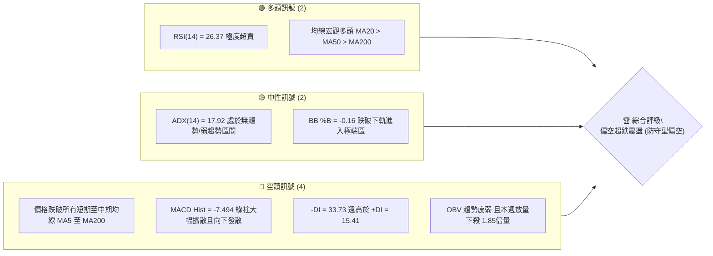
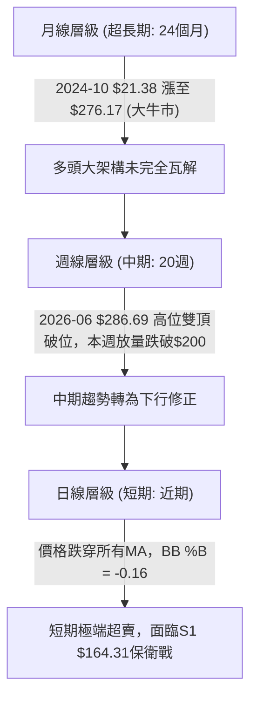
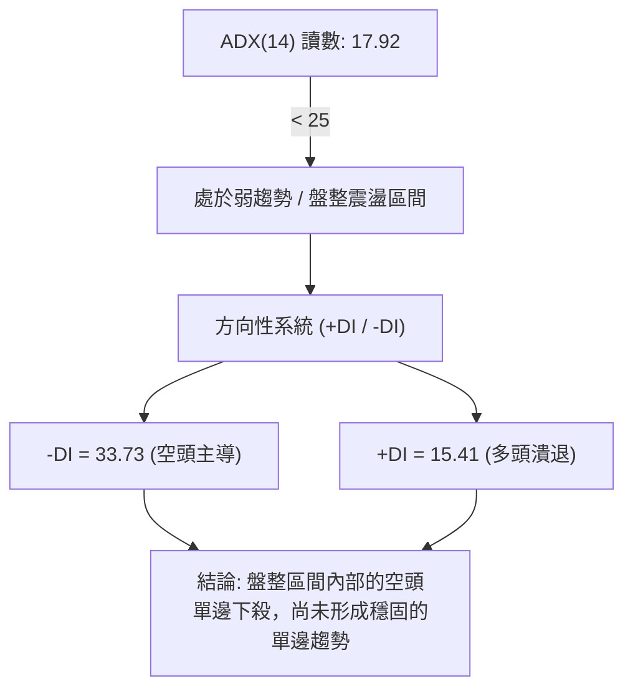
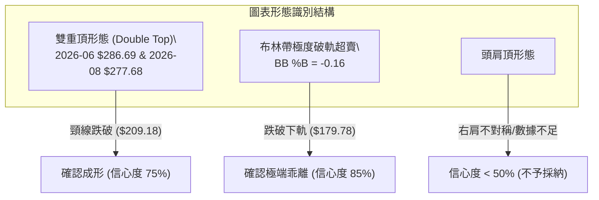
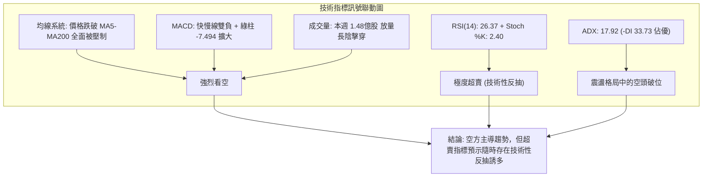
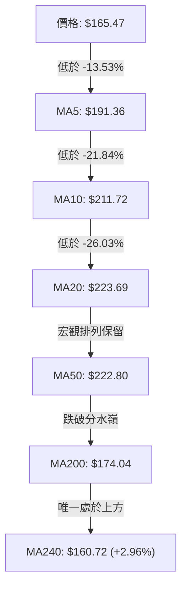
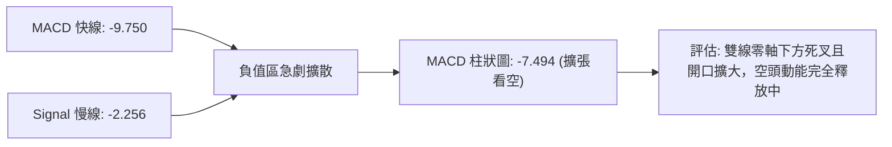
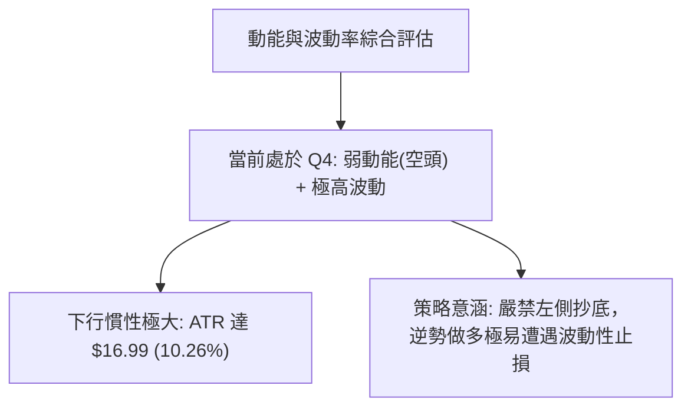
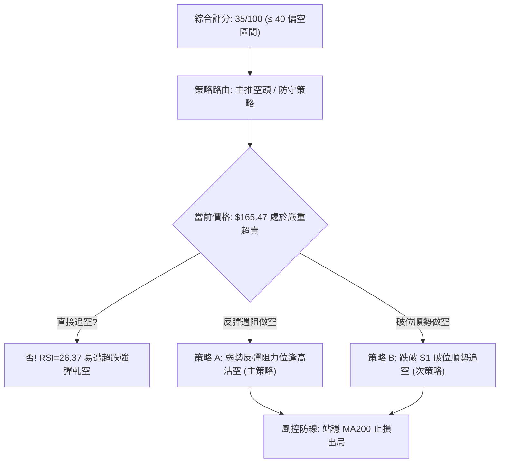
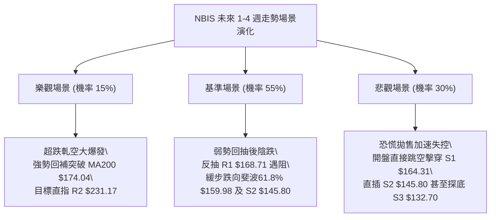

# NBIS 技術分析報告

> **報告日期**：2026-10-18 ｜ **語言**：繁體中文 ｜ **數據來源**：Yahoo Finance ｜ **當前價格**：$165.47

---

## 目錄

| 章節 | 內容 |
|------|------|
| [1. 技術面概覽](#1-技術面概覽) | 訊號儀表板、核心指標、評分卡 |
| [2. 趨勢分析](#2-趨勢分析) | 多時框趨勢、長中短期走勢 |
| [3. 圖表形態分析](#3-圖表形態分析) | 形態識別、K線組合、目標價 |
| [4. 支撐與阻力](#4-支撐與阻力) | 關鍵價位、斐波那契回調 |
| [5. 技術指標深度解讀](#5-技術指標深度解讀) | MA/RSI/MACD/布林/成交量 |
| [6. 動能與波動率](#6-動能與波動率) | 動能評估、ATR、Beta |
| [7. 多時框架總結](#7-多時框架總結) | 時框架評分矩陣 |
| [8. 交易策略建議](#8-交易策略建議) | 多空策略、風險報酬比 |
| [9. 風險提示與監控](#9-風險提示與監控) | 監控指標、風險場景 |

---

## 1. 技術面概覽

### 🎯 技術訊號儀表板



### 📊 核心指標速覽表

| 指標類別 | 指標名稱 | 當前數值 | 訊號 | 解讀 |
|----------|----------|----------|------|------|
| **價格** | 當前價格 | $165.47 | 🔴 | 跌破 MA200($174.04)，位於52週區間 40.6% 低分位 |
| **均線** | MA20 | $223.69 | 🔴 | 價格低於 MA20 達 -26.03%，短中期嚴重偏離 |
| **均線** | MA50 | $222.80 | 🔴 | 價格遠在 MA50 下方，中期均線開始拐頭向下 |
| **均線** | MA200 | $174.04 | 🔴 | 關鍵長週期防線失守（當前低於 MA200 約 -4.92%） |
| **動能** | RSI(14) | 26.37 | 🟢 | 進入深度超賣區（<30），隨時具備技術性反彈動能 |
| **動能** | MACD | -9.750 | 🔴 | 快慢線死叉開口持續擴大，MACD柱狀圖 -7.494 極度看空 |
| **波動** | ATR(14) | $16.99 | 🔴 | 佔價格 10.26%，單日波動極其劇烈，下行洗盤風險大 |

### 🏆 技術評分卡

```
╔══════════════════════════════════════════════════════════════╗
║                技術評分卡 — NBIS (2026-10-18)                ║
╠══════════════════════════════════════════════════════════════╣
║ 趨勢強度      ████░░░░░░░░░░░░░░░░  20/100  🔴 極弱/空頭壓制 ║
║ 動能指標      ██████░░░░░░░░░░░░░░  30/100  🔴 動能向下潰縮 ║
║ 支撐穩定度    ████████░░░░░░░░░░░░  40/100  🟡 考驗S1臨界點  ║
║ 成交量配合    ██████░░░░░░░░░░░░░░  30/100  🔴 放量下殺出貨 ║
║ 形態完整度    ████████░░░░░░░░░░░░  40/100  🟡 箱體破位邊緣 ║
║ 均線排列      ██████░░░░░░░░░░░░░░  30/100  🔴 均線反壓沉重 ║
╠══════════════════════════════════════════════════════════════╣
║ 綜合評分      ███████░░░░░░░░░░░░░  35/100  🔴 偏空觀望/破位 ║
╚══════════════════════════════════════════════════════════════╝
```

---

## 2. 趨勢分析

### 🌐 多時框趨勢分析



### 📈 長期趨勢 — 12個月走勢圖（Unicode）

```
NBIS 月線走勢圖（過去12個月：2025-11 至 2026-10）
價格軸 ($)
$280 ┤                                      ● (2026-06 $276.17)
$240 ┤                                  ●       ● (2026-09 $235.88)
$200 ┤                              ●       ●
$160 ┤                                          ●←現在 ($165.47)
$120 ┤                      ●
$80  ┤  ●       ●   ●   ●
$40  ┤      ●
     └──────────────────────────────────────────────────────────
       11   12  01  02  03  04  05  06  07  08  09  10 (月)
```

#### 走勢特徵分析表格

| 階段 | 時間區間 | 起始價 → 終止價 | 漲跌幅 | 主要走勢特徵 |
|------|----------|-----------------|--------|--------------|
| **第1階段：深幅洗盤築底** | 2025-11 ~ 2026-02 | $94.87 → $91.19 | -3.88% | 於 $80~$95 區間反覆震盪打底，消化前波獲利盤 |
| **第2階段：主升浪爆發** | 2026-03 ~ 2026-06 | $103.76 → $276.17 | +166.16% | 突破百元大關後連續拉出大陽線，成交量急劇放大 |
| **第3階段：高位劇震出貨** | 2026-07 ~ 2026-09 | $190.41 → $235.88 | +23.88% | 高位大幅寬幅震盪，構建次高點未過前高 $276.17 |
| **第4階段：高位破位崩落** | 2026-10 (當前) | $235.88 → $165.47 | -29.85% | 單月長黑暴跌失守 $200 與 MA200，籌碼快速鬆動 |

### 📊 中期趨勢（週線分析）

週線近 20 週數據呈現出明確的「巨幅雙頂回落」架構。2026-06-21 見高 $286.69，隨後於 2026-08-16 再次衝高至 $277.68 無法突破，構築中期雙重頂。近三週週線收盤分別為 $242.81 → $221.07 → $165.47，下殺速度驚人。

```
週線支撐與阻力示意圖
══════════════════════════════════════════════════════════════
$286.69 ────────────────────────── 波段雙頂頭部區 (強阻力)
$231.17 ────────────────────────── 關鍵頸線/週線密集成交區 (R2)
$174.04 -------------------------- MA200 剛被擊穿 (反轉防守線)
$165.47 ══════════════════════════ [現價位置: 考驗斐波61.8%]
$164.31 ────────────────────────── S1 波段低點支撐 (最後防線)
$145.80 ────────────────────────── S2 深度支撐位
══════════════════════════════════════════════════════════════
```

### ⚡ 趨勢強度評估（ADX 解讀）



#### ADX 強度對照表

| 指標變數 | 當前數值 | 臨界標準 | 狀態判定 | 市場含義解讀 |
|----------|----------|----------|----------|--------------|
| **ADX(14)** | 17.92 | < 25: 盤整 / > 25: 趨勢 | 🟡 弱趨勢/區間震盪 | 先前於 $210~$240 盤整後剛開始破位，趨勢值尚未放大 |
| **+DI** | 15.41 | > 20 為多方強勢 | 🔴 疲弱無力 | 多頭資金全面退潮，無主動性推升意願 |
| **-DI** | 33.73 | > 30 為極端空頭 | 🔴 空方極強 | 空頭壓制力道猛烈，主導短期所有定價權 |
| **多空差值** | -18.32 | 差值 < -15 | 🔴 空方完勝 | 空方完全控盤，任何微弱反彈皆面臨壓制 |

---

## 3. 圖表形態分析

### 🔍 形態識別系統



#### 形態識別與信心度評估表

| 形態 | 信心度 | 判斷依據（引用數據） | 完成度 | 目標價（附計算式） |
|------|--------|----------------------|--------|--------------------|
| **波段雙頂形態** | 75% | 頂部一：2026-06 收盤 $276.17 (最高 $286.69)；頂部二：2026-08 收盤 $277.68；跌破中期低點頸線 $209.18 | 90% | 頸線 $209.18 - (頂部 $277.68 - 頸線 $209.18) = $140.68 (接近支撐 S2 $145.80) |
| **布林極限負向擴散** | 85% | 收盤價 $165.47 遠低於 BB下軌 $179.78，%B 為 -0.16 | 100% | 均值回歸理論目標：測試 BB中軌 $223.69 或阻力 R1 $168.71 |
| **頭肩頂形態** | 35% | 缺乏清晰左肩與對稱成交量架構，歷史數據不支持 | 0% | 訊號不足，僅做指標型解讀，不強行設定目標價 |

### 🕯️ 重要K線形態分析

| 月份/週期 | 收盤價 | K線形態 | 解讀 | 訊號 |
|-----------|--------|---------|------|------|
| **2026-06** | $276.17 | 高位長上影大陽線 | 創 52W 高點 $299.86 後遭遇極大獲利了結拋壓 | 🟡 滯漲預警 |
| **2026-08** | $206.32 | 巨幅震盪十字星 | 當月巨量成交，最高反彈至 $277.68 後回落，多空分歧巨大 | 🟡 變盤十字星 |
| **2026-09** | $235.88 | 次高小陽線反抽 | 量縮反抽至 R2 $231.17 附近，形成誘多假突破 | 🔴 多頭陷阱 |
| **2026-10 (最新)** | $165.47 | 放量實體大陰線 | 單月貫穿多條均線，週成交量達 1.48 億股，主力不計成本出逃 | 🔴 恐慌拋售破位 |

### 📉 ASCII 走勢形態示意圖

```
NBIS 關鍵雙頂與破位形態示意圖
$299.86 ┬                    [52W 高點]
$280.00 ┼      頂部 1 ($286.69)        頂部 2 ($277.68)
        │         /\                      /\
$240.00 ┼────────/──\────────────────────/──\────────────
        │       /    \   反彈浪 ($237)  /    \
$209.18 ┼──────/──────\──────/\───────/──────\─────────── [雙頂頸線]
        │     /        \____/  \_____/        \
$174.04 ┼────/─────────────────────────────────\───────── [MA200 失守]
$165.47 ┼───/───────────────────────────────────● 現價 ($165.47)
$145.80 ┴                                        ↓ [形態量度低點目標: S2]
```

### 🎯 形態目標價計算

根據確立之波段雙頂形態進行量度推算：
- **形態高點（Peak）**：以 2026-08 頂部收盤 $277.68 為基準
- **頸線位置（Neckline）**：取 2026-08-30 波段調整收盤低點 $209.18
- **形態高度（H）**：$277.68 - $209.18 = $68.50
- **理論量度跌幅目標價**：$209.18 - $68.50 = **$140.68**
- **結論驗證**：該目標價落於由 OHLCV 歷史低點聚類計算之 **S2 ($145.80)** 與 **S3 ($132.70)** 之間，證明數據高度收斂且具備技術參照價值。

---

## 4. 支撐與阻力

### 🗺️ 關鍵價位分布圖（Unicode）

```
NBIS 價位結構分布圖
══════════════════════════════════════════════════════════════
$254.92 ║████████████████████████║ 強阻力 R3 (高位平台解套盤密集區)
$246.44 ║▒▒▒▒▒▒▒▒▒▒▒▒▒▒▒▒▒▒▒▒▒▒  ║ 斐波那契 23.6% 回調位
$231.17 ║████████████████████    ║ 關鍵頸線阻力 R2 (MA20/MA50重疊區)
$213.40 ║▒▒▒▒▒▒▒▒▒▒▒▒▒▒▒▒        ║ 斐波那契 38.2% 回調位
$186.69 ║▒▒▒▒▒▒▒▒▒▒▒▒            ║ 斐波那契 50.0% 回調位
$174.04 ║------------------------║ 失守的 MA200 牛熊分界線
$168.71 ║████████████████████████║ 近端反彈第一阻力 R1 (+1.96%)
$165.47 ╠════════════════════════╣ ◄ 現價 ($165.47)
$164.31 ║▓▓▓▓▓▓▓▓▓▓▓▓▓▓▓▓        ║ 近端關鍵支撐 S1 (-0.70%)
$159.98 ║▒▒▒▒▒▒▒▒                ║ 斐波那契 61.8% 黃金分割極限支撐
$145.80 ║████████████████████████║ 強支撐 S2 (波段雙頂量度目標區)
$132.70 ║████████████            ║ 深度支撐 S3 (前期爆發起漲平台)
══════════════════════════════════════════════════════════════
```

### 🚧 阻力位分析表

| 阻力級別 | 價位 | 形成原因 | 突破難度 | 重要性 |
|----------|------|----------|----------|--------|
| **R1** | $168.71 | 近一年波段高點聚類、短線跳空下殺平台下沿 | 🟡 中等（短線反彈首要障礙） | ★★★☆☆ |
| **R2** | $231.17 | 近一年波段高點聚類、高度重疊 MA20($223.69) 與 MA50($222.80) | 🔴 極高（中期強阻力帶） | ★★★★★ |
| **R3** | $254.92 | 近一年波段高點聚類、次高點換手套牢籌碼峰 | 🔴 極高（多頭完全逆轉目標） | ★★★★☆ |

### 🛡️ 支撐位分析表

| 支撐級別 | 價位 | 形成原因 | 守住機率 | 重要性 |
|----------|------|----------|----------|--------|
| **S1** | $164.31 | 近一年波段低點聚類，距離現價僅 -0.70%，當前日線最後防線 | 🟡 45%（岌岌可危） | ★★★★☆ |
| **S2** | $145.80 | 近一年波段低點聚類，雙頂形態等高測算回吐核心區 | 🟢 65%（強勁支撐區） | ★★★★★ |
| **S3** | $132.70 | 近一年波段低點聚類，2026年4月主升浪起漲換手支撐平台 | 🟢 80%（鋼鐵底部） | ★★★★☆ |

### 📐 斐波那契回調位分析

依據 52 週完整波動區間（低點 $73.52 至 高點 $299.86，總跨度 $226.34）計算：

| 斐波那契水平 | 準確價位 | 技術含義與現價位置解讀 |
|--------------|----------|------------------------|
| **0.0% (52W High)** | $299.86 | 歷史天花板，牛市極限頂部 |
| **23.6%** | $246.44 | 強勢修正極限，已於 10 月初徹底失守 |
| **38.2%** | $213.40 | 中期常規回檔位，跌破宣告中期趨勢走壞 |
| **50.0%** | $186.69 | 多空分水嶺，跌破後確認市場進入深幅下行回撤 |
| **61.8%** | $159.98 | **黃金分割最後防線**。現價($165.47)正運行於 50.0%($186.69) 與 61.8%($159.98) 之間，即將考驗 $159.98 關鍵回撤位 |
| **78.6%** | $121.96 | 深度空頭回撤目標，若失守牛市基石動搖 |
| **100.0% (52W Low)**| $73.52 | 全年起漲起點 |

---

## 5. 技術指標深度解讀

### 🎛️ 指標訊號總覽



### 📈 移動平均線排列分析



#### 均線矩陣詳細狀態

| 均線名稱 | 價位 | 與現價偏差 | 走勢特徵 | 訊號評估 |
|----------|------|------------|----------|----------|
| **MA5** | $191.36 | -13.53% | 極速俯衝向下，斜率極大 | 🔴 極短線高壓線 |
| **MA10** | $211.72 | -21.84% | 快速下行，形成第一波套牢區 | 🔴 短線反彈天花板 |
| **MA20** | $223.69 | -26.03% | 拐頭向下，即將下穿 MA50 形成死叉 | 🔴 中期多頭瓦解 |
| **MA50** | $222.80 | -23.98% | 走平轉下拐，扣抵高位 | 🔴 中期均線破位 |
| **MA200** | $174.04 | -4.92% | 長期生命線，現價已實質跌破 | 🔴 牛熊轉化臨界點 |
| **MA240** | $160.72 | +2.96% | 價格上方僅存的年線支撐（接近斐波 61.8%） | 🟢 最後動態支撐 |

### 📉 RSI(14) 分析

- **當前讀數**：`26.37` ── 處於極度超賣狀態（<30）。
- **數值進度條**：
  ```
  RSI(14): 26.37 ▓▓▓▓▓░░░░░░░░░░░░░░░  [極度超賣區 <30]
  ```
- **超買超賣區間判斷**：RSI 跌至 26.37，且隨機指標 Stoch %K 跌至 2.40、Stoch %D 為 11.24，處於極罕見的鈍化超賣區。
- **背離分析**：
  - **頂背離**：2026-06 價格 $286.69（RSI 65.3），2026-08 價格 $277.68（RSI 67.2），隨後於 2026-10-04 價格反抽至 $242.81 時 RSI 達 66.5，但價格未能過高，形成**中期價格與動能頂背離**。
  - **底背離**：目前日線與週線 RSI 連續下殺破底，**無底背離形成**，屬於標準動能下殺型態，切不可盲目猜底。

### 📊 MACD(12/26/9) 訊號解讀



週線層級 MACD 柱狀圖由 2026-10-04 的 `+1.113` 驟降至 2026-10-11 的 `-1.599`，最新一週（2026-10-18）更是崩落至 `-7.494`。柱狀圖呈階梯式放量下殺，未出現任何收斂跡象，表明空方砸盤動能依然強烈。

### 📦 布林通道分析

```
NBIS 布林通道價格空間示意圖
$267.59 ┬────────────────────────────────────────── 上軌 (BB Upper)
        │
$223.69 ┼────────────────────────────────────────── 中軌 (MA20)
        │
$179.78 ┼────────────────────────────────────────── 下軌 (BB Lower)
        │   ▼ 跌破下軌 (超賣溢出)
$165.47 ┴───● 現價 (BB %B = -0.16)
```

當前布林帶寬度急劇張開，BB %B 數值為 `-0.16`（數值低於 0 代表價格已滑落至下軌外側）。在統計學上，價格脫離布林通道下軌屬於小機率事件，暗示價格存在強烈的「回歸通道內」修正需求，但通常需要成交量在特定支撐位縮量確認才能止跌。

### 💹 成交量分析（量價配合度）

- **最新成交量**：`34,962,100`（單日）
- **20日均量**：`18,949,640` ｜ **量比**：`1.85x`（顯著放量）
- **週線級別成交量**：最新一週達 `148,425,600`，較前一週的 `86,070,300` 暴增 72.4%，呈現「**放量破位長黑**」的惡劣量價背離。
- **OBV（能量潮）狀態**：OBV < MA，能量潮線呈懸崖式向下拐頭，說明主力資金主動拋盤堅決，量能完全確認了當前下跌趨勢的真實性與破壞力。

---

## 6. 動能與波動率

### ⚡ 動能評估四象限

| 象限 | 動能維度 | 波動維度 | 代表特徵 | 當前狀態判定 |
|------|----------|----------|----------|--------------|
| **Q1 (最佳擴張)** | 動能強 (多頭) | 波動低/中 | 穩定趨勢主升浪 | ─ |
| **Q2 (盤整蓄勢)** | 動能弱 (中性) | 波動低 | 區間壓縮打底 | ─ |
| **Q3 (極限搏殺)** | 動能強 (多頭) | 波動高 | 頂部狂熱拉升 | ─ |
| **Q4 (恐慌出逃)** | **動能弱 (空頭極強)** | **波動極高** | **放量破位下殺** | **✓ NBIS 目前身處 Q4 象限** |



### 📊 ATR 波動率分析

- **ATR(14) 數值**：`$16.99`
- **ATR 佔比**：`10.26%`（屬於極高波動度成長股標的）。
- **止損距離建議**：
  - 在高達 10.26% 的日波動率下，常規的 3%~5% 窄幅止損極易被市場雜訊掃出場。
  - **日內交易緩衝**：至少需預留 1.0 倍 ATR（即 `$16.99`）的波動空間。
  - **波段交易防守**：建議使用 1.5 倍 ATR 至 2.0 倍 ATR（即 `$25.48` ~ `$33.98`）作為結構性止損距離。

### 📐 Beta 與市場相關性

- **Beta 係數**：`1.46`
- **解讀**：NBIS 具備典型的高彈性科技/通訊股特徵。相較於 S&P 500 指數，該股波動幅度高出大盤 46%。當市場大盤處於回調週期時，NBIS 面臨放大的 Beta 乘數回撤效應；當前融券放空比例（Short % Float）高達 `18.9%`，Short Ratio 達 `2.98`，空頭集中度極高，一旦出現軋空行情波動將同樣極端。

---

## 7. 多時框架總結

### 📋 時框架評分表

| 時框架 | 趨勢方向 | 動能狀態 | 均線排列 | 形態識別 | 綜合評分 | 交易建議 |
|--------|----------|----------|----------|----------|----------|----------|
| **月線 (長期)** | 🟢 偏多 | 🟡 高位拐頭 | 🟢 MA20>MA50>MA200 多頭 | 巨大波段漲幅後的初次回撤 | 60/100 | 長線底倉防守，觀望 |
| **週線 (中期)** | 🔴 偏空 | 🔴 MACD擴散下行 | 🔴 跌破 MA200($174.04) | 波段雙頂頸線破位 | 30/100 | 逢反彈減碼或建立對沖 |
| **日線 (短期)** | 🔴 極空 | 🟢 RSI=26.37 極度超賣 | 🔴 均線空頭排列壓制 | 跌破布林下軌 (BB %B=-0.16) | 35/100 | 嚴禁追空，等待超跌反彈 |

### 🔲 綜合訊號矩陣

```
時框衝突收斂矩陣
══════════════════════════════════════════════════════════════
時框層級       趨勢維度        動能維度        量價結構        主導邏輯
──────────────────────────────────────────────────────────────
長期 (月線)    🟢 多頭防守     🟡 衰退         🟡 縮量         大週期處於回撤
中期 (週線)    🔴 空頭突破     🔴 強烈看空     🔴 放量殺跌     中期下行空間打開
短期 (日線)    🔴 空頭排列     🟢 嚴重超賣     🔴 量能失衡     短線醞釀超跌反抽
══════════════════════════════════════════════════════════════
```

### ⚖️ 多時框收斂結論

**依規則 14 進行系統收斂**：
1. **趨勢判定**：當前 ADX(14) 數值為 `17.92`（< 25），在技術定義上屬於**「盤整/弱趨勢」框架**。
2. **收斂規則指引**：在 ADX < 25 的盤整震盪市場中，**以日線布林通道上下軌為主要交易邊界，並防範區間邊緣假突破**。
3. **時框權衡**：儘管月線宏觀維持多頭排列，但週線已放量跌破 MA200 關鍵位，日線價格全面運行於下軌之外（BB %B = -0.16）。根據收斂優先級，盤整帶下沿面臨實質破位壓力，短線超賣引發的反彈皆屬弱勢反抽。
4. **唯一方向性結論**：**【偏空觀望 / 防守型偏空】**。第 1 章技術評分卡為 **35/100**，全面支持空頭主導之防守策略。

---

## 8. 交易策略建議

### 🗺️ 策略決策流程圖



### 🧭 策略路由

> **當前主策略方向 = 空頭策略（主推逢高沽空／破位順勢空，依評分 35/100）**
> 
> *多頭操作僅列為極端超賣環境下的反轉風險提示與對沖參考，嚴禁重倉抄底。*

### 🎯 價格情境階梯（Price Scenarios）

所有價位精確引用本報告第 4 章由 OHLCV 歷史低高點聚類及斐波那契計算之數據：

| 觸發條件 | 下一目標 | 後續延伸 | 情境含義 |
|----------|----------|----------|----------|
| **向上突破 R1 $168.71** | MA200 $174.04 / 斐波50% $186.69 | R2 $231.17 | 超跌技術性修復，測試失守的長期均線防線 |
| **站穩現價 $165.47~$168.71**| 區間拉鋸震盪 | BB下軌 $179.78 | 消化超賣指標，低位構築弱勢換手小平台 |
| **向下跌破 S1 $164.31** | 斐波61.8% $159.98 | S2 $145.80 / S3 $132.70 | 空頭浪潮加速，打開通往波段雙頂量度目標空間 |

### 📊 情境機率分佈

| 情境 | 機率 | 主要依據 |
|------|------|----------|
| **弱勢反彈受阻再探底 (基準)** | **55%** | RSI(26.37) 與布林負值推動短線小幅抽反彈，但受制於 R1($168.71) 與 MA200($174.04) 沉重套牢賣壓，反彈後將再度向下尋找支撐。 |
| **直接破位加速下殺 (悲觀)** | **30%** | 最新週量暴增至 1.48 億股，-DI(33.73) 掌控全局，若直接失守 S1($164.31)，將引發融券放空盤(18.9%空頭)順勢摜壓至 S2($145.80)。 |
| **強勢 V 型反轉站上 $180 (樂觀)** | **15%** | 僅能在出現極重磅基本面利多時觸發軋空，目前技術面均線與 MACD 完全不具備反轉結構。 |

### 🔴 主策略詳情（空頭主導策略）

#### 空頭交易計畫表

| 策略要素 | 策略 A（反彈高空 — 優先主策略） | 策略 B（破位追空 — 順勢突破策略） |
|----------|----------------------------------|-----------------------------------|
| **交易邏輯** | 利用日線超賣反抽測試反壓時逢高建空 | 跌破近一年低點聚類 S1 確認下行延伸 |
| **進場條件** | 股價反彈至 R1 遇阻回落，或觸及 MA200 出現上影線 | 日線收盤實質跌破 S1 $164.31（跌破 0.5% 確認）|
| **進場價格** | **$168.71**（精確引用阻力 R1） | **$163.49**（S1 $164.31 跌破 0.5% 確認進場）|
| **目標價 T1** | **$159.98**（精確引用斐波那契 61.8%） | **$145.80**（精確引用強支撐 S2） |
| **目標價 T2** | **$145.80**（精確引用強支撐 S2） | **$132.70**（精確引用深度支撐 S3） |
| **止損價格** | **$174.04**（精確引用失守之 MA200） | **$168.71**（精確引用阻力 R1） |
| **風險報酬比** | **1 : 1.63** (至T1) ｜ **1 : 4.29** (至T2) | **1 : 3.39** (至T1) ｜ **1 : 5.90** (至T2) |
| **成功機率** | **65%** | **60%** |
| **建議倉位** | **15%** (分批建倉) | **10%** (突破加碼) |

*計算式備註（策略 A 至 T2）：*
- *潛在風險：進場 $168.71 - 止損 $174.04 = $5.33*
- *潛在利潤：進場 $168.71 - 目標 $145.80 = $22.91*
- *風報比：$22.91 / $5.33 ≈ 4.29 : 1*

### 🟢 反向風險觸發點（對沖與止損提示）

若出現以下訊號，代表空頭策略被推翻，空方必須無條件停損出場，激進者可轉為超跌短多操作：
1. **關鍵價位逆轉**：日線收盤價強勢收復 **$174.04 (MA200)**，並進一步封閉跳空缺口突破 **$186.69 (斐波 50.0%)**。
2. **指標確認**：日線 RSI(14) 重新站回 45 以上，且 MACD 柱狀圖（-7.494）出現連續三日大幅收斂縮短。
3. **量能異動**：在 $160~$165 區間出現單日換手率超過 20% 的長下影陽線，伴隨 Short Squeeze 軋空啟動。

### ⭐ 整體訊號強度評星

```
做多訊號強度：★☆☆☆☆  (1/5星 — 僅具超賣技術反彈，勝率偏低)
做空訊號強度：★★★★☆  (4/5星 — 均線與量價形態高度共振偏空)
整體可信度：  ★★★★☆  (4/5星 — 多時框數據一致確認破位趨勢)
```

---

## 9. 風險提示與監控

### ✅ 關鍵監控指標 Checklist

```
╔══════════════════════════════════════════════════════════════╗
║                    每日盤面核心監控清單                      ║
╠══════════════════════════════════════════════════════════════╣
║ [ ] 支撐防守監控：現價 $165.47 是否失守 S1 $164.31          ║
║ [ ] 長期均線壓力：反彈是否在 MA200 $174.04 遭遇明顯壓制     ║
║ [ ] 動能鈍化修復：RSI(14) 是否脫離 26.37 極度超賣區         ║
║ [ ] 空頭柱收斂度：MACD Hist 是否從 -7.494 開始顯著減速收窄  ║
║ [ ] 異常放量警報：單日成交量是否再度超越 3,500 萬股異動    ║
║ [ ] 軋空指標監測：融券餘額變化（Short Float 18.9% 是否回補） ║
╚══════════════════════════════════════════════════════════════╝
```

### ⚠️ 風險場景分析



### 🛡️ 風險管理重要提醒

1. **極度波動防禦（ATR = $16.99）**：
   - 每日平均高低點波動超過 $17 美元，相當於本金每日承受 10% 以上之跳動。
   - **嚴禁重倉操作**：單一策略部位建議不超過總投資組合的 **10% ~ 15%**。
2. **高 Short Interest 雙刃劍**：
   - NBIS Short % Float 達 18.9%，在極度超賣（RSI=26.37）之際，隨時可能因市場微小消息誘發暴力軋空（Short Squeeze）。
   - 空頭操作必須「嚴設硬止損於 $174.04」，絕不可抱持僥倖心態扛單。
3. **執行紀律**：
   - 價格目前剛好卡在 S1（$164.31）上方 -0.70% 的極端臨界點，**切勿在此位置半山腰追空**，必須耐心等待「反彈至 R1 沽空」或「確認跌破 S1 追空」。

---

## 📋 報告總結

```
╔══════════════════════════════════════════════════════════════╗
║                   NBIS 技術分析報告總結                      ║
╠══════════════════════════════════════════════════════════════╣
║ 報告日期：2026-10-18                                         ║
║ 當前價格：$165.47                                            ║
║ 分析評級：🔴 防守型偏空 (Bearish Breakdown / High Volatility)║
║                                                              ║
║ 關鍵結論：                                                   ║
║ ├─ 長期趨勢：🟡 多頭大架構回撤，考驗年線 MA240 $160.72       ║
║ ├─ 中期趨勢：🔴 雙頂確立，實質跌破 MA200($174.04) 與頸線    ║
║ ├─ 短期趨勢：🔴 均線空頭壓制，布林下軌超賣 (%B = -0.16)     ║
║ ├─ 關鍵支撐：S1 $164.31 ｜ S2 $145.80 ｜ 斐波61.8% $159.98   ║
║ ├─ 關鍵阻力：R1 $168.71 ｜ MA200 $174.04 ｜ R2 $231.17       ║
║ └─ 分析師目標：共識均價 $283.60 (遠期基本面看好，技術面脫節)║
║                                                              ║
║ 最優策略組合：                                               ║
║ 1. 🥇 最佳機會：等待超跌反彈至 R1 $168.71 逢高布空 (風報比 1:4.3)║
║ 2. 🥈 次選機會：實質跌破 S1 $164.31 後順勢追空，看至 S2 $145.80║
║ 3. 🥉 保守選擇：空倉觀望，等待股價於 S2 $145.80 形成右側打底 ║
╚══════════════════════════════════════════════════════════════╝
```

---

> ⚠️ **免責聲明**：本報告為 AI 自動生成之技術分析，所有數據及估算均基於提供的歷史價格資訊。本報告**僅供研究與學術參考**，**不構成任何投資建議**。投資有風險，入市需謹慎。

---

*報告生成時間：2026-10-18 ｜ 數據來源：Yahoo Finance ｜ 分析框架：多時框技術分析*