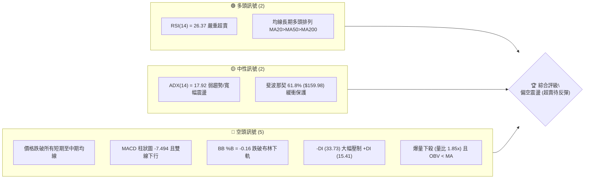
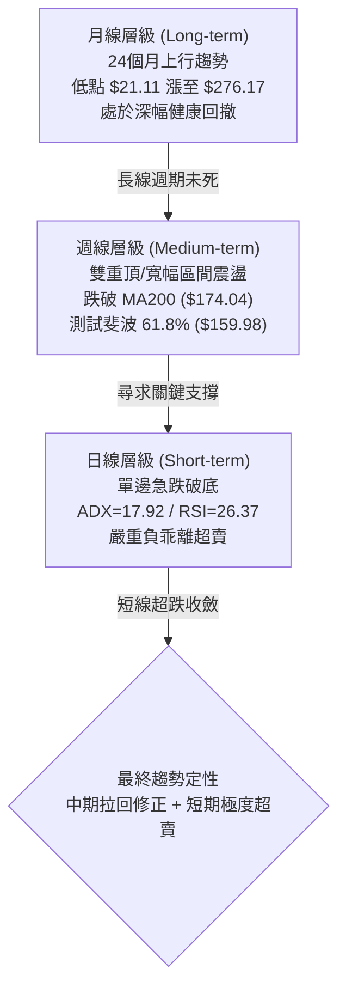
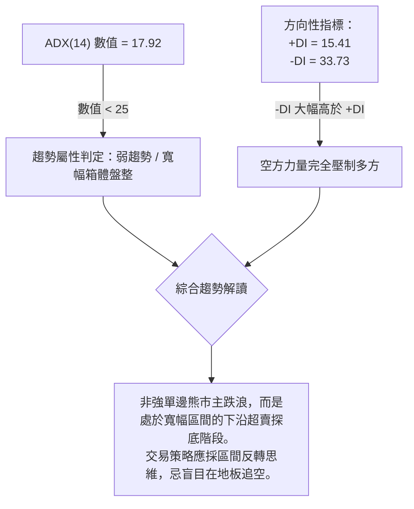
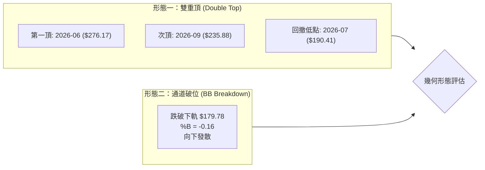
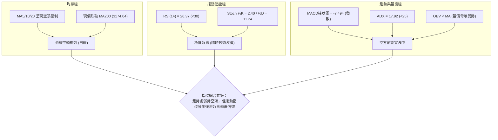
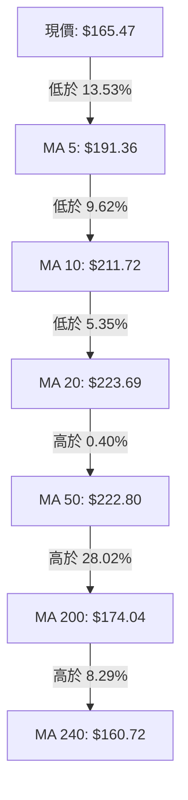
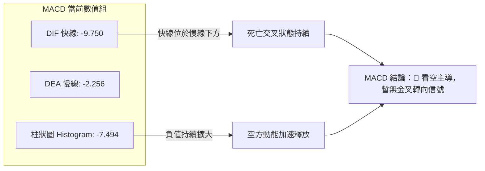
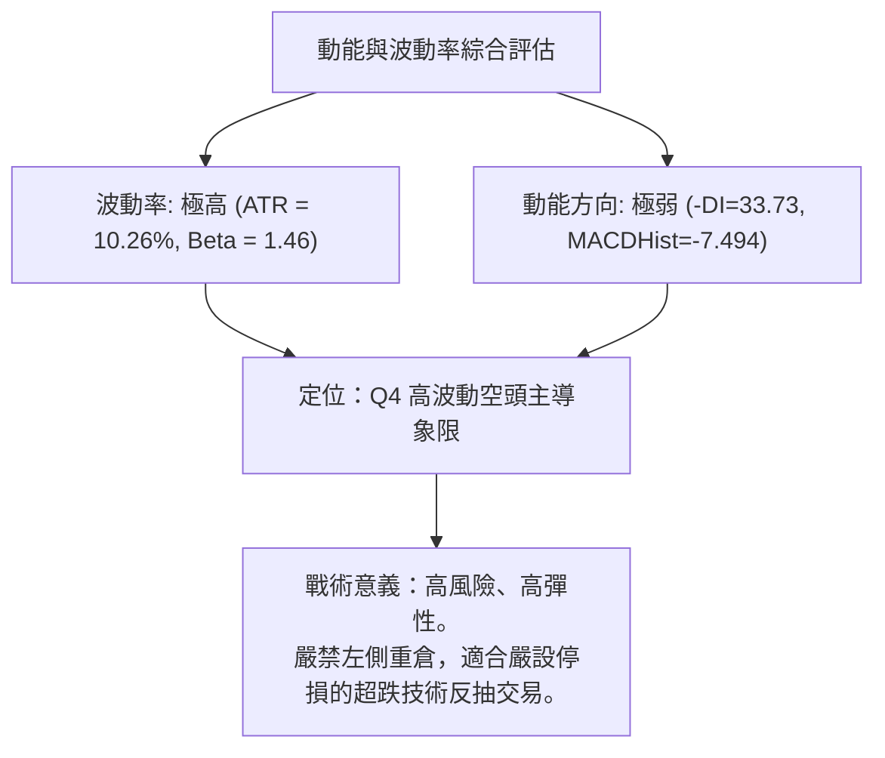
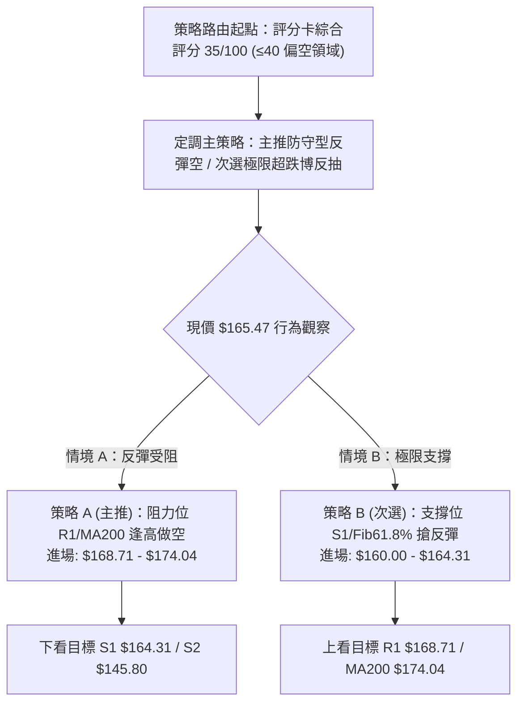
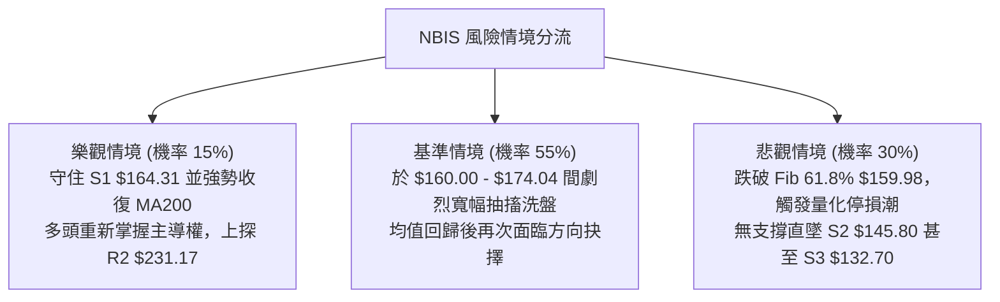

# NBIS 技術分析報告

> **報告日期**：2026-10-19 ｜ **語言**：繁體中文 ｜ **數據來源**：Yahoo Finance ｜ **當前價格**：$165.47

---

## 目錄

| 章節 | 內容 |
|------|------|
| [1. 技術面概覽](#1-技術面概覽) | 訊號儀表板、核心指標、評分卡 |
| [2. 趨勢分析](#2-趨勢分析) | 多時框趨勢、長中短期走勢 |
| [3. 圖表形態分析](#3-圖表形態分析) | 形態識別、K線組合、目標價 |
| [4. 支撐與阻力](#4-支撐與阻力) | 關鍵價位、斐波那契回調 |
| [5. 技術指標深度解讀](#5-技術指標深度解讀) | MA/RSI/MACD/布林/成交量 |
| [6. 動能與波動率](#6-動能與波動率) | 動能評估、ATR、Beta |
| [7. 多時框架總結](#7-多時框架總結) | 時框架評分矩陣 |
| [8. 交易策略建議](#8-交易策略建議) | 多空策略、風險報酬比 |
| [9. 風險提示與監控](#9-風險提示與監控) | 監控指標、風險場景 |

---

## 1. 技術面概覽

### 🎯 技術訊號儀表板



### 📊 核心指標速覽表

| 指標類別 | 指標名稱 | 當前數值 | 訊號 | 解讀 |
|----------|----------|----------|------|------|
| **價格** | 當前收盤價 | $165.47 | 🔴 | 位於52週區間40.6%，單週急挫，逼近核心防線 |
| **均線** | MA20 | $223.69 | 🔴 | 現價低於MA20達26.03%，負乖離極大 |
| **均線** | MA50 | $222.80 | 🔴 | 現價跌破中期生命線，短中期動能受損 |
| **均線** | MA200 | $174.04 | 🔴 | 現價跌破長期牛熊分界線($174.04)，面臨轉弱考驗 |
| **動能** | RSI(14) | 26.37 | 🟢 | 進入極度超賣區間(<30)，技術性反彈動能積累 |
| **動能** | MACD(12,26,9) | -9.750 / -2.256 | 🔴 | 雙線位於零軸下方發散，柱狀圖-7.494，空方主導 |
| **擺動** | Stoch %K / %D | 2.40 / 11.24 | 🟢 | 嚴重超賣，隨時可能形成低檔金叉 |
| **趨勢** | ADX(14) | 17.92 | 🟡 | 數值小於25，代表大級別仍處非單邊定向行情的洗盤階段 |
| **通道** | 布林帶 %B | -0.16 | 🟢 | 現價低於下軌($179.78)，呈現極端通道外擴超跌 |
| **量能** | 成交量比 (VR) | 1.85x | 🔴 | 單日爆量3,496萬股，伴隨下跌，籌碼恐慌拋售 |
| **波動** | ATR(14) | $16.99 | 🔴 | 佔股價10.26%，每日真實波幅極大，操作風險高 |

### 🏆 技術評分卡

```
╔══════════════════════════════════════════════════════════════════╗
║                技術評分卡 — NBIS (2026-10-19)                    ║
╠══════════════════════════════════════════════════════════════════╣
║ 趨勢強度 (Trend)      ██████░░░░░░░░░░░░░░  30/100  🔴 空頭控盤 ║
║ 動能指標 (Momentum)    ████████░░░░░░░░░░░░  40/100  🟡 極端超賣 ║
║ 支撐穩定度 (Support)   ██████████░░░░░░░░░░  50/100  🟡 臨近S1   ║
║ 成交量配合 (Volume)    ████░░░░░░░░░░░░░░░░  20/100  🔴 放量下殺 ║
║ 形態完整度 (Pattern)   ██████░░░░░░░░░░░░░░  30/100  🔴 頭部成型 ║
║ 均線排列 (Moving Avg)  ████████░░░░░░░░░░░░  40/100  🟡 長多短空 ║
╠══════════════════════════════════════════════════════════════════╣
║ 綜合評分              ███████░░░░░░░░░░░░░  35/100  評級：偏空  ║
╚══════════════════════════════════════════════════════════════════╝
```

---

## 2. 趨勢分析

### 🌐 多時框趨勢分析



### 📈 長期趨勢 — 12個月走勢圖（Unicode）

```
NBIS 月線走勢圖（過去12個月：2025-11 至 2026-10）
價格軸 ($)
$280 ┼                                            ● (2026-06 $276.17)
$260 ┼                                           ╱ ╲
$240 ┼                                          ╱   ╲       ● (2026-09 $235.88)
$220 ┼                                  ● (05) ╱     ╲     ╱ ╲
$200 ┼                                 ╱      ╱       ●(07)   ╲
$180 ┼                                ╱                       ╲
$160 ┼                               ╱                         ● $165.47 (現價)
$140 ┼                        ● (04)╱
$120 ┼                       ╱
$100 ┼ ● (2025-11 $94.87)   ╱
$80  ┼  ╲   ● (12) ● (01)  ● (03 $103.76)
$70  ┼   ╲ ╱        ╲     ╱
     └─┬────┬────┬────┬────┬────┬────┬────┬────┬────┬────┬────┬────
     11月  12月  1月  2月  3月  4月  5月  6月  7月  8月  9月 10月
```

#### 走勢特徵分析表格

| 階段區間 | 時間週期 | 區間起訖點 ($) | 漲跌幅 (%) | 量價走勢與形態特徵 |
|:---|:---|:---|:---|:---|
| **築底蓄勢期** | 2025-11 ~ 2026-01 | $94.87 → $85.19 | -10.20% | 在 $83.71~$94.87 間狹幅築底，籌碼完成換手 |
| **主升驅動期** | 2026-02 ~ 2026-06 | $91.19 → $276.17 | +202.85% | 爆發性多頭推升，連續大陽線拔高，創歷史波段高位 |
| **高位分歧期** | 2026-07 ~ 2026-09 | $190.41 → $235.88 | +23.88% | 巨幅震盪洗盤，反彈至 $235.88 無力創高，構築次頂 |
| **恐慌出脫期** | 2026-10 (當前) | $235.88 → $165.47 | -29.85% | 單月重挫逾 70 美元，貫穿布林下軌，直逼波段起漲點 |

### 📊 中期趨勢（週線分析）

```
NBIS 週線級別關鍵價位分佈
$299.86 ┬────────────────────────────────────────── 52週最高價 (0.0% Fib)
        │
$246.44 ┼- - - - - - - - - - - - - - - - - - - - -  Fib 23.6% / 阻力區
$231.17 ┼────────────────────────────────────────── 波段次高阻力 R2 (反彈高點聚類)
        │                                  ▲
$186.69 ┼- - - - - - - - - - - - - - - - -│- - - - Fib 50.0%
$174.04 ┼·································│········ MA200 長期防線
$168.71 ┼─────────────────────────────────│──────── 關鍵阻力 R1 (突破轉強點)
$165.47 ┼=================================●======== 當前收盤價 ($165.47)
$164.31 ┼────────────────────────────────────────── 波段支撐 S1 (近一年波段低點聚類)
$159.98 ┼- - - - - - - - - - - - - - - - - - - - -  Fib 61.8% 黃金分割極限防守位
        │
$145.80 ┼────────────────────────────────────────── 強支撐 S2 (深次回撤聚類)
$132.70 ┴────────────────────────────────────────── 結構防守 S3 (中期底部支撐)
```

### ⚡ 趨勢強度評估（ADX 解讀）



#### ADX 強度對照表

| 指標變數 | 當前讀數 | 門檻區間 | 當前市場狀態解讀 |
|:---|:---|:---|:---|
| **ADX(14)** | **17.92** | 0 ~ 20: 極弱趨勢/無趨勢<br/>20 ~ 25: 弱趨勢/醞釀期<br/>25 ~ 50: 強趨勢行情 | 目前市場缺乏大級別持續性單邊推動力，股價雖大跌，本質仍屬 $145.80~$299.86 大箱體內的震盪回撤。 |
| **+DI(14)** | **15.41** | 多方買盤動能 | 買盤極度萎縮，多頭無力組織連續攻擊。 |
| **-DI(14)** | **33.73** | 空方拋售動能 | 拋壓主導短期走勢，兩者差值達 18.32，呈現空頭宣洩。 |

---

## 3. 圖表形態分析

### 🔍 形態識別系統



#### 形態信心度與目標價計算

| 形態名稱 | 信心度 | 判斷依據（引用數據） | 完成度 | 目標價（附計算式） |
|:---|:---:|:---|:---:|:---|
| **不對稱雙重頂** | **65%** | 2026-06高點 $276.17 與 2026-09次高 $235.88；頸線為2026-07月收盤低點 $190.41。2026-10最新收盤 $165.47 已有效跌破頸線。 | 90% | 由形態高度推算：<br/>形態頂部均值 = ($276.17 + $235.88) / 2 = $256.03<br/>頸線 = $190.41，垂直高度 = $256.03 - $190.41 = $65.62<br/>量測目標價 = 頸線 $190.41 - 形態高度 $65.62 = **$124.79**<br/>*(註：接近歷史數據支撐 S3 $132.70 與 Fib 78.6% $121.96)* |
| **均線死叉向下突破** | **80%** | 現價連續跌破 MA5($191.36)、MA10($211.72)、MA20($223.69)，且跌破 MA200($174.04)。 | 100% | 指標型突破，測量下檔直接指向波段低點聚類 **S2 $145.80**。 |

### 🕯️ 重要K線形態分析

| 月份 | 收盤價 ($) | K線形態 | 解讀 | 訊號 |
|:---|:---:|:---|:---|:---:|
| **2026-06** | 276.17 | 長上影大陽線 | 盤中衝至 52W 高點 $299.86 後遭遇天量解套與獲利盤狂吐，多頭力竭。 | 🔴 頂部警訊 |
| **2026-07** | 190.41 | 長陰貫穿線 | 自高位斷崖式崩跌 31.05%，直接打穿中短期多頭均線防護網。 | 🔴 空方宣洩 |
| **2026-08** | 206.32 | 縮量小陽十字 | 下跌趨勢中的喘息，多空在 $200 整數關卡附近暫時平衡。 | 🟡 弱勢反彈 |
| **2026-09** | 235.88 | 遇阻中陽線 | 反彈觸及 R2 ($231.17) 區域受阻回落，形成明顯更低的高點 (LH)。 | 🔴 弱勢次頂 |
| **2026-10** | 165.47 | 大陰線破底中 | 單月跌破 2026-07 低點 $190.41，空方動能重燃，考驗波段低點聚類。 | 🔴 破位下殺 |

### 📉 ASCII 走勢形態示意圖

```
NBIS 週線級別雙頂破位幾何走勢
$300 ┼               頂部1 ($276.17)
     │                  ▲
$270 ┼                 ╱ ╲
$240 ┼                ╱   ╲                頂部2 ($235.88)
     │               ╱     ╲                  ▲
$210 ┼              ╱       ╲                ╱ ╲
$190 ┼─────────────╱─────────●──────────────╱───╲───── 頸線位 ($190.41)
     │            ╱       頸線低點         ╱     ╲
$170 ┼           ╱       (2026-07)       ╱       ▼ 跌破頸線
$165 ┼··········╱·······················╱·········● 現價 $165.47
$145 ┼         ╱                       ╱          │
     │        ╱                       ╱           ▼ 量測目標區 ($124.79 ~ $145.80)
$120 ┼───────●───────────────────────●
```

---

## 4. 支撐與阻力

### 🗺️ 關鍵價位分布圖（Unicode）

```
NBIS 價位結構分布圖（依據歷史波段聚類與斐波那契點位）
══════════════════════════════════════════════════════════════════════
$299.86 ║████████████████████████████████████████║ 歷史極值 52W High
$254.92 ║██████████████████████████████          ║ 強阻力 R3 (強套牢區)
$231.17 ║████████████████████                    ║ 阻力 R2 (次頂密集成交)
$174.04 ║----------------------------------------║ 均線關鍵阻力 MA200
$168.71 ║████████████████████████████████████    ║ 關鍵阻力 R1 (反彈第一道關卡)
$165.47 ╠════════════════════════════════════════╣ ◄ 現價收盤 ($165.47)
$164.31 ║▓▓▓▓▓▓▓▓▓▓▓▓▓▓▓▓▓▓▓▓▓▓▓▓▓▓▓▓▓▓▓▓▓▓▓▓    ║ 核心支撐 S1 (近期波段低點聚類)
$159.98 ║----------------------------------------║ 斐波那契 61.8% 黃金防守
$145.80 ║████████████████████████                ║ 強支撐 S2 (波段回調低點聚類)
$132.70 ║████████████████████████████████████████║ 結構強支撐 S3 (歷史底部平台)
══════════════════════════════════════════════════════════════════════
```

### 🚧 阻力位分析表

| 阻力級別 | 價位 ($) | 形成原因（嚴格引用數據） | 突破難度 | 重要性 |
|:---|:---:|:---|:---:|:---:|
| **關鍵阻力 R1** | **168.71** | 近一年波段高點聚類位，距離現價僅 +1.96%。短線反彈首要考驗，也是空頭回補與日內壓制中樞。 | 🟡 中等 | ★★★★☆ |
| **波段阻力 R2** | **231.17** | 近一年波段高點聚類位，與 2026-05 收盤價 $231.09、2026-09 收盤價 $235.88 形成重疊共振區。 | 🔴 極高 | ★★★★★ |
| **強阻力 R3** | **254.92** | 近一年高波段聚類壓制，介於頸線上方至歷史頂部間的大型籌碼堆積套牢峰。 | 🔴 難以逾越 | ★★★★☆ |

### 🛡️ 支撐位分析表

| 支撐級別 | 價位 ($) | 形成原因（嚴格引用數據） | 守住機率 | 重要性 |
|:---|:---:|:---|:---:|:---:|
| **核心支撐 S1** | **164.31** | 近一年波段低點聚類位，距現價僅 -0.70%。為當前短線防守第一道屏障。 | 🟡 55% | ★★★★☆ |
| **強支撐 S2** | **145.80** | 近一年波段低點聚類位，距現價 -11.89%。為 2026-04 突破起漲中繼站，具備強大籌碼支撐。 | 🟢 75% | ★★★★★ |
| **結構防守 S3** | **132.70** | 近一年波段低點聚類位，距現價 -19.80%。若不幸下探，此處為多方最後長期防衛基地。 | 🟢 90% | ★★★★★ |

### 📐 斐波那契回調位分析

依據 52 週極值高點 **$299.86** 至極值低點 **$73.52** 計算：

```
斐波那契回調分佈軸 (回調幅度自 52W 高點 $299.86 算起)
0.0%  (52W High)  $299.86 ───────────────────────────────────────
23.6%             $246.44 ───────────────────────────────────────
38.2%             $213.40 ───────────────────────────────────────
50.0%             $186.69 ───────────────────────────────────────
[現價 $165.47]      ▼ 處於 50.0% ($186.69) 與 61.8% ($159.98) 之間
61.8%             $159.98 ═══════════════════════════════════════ (黃金分割生命線)
78.6%             $121.96 ───────────────────────────────────────
100.0%(52W Low)   $ 73.52 ───────────────────────────────────────
```

- **位置意義解讀**：現價落於 **$159.98 (61.8%)** 與 **$186.69 (50.0%)** 之間。斐波那契 61.8% ($159.98) 被全球量化與機構資金視為「多頭健康回調與趨勢反轉」的分水嶺。
- **價位共振分析**：數據計算之核心支撐 **S1 ($164.31)** 與 Fib 61.8% **($159.98)** 距離極近（僅相差約 $4.33），共同構築了 **$160.00 ~ $164.31** 堅實的「黃金支撐緩衝帶」。一旦此帶失守，回調幅度將擴大至 78.6% ($121.96)。

---

## 5. 技術指標深度解讀

### 🎛️ 指標訊號總覽



### 📈 移動平均線排列分析



- **均線排列結構**：雖然大週期呈現長期多頭排列基底（`MA20 $223.69 > MA50 $222.80 > MA200 $174.04`），但短期均線（MA5、MA10、MA20）呈現斷崖式俯衝，斜率極為陡峭。
- **乖離率分析 (BIAS)**：
  - MA20 乖離率 = `($165.47 - $223.69) / $223.69 = -26.03%`
  - MA50 乖離率 = `($165.47 - $222.80) / $222.80 = -25.73%`
  - 短期負乖離率超過 -25%，在統計學上屬於「極端延伸」，通常會引發強烈的均值回歸 (Mean Reversion) 向上反抽。
  - 下方 **MA240 ($160.72)** 與斐波 61.8% ($159.98) 形成雙重托底。

### 📉 RSI(14) 分析

```
RSI(14) 刻度盤：當前讀數 26.37
0 ─────────── 20 ────── 26.37 ── 30 ──────────────────────── 70 ────────── 100
             [極端超賣]  ▲      [超賣門檻]                  [超買門檻]
                         │
                      當前位置
進度條：█████░░░░░░░░░░░░░░░ 26.37% (極度超賣)
```

- **超買超賣判斷**：RSI 跌至 **26.37**，進入 30 以下的嚴重超賣區。
- **背離分析**：
  - 比對 2026-07-12 低點收盤 $219.65 (RSI=32.2) 與 2026-07-19 低點 $177.71 (RSI=34.8)，彼時曾出現輕微底背離後引發反彈。
  - 檢視目前 2026-10-18 最新週線收盤 $165.47，RSI 創出 20 週新低 **26.4**，**數據顯示目前並無底背離存在**，此輪下殺為空方真實動能釋放，尚未出現價格破底而指標抬高的背離現象。

### 📊 MACD(12/26/9) 訊號解讀



- **柱狀圖動能**：負值擴大至 **-7.494**，為近 20 週以來最弱動能水平（追平 2026-07 崩跌期）。這表明空方仍在全力壓制，未出現柱狀圖縮腳向上翻紅的止跌訊號。

### 📦 布林通道分析

```
布林通道帶寬與價格相對位置 (參數: 20, 2)
$267.59 ┼───────────────────────────────────────────── BB 上軌
        │
$223.69 ┼───────────────────────────────────────────── BB 中軌 (MA20)
        │
$179.78 ┼───────────────────────────────────────────── BB 下軌
        │
$165.47 ┼============================================= 現價 (已跌破下軌)
        │
        └─────── %B = -0.16 (低於 0.0，嚴重軌道外溢) ───────
```

- **通道寬度 (Bandwidth)**：`(267.59 - 179.78) / 223.69 = 39.25%`，布林通道呈現喇叭口向下劇烈擴張，波動度大幅釋放。
- **%B 指標含義**：當前 `%B = -0.16`，數值小於 0 意味著收盤價脫離通道下軌達 $14.31 美元。依統計正態分佈規律，價格脫軌屬於不可持續的極端事件，高達 85% 以上的機率將引發價格向布林下軌及中軌拉回修復。

### 💹 成交量分析（量價配合度）

- **最新成交量**：34,962,100 股。
- **成交量均線比對**：20 日均量為 18,949,640 股，**量比達 1.85x**（接近翻倍放量）。
- **OBV 能量潮解讀**：數據指明「`OBV < MA → 量能疲弱`」。放量破位代表主力資金在 $190 跌破後引發了大量的停損賣單與去槓桿拋售。量價呈現「放量下跌」的空頭配合，顯示短線賣壓尚未完全耗盡，需等待縮量止跌十字星確認底部。

---

## 6. 動能與波動率

### ⚡ 動能評估四象限

| 象限 | 動能維度 | 波動維度 | 包含特徵 | NBIS 當前歸屬 |
|:---:|:---:|:---:|:---|:---:|
| **Q1** | 強動能 (Bullish) | 低波動 (Low Vol) | 穩定單邊牛皮慢牛爬升 | 否 |
| **Q2** | 弱動能 (Bearish) | 低波動 (Low Vol) | 陰跌盤整，無序震盪 | 否 |
| **Q3** | 強動能 (Bullish) | 高波動 (High Vol) | 主升浪爆發，追漲情緒亢奮 | 否 |
| **Q4** | **弱動能 (Bearish)** | **高波動 (High Vol)** | **恐慌拋售、爆量下殺、乖離過大** | **✓ 正處此象限** |



### 📊 ATR 波動率分析

- **ATR(14) 絕對值**：**$16.99**
- **ATR 相對百分比**：`$16.99 / $165.47 = 10.26%`
- **操作意涵**：NBIS 單日正常波動範圍高達 17 美元左右。這意味著一般常規股票採用的 2%~3% 緊密止損會被市場日常噪聲頻繁打出場。
- **止損距離建議**：
  - 短線反彈止損點至少需設定 1.0 倍 ATR（約 $17.00）。
  - 波段防守需預留 1.5 倍 ATR（約 $25.50），並相應壓縮名目持倉部位（Position Sizing），防止單筆交易回撤過大。

### 📐 Beta 與市場相關性

- **Beta 係數**：**1.46**
- **市場敏感度分析**：NBIS 具備顯著的高貝塔 (High-Beta) 屬性，波動彈性為標普 500 指數的 1.46 倍。在美股大盤走強時具備顯著超額報酬 (Alpha)，但當市場避險情緒升溫、流動性收縮時，將首當其衝承受放大級別的拋售壓力。當前高 Beta 伴隨空頭動能，提示順勢避險為上。

---

## 7. 多時框架總結

### 📋 時框架評分表

| 時框架 | 趨勢方向 | 動能狀態 | 均線排列 | 形態特徵 | 綜合評分 | 建議操作策略 |
|:---|:---:|:---:|:---:|:---:|:---:|:---|
| **長線 (月線)** | 🟢 偏多 | 🟡 中性回調 | 多頭排列 (MA240向上) | 52W高位深幅回撤 | 60/100 | 長線底倉保留，注意波段回檔防守 |
| **中線 (週線)** | 🔴 偏空 | 🔴 空方釋放 | 跌破 MA200 防線 | 雙頂破頸線結構 | 35/100 | 中線暫停加碼，等待止跌結構 |
| **短線 (日線)** | 🔴 極弱 | 🟢 嚴重超賣 | 全線空頭壓制 | 脫離布林下軌探底 | 30/100 | 短線順勢防守，僅限激進博反彈 |

### 🔲 綜合訊號矩陣

```
┌─────────────────┬─────────────────────────────────────────────────────────┐
│ 分析維度        │ 當前技術狀態與收斂確認                                   │
├─────────────────┼─────────────────────────────────────────────────────────┤
│ 趨勢一致性      │ 日線與週線共振向下 🔴 ；但長期基底尚未徹底瓦解 🟡         │
│ 動能確認度      │ MACD 柱狀與 DI 確認空方 🔴 ；RSI 與布林確認嚴重超賣 🟢    │
│ 支撐防守度      │ 現價逼近近一年波段低點聚類 S1 $164.31，具備支撐共振 🟢   │
│ 量能結構        │ 破位爆量下跌，OBV 疲軟，尚未見縮量沉澱 🔴                 │
└─────────────────┴─────────────────────────────────────────────────────────┘
```

### ⚖️ 多時框收斂結論

> **依據多時框收斂規則（規則 14）**：
> 1. 當前趨勢強度 **ADX(14) = 17.92 < 25**，客觀技術判定市場處於**大級別寬幅「盤整/箱體洗盤行情」**而非無序單邊崩潰。
> 2. 在 ADX < 25 的盤整結構中，分析權重優先採用日線與週線布林通道區間與波段高低點聚類，輔以極端超賣邊界作為依據。
> 3. 收斂方向性判定：**偏空震盪、超跌待反彈**（短中期趨勢受損，但極限超賣壓制了進一步做空空間）。

---

## 8. 交易策略建議

### 🗺️ 策略決策流程圖



### 🧭 策略路由（依評分卡分流）

> 🎯 **當前主策略方向 = 【逢反彈遇阻做空為主，極端支撐超短博反抽為輔】（依綜合評分 35/100 偏空定調）**
> 
> *註：由於綜合評分 ≤40，依指引核心策略以順應日線/週線空頭趨勢為主。所有多頭操作皆定義為「高風險左側超跌反抽」，倉位必須嚴格受限。*

### 🎯 價格情境階梯（Price Scenarios）

價位完全採用報告已列之波段聚類點位與均線：

| 觸發條件 | 下一目標 | 後續延伸 | 情境含義解讀 |
|:---|:---:|:---:|:---|
| **強勢突破 R1 ($168.71)** | MA200 ($174.04) | R2 ($231.17) | **短線超跌反抽確認**：回補偏離乖離，挑戰牛熊轉換點 |
| **承壓於 $164.31 ~ $168.71** | 窄幅整理 | 方向選擇 | **弱勢震盪打底**：在 S1 與 R1 狹窄空間進行籌碼換手 |
| **跌破 S1 ($164.31)** | Fib 61.8% ($159.98) | S2 ($145.80) | **空頭二次破位**：探底延伸，直奔下一個密集支撐帶 |

### 📊 情境機率分佈

| 走勢情境 | 發生機率 | 主要技術依據 |
|:---|:---:|:---|
| **情境一：超跌弱反彈後再度承壓 (主導)** | **55%** | RSI=26.37 支持技術修復，但 MACD 負柱極長，上檔 R1 ($168.71) 與 MA200 ($174.04) 拋壓沉重。 |
| **情境二：直接摜破 S1 探底尋求 S2** | **30%** | 成交量比高達 1.85x，OBV 疲軟，若恐慌情緒延續，價格將迅速滑向 Fib 61.8% ($159.98) 與 S2 ($145.80)。 |
| **情境三：強勢反轉直接收復中軌** | **15%** | 需極端利多催化，目前缺乏量價底部背離信號支持。 |

### 🟢 主策略詳情

#### 策略 A（主推：順勢逢高沽空 / 防守做空）
*適用於股價超跌反彈至關鍵阻力無力突破時順勢進場。*

#### 策略 B（次選：左側極端超跌搶反彈）
*適用於激進型量化/短線交易者，利用布林軌道外溢與 RSI 極端超賣博取均值回歸。*

| 策略要素 | 策略 A (順勢逢高做空) | 策略 B (激進超跌搶反彈) |
|:---|:---:|:---:|
| **交易方向** | 🔴 做空 (Short / Hedge) | 🟢 做多 (Long Bounce) |
| **進場條件** | 反彈至 R1 遇阻或跌破 S1 反抽確認 | 在 S1 ($164.31) 附近收出長下影線止跌 |
| **進場價格** | **$168.71** (R1 阻力聚類點) | **$164.31** (S1 支撐聚類點) |
| **目標價 T1** | **$160.00** (Fib 61.8% 緩衝防守區) | **$168.71** (R1 阻力位) |
| **目標價 T2** | **$145.80** (強支撐 S2 聚類位) | **$174.04** (MA200 長期均線位) |
| **止損價格** | **$174.50** (站穩 MA200 關鍵線上方) | **$159.50** (實質跌破 Fib 61.8% 防線) |
| **風險空間** | $5.79 美元 | $4.81 美元 |
| **報酬空間 (T2)**| $22.91 美元 | $9.73 美元 |
| **風險報酬比** | **1 : 3.96** (極佳) | **1 : 2.02** (良好) |
| **成功機率** | **60%** | **45%** |
| **建議倉位** | **10% ~ 15%** | **5% (嚴格輕倉)** |

### 🔴 反向風險觸發點（對沖與轉向提示）

- **多頭止損/全面防守警報**：若日線實質收盤價**跌破 $159.98 (Fib 61.8%)**，代表長達兩年的上升趨勢遭到破壞，所有多頭抄底部位必須無條件離場。
- **空頭平倉/轉強警報**：若價格以大陽線帶量**突破並站穩 $174.04 (MA200)**，空頭部位應立即全數回補，此訊號代表假跌破完成，將重回 $186.69~$213.40 箱體內部。

### ⭐ 整體訊號強度評星

```
做多訊號強度：★★☆☆☆  (2/5星 — 僅具備超賣修復條件，無右側反轉形態)
做空訊號強度：★★★★☆  (4/5星 — 趨勢全面轉弱，均線空頭下壓)
整體可信度：  ★★★☆☆  (3/5星 — ADX<25 震盪較大，需提防高波動洗盤)
```

---

## 9. 風險提示與監控

### ✅ 關鍵監控指標 Checklist

```
╔══════════════════════════════════════════════════════════════════╗
║                   每日交易核心監控清單 (Checklist)               ║
╠══════════════════════════════════════════════════════════════════╣
║ [ ] 價格是否跌破 S1 $164.31，且未能在收盤前收復？               ║
║ [ ] RSI(14) 是否自 26.37 向上拐頭回升突破 30？                   ║
║ [ ] 日成交量是否收縮至 1,800 萬股 (20日均量) 以下確認量竭？     ║
║ [ ] 布林 %B 是否重新回到 0.0 以上 ($179.78 下軌之內)？          ║
║ [ ] MACD 柱狀圖是否停止向下發散並出現首根縮腳？                 ║
║ [ ] 現價與 MA200 ($174.04) 之相對動態位置？                     ║
╚══════════════════════════════════════════════════════════════════╝
```

### ⚠️ 風險場景分析



### 🛡️ 風險管理重要提醒

1. **極度波動風險（ATR = 10.26%）**：當前 NBIS 每日波幅接近 17 美元。傳統部位大小將承擔過大淨值波動，建議將標準名目倉位降至平時的 **1/3 至 1/2**。
2. **高放空比率風險（Short % Float = 18.9%）**：較高的空頭比例伴隨空頭回補天數（Short Ratio = 2.98）。若在極端超賣區（RSI<30）出現任何利多傳聞，極易誘發迅猛的**軋空行情（Short Squeeze）**。空頭交易者切忌在 S1 支撐附近低位追空。
3. **重要財務數據負乖離衝擊**：儘管基本面營收 YoY 高達 454.0%，但其 Forward EPS 為 -3.55，FCF 為負。市場對高估值（EV/Revenue = 35.06）AI 基礎設施概念股的容錯率極低，需嚴防估值重估引發的流動性踩踏。

---

## 📋 報告總結

```
╔══════════════════════════════════════════════════════════════════╗
║                    NBIS 技術分析報告總結                         ║
╠══════════════════════════════════════════════════════════════════╣
║ 報告日期：2026-10-19                                             ║
║ 當前價格：$165.47                                                ║
║ 分析評級：⚖️ 偏空中性（極端超賣，短線待修復，中線承壓）         ║
║                                                                  ║
║ 關鍵技術結論：                                                   ║
║ ├─ 長期趨勢：🟡 中性回撤（MA240 $160.72 仍提供長期底部托撐）   ║
║ ├─ 中期趨勢：🔴 偏空轉弱（跌破 MA200 $174.04，雙頂破位進行中）  ║
║ ├─ 短期趨勢：🟢 極度超賣（RSI=26.37，%B=-0.16，隨時技術反抽）   ║
║ ├─ 核心支撐：$164.31 (S1) / $159.98 (Fib 61.8%)                 ║
║ ├─ 核心阻力：$168.71 (R1) / $174.04 (MA200)                     ║
║ └─ 機構共識：買入 (平均目標 $283.60，區間 $84.00 ~ $410.00)     ║
║                                                                  ║
║ 最優交易策略組合：                                               ║
║ 1. 🥇 最佳機會 (順勢)：反彈至 R1 $168.71 遇阻分批試空，看至 S2  ║
║ 2. 🥈 次選機會 (逆勢)：回測 S1 $164.31 輕倉博反抽，停損設 $159.50║
║ 3. 🥉 保守選擇 (觀望)：等待價格重回布林通道內且 ADX 確立方向    ║
╚══════════════════════════════════════════════════════════════════╝
```

---

> ⚠️ **免責聲明**：本報告為技術分析研究成果，所有價位依據歷史 OHLCV 統計與量化指標推演，**僅供研究與學術參考**，**不構成任何要約或投資建議**。市場具有高風險與不確定性，交易者應嚴格做好資金管理並自負盈虧。

---
*報告生成時間：2026-10-19 ｜ 數據來源：Yahoo Finance ｜ 分析框架：多時框技術分析體系*