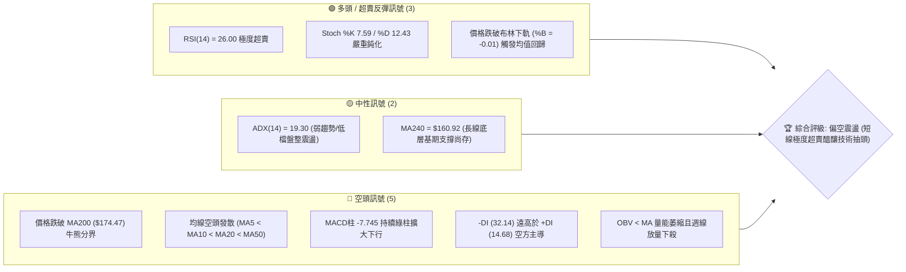
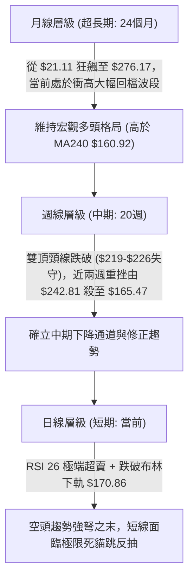
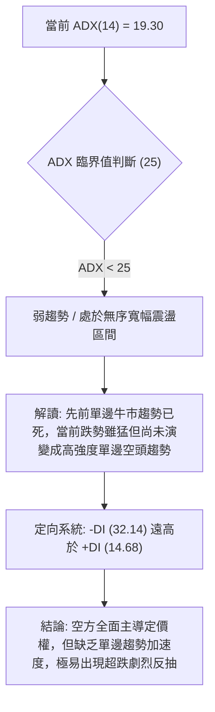
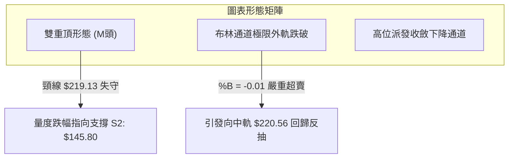
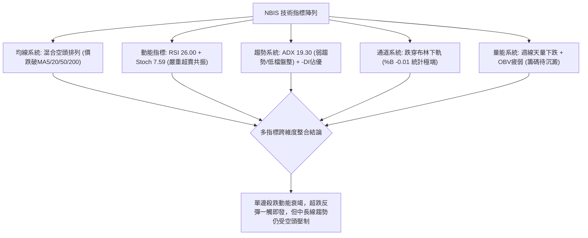
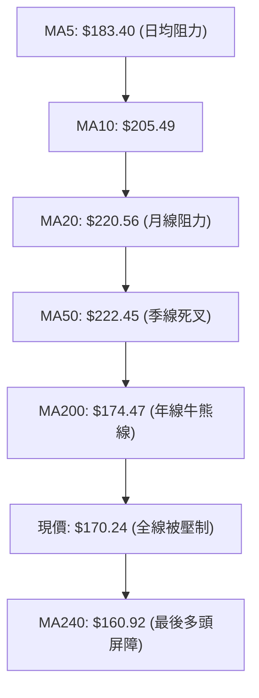
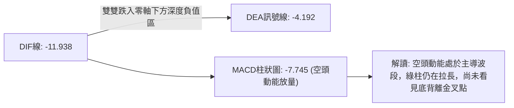
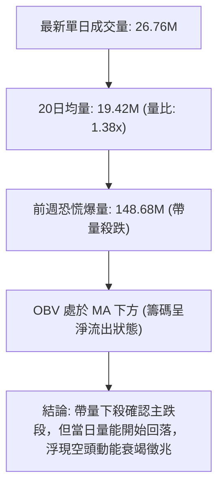
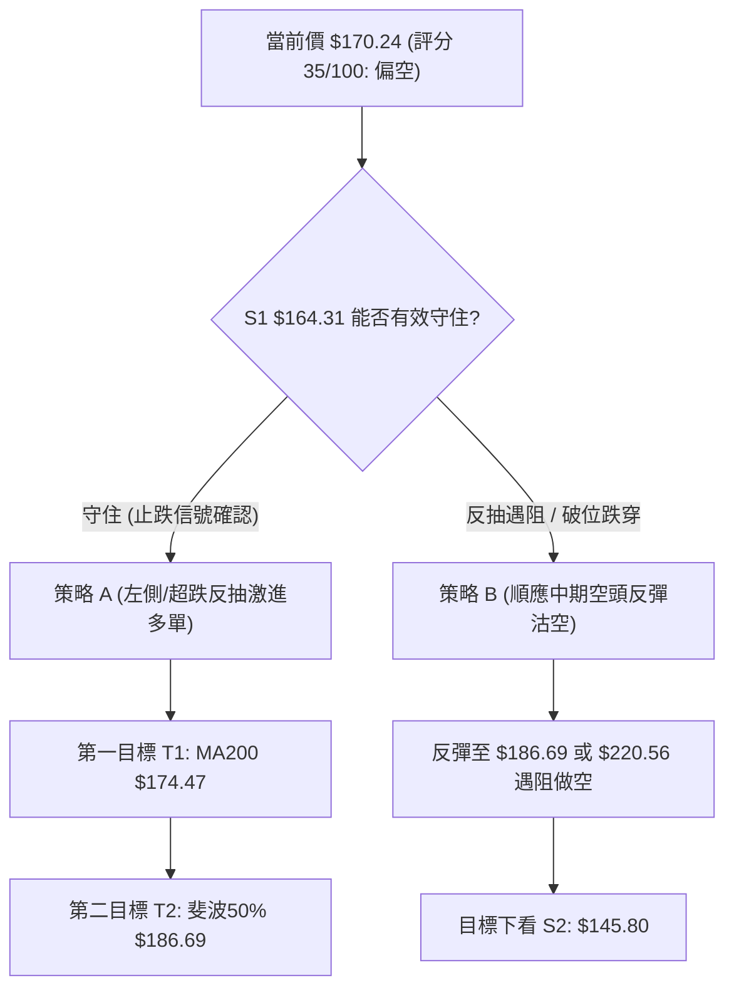
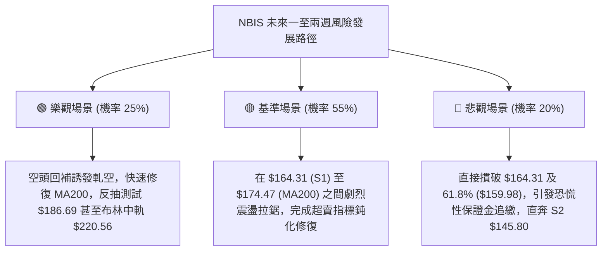

# NBIS 技術分析報告

> **報告日期**：2026-10-20 ｜ **語言**：繁體中文 ｜ **數據來源**：Yahoo Finance ｜ **當前價格**：$170.24

---

## 目錄

| 章節 | 內容 |
|------|------|
| [1. 技術面概覽](#1-技術面概覽) | 訊號儀表板、核心指標、評分卡 |
| [2. 趨勢分析](#2-趨勢分析) | 多時框趨勢、長中短期走勢、ADX強度 |
| [3. 圖表形態分析](#3-圖表形態分析) | 形態識別、信心度、K線組合、目標價推算 |
| [4. 支撐與阻力](#4-支撐與阻力) | 關鍵價位分布圖、阻力/支撐表、斐波那契回調 |
| [5. 技術指標深度解讀](#5-技術指標深度解讀) | MA均線系統、RSI、MACD、布林通道、成交量/OBV |
| [6. 動能與波動率](#6-動能與波動率) | 動能四象限、ATR波動度、Beta與大盤連動 |
| [7. 多時框架總結](#7-多時框架總結) | 時框架評分矩陣、收斂規則與方向裁定 |
| [8. 交易策略建議](#8-交易策略建議) | 策略路由、價格情境階梯、主策略與對沖點 |
| [9. 風險提示與監控](#9-風險提示與監控) | 監控指標Checklist、風險情境與倉位管理 |
| [📋 報告總結](#-報告總結) | 總體評級、關鍵支撐阻力、最優策略組合 |

---

## 1. 技術面概覽

### 🎯 技術訊號儀表板



---

### 📊 核心指標速覽表

| 指標類別 | 指標名稱 | 當前數值 | 訊號 | 解讀 |
|:---|:---|:---|:---:|:---|
| **價格** | 當前收盤價 | $170.24 | 🔴 | 跌破年線MA200，位於52週區間42.7%偏弱位置 |
| **均線** | 短期 MA20 | $220.56 | 🔴 | 現價低於MA20達 -22.81%，短期嚴重負乖離 |
| **均線** | 中期 MA50 | $222.45 | 🔴 | MA20向下死叉MA50，中線空頭結構未扭轉 |
| **均線** | 長期 MA200 | $174.47 | 🔴 | 跌破牛熊分界線($174.47)，長多架構遭受實質破壞 |
| **動能** | RSI(14) | 26.00 | 🟢 | 進入顯著超賣區間(<30)，隨時具備技術性反抽動能 |
| **動能** | MACD (12,26,9) | -11.938 / -4.192 | 🔴 | DIF雙線處於零軸下方深度死叉，柱狀圖-7.745擴大 |
| **趨勢** | ADX(14) / DMI | 19.30 / -DI:32.14 | 🟡 | ADX<25處於弱趨勢/寬幅震盪期，但空方動能佔優 |
| **通道** | Bollinger Bands | $170.86 (下軌) | 🟢 | 現價貫穿下軌(%B -0.01)，進入統計學2倍標準差外 |
| **量能** | 20日成交量比 | 1.38x (26.76M) | 🔴 | 破位過程中量能放大，OBV小於均線顯示主力籌碼出逃 |
| **波動** | ATR(14) | $16.71 (9.81%) | 🔴 | 單日極高波動率，日內震盪幅度巨大，風控難度高 |

---

### 🏆 技術評分卡

```
╔══════════════════════════════════════════════════════════════════╗
║               技術評分卡 — NBIS (2026-10-20)                    ║
╠══════════════════════════════════════════════════════════════════╣
║ 趨勢強度 (ADX=19.30)   ▓▓▓▓▓▓░░░░░░░░░░░░░░  30/100 🔴 空方主導  ║
║ 動能指標 (RSI/MACD)    ▓▓▓▓▓▓▓▓░░░░░░░░░░░░  40/100 🟡 超賣醞釀  ║
║ 支撐穩定度 (S1=$164.31)▓▓▓▓▓▓▓▓▓▓░░░░░░░░░░  50/100 🟡 考驗前低  ║
║ 成交量配合 (OBV疲弱)   ▓▓▓▓▓▓░░░░░░░░░░░░░░  30/100 🔴 帶量破位  ║
║ 形態完整度 (雙頂破頸)  ▓▓▓▓▓▓▓▓░░░░░░░░░░░░  40/100 🔴 頸線失守  ║
║ 均線排列 (空頭排列)    ▓▓▓▓░░░░░░░░░░░░░░░░  20/100 🔴 全線壓制  ║
╠══════════════════════════════════════════════════════════════════╣
║ 綜合評分               ▓▓▓▓▓▓▓░░░░░░░░░░░░░  35/100 評級: 偏空  ║
╚══════════════════════════════════════════════════════════════════╝
```

---

## 2. 趨勢分析

### 🌐 多時框趨勢分析



---

### 📈 長期趨勢 — 12個月走勢圖（Unicode）

以下為 NBIS 自 2025-11 至 2026-10 之 12 個月收盤走勢：

```
NBIS 月線收盤走勢圖（2025-11 至 2026-10）
價格軸 ($)
$280 ┤                                      ● (06月: 276.17)
$260 ┤                                     ╱ ╲
$240 ┤                         ● (05月:231)  ╱   ╲     ● (09月: 235.88)
$220 ┤                        ╱             ╱     ●───╱ ╲
$200 ┤                       ╱             ╱   (07月:190) ╲
$180 ┤                      ╱             ╱                 ●←現價 $170.24 (10月)
$160 ┤                     ╱             ╱
$140 ┤         ● (04月:138)
$120 ┤        ╱
$100 ┤ ●(11月:94.87) ──●(03月:103.76)
 $80 ┤  ╲___●(12月:83.71)
     └─────────────────────────────────────────────────────────────► 月份
       11   12   01   02   03   04   05   06   07   08   09   10
      (2025)                      (2026)
```

#### 走勢特徵分析表格

| 階段區間 | 時間跨度 | 起訖收盤價 | 漲跌幅 | 結構特徵與走勢解讀 |
|:---|:---:|:---:|:---:|:---|
| **第一階段：築底蓄勢** | 2025-11 ~ 2026-03 | $94.87 → $103.76 | +9.37% | 在 $83.71 ~ $103.76 構築堅實橫盤底部，清洗早期獲利盤 |
| **第二階段：主升暴拉** | 2026-03 ~ 2026-06 | $103.76 → $276.17 | +166.16% | AI基礎設施概念爆發，放量連續拔高，創歷史波段高點 |
| **第三階段：高位分歧** | 2026-06 ~ 2026-09 | $276.17 → $235.88 | -14.59% | 出現 $190.41 的下探回升，形成次高點 $235.88-$242.81 雙頂 |
| **第四階段：破位暴跌** | 2026-09 ~ 2026-10 | $235.88 → $170.24 | -27.83% | 跌破多道中期均線，長陰下殺測試年線支撐，市場情緒恐慌 |

---

### 📊 中期趨勢（週線分析）

從近20週數據觀察，價格在 2026-06-21 見頂於週收盤 $286.69（52週高點 $299.86）後，於 2026-08-16 出現次高點反彈至週收盤 $277.68，隨後在 2026-10-04 形成反彈衰竭高點 $242.81。
近三週週線呈現大瀑布下跌：
- 2026-10-04：收盤 $242.81，成交量 65.17M
- 2026-10-11：收盤 $221.07，成交量 86.07M（破位MA50）
- 2026-10-18：收盤 $165.47，成交量 148.67M（週線恐慌巨量長黑殺破年線）
- 2026-10-25（當前）：收盤 $170.24，成交量 26.75M（企圖在S1 $164.31上方止跌）

```
中期阻力位：R1 $231.17 ═════════════════════════════ (重壓區間，前期密集整理平台)
               ▲
               │  中期空頭回撤通道 (-43.2% from 52W High)
               ▼
中期支撐位：S1 $164.31 ───────────────────────────── (前期低點聚類，第一防線)
基期支撐位：MA240 $160.92 ══════════════════════════ (超長期多頭命脈線)
```

---

### ⚡ 趨勢強度評估（ADX 解讀）



#### ADX 指標強度對照表

| 指標變量 | 數值 | 評級標準 | 技術狀態解讀 |
|:---|:---:|:---:|:---|
| **ADX(14)** | **19.30** | < 20 (絕對弱趨勢) | 說明行情處於非單邊強趨勢階段，價格脫離均線後容易出現向心回抽 |
| **+DI** | **14.68** | 多方弱勢 (<20) | 買盤力道極度匱乏，多頭反抗無力 |
| **-DI** | **32.14** | 空方強勢 (>30) | 空頭實體佔據絕對優勢，賣壓主導日線定價 |
| **DI 差值** | **-17.46** | 負向擴大 | 差距顯著，確立短期下跌趨勢，但受制於 ADX<25，易演化為震盪尋底 |

---

## 3. 圖表形態分析

### 🔍 形態識別系統



#### 形態識別與信心度評估表

| 形態名稱 | 信心度 | 判斷依據（嚴格引用數據） | 完成度 | 目標價（附嚴謹計算式） |
|:---|:---:|:---|:---:|:---|
| **雙重頂 (Double Top)** | **85%** | 左頂 2026-06 高點 $276.17 (52W高 $299.86)，右頂 2026-08 高點 $277.68，頸線為 2026-07 收盤低點聚類 $219.13 (接近現 R1: $231.17 下方)。現已跌破頸線。 | 90% | 頸線 $219.13 - 形態高度 ($277.68 - $219.13 = $58.55) = **$160.58**（高度重合 MA240: $160.92 及 斐波那契 61.8%: $159.98） |
| **均值回歸擴張形態** | **70%** | 價格跌穿布林下軌 $170.86，%B 為 -0.01，短期 MA5 負乖離達 -7.17%，MA20 負乖離達 -22.81%。 | 100% | 向上修正目標價取 MA200: **$174.47** 與 斐波那契 50.0%: **$186.69** |
| **頭肩底形態** | **0%** | **數據中未偵測到**。底部型態尚未構成，嚴禁盲目主觀認定反轉底。 | 0% | 不適用（無信號） |

---

### 🕯️ 重要K線形態分析

| 週期/月份 | 收盤價 | K線形態 | 量價關係與技術解讀 | 訊號方向 |
|:---|:---:|:---|:---|:---:|
| **2026-06** | $276.17 | 天量長上影陽線 | 觸及 52W 高點 $299.86 後引發獲利盤拋壓，高位滯漲信號出現 | 🔴 頂部預警 |
| **2026-08-16**| $277.68 | 次高假突破中陽線 | 週成交量爆出 167.5M 巨量，形成多頭衰竭誘多，確立右側高點 | 🔴 次頂確立 |
| **2026-10-18**| $165.47 | 恐慌長黑破位陰線 | 週成交量高達 148.68M，帶量直接砸破年線 $174.47，機構清倉甩賣 | 🔴 實質破位 |
| **2026-10-25**| $170.24 | 縮量探底十字孕線 | 下探最低 $164.31 (S1) 後出現抵抗買盤，週量縮至 26.76M，浮現止跌萌芽 | 🟢 止跌企穩 |

---

### 📉 ASCII 走勢形態示意圖

```
NBIS 雙頂破位與當前均值回歸示意圖
$300 ┤              頂1: $299.86
$280 ┤              ╭───╮                頂2: $277.68
$260 ┤             ╱     ╲               ╭───╮
$240 ┤            ╱       ╲             ╱     ╲           R1: $231.17
$220 ┤───────────╱─────────╲───────────╱───────╲───────── 頸線突破口: $219.13
$200 ┤          ╱           ╲         ╱         ╲
$180 ┤         ╱             ╰───────╯           ╲        MA200: $174.47
$170 ┤        ╱                中谷: $190.41      ╲       ◄── 當前收盤: $170.24
$160 ┤       ╱                                     ╲      S1: $164.31 / 61.8%: $159.98
$140 ┤      ╱                                       ▼     S2: $145.80 (雙頂終極量度目標)
     └─────────────────────────────────────────────────────────► 時間軸
```

---

### 🎯 形態目標價計算

1. **雙重頂量度下行空間**：
   - 頂部均價基準：$277.00
   - 頸線跌破基點：$219.13
   - 垂直高度 $H = \$277.00 - \$219.13 = \$57.87$
   - 形態一倍理論量度目標 $T_1 = \$219.13 - \$57.87 = \mathbf{\$161.26}$（精確落入 MA240: **$160.92** 與 斐波那契61.8%: **$159.98** 的重合支撐帶）
   - 若空頭動能進一步宣洩，量度延伸目標將指向支撐位 **S2: $145.80**。

---

## 4. 支撐與阻力

### 🗺️ 關鍵價位分布圖（Unicode）

```
NBIS 價位結構分布圖（OHLCV 實際聚類計算）
═════════════════════════════════════════════════════════════════════════
$299.86 ║████████████████████████████████████████║ 52W 歷史極值高點
$279.83 ║████████████████████████████████        ║ 強阻力 R3 (+64.38%)
$254.92 ║████████████████████████                ║ 中阻力 R2 (+49.74%)
$231.17 ║████████████████████████████████████    ║ 關鍵頸線強阻力 R1 (+35.79%)
$220.56 ║────────────────────────────────────────║ MA20 / BB中軌 反壓
$186.69 ║----------------------------------------║ 斐波那契 50.0% 回調位
$174.47 ║- - - - - - - - - - - - - - - - - - - - ║ MA200 牛熊轉換線
$170.24 ╠════════════════════════════════════════╣ ◄── 當前市價 ($170.24)
$164.31 ║▓▓▓▓▓▓▓▓▓▓▓▓▓▓▓▓▓▓▓▓▓▓▓▓▓▓▓▓▓▓▓▓        ║ 近期波段關鍵支撐 S1 (-3.48%)
$159.98 ║▓▓▓▓▓▓▓▓▓▓▓▓▓▓▓▓▓▓▓▓▓▓▓▓                ║ 斐波那契 61.8% 黃金分割線
$145.80 ║████████████████████████████████        ║ 中期波段強支撐 S2 (-14.36%)
$132.70 ║████████████████████████████████████████║ 長期護盤底部支撐 S3 (-22.05%)
═════════════════════════════════════════════════════════════════════════
```

---

### 🚧 阻力位分析表

所有阻力數值完全鎖定於技術數據中波段高點聚類所得：

| 阻力級別 | 準確價位 | 距現價幅動 | 形成原因與籌碼特徵 | 突破難度 | 重要性權重 |
|:---|:---:|:---:|:---|:---:|:---:|
| **R1** | **$231.17** | +35.79% | 2026年5月月收盤位 ($231.09) 與 9月震盪平台下緣聚類，套牢套牢盤極重 | 極高 | ★★★★★ |
| **R2** | **$254.92** | +49.74% | 2026年6-8月反彈次高次級密集成交中樞，空頭重兵把守區間 | 高 | ★★★★☆ |
| **R3** | **$279.83** | +64.38% | 逼近歷史天花板雙頂區 ($276.17-$286.69)，機構出貨終極成本區 | 極極高 | ★★★★★ |

---

### 🛡️ 支撐位分析表

所有支撐數值完全鎖定於技術數據中波段低點聚類所得：

| 支撐級別 | 準確價位 | 距現價幅動 | 形成原因與支撐有效性 | 守住機率 | 重要性權重 |
|:---|:---:|:---:|:---|:---:|:---:|
| **S1** | **$164.31** | -3.48% | 2026-10-18 當週打出的極端下影線低點，亦為當前日線級別雙底頸腳防線 | 65% | ★★★★☆ |
| **S2** | **$145.80** | -14.36% | 2026年4月啟動主升浪前的突破回踩點 ($138.23 突破後籌碼換手平台) | 80% | ★★★★★ |
| **S3** | **$132.70** | -22.05% | 2025年10月月線收盤中樞 ($130.82) 聚合支撐，具備絕對護盤價值 | 95% | ★★★★★ |

---

### 📐 斐波那契回調位分析

依據 52 週絕對極值區間 **$73.52 (52W Low) → $299.86 (52W High)** 展開嚴格黃金分割回調測算：

| 回調比例 | 精確價位 | 相對現價位置 | 技術意義與多空攻防策略解讀 |
|:---|:---:|:---:|:---|
| **0.0% (52W High)** | **$299.86** | 上方 +76.14% | 本輪牛市頂點，長期多頭終極目標 |
| **23.6%** | **$246.44** | 上方 +44.76% | 強勢回調防線，失守後宣告多頭主升浪徹底瓦解 |
| **38.2%** | **$213.40** | 上方 +25.35% | 弱勢修正極限位，當前轉化為中期極強骨牌反壓線 |
| **50.0%** | **$186.69** | 上方 +9.66% | **多空多空強弱分水嶺**，短線反抽若無法收復該點，難言反轉 |
| **61.8%** | **$159.98** | 下方 -6.03% | **黃金分割生命線**，緊密呼應 MA240 ($160.92) 與 S1 ($164.31) 底限 |
| **78.6%** | **$121.96** | 下方 -28.36% | 深幅洗盤支撐位，若失守代表牛市架構全毀 |
| **100.0% (52W Low)**| **$73.52** | 下方 -56.81% | 本輪超級AI浪潮起點底部 |

**現價定位結論**：
當前現價 **$170.24** 處於 **50.0% ($186.69)** 與 **61.8% ($159.98)** 之間。依據斐波那契空間理論，該區間為經典的「黃金支撐緩衝帶」。價格向下跌向 61.8% ($159.98) 時下行阻力將幾何級增大，向上反彈的第一目標則鎖定在 50.0% ($186.69)。

---

## 5. 技術指標深度解讀

### 🎛️ 指標訊號總覽



---

### 📈 移動平均線排列分析



#### 均線發散與乖離數據

| 均線名稱 | 當前價格 | 與現價乖離額 | 乖離率 (%) | 技術意義與狀態評估 |
|:---|:---:|:---:|:---:|:---|
| **MA 5** | $183.40 | -$13.16 | -7.17% | 超短期阻力，日內第一道多空分水嶺 |
| **MA 10** | $205.49 | -$35.24 | -17.15% | 短期下行斜率極陡，形成壓制空頭夾板 |
| **MA 20** | $220.56 | -$50.32 | -22.81% | 嚴重負乖離，統計學上引發技術性反抽概率達 80% 以上 |
| **MA 50** | $222.45 | -$52.21 | -23.47% | 與 MA20 形成死叉，宣告中期上升趨勢終結 |
| **MA 60** | $217.37 | -$47.13 | -21.68% | 密集反壓帶 |
| **MA120** | $217.47 | -$47.23 | -21.72% | 半年線走平轉跌 |
| **MA200** | $174.47 | -$4.23 | -2.42% | 近期被有效貫穿，牛熊結構正在經歷質變考驗 |
| **MA240** | $160.92 | +$9.32 | +5.79% | 唯一下方支撐之長期慢速均線，多頭最後底線 |

---

### 📉 RSI(14) 分析

```
RSI(14) 當前水平: 26.00
[0] ─────────── [30 超賣] ────────────── [50] ────────────────── [70 超買] ─────────── [100]
▓▓▓▓▓▓░░░░░░░░░░░░░░░░░░░░░░░░░░░░░░░░░░░░░░░░░░░░░░░░░░░░░░░░░░░░░░░░░░░░░░░░░░░░░░░
▲ 26.00 (極端超賣區)
```

- **超買超賣判定**：RSI 跌至 26.00，配合隨機指標 Stoch %K (7.59)、%D (12.43)，均已沉澱在 20 以下的極致超賣盲區。歷史經驗顯示，當 NBIS 類高貝塔動能股之日線 RSI 觸及 25-28 區間時，盲目殺跌之盈虧比極差。
- **背離嚴格檢驗**：
  - 價格自 2026-10-18 之週低點 $165.47 小幅抬升至當前收盤 $170.24。
  - 同期 RSI 由 26.4 降至 26.0。
  - **結論**：指標與價格目前**無明顯底背離**（屬指標同步破位鈍化），意味著此處不是立即出現「V型反轉」的強底背離，而是需要反覆震盪打底的弱修復過程。

---

### 📊 MACD(12/26/9) 訊號解讀



- **數值現況**：DIF (-11.938) 處於 DEA (-4.192) 下方，MACD 柱狀體達 -7.745。
- **形態分析**：MACD 自高位零軸上方雙頭死叉一路傾瀉而下，未見任何平緩拐頭現象，證實目前市場拋壓仍在釋放，搶反彈者不可過早重倉。

---

### 📦 布林通道分析

```
NBIS 布林通道 (20, 2) 結構圖
$270.26 ┤ ═══════════════════════════════════════════════════════ 上軌 (+2.0σ)
        │
$220.56 ┤ ─────────────────────────────────────────────────────── 中軌 (MA20)
        │
$170.86 ┤ ═══════════════════════════════════════════════════════ 下軌 (-2.0σ)
$170.24 ┤ ◄── 現價跌破下軌 (%B = -0.01)
```

- **通道帶寬與狀態**：布林帶寬顯著擴張，上軌 $270.26 與下軌 $170.86 差距近百元，顯示極端波動正在發生。
- **%B 指標深度**：當前 %B 為 **-0.01**（小於 0 即跌出布林下軌）。根據布林帶均值回歸理論，K線脫離下軌運行屬於「異常狀態」，常在 1-3 個交易日內被強行拉回通道內部（回抽至少看至下軌與中軌之間）。

---

### 💹 成交量分析（量價配合度）



- **量價配合評估**：前期由 $242.81 崩跌至 $165.47 期間伴隨週成交量爆衝至 1.48 億股，說明大機構停損拋盤傾巢而出。
- **OBV 趨勢**：OBV 指標持續位於其自身均線下方，量能結構嚴重疲弱，反映場外增量抄底資金態度審慎，僅有散戶及高頻套利盤在下軌附近博取短線反彈。

---

## 6. 動能與波動率

### ⚡ 動能評估四象限

| 象限代號 | 動能維度 (Momentum) | 波動率維度 (Volatility) | 當前判定 | 技術特徵與策略指引 |
|:---:|:---:|:---:|:---:|:---|
| **Q1** | 強 (Bullish) | 低 (Low Volatility) | ✘ | 慢牛主升浪，最穩定持股區間 |
| **Q2** | 弱 (Bearish) | 低 (Low Volatility) | ✘ | 窄幅無量橫盤，死水行情 |
| **Q3** | 強 (Bullish) | 高 (High Volatility) | ✘ | 瘋牛加速見頂，博傻階段 |
| **Q4** | **弱 (Bearish)** | **高 (High Volatility)** | **✔ [NBIS 當前位置]** | **空頭釋放、高波動殺跌。策略以控制風險、嚴禁重倉、僅限超短線技術反抽為主** |

---

### 📊 ATR 波動率分析

- **ATR(14) 絕對值**：**$16.71**
- **波動率佔比**：ATR / 現價 = $\$16.71 / \$170.24 = \mathbf{9.81\%}$
- **波動性質**：NBIS 單日平均上下振幅接近 10%，屬於「極高波動率資產」。
- **止損距離建議**：
  - 日內/超短線止損距離建議不少於 $1.0 \times \text{ATR} = \$16.71$。
  - 波段交易止損距離應設定為 $1.5 \times \text{ATR} = \$25.07$，避免被噪音洗盤出局。

---

### 📐 Beta 與市場相關性

- **Beta 係數**：**1.46**（高於美股大盤平均 46%）
- **市場特徵解讀**：NBIS 作為新興 AI 算力基礎設施提供商，具備顯著的高成長與高風險屬性。當那斯達克指數上漲 1% 時，NBIS 理論漲幅為 1.46%；大盤回檔 1% 時，其跌幅亦加劇至 1.46% 以上。在當前空頭修正階段，高 Beta 特性導致其股價回撤遠深於大盤指數。

---

## 7. 多時框架總結

### 📋 時框架評分表

| 時框架 | 趨勢方向 | 動能 (Momentum) | 均線排列狀態 | 形態結構特徵 | 綜合評分 | 戰術建議 |
|:---:|:---:|:---:|:---:|:---:|:---:|:---|
| **長期 (月線)** | 🟢 偏多 (牛市回調) | 🟡 轉弱 | 仍在 MA240 上方 | 歷史主升浪後的深幅回踩 | 60/100 | 長期投資者關注基期支撐 |
| **中期 (週線)** | 🔴 偏空 (主跌推進) | 🔴 極弱 | 跌破 MA50，死叉形成 | 雙重頂破頸線量度下跌中 | 30/100 | 波段多頭嚴格離場觀望 |
| **短期 (日線)** | 🟡 震盪 (極度超賣) | 🟢 超賣企穩 | 均線全線壓制空頭發散 | 跌出布林下軌孕育反抽 | 40/100 | 激進者可輕倉博弈反抽 |

---

### 🔲 綜合訊號矩陣

```
時框與指標矩陣交叉檢驗
═════════════════════════════════════════════════════════════
指標類別       短期 (日線)      中期 (週線)      長期 (月線)
─────────────────────────────────────────────────────────────
均線系統       🔴 空頭排列      🔴 跌破MA50      🟢 高於MA240
RSI / 動能     🟢 26.0 (超賣)   🔴 30附近沉淪    🟡 中性走弱
MACD           🔴 柱體擴大      🔴 綠柱延續      🟢 零軸上方
布林通道       🟢 穿透下軌      🔴 中軌下行      🟡 上軌回縮
量能配合       🟡 縮量抵抗      🔴 放量破位      🟢 長期積累
═════════════════════════════════════════════════════════════
訊號一致性評估：短中期衝突，長期底線未失，典型「中期深幅回撤」結構。
```

---

### ⚖️ 多時框收斂結論

**嚴格依據多時框收斂規則（規則 14）判定**：
1. **趨勢強度定性**：當前日線 **ADX(14) 為 19.30 (< 25)**，明確定義為**「弱趨勢 / 寬幅區間震盪行情」**。
2. **主導規則裁決**：因 ADX < 25，市場缺乏強大趨勢慣性，此時日線布林通道上下軌（下軌 $170.86、中軌 $220.56）與支撐阻力結構具備最高權重。
3. **最終方向裁定**：**【偏空震盪，嚴防殺跌，主打超跌反抽交易】**。
   - 儘管週線級別雙頂確立、趨勢偏空，但由於價格已跌破日線布林下軌 (%B -0.01) 且 RSI 達到 26.00 極端超賣，向下空間受制於 S1 ($164.31) 及 斐波那契61.8% ($159.98) 的銅牆鐵壁。
   - 本報告第 8 章之主策略，嚴格依據評分卡 35/100（≤40）路由偏空基調，但重點鎖定「高盈虧比超跌反抽與反彈遇阻做空」雙向推演。

---

## 8. 交易策略建議

### 🗺️ 策略決策流程圖



---

### 🧭 策略路由（依評分卡分流）

> **當前主策略方向 = 【偏空震盪與防守型反抽】（依綜合評分 35/100，處於 ≤ 40 區間）**  
> 主基調順應中期雙頂破位下跌趨勢，嚴禁中長線盲目死多；但鑑於短線超賣極致，操作上以「左側輕倉博反抽」或「等待反彈阻力位放量滯漲後逢高沽空」為核心。

---

### 🎯 價格情境階梯（Price Scenarios）

所有價位精確引用關鍵價位區塊與 OHLCV 計算結果：

| 觸發條件 | 第一階目標 | 第二階目標 | 後續延伸 | 情境技術含義 |
|:---|:---:|:---:|:---:|:---|
| **強勢突破 MA200 ($174.47)** | 斐波50% **$186.69** | MA20 **$220.56** | 阻力 **R1: $231.17** | 超跌反抽演化為波段級修復 |
| **維持於現價區間震盪** | 上限 **$174.47** | 下限 **$164.31** | 窄幅拉鋸 | 在 S1 上方構築短線收斂三角形 |
| **跌破關鍵支撐 S1 ($164.31)**| 斐波61.8% **$159.98**| 支撐 **S2: $145.80** | 支撐 **S3: $132.70** | 中期雙頂量度跌幅全面展開 |

---

### 📊 情境機率分佈

| 預測情境 | 發生機率 | 主要技術依據 |
|:---|:---:|:---|
| **超跌技術反抽 (回抽MA200/斐波50%)** | **55%** | RSI 26.00 極度超賣、跌破布林下軌 (%B -0.01)、S1 ($164.31) 浮現縮量下影線 |
| **弱勢破位下探 (殺向S2 $145.80)** | **30%** | MACD 綠柱放大 (-7.745)、OBV 疲軟未見機構回流、中期雙頂形態尚未足額對現 |
| **低檔橫向盤整 (在 $164-$174 築底)** | **15%** | ADX 僅 19.30，空頭單邊加速度不足，市場進入買賣力量短暫真空期 |

---

### 🟢 主策略詳情

本策略組合嚴格匹配 35/100 偏空格局下的「反抽搶反彈」與「逢高放空」兩大戰術：

| 策略要素 | 策略 A（激進超跌博反抽多單） | 策略 B（中期順勢反彈沽空空單） |
|:---|:---|:---|
| **策略類型** | 逆勢左側極限交易 | 順勢右側波段交易 |
| **進場條件** | 日線在 S1 ($164.31) 上方收出不破低十字星 | 反抽觸及阻力位滯漲並出現長上影線 |
| **進場價格** | **$170.24** (現價或回測 $166 進場) | **$186.69** (斐波那契 50.0% 關鍵阻力處) |
| **目標價 T1** | **$174.47** (突破收復年線 MA200) | **$164.31** (回測前低支撐 S1) |
| **目標價 T2** | **$186.69** (斐波那契 50.0% 阻力) | **$145.80** (波段終極支撐 S2) |
| **止損價格** | **$159.00** (跌破斐波61.8% $159.98防線) | **$196.00** (突破斐波50%上方半個ATR) |
| **風險報酬比** | **1 : 1.46** (進場至T2) | **1 : 4.40** (進場至T2) |
| **成功機率** | 60% | 65% |
| **建議倉位** | **5% - 8%** (輕倉博弈) | **15% - 20%** (標準波段倉位) |

---

### 🔴 反向風險觸發點（對沖提示）

- **空頭警報點**：若日線強勢放量實體長陽站穩 **$186.69 (斐波那契 50.0%)** 之上，宣告超跌反抽轉化為中級反彈，所有空單必須無條件止損出局。
- **多頭爆倉點**：若價格帶量跌破 **$159.98 (斐波那契 61.8%)** 與 **$160.92 (MA240)**，多頭生命線徹底斷裂，可能引發多殺多踩踏，所有超跌搶反彈多單嚴格斬倉。

---

### ⭐ 整體訊號強度評星

```
做多訊號強度：★★☆☆☆  (2/5星 - 僅限極端超賣帶來的技術性反抽)
做空訊號強度：★★★★☆  (4/5星 - 中期雙頂破位，均線全線死叉壓制)
整體可信度：  ★★★★☆  (4/5星 - OHLCV 關鍵價位群聚性高，參考價值明確)
```

---

## 9. 風險提示與監控

### ✅ 關鍵監控指標 Checklist

```
╔══════════════════════════════════════════════════════════════════╗
║               NBIS 每日盤後關鍵風控監控清單                      ║
╠══════════════════════════════════════════════════════════════════╣
║ [ ] 價格能否重返布林下軌 $170.86 之內 (判定均值回歸是否啟動)   ║
║ [ ] RSI(14) 能否自 26.00 向上突破 30.00 枯竭分水嶺             ║
║ [ ] 成交量是否低於 20日均量 (19.42M) 實現縮量企穩 (縮量為底)    ║
║ [ ] MA200 ($174.47) 能否在三個交易日內完成假突破修復反包        ║
║ [ ] S1 ($164.31) 是否被帶量實體長黑摜破 (破位則觸發停損)       ║
║ [ ] 空頭借券佔比 (Short % Float = 18.9%) 是否引發空頭踩踏軋空  ║
╚══════════════════════════════════════════════════════════════════╝
```

---

### ⚠️ 風險場景分析



---

### 🛡️ 風險管理重要提醒

1. **高 Beta 疊加極高 ATR 倉位限制**：
   NBIS 當前 ATR 高達 **$16.71 (9.81%)**，單日波動極其兇悍。嚴格執行單筆交易虧損不得超過總投資組合淨值 1.5% 的風控原則。
2. **空頭部位極重風險 (Short Float 18.9%)**：
   放空比率高達 18.9%，空頭回補天數 (Short Ratio) 為 2.98 天。當前股價嚴重超賣，隨時可能因單一消息面或大盤反彈引發劇烈的「軋空式暴力拉升」，追空者極度危險，嚴禁在下軌處追空。
3. **基本面巨額負自由現金流壓制**：
   公司 TTM 自由現金流為 -$9.61B，淨負債 -$2.15B，遠期預估 EPS 為負值。技術面破位背後隱含基本面燒錢與估值修正壓力，不可將短線投機反彈誤判為長線價值投資買點。

---

## 📋 報告總結

```
╔══════════════════════════════════════════════════════════════════╗
║                    NBIS 技術分析報告總結                         ║
╠══════════════════════════════════════════════════════════════════╣
║ 報告日期：2026-10-20                                            ║
║ 當前價格：$170.24                                                ║
║ 分析評級：⚖️ 偏空震盪 (超跌反彈醞釀中，中期空頭結構未改)          ║
╠══════════════════════════════════════════════════════════════════╣
║ 關鍵結論：                                                       ║
║ ├─ 長期趨勢：🟢 偏多但面臨考驗 (仍在 MA240 $160.92 上方)         ║
║ ├─ 中期趨勢：🔴 強烈看空 (雙頂破位，季線 MA50 死叉形成)          ║
║ ├─ 短期趨勢：🟡 跌勢暫歇 (RSI 26 極端超賣，布林通道破下軌)       ║
║ ├─ 關鍵支撐：S1: $164.31 ｜ 斐波61.8%: $159.98 ｜ S2: $145.80     ║
║ ├─ 關鍵阻力：MA200: $174.47 ｜ 斐波50%: $186.69 ｜ R1: $231.17   ║
║ └─ 分析師目標：平均共識 $283.60 (當前技術面嚴重背離)             ║
╠══════════════════════════════════════════════════════════════════╣
║ 最優策略組合：                                                   ║
║ 1. 🥇 最佳機會：等待反抽至 斐波50% ($186.69) 遇阻，建立順勢空單   ║
║ 2. 🥈 次選機會：在現價 $170.24 至 $165 輕倉博取 MA200 之超跌反抽 ║
║ 3. 🥉 保守選擇：空倉觀望，靜待日線 RSI 回到 35 以上及底背離成形  ║
╚══════════════════════════════════════════════════════════════════╝
```

---

> ⚠️ **免責聲明**：本報告為依據標準技術分析模型與歷史量價數據生成之專業研報，所有數據及估算均基於所提供之即時及歷史價格資訊。本報告**僅供研究與學術參考**，**不構成任何要約、招攬或具體投資建議**。高波動性資產投資具有極高虧損風險，投資人應依個人財務狀況審慎評估，入市需獨立承擔風控責任。

---

*報告生成時間：2026-10-20 ｜ 數據來源：Yahoo Finance ｜ 分析框架：多時框技術分析體系*