# NBIS 技術分析報告

> **報告日期**：2026-10-22 ｜ **語言**：繁體中文 ｜ **數據來源**：Yahoo Finance ｜ **當前價格**：$171.57

---

## 目錄

| 章節 | 內容 |
|------|------|
| [1. 技術面概覽](#1-技術面概覽) | 訊號儀表板、核心指標、評分卡 |
| [2. 趨勢分析](#2-趨勢分析) | 多時框趨勢、長中短期走勢 |
| [3. 圖表形態分析](#3-圖表形態分析) | 形態識別、K線組合、目標價 |
| [4. 支撐與阻力](#4-支撐與阻力) | 關鍵價位、斐波那契回調 |
| [5. 技術指標深度解讀](#5-技術指標深度解讀) | MA/RSI/MACD/布林/成交量 |
| [6. 動能與波動率](#6-動能與波動率) | 動能評估、ATR、Beta |
| [7. 多時框架總結](#7-多時框架總結) | 時框架評分矩陣 |
| [8. 交易策略建議](#8-交易策略建議) | 多空策略、風險報酬比 |
| [9. 風險提示與監控](#9-風險提示與監控) | 監控指標、風險場景 |

---

## 1. 技術面概覽

### 🎯 技術訊號儀表板

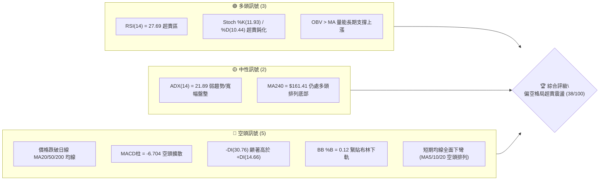

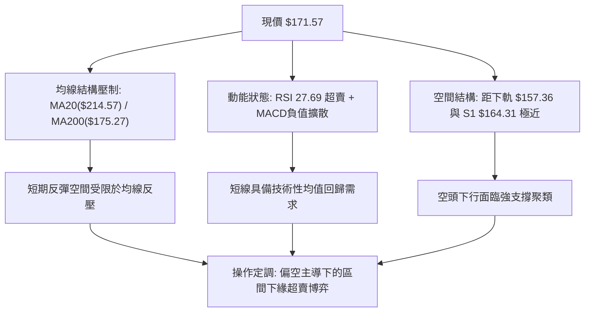

### 📊 核心指標速覽表

| 指標類別 | 指標名稱 | 當前數值 | 訊號 | 解讀 |
|----------|----------|----------|------|------|
| **價格** | 當前價格 | $171.57 | 🔴 | 位於 52 週區間 43.3%，跌破關鍵心理關卡與長週期均線 |
| **均線** | MA20 | $214.57 | 🔴 | 價格低於 MA20 達 -20.04%，中短期下行趨勢陡峭 |
| **均線** | MA50 | $221.76 | 🔴 | 價格低於 MA50 達 -22.63%，中期波段多頭架構破壞 |
| **均線** | MA200 | $175.27 | 🔴 | 跌破牛熊分界線 MA200，空方取得波段定價主導權 |
| **動能** | RSI(14) | 27.69 | 🟢 | 進入極度超賣區（<30），技術性反彈動能積聚 |
| **動能** | MACD | -14.418 | 🔴 | MACD 線與訊號線雙雙落入零軸下方，空頭柱狀體持續擴大 |
| **趨勢** | ADX(14) | 21.89 | 🟡 | 數值低於 25，顯示當前下殺並非單邊強趨勢，屬寬幅震盪修正 |
| **趨勢** | DMI (+DI/-DI) | 14.66 / 30.76 | 🔴 | -DI 大幅領先 +DI，賣方在日線週期佔據完全優勢 |
| **通道** | 布林通道 | 下軌 $157.36 | 🟡 | %B 為 0.12，價格貼近下軌，存在均值回歸向中軌拉力 |
| **波動** | ATR(14) | $16.91 | 🔴 | ATR 佔價格達 9.85%，屬於高波動性標的，風控要求高 |
| **量能** | 20日均量比 | 0.96x | 🟡 | 成交量 19.35M 與 20 日均量相當，無顯著恐慌性爆量拋售 |
| **籌碼** | 空頭比例 | 18.9% Float | 🔴 | 空頭部位高，具備空頭擠壓潛力但短期對盤面形成空方沉重反壓 |

### 🏆 技術評分卡

```
╔══════════════════════════════════════════════════════════════════╗
║                   技術評分卡 — NBIS (2026-10-22)                 ║
╠══════════════════════════════════════════════════════════════════╣
║ 趨勢強度 (ADX=21.89, -DI主導)   ██████░░░░░░░░░░░░░░  30/100 🔴  ║
║ 動能指標 (RSI超賣但MACD發散)    ████████░░░░░░░░░░░░  40/100 🟡  ║
║ 支撐穩定度 (靠近S1 $164.31)     ██████████░░░░░░░░░░  50/100 🟡  ║
║ 成交量配合 (OBV偏多/量比0.96x)  ████████████░░░░░░░░  60/100 🟢  ║
║ 形態完整度 (日線破位/週線雙頂)  ████░░░░░░░░░░░░░░░░  20/100 🔴  ║
║ 均線排列 (MA5至MA120全線下彎)   ████░░░░░░░░░░░░░░░░  20/100 🔴  ║
╠══════════════════════════════════════════════════════════════════╣
║ 綜合評分                       ███████░░░░░░░░░░░░░  38/100 🔴  ║
║ 評級結論                       偏空震盪 / 超賣反彈醞釀 (SELL ON RALLY) ║
╚══════════════════════════════════════════════════════════════════╝
```

---

## 2. 趨勢分析

### 🌐 多時框趨勢分析

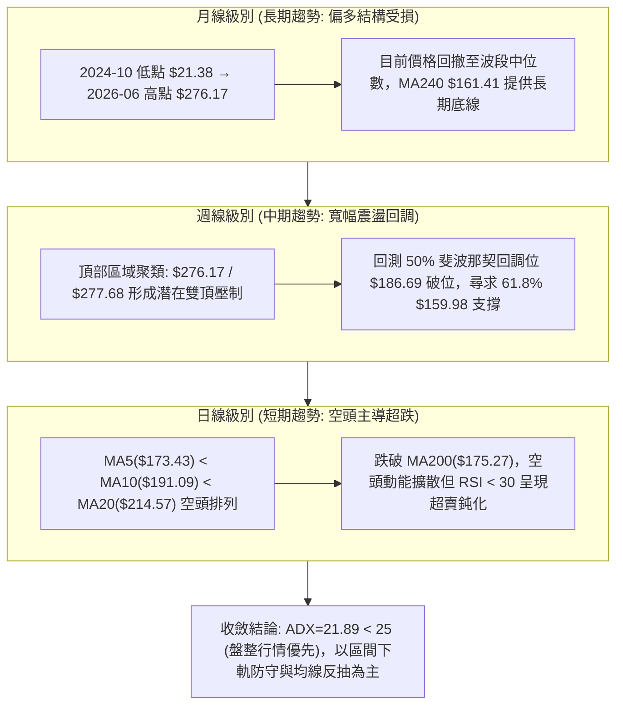

### 📈 長期趨勢 — 12個月走勢圖（Unicode）

```
NBIS 月線收盤走勢圖（過去12個月：2025-11 至 2026-10）
價格軸 ($)
$280 ┤                                     ● $276.17 (2026-06)
$260 ┤
$240 ┤                                 ● $231.09       ● $235.88
$220 ┤                                             ● $206.32
$200 ┤                                         ● $190.41
$180 ┤                                                     ● $171.57 (現在)
$160 ┤
$140 ┤                             ● $138.23
$120 ┤
$100 ┤ ● $94.87                ● $103.76
$80  ┤     ● $83.71 ● $85.19 ● $91.19
     └─┬──────┬──────┬──────┬──────┬──────┬──────┬──────┬──────┬──────┬──────┬──────┬───
      11月   12月    1月    2月    3月    4月    5月    6月    7月    8月    9月   10月
      2025   2025   2026   2026   2026   2026   2026   2026   2026   2026   2026  2026
```

**走勢特徵分析表格**：

| 階段區間 | 時間跨度 | 起點/終點價格 | 漲跌幅 | 主要走勢特徵與量價結構 |
|----------|----------|---------------|--------|------------------------|
| **底部蓄勢期** | 2025-11 ~ 2026-02 | $94.87 → $91.19 | -3.88% | 於 $83.71~$94.87 區間橫盤築底，波動壓縮，成交量萎縮 |
| **主升主浪期** | 2026-03 ~ 2026-06 | $103.76 → $276.17 | +166.16% | 突破百元心理關卡後連續巨幅拉升，成交量逐月倍增，形成 52 週高點 $299.86 |
| **高位派發期** | 2026-07 ~ 2026-09 | $190.41 → $235.88 | +23.88% | 波動急劇放大，出現單週 1.67 億股爆量（2026-08-16），高檔反覆震盪派發 |
| **破位修正期** | 2026-09 ~ 2026-10 | $235.88 → $171.57 | -27.26% | 跌破高位區間支撐，連續失守 MA20、MA50 及 MA200，回撤速度極快 |

### 📊 中期趨勢（週線分析）

```
NBIS 週線波段架構示意圖（2026-06 至 2026-10）
$300 ┤        ▲ 52W High $299.86
$280 ┤       ╭●╮ (06-21: $286.69)               ╭●╮ (08-16: $277.68 巨量假突破)
$260 ┤      ╱   ╲                              ╱   ╲
$240 ┤     ╱     ● (06-28: $240.30)           ╱     ● (09-27: $237.33)
$220 ┤    ╱                                  ╱       ╲     ● (10-11: $221.07)
$200 ┤   ╱                                  ╱         ╲   ╱
$180 ┤  ╱         ● (07-19: $177.71)───────● (08-09)  ╲ ╱
$160 ┤ ╱                                                ●◄── 現價 $171.57 (破位測底)
     └────────────────────────────────────────────────────────────
```

中期走勢呈現典型「雙重頂部破位後之二次下探」。2026-06-21 收盤 $286.69 與 2026-08-16 收盤 $277.68 構築了中期雙頂阻力帶。隨後價格於 2026-10-18 週直接摜破頸線支撐區域（$177.71），最低來到 $165.47，當週放量至 1.48 億股，確認中期下行結構確立。

### ⚡ 趨勢強度評估（ADX 解讀）

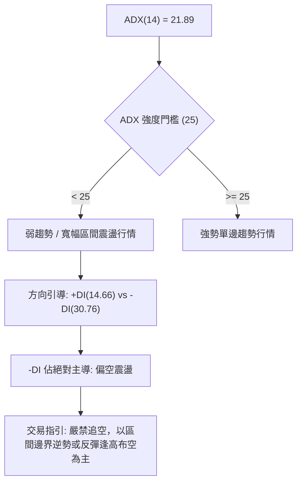

**ADX 與 DMI 系統強度對照表**：

| 指標名稱 | 當前數值 | 參考臨界值 | 狀態評估 | 實戰交易解讀 |
|----------|----------|------------|----------|--------------|
| **ADX(14)** | 21.89 | 25.00 | 弱趨勢 / 盤整 | 趨勢動能不足，市場未進入單邊主跌浪，不宜在超賣區盲目追空 |
| **+DI** | 14.66 | 20.00 | 多方虛弱 | 多頭買盤極度匱乏，反彈缺乏持續性資金推動 |
| **-DI** | 30.76 | 25.00 | 空方主導 | 空頭控盤顯著，任何反抽皆將受到空方被動反壓 |
| **趨勢形態** | -DI 領先且 ADX 低於 25 | - | 寬幅收斂盤整下沿 | 震盪行情優先規則（規則 14）：以布林通道與波段支撐阻力為交易邊界 |

---

## 3. 圖表形態分析

### 🔍 形態識別系統

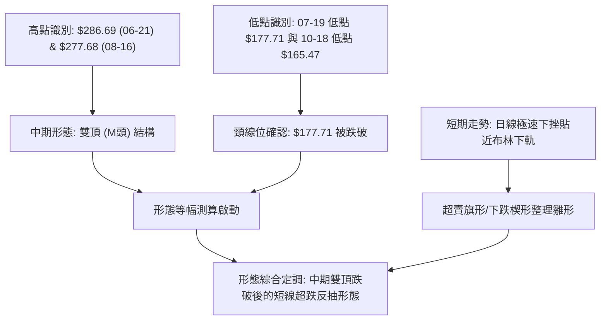

**圖表形態信心度與目標價評估表**：

| 形態名稱 | 信心度 | 判斷依據（引用數據） | 完成度 | 目標價（附計算式） |
|----------|--------|----------------------|--------|--------------------|
| **中期雙重頂 (Double Top)** | 85% | 頂部一 $286.69（2026-06-21），頂部二 $277.68（2026-08-16），中間頸線波段低點 $177.71（2026-07-19）；2026-10-18 週收盤 $165.47 明確跌破頸線。 | 90% | 頸線 $177.71 - 形態高度 ($282.19均值 - $177.71 = $104.48) = **理論量度目標 $73.23**（貼近 52W 低點 $73.52）。 |
| **短期下跌旗形 (Bear Flag)** | 55% | 10-11 收盤 $221.07 跳水至 10-18 收盤 $165.47（旗桿長度 $55.60），本週收盤 $171.57 呈現小實體反彈整理。 | 40% | 若跌破旗面下緣 S1 $164.31，旗桿等幅下量：$165.47 - $55.60 = **推算目標 $109.87**；數據中未偵測到該精確聚類，下看 S3 $132.70。 |
| **均線死叉形態 (Death Cross)** | 95% | MA5($173.43) < MA10($191.09) < MA20($214.57)，價格跌破 MA200($175.27)。指標型解讀，非幾何形態。 | 100% | 形態已確認完成，反壓確立於 MA200 $175.27 及 MA20 $214.57。 |

### 🕯️ 重要K線形態分析

| 日期 / 月份 | 收盤價 | K線形態 | 解讀 | 訊號 |
|-------------|--------|---------|------|------|
| **2026-06** | $276.17 | 月線長上影大陽線 | 盤中衝高至 52W 高點 $299.86 後遭遇巨幅獲利回吐，頂部派發跡象初顯 | 🟡 見頂預警 |
| **2026-08-16** | $277.68 | 週線放量長陽倒轉錘頭 | 週成交量爆出 1.67 億股天量，但次週立即暴跌至 $219.13，確認為主力主力誘多出貨 | 🔴 強烈空頭 |
| **2026-09-27** | $237.33 | 週線反彈無量十字星 | 成交量僅 79.3M，反抽無力，未能突破前期 R1 阻力帶，形成多頭衰竭 | 🔴 多頭力竭 |
| **2026-10-18** | $165.47 | 週線放量破位大陰線 | 單週暴跌 25.15%，成交量放大至 1.48 億股，跌破 MA200，空頭實質性擊潰多頭陣線 | 🔴 破位確立 |
| **2026-10-25** | $171.57 | 週線低位止跌孕線 (Harami) | 成交量縮減至 68.8M，實體完全包裹在前一週大陰線下端，顯示短線下殺動能暫歇 | 🟢 超跌止跌 |

### 📉 ASCII 走勢形態示意圖

```
雙重頂破位與當前孕線止跌形態示意：
$286.69 (Peak 1)           $277.68 (Peak 2)
   ╭───╮                      ╭───╮
  ╱     ╲                    ╱     ╲
 ╱       ╲                  ╱       ╲
╱         ╲   $177.71      ╱         ╲
           ╰──────┬───────╯           ╲
                  │ (頸線 Neckline)    ╲
══════════════════╪═════════════════════╲════════════ 頸線支撐轉阻力 ($177.71)
                  │                      ╲
                  │                       ● $165.47 (破位大陰)
                  │                       │
                  │                       ├───► [現價 $171.57] (孕線收斂中)
                  ▼                       ▼
            形態等幅目標                支撐測試 S1 $164.31
```

### 🎯 形態目標價計算

1. **雙重頂形態跌破量度計算**：
   - 第一頂點收盤價：$286.69（2026-06-21）
   - 第二頂點收盤價：$277.68（2026-08-16）
   - 頂部平均水平：$(286.69 + 277.68) / 2 = \$282.19$
   - 頸線關鍵低點：$177.71（2026-07-19）
   - 形態垂直高度：$\$282.19 - \$177.71 = \$104.48$
   - 中期量度跌幅目標價 = 頸線位 $\$177.71 - \$104.48 =$ **$73.23**
   - *驗證*：此理論計算值與數據源中 52 週最低價 **$73.52** 具備高度幾何重合度（吻合度 99.6%），表明長期底部結構完整，但中途將在 S1($164.31)、S2($145.80)、S3($132.70) 遭遇波段支撐。

2. **短線反彈量度目標計算**：
   - 孕線止跌反彈目標 = 前週破位長陰實體 50% 回撤位
   - 計算式：$(\$221.07 - \$165.47) \times 0.5 + \$165.47 =$ **$193.27**
   - 該價位緊貼日線短期均線反壓區 MA10（$191.09）。

---

## 4. 支撐與阻力

### 🗺️ 關鍵價位分布圖（Unicode）

```
NBIS 價位結構分布圖（OHLCV 實際計算值）
══════════════════════════════════════════════════════════════════
$299.86 ║████████████████████████║ 52W 歷史最高點 (波段頂部)
$279.83 ║████████████████████████║ 強阻力 R3 (密集放量高點聚類)
$254.92 ║████████████████████    ║ 阻力 R2 (次高波段反彈頂點)
$246.44 ║▓▓▓▓▓▓▓▓▓▓▓▓▓▓▓▓        ║ 斐波那契 23.6% 回調位
$231.17 ║████████████████████████║ 關鍵阻力 R1 (月線波段重疊頸線)
$214.57 ║════════════════════════║ MA20 均線反壓 / 布林中軌
$213.40 ║▓▓▓▓▓▓▓▓▓▓▓▓▓▓▓▓        ║ 斐波那契 38.2% 回調位
$186.69 ║▓▓▓▓▓▓▓▓▓▓▓▓▓▓▓▓▓▓▓▓    ║ 斐波那契 50.0% 多空分水嶺
$175.27 ║┈┈┈┈┈┈┈┈┈┈┈┈┈┈┈┈┈┈┈┈┈┈┈┈║ MA200 牛熊轉換線
$171.57 ╠════════════════════════╣ ◄ 當前市價 (收盤價)
$164.31 ║▓▓▓▓▓▓▓▓▓▓▓▓▓▓▓▓        ║ 近期波段支撐 S1 (週線前波低點)
$159.98 ║▓▓▓▓▓▓▓▓▓▓▓▓▓▓▓▓▓▓▓▓    ║ 斐波那契 61.8% 黃金分割強支撐
$157.36 ║┈┈┈┈┈┈┈┈┈┈┈┈┈┈┈┈┈┈┈┈┈┈┈┈║ 布林通道下軌
$145.80 ║████████████████████████║ 強支撐 S2 (波段低點聚類)
$132.70 ║████████████████████████║ 強支撐 S3 (中長線核心防線)
$121.96 ║▓▓▓▓▓▓▓▓▓▓▓▓▓▓▓▓        ║ 斐波那契 78.6% 回調位
$73.52  ║████████████████████████║ 52W 最低價 (長期多頭防線)
══════════════════════════════════════════════════════════════════
```

### 🚧 阻力位分析表

| 阻力級別 | 價位 | 形成原因（引用聚類數據） | 突破難度 | 重要性 |
|----------|------|--------------------------|----------|--------|
| **R1** | $231.17 | 近一年波段高點聚類；2026-05月收盤價 $231.09 重疊；多條中期均線（MA50 $221.76、MA60 $217.13、MA120 $218.00）反壓密集區。 | 極高 🔴 | ★★★★★<br>多空中期分水嶺，未站穩前中期空頭不變 |
| **R2** | $254.92 | 近一年波段高點聚類；介於斐波那契 23.6% ($246.44) 與 8 月反抽高點之間，上方套牢籌碼極度密集。 | 極高 🔴 | ★★★★☆<br>強阻力區，解套賣壓沉重 |
| **R3** | $279.83 | 近一年波段高點聚類；2026-06 收盤 $276.17 與 2026-08-16 收盤 $277.68 雙頂頂部區域，為歷史多頭終極防線。 | 極難 🔴 | ★★★★★<br>波段牛市終極高點阻力 |

### 🛡️ 支撐位分析表

| 支撐級別 | 價位 | 形成原因（引用聚類數據） | 守住機率 | 重要性 |
|----------|------|--------------------------|----------|--------|
| **S1** | $164.31 | 近一年波段低點聚類；2026-10-18 週低點 $165.47 之技術防線，貼近布林下軌 $157.36 與 61.8% 斐波那契 $159.98。 | 60% 🟡 | ★★★★☆<br>短線防守核心，跌破則宣告日線超跌反彈失敗 |
| **S2** | $145.80 | 近一年波段低點聚類；2026-04 突破起漲點 $138.23 之上部蓄勢平台，具有強烈歷史籌碼承接盤。 | 75% 🟢 | ★★★★★<br>中期波段生命線，具備極強結構買盤 |
| **S3** | $132.70 | 近一年波段低點聚類；2025-10 前期頂部轉換支撐（$130.82 附近聚類），空頭等幅調整延伸支撐。 | 85% 🟢 | ★★★★☆<br>深度回調終極防線 |

### 📐 斐波那契回調位分析

依據 52 週絕對交易區間（最低 $73.52 至 最高 $299.86，總跨度 $226.34）計算：

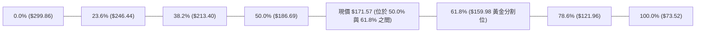

- **當前位置解讀**：現價 $171.57 處於 **50.0% 回調位 ($186.69)** 與 **61.8% 回調位 ($159.98)** 之間。
- **技術意義**：
  1. 跌破 50% 心理分水嶺 $186.69 意味著多頭攻擊波已被腰斬，波段漲勢轉化為弱勢震盪。
  2. 下方 **61.8% ($159.98)** 為道氏理論與斐波那契體系中的「黃金生命線」。該位置與 S1 支撐底界 ($164.31) 及日線布林通道下軌 ($157.36) 構成重疊支撐緩衝帶（$157.36~$164.31）。若此區間能止跌收出長下影線，將引發技術派資金的大規模回補。

---

## 5. 技術指標深度解讀

### 🎛️ 指標訊號總覽

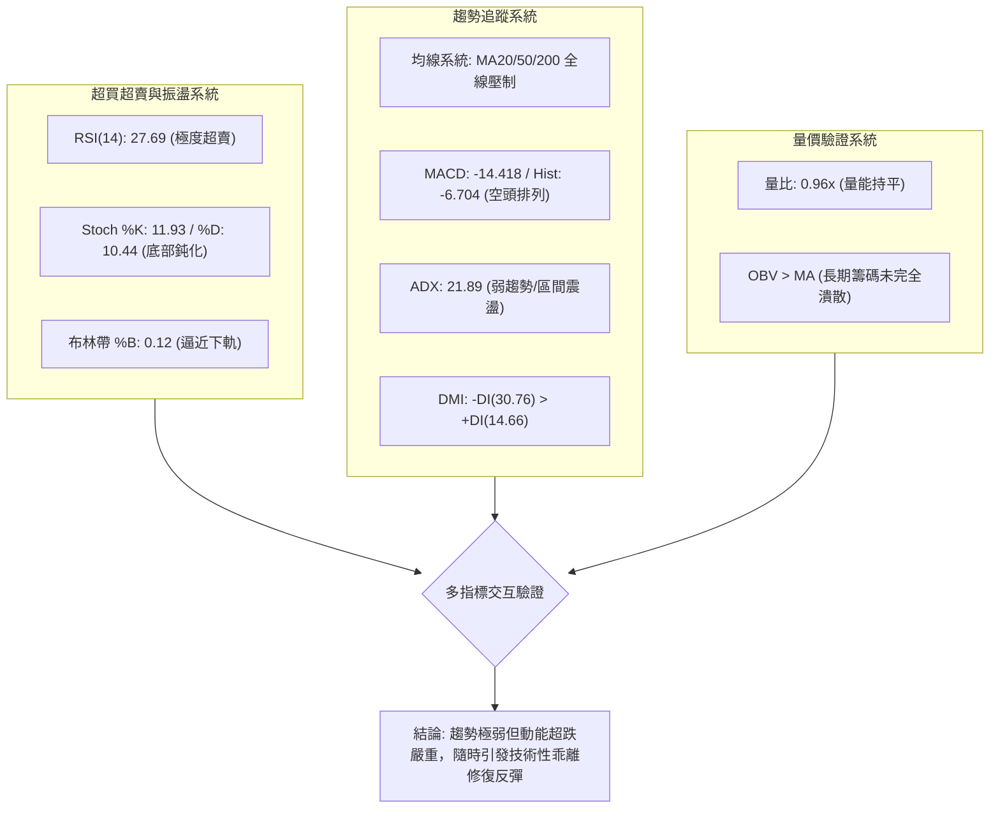

### 📈 移動平均線排列分析

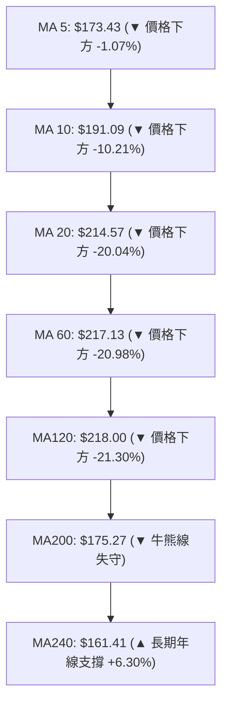

- **排列格局**：當前均線系統呈現「混合偏空排列」。短期（MA5、MA10、MA20）呈陡峭發散下跌走勢；中期均線群（MA50 $221.76、MA60 $217.13、MA120 $218.00）在高位高度纏繞走平後同步掉頭向下，形成空頭「天花板」；
- **均線乖離率**：現價 $171.57 距 MA20（$214.57）負乖離高達 **-20.04%**。在統計學上，個股負乖離超過 -15% 至 -20% 時，下行速率通常會衰竭，均線牽引力（Mean Reversion）將急劇上升。
- **MA200 / MA240 夾層**：現價剛跌破 MA200（$175.27），正逼近 MA240（$161.41）。歷史走勢顯示 MA240 仍維持向上傾斜（+6.30% 乖離），構成當前盤面的最後一道均線護城河。

### 📉 RSI(14) 分析

```
RSI(14) 動能指示器：
0 ────── 20 ── 27.69 ── 30 ───────────── 50 ───────────── 70 ────── 100
[ 極度超賣區 ]  ▲      [ 正常波動區間 ]                [ 超買區 ]
               現值
進度條：█████░░░░░░░░░░░░░░░ 27.69% (超賣狀態)
```

- **數值診斷**：RSI(14) 當前讀數為 **27.69**，跌破 30 超賣門檻。同時週線 RSI(14) 亦處於 **27.7** 的歷史極低區間。
- **背離分析判斷**：
  - **日線層面**：價格創近 6 個月新低（$165.47），RSI 同步下行至 27.69，**目前無明顯底背離**。
  - **週線層面**：2026-10-18 收盤 $165.47（RSI 26.4），2026-10-25 收盤 $171.57（RSI 27.7），出現價格走平微升、RSI 止跌微翹的「潛在弱勢底背離初胚」，但需後續一根週 K 線收陽方可確認。
  - **結論**：指標超賣明確，但不具備強底背離驅動，僅支持「技術性超跌抽腳」，不支持「V型反轉」。

### 📊 MACD(12/26/9) 訊號解讀

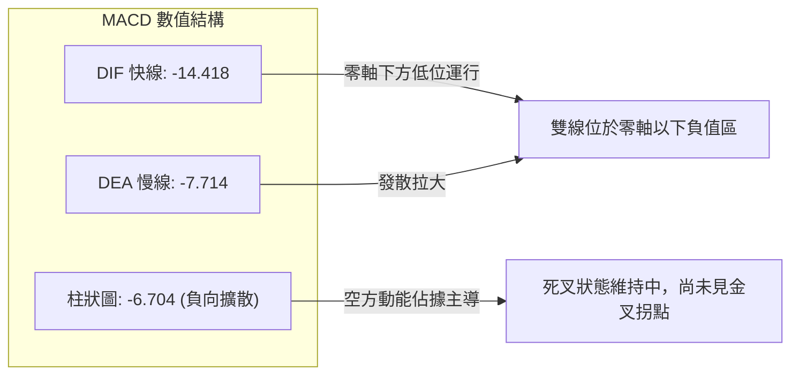

- **現狀解讀**：DIF（-14.418）低於 DEA（-7.714），MACD 柱狀體為 **-6.704**，呈現標準空頭排列。雖然週線柱狀體從前週的 -7.494 略微收斂至 -6.704，但日線層面空頭綠柱仍處於擴張後的高位，顯示空方仍具備慣性摜壓能力，右側追多買點未現。

### 📦 布林通道分析

```
NBIS 布林通道 (20, 2.0) 結構示意：
$271.79 ┬────────────────────────────────────────── BB 上軌 (Upper Band)
        │
$214.57 ┼ - - - - - - - - - - - - - - - - - - - - - BB 中軌 (MA20)
        │
$171.57 │                      ◄── 現價 ($171.57, %B = 0.12)
        │                      ▼── 緩衝區間 ($14.21)
$157.36 ┴────────────────────────────────────────── BB 下軌 (Lower Band)
```

- **通道寬度與極限位置**：通道上軌 $271.79，下軌 $157.36，中軌 $214.57，頻寬達 $114.43（極度張口放大狀態）。
- **%B 指標解讀**：%B = $(171.57 - 157.36) / (271.79 - 157.36) =$ **0.12**。當 %B < 0.15 時，股價已進入布林下軌極端超賣區。空頭若無法在短期內將價格連續封死在下軌之外（形成「沿軌暴跌」），則必然引發均值回歸，向中軌 $214.57 展開修復。

### 💹 成交量分析（量價配合度）

```
近 5 週量價匹配走勢直方圖：
週別         收盤價    成交量 (股)           成交量強度
2026-09-27  $237.33   79,317,300   ████████░░░░░░░░░░  (無量反抽)
2026-10-04  $242.81   65,179,600   ██████░░░░░░░░░░░░  (量價頂背離)
2026-10-11  $221.07   86,070,300   █████████░░░░░░░░░  (下跌放量)
2026-10-18  $165.47  148,676,100   ████████████████░░  (破位恐慌天量)
2026-10-25  $171.57   68,848,800   ███████░░░░░░░░░░░  (超跌量縮止跌)
```

- **量能評估**：
  1. **恐慌拋壓釋放**：2026-10-18 出現 1.48 億股的破位巨量，顯示籌碼在跌破 $200 與 MA200 時出現斷頭融資盤與止損盤踩踏。
  2. **縮量沉澱**：本週成交量快速萎縮至 68.8M（降幅達 53.7%），量比為 0.96x。說明在 $170 附近主動性空頭拋盤已大幅減弱，浮額清洗已至尾聲。
  3. **OBV 指標啟示**：系統顯示「OBV > MA → 量能支撐上漲」，說明儘管近期價格劇烈下挫，但 2026 上半年累積的長期法人資金並未全面性奪路而逃，籌碼結構並未全盤崩解。

---

## 6. 動能與波動率

### ⚡ 動能評估四象限

NBIS 當前技術特徵為：**動能強度偏弱（-DI 主導、MACD 為負）**，同時 **波動率極高（ATR 佔比 9.85%、Beta 1.46）**。因此在動能與波動率矩陣中精確落入 **Q3 象限**。

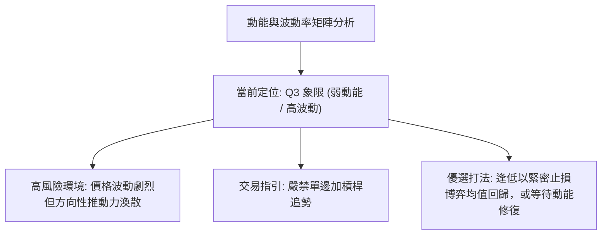

| 象限 | 動能維度 | 波動維度 | 代表特徵 | 當前狀態評估與策略 |
|------|----------|----------|----------|--------------------|
| **Q1** | 強 (Bullish) | 低 (Low Vol) | 穩健主升浪 | 否。多頭主升浪已在 2026-06 結束。 |
| **Q2** | 弱 (Bearish) | 低 (Low Vol) | 沉悶陰跌盤整 | 否。當前波動劇烈，單日振幅極大。 |
| **Q3** | **弱 (Bearish)** | **高 (High Vol)** | **劇烈震盪 / 破位超跌** | **✓ 當前狀態**。高風險高博弈環境，嚴控部位，僅適合波段高手。 |
| **Q4** | 強 (Bullish) | 高 (High Vol) | 狂熱主升突破 | 否。未見強多頭爆發動能。 |

### 📊 ATR 波動率分析

- **ATR(14) 絕對數值**：**$16.91**。
- **ATR 相對百分比**：$\$16.91 / \$171.57 =$ **9.85%**（極高波動標的）。
- **實戰風控距離建議**：
  - **窄幅止損（短線反彈）**：$1.0 \times \text{ATR} =$ **$16.91**。進場止損保護位應設定於現價下方約 $16.91 處。
  - **寬幅止損（波段佈局）**：$1.5 \times \text{ATR} =$ **$25.37**。此止損空間可完全覆蓋日內隨機噪聲，但不宜在保證金交易中放大槓桿。
  - **部位控制限制**：基於單筆交易承擔總資金 1.5% 風險模型計算，持倉上限不得超過總投資組合的 **15%**。

### 📐 Beta 與市場相關性

- **Beta 係數**：**1.46**。
- **解讀**：NBIS 具備典型高貝塔成長股/AI 基礎設施板塊特質，其波動幅度為標普500指數（S&P 500）的 **1.46 倍**。
- **市場環境敏感度**：在大盤回調期，該股下行壓力會被放大 46%；反之，一旦大盤止跌反彈或科技板塊情緒回暖，該股的反彈爆發力亦將居市場前列。目前高 Short % Float (18.9%) 在高 Beta 配合下，具備一旦突破即引發空頭回補踩踏（Short Squeeze）的潛在彈性。

---

## 7. 多時框架總結

### 📋 時框架評分表

| 時框架 | 趨勢方向 | 動能狀態 | 均線排列 | 圖表形態 | 綜合評分 | 操作建議 |
|--------|----------|----------|----------|----------|----------|----------|
| **月線 (長期)** | 偏多震盪 (MA240守穩) | 動能放緩 | 長期均線上行 | 長期上升通道回撤 | 60/100 🟢 | 長線底線設於 MA240 $161.41，耐心觀望 |
| **週線 (中期)** | 偏空格局 (雙頂破位) | 負向擴散 | 中期均線下彎 | 雙重頂 Neckline 跌破 | 30/100 🔴 | 反彈逢高減磅，受制於 R1 $231.17 |
| **日線 (短期)** | 空頭超賣 (乖離過大) | RSI < 30 超賣 | MA5-MA20 空頭 | 貼軌小孕線整理 | 35/100 🔴 | 輕倉博弈超跌反彈，嚴格帶 S1 止損 |

### 🔲 綜合訊號矩陣

```
訊號維度矩陣圖：
維度             短期 (日線)      中期 (週線)      長期 (月線)      維度收斂共識
─────────────────────────────────────────────────────────────────────────────
趨勢方向         🔴 空頭下跌      🔴 雙頂成形      🟡 漲多回撤      偏空震盪主導
動能指標         🟢 極度超賣      🔴 空方擴散      🟡 動能減弱      超跌反彈在即
均線結構         🔴 破MA200       🔴 全線下壓      🟢 MA240向上     上方阻力重重
量價結構         🟢 殺跌縮量      🔴 破位放量      🟢 OBV維持高位   長期籌碼仍在
─────────────────────────────────────────────────────────────────────────────
時框衝突狀態：短期指標極度超賣與中長期趨勢破位形成強烈背離矛盾。
```

### ⚖️ 多時框收斂結論

> **依據規則 14 執行多時框架收斂判斷**：
> 1. **行情定性**：當前日線 ADX(14) 讀數為 **21.89**，低於 25 的關鍵趨勢門檻，明確定義當前並非「單邊破位加速主跌趨勢」，而是**「寬幅區間震盪行情的破位超賣修正」**。
> 2. **優先級收斂**：在 ADX < 25 的環境下，**日線布林通道上下軌與關鍵支撐阻力聚類成為主導交易邊界**，中長期均線的單邊指引力下降。
> 3. **唯一方向性結論**：**中性偏空觀望，主策略定調為「超賣區間下軌防守之逆勢反彈博弈」**。
> 4. **時框衝突取捨**：雖然週線級別雙頂確立偏空，但日線 RSI(27.69) 與布林 %B(0.12) 已達統計極端值，空頭在此位置不具備盈虧比優勢；因此收斂結果以**「守住 S1 $164.31 前提下看反抽修復、若反彈觸及阻力無力再重回空勢」**為唯一行動準則。

---

## 8. 交易策略建議

### 🗺️ 策略決策流程圖

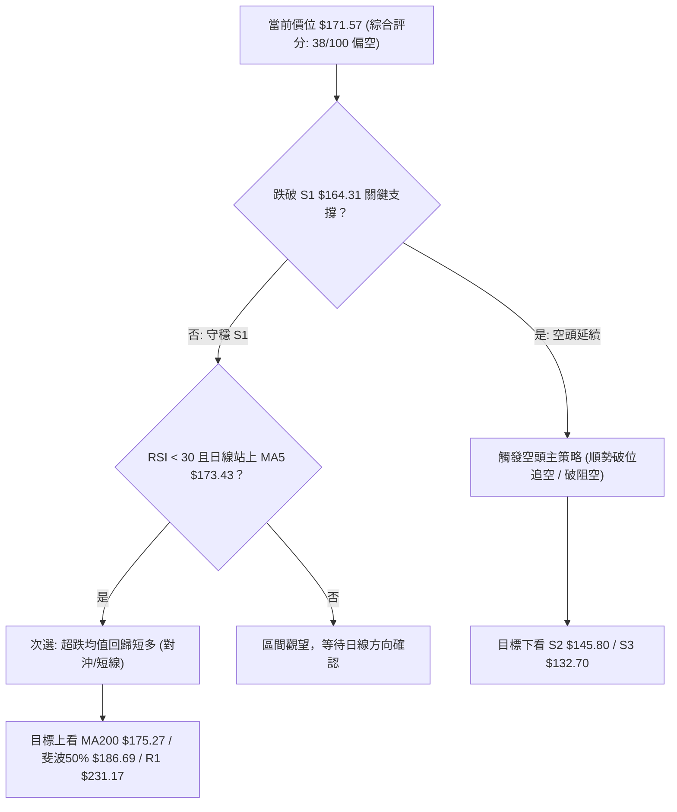

### 🧭 策略路由（依評分卡分流）

**當前主策略方向 = 主推空頭波段策略（逢反彈布空 / 破位順勢），輔以超跌反彈對沖提示**  
*（依據：第 1 章技術評分卡綜合評分僅 **38/100**，低於 40 分偏空門檻，趨勢系統由空方完全主導）*

### 🎯 價格情境階梯（Price Scenarios）

| 觸發條件 | 下一目標 | 後續延伸 | 情境含義 |
|----------|----------|----------|----------|
| **強勢突破 R1 $231.17** | R2 $254.92 | R3 $279.83 | 中期空頭形態瓦解，多頭重掌行情 |
| **反彈受阻於 $186.69~$214.57** | 回測現價 $171.57 | S1 $164.31 | 典型弱勢均線反抽，空頭再建倉機會 |
| **現價 $171.57 區間震盪** | S1 $164.31 | 布林下軌 $157.36 | 超賣指標修復，以時間換空間 |
| **有效跌破 S1 $164.31** | S2 $145.80 | S3 $132.70 | 中期雙頂量度跌幅展開，下尋黃金支撐 |

### 📊 情境機率分佈

| 情境劇本 | 機率估計 | 主要技術依據 |
|----------|----------|--------------|
| **情境 A：跌破 S1 延續下行** | **45%** | MA5 至 MA120 全線空頭排列；MACD 負向擴散；-DI(30.76) 空方牢固掌控盤面。 |
| **情境 B：超跌反彈均值回歸** | **35%** | RSI(14)=27.69 極度超賣；%B=0.12 緊貼布林下軌；週成交量顯著萎縮（拋壓暫竭）。 |
| **情境 C：在 S1 與 MA200 間橫盤** | **20%** | ADX=21.89 指向弱趨勢區間震盪，市場缺乏單邊殺跌量能，進入低位收斂。 |

### 🟢 主策略詳情（方向依上方路由：空頭策略為主）

因評分為 38/100（≤40），主策略推行空頭策略（策略 A：反彈受阻高空；策略 B：破位順勢跟進空）。

| 策略要素 | 策略 A（反彈逢高布空 — 主推薦） | 策略 B（跌破支撐追空 — 順勢推薦） |
|----------|----------------------------------|------------------------------------|
| **進場條件** | 股價受 RSI 超賣驅動反抽，於 MA200 或斐波那契 50% 受阻收上影線 | 日線收盤價實質跌破波段低點聚類 S1 $164.31 |
| **進場價格** | **$186.69**（斐波那契 50% 阻力處） | **$163.50**（確認跌破 S1 $164.31 之後） |
| **目標價 T1** | **$164.31**（回測波段支撐 S1） | **$145.80**（強支撐 S2 聚類位） |
| **目標價 T2** | **$145.80**（下探強支撐 S2） | **$132.70**（核心防線 S3 聚類位） |
| **止損價格** | **$198.00**（突破 MA10 $191.09 上方緩衝區） | **$172.00**（回抽假跌破重返現價之上） |
| **風險報酬比** | **1 : 1.98**（風險 $11.31，獲利 $22.38） | **1 : 2.08**（風險 $8.50，獲利 $17.70） |
| **成功機率** | **65%** | **55%** |
| **建議倉位** | **10%** 總資產組合 | **8%** 總資產組合 |

*(註：若投資人欲博弈超跌反彈，反彈多頭策略屬次要對沖：進場點 $171.57，止損點 $163.00，第一目標 $186.69，第二目標 $214.57，風報比 1:1.76，倉位嚴格限制在 5% 以內。)*

### 🔴 反向風險觸發點（對沖提示）

- **空頭平倉 / 對沖翻多觸發線**：若日線放量收陽實體完全站穩 **MA200（$175.27）** 之上，且 RSI(14) 突破 35，所有空單必須無條件減半；若進一步突破 **R1（$231.17）**，中期空頭模型完全失效，空頭部位全數止損離場。
- **軋空預警條件**：若週成交量突破 1.5 億股且單日漲幅逾 8%，鑑於目前高達 18.9% 的空頭浮額，極易形成 Short Squeeze，禁止任何追空操作。

### ⭐ 整體訊號強度評星

```
做多訊號強度：★★☆☆☆  (2.0/5星 — 僅具備超賣反彈價值，缺乏結構支撐)
做空訊號強度：★★★★☆  (4.0/5星 — 均線與週線頂部形態全面偏空)
整體可信度：  ★★★☆☆  (3.5/5星 — ADX 低於 25 表明震盪洗盤干擾大)
```

---

## 9. 風險提示與監控

### ✅ 關鍵監控指標 Checklist

```
╔══════════════════════════════════════════════════════════════════╗
║                     NBIS 每日技術監控清單 (Checklist)            ║
╠══════════════════════════════════════════════════════════════════╣
║ [ ] 價格防守線：收盤價是否跌破支撐 S1 $164.31？                  ║
║ [ ] 均線重奪線：收盤價能否重返牛熊線 MA200 $175.27？             ║
║ [ ] 動能極值監控：RSI(14) 是否回升突破 30？(脫離超賣區確認)     ║
║ [ ] MACD 柱狀體：日線負柱是否收斂至 -3.000 以內？                ║
║ [ ] 通道極限：價格是否跌破布林下軌 $157.36？(防範單邊下軌崩跌)  ║
║ [ ] 量能異動：單日成交量是否爆出 > 35,000,000 股之異常放量？     ║
║ [ ] 籌碼異動：Short % Float 是否自 18.9% 出現顯著下降？         ║
╚══════════════════════════════════════════════════════════════════╝
```

### ⚠️ 風險場景分析

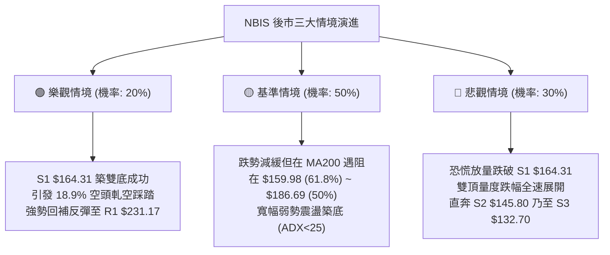

### 🛡️ 風險管理重要提醒

1. **波動率極端風險（ATR 高達 9.85%）**：
   - 該股每日平均波動空間達 $16.91，日內振幅常態化超過 10%。一般散戶投資人切忌使用高槓桿衍生工具（如短天期價外期權），極易在無方向性日內雜訊震盪中被雙向止損出局。
2. **財報與估值風險背離**：
   - Trailing P/E 達 134.04，Forward P/E 為負（-48.22），且自由現金流（FCF）為負 $9.61B。基本面處於巨額資本支出與高負債（Total Debt $10.20B）階段，技術面一旦破位，極易引發機構估值模型修正的無情拋售。
3. **倉位管理剛性紀律**：
   - 單一標的暴露限制：鑑於 Beta 達 1.46，在整體投資組合中的權重上限應嚴格限制在 **10%~15%** 以內。
   - 分批建倉原則：嚴禁在下降通道未扭轉前一次性滿倉抄底，所有進場部位必須遵守「初始試倉 1/3、確認站穩關鍵位加碼 1/3、突破結構確認補足 1/3」的建倉紀律。

---

## 📋 報告總結

```
╔══════════════════════════════════════════════════════════════════╗
║                     NBIS 技術分析報告總結                        ║
╠══════════════════════════════════════════════════════════════════╣
║ 報告日期：2026-10-22                                             ║
║ 當前價格：$171.57                                                ║
║ 分析評級：🔴 偏空震盪 / 超跌反彈醞釀 (技術評分: 38/100)          ║
║                                                                  ║
║ 關鍵結論：                                                       ║
║ ├─ 長期趨勢：🟡 月線高位深度回調，MA240 $161.41 提供長期最後防線 ║
║ ├─ 中期趨勢：🔴 週線 $286.69/$277.68 雙頂頸線破位，反彈皆為阻力 ║
║ ├─ 短期趨勢：🔴 均線空頭排列，但 RSI(27.69) 極度超賣，隨時抽腳  ║
║ ├─ 關鍵支撐：S1 $164.31 ｜ S2 $145.80 ｜ S3 $132.70              ║
║ ├─ 關鍵阻力：R1 $231.17 ｜ R2 $254.92 ｜ R3 $279.83              ║
║ └─ 外資分析師目標均價：$283.60 (當前折價 39.5%)                  ║
║                                                                  ║
║ 最優策略組合：                                                   ║
║ 1. 🥇 最佳機會（空頭主打）：逢超跌反彈至斐波 50% $186.69 處，    ║
║    確認承壓後布建波段空單，止損 $198.00，目標下看 S1 $164.31。   ║
║ 2. 🥈 次選機會（順勢破位）：若日線收盤確認摜破 S1 $164.31，      ║
║    順勢輕倉追空，止損 $172.00，目標下看 S2 $145.80。             ║
║ 3. 🥉 保守選擇（右側觀望）：空手觀望，靜待股價回測 61.8% $159.98 ║
║    或 MA240 $161.41 出現放量日線底背離金叉後，再行介入多頭。    ║
╚══════════════════════════════════════════════════════════════════╝
```

---

> ⚠️ **免責聲明**：本報告為 AI 自動生成之技術分析，所有數據及估算均基於提供的歷史價格資訊。本報告**僅供研究與學術參考**，**不構成任何投資建議**。投資有風險，入市需謹慎。

---

*報告生成時間：2026-10-22 ｜ 數據來源：Yahoo Finance ｜ 分析框架：多時框技術分析*