# NBIS 技術分析報告

> **報告日期**：2026-10-23 ｜ **語言**：繁體中文 ｜ **數據來源**：Yahoo Finance ｜ **當前價格**：$159.17 USD

---

## 目錄

| 章節 | 內容 |
|------|------|
| [1. 技術面概覽](#1-技術面概覽) | 訊號儀表板、核心指標、評分卡 |
| [2. 趨勢分析](#2-趨勢分析) | 多時框趨勢、長中短期走勢、12個月走勢圖 |
| [3. 圖表形態分析](#3-圖表形態分析) | 形態識別、K線組合、目標價推算 |
| [4. 支撐與阻力](#4-支撐與阻力) | 關鍵價位分布、阻力與支撐表、斐波那契回調 |
| [5. 技術指標深度解讀](#5-技術指標深度解讀) | 均線系統、RSI、MACD、布林通道、成交量 |
| [6. 動能與波動率](#6-動能與波動率) | 動能四象限、ATR波動分析、Beta相關性 |
| [7. 多時框架總結](#7-多時框架總結) | 時框架矩陣、多時框收斂結論 |
| [8. 交易策略建議](#8-交易策略建議) | 策略路由、情境階梯、主策略詳情、評星 |
| [9. 風險提示與監控](#9-風險提示與監控) | 監控清單、情境模擬、風控提醒 |
| [10. 報告總結](#-報告總結) | 核心總結儀表板與策略結論 |

---

## 1. 技術面概覽

### 🎯 技術訊號儀表板

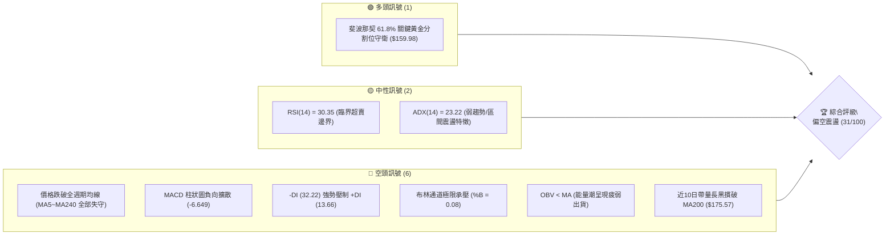

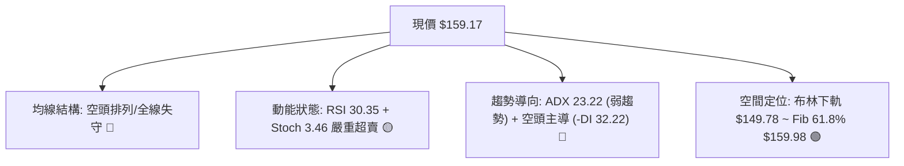

### 📊 核心指標速覽表

| 指標類別 | 指標名稱 | 當前數值 | 訊號 | 解讀 |
|:---|:---|:---|:---:|:---|
| **價格** | 當前收盤價 | $159.17 | 🔴 | 位於52週區間 37.8%，自波段高點 $299.86 大幅修正 -46.92% |
| **均線** | MA20 | $210.36 | 🔴 | 價格低於 MA20 達 -24.33%，短期均線呈現陡峭下行下彎 |
| **均線** | MA50 | $219.76 | 🔴 | 價格遠在 MA50 下方，中期趨勢完全轉向空方控盤 |
| **均線** | MA200 | $175.57 | 🔴 | 近期實體黑K摜破年線 ($175.57)，長期牛熊分水嶺失守 |
| **動能** | RSI(14) | 30.35 | 🟡 | 觸及 30 關鍵超賣臨界點，具備技術性跌深反彈動能 |
| **動能** | MACD (12,26,9) | -16.025 / -9.376 | 🔴 | 雙線位於零軸下方嚴重負值區，柱狀圖 -6.649 持續看空 |
| **動能** | Stoch %K / %D | 3.46 / 9.07 | 🟡 | 數值落入個位數極端超賣區，隨時具備反抽修復可能 |
| **波動** | ATR(14) | $16.59 | 🔴 | 佔股價 10.42%，屬於超高波動資產，日內停損區間需擴大 |
| **趨勢** | ADX(14) / ±DI | 23.22 / -DI 32.22 | 🔴 | ADX<25 顯示單邊趨勢放緩轉入震盪，但 -DI 壓倒性領先 |
| **通道** | 布林通道 | 下軌 $149.78 / %B 0.08 | 🟡 | 價格貼近下軌，出現布林帶擠壓與下軌支撐回測現象 |
| **量能** | 20日成交量比 | 1.28x (26.01M) | 🔴 | 下殺過程中成交量放大高於均量，OBV < MA 顯示主力減碼 |

### 🏆 技術評分卡

```
╔══════════════════════════════════════════════════════════════╗
║                技術評分卡 — NBIS (2026-10-23)                 ║
╠══════════════════════════════════════════════════════════════╣
║ 趨勢強度      ███████░░░░░░░░░░░░░  35/100  🔴 空頭控盤      ║
║ 動能指標      ██████░░░░░░░░░░░░░░  28/100  🔴 負向擴散      ║
║ 支撐穩定度    ██████████░░░░░░░░░░  48/100  🟡 考驗S1/Fib    ║
║ 成交量配合    ██████░░░░░░░░░░░░░░  32/100  🔴 量大走跌      ║
║ 形態完整度    ██████░░░░░░░░░░░░░░  30/100  🔴 形態破位      ║
║ 均線排列      ███░░░░░░░░░░░░░░░░░  15/100  🔴 全線倒掛      ║
╠══════════════════════════════════════════════════════════════╣
║ 綜合評分      ██████░░░░░░░░░░░░░░  31/100  🔴 強烈偏空      ║
║ 評分公式: (35 + 28 + 48 + 32 + 30 + 15) ÷ 6 = 31.33 → 31/100  ║
╚══════════════════════════════════════════════════════════════╝
```

---

## 2. 趨勢分析

### 🌐 多時框趨勢分析

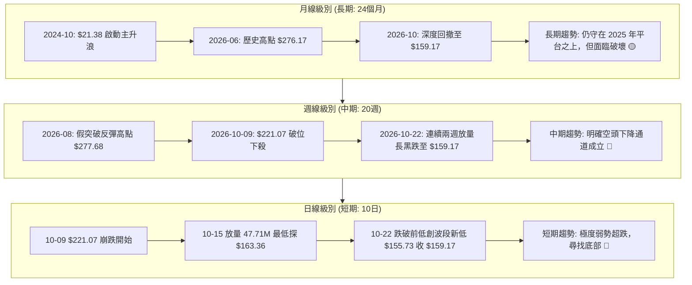

### 📈 長期趨勢 — 12個月走勢圖（Unicode）

```
NBIS 月線收盤走勢圖（過去12個月: 2025-11 至 2026-10）
價格軸 ($)
$280 ┤                                  ● $276.17 (2026-06)
$250 ┤                                              ● $235.88 (2026-09)
$220 ┤                             ● $231.09        
$190 ┤                                          ● $190.41 (2026-07)
$160 ┤                                                      ● $159.17 (現在)
$130 ┤                                  
$100 ┤ ● $94.87 (2025-11)      ● $103.76
$70  ┤     ● $83.71 (2025-12)    
     └─────────────────────────────────────────────────────────────
        11    12    01    02    03    04    05    06    07    08    09    10
       2025  2025  2026  2026  2026  2026  2026  2026  2026  2026  2026  2026
```

#### 走勢特徵分析表格

| 階段 | 時間區間 | 起點價格 | 終點價格 | 漲跌幅 (%) | 走勢特徵與市場量價心理 |
|:---|:---|:---|:---|:---|:---|
| **第一階段：築底蓄勢** | 2025-11 ~ 2026-02 | $94.87 | $91.19 | -3.88% | 股價於 $83.71 ~ $94.87 區間形成堅實底部箱體，成交量溫和萎縮。 |
| **第二階段：主升暴漲** | 2026-02 ~ 2026-06 | $91.19 | $276.17 | +202.85% | 伴隨 AI 雲端算力題材爆發，連續大陽線拔高，創下歷史收盤高點 $276.17。 |
| **第三階段：高檔震盪** | 2026-06 ~ 2026-09 | $276.17 | $235.88 | -14.59% | 7月大幅回撤至 $190.41，8月強拉至 $206.32，9月收 $235.88，主力高檔巨幅洗盤。 |
| **第四階段：崩跌破位** | 2026-09 ~ 2026-10 | $235.88 | $159.17 | -32.52% | 10月單月重挫近百元，直接摜穿所有短期與中期支撐線，空頭完全主導。 |

### 📊 中期趨勢（週線分析）

中期走勢圖展示了近 20 週高點與低點的劇烈擺動。自 2026-06-18 創下 $286.69 的週收盤高點與 2026-08-14 反彈高點 $277.68 以來，NBIS 構築了雙重高點壓制結構，隨後展開了階梯式雪崩行情。

```
NBIS 週線關鍵壓力與支撐階梯示意圖
價格 ($)
$280 ┤─────── 週線雙頂阻力區 ($277.68 - $286.69)
$250 ┤─────── 頸線/破位阻力 R3: $254.92
$230 ┤─────── 中期籌碼密集阻力 R2: $231.17
$170 ┤─────── 近期回抽阻力 R1: $168.71
$159 ┼─────── 當前收盤價 ($159.17) / Fib 61.8% ($159.98)
$145 ┤─────── 波段支撐 S1: $145.80
$132 ┤─────── 強力防守支撐 S2: $132.70
$90  ┤─────── 長期趨勢防線 S3: $89.65
```

### ⚡ 趨勢強度評估（ADX 解讀）

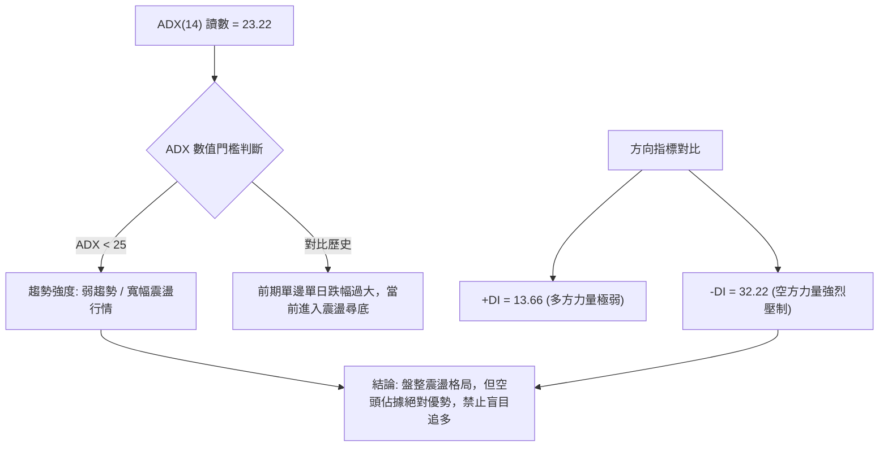

#### ADX 指標強度對照解析

| 指標名稱 | 當前數值 | 參考標準區間 | 趨勢狀態判定 | 交易策略意涵 |
|:---|:---:|:---:|:---:|:---|
| **ADX (14)** | **23.22** | < 25 (弱/無趨勢)；25-50 (強趨勢)；> 50 (極強) | **弱趨勢 / 震盪走勢** | 單邊追空風險增大，盤面將轉為依託布林通道與關鍵支撐阻力之區間波動。 |
| **+DI (14)** | **13.66** | 數值越低多頭動能越匱乏 | **極度疲軟** | 多頭完全喪失進攻意願，上方無主動承接盤。 |
| **-DI (14)** | **32.22** | > 25 且顯著高於 +DI 代表空方主控 | **空方實質主導** | 逢反彈即遭遇拋壓，任何反抽皆應視為技術性解套賣壓釋放。 |

---

## 3. 圖表形態分析

### 🔍 形態識別系統

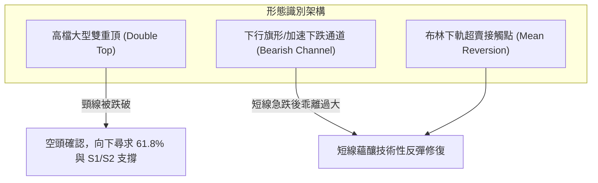

#### 形態識別信心度與目標價評估

| 形態名稱 | 信心度 (%) | 判斷依據（引用數據） | 完成度 (%) | 目標價（附嚴謹計算式） |
|:---|:---:|:---|:---:|:---|
| **高檔雙重頂 (M頭)** | **85%** | 兩大波段高點分別為 2026-06-18 的 $286.69 與 2026-08-14 的 $277.68，頸線為 7月低點聚類阻力 R2 $231.17。近期以巨量長黑摜破頸線。 | **100% (已跌破)** | 形態高度 = $277.68 − $231.17 = $46.51。<br>破位目標價 = 頸線 $231.17 − $46.51 = **$184.66**（現價已跌破此目標，空頭超額宣洩）。 |
| **波段下行擴散通道** | **70%** | 連續跌破日線 MA20 ($210.36) 與 MA200 ($175.57)，在 10-09 至 10-22 間呈現 45 度角下殺。 | **80%** | 下行通道下軌支撐對應下方波段低點聚類 **S1 $145.80**。 |
| **多重底形態 (潛在)** | **20%** | 訊號不足，僅做指標型解讀。現價僅有一根探底 K 棒 ($155.73)，尚未形成任何回踩或第二隻腳。 | **15%** | 尚未成立，不可預測多頭底形目標價。 |

### 🕯️ 重要K線形態分析

嚴格依據數據中「近10根日K」與「近8根週K」的實際數值進行專業 K 線組合分析：

| 日期（級別） | 開盤價 | 最高價 | 最低價 | 收盤價 | K線形態名稱 | 專業技術解讀 | 訊號方向 |
|:---|:---:|:---:|:---:|:---:|:---|:---|:---:|
| **2026-10-14 (日K)** | $195.00 | $198.60 | $183.11 | $186.01 | **放量實體大陰線** | 跳空低開低走，成交量激增至 34.04M，跌破 $190 關鍵整數關卡。 | 🔴 強烈看跌 |
| **2026-10-15 (日K)** | $175.48 | $189.33 | $163.36 | $188.41 | **長下影錘頭線 (Hammer)** | 爆出近期天量 47.72M，盤中急殺至 $163.36 後強拉回升，顯示低檔爆量換手。 | 🟡 止跌信號 |
| **2026-10-16 (日K)** | $181.17 | $182.70 | $163.27 | $165.47 | **吞噬性中陰線** | 未能延續前日長下影反彈，反向摜破前低，成交量 35.21M，形成空頭反撲。 | 🔴 延續下跌 |
| **2026-10-20 (日K)** | $163.99 | $174.74 | $160.25 | $171.45 | **低檔抗跌中陽線** | 開盤 $163.99 探底至 $160.25 後逆勢收高於 $171.45，成交量 22.62M，多頭初步反抗。 | 🟢 短線反彈 |
| **2026-10-22 (日K)** | $164.75 | $167.50 | $155.73 | $159.17 | **破底中陰線 (現價)** | 低開低走收最低附近，跌破 10-20 低點，創下 $155.73 新低，量能放大至 26.01M。 | 🔴 空方控盤 |
| **2026-10-16 (週K)** | $217.20 | $217.20 | $163.27 | $165.47 | **光頭光腳大黑K** | 單週重挫 $55.60 (-25.15%)，週成交量暴增至 148.68M，實體完全吞噬前5週K棒。 | 🔴 毀滅性看空 |
| **2026-10-22 (週K)** | $176.51 | $178.85 | $155.73 | $159.17 | **探底弱勢中陰線** | 週線延續破底，高點受制於 $178.85，週量 95.20M，尚未出現底部翻轉長紅。 | 🔴 弱勢尋底 |

### 📉 ASCII 走勢形態示意圖

```
NBIS 近10日 K 線排列與形態跌破示意圖
  價格 ($)
  $225 ┤   ┌─┐
  $215 ┤   │ │ (10-09 $221.07)
  $205 ┤   └┬┘   ┌─┐
  $195 ┤         │ │ ┌─┐
  $185 ┤         └┬┘ │ │ (10-14 $186.01 爆量大陰)
  $175 ┤             └┬┘   ┌─┐ (10-15 爆量下影線)
  $165 ┤                   │ │   ┌─┐       ┌─┐ (10-21 $171.57)
  $155 ┤                   └┬┘   │ │ ┌─┐   │ │   ┌─┐
  $145 ┤                         └┬┘ │ │   └┬┘   │ │ (10-22 收 $159.17 破底)
       └─────────────────────────────┴─┘─────────┴─┘───────────────
         10-09  10-12  10-13 10-14 10-15 10-16 10-19 10-20 10-21 10-22
```

### 🎯 形態目標價計算

針對「雙重頂頸線破位」與「下行測幅」之具體數值計算如下：

```
╔══════════════════════════════════════════════════════════════╗
║               形態測幅目標價詳細推算說明                     ║
╠══════════════════════════════════════════════════════════════╣
║ 1. 高檔 M 頭破位等幅測幅目標：                               ║
║    高點 A = $286.69 (2026-06-18)                             ║
║    高點 B = $277.68 (2026-08-14)                             ║
║    形態取樣高點 = $277.68                                    ║
║    頸線位置 = R2 ($231.17)                                   ║
║    形態垂直高度 H = $277.68 − $231.17 = $46.51               ║
║    第一等幅滿足點 = $231.17 − $46.51 = $184.66 (已跌破)      ║
║    第二倍延伸滿足點 = $231.17 − (2 × $46.51) = $138.15        ║
║    ★ 該數值與數據庫中關鍵支撐 S2 ($132.70) 形成密集共振區間  ║
╠══════════════════════════════════════════════════════════════╣
║ 2. 下行箱體/旗形跌破目標：                                   ║
║    旗面整理區間: 10-19 至 10-21 高點 $178.85 / 低點 $160.25  ║
║    箱體振幅 = $178.85 − $160.25 = $18.60                     ║
║    破位目標價 = $160.25 − $18.60 = $141.65                   ║
║    ★ 該數值緊貼波段低點聚類支撐位 S1 ($145.80)              ║
╚══════════════════════════════════════════════════════════════╝
```

---

## 4. 支撐與阻力

### 🗺️ 關鍵價位分布圖（Unicode）

```
NBIS 價位結構分布圖 (嚴格引用 OHLCV 計算與斐波那契數值)
═══════════════════════════════════════════════════════════════════
$299.86 ║████████████████████████████████████║ 52W 歷史最高點 (Fib 0.0%)
$254.92 ║████████████████████████████        ║ 強阻力 R3 (高檔解套賣壓密集區)
$246.44 ║▓▓▓▓▓▓▓▓▓▓▓▓▓▓▓▓▓▓▓▓▓▓▓▓▓▓▓▓        ║ Fib 23.6% 回調阻力
$231.17 ║████████████████████████            ║ 關鍵波段阻力 R2 (中期破位頸線)
$213.40 ║▓▓▓▓▓▓▓▓▓▓▓▓▓▓▓▓                    ║ Fib 38.2% 回調位 (接近 MA20 $210.36)
$186.69 ║▓▓▓▓▓▓▓▓▓▓▓▓                        ║ Fib 50.0% 中軸平衡位
$168.71 ║████████████                        ║ 短線反彈第一阻力 R1 (10-21跳空高點)
$159.98 ╠════════════════════════════════════╣ Fib 61.8% 黃金分割線 (現價 $159.17 ◄ 爭奪中)
$149.78 ║▒▒▒▒▒▒▒▒▒▒                          ║ 布林通道下軌動態支撐
$145.80 ║████████                            ║ 近期波段關鍵支撐 S1
$132.70 ║██████                              ║ 強力防守支撐 S2 (波段低點聚類)
$121.96 ║▓▓▓▓                                ║ Fib 78.6% 極限回調支撐
$89.65  ║██                                  ║ 終極長期防守支撐 S3
$73.52  ║                                    ║ 52W 歷史最低點 (Fib 100.0%)
═══════════════════════════════════════════════════════════════════
```

### 🚧 阻力位分析表

所有價位均來自歷史波段高點聚類分析：

| 阻力級別 | 精確價位 | 距現價幅離 (%) | 形成原因與籌碼解讀 | 突破難度 | 技術重要性 |
|:---|:---:|:---:|:---|:---:|:---:|
| **R1** | **$168.71** | +5.99% | 近期 10-20 ~ 10-21 密集換手反彈高點聚類，同時與 MA5 ($167.58) 形成重疊共振壓制。 | 🟡 中等 | ★★★☆☆ |
| **R2** | **$231.17** | +45.23% | 前期週線級別 M 頭頸線破位點，大量機構持倉成本套牢區，反彈至此將遭遇解套賣壓。 | 🔴 極高 | ★★★★★ |
| **R3** | **$254.92** | +60.16% | 2026-09-11 週線高點 $254.74 與歷史次高點聚類區，屬於中期空頭防守的堡壘。 | 🔴 極難 | ★★★★☆ |

### 🛡️ 支撐位分析表

所有價位均來自歷史波段低點聚類分析：

| 支撐級別 | 精確價位 | 距現價幅離 (%) | 形成原因與籌碼解讀 | 守住機率 | 技術重要性 |
|:---|:---:|:---:|:---|:---:|:---:|
| **S1** | **$145.80** | -8.40% | 近一年波段低點聚類密集區，且接近布林下軌 ($149.78)，為短線空頭下殺的第一緩衝帶。 | 🟡 55% | ★★★★☆ |
| **S2** | **$132.70** | -16.63% | 2026年4月起漲波段的平台起點，強烈機構買盤防護區，技術形態雙頂等幅倍數滿足區。 | 🟢 75% | ★★★★★ |
| **S3** | **$89.65** | -43.67% | 2025-12 至 2026-02 築底中樞 ($83.71 ~ $91.19) 之核心聚類點，長期多頭不可退守的底線。 | 🟢 90% | ★★★★★ |

### 📐 斐波那契回調位分析

依據 52 週完整波動區間（低點 $73.52 至 高點 $299.86，垂直落差 $226.34）計算：

```
斐波那契回調位與現價位置對照
0.0%  (52W High)  $299.86  ───────────────────────────────────────
23.6%             $246.44  ───────────────────────────────────────
38.2%             $213.40  ─────────────────────────────────────── (貼近 MA20 $210.36)
50.0%             $186.69  ───────────────────────────────────────
61.8%             $159.98  ═══════════════════════════════════════ (現價 $159.17 正位於此)
78.6%             $121.96  ───────────────────────────────────────
100.0% (52W Low)  $73.52   ───────────────────────────────────────
```

- **位置解讀**：NBIS 當前收盤價 **$159.17** 正處於 **Fib 61.8% ($159.98)** 與 **Fib 78.6% ($121.96)** 的回調通道邊緣，實質上僅差 $0.81 即完美貼合金邊分割點。
- **技術意義**：
  1. 斐波那契 61.8% ($159.98) 為經典多空防守生死線。多頭若能在此展現強烈防守意願並收出日線紅K吞噬，則可確立為健康的中期深度回調。
  2. 若本週收盤實體跌破 $159.98 且無法收回，依據黃金分割慣性，價格將下探 **Fib 78.6% ($121.96)**，期間僅有波段聚類支撐 **S1 ($145.80)** 與 **S2 ($132.70)** 能提供實質支撐。

---

## 5. 技術指標深度解讀

### 🎛️ 指標訊號總覽

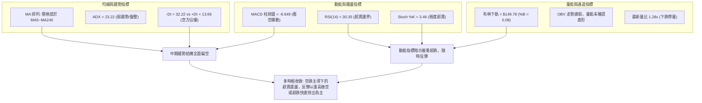

### 📈 移動平均線排列分析

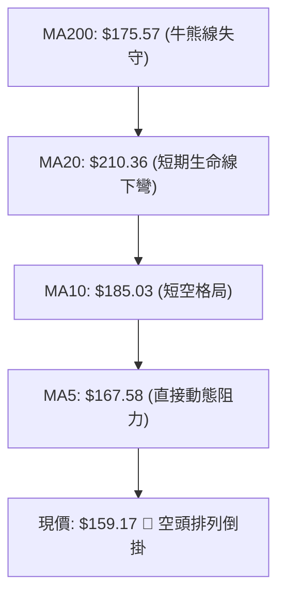

#### 均線全維度數據對照表

| 均線名稱 | 數值 | 距現價差距 ($) | 偏離率 (%) | 均線斜率與形態 | 走勢特徵解讀 |
|:---|:---:|:---:|:---:|:---|:---|
| **MA 5** | $167.58 | -$8.41 | -5.02% | 陡峭向下 █▇▇▆▆ | 最貼近價格的動態壓制線，短線未收復前不可言底。 |
| **MA 10** | $185.03 | -$25.86 | -13.98% | 快速下行 ▆▆▆▇▇ | 短線多頭反抽的第一極限防守區。 |
| **MA 20** | $210.36 | -$51.19 | -24.33% | 下彎加速 ▇▅▄▃▃ | 月線生命線，亦為布林通道中軌，偏離達 -24.33% 屬嚴重負乖離。 |
| **MA 50** | $219.76 | -$60.59 | -27.57% | 走平轉下 █▇▆▄▃ | 中期季線防線徹底失守，宣告中期多頭循環結束。 |
| **MA 60** | $217.31 | -$58.14 | -26.75% | 向下發散 █▇▆▄▃ | 與 MA50 形成高檔死叉下行。 |
| **MA 120** | $218.04 | -$58.87 | -27.00% | 走平鈍化 ▁▁▂▂▃ | 半年線失守，長線機構資金開始轉為觀望減碼。 |
| **MA 200** | $175.57 | -$16.40 | -9.34% | 緩步走平 ▁▁▂▂▃ | 傳統技術分析之年線分水嶺，跌破後確認進入熊市修正格局。 |
| **MA 240** | $161.61 | -$2.44 | -1.51% | 走緩微升 ▁▁▂▂▃ | 長期成本底線，現價剛跌破 MA240，正考驗長線資金最後防線。 |

### 📉 RSI(14) 分析

```
RSI(14) 當前強度: 30.35 / 100
[██████░░░░░░░░░░░░░░] 30.35% (臨界超賣線 30.00)
 0             30         50         70           100
 超賣區        現價       中軸       超買區
```

- **超買超賣判定**：RSI(14) 讀數為 **30.35**，剛好觸及傳統技術分析的 30 超賣門檻。同時隨機指標 Stoch %K 為 **3.46**，%D 為 **9.07**，處於個位數的極端低位，顯示短期市場經歷恐慌性拋售，賣盤動能已宣洩至極限。
- **背離分析結論**：
  - **日線背離判定**：比對近 20 根 K 棒走勢，價格自 10-09 的 $221.07 崩跌至 10-22 的 $159.17，同期間 RSI 從約 46 快速滑落至 30.35，價格與指標呈現同步下行，「**無明顯日線底背離**」。
  - **週線背離判定**：週線收盤價自 10-02 的 $242.81 降至 10-22 的 $159.17，週線 RSI 由 57.1 降至 30.3，同樣呈現方向一致的同步下降。「**無底背離確認，下跌動能仍屬真實宣洩**」。

### 📊 MACD(12/26/9) 訊號解讀

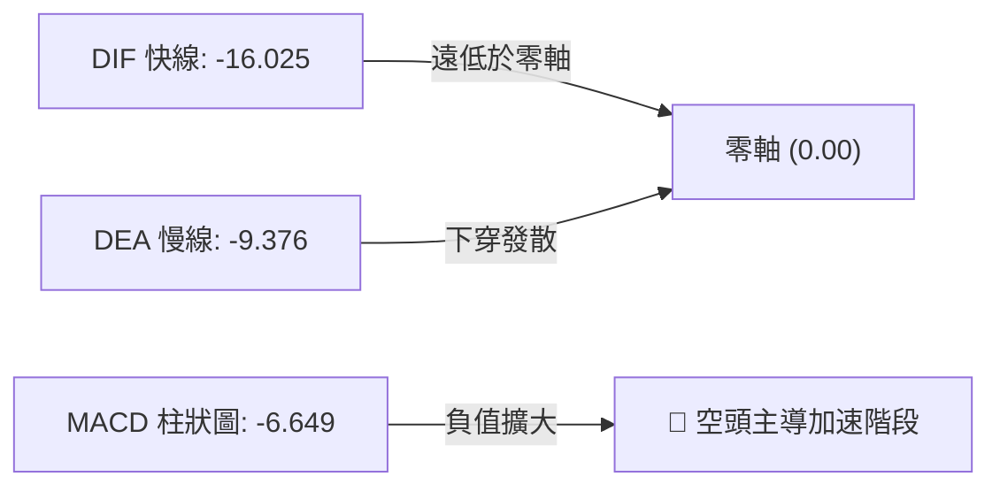

- **數值與形態狀態**：MACD 快線 (DIF) 錄得 **-16.025**，慢線 (DEA) 為 **-9.376**，柱狀圖差值為 **-6.649**。
- **交叉與柱狀圖研判**：
  - 雙線均在零軸下方運行，屬於典型的「弱勢區空頭死叉發散」結構。
  - 負柱狀圖自前期的 -1.599 (10-09) 急速擴散至 -7.494 (10-16) 及當前的 -6.649，柱體雖有輕微收縮，但未出現實質性黃金交叉，表明短期內下行動能雖略有減速，但仍無多頭反轉訊號。

### 📦 布林通道分析

```
NBIS 布林通道 (20, 2) 結構圖
價格 ($)
$270.93 ┼────────────────────────────── 上軌 (Upper Band)
        │
$210.36 ┼────────────────────────────── 中軌 (MA20 Middle Band)
        │
$159.17 ┼───────── ● 現價 ($159.17, %B = 0.08)
$149.78 ┼────────────────────────────── 下軌 (Lower Band)
```

- **通道參數解讀**：
  - 上軌：**$270.93**
  - 中軌 (MA20)：**$210.36**
  - 下軌：**$149.78**
  - 通道帶寬 (Bandwidth) = ($270.93 − $149.78) ÷ $210.36 = **57.59%**，顯示通道處於極度張口放大的高波動狀態。
- **%B 位置分析**：%B 讀數為 **0.08**，極度逼近下軌（0 代表下軌，0.5 為中軌）。當價格緊貼下軌運行且 %B < 0.10，常出現「鈍化下行」或「觸軌技術性反抽」。下軌 **$149.78** 將與支撐位 **S1 $145.80** 構成短線強效支撐帶。

### 💹 成交量分析（量價配合度）

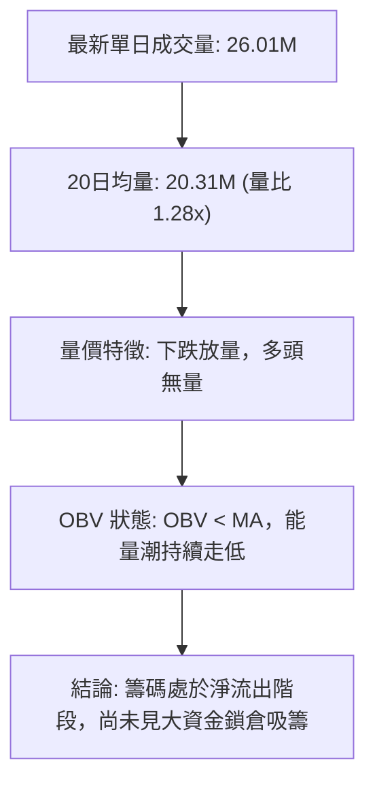

- **量比與換手解讀**：最新成交量為 **26,008,000 股**，相較於 20 日均量 (20.31M) 達到 **1.28 倍**。回顧 10-14 (34.04M)、10-15 (47.72M) 與 10-16 (35.21M)，在破位階段均伴隨超大成交量，屬於標準的「帶量破位」特徵。
- **能量潮 (OBV) 分析**：數據明確提示「**OBV < MA → 量能疲弱**」。這表明在反彈的交易日（如 10-20 與 10-21），成交量分別萎縮至 22.62M 與 19.69M，呈現典型的「上漲量縮、下跌放量」的空頭量價背離，量能未確認價格具備可持續的反轉動能。

---

## 6. 動能與波動率

### ⚡ 動能評估四象限

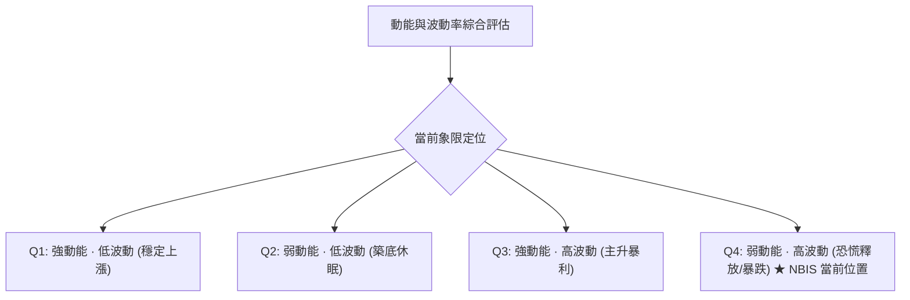

#### 動能四象限特徵定位表

| 象限代號 | 動能狀態 | 波動狀態 | 當前符合狀態 | 象限特徵與交易指引 |
|:---:|:---:|:---:|:---:|:---|
| **Q1** | 強 (正向) | 低 | — | 趨勢穩健推進，為中長線買入並持有的最佳溫床。 |
| **Q2** | 弱 (中性) | 低 | — | 盤整蓄勢，波動萎縮，宜謹慎觀望等待突破確認。 |
| **Q3** | 強 (正向) | 高 | — | 主升浪爆發，追漲報酬高但伴隨劇烈震盪回撤。 |
| **Q4** | **弱 (負向)** | **高** | **✓ (NBIS)** | **空頭動能強勁釋放，價格日內振幅極大，風險收益比嚴重向空頭傾斜。禁止重倉博多，以短線順勢做空或極低倉位博弈超賣反彈為主。** |

### 📊 ATR 波動率分析

```
ATR(14) 波動強度儀表板
當前數值: $16.59  (佔當前股價 10.42%)
[████████████████████████████████████████] 10.42% (超高波動等級)
```

- **數值深度解讀**：NBIS 的 ATR(14) 高達 **$16.59**（佔現價的 **10.42%**），意味著在常態交易日內，股價單日潛在震盪空間可達 $16 以上。
- **風險控制與停損距離具體建議**：
  1. **常態停損間距**：日內與短線交易不得採用固定百分比（如常規的 2-3% 易被雜訊掃出場），建議採用 **1.0 × ATR ($16.59)** 至 **1.5 × ATR ($24.89)** 作為安全動態停損基準。
  2. **倉位縮減換算**：鑑於單日 10.42% 的極高波動率，單筆交易名義曝險額應較常規股票縮減 50% 以上，避免在單邊下殺過程中遭遇保證金重大回撤。

### 📐 Beta 與市場相關性

- **Beta 數值**：**1.46**。
- **市場特徵分析**：NBIS 相對於標普 500 指數擁有高達 1.46 的 Beta 係數，屬於典型的高彈性、高貝塔成長股。
- **市場聯動性解讀**：在科技股或 AI 基礎設施板塊遭遇整體性拋售時，NBIS 的跌幅通常為大盤的 1.5 倍左右；反之，若大盤展開報復性反彈，該股亦具備強烈的向上彈性。

---

## 7. 多時框架總結

### 📋 時框架評分表

| 時框架 | 趨勢方向 | 動能狀態 | 均線排列 | 形態結構 | 綜合評分 | 操作指引 |
|:---|:---:|:---:|:---:|:---:|:---:|:---|
| **月線級別 (長期)** | 🟡 中性走平 | 🟡 動能趨緩 | 🟡 仍高於長天期基底 | 寬幅箱體回調 | **50/100** | 考驗 2026 年初起漲中樞支撐，不宜盲目清倉長線部位。 |
| **週線級別 (中期)** | 🔴 明確看跌 | 🔴 MACD負向 | 🔴 跌破週線短期均線 | 高檔雙重頂成型 | **25/100** | 中期下降趨勢已確立，逢反彈皆為減碼點。 |
| **日線級別 (短期)** | 🔴 弱勢破底 | 🟡 極度超賣 | 🔴 空頭排列倒掛 | 下行階梯，尋底中 | **30/100** | 短線面臨下軌與 61.8% 支撐，禁止追空，防超跌反抽。 |

### 🔲 綜合訊號矩陣

```
╔══════════════════════════════════════════════════════════════════╗
║                    多時框架綜合訊號矩陣表                        ║
╠══════════════════╦══════════════╦══════════════╦═════════════════╣
║ 分析維度         ║ 短期 (日線)  ║ 中期 (週線)  ║ 長期 (月線)     ║
╠══════════════════╬══════════════╬══════════════╬═════════════════╣
║ 趨勢方向         ║ 🔴 看跌      ║ 🔴 看跌      ║ 🟡 中性偏多     ║
║ 動能指標         ║ 🟡 極度超賣  ║ 🔴 負向發散  ║ 🟡 震盪回落     ║
║ 均線系統         ║ 🔴 空頭排列  ║ 🔴 破線向下  ║ 🟢 守在長均之上 ║
║ 支撐/阻力位置    ║ 🟢 測 Fib/下軌║ 🔴 破 M頭頸線║ 🟢 S2/S3 強支撐 ║
║ 成交量配合       ║ 🔴 跌放量    ║ 🔴 週陰巨量  ║ 🟡 總量維持高檔 ║
╚══════════════════╩══════════════╩══════════════╩═════════════════╝
```

### ⚖️ 多時框收斂結論

嚴格遵循【嚴格要求 14】之收斂原則進行權威判定：
1. **行情性質判定**：當前日線 ADX(14) 錄得 **23.22 (< 25)**，嚴格定義為「**弱趨勢 / 盤整震盪行情**」。
2. **主導維度依歸**：依規則，盤整行情中應「**以日線布林通道上下軌 ($149.78 ~ $270.93) 為主要交易區間**」進行考量；但因 -DI (32.22) 顯著強於 +DI (13.66)，且週線級別呈現明確破位下降通道，故震盪中樞嚴重下移。
3. **唯一方向性結論**：**【強烈偏空震盪】（與第 1 章綜合評分 31/100 嚴格一致）**。
   - **取捨說明**：短期日線指標雖出現嚴重超賣（RSI 30.35, Stoch 3.46），但由於中期週線破位動能強大，日線的超跌訊號僅能視為「反彈修復」，不可解讀為多頭趨勢反轉。交易邏輯確立為：**主推順勢高空或反彈放空策略；嚴控超跌博反彈之極小部位**。

---

## 8. 交易策略建議

### 🗺️ 策略決策流程圖

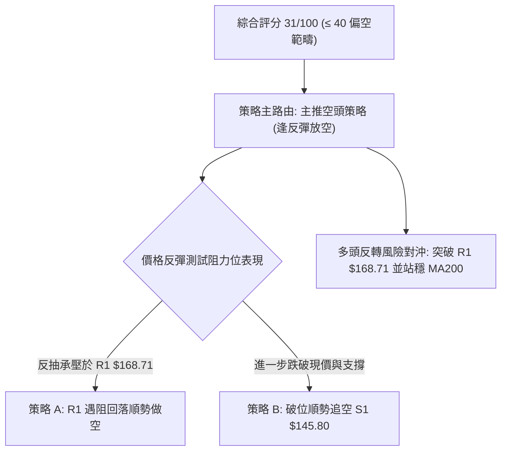

### 🧭 策略路由

> **當前主策略方向 = 【空頭策略（逢反彈做空為主）】（依技術評分卡 31/100）**
> 
> 依據技術面概覽，六項評分均值僅 31 分，全週期均線失守，MACD 持續負向擴散。即便短線指標超賣，策略導向仍必須以逢高放空或跌破關鍵位跟進為主，多頭操作僅列為風控避險提示。

### 🎯 價格情境階梯（Price Scenarios）

價位嚴格引用關鍵價位區塊與斐波那契回調數值：

| 觸發條件 | 下一目標 | 後續延伸 | 技術情境含義與籌碼邏輯 |
|:---|:---:|:---:|:---|
| **向上突破 R1 ($168.71)** | MA200 ($175.57) | Fib 50.0% ($186.69) / R2 ($231.17) | 短線超跌反抽啟動，挑戰牛熊線與解套賣壓密集區。 |
| **站穩現價區間 ($159.17 ~ $159.98)** | R1 ($168.71) | 布林中軌 ($210.36) | 依託 Fib 61.8% 進行低檔弱勢橫盤築底。 |
| **跌破 S1 ($145.80)** | S2 ($132.70) | S3 ($89.65) / Fib 78.6% ($121.96) | 空頭加速趕底，向下尋求 4 月起漲平台之長期買盤支撐。 |

### 📊 情境機率分佈

| 交易情境 | 發生機率 (%) | 主要技術與量價依據 |
|:---|:---:|:---|
| **情境一：弱勢震盪後破底下探 (續跌)** | **60%** | MACD 負柱狀圖維持 -6.649，-DI (32.22) 絕對主導，反彈缺乏成交量配合 (OBV < MA)，價格受制於下彎均線。 |
| **情境二：依託 Fib 61.8% 展開超賣反彈** | **30%** | RSI(14) 觸及 30.35 臨界點，Stoch %K 降至 3.46 極值，布林 %B 為 0.08，具備均值回歸修復動能。 |
| **情境三：直接向上反轉突破 R2** | **10%** | 上方套牢籌碼沉重，短期均線呈空頭排列倒掛，缺乏基本面極大催化劑難以直接 V 型反轉。 |

### 🟢 主策略詳情（方向依上方路由：空頭主推）

嚴格依據規則 17 計算風險報酬比：做空 R:R = (進場價 − 目標價 T1) ÷ (止損價 − 進場價)。

| 策略要素 | 策略 A：反彈遇阻做空（首選順勢策略） | 策略 B：跌破支撐追空（突破放空策略） |
|:---|:---|:---|
| **策略名稱** | **R1 阻力位反抽衰竭做空** | **S1 破位加速下行追空** |
| **進場條件** | 價格反彈至 R1 阻力區，盤中見長上影線或黑K反轉 | 實體日K跌破關鍵支撐 S1，空頭動能再次宣洩 |
| **進場價格** | **$168.71** (引用阻力位 R1) | **$145.80** (引用支撐位 S1) |
| **目標價 T1** | **$145.80** (引用支撐位 S1) | **$132.70** (引用支撐位 S2) |
| **目標價 T2** | **$132.70** (引用支撐位 S2) | **$89.65** (引用支撐位 S3) |
| **止損價格** | **$175.57** (引用 MA200 牛熊分水嶺) | **$155.73** (引用 10-22 當日最低點) |
| **風險報酬比** | **1 : 3.34（以 T1 計）**<br>計算式: ($168.71 − $145.80) ÷ ($175.57 − $168.71) = $22.91 ÷ $6.86 = 3.34 | **1 : 1.32（以 T1 計）**<br>計算式: ($145.80 − $132.70) ÷ ($155.73 − $145.80) = $13.10 ÷ $9.93 = 1.32 |
| **成功機率** | **65%** | **55%** |
| **建議倉位** | **總資金之 15%** | **總資金之 10%** |

*註：策略 A 若以目標價 T2 ($132.70) 計算，風險報酬比為 1 : 5.25（以 T2 計）；策略 B 若以 T2 ($89.65) 計算，風險報酬比為 1 : 5.65（以 T2 計）。*

### 🔴 反向風險觸發點（對沖提示）

- **全面止損/反手平空點**：若日線收盤價帶量站上 **MA200 ($175.57)** 或突破 **Fib 50.0% ($186.69)**，宣告空頭假突破，所有放空部位必須無條件止損離場。
- **超賣多頭博弈點（限極輕倉 5%）**：若現價在 **Fib 61.8% ($159.98)** 與布林下軌 **$149.78** 之間形成吞噬紅K，僅適合作為日內短打反彈，進場價 $159.17，停損設於 $155.73，目標看 R1 $168.71。

### ⭐ 整體訊號強度評星

```
╔══════════════════════════════════════════════════════════════╗
║                    整體訊號強度評星                          ║
╠══════════════════════════════════════════════════════════════╣
║ 做多訊號強度：★☆☆☆☆  (1/5星 - 僅存超賣指標支撐)            ║
║ 做空訊號強度：★★★★☆  (4/5星 - 順應大趨勢破位動能)          ║
║ 整體可信度：  ★★★★☆  (4/5星 - 多指標高度共振驗證)          ║
╚══════════════════════════════════════════════════════════════╝
```

---

## 9. 風險提示與監控

### ✅ 關鍵監控指標 Checklist

```
╔══════════════════════════════════════════════════════════════╗
║                   每日交易關鍵監控清單                       ║
╠══════════════════════════════════════════════════════════════╣
║ [ ] 監控一：收盤價是否有效跌破 Fib 61.8% ($159.98)           ║
║     - 跌破確認：空頭下一站直接鎖定 S1 ($145.80)。            ║
║ [ ] 監控二：日線 RSI(14) 是否跌破 30 形成鈍化               ║
║     - 若自 30.35 向上勾頭站回 35，預警短線空頭回補浪潮。     ║
║ [ ] 監控三：成交量是否萎縮至 20日均量 (20.31M) 之下          ║
║     - 量縮代表恐慌拋盤告一段落，盤面將轉入橫盤盤整。         ║
║ [ ] 監控四：MACD 負柱狀圖 (-6.649) 是否出現翻紅拐點          ║
║     - 柱體若持續收斂至 -2 以內，禁止追空操作。               ║
║ [ ] 監控五：上方動態均線 MA5 ($167.58) 壓制力道             ║
║     - 無法有效突破 MA5 之前，所有日內反彈均視為誘多。        ║
╚══════════════════════════════════════════════════════════════╝
```

### ⚠️ 風險場景分析

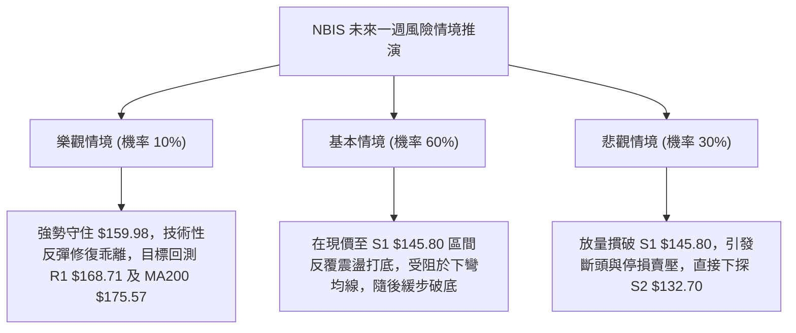

### 🛡️ 風險管理重要提醒

1. **極高波動風險控管**：
   - NBIS 當前 ATR(14) 高達 **$16.59**（佔股價 10.42%），單日波動極其劇烈。嚴格禁止在無保護狀態下進行隔夜持倉。
   - 單筆交易最大虧損額度應嚴格限制在整體投資帳戶淨值的 **1.0% ~ 1.5%** 之內。
2. **高放空比例 (Short Interest) 擠壓風險**：
   - 數據顯示 NBIS 之 **Short % Float 高達 18.9%**，Short Ratio 為 **2.98**。
   - 高放空比例意味著一旦有利多消息或大盤強力反彈，極易引發劇烈的「軋空行情 (Short Squeeze)」。空頭持倉必須嚴守 **MA200 ($175.57)** 止損位，防止遭軋空重創。
3. **重大基本面與融資缺口干擾**：
   - 公司自由現金流 (FCF TTM) 為 **$-5.88B**，資本支出達 **$11.14B**，總負債 **$10.20B**。基本面的龐大現金消耗可能促發市場對其融資稀釋股權的擔憂，技術面破位背後具備沉重基本面壓力。

---

## 📋 報告總結

```
╔══════════════════════════════════════════════════════════════╗
║                 NBIS 技術分析報告總結                        ║
╠══════════════════════════════════════════════════════════════╣
║ 報告日期：2026-10-23                                         ║
║ 當前價格：$159.17 USD                                        ║
║ 技術評級：🔴 偏空震盪 (綜合評分: 31/100)                     ║
╠══════════════════════════════════════════════════════════════╣
║ 關鍵結論：                                                   ║
║ ├─ 長期趨勢：🟡 中性回調，歷史高位拉回考驗起漲區            ║
║ ├─ 中期趨勢：🔴 雙頂頸線破位，空頭下降通道確立              ║
║ ├─ 短期趨勢：🔴 均線全數倒掛，正於 Fib 61.8% 尋求支撐       ║
║ ├─ 關鍵支撐：S1 $145.80 ｜ S2 $132.70 ｜ S3 $89.65           ║
║ ├─ 關鍵阻力：R1 $168.71 ｜ R2 $231.17 ｜ R3 $254.92          ║
║ └─ 分析師目標：均價 $281.00 (低標 $84.00 / 高標 $410.00)     ║
╠══════════════════════════════════════════════════════════════╣
║ 最優策略組合：                                               ║
║ 1. 🥇 最佳機會：策略 A (反彈至 R1 $168.71 遇阻放空)          ║
║    進場 $168.71 ｜ 止損 $175.57 ｜ 目標 $145.80 (R:R = 1:3.34)║
║ 2. 🥈 次選機會：策略 B (跌破 S1 $145.80 順勢追空)            ║
║    進場 $145.80 ｜ 止損 $155.73 ｜ 目標 $132.70 (R:R = 1:1.32)║
║ 3. 🥉 保守選擇：完全空倉觀望，等待日線底背離或帶量收復 MA200║
╚══════════════════════════════════════════════════════════════╝
```

---

> ⚠️ **免責聲明**：本報告為 AI 自動生成之技術分析，所有數據及估算均基於提供的歷史價格資訊。本報告**僅供研究與學術參考**，**不構成任何投資建議**。投資有風險，入市需謹慎。

---

*報告生成時間：2026-10-23 ｜ 數據來源：Yahoo Finance ｜ 分析框架：多時框技術分析*