# NBIS 技術分析報告

> **報告日期**：2026-10-24 ｜ **語言**：繁體中文 ｜ **數據來源**：Yahoo Finance ｜ **當前價格**：$158.74 USD

---

## 目錄

| 章節 | 內容 |
|------|------|
| [1. 技術面概覽](#1-技術面概覽) | 訊號儀表板、核心指標、評分卡 |
| [2. 趨勢分析](#2-趨勢分析) | 多時框趨勢、長中短期走勢、ADX 解讀 |
| [3. 圖表形態分析](#3-圖表形態分析) | 形態識別、K線組合、目標價推算 |
| [4. 支撐與阻力](#4-支撐與阻力) | 關鍵價位、斐波那契回調結構 |
| [5. 技術指標深度解讀](#5-技術指標深度解讀) | 均線系統、RSI、MACD、布林通道、成交量 |
| [6. 動能與波動率](#6-動能與波動率) | 動能評估矩陣、ATR 波動度、Beta 係數 |
| [7. 多時框架總結](#7-多時框架總結) | 時框架評分矩陣、多時框收斂結論 |
| [8. 交易策略建議](#8-交易策略建議) | 策略路由、空頭主策略、風險報酬比 |
| [9. 風險提示與監控](#9-風險提示與監控) | 關鍵監控清單、情境分析、風控紀律 |

---

## 1. 技術面概覽

### 🎯 技術訊號儀表板

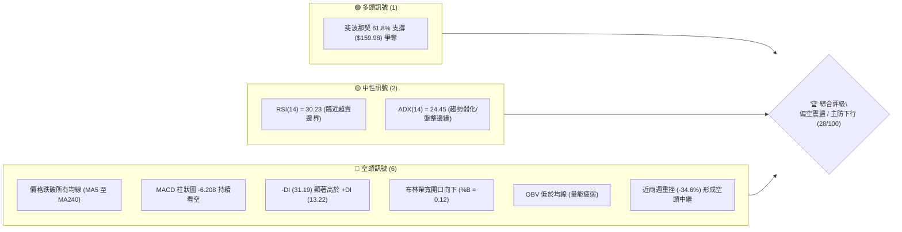

### 📊 核心指標速覽表

| 指標類別 | 指標名稱 | 當前數值 | 訊號 | 解讀 |
|----------|----------|----------|:----:|------|
| **價格** | 當前收盤價 | $158.74 | 🔴 | 位於 52 週區間 37.7% 位置，短期呈現加速破位下行走勢 |
| **均線** | MA20 | $206.43 | 🔴 | 現價大幅低於 MA20 (-23.10%)，短期下行斜率陡峭，為首要動態反壓 |
| **均線** | MA50 | $217.84 | 🔴 | 現價低於 MA50 (-27.13%)，中期波段趨勢轉為全面弱勢 |
| **均線** | MA200 | $175.88 | 🔴 | 現價跌破長期牛熊分界線 (-9.75%)，長期上升趨勢遭受實質破壞 |
| **動能** | RSI(14) | 30.23 | 🟡 | 進入超賣邊界區（30 關卡），存在技術性超跌反彈動能但尚未形成鈍化 |
| **動能** | MACD (12,26,9) | -17.136 / -10.928 | 🔴 | DIF 線遠處於 Signal 線下方，Hist 為 -6.208，空頭動能完全主導 |
| **波動** | ATR(14) | $15.92 | 🔴 | 佔股價 10.03%，日內與週級別震幅極大，風險敞口顯著上升 |

### 🏆 技術評分卡

```
╔══════════════════════════════════════════════════════════════╗
║                技術評分卡 — NBIS (2026-10-24)                ║
╠══════════════════════════════════════════════════════════════╣
║ 趨勢強度      █████░░░░░░░░░░░░░░░  25/100  🔴 強烈偏空       ║
║ 動能指標      ████░░░░░░░░░░░░░░░░  20/100  🔴 動能渙散       ║
║ 支撐穩定度    █████████░░░░░░░░░░░  45/100  🟡 考驗 Fib 61.8% ║
║ 成交量配合    ██████░░░░░░░░░░░░░░  30/100  🔴 量能背離渙散   ║
║ 形態完整度    ███████░░░░░░░░░░░░░  35/100  🔴 頭部下破形態   ║
║ 均線排列      ███░░░░░░░░░░░░░░░░░  15/100  🔴 空頭排列發散   ║
╠══════════════════════════════════════════════════════════════╣
║ 綜合評分      ██████░░░░░░░░░░░░░░  28/100  🔴 偏空主導       ║
║ 評分定義：六項算術平均 (25+20+45+30+35+15)/6 = 28.33 → 28  ║
╚══════════════════════════════════════════════════════════════╝
```

---

## 2. 趨勢分析

### 🌐 多時框趨勢分析

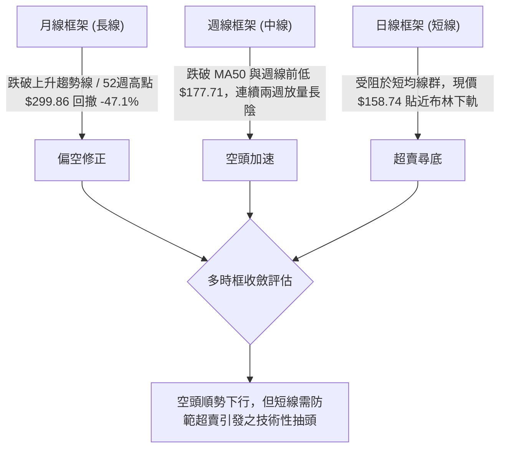

### 📈 長期趨勢 — 12個月走勢圖（Unicode）

根據過去 12 個月（2025-11 至 2026-10）真實月度收盤價數據繪製：

```
NBIS 月線走勢圖（2025-11 至 2026-10）
價格軸 ($)
$280 ┤                                   ● $276.17 (2026-06 峰值)
$260 ┤
$240 ┤                                            ● $235.88
$220 ┤                             ● $231.09
$200 ┤                                       ● $206.32
$180 ┤                                  ● $190.41
$160 ┤                                                 ● $158.74 (現價)
$140 ┤                        ● $138.23
$120 ┤
$100 ┤ ● $94.87    ● $91.19   ● $103.76
 $80 ┤    ● $83.71   ● $85.19
     └───────────────────────────────────────────────────────────►
       11   12   01   02   03   04   05   06   07   08   09   10  (月份)
     [── 2025 ──] [───────────────── 2026 ─────────────────────]
```

#### 走勢特徵分析表格

| 階段區間 | 起止價格 | 漲跌幅 | 成交量與動能特徵 | 結構屬性 |
|----------|----------|:------:|------------------|----------|
| **築底蓄勢期**<br>(2025-11 ~ 2026-02) | $94.87 → $91.19 | -3.88% | 股價於 $83~$95 區間窄幅橫盤，量能萎縮沉澱 | 底部吸籌矩形整理 |
| **主升浪推進**<br>(2026-03 ~ 2026-06) | $103.76 → $276.17 | +166.16% | 月線連續放量拉升，創歷史新高 $299.86 | 強勢主升推升行情 |
| **高位派發期**<br>(2026-07 ~ 2026-09) | $190.41 → $235.88 | +23.88% | 劇烈雙向洗盤，週量能屢破億股，高檔寬幅震盪 | 頭部籌碼鬆動與派發 |
| **破位下行期**<br>(2026-10 現狀) | $235.88 → $158.74 | -32.70% | 長陰貫穿跌破所有中短期均線，空方量能顯著釋放 | 破位崩跌與估值修正 |

### 📊 中期趨勢（週線分析）

```
NBIS 週線關鍵壓力與支撐示意圖
═════════════════════════════════════════════════════════════════════
  $255.10 ───┬─────────────────────────── [波段高點阻力 R3: $254.92]
             │
  $231.17 ───┴─────────────────────────── [前波反彈頸線 R2: $231.17]
  $206.43 ─────────────────────────────── [MA20 動態反壓 / 密集整理區]
  $175.88 ─────────────────────────────── [MA200 長期均線反壓]
  $168.71 ─────────────────────────────── [近期破位反壓 R1: $168.71]
─────────────────────────────────────────────────────────────────────
  $158.74 ◄── 現價位置 (測試 Fib 61.8% $159.98 關鍵分水嶺)
─────────────────────────────────────────────────────────────────────
  $145.80 ───┬─────────────────────────── [下檔波段支撐 S1: $145.80]
  $132.70 ───┼─────────────────────────── [強支撐區 S2: $132.70]
   $89.65 ───┴─────────────────────────── [歷史大底支撐 S3: $89.65]
═════════════════════════════════════════════════════════════════════
```

### ⚡ 趨勢強度評估（ADX 解讀）

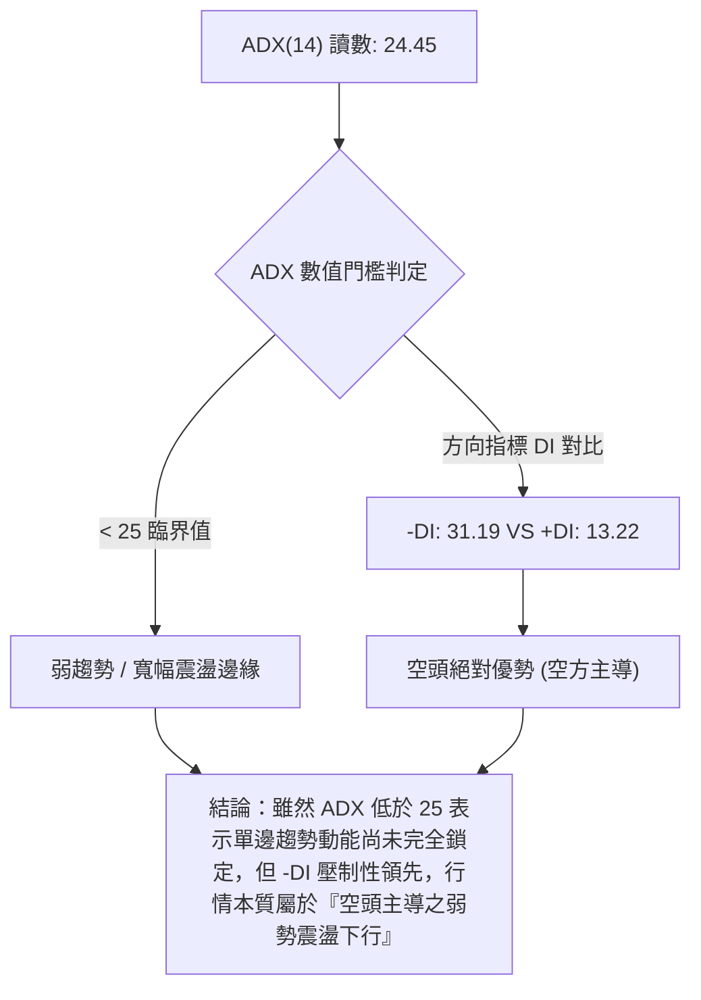

| 指標變數 | 當前讀數 | 強度指示 | 市場結構定義 |
|----------|:--------:|:--------:|--------------|
| **ADX(14)** | 24.45 | ░░░░░░░░░░ [24%] | 處於 25 臨界分水嶺下方，代表前波暴跌動能短期面臨衰減，可能轉入區間震盪 |
| **+DI** | 13.22 | ░░░░░░░░░░ [13%] | 多方買盤意願極低，無法組織有效反攻 |
| **-DI** | 31.19 | ████████░░ [31%] | 空方完全控盤，市場賣壓沉重，任何反彈均面臨解套盤壓制 |

---

## 3. 圖表形態分析

### 🔍 形態識別系統

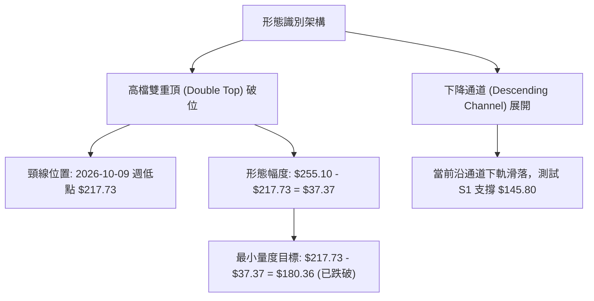

#### 形態識別與信心度評估表

| 形態類別 | 信心度 | 判斷依據（引用數據） | 完成度 | 量度目標價（計算式） |
|----------|:------:|----------------------|:------:|----------------------|
| **雙重頂破位**<br>(Double Top) | **85%** | 2026-09-25 高點 $249.19 與 2026-10-09 高點 $255.10 構築雙頂，2026-10-16 週長陰跌破頸線 $217.73 | 100% | 頸線 $217.73 − 高度 ($255.10 − $217.73 = $37.37) = **$180.36**（已達成，確認向下突破） |
| **下降通道**<br>(Descending Channel) | **70%** | 上軌由近期高點連線（$178.85、$167.50），下軌由波段低點連線（$160.25、$155.73）構成 | 75% | 若通道下軌失守，量度跌幅將延伸至波段支撐 **S1: $145.80** |
| **頭肩底形態** | **0%** | 數據中未偵測到任何底部結構特徵 | 0% | 訊號不足，僅做指標型解讀（嚴禁通靈） |

### 🕯️ 重要 K 線形態分析

#### 近 10 根日 K 線形態解析（2026-10-12 至 2026-10-23）

| 日期 | 開盤價 | 最高價 | 最低價 | 收盤價 | 成交量 | K 線形態特徵 | 解讀與意涵 | 訊號 |
|:----:|:------:|:------:|:------:|:------:|:------:|--------------|------------|:----:|
| **10-12** | $217.20 | $217.20 | $206.90 | $210.06 | 14,062,200 | 光頭中陰線 | 破位長陰開端，空方無情摜壓 | 🔴 |
| **10-13** | $200.50 | $207.92 | $197.60 | $206.86 | 17,642,600 | 跳空十字星 | 跳空低開嘗試抵抗，反彈乏力 | 🟡 |
| **10-14** | $195.00 | $198.60 | $183.11 | $186.01 | 34,041,200 | 放量大陰線 | 跌破 $190 整數關卡，賣壓爆發 | 🔴 |
| **10-15** | $175.48 | $189.33 | $163.36 | $188.41 | 47,717,500 | 長下影長陽線 | 巨量下影線抄底，短線多空激烈交戰 | 🟢 |
| **10-16** | $181.17 | $182.70 | $163.27 | $165.47 | 35,212,600 | 陰包陽吞噬線 | 完全抹平前日反彈，確立空方勝出 | 🔴 |
| **10-19** | $176.51 | $176.69 | $166.59 | $170.24 | 26,881,200 | 低開弱反彈陽 | 受制於 $176 阻力，量縮反抽 | 🟡 |
| **10-20** | $163.99 | $174.74 | $160.25 | $171.45 | 22,615,600 | 下影小陽線 | 測試 $160 整數關卡獲得微弱支撐 | 🟡 |
| **10-21** | $176.46 | $178.85 | $164.00 | $171.57 | 19,693,900 | 長上影十字星 | 向上衝擊 R1 阻力失敗，留長上影線 | 🔴 |
| **10-22** | $164.75 | $167.50 | $155.73 | $159.17 | 26,221,800 | 破位中陰線 | 跌破前低 $160，創波段新低 $155.73 | 🔴 |
| **10-23** | $158.90 | $162.99 | $155.86 | $158.74 | 13,423,700 | 量縮低位十字 | 週五收斂整理，量能驟減至 13.4M | 🟡 |

#### 近 8 根週 K 線形態解析（2026-09-04 至 2026-10-23）

| 週末日期 | 週開盤 | 週最高 | 週最低 | 週收盤 | 週成交量 | 週 K 線形態特徵 | 中期格局意涵 | 訊號 |
|:--------:|:------:|:------:|:------:|:------:|:--------:|----------------|--------------|:----:|
| **09-04** | $205.74 | $226.58 | $194.80 | $226.39 | 57,880,200 | 長陽吞噬 | 站穩 $200 關卡，多頭防線穩固 | 🟢 |
| **09-11** | $234.85 | $254.74 | $223.64 | $224.55 | 62,424,000 | 衝高回落倒錘 | 挑戰 $254 遇強大阻力回落 | 🔴 |
| **09-18** | $204.98 | $232.85 | $203.87 | $223.54 | 90,247,300 | 下影長陽星 | 低檔買盤承接強勁，守住 $200 | 🟢 |
| **09-25** | $225.96 | $249.19 | $221.30 | $237.33 | 79,317,300 | 溫和中陽線 | 再次蓄勢挑戰前高壓力區 | 🟢 |
| **10-02** | $235.20 | $250.48 | $228.38 | $242.81 | 65,179,600 | 高位窄幅小陽 | 連續兩週受阻於 $250，動能衰竭 | 🟡 |
| **10-09** | $244.10 | $255.10 | $217.73 | $221.07 | 86,070,300 | 帶長上影長陰 | 創次高 $255.10 後暴跌，形成雙頂 | 🔴 |
| **10-16** | $217.20 | $217.20 | $163.27 | $165.47 | 148,676,100 | 爆量破位斷頭鍘 | 放巨量摜破所有支撐，趨勢徹底反轉 | 🔴 |
| **10-23** | $176.51 | $178.85 | $155.73 | $158.74 | 108,836,200 | 延續性下行陰線 | 弱勢下探，收在全週低點附近 | 🔴 |

### 📉 ASCII 走勢形態示意圖

```
雙重頂破位與通道下行示意圖
$255.10 ─────────┐          ┌───────── $255.10 (雙頂峰值)
                 │  $242.81 │
                 ▼          ▼
$217.73 ══════════════════════════════ [頸線位置] ── 跌破確認！
                 │
                 │ 形態高度幅度：$37.37
                 ▼
$180.36 ------------------------------ [第一量度滿足點] ── 已跌破貫穿
                 │
                 │ 當前下行通道斜率
                 ▼
$158.74 ═════════●════════════════════ [現價位置 $158.74]
                 │
                 ▼ 下行目標測算
$145.80 ────────────────────────────── [下檔強支撐 S1]
```

### 🎯 形態目標價計算

1. **雙重頂量度目標（已跌破延伸）**：
   - 頂部最高價：$255.10（2026-10-09 週最高）
   - 頸線位置：$217.73（2026-10-09 週最低）
   - 形態高度 $H = \$255.10 - \$217.73 = \$37.37$
   - 跌破頸線第一目標：$\$217.73 - \$37.37 = \mathbf{\$180.36}$（10-16 當週已跌破）
2. **延伸 1.618 倍量度目標價**：
   - 目標價 $= \$217.73 - (\$37.37 \times 1.618) = \$217.73 - \$60.46 = \mathbf{\$157.27}$（現價 $158.74 精確落在該延伸滿足點附近，面臨激烈爭奪）
3. **若無法守住現價區間，次級形態目標**：
   - 跌向近一年波段低點聚類支撐 **S1: $145.80**

---

## 4. 支撐與阻力

### 🗺️ 關鍵價位分布圖（Unicode）

```
NBIS 價位結構分布圖
═══════════════════════════════════════════════════════════════
$254.92 ║██████████████████████████████║ 強阻力 R3 (波段雙頂高點聚類)
$231.17 ║████████████████████          ║ 中期阻力 R2 (反彈平台頸線)
$168.71 ║████████████████████████      ║ 關鍵短阻力 R1 (近期反彈高點聚類)
════════╠══════════════════════════════╣ ◄ 當前價格 $158.74
$159.98 ║░░░░░░░░░░░░░░░░░░░░░░░░░░░░░░║ 斐波那契 61.8% 黃金分割線
$145.80 ║▓▓▓▓▓▓▓▓▓▓▓▓▓▓▓▓              ║ 近期波段關鍵支撐 S1
$132.70 ║████████████████████████      ║ 強支撐 S2 (密集換手平台)
 $89.65 ║██████████████████████████████║ 終極長期支撐 S3 (歷史底部聚類)
═══════════════════════════════════════════════════════════════
```

### 🚧 阻力位分析表

所有價位均嚴格取自數據提供的波段高點聚類計算：

| 阻力級別 | 精確價位 | 距現價空間 | 形成原因與籌碼特徵 | 突破難度 | 重要性 |
|:--------:|:--------:|:----------:|--------------------|:--------:|:------:|
| **R1** | **$168.71** | +6.28% | 近 10 日多次反彈受阻高點連線（10-21 高點 $178.85 震盪中樞之低位籌碼鎖定區） | 🟡 中等 | ★★★★☆ |
| **R2** | **$231.17** | +45.63% | 前期多頭反覆測試的平台低點，現已徹底轉換為極強套牢頭部反壓 | 🔴 極高 | ★★★★★ |
| **R3** | **$254.92** | +60.59% | 2026-09 與 2026-10 兩次衝頂之高點聚類密集區（雙頂天花板） | 🔴 極高 | ★★★★★ |

### 🛡️ 支撐位分析表

所有價位均嚴格取自數據提供的波段低點聚類計算：

| 支撐級別 | 精確價位 | 距現價空間 | 形成原因與籌碼特徵 | 守住機率 | 重要性 |
|:--------:|:--------:|:----------:|--------------------|:--------:|:------:|
| **S1** | **$145.80** | -8.15% | 近一年上升行情中段回檔低點聚類，布林通道下軌動態支撐防線 | 🟡 50% | ★★★★☆ |
| **S2** | **$132.70** | -16.40% | 2025-10 至 2026-04 上升中繼的核心成交密集區下沿 | 🟢 65% | ★★★★★ |
| **S3** | **$89.65** | -43.52% | 2025-11 至 2026-02 歷史大底橫盤震盪中樞（終極安全邊際） | 🟢 85% | ★★★★★ |

### 📐 斐波那契回調位分析

依據 52 週絕對極值區間（低點 $73.52 → 高點 $299.86）精確計算，總垂直波幅達 $226.34：

| 回調比例 | 精確水平位 | 與現價關係 | 技術意涵與市場心理剖析 |
|:--------:|:----------:|:----------:|------------------------|
| **0.0%** | **$299.86** | +88.90% | 52 週最高點，歷史多頭行情報酬頂部 |
| **23.6%** | **$246.44** | +55.25% | 強勢回檔位，失守後宣告多頭強攻格局瓦解 |
| **38.2%** | **$213.40** | +34.43% | 頸線中樞位，與雙頂頸線 $217 重合，轉為中期重壓力區 |
| **50.0%** | **$186.69** | +17.61% | 心理平衡位，10-15 日曾短暫反彈至 $189.33 隨即破位潰敗 |
| **61.8%** | **$159.98** | **+0.78%** | **黃金分割生命線：現價 $158.74 正處於該關鍵點下方微幅穿透！** |
| **78.6%** | **$121.96** | -23.17% | 深度防禦位，若 61.8% 實質失守，下行空間將完全敞開 |
| **100.0%** | **$73.52** | -53.69% | 52 週最低點，原始起漲原點 |

> **解讀結論**：現價 $158.74 正貼近斐波那契 61.8%（$159.98）進行生死保衛戰。在經典技術分析中，61.8% 是牛市修正允許的最大極限回撤，一旦日線連續收於其下方，行情結構將正式從「牛市深度修正」降級為「長期熊市趨勢」。

---

## 5. 技術指標深度解讀

### 🎛️ 指標訊號總覽

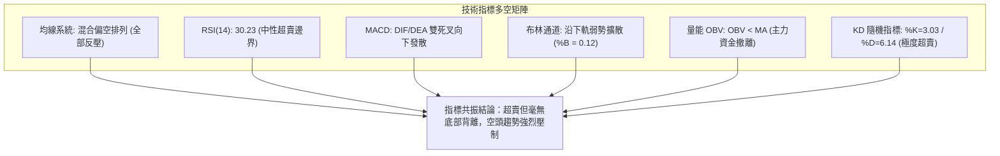

### 📈 移動平均線排列分析

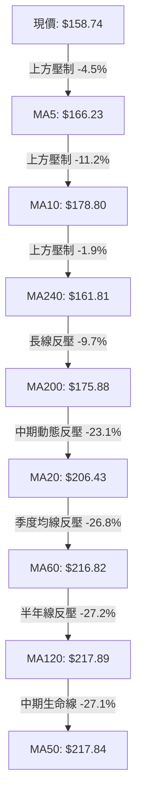

#### 均線數據量化監控表

| 均線名稱 | 當前價格 | 與現價偏離度 | 歷史微型走勢 | 當前排列狀態與評估 |
|:--------:|:--------:|:------------:|:------------:|--------------------|
| **MA5** | $166.23 | -4.51% | ▇▇████▇▆▅▄▃▂▁ | 極速下墜，構成超短線反彈第一道天花板 |
| **MA10** | $178.80 | -11.22% | ▆▆▇▇████▇▇▆▅▄▃ | 加速向下傾斜，強化空頭下推動力 |
| **MA20** | $206.43 | -23.10% | ▆▅▆▇██████▇▆▅▄ | 布林中軌，中期趨勢下行，乖離率過大 |
| **MA60** | $216.82 | -26.79% | █▆▃▂▂▃▄▅▆▇███▇ | 拐頭向下，季線正式由支撐轉為強壓力 |
| **MA120** | $217.89 | -27.15% | ▁▂▃▄▅▆▇███████ | 高檔走平即將向下死叉 |
| **MA200** | $175.88 | -9.75% | 數據提供: $175.88 | **現價已摜破長期牛熊分界線** |
| **MA240** | $161.81 | -1.90% | ▁▂▃▄▅▆▇███████ | 年線正受直接衝擊，多頭最後心理防線 |

**均線綜合結論**：目前均線系統呈現「混合偏空排列」。短期 MA5、MA10 形成空頭陡峭下壓，MA20、MA50、MA60、MA120 於 $206~$217 高位形成堅不可摧的套牢堡壘。更致命的是，現價已實質跌穿 MA200（$175.88），長期結構已經被空頭擊穿。

### 📉 RSI(14) 分析

```
RSI(14) 當前讀數：30.23 (Wilder 平滑法)
0 ───────────── 30 ════════════════════════════ 70 ───────────── 100
[    超賣區     ] █░░░░░░░░░░░░░░░░░░░░░░░░░░░░ [    超買區     ]
                  ▲ (現處 30.23 臨界線)
```

- **超買超賣狀態**：RSI 數值為 30.23，貼近 30 超賣門檻。隨機指標 Stoch %K (3.03) 與 %D (6.14) 則處於深度的個位數極端超賣區。
- **背離判斷結論**：
  - **頂背離**：無（當前處於低檔區）。
  - **底背離**：**無明顯背離**（比對近 20 根 K 棒價格創波段新低 $155.73，RSI 同步滑落至 30.23，量能指標未見底背離抬升現象）。
  - **技術解讀**：指標雖嚴重超賣，但在缺乏底背離確認前，超賣指標往往會以「低位鈍化」的形式延續跌勢，不能單憑超賣作為盲目抄底的買入依據。

### 📊 MACD(12,26,9) 訊號解讀

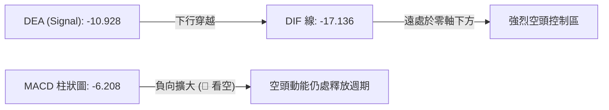

- **數值指標**：DIF 線為 -17.136，Signal 線為 -10.928，柱狀圖差值為 **-6.208**。
- **形態分析**：MACD 於零軸下方出現死叉並加速向下開口，負向柱狀圖持續深陷，確認市場正處於中期主跌浪之中。儘管近一週柱狀圖負值略有收斂（由 -7.494 收斂至 -6.208），但仍處於極深的空頭水準，尚未發出任何金叉反轉訊號。

### 📦 布林通道分析

```
布林通道 (20, 2) 結構示意圖
$269.77 ────────────────────────────────── 上軌 (Upper Band)
                         
$206.43 ────────────────────────────────── 中軌 (MA20 基準反壓)
                         
$158.74 ═════════════════●════════════════ 現價 ($158.74, %B = 0.12)
$143.09 ────────────────────────────────── 下軌 (Lower Band)
```

- **布林參數狀態**：上軌 $269.77，中軌 $206.43，下軌 $143.09。帶寬達 $126.68，呈現急劇擴張態勢。
- **%B 指標解讀**：%B 讀數為 **0.12**（0 代表下軌，$0.5$ 代表中軌，$1.0$ 代表上軌）。現價貼近下軌滑行，屬於標準的「下軌擴散空頭單邊型態」，說明下跌動能具有持續性。

### 💹 成交量分析（量價配合度）

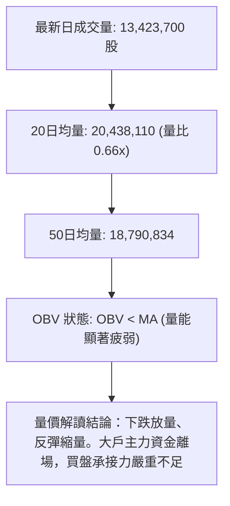

- **量比與均量對比**：最新日成交量 13.4M，較 20 日均量（20.4M）萎縮約 34%（量比 0.66x）。
- **籌碼與週成交量驗證**：回顧 10-16 當週暴跌時釋放出 148.6M 的天量賣壓，而 10-23 週反彈時量能萎縮至 108.8M，呈現典型的「跌時放量、漲時無量」籌碼崩解結構。
- **OBV 能量潮趨勢**：OBV 穩固運行於其移動平均線下方，證實無資金進場吸籌，反彈皆屬空方獲利回補或散戶無謂掙扎。

---

## 6. 動能與波動率

### ⚡ 動能評估四象限

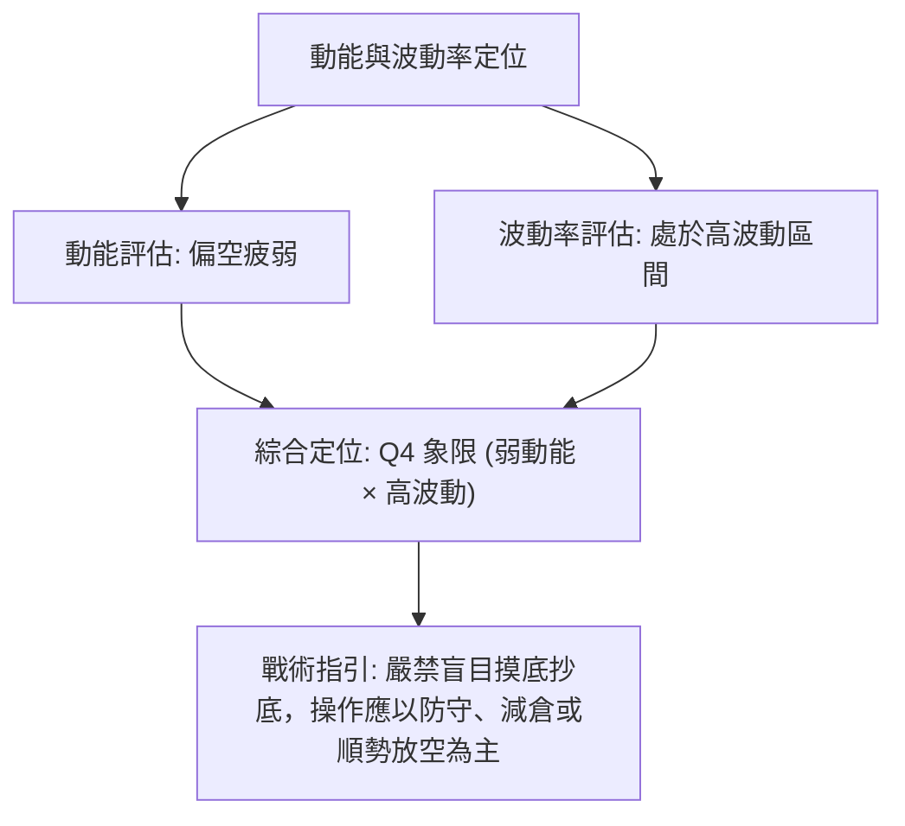

| 象限 | 動能維度 | 波動維度 | 代表特徵 | NBIS 當前定位 | 交易戰術評估 |
|:----:|:--------:|:--------:|:--------:|:-------------:|--------------|
| **Q1** | 強多頭 | 低波動 | 穩步上揚 | — | 最佳波段持股機會 |
| **Q2** | 弱動能 | 低波動 | 窄幅橫盤 | — | 觀望等待方向突破 |
| **Q3** | 強動能 | 高波動 | 暴漲暴跌 | — | 激進突破跟隨操作 |
| **Q4** | **弱動能** | **高波動** | **加速尋底** | **✓ 正處於此區** | **高風險高殺傷力，以反彈逢高減倉/避險放空為主** |

### 📊 ATR 波動率分析

- **ATR(14) 讀數**：**$15.92**（Wilder 平滑法），佔當前股價比例高達 **10.03%**。
- **日內波動意涵**：NBIS 單日平均真實震幅高達 $16 美元，意味著在正常市場噪音下，單日波動即可能造成 ±10% 的帳面損益震盪。
- **風控止損距建議**：
  - **常規止損距離（1.0 × ATR）**：$\$15.92$，適用於日內短線交易。
  - **寬鬆波段止損（1.5 × ATR）**：$\$23.88$，適用於隔夜波段操作，防止因正常開盤跳空或日內洗盤而觸發不必要止損。

### 📐 Beta 與市場相關性

- **Beta 係數**：**1.46**（高 Beta 屬性）。
- **市場敏感度**：該股對標普 500 或納斯達克大盤指數的敏感度比市場高出 46%。在當前 AI 板塊整體面臨資本支出（CAPEX）審視的利空背景下，高 Beta 特質放大了下跌動能；若市場大盤回調，NBIS 將承擔顯著放大的下行貝塔風險。

---

## 7. 多時框架總結

### 📋 時框架評分表

| 時框架 | 趨勢方向 | 動能狀態 | 均線排列 | 關鍵形態 | 時框評分 | 戰術建議 |
|:------:|:--------:|:--------:|:--------:|:--------:|:--------:|:--------:|
| **日線** (短線) | 🔴 下行尋底 | 🟡 邊緣超賣 (RSI 30) | 🔴 空頭排列 | 下降通道下軌測試 | 30/100 | 等待反彈衰竭點逢高空 |
| **週線** (中線) | 🔴 破位下挫 | 🔴 MACD負向放大 | 🔴 跌破MA50 | 雙重頂頸線破位 | 25/100 | 中線空單續抱，下看S1 |
| **月線** (長線) | 🟡 深度回調 | 🔴 見頂回落 | 🟡 跌向MA240 | 52週高點回撤-47% | 40/100 | 長期牛市結構遭嚴重侵蝕 |

### 🔲 綜合訊號矩陣

```
訊號維度對照表：
┌──────────────┬──────────────┬──────────────┬──────────────┐
│   維度指標   │  日線 (短線) │  週線 (中線) │  月線 (長線) │
├──────────────┼──────────────┼──────────────┼──────────────┤
│ 均線架構     │ 🔴 跌破全部  │ 🔴 跌穿 MA50 │ 🟡 考驗MA240 │
│ 動能指標     │ 🟡 超賣鈍化  │ 🔴 空頭發散  │ 🔴 高位滑落  │
│ 量能配合     │ 🔴 萎縮反抽  │ 🔴 破位放巨量│ 🟡 天量見頂  │
│ 形態完整度   │ 🔴 破位延續  │ 🔴 雙頂成型  │ 🟡 潛在高位假突破│
└──────────────┴──────────────┴──────────────┴──────────────┘
```

### ⚖️ 多時框收斂結論

> **依據規則 14 之收斂優先級執行**：
> 1. **趨勢/盤整判定**：當前 ADX(14) 數值為 **24.45**，剛好處於 25 的微幅下方（界定為弱趨勢/寬幅盤整邊界）。然而，方向指標中 **-DI (31.19)** 呈完全壓制態勢，且日/週線共振跌破所有中期關鍵支撐與均線。
> 2. **主導時框裁決**：在此情境下，盤整特徵僅體現於日線因極端超賣（Stoch %K=3.03）而可能誘發的微幅技術修復；**中長期（週線/MA50、MA200）方向具有絕對主導權**。
> 3. **唯一方向性結論**：**偏空（主防下行）**。日線的超賣修復不可解讀為多頭反轉，而應嚴格定義為「空頭波段中的反抽誘多」，交易邏輯以「逢高做空」為核心。

---

## 8. 交易策略建議

### 🗺️ 策略決策流程圖

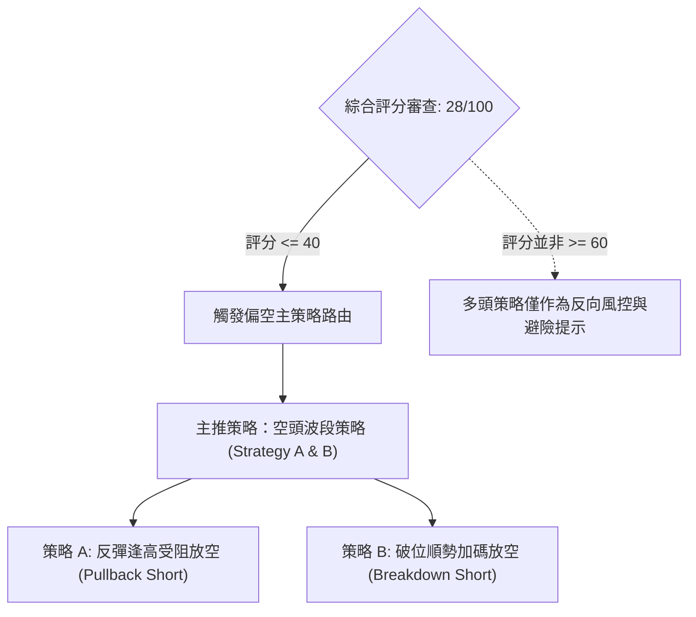

### 🧭 策略路由（依評分卡分流）

**當前主策略方向 = 🔴 偏空主導 / 逢高做空（依評分卡 28/100，嚴格符合規則 18 判定 ≤ 40 區間）**

### 🎯 價格情境階梯（Price Scenarios）

價位嚴格引用下方數據及第 4 章「關鍵價位」的實際計算數值：

| 觸發條件 | 下一目標 | 後續延伸 | 情境含義 |
|----------|----------|----------|----------|
| **突破 R1 $168.71** | **R2 $231.17** | **R3 $254.92** | 短線超賣強烈修復，測試中期套牢平台 |
| **跌破 Fib 61.8% $159.98** | **S1 $145.80** | **S2 $132.70** | 黃金分割失守，空頭加速尋底 |
| **跌破 S1 $145.80** | **S2 $132.70** | **S3 $89.65** | 宣告中線結構崩潰，下探歷史底部平台 |

### 📊 情境機率分佈

| 情境類別 | 預估機率 | 主要判定依據（引用數據指標） |
|----------|:--------:|------------------------------|
| **跌破下行 / 測試 S1** | **55%** | MACD 柱狀圖負向擴散 (-6.208)，均線全面反壓，-DI 領先高達 31.19 |
| **區間震盪 / 考驗 61.8%** | **30%** | ADX 降至 24.45，短線 RSI (30.23) 與 Stoch 超賣，空方動能短暫衰竭 |
| **強烈反彈 / 測試 R1** | **15%** | 極端超賣觸發空頭獲利回補，但 OBV 量能疲弱，反彈高度極其有限 |

### 🔴 主策略詳情（空頭專屬策略）

嚴格遵守規則 17 之風險報酬比定義：
$$\text{做空風險報酬比} = \frac{\text{進場價} - \text{目標價 T1}}{\text{止損價} - \text{進場價}}$$

| 策略要素 | 策略 A（反彈逢高放空 — 優先首選） | 策略 B（跌破 S1 順勢追空 — 破位確認） |
|----------|-----------------------------------|---------------------------------------|
| **進場條件** | 價格反彈至短阻力 R1 受阻，出現長上影線或日 K 轉陰 | 跌破波段關鍵支撐 S1，並收盤確認跌穿 |
| **進場價格** | **$168.71**（精確取自 R1） | **$145.80**（精確取自 S1） |
| **目標價 T1** | **$145.80**（精確取自 S1） | **$132.70**（精確取自 S2） |
| **目標價 T2** | **$132.70**（精確取自 S2） | **$89.65**（精確取自 S3） |
| **止損價格** | **$176.51**（取自 10-19 開盤價阻力位） | **$158.74**（取自當前收盤價阻力） |
| **風險報酬比** | **1 : 2.94（以 T1 計）**<br>*(計算式: (168.71 - 145.80) / (176.51 - 168.71) = 22.91 / 7.80 = 2.937)*<br>*註：若以 T2 計則為 1 : 4.62* | **1 : 1.01（以 T1 計）**<br>*(計算式: (145.80 - 132.70) / (158.74 - 145.80) = 13.10 / 12.94 = 1.012)*<br>*註：若以 T2 計則為 1 : 4.34* |
| **成功機率** | **65%** | **55%** |
| **建議倉位** | **總資金之 15%** | **總資金之 10%** |

### 🟢 反向風險觸發點（對沖與止損提示）

若市場出現以下訊號，代表偏空假說被實質推翻，空頭必須嚴格無條件執行對沖或停損離場：
1. **價格強勢站穩 R1 ($168.71) 上方**：且連續 2 個交易日收盤高於 MA10（$178.80），意味著短線下行通道被打破。
2. **日線級別 MACD 柱狀圖由負轉正**：伴隨日成交量擴大超越 20 日均量（> 20.4M）。
3. **斐波那契 61.8% ($159.98) 形成有效底背離**：Stoch 與 RSI 同步脫離超賣區並突破前高。

### ⭐ 整體訊號強度評星

```
╔══════════════════════════════════════════════════════════════╗
║ 做多訊號強度：★☆☆☆☆  (1/5星 — 極端超賣僅利於超短線博弈)   ║
║ 做空訊號強度：★★★★☆  (4/5星 — 均線空頭排列，趨勢向下確立)   ║
║ 整體可信度：  ★★★★☆  (4/5星 — 指標與形態高度共振)           ║
╚══════════════════════════════════════════════════════════════╝
```

---

## 9. 風險提示與監控

### ✅ 關鍵監控指標 Checklist

```
╔══════════════════════════════════════════════════════════════╗
║                   每日交易風控監控清單 (Checklist)           ║
╠══════════════════════════════════════════════════════════════╣
║ [ ] 價格是否跌破斐波那契 61.8% ($159.98) 並確認失守         ║
║ [ ] 日成交量是否顯著超越 20 日均量 (20.4M) 出現異常異動      ║
║ [ ] RSI(14) 是否在 30 附近形成有效底背離 (價格新低/指標抬高) ║
║ [ ] ATR(14) 是否突破 $16.00 警戒線，導致日內波動風險爆發     ║
║ [ ] 空頭回補天花板：收盤價是否意外突破 $168.71 (R1 阻力位)  ║
║ [ ] 融券餘額風險：空頭佔流通盤比例達 18.9%，需嚴防軋空震盪   ║
╚══════════════════════════════════════════════════════════════╝
```

### ⚠️ 風險場景分析

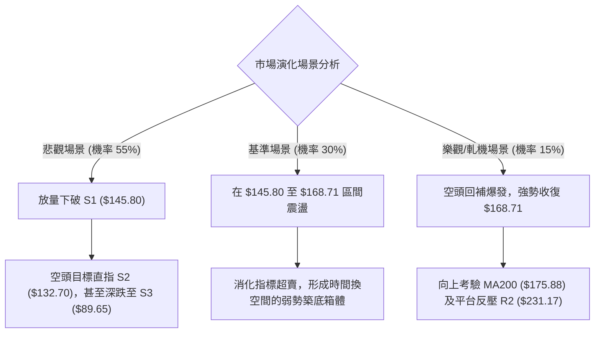

### 🛡️ 風險管理重要提醒

1. **軋空（Short Squeeze）風險警示**：
   - 目前 NBIS 融券佔流通盤比例（Short % Float）高達 **18.9%**，Short Ratio 為 2.98 天。這意味著市場放空部位極為擁擠。一旦出現突發利多或超跌大反彈，極易觸發逼空式暴拉，因此**做空必須嚴格掛設防禦止損單，絕對不可重倉死扛**。
2. **極高波動性部位控制**：
   - 鑑於 NBIS 的 ATR 高達 $15.92（佔股價 10.03%），其單日淨值波動風險極大。任何單一方向的總曝險部位**強烈建議不得超過個人總交易資金的 15%**。
3. **基本面資本支出負現金流外溢風險**：
   - 財務數據顯示自由現金流為 **-$5.88B**（資本支出高達 $11.14B），負債權益比達 98.6%。高槓桿與鉅額資本開支在當前宏觀流動性收緊與 AI 審查環境下，使估值彈性極度脆弱，基本面未能提供強而有力的下檔估值安全墊。

---

## 📋 報告總結

```
╔════════════════════════════════════════════════════════════════╗
║                   NBIS 技術分析報告總結                        ║
╠════════════════════════════════════════════════════════════════╣
║ 報告日期：2026-10-24                                          ║
║ 當前價格：$158.74 USD                                         ║
║ 分析評級：🔴 偏空主導 / 逢高做空 (綜合評分: 28/100)            ║
╠════════════════════════════════════════════════════════════════╣
║ 關鍵結論：                                                     ║
║ ├─ 長期趨勢：🔴 跌破 MA200 ($175.88)，長期上升軌道嚴重受損    ║
║ ├─ 中期趨勢：🔴 跌穿雙頂頸線 $217.73，下行通道展開            ║
║ ├─ 短期趨勢：🟡 短線極度超賣 (RSI 30.23)，存在技術性抽頭需求   ║
║ ├─ 關鍵支撐：S1: $145.80  /  S2: $132.70                      ║
║ ├─ 關鍵阻力：R1: $168.71  /  R2: $231.17                      ║
║ └─ 斐波分水：Fib 61.8% ($159.98) 爭奪戰正在進行中             ║
╠════════════════════════════════════════════════════════════════╣
║ 最優策略組合：                                                 ║
║ 1. 🥇 最佳機會：反彈至 R1 ($168.71) 附近逢高沽空，下看 S1     ║
║ 2. 🥈 次選機會：實質跌破 S1 ($145.80) 後順勢破位放空，下看 S2  ║
║ 3. 🥉 保守選擇：場外空倉觀望，等待日線走出底背離後再行定奪    ║
╚════════════════════════════════════════════════════════════════╝
```

---

> ⚠️ **免責聲明**：本報告為依據標準技術分析模型與量化指標系統自動生成之專業研報，所有數據與價位推算均嚴格基於所提供之歷史價格與成交量資訊。本報告**僅供研究與學術參考**，**不構成任何要約、招攬或具體投資建議**。市場具有高度不確定性，金融衍生品及股票交易具備本金虧損風險，投資人應獨立評估自身風險承受能力並嚴守資金管理紀律。

---

*報告生成時間：2026-10-24 ｜ 數據來源：Yahoo Finance ｜ 分析框架：多時框技術分析模型*