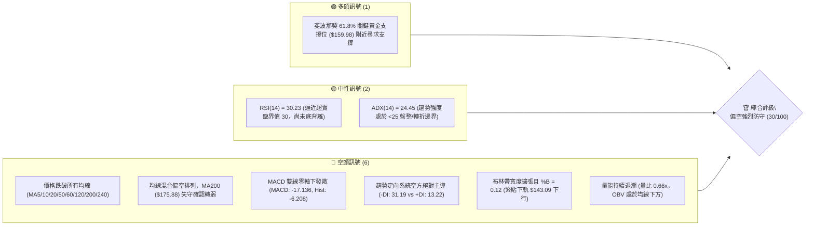
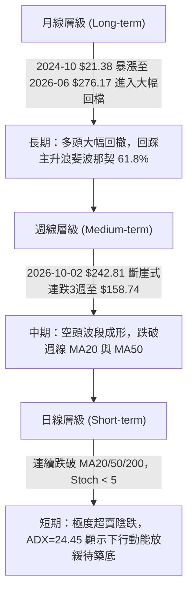
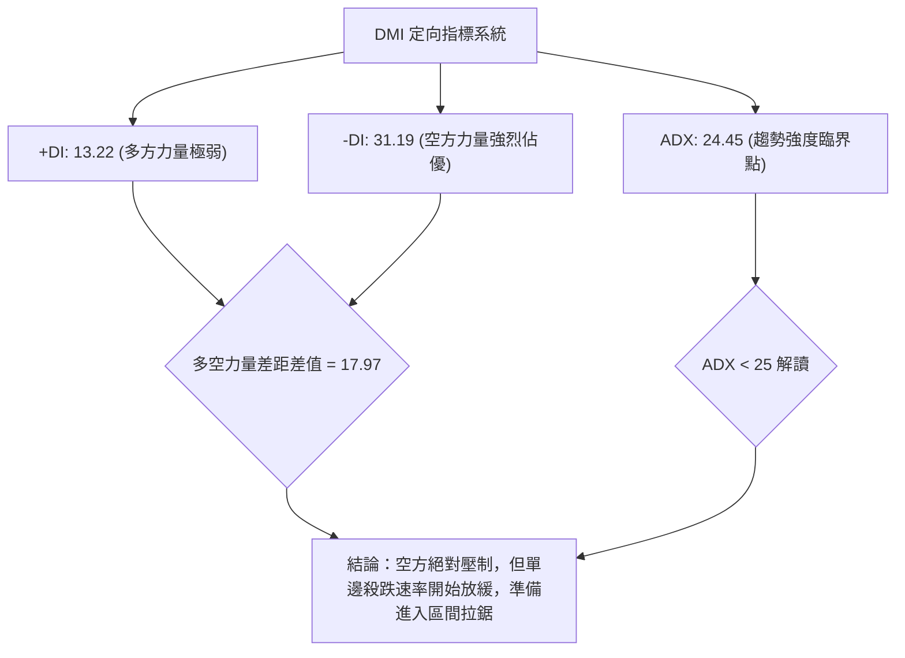
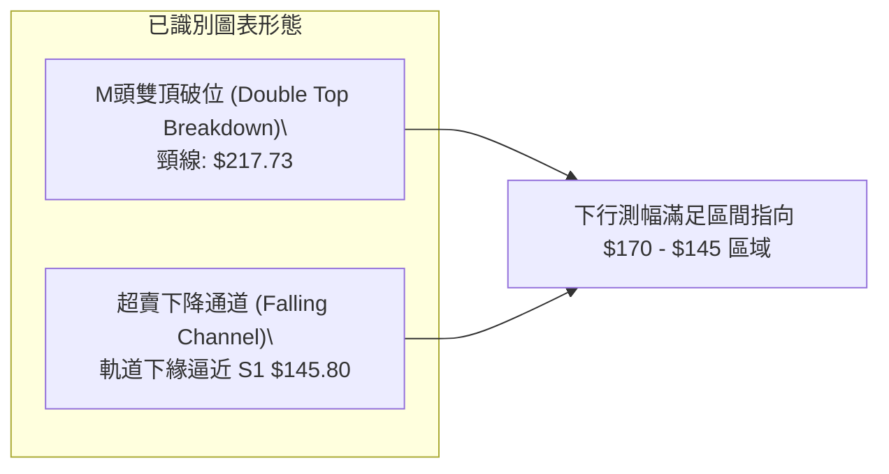
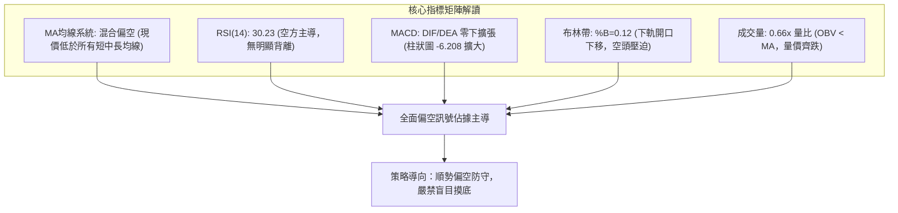
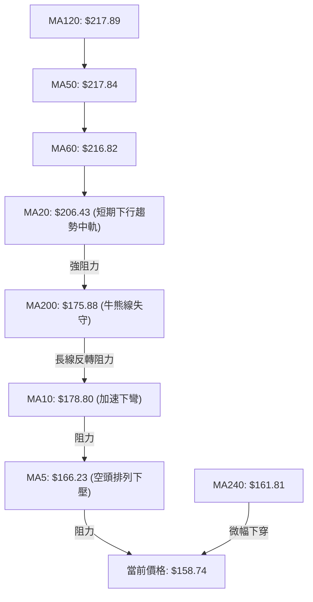
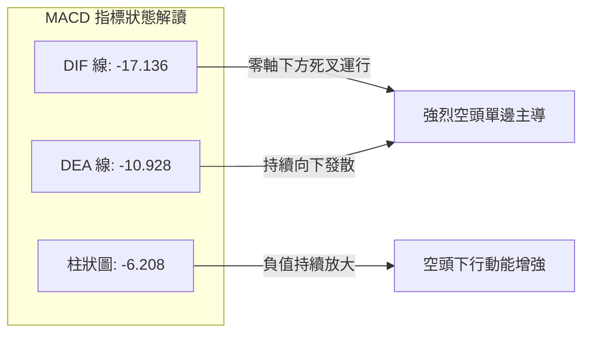
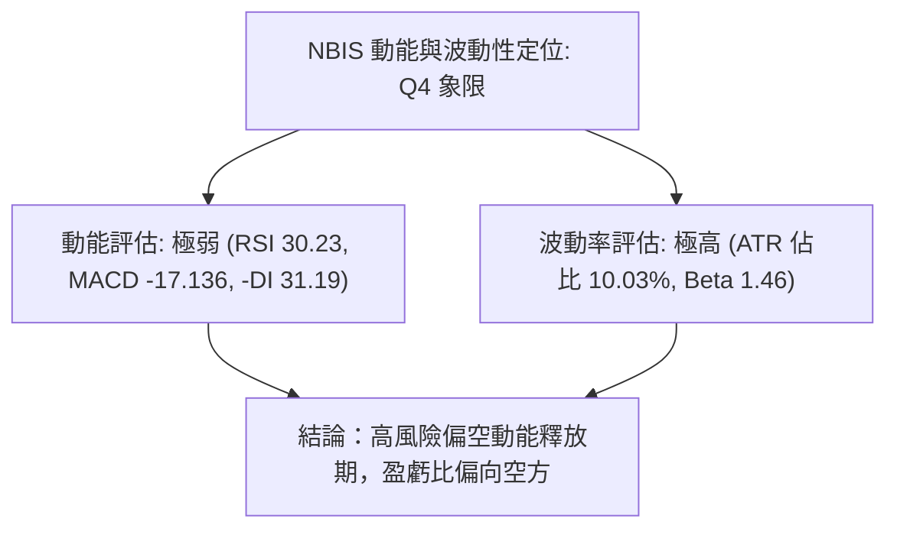
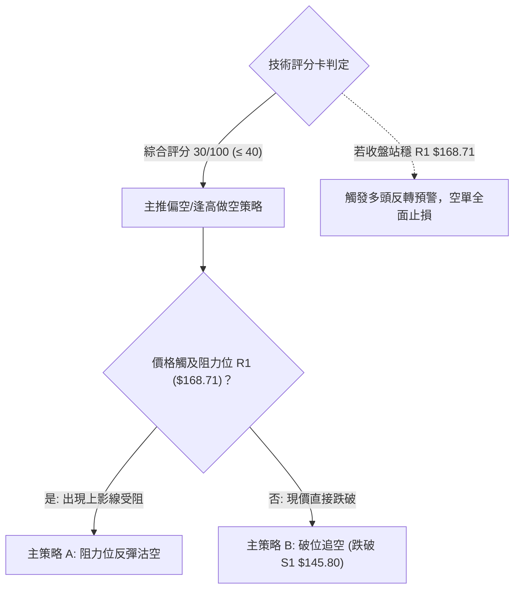
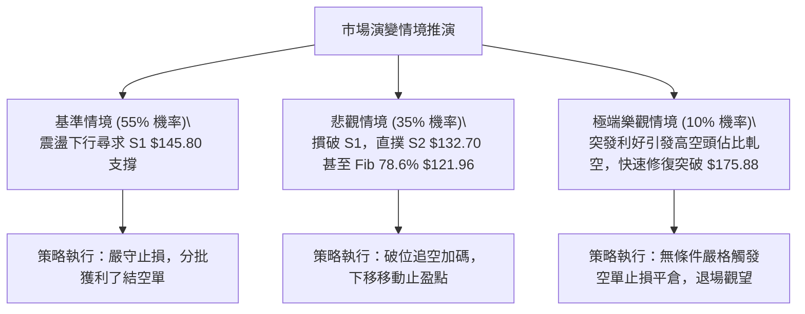

# NBIS 技術分析報告

> **報告日期**：2026-10-25 ｜ **語言**：繁體中文 ｜ **數據來源**：Yahoo Finance ｜ **當前價格**：$158.74

---

## 目錄

| 章節 | 內容 |
|------|------|
| [1. 技術面概覽](#1-技術面概覽) | 訊號儀表板、核心指標、評分卡 |
| [2. 趨勢分析](#2-趨勢分析) | 多時框趨勢、長中短期走勢 |
| [3. 圖表形態分析](#3-圖表形態分析) | 形態識別、K線組合、目標價 |
| [4. 支撐與阻力](#4-支撐與阻力) | 關鍵價位、斐波那契回調 |
| [5. 技術指標深度解讀](#5-技術指標深度解讀) | MA/RSI/MACD/布林/成交量 |
| [6. 動能與波動率](#6-動能與波動率) | 動能評估、ATR、Beta |
| [7. 多時框架總結](#7-多時框架總結) | 時框架評分矩陣 |
| [8. 交易策略建議](#8-交易策略建議) | 多空策略、風險報酬比 |
| [9. 風險提示與監控](#9-風險提示與監控) | 監控指標、風險場景 |

---

## 1. 技術面概覽

### 🎯 技術訊號儀表板



### 📊 核心指標速覽表

| 指標類別 | 指標名稱 | 當前數值 | 訊號 | 解讀 |
|----------|----------|----------|------|------|
| **價格** | 當前收盤價 | $158.74 | 🔴 | 位於52週高低區間 37.7%，創近6個月波段收盤新低 |
| **均線** | MA20 | $206.43 | 🔴 | 現價低於 MA20 -23.10%，短期下行趨勢陡峭 |
| **均線** | MA50 | $217.84 | 🔴 | 現價低於 MA50 -27.13%，中期生命線宣告失守 |
| **均線** | MA200 | $175.88 | 🔴 | 現價低於 MA200 -9.75%，跌破長期多空分水嶺 |
| **動能** | RSI(14) | 30.23 | 🟡 | 進入超賣臨界區 (30-70中性區邊緣)，未見底背離 |
| **動能** | MACD (12,26,9) | -17.136 / -10.928 | 🔴 | DIF < DEA 且雙線位於零軸下方，柱狀圖 -6.208 持續看空 |
| **動能** | Stochastic %K/%D | 3.03 / 6.14 | 🟢 | 極度超賣區間，短線存在技術性超賣抽腳反彈空間 |
| **趨勢** | ADX / DMI | ADX: 24.45 | 🔴 | ADX < 25 指向弱趨勢或震盪磨底，但 -DI(31.19) 遠壓過 +DI(13.22) |
| **通道** | 布林帶 (%B) | %B: 0.12 | 🔴 | 價格貼近下軌 ($143.09)，布林通道下行開口打開 |
| **成交量** | 量比 / OBV | 0.66x / OBV<MA | 🔴 | 成交量 13.42M 低於20日均量 20.44M，量價配合呈量縮陰跌 |
| **波動** | ATR(14) | $15.92 | 🔴 | 每日震幅佔比達 10.03%，市場處於極高波動狀態 |

### 🏆 技術評分卡

```
╔══════════════════════════════════════════════════════════════╗
║                 技術評分卡 — NBIS (2026-10-25)               ║
╠══════════════════════════════════════════════════════════════╣
║ 趨勢強度      ██████░░░░░░░░░░░░░░  28/100  🔴 強烈偏空       ║
║ 動能指標      █████░░░░░░░░░░░░░░░  25/100  🔴 動能低迷       ║
║ 支撐穩定度    █████████░░░░░░░░░░░  45/100  🟡 測試黃金分割   ║
║ 成交量配合    ██████░░░░░░░░░░░░░░  32/100  🔴 量能退潮       ║
║ 形態完整度    ███████░░░░░░░░░░░░░  35/100  🔴 頭部破位       ║
║ 均線排列      ███░░░░░░░░░░░░░░░░░  15/100  🔴 均線反壓       ║
╠══════════════════════════════════════════════════════════════╣
║ 綜合評分      ██████░░░░░░░░░░░░░░  30/100  🔴 偏空 / 觀望防守║
║ (依規則18算術平均：(28 + 25 + 45 + 32 + 35 + 15) / 6 = 30)   ║
╚══════════════════════════════════════════════════════════════╝
```

---

## 2. 趨勢分析

### 🌐 多時框趨勢分析



### 📈 長期趨勢 — 12個月走勢圖（Unicode）

```
NBIS 月線收盤走勢圖（2025-11 至 2026-10）
價格軸 ($)
$280 ┤                                      ● (2026-06 $276.17)
$250 ┤                                  ●       
$230 ┤                              ●               ● (2026-09 $235.88)
$200 ┤                                          ●   
$170 ┤                                              
$160 ┤━━━━━━━━━━━━━━━━━━━━━━━━━━━━━━━━━━━━━━━━━━━━━●← 當前 ($158.74)
$130 ┤                      ● (2026-04 $138.23)
$100 ┤  ● (2025-11 $94.87)      ● (2026-03 $103.76)
$80  ┤      ● (2025-12 $83.71)
     └─────────────────────────────────────────────────────────────
        11   12   01   02   03   04   05   06   07   08   09   10  (月份)
```

**走勢特徵分析表格**：

| 階段區間 | 起止價格 | 漲跌幅 | 趨勢性質 | 價量特徵與結構意涵 |
|----------|----------|--------|----------|--------------------|
| **第一階段：底部盤整** (2025-11 ~ 2026-01) | $94.87 → $85.19 | -10.20% | 築底打底 | 價格在 $83.71 探底後量縮築底，確立 52 週低點區間 |
| **第二階段：主升起跑** (2026-01 ~ 2026-04) | $85.19 → $138.23 | +62.26% | 爆發突破 | 均線向上發散，突破百元關卡，機構買盤持續湧入 |
| **第三階段：狂熱趕頂** (2026-04 ~ 2026-06) | $138.23 → $276.17 | +99.79% | 狂熱主升 | 創歷史高點 $299.86，月線連續大陽線，乖離率達極限 |
| **第四階段：高位震盪** (2026-06 ~ 2026-09) | $276.17 → $235.88 | -14.59% | 雙頂構築 | $190.41 至 $277.68 寬幅劇烈震盪，頭部出貨特徵顯著 |
| **第五階段：破位暴跌** (2026-09 ~ 2026-10) | $235.88 → $158.74 | -32.70% | 空頭崩跌 | 跌破多道重要均線與整數關卡，單月重挫近百元尋求支撐 |

### 📊 中期趨勢（週線分析）

```
NBIS 週線關鍵結構與多空分水嶺示意圖
  $255.10 ───┐ (2026-10-09 週高點，次頂確認)
             │
  $231.17 ───┴─────────────────────────────── 強阻力 R2 (反彈重壓區)
             │
  $178.85 ───┬─────────────────────────────── 近兩週反彈高點聚類
  $168.71 ───┴─────────────────────────────── 關鍵阻力 R1 (日/週轉折點)
  ═══════════════════════════════════════════ ◄ 現價 $158.74 (斐波那契 61.8% $159.98 處)
  $145.80 ─────────────────────────────────── 近期關鍵支撐 S1 (波段低點聚類)
  $132.70 ─────────────────────────────────── 強支撐 S2 (2026-04 爆發平台頂部)
```

中期週線在 2026-10-09 當週見高 $255.10 後出現連續三週大陰線殺跌。週成交量自 86.07M 擴大至 148.68M，隨後在當週（2026-10-23）縮量至 108.84M，顯示籌碼經歷高位恐慌拋售後，下行拋壓雖有些微鈍化，但仍未見明確的止跌回升長下影線。

### ⚡ 趨勢強度評估（ADX 解讀）



**ADX 數值強度對照解析**：

| 指標項 | 數值 | 區間分類 | 技術意涵解讀 |
|--------|------|----------|--------------|
| **ADX(14)** | 24.45 | 弱趨勢 / 盤整臨界 (< 25) | 雖然近三週跌幅劇烈，但 ADX 尚未升破 25，說明行情尚未完全確立持續性的單邊長期空頭大趨勢，極可能在斐波那契關鍵位附近轉入寬幅震盪。 |
| **+DI(14)** | 13.22 | 極弱多頭 (< 20) | 多頭攻擊能量徹底瓦解，買盤意願低迷。 |
| **-DI(14)** | 31.19 | 強烈空頭 (> 30) | 空方完全掌控短期定價權，逢高沽空拋壓沉重。 |

---

## 3. 圖表形態分析

### 🔍 形態識別系統



**形態信心度評估表（依規則 15 嚴格審核）**：

| 形態 | 信心度 | 判斷依據（引用數據） | 完成度 | 目標價（附計算式） |
|------|--------|----------------------|--------|--------------------|
| **M頭雙頂破位** | 85% | 頂1: 2026-08-14 高點 ($277.68 收盤)，頂2: 2026-10-02 週高 ($250.48)，跌破 2026-10-09 週低頸線 $217.73 | 100% (已跌破) | 形態高度 = $255.10 (波段高) - $217.73 = $37.37。破位測幅目標 = $217.73 - $37.37 = **$180.36**（已達成，超額跌向 S1 $145.80） |
| **下降收斂通道** | 60% | 近10根日K高點階梯式下移 ($217.20 → $198.60 → $182.70 → $178.85 → $162.99) | 75% | 通道下軌下探支撐位 **S1: $145.80** |
| **頭肩底 / 雙底** | 0% | 數據中未偵測到任何底部反轉形態結構 | 0% | 訊號不足，僅做指標型解讀，嚴禁過早預設反轉底部 |

### 🕯️ 重要K線形態分析

根據提供的「近10根日K」與「近8根週K」實際開高低收數據進行嚴格識別：

| 日期（時框） | 開 | 高 | 低 | 收 | 成交量 | K線形態名稱 | 技術解讀與訊號驗證 | 訊號 |
|--------------|----|----|----|----|--------|-------------|--------------------|------|
| **2026-10-15 (日K)** | 175.48 | 189.33 | 163.36 | 188.41 | 47,717,500 | 長下影中陽線 (Pinbar) | 巨量下影線低測 $163.36 後強拉，多頭一度嘗試抵抗 | 🟡 |
| **2026-10-16 (日K)** | 181.17 | 182.70 | 163.27 | 165.47 | 35,212,600 | 反轉破位陰線 | 開高走低完全吞食前日反彈陽線，確認前低多頭防守崩潰 | 🔴 |
| **2026-10-20 (日K)** | 163.99 | 174.74 | 160.25 | 171.45 | 22,615,600 | 下影小陽線 | 探低 $160.25 後反彈，但成交量僅 22.6M，無連續攻擊動能 | 🟡 |
| **2026-10-21 (日K)** | 176.46 | 178.85 | 164.00 | 171.57 | 19,693,900 | 衝高受阻流星星線 | 上探阻力位高點 $178.85 遭遇 MA5/MA10 強力反壓留長上影 | 🔴 |
| **2026-10-22 (日K)** | 164.75 | 167.50 | 155.73 | 159.17 | 26,221,800 | 實體中陰線破位 | 開盤即跌破前日低點，最低探至 $155.73，創波段新低 | 🔴 |
| **2026-10-23 (日K)** | 158.90 | 162.99 | 155.86 | 158.74 | 13,423,700 | 量縮十字星 / 小紡錘 | 振幅收窄至 $7.13，成交量驟降至 13.4M，短期殺跌動能暫竭 | 🟡 |
| **2026-10-16 (週K)** | 217.20 | 217.20 | 163.27 | 165.47 | 148,676,100 | 光頭大黑棒 (週斷崖) | 巨量單週重挫 -25.15%，實體大陰線摜破中期所有防線 | 🔴 |
| **2026-10-23 (週K)** | 176.51 | 178.85 | 155.73 | 158.74 | 108,836,200 | 下跌實體陰線 | 延續弱勢跌破 $160，週跌幅 -4.07%，收在全週相對低位 | 🔴 |

### 📉 ASCII 走勢形態示意圖

```
NBIS 近10日 K 線連續破位與反彈受阻示意圖
價格 ($)
$190 ┤      ┌─┐
$185 ┤      │ │ (10-15: 巨量反彈高點 $189.33)
$180 ┤      │ │   ┌─┐             ┌─┐
$175 ┤  ┌─┐ │ │   │ │             │ │ (10-21: 上影高點 $178.85 遇阻 R1)
$170 ┤  │ │ │ │   │ └─┐   ┌─┐ ┌─┐ │ │
$165 ┤  │ │ └─┘   └───┘   │ │ │ │ └─┘
$160 ┤  │ │               └─┘ │ │     ┌─┐
$155 ┤  └─┘                   └─┘     │ │ (10-22/23: 連續下探 $155.73)
     └────────────────────────────────────────────────────────
        10-14 10-15 10-16 10-19 10-20 10-21 10-22 10-23 (交易日)
```

### 🎯 形態目標價計算

1. **雙頂頸線破位測幅**：
   - 頂部高點區間：$255.10
   - 跌破關鍵頸線：$217.73
   - 形態垂直高度（$H$）= $255.10 - $217.73 = $37.37
   - 第一等距下行目標價 = 頸線 $217.73 - $37.37 = **$180.36**（已跌破並轉為強阻力）
   - 1.618倍擴展滿足位 = $217.73 - (37.37 × 1.618) = $217.73 - $60.46 = **$157.27**（現價 $158.74 正在此測幅延伸滿足區附近激烈爭奪）

---

## 4. 支撐與阻力

### 🗺️ 關鍵價位分布圖（Unicode）

```
NBIS 價位結構分布圖 (Resistance & Support Map)
═══════════════════════════════════════════════════════════════════
$254.92 ║████████████████████████████████████║ 強阻力 R3 (波段頂部密集成交區)
$246.44 ║────────────────────────────────────║ 斐波那契 23.6% 回調位
$231.17 ║████████████████████████            ║ 阻力 R2 (反彈重要中繼反壓)
$213.40 ║────────────────────────────────────║ 斐波那契 38.2% 回調位
$206.43 ║▓▓▓▓▓▓▓▓▓▓▓▓▓▓▓▓                    ║ MA20 下降軌道反壓
$186.69 ║────────────────────────────────────║ 斐波那契 50.0% 多空分水嶺
$175.88 ║▓▓▓▓▓▓▓▓▓▓▓▓▓▓▓▓▓▓▓▓                ║ 關鍵均線反壓 (MA200 牛熊線)
$168.71 ║████████████████████████            ║ 關鍵阻力 R1 (波段跌破轉折阻力)
$159.98 ║────────────────────────────────────║ 斐波那契 61.8% 黃金分割線
$158.74 ╠════════════════════════════════════╣ ◄ 當前收盤價 ($158.74)
$145.80 ║▓▓▓▓▓▓▓▓▓▓▓▓▓▓▓▓                    ║ 近期支撐 S1 (波段低點聚類)
$143.09 ║────────────────────────────────────║ 布林通道下軌動態支撐
$132.70 ║████████████████████████            ║ 強支撐 S2 (波段主升平台底部)
$121.96 ║────────────────────────────────────║ 斐波那契 78.6% 回調位
$89.65  ║████████████████████████████████████║ 極限強支撐 S3 (52W歷史低點聚類)
═══════════════════════════════════════════════════════════════════
```

### 🚧 阻力位分析表

所有價位均來自提供的歷史 OHLCV 聚類計算：

| 阻力級別 | 價位 | 與現價距離 | 形成原因與籌碼結構 | 突破難度 | 重要性 |
|----------|------|------------|--------------------|----------|--------|
| **阻力 R1** | **$168.71** | +6.28% | 近期日K跌破後的反壓下緣，且與 MA5 ($166.23) 形成短線共振壓制 | 🟡 中等 | ★★★★☆ |
| **阻力 R2** | **$231.17** | +45.63% | 2026-09 波段成交密集平台底頸線，現與 MA50 ($217.84) 共同構築中期防線 | 🔴 極高 | ★★★★★ |
| **阻力 R3** | **$254.92** | +60.59% | 2026-10-09 當週高點聚類 ($255.10) 及歷史次高密集成交區 | 🔴 極高 | ★★★★☆ |

### 🛡️ 支撐位分析表

所有價位均來自提供的歷史 OHLCV 聚類計算：

| 支撐級別 | 價位 | 與現價距離 | 形成原因與籌碼結構 | 守住機率 | 重要性 |
|----------|------|------------|--------------------|----------|--------|
| **支撐 S1** | **$145.80** | -8.15% | 近一年上升走勢中的波段低點聚類，接近布林下軌 ($143.09) | 🟡 55% | ★★★★☆ |
| **支撐 S2** | **$132.70** | -16.40% | 2026-04 爆發性大陽線啟動起漲點聚類，具備強大籌碼沉澱基礎 | 🟢 70% | ★★★★★ |
| **支撐 S3** | **$89.65** | -43.52% | 52週低點區間 ($73.52 - $94.87) 的核心中軸沉澱帶 | 🟢 90% | ★★★☆☆ |

### 📐 斐波那契回調位分析

依據 52 週完整循環（波段低點 $73.52 至波段高點 $299.86）精確回調層級：

| 回調比例 | 斐波那契價位 | 當前相對位置 | 結構意義與多空攻防解讀 |
|----------|--------------|--------------|------------------------|
| **0.0%** | $299.86 | +88.90% | 52週歷史最高點（牛市極限頂部） |
| **23.6%** | $246.44 | +55.25% | 第一級淺度回檔位，跌破後確認多頭主升結束 |
| **38.2%** | $213.40 | +34.43% | 強勢回檔分水嶺，跌破後市場進入深度洗盤結構 |
| **50.0%** | $186.69 | +17.61% | 多空平衡中軸（半數利潤回吐線），現轉化為強大反彈阻力 |
| **61.8%** | **$159.98** | **+0.78%** | **黃金分割關鍵支撐位**：現價 $158.74 正在此位正負 1% 範圍內徘徊！此處為多方技術派最後核心堡壘，若收盤有效跌破，回檔空間將大幅下移。 |
| **78.6%** | $121.96 | -23.17% | 深度防禦位，若黃金分割失守，下行探底中繼站 |
| **100.0%** | $73.52 | -53.69% | 52週週期起漲原點 |

---

## 5. 技術指標深度解讀

### 🎛️ 指標訊號總覽



### 📈 移動平均線排列分析



**移動平均線數值與乖離率統計表**：

| 均線名稱 | 數值 | 現價與均線距離 ($) | 乖離率 (%) | 均線斜率與趨勢狀態 |
|----------|------|-------------------|------------|--------------------|
| **MA5** | $166.23 | -$7.49 | -4.51% | 急劇向下，構成超短線反彈第一道天花板 |
| **MA10** | $178.80 | -$20.06 | -11.22% | 陡峭下行，短線反彈強壓 |
| **MA20** | $206.43 | -$47.69 | -23.10% | 中短線趨勢向下，嚴重負乖離 |
| **MA50** | $217.84 | -$59.10 | -27.13% | 中期走平轉跌，中期趨勢翻空 |
| **MA60** | $216.82 | -$58.08 | -26.79% | 季線下彎，上檔套牢籌碼沉重 |
| **MA120** | $217.89 | -$59.15 | -27.15% | 半年線下彎，中期反轉確立 |
| **MA200** | $175.88 | -$17.14 | -9.75% | 長期年線宣告跌破，牛熊格局逆轉 |
| **MA240** | $161.81 | -$3.07 | -1.90% | 跌破兩年均線支撐，長線結構轉危 |

### 📉 RSI(14) 分析

- **RSI(14) 數值進度條**：
  `RSI(14) = 30.23: ▓▓▓▓▓▓░░░░░░░░░░░░░░ (30.23%)` ── 🟡 處於中性偏空與超賣的臨界邊界。
- **超買超賣狀態**：
  目前 RSI 自 2026-10-02 的 57.1 大幅跳水至 30.23。儘管 Stochastic %K 已進入 3.03 的極度超賣區，但 RSI(14) 仍穩定運行於 30 邊界之上，顯示空頭下殺動能尚未釋放完畢，不排除跌破 30 進一步引發超賣鈍化。
- **背離分析**：
  依據 20 根 K 棒數據檢驗：價格創出近半年新低（$155.73），對應 RSI 同樣創出 30.23 的近期新低，**並無底背離（Bullish Divergence）現象**，亦無頂背離。這意味著當前價格的下跌完全由實質性賣盤驅動，下行趨勢仍具備技術連貫性。

### 📊 MACD(12/26/9) 訊號解讀



MACD 核心指標數據：DIF (-17.136) 遠低於 DEA (-10.928)，柱狀圖為 -6.208。雙線在零軸下方加速下行且間距擴大，未見任何金叉或收斂走平跡象，表明中短期市場動能完全由空方掌控，反彈均屬弱勢修正。

### 📦 布林通道分析

```
NBIS 日線布林通道 (Bollinger Bands 20, 2) 結構示意圖
價格軸 ($)
$270 ┤  ──────────────────────────────── 上軌 $269.77 (持續收斂下移)
$240 ┤
$210 ┤  - - - - - - - - - - - - - - - - 中軌 (MA20) $206.43 (強大下行反壓)
$180 ┤
$160 ┤  ● 現價 $158.74 (%B = 0.12，緊貼下軌運行)
$140 ┤  ──────────────────────────────── 下軌 $143.09 (通道下行張口)
     └─────────────────────────────────────────────────────────────
```

- **布林帶寬度與 %B 解讀**：
  當前布林帶上軌位於 $269.77，中軌為 $206.43，下軌為 $143.09。通道帶寬高達 $126.68，展現極大波動率。當前價格 $158.74 對應 **%B 為 0.12**，極度逼近下軌（0 代表下軌，0.5 代表中軌）。價格「貼軌下行」是典型弱勢單邊行情的特徵，下軌 $143.09 將與支撐位 S1 ($145.80) 構成下檔動態考驗區。

### 💹 成交量分析（量價配合度）

1. **量能縮減與陰跌**：
   最新單日成交量為 13,423,700 股，相較於 20 日均量 20,438,110 股，量比僅為 **0.66x**。成交量顯著萎縮至 50 日均量 (18.79M) 之下。
2. **量價關係判斷**：
   在經歷 2026-10-15 至 10-16 的放量殺跌（單日高達 47.7M 及 35.2M）後，近期成交量驟降至 13.4M。此種「巨量破位後量縮陰跌」反映抄底買盤極為謹慎，市場並非出現「放量恐慌見底（Climax Selling）」，而是呈現承接無力的弱勢流血狀態。
3. **OBV 能量潮趨勢**：
   數據明確顯示「OBV < MA → 量能疲弱」。能量潮線持續受制於其移動平均線下方，資金流向呈淨流出態勢，量能完全無法確認多頭具備反轉資格。

---

## 6. 動能與波動率

### ⚡ 動能評估四象限

動能強度（以 RSI、MACD、DMI 衡量）與波動率（以 ATR、布林帶寬衡量）交叉評估：

| 象限 | 動能維度 | 波動維度 | 象限特徵 | 當前狀態判定 | 操作意涵 |
|------|----------|----------|----------|--------------|----------|
| **Q1** | 強 (多頭) | 低波動 | 慢牛爬升 | ─ | 最佳趨勢抱股區間 |
| **Q2** | 弱 (空頭) | 低波動 | 窄幅盤整 | ─ | 觀望等待方向突破 |
| **Q3** | 強 (多頭) | 高波動 | 狂熱主升 | ─ | 逢高獲利了結 |
| **Q4** | **弱 (空頭)** | **高波動** | **空頭宣洩 / 破位殺跌** | **✓ (NBIS 當前位置)** | **風險最高區，避免盲目抄底，以防守或反彈放空為主** |



### 📊 ATR 波動率分析

- **ATR(14) 數值**：**$15.92**。
- **波動佔比**：佔當前股價高達 **10.03%**（極高波動標的）。
- **技術意義與止損設計**：
  每日平均波動近 $16 美元，意味著日內常規雜訊極易觸發過於狹窄的止損。
  - **保守止損緩衝**：以 1.5 倍 ATR 計算 = $15.92 × 1.5 = **$23.88**。
  - **激進波段止損緩衝**：以 1.0 倍 ATR 計算 = **$15.92**。
  因此，任何交易策略的止損間距若小於 $15，被市場隨機噪音打停的機率極高。

### 📐 Beta 與市場相關性

- **Beta 係數**：**1.46**。
- **市場敏感度**：NBIS 屬於高彈性進攻型資產，波動度高出大盤標普500指數 46%。在整體大盤偏弱或 AI 基礎設施板塊 CAPEX 爭議發酵時，該股容易承受 1.5 倍的放大拋售壓力。當前高達 18.9% 的空頭浮動比率（Short % Float）與 2.98 的 Short Ratio，顯示市場存在龐大放空避險及投機籌碼。

---

## 7. 多時框架總結

### 📋 時框架評分表

| 時框架 | 趨勢方向 | 動能狀態 | 均線排列 | 圖表形態 | 綜合評分 | 戰術建議 |
|--------|----------|----------|----------|----------|----------|----------|
| **月線 (長期)** | 🟡 中性回撤 | 減弱向下 | 仍站於 MA240 之上 | 歷史高位大幅回吐 | 45/100 | 長期資金可觀察 Fib 61.8% 支撐防守 |
| **週線 (中期)** | 🔴 明確看空 | 空頭加速 | 摜破週 MA20/50 | M頭頸線跌破 | 25/100 | 中期波段禁止建多倉，反彈皆賣點 |
| **日線 (短期)** | 🔴 空頭延續 | 極度超賣 | 全面空頭反壓 | 量縮破位陰跌 | 20/100 | 短線等待反彈觸及阻力位放空 |

### 🔲 綜合訊號矩陣

```
時框維度       趨勢訊號    均線訊號    動能訊號    量價訊號    一致性確認
─────────────────────────────────────────────────────────────────
短期 (日線)      🔴 空       🔴 空       🔴 空       🔴 空      強烈偏空 (100% 吻合)
中期 (週線)      🔴 空       🔴 空       🔴 空       🔴 空      強烈偏空 (100% 吻合)
長期 (月線)      🟡 中       🟡 中       🔴 空       🟡 中      轉向中性警惕
─────────────────────────────────────────────────────────────────
多時框收斂判定：中短期高度共振看空，長期牛市主升浪遭遇嚴峻考驗。
```

### ⚖️ 多時框收斂結論

依據多時框架收斂規則（規則 14）：
當前 **ADX(14) 為 24.45 (< 25)**，進入趨勢與盤整的臨界拉鋸區。儘管日線跌勢凌厲，但在 ADX 未突破 25 且觸及重要斐波那契 61.8% ($159.98) 的情況下，市場高機率將在布林通道下軌 ($143.09) 至阻力位 R1 ($168.71) 之間進行劇烈的低位震盪築底或換手。
然而，由於日線與週線層級全面跌破生命線 MA50 ($217.84) 與年線 MA200 ($175.88)，中期空頭架構佔有壓倒性主導權。
**唯一方向性結論：強烈偏空防守（Bearish Preservation）**。任何短線反彈均視為解套減碼或順勢沽空契機，絕非大舉做多信號。

---

## 8. 交易策略建議

### 🗺️ 策略決策流程圖



### 🧭 策略路由（依評分卡分流，不得兩頭下注）

> **當前主策略方向 = 偏空做空 / 逢高布局空單（依技術評分卡綜合評分 30/100 確定）**
> 依據第 1 章綜合評分 30/100（≤ 40 區間），本報告嚴格執行紀律，**主推空頭交易策略**。多頭僅列為反轉風險觸發點與風控對沖提示，不主推多頭建倉。

### 🎯 價格情境階梯（Price Scenarios）

價位完全引用第 4 章關鍵價位數據：

| 觸發條件 | 下一目標 | 後續延伸 | 情境含義 |
|----------|----------|----------|----------|
| **向上突破 R1 $168.71** | MA200 $175.88 | 阻力 R2 $231.17 | 短線超賣強烈修復，空頭回補，短線轉強 |
| **受阻於現價至 R1 區間** | 支撐 S1 $145.80 | 布林下軌 $143.09 | 弱勢下行中繼，維持空頭常態震盪下挫 |
| **向下擊穿 S1 $145.80** | 強支撐 S2 $132.70 | 極限支撐 S3 $89.65 | 中期支撐崩解，引發新一輪多殺多恐慌盤 |

### 📊 情境機率分佈

| 情境 | 機率 | 主要依據 |
|------|------|----------|
| **震盪回落 / 跌破支撐 (再探底)** | **55%** | MACD 零軸下發散 (-17.136)，-DI 高達 31.19，價格受制於全數均線之下 |
| **區間弱勢震盪 (低位橫盤)** | **35%** | ADX 處於 24.45 (<25)，Stoch 進入極度超賣 (%K: 3.03)，空方砸盤速率減緩 |
| **強勢 V 型反彈 (向上突破)** | **10%** | OBV 量能極度匱乏，成交量萎縮至 0.66x，缺乏機構增量資金支持反轉 |

### 🟢 主策略詳情（空頭交易策略）

所有風險報酬比嚴格按公式計算：做空風險報酬比 = (進場價 − 目標價 T1) ÷ (止損價 − 進場價)。

| 策略要素 | 策略 A（反彈至阻力位放空 - 推薦） | 策略 B（現價順勢放空 / 跌破追空） |
|----------|------------------------------------|-----------------------------------|
| **交易類型** | 逢高逆彈放空 (Pullback Short) | 順勢破位放空 (Breakdown Short) |
| **進場條件** | 價格反彈測試 R1 $168.71 遇阻留上影 | 現價 $158.74 或反彈無力直接做空 |
| **進場價格** | **$168.71** (阻力位 R1) | **$158.74** (當前市價) |
| **止損價格** | **$175.88** (MA200 關鍵反轉阻力線) | **$168.71** (阻力位 R1) |
| **目標價 T1** | **$145.80** (支撐位 S1) | **$145.80** (支撐位 S1) |
| **目標價 T2** | **$132.70** (強支撐 S2) | **$132.70** (強支撐 S2) |
| **風險報酬比** | **1 : 3.20（以 T1 計）** <br>*(168.71 - 145.80) ÷ (175.88 - 168.71) = 22.91 ÷ 7.17 = 3.195*<br>另計 T2: 1 : 5.02（以 T2 計） | **1 : 1.30（以 T1 計）** <br>*(158.74 - 145.80) ÷ (168.71 - 158.74) = 12.94 ÷ 9.97 = 1.298*<br>另計 T2: 1 : 2.61（以 T2 計） |
| **成功機率** | 60% | 50% |
| **建議倉位** | 10% - 15% | 5% - 8% |

### 🔴 反向風險觸發點（對沖與止損提示）

若出現以下情境，宣告空頭主策略失效，空單必須立即全面平倉避險：
1. **價格收盤站上 R1 ($168.71)**，且次日放量突破 **MA200 ($175.88)**，形成破底翻（False Breakdown）結構。
2. **日線 RSI(14) 強勢回升突破 45**，且 MACD 柱狀圖由負轉正形成底部金叉。
3. 若發生上述訊號，激進型交易者方可考慮小倉位博取反彈，目標看至 **R2 $231.17**，止損設於 **$155.73**。

### ⭐ 整體訊號強度評星

```
做多訊號強度：★☆☆☆☆  (1/5星 - 極度疲弱)
做空訊號強度：★★★★☆  (4/5星 - 結構明確)
整體可信度：  ★★★★☆  (4/5星 - 指標共振高度吻合)
```

---

## 9. 風險提示與監控

### ✅ 關鍵監控指標 Checklist

```
╔══════════════════════════════════════════════════════════════════════╗
║                   每日交易監控 Checklist — NBIS                      ║
╠══════════════════════════════════════════════════════════════════════╣
║ [ ] 價格能否收盤守住斐波那契 61.8% ($159.98)                        ║
║ [ ] 日成交量是否放大至 20日均量 (20.44M) 以上（放量破位或止跌確認） ║
║ [ ] RSI(14) 是否正式摜破 30 進入深度超賣鈍化區間                     ║
║ [ ] 短線反彈時，MA5 ($166.23) 與 R1 ($168.71) 的拋壓承接狀況        ║
║ [ ] 空頭浮動比率 (Short Float 18.9%) 是否因空頭回補引發軋空震盪     ║
║ [ ] 跌破 S1 ($145.80) 時布林通道下軌是否加速外擴張口                 ║
╚══════════════════════════════════════════════════════════════════════╝
```

### ⚠️ 風險場景分析



### 🛡️ 風險管理重要提醒

1. **極高 ATR 波動風控**：NBIS 日震幅超過 10%（ATR $15.92），在建立任何倉位前，務必將單筆交易損失嚴格控制在總投資資本的 1% 至 1.5% 之內。
2. **空頭軋空風險（Short Squeeze）**：當前高達 18.9% 的流通股被做空，若股價於斐波那契 61.8% 附近出現超賣報復性抽腳，容易引發空頭踩踏式回補，因此空頭部位必須設定嚴格的硬止損（如 MA200 $175.88），切忌抱死扛單。
3. **重大基本面資本支出負擔**：最新財務數據顯示自由現金流為 -$5.88B，資本支出達 $11.14B，基本面資金缺口與負營運利潤率加劇了技術面的破位拋售，基本面與技術面共振轉弱時，下檔空間往往超出單純技術支撐範疇。

---

## 📋 報告總結

```
╔══════════════════════════════════════════════════════════════════╗
║                    NBIS 技術分析報告總結                         ║
╠══════════════════════════════════════════════════════════════════╣
║ 報告日期：2026-10-25                                            ║
║ 當前價格：$158.74                                                ║
║ 分析評級：🔴 強烈偏空 / 觀望防守 (技術評分: 30/100)              ║
║                                                                  ║
║ 關鍵技術結論：                                                   ║
║ ├─ 長期趨勢：🟡 中性回撤 (主升浪受挫，考驗 Fib 61.8% 支撐)       ║
║ ├─ 中期趨勢：🔴 強烈看空 (M頭雙頂破位，跌破生命線 MA50)         ║
║ ├─ 短期趨勢：🔴 弱勢陰跌 (均線全數反壓，貼布林下軌運行)         ║
║ ├─ 關鍵支撐：S1: $145.80 ｜ S2: $132.70 ｜ S3: $89.65            ║
║ ├─ 關鍵阻力：R1: $168.71 ｜ R2: $231.17 ｜ R3: $254.92            ║
║ └─ 外資分析師目標均價：$281.00 (高低區間: $84.00 - $410.00)      ║
║                                                                  ║
║ 交易策略優先級：                                                 ║
║ 1. 🥇 首選策略 (策略 A)：等待價格反彈至 R1 $168.71 受阻順勢放空，║
║    止損設 MA200 $175.88，目標 S1 $145.80 (風報酬比 1 : 3.20)     ║
║ 2. 🥈 次選策略 (策略 B)：現價 $158.74 輕倉做空，止損 R1 $168.71，║
║    目標 S1 $145.80 (風報酬比 1 : 1.30)                           ║
║ 3. 🥉 保守選擇：完全空倉觀望，耐心等待日線放量築底信號出現      ║
╚══════════════════════════════════════════════════════════════════╝
```

---

> ⚠️ **免責聲明**：本報告為 AI 自動生成之技術分析研究報告，所有數據、圖表及估算均嚴格基於所提供的歷史價格與量化指標。本報告**僅供研究與學術參考**，**不構成任何形式的投資建議、買賣邀約或推薦**。金融市場具有極高風險，投資人應依據個人風險承受能力獨立判斷，並自行承擔交易盈虧。

---

*報告生成時間：2026-10-25 ｜ 數據來源：Yahoo Finance ｜ 分析框架：多時框技術分析模型*