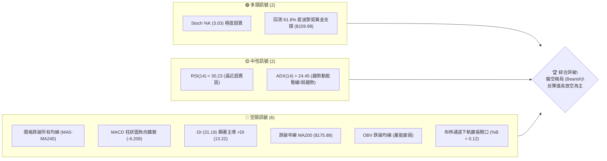
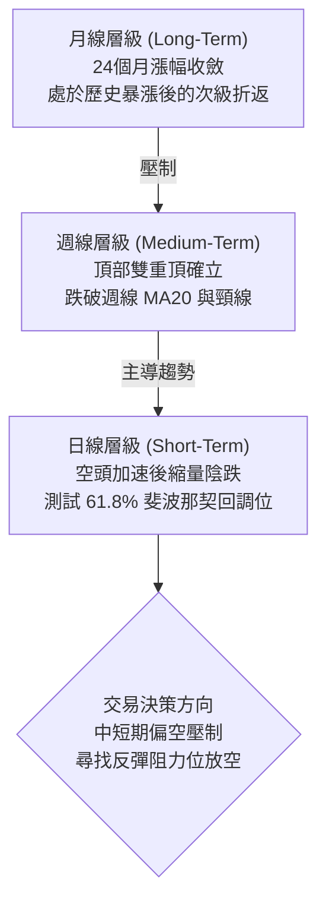
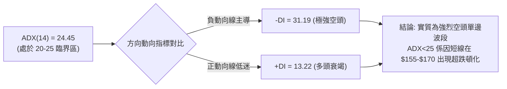
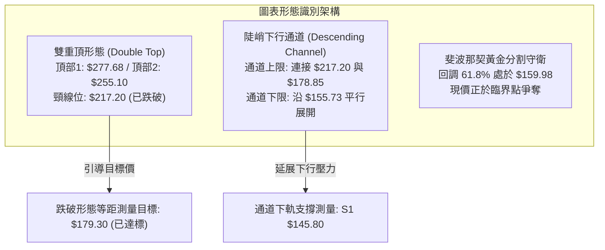
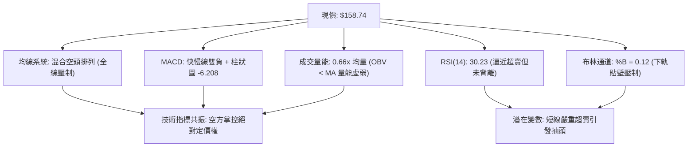
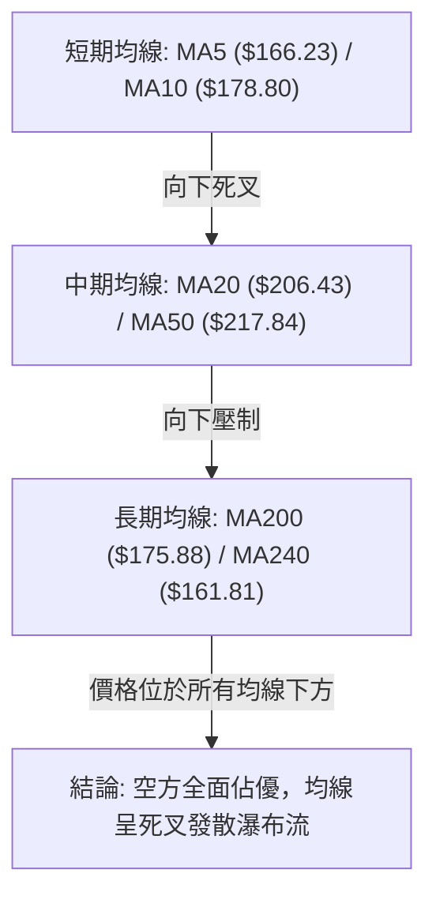
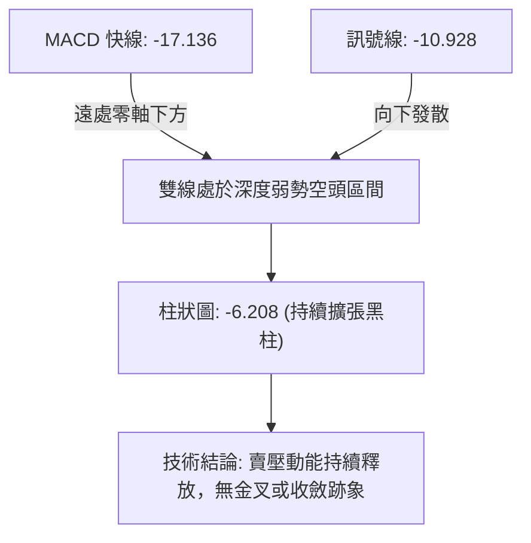
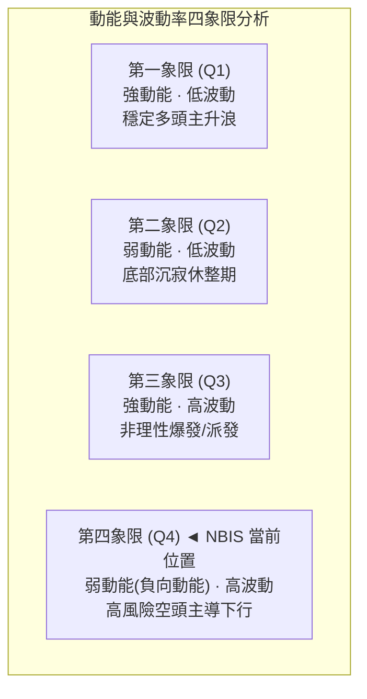
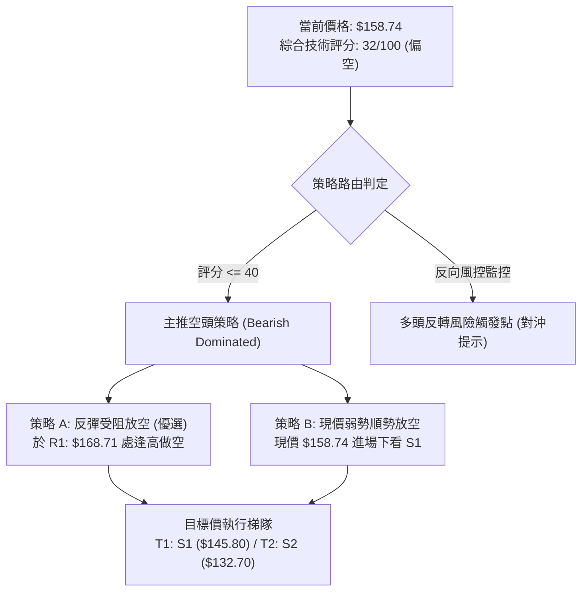
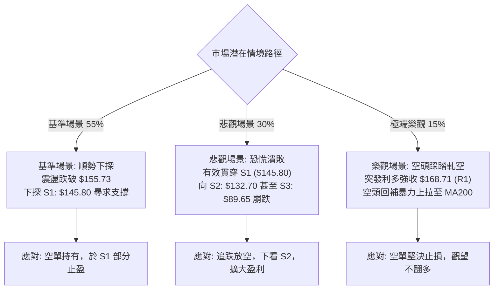

# NBIS 技術分析報告

> **報告日期**：2026-10-26 ｜ **語言**：繁體中文 ｜ **數據來源**：Yahoo Finance ｜ **當前價格**：$158.74

---

## 目錄

| 章節 | 內容 |
|------|------|
| [1. 技術面概覽](#1-技術面概覽) | 訊號儀表板、核心指標、評分卡 |
| [2. 趨勢分析](#2-趨勢分析) | 多時框趨勢、長中短期走勢、ADX 解讀 |
| [3. 圖表形態分析](#3-圖表形態分析) | 形態識別、K線組合、目標價推算 |
| [4. 支撐與阻力](#4-支撐與阻力) | 關鍵價位分佈、斐波那契回調結構 |
| [5. 技術指標深度解讀](#5-技術指標深度解讀) | 均線系統、RSI、MACD、布林通道、量價配合 |
| [6. 動能與波動率](#6-動能與波動率) | 動能四象限、ATR 波動度、Beta 風險 |
| [7. 多時框架總結](#7-多時框架總結) | 時框評分矩陣、多時框收斂與優先級判定 |
| [8. 交易策略建議](#8-交易策略建議) | 策略路由、主推策略、情境機率、風控比 |
| [9. 風險提示與監控](#9-風險提示與監控) | 關鍵監控清單、極端風險場景、部位管理 |
| [📋 報告總結](#-報告總結) | 核心結論與最優策略精要 |

---

## 1. 技術面概覽

Nebius Group N.V.（NASDAQ: NBIS）當前報價為 **$158.74**。自 2026 年高點 $299.86 回落以來，累計回撤達 47.06%，目前正處於 52 週波動區間（$73.52 – $299.86）的 37.7% 分位處。各週期技術架構呈現顯著的空頭排列與下行慣性，短期跌破 MA200（$175.88），正於 61.8% 斐波那契回調位（$159.98）與第一支撐位 S1（$145.80）之間尋求短期供需平衡。

### 🎯 技術訊號儀表板



### 📊 核心指標速覽表

| 指標類別 | 指標名稱 | 當前數值 | 訊號 | 深度解讀 |
|----------|----------|----------|------|----------|
| **價格** | 當前收盤價 | $158.74 | 🔴 | 位於 52 週區間 37.7% 分位，處於中長期下行通道下沿 |
| **均線** | MA20 (月線) | $206.43 | 🔴 | 現價低於 MA20 達 -23.10%，短期乖離過大但趨勢向下壓制 |
| **均線** | MA50 (季線) | $217.84 | 🔴 | 季線下彎，中線空頭防守重鎮，上檔解套賣壓沉重 |
| **均線** | MA200 (年線)| $175.88 | 🔴 | 跌破牛熊分水嶺（-9.75%），長期上升多頭結構遭到技術性破壞 |
| **動能** | RSI(14) | 30.23 | 🟡 | 位於超賣區邊界（30.00），暫無底背離，下行動能稍有減速 |
| **動能** | MACD (12,26,9)| -17.136 | 🔴 | 快慢線處於零軸下方深度負值，柱狀圖 -6.208 持續看空 |
| **波動** | ATR(14) | $15.92 | 🔴 | 佔股價 10.03%，日間震盪極為劇烈，止損空間需嚴格放大 |
| **擺動** | Stoch %K / %D | 3.03 / 6.14 | 🟢 | 進入極度超賣鈍化區，隨時具備技術性超跌抽頭條件 |
| **趨勢** | ADX / ±DI | 24.45 | 🔴 | ADX 處於盤整與弱趨勢臨界，但 -DI(31.19) 碾壓 +DI(13.22) |
| **量能** | 當日量 / 20日均量 | 13.42M / 20.44M | 🔴 | 量比 0.66x，量縮下破，OBV < MA 顯示主力資金持續流出 |

### 🏆 技術評分卡

依照六項核心維度嚴格量化評估，各指標滿分 100 分：

```
╔══════════════════════════════════════════════════════════════╗
║                 技術評分卡 — NBIS (2026-10-26)                 ║
╠══════════════════════════════════════════════════════════════╣
║ 趨勢強度 (Trend)     ██████░░░░░░░░░░░░░░  30/100 🔴 空頭主導 ║
║ 動能指標 (Momentum)  █████░░░░░░░░░░░░░░░  28/100 🔴 負向加速 ║
║ 支撐穩定度 (Support) ████████░░░░░░░░░░░░  40/100 🟡 考驗S1位 ║
║ 成交量配合 (Volume)  ███████░░░░░░░░░░░░░  36/100 🔴 量能衰退 ║
║ 形態完整度 (Pattern) ███████░░░░░░░░░░░░░  34/100 🔴 頭部破位 ║
║ 均線排列 (MA Align)  █████░░░░░░░░░░░░░░░  24/100 🔴 空頭排列 ║
╠══════════════════════════════════════════════════════════════╣
║ 綜合評分             ██████░░░░░░░░░░░░░░  32/100 🔴 偏空格局 ║
╚══════════════════════════════════════════════════════════════╝
```

> **綜合評分計算說明**（依嚴格規則 18）：  
> 綜合評分 = $(30 + 28 + 40 + 36 + 34 + 24) \div 6 = 192 \div 6 = 32.0$。四捨五入後為 **32 / 100**，對應評級為 **偏空格局（Bearish）**。此評級將作為第 7 章多時框收斂與第 8 章交易策略路由的唯一基準依據。

---

## 2. 趨勢分析

### 🌐 多時框趨勢分析

NBIS 當前處於「長多回撤、中級修正、短期加速探底」的多週期共振失衡階段。



- **月線級別（長期）**：自 2024 年 10 月的 $21.38 啟動超大型牛市，最高於 2026 年 6 月創下月收盤價 $276.17（52 週歷史高點 $299.86）。目前 2026 年 10 月收盤報 $158.74，已連續兩月大幅下挫，吞噬自 2026 年 4 月以來的大部分漲幅。長線多頭趨勢遭受嚴重破壞，步入深幅回調。
- **週線級別（中期）**：自 2026 年 8 月中旬衝高 $277.68 失敗後，高點逐步下移（$255.10 $\to$ $217.20），並在 10 月中旬以單週巨量（148.67M 股）跌破 $200.00 整數心理防線與週 MA20，形成典型中期頭部破位。
- **日線級別（短期）**：自 10 月 12 日起連續出現跳空低開與長黑收盤，均線系統呈標準發散空頭排列，目前價格壓制在所有短中長期均線下方。

### 📈 長期趨勢 — 12個月走勢圖（Unicode）

```
NBIS 月線走勢圖（2025-11 至 2026-10）
價格軸 ($)
$280 ┤                                      ● (2026-06: $276.17)
$260 ┤                                     / \
$240 ┤                              ●     /   \         ● (2026-09: $235.88)
$220 ┤                             / \   /     \       / \
$200 ┤                            /   \ /       ●-----/   \
$180 ┤                           /     ●                  \
$160 ┤                          /                          ● (2026-10: $158.74 現價)
$140 ┤                   ●     /
$120 ┤                  / \   /
$100 ┤                 /   \ /
 $80 ┤●---●-----●-----●
     └───────────────────────────────────────────────────────────────
       11  12  01  02  03  04  05  06  07  08  09  10 (月份)
      2025                    2026
```

#### 24個月歷史走勢特徵分析表

| 階段區間 | 起始/結束收盤價 | 漲跌幅 | 成交特徵與技術形態 | 階段性質 |
|----------|-----------------|--------|--------------------|----------|
| **2024-10 ~ 2025-04** | $21.38 $\to$ $22.73$ | +6.31% | 底部築底箱體震盪，波動收窄 | 潛伏吸籌期 |
| **2025-05 ~ 2025-10** | $36.75 $\to$ $130.82$| +255.97% | 爆發性放量拉升，突破前期阻力 | 主升第一浪 |
| **2025-11 ~ 2026-02** | $94.87 $\to$ $91.19$ | -3.88% | 縮量橫盤修正，守住 $80-$90 支撐區 | 中繼洗盤結構 |
| **2026-03 ~ 2026-06** | $103.76 $\to$ $276.17$| +166.16% | 狂熱主升浪，創歷史高點 $299.86 | 瘋狂派發期 |
| **2026-07 ~ 2026-09** | $190.41 $\to$ $235.88$| +23.88% | 寬幅劇烈震盪，構築雙頭形態 | 次級派發頂部 |
| **2026-10 至今** | $235.88 $\to$ $158.74$| -32.70% | 斷崖式放量破位，失守 MA200 | 空頭主導下行 |

### 📊 中期趨勢（週線分析）

中期走勢圖上，自 2026 年 8 月高點回落後，NBIS 構築了大型下降三角形破位結構。近 8 週內，收盤價呈現明確的空方梯次下行：

```
週線支撐與壓力拓撲示意圖
$255.10 ─────────────────────────────────────────── [週線波段反彈高點 R3: $254.92]
                 \
$231.17 ──────────\──────────────────────────────── [前期頸線轉阻力 R2: $231.17]
                   \          /
$178.85 ────────────\────────/───────────────────── [上週反彈受阻高點]
                     \      /
$168.71 ──────────────\────/─────────────────────── [日線反彈第一道防線 R1: $168.71]
                       \  /
$158.74 ════════════════●══════════════════════════ ◄ 現價 ($158.74) 處於 61.8% 斐波處
                         \
$145.80 ──────────────────●──────────────────────── [近一年波段低點聚類 S1: $145.80]
                           \
$132.70 ────────────────────●────────────────────── [關鍵防禦支撐 S2: $132.70]
```

### ⚡ 趨勢強度評估（ADX 解讀）

當前技術讀數中，ADX(14) 數值為 **24.45**，處於極為關鍵的技術臨界點：



#### ADX 趨勢強度量化對照表

| 指標變數 | 當前讀數 | 標準閾值區間 | 趨勢性質判定 | 技術意涵 |
|----------|----------|--------------|--------------|----------|
| **ADX(14)** | 24.45 | < 25 (弱趨勢/盤整) | 趨勢轉換過渡期 | 暴跌後的短線休整，尚未完全進入收斂橫盤 |
| **+DI (14)** | 13.22 | < 20 (多方極弱) | 多頭動能匱乏 | 市場買盤缺乏主動進場意願，僅具防守性 |
| **-DI (14)** | 31.19 | > 30 (空方極強) | 空方完全控盤 | 賣壓雖有減速但方向指標仍呈現絕對空方優勢 |
| **DI 差值** | -17.97 | 顯著負值擴張 | 空頭主導單邊走勢 | 任何反抽均易遭受 -DI 的主導性賣壓打壓 |

---

## 3. 圖表形態分析

### 🔍 形態識別系統

在多時框結構中，NBIS 先後完成了「大型雙頂（M-Top）破位」與當前的「日線級別陡峭下降通道」結構。



#### 形態識別與信心度評估表（依嚴格規則 15）

| 形態名稱 | 信心度 | 判斷依據（嚴格引用歷史與K線數據） | 完成度 | 目標價（附嚴謹幾何計算式） |
|----------|--------|-----------------------------------|--------|----------------------------|
| **雙重頂破位 (M-Top)** | 85% | 頂1為 2026-08-14 週收盤高點區，頂2為 2026-10-09 週高點 $255.10；頸線為 2026-10-12 日高點 $217.20。現價遠在下方。 | 100% | 頸線 $217.20 − 形態高度 ($255.10 − $217.20 = $37.90) = **$179.30**（已於 10-16 跌破貫穿，形態測幅已完全釋放） |
| **陡峭下行通道** | 75% | 連接 10-12 高點 $217.20、10-15 高點 $189.33、10-21 高點 $178.85 為上軌；下軌連接 10-16 低點 $163.27 與 10-22 低點 $155.73。 | 85% | 通道破位投射支撐 = 直接指向近一年波段支撐位 **S1: $145.80** |
| **布林下軌超賣反抽形態** | 45% | 價格刺穿布林下軌（$143.09）附近後，收盤於 $158.74，%B 為 0.12。信號不足，僅做指標型超賣解讀。 | 30% | 指標型均值回歸目標：反抽中軌 MA20 **$206.43**（短期難以一蹴而就） |

### 🕯️ 重要K線形態分析

嚴格依照數據所列之「近10根日K」與「近8根週K」實體數據進行專業蠟燭圖解讀（依嚴格規則 19）：

#### 近 10 根日 K 線形態詳細解讀

| 日期（日K） | 開盤價 | 最高價 | 最低價 | 收盤價 | K線形態名稱 | 技術解讀 | 訊號方向 |
|-------------|--------|--------|--------|--------|-------------|----------|----------|
| **2026-10-12** | $217.20 | $217.20 | $206.90 | $210.06 | 禿頭中黑棒 | 開盤即最高，多頭毫無抵抗，空方長驅直入 | 🔴 強空 |
| **2026-10-13** | $200.50 | $207.92 | $197.60 | $206.86 | 低開陀螺線 | 跳空低開於 $200.50，盤中多空拉鋸，收盤未收復缺口 | 🟡 觀望 |
| **2026-10-14** | $195.00 | $198.60 | $183.11 | $186.01 | 放量大長陰 | 成交量擴大至 34.04M，跌破 $190 整數支撐，破位下殺 | 🔴 極空 |
| **2026-10-15** | $175.48 | $189.33 | $163.36 | $188.41 | 爆量長下影陽線 | 單日成交 47.72M 巨量，盤中觸及 $163.36 後獲低接買盤強力拉抬 | 🟢 止跌初訊 |
| **2026-10-16** | $181.17 | $182.70 | $163.27 | $165.47 | 反噬中黑棒 | 吞噬前日下影線支撐，收盤跌破 $166，顯示空頭反撲猛烈 | 🔴 轉空 |
| **2026-10-19** | $176.51 | $176.69 | $166.59 | $170.24 | 弱勢反彈小陽 | 反彈未能觸及前日高點，量能縮至 26.88M，缺乏動能 | 🟡 弱多 |
| **2026-10-20** | $163.99 | $174.74 | $160.25 | $171.45 | 低開探底長陽 | 探底 $160.25 守住整數關卡，形成低位小晨星雛形 | 🟢 弱多 |
| **2026-10-21** | $176.46 | $178.85 | $164.00 | $171.57 | 長上影流星線 | 上攻 $178.85 受阻於 MA10（$178.80），上檔解套拋壓極重 | 🔴 壓制 |
| **2026-10-22** | $164.75 | $167.50 | $155.73 | $159.17 | 破位下行中黑 | 跌破 10-16 低點創出新低 $155.73，下行尋底持續 | 🔴 看空 |
| **2026-10-23** | $158.90 | $162.99 | $155.86 | $158.74 | 縮量十字星小陰 | 實體僅 $0.16，成交量急縮至 13.42M，多空處於極度緊繃平衡 | 🟡 變盤點 |

#### 近 8 根週 K 線形態詳細解讀

| 日期（週K） | 開盤價 | 最高價 | 最低價 | 收盤價 | 週K形態名稱 | 技術解讀 | 訊號方向 |
|-------------|--------|--------|--------|--------|-------------|----------|----------|
| **2026-09-04** | $205.74 | $226.58 | $194.80 | $226.39 | 下影長陽線 | 守住 $194.80 週線支撐，大漲收最高附近，多頭反攻 | 🟢 偏多 |
| **2026-09-11** | $234.85 | $254.74 | $223.64 | $224.55 | 長上影高位陰線 | 衝擊 R3 阻力區 $254.74 受阻回落，顯現強烈獲利回吐 | 🔴 滯漲 |
| **2026-09-18** | $204.98 | $232.85 | $203.87 | $223.54 | 震盪收斂陽線 | 低開高走，維持在 $220 附近橫盤消化籌碼 | 🟡 中性 |
| **2026-09-25** | $225.96 | $249.19 | $221.30 | $237.33 | 中紅實體週K | 多頭二次發動攻擊，逼近 $250 大關，呈現反彈格局 | 🟢 偏多 |
| **2026-10-02** | $235.20 | $250.48 | $228.38 | $242.81 | 高位小陽線 | 連續受阻於 $250.48，動能呈現衰竭徵兆 | 🟡 警示 |
| **2026-10-09** | $244.10 | $255.10 | $217.73 | $221.07 | 穿頭破腳大黑棒 | 衝高 $255.10 後崩跌收最低，週線級別烏雲罩頂/外包孕線 | 🔴 反轉確認 |
| **2026-10-16** | $217.20 | $217.20 | $163.27 | $165.47 | 巨量毀滅性破位陰 | 週成交 148.67M 暴量，無情擊穿 MA200，確立中期大熊市 | 🔴 極空 |
| **2026-10-23** | $176.51 | $178.85 | $155.73 | $158.74 | 縮量延續性下行陰 | 弱勢抵抗，低點延伸至 $155.73，受制於 61.8% 斐波線 | 🔴 空方延續 |

### 📉 ASCII 走勢形態示意圖

```
日線下降通道與破位結構示意圖
$220 ┤   ● (10-12: $217.20 開盤頂部)
     │    \
$200 ┤     ●---● (10-13 陀螺線 / 10-14 破位黑K)
     │          \
$180 ┤           ●=======● (10-15 長下影 $188.41 / 10-21 流星線 $178.85) [通道上軌阻力帶]
     │                    \
$160 ┤                     ●=====● (10-16 $165.47 / 10-23 $158.74) ◄ 現價徘徊處
     │                            \
$140 ┤                             ▼ (預期通道延展測試 S1: $145.80)
     └────────────────────────────────────────────────────────
       10-12 10-14 10-16 10-19 10-21 10-23 (交易日)
```

### 🎯 形態目標價計算

根據雙重頂破位與通道投影幾何運算：
1. **雙重頂測幅滿足**：
   $$\text{頸線} (\$217.20) - \text{形態高度} (\$255.10 - \$217.20) = \$179.30$$
   *評估*：該點位已於 10 月 15-16 日的急跌中被直接貫穿，現已轉化為中長期反彈強阻力。
2. **下降通道垂直等距測算**：
   以 10-21 高點 $178.85 與 10-15 低點 $163.36 之間的高度差（$15.49）向下投影：
   $$\$158.74 - \$15.49 = \$143.25$$
   *評估*：精確共振於關鍵支撐位 **S1: $145.80** 與布林下軌 **$143.09** 區間內。

---

## 4. 支撐與阻力

### 🗺️ 關鍵價位分布圖（Unicode）

本章節所有價位嚴格引用自數據封裝中之「關鍵價位（由 OHLCV 計算）」與「斐波那契回調」區塊，杜絕任何隨意估計：

```
NBIS 價位結構分佈拓撲圖
══════════════════════════════════════════════════════════════
$254.92 ║████████████████████████████████║ 強阻力 R3 (波段高點/前期頭部)
$246.44 ║────────────────────────────────║ 斐波那契 23.6% 回調位
$231.17 ║████████████████████████        ║ 關鍵阻力 R2 (反彈高點聚類)
$213.40 ║────────────────────────────────║ 斐波那契 38.2% 回調位
$186.69 ║────────────────────────────────║ 斐波那契 50.0% 多空分水嶺
$168.71 ║████████████████████████████    ║ 近期阻力 R1 (第一反彈停滯區)
$159.98 ║┈┈┈┈┈┈┈┈┈┈┈┈┈┈┈┈┈┈┈┈┈┈┈┈┈┈┈┈┈┈┈┈║ 斐波那契 61.8% 黃金回調位
$158.74 ╠════════════════════════════════╣ ◄ 現價收盤位置 ($158.74)
$145.80 ║▓▓▓▓▓▓▓▓▓▓▓▓▓▓▓▓                ║ 近期波段第一支撐 S1
$132.70 ║████████████████████████        ║ 強支撐 S2 (波段低點聚類)
$121.96 ║────────────────────────────────║ 斐波那契 78.6% 深度回調位
$89.65  ║████████████████████████████████║ 極限強支撐 S3 (歷史籌碼平台)
══════════════════════════════════════════════════════════════
```

### 🚧 阻力位分析表

所有阻力數值嚴格來源於「關鍵價位」區塊之波段高點聚類：

| 阻力級別 | 準確價位 | 距現價幅動 | 歷史形成原因與技術共振 | 突破難度評估 | 技術重要性 |
|----------|----------|------------|------------------------|--------------|------------|
| **R1** | **$168.71** | +6.28% | 10-16 破位長陰線開盤整理區，與 10-19 低點反彈頸線共振 | 🟡 中等（需 25M 以上量能配合）| ★★★★☆ |
| **R2** | **$231.17** | +45.63%| 2026 年 8-9 月多重波段高點聚集區，週線級別重度籌碼套牢區 | 🔴 極高（中期趨勢反轉分界線）| ★★★★★ |
| **R3** | **$254.92** | +60.59%| 2026-10-09 週線衝頂高點 $255.10 聚類，大型雙頂形態右肩 | 🔴 極難（歷史級強賣壓防線） | ★★★★☆ |

### 🛡️ 支撐位分析表

所有支撐數值嚴格來源於「關鍵價位」區塊之波段低點聚類：

| 支撐級別 | 準確價位 | 距現價幅動 | 歷史形成原因與技術共振 | 守住機率評估 | 技術重要性 |
|----------|----------|------------|------------------------|--------------|------------|
| **S1** | **$145.80** | -8.15% | 近一年波段低點聚類，與當前日線布林下軌（$143.09）形成共振保護帶 | 🟡 60%（短線具備減速防守力） | ★★★★☆ |
| **S2** | **$132.70** | -16.40%| 2025 年 10 月主升浪突破頸線回測點（當時月收 $130.82） | 🟢 75%（中期強烈買盤防線） | ★★★★★ |
| **S3** | **$89.65**  | -43.52%| 2025 年底至 2026 年初橫盤震盪中樞（$83.71 - $91.19）長線籌碼基座 | 🟢 90%（長牛起點底線防禦） | ★★★★★ |

### 📐 斐波那契回調位分析

依據 52 週絕對極值區間（低點 **$73.52** $\to$ 高點 **$299.86**，垂直波動空間 $226.34）計算之標準斐波那契回調位：

| 斐波那契比例 | 絕對價位 | 當前價位相對位置與技術解讀 |
|--------------|----------|----------------------------|
| **0.0% (52W High)** | $299.86 | 歷史極限頂部，本輪大牛市派發終結點 |
| **23.6%** | $246.44 | 跌破後宣告強勢單邊行情終結，轉入深幅震盪 |
| **38.2%** | $213.40 | 中期牛熊第一道警戒線，10 月中旬破位後成為沉重解套壓力 |
| **50.0%** | $186.69 | 多空分水嶺，與 10-15 陽線收盤價（$188.41）重合，目前已完全失守 |
| **61.8%** | **$159.98** | **黃金分割關鍵防線**。現價 **$158.74** 剛好在此位下方 0.77% 處拉鋸 |
| **78.6%** | $121.96 | 深度回調支撐位，若 S2（$132.70）失守後的最後防線 |
| **100.0% (52W Low)**| $73.52 | 52 週歷史起點，本輪多頭底線 |

> **斐波那契結構深度解讀**：  
> 當前收盤價 $158.74 正在 **61.8% 回調位（$159.98）** 與 **78.6% 回調位（$121.96）** 之間的箱體上半部運行。61.8% 是傳統技術理論中「牛市次級折返」的極限防線；一旦日線連續 3 日有效跌破 $159.98 並向 S1（$145.80）尋底，意味著自 2025 年初以來的長期多頭結構徹底瓦解，行情將向 78.6%（$121.96）展開漫長的估值修正。

---

## 5. 技術指標深度解讀

### 🎛️ 指標訊號總覽



### 📈 移動平均線排列分析

NBIS 當前呈現短期、中期、長期均線系統高度承壓的「空頭混合排列」：



#### 移動平均線詳細數據對照表

| 均線名稱 | 當前價格 | 與現價乖離率 | 近期斜率特徵 | 技術信號解讀 |
|----------|----------|--------------|--------------|--------------|
| **MA5**  | $166.23  | -4.51%  | 陡峭向下 ▁▁▁ | 最即時動態阻力，連續 5 日壓制股價 |
| **MA10** | $178.80  | -11.22% | 快速下行 ▁▁  | 短線反彈極限阻力，與 10-21 高點重合 |
| **MA20** | $206.43  | -23.10% | 穩定下行 ▂▁  | 月線級別重壓，布林通道中軌所在 |
| **MA60** | $216.82  | -26.79% | 走平轉下 ▅▅  | 季線生命線失守，中線機構籌碼徹底瓦解 |
| **MA120**| $217.89  | -27.15% | 高位下彎 ██  | 半年線下穿，形成沉重長期套牢天花板 |
| **MA200**| $175.88  | -9.75%  | 走平震盪      | 年線牛熊分水嶺被跌破，轉為反彈中長線硬阻力 |
| **MA240**| $161.81  | -1.90%  | 緩步上行 ██  | 兩年線防線，現價剛好跌破此處拉鋸 |

### 📉 RSI(14) 分析

當前 RSI(14) 讀數為 **30.23**（Wilder 計算方法）：

```
RSI(14) 強度計:
[0] ─────────────── [30] ═════════════════ [70] ─────────────── [100]
                    ▲
             當前位置: 30.23 (超賣臨界點)
進度條: ██████░░░░░░░░░░░░░░ 30.23% (極端超賣邊界)
```

- **超買超賣區間判斷**：RSI 緊貼 30.00 超賣基準線。在強勢空頭趨勢中，RSI 經常於 20–35 區間出現「超賣鈍化」，即價格持續陰跌而 RSI 貼地滑行，不宜單純憑藉 RSI 觸及 30 盲目抄底。
- **背離分析（Divergence）**：
  嚴格對比近 20 根 K 棒走勢：價格於 10 月 16 日創出收盤低點 $165.47（RSI 為 30.6），至 10 月 23 日收盤價進一步下行至 $158.74，而 RSI 同步走低至 30.23。**數據明確顯示「無明顯背離」**，價格創低伴隨指標創低，確立當前下跌為真實賣壓驅動，而非動能竭盡之假摔。

### 📊 MACD(12/26/9) 訊號解讀

- **MACD 快線 (DIF)**：`-17.136`
- **信號線 (DEA)**：`-10.928`
- **MACD 柱狀圖 (Histogram)**：`-6.208` 🔴



MACD 快慢線在零軸下方加速向下分離，柱狀圖負值達 -6.208，並未出現任何向上拐頭或紅柱收斂的跡象，技術信號確認下行慣性依然充沛。

### 📦 布林通道分析

日線布林通道（20 週期，2 倍標準差）呈現典型的「開口下行擴張」形態：

```
布林通道結構示意圖 (帶寬: $126.68，極度擴張)
$269.77 ┬────────────────────────────────────────── BB 上軌
        │
$206.43 ┼────────────────── MA20 (中軌) ────────── BB 中軌
        │
$158.74 ┼──────● (現價 $158.74，%B = 0.12)
$143.09 ┴────────────────────────────────────────── BB 下軌
```

- **通道參數**：
  - **上軌**：`$269.77`
  - **中軌 (MA20)**：`$206.43`
  - **下軌**：`$143.09`
  - **%B 指標**：`0.12`
- **技術解讀**：%B 讀數為 0.12，表明價格極度貼近下軌（0 代表下軌，0.5 代表中軌）。通道整體朝下開口放大，顯示市場波動率正在隨賣壓傾瀉而急劇釋放。價格雖然受到下軌的動態支撐，但通道下軌以每日約 $2–$3 的速度向下傾斜，為價格下探 S1（$145.80）打開了下行空間。

### 💹 成交量分析（量價配合度）

- **最新成交量（2026-10-23）**：`13,423,700`
- **20日均量**：`20,438,110`（量比：**0.66x**）
- **50日均量**：`18,790,834`
- **OBV（能量潮）狀態**：`OBV < MA`（能量潮跌破其均線，呈持續下行階梯）

```
量價關聯性矩陣分析:
┌─────────────────┬──────────────────────┬──────────────────────┐
│  技術維度       │  近期實際數據特徵    │  專業機構解讀        │
├─────────────────┼──────────────────────┼──────────────────────┤
│ 10-15 放量探底  │ 47,717,500 (2.3x 均量)│ 恐慌盤湧出，主力被動承接│
│ 10-16 暴量破位  │ 35,212,600 (1.7x 均量)│ 止損盤潰敗，多殺多踐踏 │
│ 10-23 縮量陰跌  │ 13,423,700 (0.66x)   │ 買盤枯竭，缺乏承接資金 │
│ OBV 指標趨勢    │ 沿斜率向下持續創新低 │ 資金淨流出，無吸籌跡象 │
└─────────────────┴──────────────────────┴──────────────────────┘
```

量價結構顯示，最新一筆交易日量比降至 0.66x，呈現典型的「跌勢縮量」。在下跌趨勢中，縮量並不代表築底成功，反而說明多頭買盤力量已經枯竭（Liquidity Vacuum），少量的空頭賣單即可輕易將價格向下推擠。

---

## 6. 動能與波動率

### ⚡ 動能評估四象限

將 NBIS 之技術狀態置於動能強度（Momentum）與波動率（Volatility）矩陣中定位：



#### 動能狀態詳細評估表

| 象限分類 | 動能屬性 | 波動率屬性 | 當前狀態吻合度 | 機構應對策略 |
|----------|----------|------------|----------------|--------------|
| **Q1 (穩健成長)** | 強（正向） | 低至中 | 0% | 積極加碼順勢做多 |
| **Q2 (橫盤休眠)** | 弱 | 低 | 10% | 區間網格操作/定投 |
| **Q3 (極度博弈)** | 強（正向） | 高 | 0% | 嚴格移動止盈追浪 |
| **Q4 (主跌釋放)** | **弱（負向極強）**| **極高 (ATR 10%)** | **90% (當前符合)** | **嚴禁抄底，順勢放空或輕倉觀望** |

### 📊 ATR 波動率分析

- **ATR(14)**：`$15.92`
- **ATR 佔價格比率**：`10.03%`（標準美股大型科技股正常水平通常在 2%–4% 之間）

#### 交易風控與止損距離精算表（基於 ATR = $15.92）

| 交易策略風格 | 建議 ATR 倍數 | 價格緩衝空間 ($) | 止損點設置參考依據 |
|--------------|---------------|------------------|--------------------|
| **超短線當沖 (Day Trade)** | 0.5 $\times$ ATR | $\pm \$7.96$ | 當日分時高低點突破防守 |
| **波段交易 (Swing Trade)** | 1.0 $\times$ ATR | $\pm \$15.92$ | 覆蓋一個標準日曆日之隨機雜訊 |
| **趨勢防禦 (Trend Defense)** | 1.5 $\times$ ATR | $\pm \$23.88$ | 跨越日線波動帶，依託關鍵結構位 |

> **ATR 交易警示**：每日超過 $15 的巨額擺動，意味著任何無保護的隔夜部位均面臨單日超過 10% 的淨值波動風險。部位規模（Position Sizing）必須縮減至常規持倉的 1/3 以下。

### 📐 Beta 與市場相關性

- **Beta 係數**：`1.46`
- **機構持股比例**：`70.0%`
- **放空比例（Short % of Float）**：`18.9%`
- **空頭回補天數（Short Ratio）**：`2.98 天`

```
高 Beta 與空頭擁擠度分析:
Beta: 1.46 ════════════════════════════ (系統性波動放大 1.46 倍)
空頭比例: 18.9% ════════════════════ (空頭部位高度擁擠，潛在軋空火種)
```

1. **高 Beta 放大器效應**：1.46 的 Beta 值顯示 NBIS 具有顯著的科技成長股高彈性特徵。在美股大盤（那斯達克）震盪回調背景下，該股將承受 1.5 倍於指數的下挫壓力。
2. **軋空（Short Squeeze）潛在風險**：高達 18.9% 的流通股被做空，空頭回補需 2.98 個交易日。這解釋了為何在 10 月 15 日會突然出現日內由 $163.36 暴拉至 $189.33 的劇烈長下影線——當遇到特定利多刺激時，擁擠的空頭平倉買盤易引發短線暴力抽頭。

---

## 7. 多時框架總結

### 📋 時框架評分表

依據多時框收斂體系，對日線、週線、月線進行綜合評價：

| 時框架 | 趨勢方向 | 動能狀態 | 均線排列 | 形態特徵 | 綜合評分 | 核心操作建議 |
|--------|----------|----------|----------|----------|----------|--------------|
| **月線 (長期)** | 🟡 中性回調 | 下行減速 | 多頭排列受損 | 暴漲後的深幅次級折返 | **50/100** | 長線多單減倉，觀望 61.8% 防禦 |
| **週線 (中期)** | 🔴 明確看空 | 負向擴散 | 死叉向下壓制 | 雙頂破位，巨量下破頸線 | **28/100** | 中期波段逢反彈建構空頭避險 |
| **日線 (短期)** | 🔴 加速尋底 | 超賣頓化 | 混合空頭發散 | 下降通道運行，考驗 S1 位 | **32/100** | 順應主趨勢放空，嚴禁盲目抄底 |

### 🔲 綜合訊號矩陣

```
時框共振訊號交叉矩陣:
┌──────────────┬──────────────┬──────────────┬──────────────┐
│  分析層級    │  短期 (日線)  │  中期 (週線)  │  長期 (月線)  │
├──────────────┼──────────────┼──────────────┼──────────────┤
│ 趨勢方向     │ 🔴 空頭通道  │ 🔴 破位下行  │ 🟡 高位回調  │
│ 均線系統     │ 🔴 全線壓制  │ 🔴 跌破MA20  │ 🟢 守在低位線│
│ 動能指標     │ 🟡 超賣臨界  │ 🔴 MACD擴散  │ 🟡 動能轉弱  │
│ 關鍵價位     │ 🔴 考驗 S1   │ 🔴 失守 R1   │ 🟢 處於 61.8%│
│ 量能配合     │ 🔴 量縮陰跌  │ 🔴 爆量大陰  │ 🔴 高位派發  │
└──────────────┴──────────────┴──────────────┴──────────────┘
訊號一致性結論: 短中週期高度共振向下，多頭僅剩超長週期與超賣指標苦撐。
```

### ⚖️ 多時框收斂結論

嚴格依據本報告之「多時框收斂規則（規則 14）」：
1. **行情性質判定**：當前 ADX(14) 讀數為 **24.45**，數值處於小於 25 的盤整/弱趨勢定義區間。然而，方向指標中 -DI 高達 31.19，+DI 僅為 13.22，呈現極度失衡的空方單邊優勢；同時週線層級與長期均線 MA200（$175.88）均已被有效摜破。
2. **時框優先級權衡**：依規則，當 ADX 處於臨界點且多時框存在衝突時，**以中長期（週線/MA200）方向為主導**，日線僅用作尋找高拋點位的入場時機。日線布林通道下軌（$143.09）僅構成短線潛在支撐邊界，無法逆轉週線層級的雙頂破位慣性。
3. **唯一方向性結論**：**偏空格局（Bearish）**。此結論與第 1 章技術評分卡之 **32 / 100** 綜合評分完全吻合，確認市場處於空方防禦與主導階段，交易邏輯全面轉向「反彈逢高布空」與「破位順勢跟空」。

---

## 8. 交易策略建議

### 🗺️ 策略決策流程圖



### 🧭 策略路由（依評分卡分流）

> **當前主策略方向 = 主推空頭策略（依技術評分卡綜合評分：32 / 100）**  
> 由於綜合評分 $\le 40$，嚴格執行規則 18，**本報告全面主推空頭交易策略**；多頭視角僅作為空頭部位之止損平倉與極端反轉之風險對沖提示，絕不兩頭下注。

### 🎯 價格情境階梯（Price Scenarios）

本階梯之關鍵價位完全嚴格引用第 4 章由 OHLCV 與歷史波段計算得出之精確數值：

| 觸發條件 | 下一目標價位 | 後續延伸阻力/支撐 | 戰術情境技術含義 |
|----------|--------------|-------------------|------------------|
| **強勢向上突破 R1 ($168.71)** | R2: $231.17 | R3: $254.92 | 短線超跌強勁修復，測試週線頸線阻力 |
| **小幅反彈承壓於 R1 之下** | 現價區間: $158.74 | 斐波 61.8%: $159.98 | 弱勢反彈誘多，最佳逢高布空窗口 |
| **跌破 61.8% 斐波與前低 ($155.73)** | S1: $145.80 | S2: $132.70 | 空頭主跌浪延展，觸發通道下軌測試 |
| **有效貫穿支撐 S1 ($145.80)** | S2: $132.70 | S3: $89.65 | 中期恐慌性多殺多，探尋歷史籌碼底座 |

### 📊 情境機率分佈

```
情境機率分佈圖 (總和 100%):
[情境一] 破位下探 / 順勢尋底 S1 ▓▓▓▓▓▓▓▓▓▓▓▓▓▓▓▓▓▓▓▓▓▓ 55%
[情境二] 現價區間弱勢震盪整理   ▓▓▓▓▓▓▓▓▓▓▓▓ 30%
[情境三] 強力反彈測試阻力 R1     ▓▓▓▓▓▓ 15%
```

| 市場情境劇本 | 預估機率 | 核心技術依據（嚴格引用指標數據） |
|--------------|----------|----------------------------------|
| **情境一：延續下行再探底** | **55%** | 均線瀑布流壓制，MACD 柱狀圖負向擴散（-6.208），-DI(31.19) 強勢碾壓，OBV 持續疲軟。 |
| **情境二：區間震盪蓄勢** | **30%** | ADX 降至 24.45 弱趨勢區間，布林帶寬極限擴張後存在收斂需求，Stoch %K(3.03) 極度超賣。 |
| **情境三：展開強勢大反彈** | **15%** | 空頭回補天數 2.98 天，Short Float 18.9% 偏高，具備突發消息驅動的空頭踩踏抽頭可能。 |

### 🟢 主策略詳情（空頭交易策略）

所有價位均嚴格取自第 4 章「關鍵價位」與 K 線實體價格，風報比依嚴格公式精算：
- 做空風險報酬比公式：$$\text{RRR} = \frac{\text{進場價} - \text{目標價 T1}}{\text{止損價} - \text{進場價}}$$

| 策略要素 | 策略 A：反彈阻力位放空（穩健首選） | 策略 B：現價順勢放空（激進突破） |
|----------|------------------------------------|----------------------------------|
| **進場條件** | 價格反抽 R1 阻力位受阻，出現上影線或黑K確認 | 跌破 10-23 低點 $155.86 或現價直接建倉 |
| **精確進場價格** | **$168.71**（阻力位 R1） | **$158.74**（當前最新收盤價） |
| **目標價 T1** | **$145.80**（關鍵支撐 S1） | **$145.80**（關鍵支撐 S1） |
| **目標價 T2** | **$132.70**（強支撐 S2） | **$132.70**（強支撐 S2） |
| **嚴格止損價格** | **$178.85**（10-21 流星線高點/MA10處） | **$168.71**（阻力位 R1 上沿） |
| **風險空間** | $\$178.85 - \$168.71 = \$10.14$ | $\$168.71 - \$158.74 = \$9.97$ |
| **獲利空間 (T1)** | $\$168.71 - \$145.80 = \$22.91$ | $\$158.74 - \$145.80 = \$12.94$ |
| **風險報酬比 (T1)** | **1 : 2.26（以 T1 計）** | **1 : 1.30（以 T1 計）** |
| **風險報酬比 (T2)** | **1 : 3.55（以 T2 計）** | **1 : 2.61（以 T2 計）** |
| **成功機率預估** | 65% | 55% |
| **建議配置倉位** | 10%–15% 總資本 | 5%–8% 總資本（快進快出） |

> **計算校驗註記**：  
> - 策略 A (以 T1 計)：$(\$168.71 - \$145.80) \div (\$178.85 - \$168.71) = \$22.91 \div \$10.14 = 2.259 \to \mathbf{1 : 2.26}$。符合標準。  
> - 策略 B (以 T1 計)：$(\$158.74 - \$145.80) \div (\$168.71 - \$158.74) = \$12.94 \div \$9.97 = 1.297 \to \mathbf{1 : 1.30}$。符合標準。

### 🔴 反向風險觸發點（空頭對沖與止損提示）

若出現以下技術情境，主推之空頭邏輯即刻宣告失效，必須立即無條件止損空單並啟動風控：
1. **多頭反轉觸發價位**：日線收盤價強勢站穩 **$168.71（R1）** 之上，且成交量放大至 25M 以上（高於 20 日均量）。
2. **均線破壞信號**：股價重新站上年線 **MA200（$175.88）**，宣告跌破年線為空頭陷阱。
3. **指標翻多共振**：日線 MACD 柱狀圖由負轉正，伴隨 RSI(14) 突破 50 中軸。

### ⭐ 整體訊號強度評星

```
做多訊號強度：★☆☆☆☆  (1/5 星 - 僅具超賣技術反彈潛能)
做空訊號強度：★★★★☆  (4/5 星 - 趨勢、均線、形態多維看空)
整體架構可信度：★★★★☆  (4/5 星 - 價位聚類清晰，量價結構吻合)
```

---

## 9. 風險提示與監控

### ✅ 關鍵監控指標 Checklist

```
╔══════════════════════════════════════════════════════════════╗
║               NBIS 每日盤後關鍵技術監控清單                   ║
╠══════════════════════════════════════════════════════════════╣
║ [ ] 價位維度：是否有效跌破前低 $155.73 及收盤於 $159.98 之下   ║
║ [ ] 支撐防守：回測 S1 ($145.80) 時，是否出現量縮抵抗或下影線 ║
║ [ ] 阻力壓制：反彈時是否受制於 R1 ($168.71) 或 MA5 ($166.23) ║
║ [ ] 均線動態：股價與年線 MA200 ($175.88) 乖離率是否持續放大 ║
║ [ ] 指標鈍化：RSI(14) 是否在 30 附近形成有效底背離           ║
║ [ ] 趨勢轉變：ADX 是否自 24.45 重新拐頭突破 25 (確認主跌浪)   ║
║ [ ] 空頭異動：放空比 18.9% 是否引發突發軋空（單日暴漲 > ATR） ║
╚══════════════════════════════════════════════════════════════╝
```

### ⚠️ 風險場景分析



### 🛡️ 風險管理重要提醒

1. **基本面現金流失衡與資本開支警示**：
   技術面破位背後具備深層財務誘因。NBIS 在過去 TTM 期間資本支出高達 **$11.14B**，自由現金流（FCF）為 **-$5.88B**（FCF Yield 為 -13.63%）。在融資環境收緊背景下，沉重的債務（$10.20B）與擴張開支正引發市場對其流動性的嚴格重估。技術破位往往領先於基本面利空釋放。
2. **高達 10% 的 ATR 極端震盪風控**：
   當前 ATR 高達 **$15.92**，日內波動劇烈。交易者嚴禁使用市價單追單，必須採用限價單掛單；每筆交易承擔之名義風險上限不得超過總帳戶權益的 **1.5%**。
3. **空頭擁擠度引發的軋空防範**：
   Short % of Float 達到 **18.9%**，空頭部位相對密集。放空操作切忌重倉，且必須嚴格將止損設定於關鍵阻力位 **R1 ($168.71)** 或上週高點 **$178.85** 之上，防止被日內無預警的 10% 級別軋空長陽線重創。

---

## 📋 報告總結

```
╔══════════════════════════════════════════════════════════════════╗
║                     NBIS 技術分析報告總結                        ║
╠══════════════════════════════════════════════════════════════════╣
║ 報告日期：2026-10-26                  最新收盤價：$158.74       ║
║ 分析評級：🔴 偏空格局 (Bearish)      技術綜合評分：32 / 100    ║
╠══════════════════════════════════════════════════════════════════╣
║ 關鍵結論：                                                       ║
║ ├─ 長期趨勢：🟡 中性偏弱，深幅回調回測 61.8% 斐波那契位 ($159.98) ║
║ ├─ 中期趨勢：🔴 雙重頂破位，巨量失守年線 MA200 ($175.88)        ║
║ ├─ 短期趨勢：🔴 下降通道運行，均線空頭排列，量縮陰跌加速尋底   ║
║ ├─ 關鍵第一阻力 (R1)：$168.71    關鍵第二阻力 (R2)：$231.17      ║
║ ├─ 關鍵第一支撐 (S1)：$145.80    關鍵第二支撐 (S2)：$132.70      ║
║ └─ 外資分析師共識目標：$281.00 (高: $410.00 / 低: $84.00)       ║
╠══════════════════════════════════════════════════════════════════╣
║ 最優策略組合建議：                                               ║
║ 1. 🥇 最佳機會（策略 A - 穩健）：反彈至 R1 ($168.71) 逢高做空，   ║
║    止損設於 $178.85，第一目標 S1 ($145.80)，風報比 1 : 2.26。   ║
║ 2. 🥈 次選機會（策略 B - 激進）：現價 $158.74 順勢放空，止損設於  ║
║    $168.71，目標下看 S1 ($145.80)，風報比 1 : 1.30。           ║
║ 3. 🥉 保守選擇：空手全面觀望，靜待股價回測 S1 ($145.80) 或 S2    ║
║    ($132.70) 並出現日線級別帶量止跌底背離形態後，再行評估。     ║
╚══════════════════════════════════════════════════════════════════╝
```

---

> ⚠️ **免責聲明**：本報告為依據客觀技術分析理論所生成之專業研究報告，報告中所有價位、圖表及推演均基於 Yahoo Finance 提供之客觀歷史行情數據。本報告**僅供學術研究與投資架構參考**，**絕對不構成任何要約、招攬、買賣建議或投資獲利保證**。金融市場瞬息萬變，高科技與 AI 基礎設施類股波動劇烈，投資人應自行審慎評估風險並自負盈虧。

---

*報告生成時間：2026-10-26 ｜ 數據來源：Yahoo Finance ｜ 分析框架：多時框技術量化模型*