# NBIS 技術分析報告

> **報告日期**：2026-10-28 ｜ **語言**：繁體中文 ｜ **數據來源**：Yahoo Finance ｜ **當前價格**：$170.47

---

## 目錄

| 章節 | 內容 |
|------|------|
| [1. 技術面概覽](#1-技術面概覽) | 訊號儀表板、核心指標、評分卡 |
| [2. 趨勢分析](#2-趨勢分析) | 多時框趨勢、長中短期走勢、ADX解讀 |
| [3. 圖表形態分析](#3-圖表形態分析) | 形態識別、K線組合、目標價計算 |
| [4. 支撐與阻力](#4-支撐與阻力) | 關鍵價位分布、波段聚類、斐波那契回調 |
| [5. 技術指標深度解讀](#5-技術指標深度解讀) | MA/RSI/MACD/布林通道/成交量配合 |
| [6. 動能與波動率](#6-動能與波動率) | 動能四象限、ATR止損模型、Beta敏感度 |
| [7. 多時框架總結](#7-多時框架總結) | 時框矩陣、優先級收斂原則、單一方向結論 |
| [8. 交易策略建議](#8-交易策略建議) | 策略路由、主策略詳情、精確風報比 |
| [9. 風險提示與監控](#9-風險提示與監控) | 監控指標Checklist、情境路徑、風控規則 |
| [報告總結](#-報告總結) | 核心摘要、關鍵價位一覽、策略結論 |

---

## 1. 技術面概覽

### 🎯 技術訊號儀表板

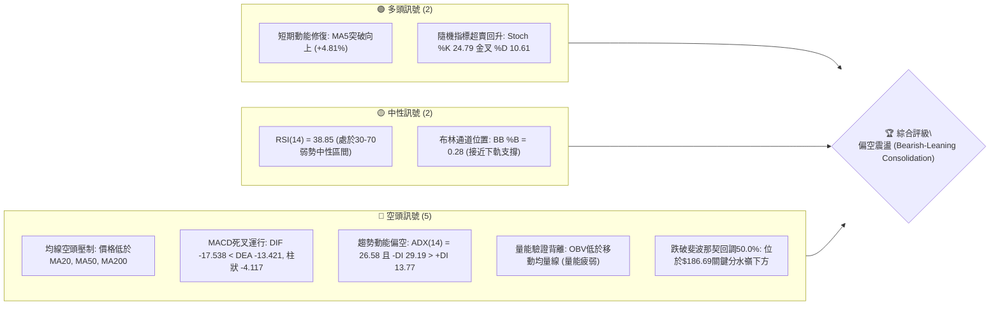

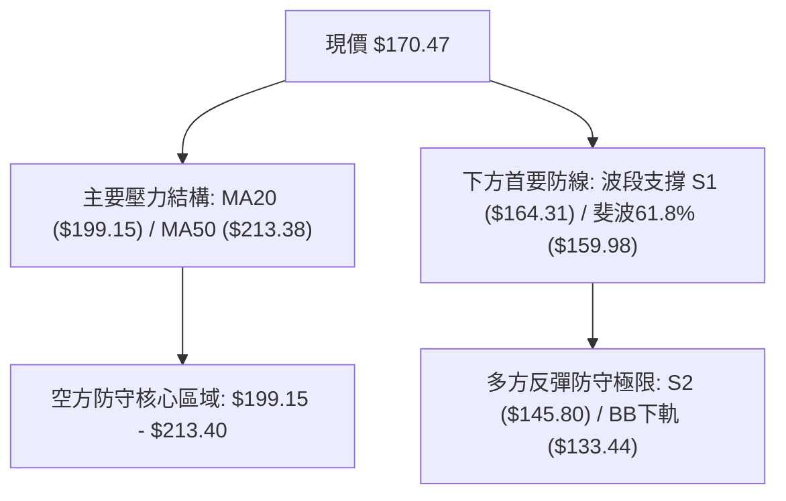

### 📊 核心指標速覽表

| 指標類別 | 指標名稱 | 當前數值 | 訊號 | 解讀 |
|----------|----------|----------|:----:|------|
| **價格** | 當前收盤價 | $170.47 | 🔴 | 位於52週區間的42.8%，近期自高點回調幅度顯著 |
| **均線** | MA20 | $199.15 | 🔴 | 價格低於MA20達-14.40%，月線級別壓制沉重 |
| **均線** | MA50 | $213.38 | 🔴 | 價格遠低於MA50，中期波段呈現下行結構 |
| **均線** | MA200 | $176.52 | 🔴 | 價格剛破年線（低於MA200約-3.43%），長期牛熊線轉為反壓 |
| **動能** | RSI(14) | 38.85 | 🟡 | 處於弱勢整理區（30–50），尚未進入極端超賣（<30） |
| **動能** | MACD (12,26,9) | -17.538 / -13.421 | 🔴 | 雙線位於零軸下方深度負值區，柱狀圖-4.117持續看空 |
| **趨勢** | ADX(14) / DI | 26.58 (-DI: 29.19) | 🔴 | ADX>25確立趨勢行情，-DI大幅壓制+DI，空頭強勢主導 |
| **通道** | Bollinger Bands | 上$264.87 / 下$133.44 | 🟡 | %B為0.28，位於中下軌弱勢區，但未跌破下軌極限 |
| **量能** | OBV / 量比 | 20.46M (量比0.94x) | 🔴 | OBV低於均線，量能萎縮且無法確認反彈力道 |
| **波動** | ATR(14) | $16.11 (9.45%) | 🔴 | 每日震幅佔比近一成，波動率極高，風控容錯空間小 |

### 🏆 技術評分卡

```
╔══════════════════════════════════════════════════════════════╗
║                技術評分卡 — NBIS (2026-10-28)                 ║
╠══════════════════════════════════════════════════════════════╣
║ 趨勢強度 (ADX=26.58, -DI佔優)  ██████░░░░░░░░░░░░░░  30/100 🔴 ║
║ 動能指標 (MACD負值, RSI=38.85) ███████░░░░░░░░░░░░░  35/100 🔴 ║
║ 支撐穩定度 (S1=$164.31面臨考驗)██████████░░░░░░░░░░  50/100 🟡 ║
║ 成交量配合 (OBV弱勢, 量比0.94) ████████░░░░░░░░░░░░  40/100 🔴 ║
║ 形態完整度 (日K破位後弱勢修復) ████████░░░░░░░░░░░░  40/100 🔴 ║
║ 均線排列 (現價低於MA20/50/200) ██████░░░░░░░░░░░░░░  30/100 🔴 ║
╠══════════════════════════════════════════════════════════════╣
║ 綜合評分 (六項算術平均四捨五入) ███████░░░░░░░░░░░░░  38/100 🔴 ║
║ 評級結論：偏空主導 (Bearish Dominant / 逢高做空為主)           ║
╚══════════════════════════════════════════════════════════════╝
```

*計算依據（規則18）：(30 + 35 + 50 + 40 + 40 + 30) ÷ 6 = 225 ÷ 6 = 37.5，四捨五入為 **38/100**。*

---

## 2. 趨勢分析

### 🌐 多時框趨勢分析

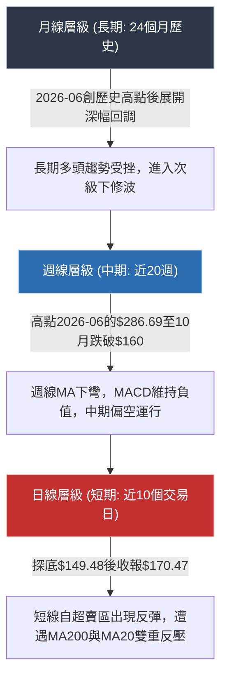

### 📈 長期趨勢 — 12個月走勢圖（Unicode）

以下依據24個月歷史數據中最近12個月（2025-11至2026-10）之月線收盤價繪製走勢軌跡：

```
NBIS 月線走勢圖（過去12個月：2025-11 至 2026-10）
價格軸 ($)
$300 ┤                                      
$276 ┤                             ●(06月:276.17)
$250 ┤                                  ●(09月:235.88)
$225 ┤                        ●(05月:231.09)
$200 ┤                                      ●(08月:206.32)
$175 ┤                                  ●(07月:190.41)   ●(10月:170.47 現價)
$150 ┤                   ●(04月:138.23)
$125 ┤                                      
$100 ┤●(11月:94.87)          ●(03月:103.76)
 $75 ┤    ●(12月:83.71)  ●(02月:91.19)
     │        ●(01月:85.19)
 $50 ┤
     └───────────────────────────────────────────────────────────────────
       11月  12月  01月  02月  03月  04月  05月  06月  07月  08月  09月  10月
       2025  2025  2026  2026  2026  2026  2026  2026  2026  2026  2026  2026
```

#### 長期走勢階段特徵剖析表

| 階段區間 | 時間段 | 價格起訖 | 漲跌幅 | 走勢結構與技術特徵 |
|:---------|:------:|:--------:|:------:|:------------------|
| **蓄勢築底期** | 2025-11 ~ 2026-02 | $94.87 → $91.19 | -3.88% | 於$83–$95區間低檔橫向震盪，消化前期自$130.82之跌勢，量能沉澱 |
| **主升加速浪** | 2026-03 ~ 2026-06 | $103.76 → $276.17 | **+166.16%** | 伴隨AI算力基建爆發，連續突破整數關卡，於2026-06觸及月收盤極值$276.17（52週高點為$299.86） |
| **頭部震盪期** | 2026-07 ~ 2026-09 | $190.41 → $235.88 | +23.88% | 巨幅洗盤，07月暴跌至$190.41，08/09月再度拉升至$235.88構築次級高點（雙頂形態雛形） |
| **破位下殺期** | 2026-09 ~ 2026-10 | $235.88 → $170.47 | **-27.73%** | 單月重挫逾65美元，正式擊穿多道短期均線，確立波段級別的回調修正 |

### 📊 中期趨勢（週線分析）

中期走勢近20週數據顯示，NBIS自2026-08-14週收盤$277.68後，進入高檔震盪盤跌走勢。關鍵轉折發生在2026-10-16當週，開盤$217.20直接暴跌至收盤$165.47（週成交量爆出148.68M股巨量），一舉砸穿斐波那契38.2%（$213.40）與50.0%（$186.69）支撐。

```
中期週線關鍵位置與現價拓撲圖：
════════════════════════════════════════════════════════════════════
$277.68 ───► 08-14 週波段高點次頂 (週MACD紅柱頂背離 +9.868)
   │
$242.81 ───► 10-02 震盪反彈高點 (最後的多頭逃命波)
   │
$213.40 ───► 斐波那契 38.2% 關鍵分水嶺 (10-16當週大陰線放量跌破)
   │
$186.69 ───► 斐波那契 50.0% 關鍵反壓 (當前已轉化為強大阻力帶)
   │
$176.52 ───► 日線 MA200 牛熊分界線 (反彈首要面臨之動態反壓)
   │
$170.47 ───► [ 當前收盤價 ] (處於超賣反彈修復期)
   │
$164.31 ───► 波段低點聚類支撐 S1 (多方短線第一防線)
   │
$159.98 ───► 斐波那契 61.8% 黃金分割強支撐 (中線多頭最後生命線)
   │
$149.48 ───► 10-26 日K探底最低點 (近期極端恐慌測試位)
════════════════════════════════════════════════════════════════════
```

### ⚡ 趨勢強度評估（ADX 解讀）

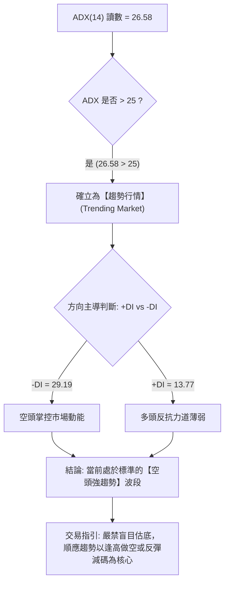

#### ADX 趨勢強度對照解讀表

| 指標名稱 | 實際讀數 | 門檻區間 | 當前技術含義解讀 |
|:---------|:--------:|:--------:|:-----------------|
| **ADX(14)** | **26.58** | > 25 (強趨勢) | 突破25閾值，確認市場告別無序震盪，具備明朗的單邊推動力度 |
| **+DI (14)** | **13.77** | 參考線 20 | 位於低檔區間，反映買方推升動能極度渙散，無力組織持續性攻勢 |
| **-DI (14)** | **29.19** | 參考線 20 | 顯著擴張且大幅超越+DI（差值達15.42），空方賣壓具有連續性 |
| **趨勢定性** | **空頭趨勢** | -DI 佔優 | 市場由空頭主導下行節奏，一切指標修復均以「反彈」而非「反轉」視之 |

---

## 3. 圖表形態分析

### 🔍 形態識別系統

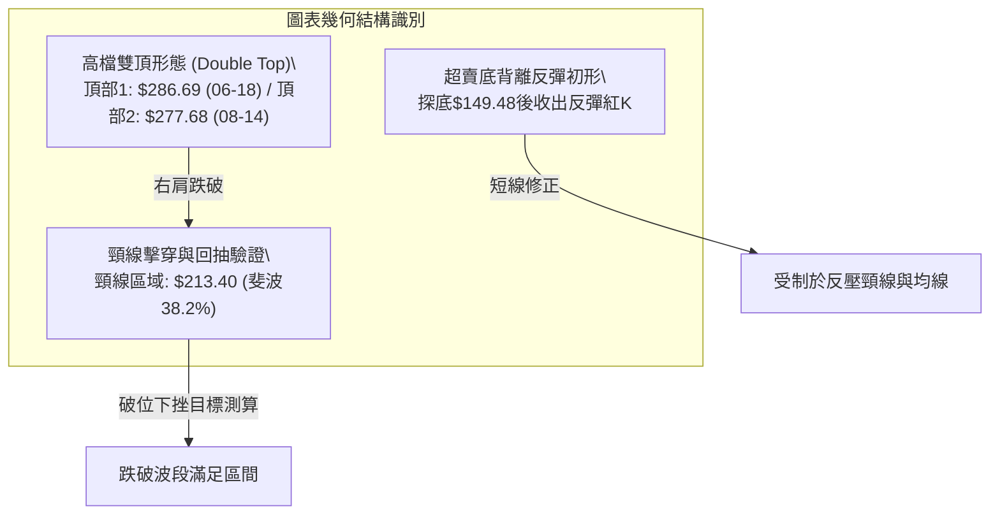

#### 圖表形態信心度與測算表（依規則 15）

| 形態名稱 | 信心度 | 判斷依據（引用數據） | 完成度 | 目標價（附嚴謹計算式） |
|:---------|:------:|:----------------------|:------:|:-----------------------|
| **週線雙頂 (Double Top)** | **85%** | ① 頂1為06-18週收盤$286.69（52W高點$299.86）；② 頂2為08-14週收盤$277.68；③ 頸線定於波段低點$213.40（斐波38.2%）；④ 10-16當週以放量長黑（成交量148.68M）實體摜破頸線。 | **90%** | **量測目標價** = 頸線 $213.40 − (形態頂點 $277.68 − 頸線 $213.40) = $213.40 − $64.28 = **$149.12**。<br>*(驗證：10-26最低點$149.48已精準抵達該形態理論目標價區間)* |
| **均線死叉空頭排列** | **95%** | 價格依序位於MA20($199.15)、MA50($213.38)、MA200($176.52)下方；MA5($162.64)低於MA10($169.48)，全週期短中長期均線呈現順向空頭壓制。 | **100%** | 動態下移壓制，短線第一阻力鎖定在MA200即 **$176.52**，次要阻力為MA20即 **$199.15**。 |
| **短線雙底反彈 (W底雛形)** | **35%** | 僅依據10-22低點$155.73與10-26低點$149.48之兩次低檔試探。因尚未突破短線頸線10-21高點$178.85，訊號極不充分。 | **25%** | **訊號不足，僅做指標型解讀**（未確認突破前不預設形態成立）。 |

### 🕯️ 重要K線形態分析

依規則 19，完全依據提供的「近10根日K」與「近8根週K」實際開高低收數據進行嚴格識別：

#### 近10根日K線形態識別表

| 日期 (日K) | 開 | 高 | 低 | 收 | 成交量 | K線形態 | 深度解讀與訊號意義 | 訊號 |
|:----------:|:----:|:----:|:----:|:----:|:------:|:-------:|:-------------------|:----:|
| 2026-10-14 | 195.00 | 198.60 | 183.11 | 186.01 | 34,041,200 | 中黑實體K | 跳空低開震盪走低，實體黑K跌破$190支撐，呈現破位態勢 | 🔴 |
| 2026-10-15 | 175.48 | 189.33 | 163.36 | 188.41 | 47,717,500 | 長下影中紅K | 盤中重挫至$163.36後獲多方低接，下影線長達$12.12，爆量承接 | 🟡 |
| 2026-10-16 | 181.17 | 182.70 | 163.27 | 165.47 | 35,212,600 | 實體黑K | 多頭未能延續反彈，再次回測前日低點$163.27並收於次低點，確認弱勢 | 🔴 |
| 2026-10-19 | 176.51 | 176.69 | 166.59 | 170.24 | 26,881,200 | 縮量倒鎚紡錘線 | 高開低走，開盤價即為當日最高點附近，量能明顯退潮 | 🔴 |
| 2026-10-20 | 163.99 | 174.74 | 160.25 | 171.45 | 22,615,600 | 下影小紅K | 探底$160.25後回升，實體收高，多空在$165–$170間展開拉鋸 | 🟡 |
| 2026-10-21 | 176.46 | 178.85 | 164.00 | 171.57 | 19,693,900 | 上影小黑K | 跳空開高試圖上攻$178.85，但遭空方當頭棒喝，留長上影線收黑 | 🔴 |
| 2026-10-22 | 164.75 | 167.50 | 155.73 | 159.17 | 26,221,800 | 破位中黑K | 擊穿$160整數關卡，低點觸及$155.73，下破整理區間平台下沿 | 🔴 |
| 2026-10-23 | 158.90 | 162.99 | 155.86 | 158.74 | 13,496,800 | 縮量十字星 | 極致縮量（13.5M），波動收窄，顯示殺跌動能暫時衰竭 | 🟡 |
| 2026-10-26 | 153.96 | 165.86 | 149.48 | 153.27 | 30,698,500 | 探底長下影小黑K | 跳空摜破$150觸及波段新低$149.48，隨後買盤介入拉回，留$3.79下影線 | 🟡 |
| 2026-10-27 | 159.00 | 171.53 | 158.30 | 170.47 | 20,459,600 | **實體大紅K (光頭陽線)** | 高開高走，實體高達$11.47，收在最高點$171.53附近，呈現強勁日線級反彈 | 🟢 |

#### 近8根週K線形態識別表

| 日期 (週K結算) | 開 | 高 | 低 | 收 | 成交量 | K線形態 | 深度解讀與訊號意義 | 訊號 |
|:--------------:|:----:|:----:|:----:|:----:|:------:|:-------:|:-------------------|:----:|
| 2026-09-11 | 234.85 | 254.74 | 223.64 | 224.55 | 62,424,000 | 上影黑K | 衝高$254.74遇阻大幅回落，高檔賣壓浮現 | 🔴 |
| 2026-09-18 | 204.98 | 232.85 | 203.87 | 223.54 | 90,247,300 | 下影紅K | 低開高走，在$203.87獲買盤支撐收復失土 | 🟡 |
| 2026-09-25 | 225.96 | 249.19 | 221.30 | 237.33 | 79,317,300 | 實體中紅K | 震盪推升，確立高檔多頭結構的最後延續 | 🟢 |
| 2026-10-02 | 235.20 | 250.48 | 228.38 | 242.81 | 65,179,600 | 衝高中紅K | 觸及次高點$250.48，量能略有背離，形成雙頂右肩頂部 | 🟡 |
| 2026-10-09 | 244.10 | 255.10 | 217.73 | 221.07 | 86,070,300 | 長黑實體吞噬 | 衝高$255.10後巨幅殺跌收於$221.07，週線高檔穿頭破腳吞噬 | 🔴 |
| 2026-10-16 | 217.20 | 217.20 | 163.27 | 165.47 | 148,676,100 | **崩跌大陰線 (光頭長黑)** | 開盤即最高點，暴跌-25.15%，放量1.48億股巨量破位，主跌浪確立 | 🔴 |
| 2026-10-23 | 176.51 | 178.85 | 155.73 | 158.74 | 108,909,300 | 下行實體黑K | 弱勢下探，反彈乏力，確認跌勢延續 | 🔴 |
| 2026-10-27 (截) | 153.96 | 171.53 | 149.48 | 170.47 | 51,158,100 | 探底回升陽K | 探底$149.48後展開技術性抽頭反彈，暫守$170關口 | 🟢 |

### 📉 ASCII 走勢形態示意圖

```
NBIS 近10日日K價格結構走勢圖（日K反彈與頸線阻力）
價格軸 ($)
$190 ┤  ●[10-14高198.60]
$185 ┤    ╲
$180 ┤     ●[10-15高189.33] 
$175 ┤        ╲            ●[10-21高178.85 短線阻力]
$170 ┤         ●[10-19高176.69]  ╲            ●[10-27收170.47 現價]
$165 ┤           ╲                 ●[10-26高165.86] ╱
$160 ┤            ●[10-16收165.47]   ╲            ╱
$155 ┤                                ●[10-22收159.17]
$150 ┤                                  ●[10-26低149.48 形態底]
     └──────────────────────────────────────────────────────────
       10-14  10-15  10-16  10-19  10-20  10-21  10-22  10-23  10-26  10-27
```

### 🎯 形態目標價計算

根據雙頂跌破量測幅度與斐波那契回調幾何位置推算：

```
1. 週線雙頂量測滿足位：
   - 形態頸線位置：$213.40 (斐波那契 38.2%)
   - 形態頂部極值：$277.68 (2026-08-14 週收盤)
   - 形態垂直高度 H = $277.68 − $213.40 = $64.28
   - 形態最小跌幅目標 = 頸線 $213.40 − H ($64.28) = $149.12
   - 現況比對：2026-10-26之日K最低點來到 $149.48，誤差僅 $0.36 (+0.24%)，確認形態第一波下行量測目標已全數滿足，觸發當前技術性超賣反彈。

2. 次級跌幅延伸計算（若跌破波段低點聚類支撐 S1 $164.31 與 S2 $145.80）：
   - 下跌波段目標延伸階梯：直指 S3 波段聚類強支撐 $132.70。
```

---

## 4. 支撐與阻力

### 🗺️ 關鍵價位分布圖（Unicode）

```
NBIS 價位結構分布圖（嚴格依據 OHLCV 聚類與斐波那契計算）
══════════════════════════════════════════════════════════════════════
$279.83 ║████████████████████████████████████████║ 強阻力 R3 (波段高點聚類)
$264.87 ║████████████████████████████████        ║ 布林通道上軌
$254.92 ║████████████████████████████            ║ 阻力 R2 (波段高點聚類)
$246.44 ║██████████████████████                  ║ 斐波那契 23.6% 回調位
$231.17 ║████████████████████████████████████    ║ 關鍵阻力 R1 (波段高點聚類)
$213.40 ║████████████████                        ║ 斐波那契 38.2% 回調位 / MA50 ($213.38)
$199.15 ║████████████                            ║ 布林通道中軌 (MA20)
$186.69 ║████████                                ║ 斐波那契 50.0% 關鍵心理分水嶺
$176.52 ║████                                    ║ 年線 MA200 牛熊反壓線
$170.47 ╠════════════════════════════════════════╣ ◄ 當前價格 (Last Close)
$164.31 ║▓▓▓▓▓▓▓▓▓▓▓▓▓▓▓▓                        ║ 近期支撐 S1 (波段低點聚類)
$159.98 ║▓▓▓▓▓▓▓▓▓▓▓▓▓▓▓▓▓▓▓▓▓▓                  ║ 斐波那契 61.8% 黃金分割強支撐
$145.80 ║████████████████████████                ║ 強支撐 S2 (波段低點聚類)
$133.44 ║████████████████████████████            ║ 布林通道下軌
$132.70 ║████████████████████████████████████    ║ 極端強支撐 S3 (波段低點聚類)
$121.96 ║████████████████████████████████████████║ 斐波那契 78.6% 回調位
══════════════════════════════════════════════════════════════════════
```

### 🚧 阻力位分析表

全部價位嚴格引用技術數據中之「阻力位（波段高點聚類）」：

| 阻力級別 | 價位 | 距現價幅寬 | 形成原因與籌碼特徵 | 突破難度 | 重要性 |
|:--------:|:----:|:----------:|:-------------------|:--------:|:------:|
| **R1** | **$231.17** | +35.61% | 近一年波段高點聚類密集區，且緊鄰MA60($215.49)與MA120($217.50)之長週線套牢籌碼帶 | 極高 🔴 | ★★★★☆ |
| **R2** | **$254.92** | +49.54% | 近一年波段高點次頂聚類區，前期多次週K衝高受阻點（09-11週高$254.74、10-09週高$255.10） | 極高 🔴 | ★★★☆☆ |
| **R3** | **$279.83** | +64.15% | 歷史頂部聚類密集區（08-14週收盤$277.68與06-18週收盤$286.69之加權密集成交頂部） | 極難 🔴 | ★★★★★ |

*附帶微觀動態反壓提示：在觸及R1之前，現價向上將依序遭遇 MA200（$176.52）、斐波50.0%（$186.69）與 MA20（$199.15）之重重壓制。*

### 🛡️ 支撐位分析表

全部價位嚴格引用技術數據中之「支撐位（波段低點聚類）」：

| 支撐級別 | 價位 | 距現價幅寬 | 形成原因與籌碼特徵 | 守住機率 | 重要性 |
|:--------:|:----:|:----------:|:-------------------|:--------:|:------:|
| **S1** | **$164.31** | -3.61% | 近一年波段低點密集聚類位，近兩週多次日K影線回測區域（10-15低$163.36、10-16低$163.27） | 55% 🟡 | ★★★★☆ |
| **S2** | **$145.80** | -14.47% | 近一年次級波段低點聚類，與10-26日K恐慌探底低點$149.48形成雙重支撐防護網 | 65% 🟢 | ★★★★★ |
| **S3** | **$132.70** | -22.16% | 近一年核心低點聚類底線，高度貼合日線布林通道下軌（$133.44），為中長線多頭防禦極限 | 80% 🟢 | ★★★★★ |

### 📐 斐波那契回調位分析

依據 52 週區間極值（最低點 $73.52 至 最高點 $299.86）精確計算，總波幅高達 $226.34：

| 回調比例 | 價位 | 當前相對位置與技術意義剖析 |
|:--------:|:----:|:---------------------------|
| **0.0% (52W High)** | **$299.86** | 歷史絕對頂部，中期上行週期之終極天花板 |
| **23.6%** | **$246.44** | 高檔震盪強勢分水嶺，跌破後確認由強勢多頭轉入深度整理 |
| **38.2%** | **$213.40** | **關鍵反壓**：完美重合日線 MA50 ($213.38)，為多頭反攻的主要障礙 |
| **50.0%** | **$186.69** | **多空心理中軸**：波段跌破此處代表空方佔據絕對主動，反彈觸及面臨解套賣壓 |
| **61.8% (黃金分割)** | **$159.98** | **黃金分割支撐位**：現價落於 50.0% ($186.69) 與 61.8% ($159.98) 區間，10-23日K收盤$158.74精準測試此位後獲買盤承接 |
| **78.6%** | **$121.96** | 深度回調防守位，若跌破意味著整輪 AI 主升浪完全瓦解 |
| **100.0% (52W Low)**| **$73.52** | 52 週週期起漲起點 |

**現價定位結論**：收盤價 **$170.47** 處於 **50.0% ($186.69)** 與 **61.8% ($159.98)** 之關鍵區間內。技術面上，此區間為典型之「弱勢震盪反彈區」；在未帶量有效重返 $186.69 之前，所有上漲均屬下行趨勢中的技術性抽頭。

---

## 5. 技術指標深度解讀

### 🎛️ 指標訊號總覽

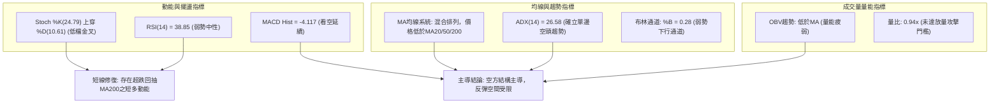

### 📈 移動平均線排列分析

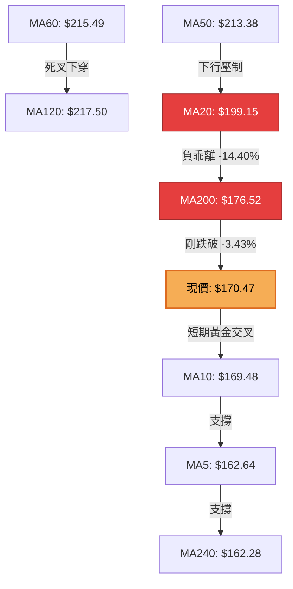

#### 均線階層架構剖析表

| 均線名稱 | 當前數值 | 距現價差距 | 乖離率 (%) | 均線斜率與技術評價 |
|:---------|:--------:|:----------:|:----------:|:-------------------|
| **MA5** | $162.64 | +$7.83 | +4.81% ▲ | 短線低檔勾頭向上，提供極短線下檔支撐 |
| **MA10** | $169.48 | +$0.99 | +0.58% ▲ | 現價剛收復MA10，短線出現止跌企穩微光 |
| **MA20** | $199.15 | -$28.68 | -14.40% ▼ | 持續下彎，為日線波段主要空頭防守線 |
| **MA50** | $213.38 | -$42.91 | -20.11% ▼ | 中期下行壓力軸心，與斐波38.2%共振 |
| **MA60** | $215.49 | -$45.02 | -20.89% ▼ | 季線下傾，中期賣壓沉重 |
| **MA120** | $217.50 | -$47.03 | -21.62% ▼ | 半年線高檔橫盤後走弱 |
| **MA200** | $176.52 | -$6.05 | -3.43% ▼ | **年線關鍵位**：現價剛跌破，反彈首要面臨之強阻力 |
| **MA240** | $162.28 | +$8.19 | +5.05% ▲ | 長線基底均線，與MA5在$162形成雙重共振支撐 |

**綜合均線結論**：短天期均線（MA5、MA10）呈現低檔金叉反彈，但中長天期均線（MA20、MA50、MA200）呈空頭壓制格局。現價正處於「短均線金叉向上」衝擊「長均線死叉向下」的夾板震盪階段。

### 📉 RSI(14) 分析

```
RSI(14) 當前數值：38.85
[0] ─────────── [30] ─────────────── [50] ─────────────── [70] ─────────── [100]
                │                     │                     │
極端超賣區間    │     當前位置: 38.85 │                     │   極端超買區間
░░░░░░░░░░░░░░░░█▓▓▓▓▓░░░░░░░░░░░░░░░░░░░░░░░░░░░░░░░░░░░░░░░░░░░░░░░░░░░░░░░░░░
                30                    50                    70
```

- **讀數解讀**：RSI(14)最新讀數為 **38.85**（Wilder計算），自前期超賣邊界（10-23週收盤對應RSI為30.2）脫離回升，目前位於 30–50 之弱勢整理區。
- **背離檢驗結論**：根據嚴格背離規則（比對近20根K棒首尾之價格與RSI走向），10-14收盤$186.01對應RSI較高，10-27收盤$170.47對應RSI為38.85，兩者同向下行，**無明顯底背離或頂背離**。當前上漲純屬超賣後的常規指標修復。

### 📊 MACD(12,26,9) 訊號解讀

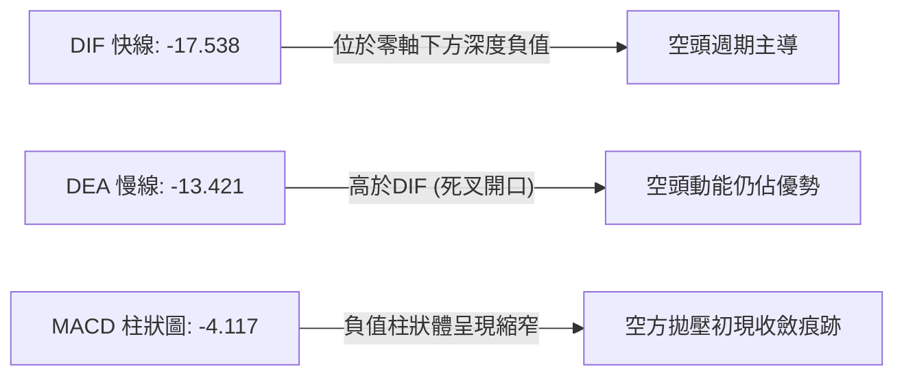

- **參數狀態**：MACD線為 **-17.538**，訊號線（Signal）為 **-13.421**，兩者均在零軸深處運行。
- **柱狀圖走向**：MACD Histogram 為 **-4.117** 🔴。雖然柱狀體為負，但較10-16當週（-7.494）與10-23當週（-6.208）相比呈現負值逐步收窄態勢，顯示短線殺跌動能有所減緩，惟在雙線完成低檔金叉前，不可臆測中級反轉。

### 📦 布林通道分析

```
NBIS 日線布林通道結構示意圖（寬度指標與現價定位）
價格軸 ($)
$264.87 ┬─────────────────────────────────────────── BB 上軌 (Upper)
        │
$230.00 ┼ 
        │
$199.15 ┼─────────────────────────────────────────── BB 中軌 (MA20 中期反壓)
        │
$170.47 ┼                 ●◄──────── 現價 ($170.47, BB %B = 0.28)
        │
$133.44 ┴─────────────────────────────────────────── BB 下軌 (Lower 強支撐)
```

- **帶寬特徵**：布林上軌為 **$264.87**，中軌為 **$199.15**，下軌為 **$133.44**，通道帶寬（Bandwidth）高達 $131.43，表明市場處於極度發散的高波動率狀態。
- **BB %B 評估**：當前數值為 **0.28**（位於0至0.5的中下軌偏弱區間）。價格剛脫離下軌邊界向上反彈，理論上具備向中軌（$199.15）尋求回抽測試的空間，但中軌斜率持續向下，將壓制反彈高度。

### 💹 成交量分析（量價配合度）

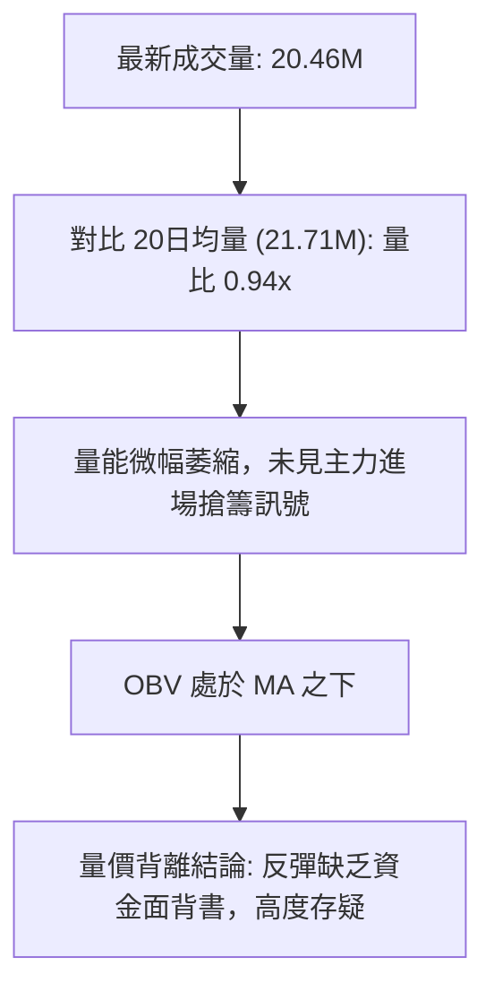

- **量比檢視**：最新成交量為 **20,459,600股**，相對於20日均量（21,706,455股）的量比僅為 **0.94x**；相對於50日均量（18,840,518股）略增。此種「上漲縮量、下跌放量」（如10-15放量47.72M、10-16放量35.21M）之量價特徵，顯示機構主力在反彈過程中並未積極進場回補，籌碼鎖定度低下。
- **OBV 趨勢確認**：指標明確顯示「**OBV < MA → 量能疲弱**」。當價格出現日線級別反彈而OBV未能穿越其均線時，確認為量能弱勢背離，反彈極易在遭遇第一阻力時夭折。

---

## 6. 動能與波動率

### ⚡ 動能評估四象限

```
動能與波動率矩陣 (Momentum-Volatility Matrix)
  高波動率 (High Volatility)
      │
  Q3  │  Q4 (當前所處象限)
      │  弱動能 + 高波動 (Weak Mom, High Vol)
      │  ★ NBIS: RSI=38.85 / ATR=9.45% / Beta=1.46
──────┼──────────────────────────────────────── 動能強度
  Q1  │  Q2
      │
  低波動率 (Low Volatility)
```

#### 動能四象限狀態歸類表

| 象限標記 | 動能屬性 | 波動屬性 | 當前特徵標籤 | 操作指引與風險特徵 |
|:--------:|:--------:|:--------:|:------------:|:-------------------|
| **Q1** | 強動能 | 低波動 | 穩定上升趨勢 | 最佳波段持股機會，享受趨勢紅利 |
| **Q2** | 弱動能 | 低波動 | 底部窄幅盤整 | 謹慎觀望，等待突破方向確認 |
| **Q3** | 強動能 | 高波動 | 暴衝主升/主跌 | 高風險高回報，適合短線突破策略 |
| **Q4 (當前)** | **弱動能** | **高波動** | **空頭震盪洗盤** | **避免重倉持有，嚴控停損，逢高做空或極短線輕倉博反彈** |

### 📊 ATR 波動率分析

- **ATR(14) 讀數**：依據 Wilder 計算公式，當前 ATR(14) 為 **$16.11**。
- **價格佔比**：ATR 佔收盤價比例高達 **9.45%**，表明該股每日平均波動空間接近一成，屬於極高波動性標的。
- **停損距離設計**：
  - **保守型（短線交易）**：以 1.0 倍 ATR 計算 = $16.11 空間。
  - **標準型（波段交易）**：以 1.5 倍 ATR 計算 = $24.17 空間。
  - **寬鬆型（防洗盤）**：以 2.0 倍 ATR 計算 = $32.22 空間。

### 📐 Beta 與市場相關性

- **Beta 係數**：**1.46**。
- **市場敏感度解讀**：該標的對標普500與那斯達克指數具備顯著的高貝塔放大效應。在大盤下跌週期中，該股跌幅預期將為大盤的 1.46 倍；在大盤反彈時雖有超額彈性，但在空頭趨勢確立背景下，高 Beta 特性加劇了下行斷崖風險。

---

## 7. 多時框架總結

### 📋 時框架評分表

| 時框架 | 趨勢方向 | 動能指標 | 均線排列 | 圖表形態 | 綜合評分 | 戰術指引 |
|:-------:|:--------:|:--------:|:--------:|:--------:|:--------:|:---------|
| **月線 (長期)** | 🟡 中性走弱 | 弱化 (高檔回落) | 多頭受挫 (逼近年線) | 歷史高點雙頂雛形 | 50/100 | 長期牛市格局遭到嚴重侵蝕 |
| **週線 (中期)** | 🔴 偏空下行 | 空頭 (MACD柱負) | 空頭排列 (失守頸線) | 雙頂頸線破位跌破 | 30/100 | 中期波段由空方絕對控盤 |
| **日線 (短期)** | 🟡 弱勢反彈 | 修復 (Stoch金叉) | 壓制 (低於MA20/200) | 超跌後陽線包覆 | 45/100 | 短線面臨均線反壓，反彈空間有限 |

### 🔲 綜合訊號矩陣

```
時框維度與核心技術指標矩陣檢視：
┌───────────┬──────────────┬──────────────┬──────────────┬──────────────┐
│ 時框層級  │ 均線系統     │ 擺盪指標     │ 趨勢強度     │ 量價狀態     │
├───────────┼──────────────┼──────────────┼──────────────┼──────────────┤
│ 長期 (月) │ 仍高於MA240  │ 高檔交叉向下 │ 趨勢開始鈍化 │ 頂部放量滯漲 │
│ 中期 (週) │ MA20死叉MA50 │ MACD零下運行 │ ADX>25強空頭 │ 跌破頸線爆量 │
│ 短期 (日) │ MA5上穿MA10  │ RSI脫離超賣  │ -DI高位強勢  │ 反彈縮量背離 │
└───────────┴──────────────┴──────────────┴──────────────┴──────────────┘
```

### ⚖️ 多時框收斂結論

依據本報告**規則 14**之嚴格收斂優先級指引：
1. **趨勢/盤整定性**：當前 ADX(14) 讀數為 **26.58 > 25**，且 -DI (29.19) 遠高於 +DI (13.77)，市場明確定性為**趨勢行情（Trending Market）**，而非無方向的盤整震盪。
2. **時框優先級權重**：在趨勢行情下，必須以**中長期方向（週線與日線 MA50、MA200）為主導**，日線級別的指標金叉與陽線僅能視為「尋找逢高進場做空時機」之次級波動，不可凌駕於中長期的破位結構之上。
3. **單一方向性結論**：**【偏空主導 — 逢反彈阻力位建立空頭部位】**。此結論嚴格收斂，並與第 1 章技術評分卡（38/100）及第 8 章之主策略完全契合。

---

## 8. 交易策略建議

### 🗺️ 策略決策流程圖

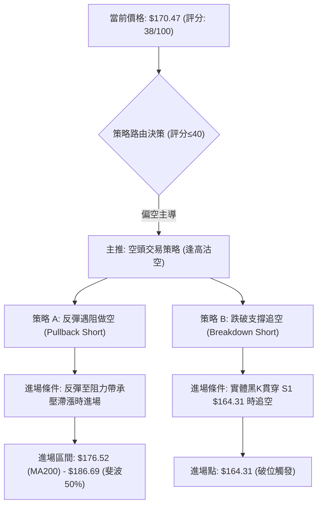

### 🧭 策略路由（依評分卡分流）

> **當前主策略方向 = 【空頭策略（逢高做空／破位追空）】（依技術評分卡綜合評分 38/100 偏空確定）**
> *規則 18 評分≤40，嚴禁兩頭對賭推薦多頭主策略；多頭僅作為逆勢短線反彈之風控提示。*

### 🎯 價格情境階梯（Price Scenarios）

價位嚴格引用第 4 章波段聚類與斐波那契回調之客觀數值：

| 觸發條件 | 下一目標 | 後續延伸 | 情境含義與操作指引 |
|:---------|:--------:|:--------:|:-------------------|
| **上破阻力 R1 $231.17** | R2 $254.92 | R3 $279.83 | 中期空頭走勢徹底逆轉，需全面停損所有空單 |
| **反彈受阻於 $176.52 ~ $186.69** | S1 $164.31 | S2 $145.80 | 標準的弱勢回抽確認，最佳空頭加碼區間 |
| **跌破支撐 S1 $164.31** | S2 $145.80 | S3 $132.70 | 延續下行主跌浪，下探測試布林下軌與前低 |

### 📊 情境機率分佈

| 情境劇本 | 機率 | 主要依據與技術邏輯 |
|:---------|:----:|:-------------------|
| **逢高回落 / 破位探底 (主情境)** | **60%** | ADX=26.58空頭主導；價格受制於MA200($176.52)；MACD雙線在零軸深處運行；OBV疲弱未見量能支撐。 |
| **區間弱勢震盪 (次情境)** | **25%** | 短線超賣反彈修復（Stoch金叉、日K收陽）；現價在$164.31至$176.52之間進行籌碼沉澱。 |
| **強勢反轉上行 (低機率情境)** | **15%** | 除非有重大基本面催化劑帶動巨量長紅直接收復斐波38.2%（$213.40），否則技術面難以支持持續暴漲。 |

### 🔴 主策略詳情（空頭交易策略）

所有價位均精確引用數據計算，風報比嚴格依據規則 17 格式呈现：

| 策略要素 | 策略 A（反彈高空 — 逢阻力回跌） | 策略 B（破位追空 — 順勢跌破） |
|:---------|:--------------------------------|:------------------------------|
| **策略定位** | 次級反彈結束時之高盈虧比做空 | 確認破位時之動量追空 |
| **進場條件** | 價格反彈至 MA200 至斐波 50% 阻力帶出現滯漲黑K | 日K實體跌破近期波段支撐位 S1 |
| **進場價格** | **$181.61** *(區間 $176.52–$186.69 之中點)* | **$164.31** *(精確引用 S1 支撐位)* |
| **止損價格** | **$199.15** *(嚴格引用 MA20 / 布林中軌反壓)* | **$176.52** *(嚴格引用 MA200 年線位置)* |
| **目標價 T1** | **$164.31** *(精確引用波段支撐 S1)* | **$145.80** *(精確引用波段強支撐 S2)* |
| **目標價 T2** | **$145.80** *(精確引用波段強支撐 S2)* | **$132.70** *(精確引用波段強支撐 S3)* |
| **風險報酬比 (T1)** | **1 : 0.99（以 T1 計）**<br>*(計算: ($181.61−$164.31)÷($199.15−$181.61) = 17.30÷17.54)* | **1 : 1.52（以 T1 計）**<br>*(計算: ($164.31−$145.80)÷($176.52−$164.31) = 18.51÷12.21)* |
| **風險報酬比 (T2)** | **1 : 2.04（以 T2 計）**<br>*(計算: ($181.61−$145.80)÷($199.15−$181.61) = 35.81÷17.54)* | **1 : 2.59（以 T2 計）**<br>*(計算: ($164.31−$132.70)÷($176.52−$164.31) = 31.61÷12.21)* |
| **成功機率** | **65%** | **55%** |
| **建議倉位** | **總資金之 10% - 15%** | **總資金之 8% - 10%** |

### 🟢 反向風險觸發點（對沖與空頭止損提示）

若出現以下技術事件，表明空頭結構被破壞，需立即平倉所有空單並轉向觀望：
1. **動態破位失效**：日K收盤價強勢突破布林中軌 MA20（**$199.15**），代表超賣反彈升級為中期逆轉波。
2. **形態翻多確立**：週線級別帶量（週成交量突破 100M 股）收復斐波那契 38.2%（**$213.40**），宣告週線雙頂破位形態失敗。
3. **指標底背離確立**：日線 MACD 在零軸下方形成實體低檔黃金交叉且 Histogram 翻正放大。

### ⭐ 整體訊號強度評星

```
做多訊號強度：★★☆☆☆  (2/5 星 - 僅屬短線技術超賣修正)
做空訊號強度：★★★★☆  (4/5 星 - 多時框空頭共振，趨勢強度高)
整體可信度：  ★★★★☆  (4/5 星 - 數據量能與均線系統高度吻合)
```

---

## 9. 風險提示與監控

### ✅ 關鍵監控指標 Checklist

```
╔══════════════════════════════════════════════════════════════╗
║              NBIS 核心技術風控監控清單 (Daily Checklist)        ║
╠══════════════════════════════════════════════════════════════╣
║ [ ] 價格是否跌破 S1 ($164.31)？  → 若跌破，加速下看 S2 ($145.80)║
║ [ ] 價格能否有效越過 MA200 ($176.52)？→ 若受阻，為絕佳空點    ║
║ [ ] 日成交量是否超越 21.71M 均量？→ 縮量反彈不可信，放量需警惕 ║
║ [ ] ADX(14) 是否持續維持在 25 之上？→ 研判空頭單邊趨勢延續性  ║
║ [ ] RSI(14) 是否觸及 50 中軸即回落？→ 驗證空方掌控反彈上限   ║
║ [ ] MACD Histogram 負值是否再次放大？→ 警惕第二輪主跌下殺     ║
╚══════════════════════════════════════════════════════════════╝
```

### ⚠️ 風險場景分析

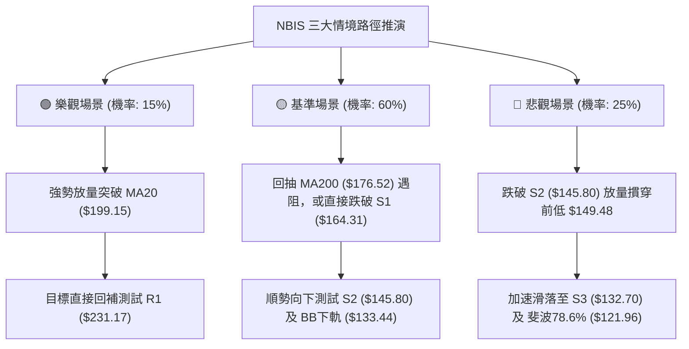

### 🛡️ 風險管理重要提醒

1. **極端波動率風險（ATR = 9.45%）**：
   NBIS 的日波幅高達 $16.11，這意味著任何單日的小幅雜訊都有可能觸發常規技術止損。因此，進場倉位必須降至常態標的的 **50% 以下**，嚴防「看對方向但被日內洗盤掃出場」。
2. **高放空比率與軋空風險（Short % Float = 18.9%）**：
   該股空頭部位佔流通盤比例高達 18.9%（Short Ratio 2.98天）。當股價在重要心理支撐（如斐波61.8% $159.98）企穩時，需高度警惕突發利多引發的「逼空式（Short Squeeze）暴力抽頭」，這也是嚴格將做空止損設定在阻力位之上（如 MA20 $199.15）的主因。
3. **大盤系統性 Beta 傳導**：
   Beta 係數高達 1.46，在美股 AI 族群整體受制於利率環境與估值壓縮時，該股下行風險將呈乘數放大，不可將其視為獨立走勢標的。

---

## 📋 報告總結

```
NBIS 技術分析報告總結
════════════════════════════════════════════════════════════════
報告日期：2026-10-28
當前價格：$170.47
分析評級：🔴 偏空主導 (Bearish Dominant) ｜ 綜合評分：38/100

關鍵結論：
├─ 長期趨勢：🟡 中性走弱（自歷史高位$299.86下修，回調考驗牛熊分水嶺）
├─ 中期趨勢：🔴 空頭主導（週線雙頂頸線$213.40摜破，ADX=26.58強勢空頭）
├─ 短期趨勢：🟡 超賣弱勢反彈（日K探底$149.48後抽頭，受制年線$176.52）
├─ 關鍵支撐：S1 $164.31  /  S2 $145.80  /  S3 $132.70
├─ 關鍵阻力：R1 $231.17  /  R2 $254.92  /  R3 $279.83
└─ 分析師共識：Recommendation Buy (共20位分析師, 目標均價 $281.00)
               *注意：基本面目標價與當前技術面下行結構嚴重背離*

最優策略組合：
1. 🥇 最佳機會（策略 A）：反彈至 MA200 與斐波50%區間中點（$181.61）遇阻做空，
                         停損 $199.15，目標 T1 $164.31（風報比 1:0.99），
                         目標 T2 $145.80（風報比 1:2.04）。
2. 🥈 次選機會（策略 B）：跌破波段低點聚類 S1（$164.31）順勢追空，
                         停損 $176.52，目標 T1 $145.80（風報比 1:1.52），
                         目標 T2 $132.70（風報比 1:2.59）。
3. 🥉 保守選擇：完全空倉觀望，耐心等待價格下探至 S2/S3（$132.70 - $145.80）
               且日線 MACD 零下形成明確底背離金叉後，再行評估左側布局。
════════════════════════════════════════════════════════════════
```

---

> ⚠️ **免責聲明**：本報告為依據客觀量化技術指標與圖表形態所產出之研究報告，所有價位均基於歷史 OHLCV 幾何測算。本報告**僅供研究與學術參考**，**不構成任何形式的投資買賣建議**。金融市場波動劇烈且該標的 Beta 與 ATR 極高，投資人應獨立承擔市場風險。

---

*報告生成時間：2026-10-28 ｜ 數據來源：Yahoo Finance ｜ 分析框架：多時框技術分析模型*