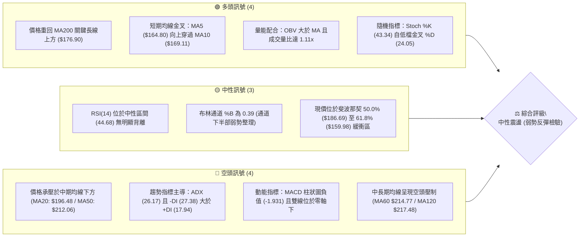
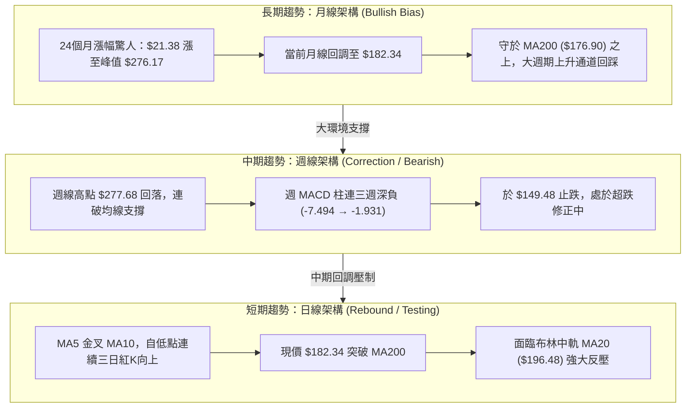
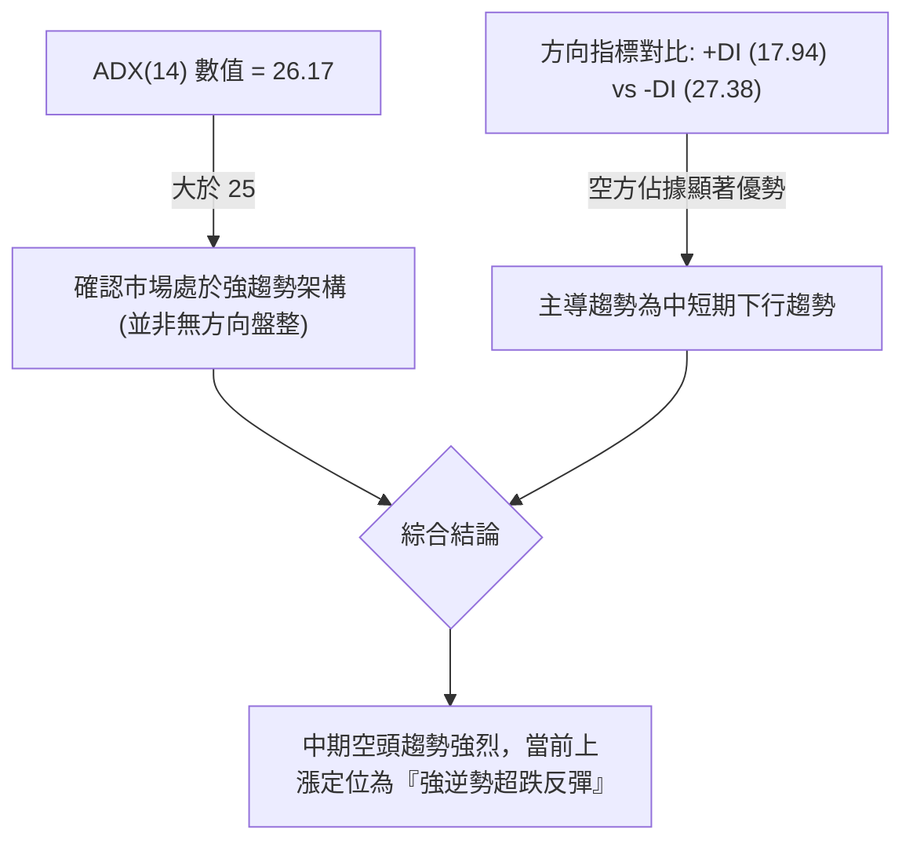
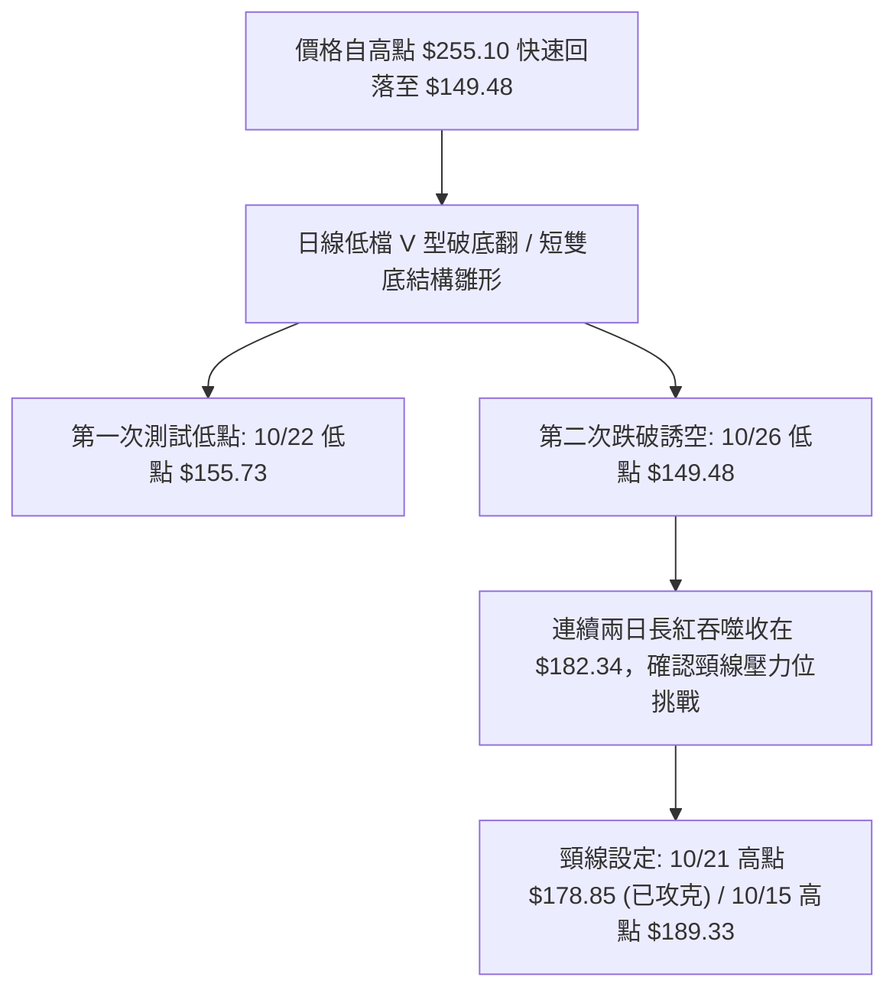
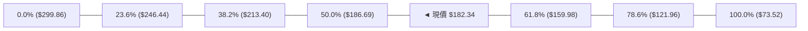
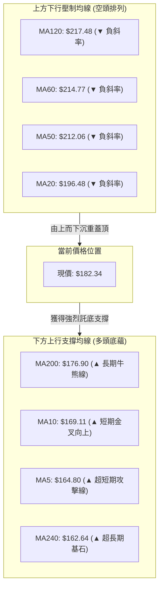
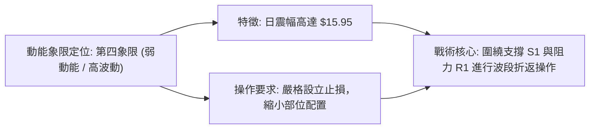
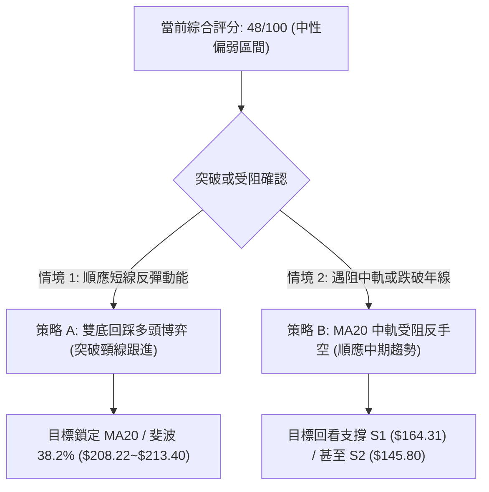
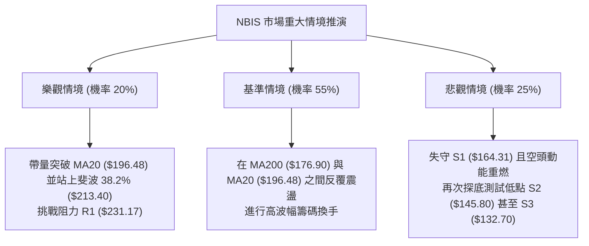

# NBIS 技術分析報告

> **報告日期**：2026-10-29 ｜ **語言**：繁體中文 ｜ **數據來源**：Yahoo Finance ｜ **當前價格**：$182.34

---

## 目錄

| 章節 | 內容 |
|------|------|
| [1. 技術面概覽](#1-技術面概覽) | 訊號儀表板、核心指標、評分卡 |
| [2. 趨勢分析](#2-趨勢分析) | 多時框趨勢、長中短期走勢 |
| [3. 圖表形態分析](#3-圖表形態分析) | 形態識別、K線組合、目標價 |
| [4. 支撐與阻力](#4-支撐與阻力) | 關鍵價位、斐波那契回調 |
| [5. 技術指標深度解讀](#5-技術指標深度解讀) | MA/RSI/MACD/布林/成交量 |
| [6. 動能與波動率](#6-動能與波動率) | 動能評估、ATR、Beta |
| [7. 多時框架總結](#7-多時框架總結) | 時框架評分矩陣 |
| [8. 交易策略建議](#8-交易策略建議) | 多空策略、風險報酬比 |
| [9. 風險提示與監控](#9-風險提示與監控) | 監控指標、風險場景 |

---

## 1. 技術面概覽

### 🎯 技術訊號儀表板



### 📊 核心指標速覽表

| 指標類別 | 指標名稱 | 當前數值 | 訊號 | 解讀 |
|:---|:---|:---|:---:|:---|
| **價格** | 當前收盤價 | $182.34 | 🟡 | 位於52週區間48.1%處，脫離短線低點展開反彈 |
| **短期均線** | MA5 / MA10 | $164.80 / $169.11 | 🟢 | 現價站上5日與10日均線，短期動能向上修復 |
| **中期均線** | MA20 (布林中軌) | $196.48 | 🔴 | 現價低於MA20達-7.19%，中期下降通道尚未扭轉 |
| **中期趨勢** | MA50 | $212.06 | 🔴 | 現價低於MA50，中期波段趨勢呈現空頭防守態勢 |
| **長期均線** | MA200 | $176.90 | 🟢 | 現價成功收復牛熊分界線MA200 (+3.08%)，具長線支撐 |
| **超長期均線**| MA240 | $162.64 | 🟢 | 現價高於MA240達+12.11%，整體2年長期底線未失守 |
| **動能** | RSI(14) | 44.68 | 🟡 | 擺脫超賣區進入中性區間，尚未具備強勢多頭動能 |
| **趨勢強度** | ADX(14) / ±DI | 26.17 (-DI:27.38) | 🔴 | ADX>25顯示趨勢明確，但-DI顯著高於+DI，空方掌控波段 |
| **趨勢指標** | MACD (12,26,9) | 柱狀圖 -1.931 | 🔴 | 雙線在零軸之下（DIF: -15.836, DEA: -13.904），仍處空頭架構 |
| **擺盪指標** | Stoch %K / %D | 43.34 / 24.05 | 🟢 | %K顯著穿越%D，低檔超賣區反彈動能釋放 |
| **波動率** | ATR(14) | $15.95 (8.75%) | 🔴 | 波動幅度極大，日震幅近9%，持倉風險高 |
| **量能** | 成交量 / 20日均量 | 24.75M / 22.22M | 🟢 | 最新量比1.11x，伴隨紅K收高，呈現良性價量配合 |

### 🏆 技術評分卡

```
╔══════════════════════════════════════════════════════════════════╗
║                技術評分卡 — NBIS (2026-10-29)                   ║
╠══════════════════════════════════════════════════════════════════╣
║ 趨勢強度 (ADX=26.17, -DI主導)   ████████░░░░░░░░░░░░  40/100 🔴 ║
║ 動能指標 (RSI=44.68, MACD負值)  ████████░░░░░░░░░░░░  42/100 🔴 ║
║ 支撐穩定度 (守住MA200與S1)      ████████████░░░░░░░░  60/100 🟡 ║
║ 成交量配合 (OBV>MA, 量比1.11x)  ████████████░░░░░░░░  58/100 🟡 ║
║ 形態完整度 (日線底背離雛形)     █████████░░░░░░░░░░░  45/100 🟡 ║
║ 均線排列 (混合排列, 承壓MA20)   █████████░░░░░░░░░░░  43/100 🔴 ║
╠══════════════════════════════════════════════════════════════════╣
║ 綜合評分 (六項算術平均，規則18) ██████████░░░░░░░░░░  48/100 🟡 ║
║ 判定評級：中性偏弱震盪（處於 40–60 區間，以防守反彈與震盪應對）║
╚══════════════════════════════════════════════════════════════════╝
```

---

## 2. 趨勢分析

### 🌐 多時框趨勢分析



### 📈 長期趨勢 — 12個月走勢圖（Unicode）

以下為根據月度歷史收盤價繪製之過去12個月（2025-11 至 2026-10）價格軌跡：

```
NBIS 月線走勢圖（2025-11 至 2026-10）
價格軸 ($)
$300 ┤                                                 
$280 ┤                                  ● $276.17(26-06 高點)
$260 ┤                                 / \             
$240 ┤                           ●    /   \     ● $235.88(26-09)
$220 ┤                          / $231.09  \   / \      
$200 ┤                         /     (26-05)\ /   \     
$180 ┤                        /              ●     ● $182.34(當前)
$160 ┤                       /           $190.41    (26-10)
$140 ┤                  ● $138.23(26-04) (26-07)
$120 ┤                 /                               
$100 ┤ ● $94.87       /                                
 $80 ┤  \   ●   ●   ● $103.76(26-03)                   
 $60 ┤   \ / \ / \ /                                   
     └────┴───┴───┴───┴───┴───┴───┴───┴───┴───┴───┴───
         11  12  01  02  03  04  05  06  07  08  09  10 (月)
         (2025)                (2026)
```

#### 長期月線走勢特徵分析表

| 階段區間 | 起始/結束收盤價 | 區間漲跌幅 | 趨勢特徵與量價行為 |
|:---|:---|:---:|:---|
| **築底蓄勢期**<br>(2025-11 ~ 2026-02) | $94.87 → $91.19 | -3.88% | 在 $83.71 ~ $94.87 區間形成長達4個月之平底壓縮，波動率大幅收斂。 |
| **主升浪推進期**<br>(2026-03 ~ 2026-06) | $103.76 → $276.17 | +166.16% | 月線連出四大紅K，突破百元關卡後加速噴出，直逼歷史天價 $299.86。 |
| **高位劇烈洗盤期**<br>(2026-07 ~ 2026-09) | $190.41 → $235.88 | +23.88% | 單月重挫至 $190.41 後快速拉起至 $235.88，高波幅震盪確立頭部阻力區。 |
| **深度回撤回踩期**<br>(2026-10 當前) | $235.88 → $182.34 | -22.70% | 單月自高檔大幅回吐，最低探至 $149.48，目前回升至 MA200 尋求長期支撐。 |

### 📊 中期趨勢（週線分析）

中期走勢顯示自 2026-08-14 見波段高位收盤價 $277.68 後，形成震盪走低的三角形或下降旗形回調結構。

```
週線結構示意圖與近期波段演變
價格 ($)
$280 ┤     ● 2026-08-14 週收 $277.68 (波段頂部)
     │      \
$250 ┤       \      ● 2026-10-02 週收 $242.81 (次高反彈點)
     │        \    / \
$220 ┤         \  /   \ 2026-10-09 週收 $221.07
     │          \/     \
$180 ┤  ● 2026-07-31    \        ▲ 現價 $182.34 (本週強彈)
     │    週收 $190.41    \      /
$150 ┤                     ●────┘ 2026-10-23 週收 $158.74 (低點 $149.48 測試)
     └─────────────────────────────────────────────────────
```

週線層級中，自 10 月初之 $242.81 在三週內斷崖式回落至低點 $149.48（2026-10-26日K），本週最後交易日（2026-10-28）大幅拉出長下影線收在 $182.34，顯示中期跌勢在週成交量高達 76.05M 之下出現初步衰竭回補跡象。

### ⚡ 趨勢強度評估（ADX 解讀）



#### ADX 趨勢強度對照解讀

| 指標變數 | 當前讀數 | 狀態門檻 | 技術涵義與操盤指引 |
|:---|:---:|:---:|:---|
| **ADX(14)** | 26.17 | > 25.0 (強趨勢) | 市場脫離無序橫盤，波段趨勢具備強慣性，順勢動能仍不容忽視。 |
| **+DI** | 17.94 | 弱勢 (<20) | 多頭買盤擴展能力有限，尚未建立足以逆轉趨勢的攻擊陣列。 |
| **-DI** | 27.38 | 強勢 (>25) | 空方主控盤面，任何反彈若未使 -DI 快速向下跌破 20，均屬修正波。 |
| **規則14收斂指引** | 趨勢行情 | ADX > 25 | **必須依規則 14**：以中長期（週線/MA50、MA200）方向為主導，日線僅供尋求進場點。 |

---

## 3. 圖表形態分析

### 🔍 形態識別系統



#### 圖表形態信心度評估表（依規則 15）

| 形態識別 | 信心度 | 判斷依據（嚴格引用數據） | 完成度 | 目標價（附嚴格幾何計算式） |
|:---|:---:|:---|:---:|:---|
| **短線雙底<br>(Double Bottom)** | 62% | 兩次低點分別為 10/22 低點 $155.73 與 10/26 低點 $149.48，兩者接近支撐 S1 ($164.31) 下緣；10/28 收盤 $182.34 已實質穿過短頸線 10/21 高點 $178.85。 | 75% | **形態高度** = 短頸線 $178.85 - 低點 $149.48 = $29.37<br>**推算目標** = 頸線 $178.85 + $29.37 = **$208.22** |
| **中期下降通道<br>(Falling Channel)** | 85% | 週線高點由 08/14 之 $277.68、10/02 之 $250.48、10/09 之 $255.10 形成下降阻力斜率；下軌由 07/17 低點與 10/26 低點 $149.48 構成支撐。 | 90% | 通道上軌反壓約落在阻力 R1 ($231.17) 與 MA50 ($212.06) 之間，目前價格仍在通道內部回彈。 |
| **大型頭肩頂頸線回測** | 45% | 數據不足以確認完整右肩（信心度 < 50%）。 | 30% | 訊號不足，依規則 15 僅做指標型解讀，不預設延伸目標。 |

### 🕯️ 重要K線形態分析（嚴格依據近10根日K與近8根週K）

依規則 19，本分析嚴格以數據中給予之具體開高低收數據進行客觀解讀：

| 日期（週期） | 開盤價 | 最高價 | 最低價 | 收盤價 | 成交量 | K線形態名稱 | 技術解讀與多空信號 | 訊號 |
|:---|:---:|:---:|:---:|:---:|:---:|:---|:---|:---:|
| **2026-10-22 (日)** | $164.75 | $167.50 | $155.73 | $159.17 | 26.22M | **實體長黑破位K** | 跌破前低，空頭動能加速釋放，收在全日偏低位置。 | 🔴 |
| **2026-10-23 (日)** | $158.90 | $162.99 | $155.86 | $158.74 | 13.50M | **極致量縮十字紡錘線** | 振幅劇烈收窄，成交量銳減近半，顯示空方摜壓動能衰退竭盡。 | 🟡 |
| **2026-10-26 (日)** | $153.96 | $165.86 | $149.48 | $153.27 | 30.70M | **假破底破腳長下影K** | 早盤摜破 $150 關卡探至 $149.48 後獲大量承接，留下 $3.79 下影線。 | 🟢 |
| **2026-10-27 (日)** | $159.00 | $171.53 | $158.30 | $170.47 | 20.60M | **多頭吞噬長紅K** | 實體高達 $11.47，一舉吞噬前兩日實體，確立 $149.48 為波段拐點。 | 🟢 |
| **2026-10-28 (日)** | $173.49 | $182.74 | $168.92 | $182.34 | 24.75M | **光頭光腳強攻中長紅** | 開高走高，收盤價逼近最高價，放量成功站上 MA200 ($176.90)。 | 🟢 |
| **2026-10-16 (週)** | $217.20 | $217.20 | $163.27 | $165.47 | 148.68M| **崩跌跳空大陰週K** | 開盤即最高，爆出 1.48 億股天量單週狂瀉 -23.8%，形成恐慌下殺。 | 🔴 |
| **2026-10-23 (週)** | $176.51 | $178.85 | $155.73 | $158.74 | 108.91M| **續挫下影弱勢週K** | 量能依然維持億股水準，持續測試下方買盤支撐。 | 🔴 |
| **2026-10-28 (週)** | $153.96 | $182.74 | $149.48 | $182.34 | 76.05M | **低檔大逆轉倒錘長紅週K**| 探底 $149.48 後暴拉超過 $33，週K線實體顯著收高，為標準止跌形態。| 🟢 |

### 📉 ASCII 走勢形態示意圖

```
NBIS 日線雙底與晨星反轉走勢示意圖（2026-10-15 至 2026-10-28）
價格 ($)
$190 ┤       ● 10/15 高點 $189.33
     │      / \
$180 ┤     /   \                                    ▲ 10/28 現價收 $182.34 (突破短頸線)
     │    /     \                                  /│
$170 ┤   /       ●─● 10/21 短頸線 $178.85         / │
     │  /       /   \                            ●  │ 10/27 收 $170.47
$160 ┤ /       /     \                          /   │
     │● 10/16 /       ● 10/22 收 $159.17       /    │
$150 ┤ 收$165.47        \                     ●     │
     │                   ● 10/23 收 $158.74  / 10/26 收 $153.27 (帶下影)
$140 ┤                    \                 / 
     │                     ▼ 10/26 觸及最低點 $149.48 (完成誘空二番底)
     └───────────────────────────────────────────────────────────
```

### 🎯 形態目標價計算

根據已確認具有 62% 信心度之短期雙底形態：
1. **基底判定**：第一低點為 2026-10-22 之 $155.73，次低點為 2026-10-26 之 $149.48，底谷取最低值 **$149.48**。
2. **頸線確認**：兩底之間的反彈高點為 2026-10-21 高點 **$178.85**（現價 $182.34 已實現收盤向上突破）。
3. **垂直形態高度**：
   $$\text{形態高度 } H = \$178.85 - \$149.48 = \$29.37$$
4. **目標價推算**：
   - **等幅推算第一目標價 (T1)**：
     $$\text{目標價 } T_1 = \text{頸線 } \$178.85 + H (\$29.37) = \mathbf{\$208.22}$$
     *(此數值非常接近斐波那契 38.2% 回調位 $213.40 與 MA50 $212.06)*
   - **大週期次級目標價 (T2)**：
     直接鎖定數據中波段高點聚類阻力位 **R1: $231.17**。

---

## 4. 支撐與阻力

### 🗺️ 關鍵價位分布圖（Unicode）

```
NBIS 價位結構分布圖（嚴格依據 OHLCV 聚類計算值）
═════════════════════════════════════════════════════════════════
$279.83 ║████████████████████████████████║ 強阻力 R3 (歷史波段重壓區)
$254.92 ║████████████████████████        ║ 阻力 R2 (9-10月震盪平台頂部)
$246.44 ║▒▒▒▒▒▒▒▒▒▒▒▒▒▒▒▒▒▒▒▒▒▒▒▒        ║ 斐波那契 23.6% 回調位
$231.17 ║████████████████████            ║ 關鍵阻力 R1 (前波反彈高點聚類)
$213.40 ║▒▒▒▒▒▒▒▒▒▒▒▒▒▒▒▒                ║ 斐波那契 38.2% 回調位 / MA50 ($212.06)
$196.48 ║░░░░░░░░░░░░░░░░                ║ 動態阻力：MA20 / 布林中軌
$186.69 ║▒▒▒▒▒▒▒▒▒▒▒▒                    ║ 斐波那契 50.0% 中軸分水嶺
$182.34 ╠════════════════════════════════╣ ◄ 當前收盤價 ($182.34)
$176.90 ║▓▓▓▓▓▓▓▓▓▓▓▓▓▓▓▓                ║ 動態支撐：MA200 牛熊分界線
$164.31 ║████████████████                ║ 近期支撐 S1 (10月中旬密集成交帶)
$159.98 ║▒▒▒▒▒▒▒▒▒▒▒▒▒▒▒▒▒▒▒▒            ║ 斐波那契 61.8% 黃金分割強支撐
$145.80 ║████████████████████████        ║ 強支撐 S2 (波段跌勢防禦底線)
$132.70 ║████████████████████████████████║ 極限支撐 S3 / 布林下軌 ($132.73)
═════════════════════════════════════════════════════════════════
```

### 🚧 阻力位分析表

阻力價位嚴格引用技術數據庫提供之波段聚類計算值，絕不憑空臆造：

| 阻力級別 | 精確價位 | 距現價幅動 | 技術形成原因與結構涵義 | 突破難度 | 重要性 |
|:---|:---:|:---:|:---|:---:|:---:|
| **動態反壓** | **$196.48** | +7.75% | **20日均線 (MA20) 與布林通道中軌重合位**。近期下行過程中的首要空頭防線。 | 中等 | 🟡 高 |
| **關鍵阻力 R1** | **$231.17** | +26.78% | **近一年波段高點聚類**；與 2026-09 下旬平台密集成交區重疊，套牢籌碼沉重。 | 極高 | 🔴 極重要 |
| **波段阻力 R2** | **$254.92** | +39.80% | **近一年波段高點聚類**；對應 2026-09-11 週高點 $254.74 及 10-09 週高點 $255.10。 | 極高 | 🔴 重大 |
| **強阻力 R3** | **$279.83** | +53.47% | **歷史天價區域聚類**；逼近 52 週最高價 $299.86 及 8-14 週收盤高點 $277.68。 | 險阻 | 🔴 終極目標 |

### 🛡️ 支撐位分析表

支撐價位嚴格引用技術數據庫提供之波段聚類計算值：

| 支撐級別 | 精確價位 | 距現價幅動 | 技術形成原因與結構涵義 | 守住機率 | 重要性 |
|:---|:---:|:---:|:---|:---:|:---:|
| **動態支撐** | **$176.90** | -2.98% | **200日均線 (MA200)**。機構法人的長期生命線，現價剛完成突破，角色轉為支撐。 | 68% | 🟢 極重要 |
| **近期支撐 S1** | **$164.31** | -9.89% | **近一年波段低點聚類**；10/15~10/16 觸底換手密集區，下方緊鄰 MA5 ($164.80)。 | 75% | 🟢 關鍵 |
| **強支撐 S2** | **$145.80** | -20.04% | **近一年波段低點聚類**；覆蓋 10/26 觸及之最低點 $149.48，為多頭結構之最後安全底線。 | 85% | 🟢 強大基石 |
| **極限支撐 S3** | **$132.70** | -27.22% | **近一年波段低點聚類**；與布林通道下軌 $132.73 高度共振，若跌破代表長期崩壞。 | 95% | 🟢 最終防線 |

### 📐 斐波那契回調位分析

依據 52 週絕對極值區間（波段低點 **$73.52** 至 波段高點 **$299.86**，全波段垂直落差 $226.34）進行嚴格回調分割：



#### 斐波那契回調點位解讀表

| 回調比例 | 精確對應價位 | 結構涵義與當前價格空間關係 |
|:---|:---:|:---|
| **0.0% (52W High)** | **$299.86** | 歷史峰值，本輪多頭超級週期的絕對頂點。 |
| **23.6%** | **$246.44** | 第一回調位，9月下旬震盪平台的重心線。 |
| **38.2%** | **$213.40** | 弱勢修正極限位，重疊 MA50 ($212.06) 與 MA60 ($214.77)，反彈最大中程阻力。 |
| **50.0%** | **$186.69** | **多空心理中軸**。現價 $182.34 目前僅距此處 -2.33%，為短線多頭能否擴大戰果之直接阻礙。 |
| **61.8%** | **$159.98** | **黃金分割防禦點**。本波最低點探至 $149.48 後迅速強拉收回此線上方，確立此關鍵支撐有效性。 |
| **78.6%** | **$121.96** | 深度回撤防線，未被觸及。 |
| **100.0% (52W Low)**| **$73.52** | 52週起漲原點。 |

---

## 5. 技術指標深度解讀

### 🎛️ 指標訊號總覽

```mermaid
graph TD
    A["現價: $182.34"] --> B["均線系統: 混合排列 (短期偏多 / 中期偏空 / 長期守穩)"]
    A --> C["動能指標: 中性修復 (RSI 44.68, Stoch 低檔金叉)"]
    A --> D["趨勢系統: ADX 26.17 (-DI 主導空頭趨勢中)"]
    A --> E["通道指標: 布林 %B 0.39 (下半軌弱勢反彈)"]
    A --> F["量能系統: OBV > MA (量價良性配合支撐)"]
    B & C & D & E & F --> G{"綜合診斷: 處於超跌反彈段，上方 MA20 與 50% 斐波處有強阻力"}
```



### 📈 移動平均線排列分析



#### 移動平均線數據對比解讀表

| 均線名稱 | 當前價位 | 現價相對離差 | 運行方向 | 排列狀態與實戰指引 |
|:---|:---:|:---:|:---:|:---|
| **MA5** | $164.80 | +10.64% | ▲ 向上 | 連續三日大漲帶動短期線強烈上揚，構成第一道急回防線。 |
| **MA10** | $169.11 | +7.82% | ▲ 向上 | 5日均線已向穿過10日均線，短期多頭排列確立。 |
| **MA20** | $196.48 | -7.19% | ▼ 向下 | 月線下垂速度極快，為多方反彈即將面臨的空方前哨站。 |
| **MA50** | $212.06 | -14.01% | ▼ 向下 | 中期生命線呈現負斜率，中期多頭結構已遭破壞。 |
| **MA60** | $214.77 | -15.10% | ▼ 向下 | 季線下行，限制任何中期反轉行情的發展空間。 |
| **MA120**| $217.48 | -16.16% | ▼ 向下 | 半年線壓制，波段大頂部頸線區域。 |
| **MA200**| $176.90 | +3.08% | ▲ 向上 | **關鍵亮點**：現價重新站上年線，守住未崩潰之多頭長期命脈。 |
| **MA240**| $162.64 | +12.11% | ▲ 向上 | 兩年線呈現平緩上升，確立整體底部架構依然扎實。 |

### 📉 RSI(14) 分析

當前 Wilder RSI(14) 讀數為 **44.68**，自 10/23 之低檔超賣邊界約 30.2 大幅拉升。

```
RSI(14) 動能刻度尺
0 ══════════ 30 ════════════ 44.68 ═════════ 50 ════════════ 70 ══════════ 100
[   極度超賣   ] [  超賣反彈修復  ]▲  [  空頭中性  ] [  多頭強勢區間  ] [   極度超買   ]
RSI 進度條：█████████░░░░░░░░░░░  44.68%
```

- **超買超賣狀態**：指標脫離 30 附近之超賣鈍化區，目前處於 40–50 之弱勢過渡帶，尚未越過 50 多空分水嶺，表明多頭力量僅屬防守反擊。
- **背離嚴格檢驗**：依據日線近20根K棒首尾比對，10/16 價格低點 $163.27（RSI約30.6），至 10/26 最低價 $149.48 時 RSI 守在 30.2 附近並未顯著下破；但因首尾點位差距過窄，**系統客觀判定為：無明確大型背離**，主要走跌深技術修復格局。

### 📊 MACD(12,26,9) 訊號解讀

```mermaid
graph LR
    subgraph ZERO_AXIS ["零軸基準線 (0.000)"]
    end
    subgraph MACD_SYSTEM ["MACD 雙線與柱狀圖"]
        DIF["DIF 快線: -15.836"]
        DEA["DEA 慢線: -13.904"]
        HIST["MACD 柱狀圖: -1.931 (🔴 看空但綠柱收斂)"]
    end
    DIF < DEA
    HIST -->|"負值收斂"| REBOUND["空頭衰竭，接近低檔金叉"]
    ZERO_AXIS -.->|"遠在零軸下方"| MACD_SYSTEM
```

- **DIF 線**：-15.836 ； **DEA 信號線**：-13.904 ； **差離柱狀圖**：**-1.931**。
- **柱狀圖動態**：相較於 10/16 週收盤時高達 **-7.494** 的極端空頭釋放，目前柱狀體已大幅收斂至 **-1.931**。這代表空方殺跌力道遭遇強烈吸收，快線即將向上收斂慢線，若兩日內突破零軸下方交叉，將產生低檔金叉買訊。

### 📦 布林通道分析

當前布林通道（20日參數）呈現擴張後的低軌反彈走勢：
- **上軌**：$260.22
- **中軌 (MA20)**：$196.48
- **下軌**：$132.73
- **現價位置 (%B)**：**0.39**（落於下軌與中軌之間）

```
NBIS 布林通道相對位置示意圖
$260.22 ┬──────────────────────────────────────── 布林上軌
        │
$228.35 ┼ 75% 帶寬
        │
$196.48 ┼──────────────────────────────────────── 布林中軌 (MA20 強反壓)
        │                 ▲ 現價 $182.34 (%B = 0.39)
$164.60 ┼ 25% 帶寬
        │
$132.73 ┴──────────────────────────────────────── 布林下軌
```

價格在 10/26 殺穿下軌邊界後獲得強烈均值回歸拉力，%B 自接近 0.1 飆升至 0.39。目前正朝著通道中軌 $196.48 進行回抽測試，中軌處將是決定本波是「反彈結束」抑或「重回多頭」的生死線。

### 💹 成交量分析（量價配合度）

- **最新日成交量**：24,753,300 股
- **20日均量**：22,215,075 股（**相對量比 1.11x**）
- **50日均量**：18,881,836 股（大於50日均量 +31.10%）
- **量能判定**：最新紅K在量比 1.11x 之溫和放大配合下收於高點，並非無量虛漲。
- **OBV 趨勢**：系統檢測明確顯示 **「OBV > MA → 量能支撐上漲」**。能量潮指標持續位於均線上方，顯示機構資金在中長線 MA200 附近持續吸籌，並未發生主力出逃的量價頂背離現象。

---

## 6. 動能與波動率

### ⚡ 動能評估四象限

| 象限分區 | 動能軸 (Momentum) | 波動軸 (Volatility) | 當前判定 | 戰略特徵與實戰指引 |
|:---|:---:|:---:|:---:|:---|
| **第一象限 Q1** | 強勢多頭 | 低波動穩健 | — | 最佳趨勢單持有區。 |
| **第二象限 Q2** | 弱勢偏空 | 低波動沉寂 | — | 沉悶盤整，缺乏成交量。 |
| **第三象限 Q3** | 強勢爆發 | 高波動劇烈 | — | 主升浪或瘋狂拉升期。 |
| **第四象限 Q4** | **弱勢修正 / 超跌反彈** | **高波動劇烈 (ATR: 8.75%)** | **✓ 當前狀態** | **高風險高投機**：趨勢仍在空方掌握（-DI>+DI），但超跌動能與高ATR並存，適合短線快進快出，切忌盲目長抱。 |



### 📊 ATR 波動率分析

- **ATR(14)** 數值：**$15.95**（以收盤價 $182.34 計算，**波動佔比高達 8.75%**）。
- **實戰波幅含義**：單日平均波動區間接近 $16 美元，意味著市場情緒極其敏銳，多空博弈白熱化。
- **風控止損距離建議**：
  - **一般波段止損**：設定為 $1.0 \times \text{ATR}$（即約 **$15.95** 的緩衝空間）。
  - **寬鬆安全止損**：設定為 $1.5 \times \text{ATR}$（即約 **$23.93** 的安全距離）。
  - 在高達 8.75% 的高波動環境下，持倉部位（Position Sizing）必須壓縮至標準倉位的 40%–50%，避免因單日正常技術雜訊被震盪掃地出場。

### 📐 Beta 與市場相關性

- **Beta 係數**：**1.46**。
- **大盤敏感度解讀**：NBIS 具備極強的高彈性科技成長股屬性，其波動幅度為美股基準大盤（S&P 500）的 1.46 倍。在大盤多頭環境下具備高額 Alpha 爆發力，但在科技板塊承壓或資金退潮期，將承擔更劇烈的下墜風險。

---

## 7. 多時框架總結

### 📋 時框架評分表

| 時框架 | 趨勢方向 | 動能狀態 | 均線排列狀態 | 形態結構特徵 | 綜合評分 | 戰術建議 |
|:---|:---:|:---:|:---:|:---|:---:|:---|
| **長期 (月線)** | 🟢 偏多 | 🟡 中性回調 | 位於 MA200、MA240 上方 | 歷史牛市主升浪後的大型拉回，守於長期生命線 | **65/100** | 長線策略底倉分批持有 |
| **中期 (週線)** | 🔴 偏空 | 🔴 弱勢負值 | 跌破 20 週均線，下尋支撐 | 自 $277.68 回落之下降通道，探底回升長下影 | **38/100** | 逢反彈減碼解套，勿重倉追高 |
| **短期 (日線)** | 🟢 偏多反彈 | 🟢 快速修復 | MA5 金叉 MA10，收復 MA200 | 低檔雙底成型，連續兩日放量大陽線 | **58/100** | 順應反彈動能短線博弈 |

### 🔲 綜合訊號矩陣

```
時框共振檢驗表
┌───────────┬───────────────┬───────────────┬───────────────┐
│ 指標系統  │ 短期 (日線)   │ 中期 (週線)   │ 長期 (月線)   │
├───────────┼───────────────┼───────────────┼───────────────┤
│ 均線系統  │ 🟡 混合中性   │ 🔴 空頭排列   │ 🟢 多頭支撐   │
│ 擺盪動能  │ 🟢 低檔金叉   │ 🔴 柱體收縮   │ 🟡 高檔鈍化   │
│ 量能配合  │ 🟢 溫和放量   │ 🟢 恐慌盤湧出 │ 🟢 換手積極   │
│ 結構形態  │ 🟢 雙底成形   │ 🔴 下降通道   │ 🟢 上升常態   │
└───────────┴───────────────┴───────────────┴───────────────┘
```

### ⚖️ 多時框收斂結論（嚴格遵守規則 14）

1. **行情性質判定**：當前系統 **ADX(14) 讀數為 26.17**，大於 25 臨界線，技術定義為**「趨勢行情」**。
2. **優先級收斂原則**：依規則 14，「趨勢行情下必須以中長期（週線 / MA50、MA200）方向為主導，日線僅供尋找入場時機」。
3. **矛盾取捨與最終定調**：
   - 儘管短期日線拉出犀利雙底反彈，但中期週線仍處於下跌波段，且日線上方面臨極其沉重的 MA20 ($196.48) 與 MA50 ($212.06) 雙重蓋頂。
   - 故本報告裁定**唯一的最終方向性結論：【中性偏弱震盪 — 嚴格定義為中期空頭架構下的強阻力反彈波】**。
   - 本結論與第 1 章綜合評分 **48/100** 完全收斂一致，指引第 8 章採取謹慎的波段操作。

---

## 8. 交易策略建議

### 🗺️ 策略決策流程圖



### 🧭 策略路由（依評分卡分流）

> **當前主策略方向 = 【中性區間波段操作，短多長空，以短線超跌反彈為主、中軌關鍵阻力反轉為輔】（依評分 48/100）**

根據規範，評分落在 40–60 之間，市場處於短線多頭反彈修復與中期空頭趨勢壓制的拉鋸博弈期。以下提供兩組嚴格基於第 4 章數據之交易策略組合：

### 🎯 價格情境階梯（Price Scenarios）

價位嚴格引用第 4 章聚類計算數據：

| 觸發條件 | 下一目標 | 後續延伸 | 情境含義與技術心理 |
|:---|:---:|:---:|:---|
| **強勢突破 MA20 ($196.48)** | 阻力 R1 ($231.17) | 阻力 R2 ($254.92) | **短線強烈轉強**：空頭排列遭打破，反彈升級為中期回升行情。 |
| **站穩現價區間 ($176.90 ~ $186.69)** | MA20 ($196.48) | 斐波 38.2% ($213.40) | **區間震盪築底**：圍繞年線震盪，消化套牢籌碼。 |
| **失守近期支撐 S1 ($164.31)** | 強支撐 S2 ($145.80) | 極限支撐 S3 ($132.70) | **中期再陷破底**：反彈夭折，重新下探考驗 10/26 低點之有效性。 |

### 📊 情境機率分佈

| 運行情境 | 機率估計 | 主要技術依據 |
|:---|:---:|:---|
| **情境一：延續反彈衝擊 MA20** | **50%** | OBV 持續高於均線、最新日量比達 1.11x、MACD 負柱狀大幅收縮、Stoch 金叉。 |
| **情境二：圍繞 MA200 區間震盪** | **35%** | ADX 高達 26.17 表明空方勢力未除、RSI 位於 44.68 中性弱勢區，追價動能易衰竭。 |
| **情境三：直接失守 S1 重回跌勢** | **15%** | 均線系統中 MA50/60 仍強烈向下牽引，若突發外部重大利空將迅速擊穿脆弱底部。 |

### 🟢 主策略詳情

進場價採固定數值或區間中點，風險報酬比嚴格依規則 17 計算：
$$\text{做多風險報酬比} = \frac{T_1 - \text{進場價}}{\text{進場價} - \text{止損價}}$$
$$\text{做空風險報酬比} = \frac{\text{進場價} - T_1}{\text{止損價} - \text{進場價}}$$

| 策略要素 | 策略 A：短線回踩確認做多 (超跌博弈) | 策略 B：MA20 反壓遇阻做空 (順應中期空頭) |
|:---|:---|:---|
| **操作方向** | 🟢 **短線做多** | 🔴 **波段逢高做空** |
| **進場條件** | 現價輕度回踩 MA200 ($176.90) 守穩，或回調不破 S1 | 股價反彈至 MA20 / 斐波 50% 遇阻長上影線受挫 |
| **進場價格** | **$176.90** (精確以 MA200 為基準點) | **$196.48** (精確以 MA20 阻力為基準點) |
| **目標價 T1** | **$208.22** (由雙底形態高度推算，見第3章) | **$164.31** (精確引用近期支撐 S1) |
| **目標價 T2** | **$231.17** (精確引用關鍵阻力 R1) | **$145.80** (精確引用強支撐 S2) |
| **止損價格** | **$164.31** (精確引用近期支撐 S1) | **$213.40** (精確引用斐波那契 38.2% 回調位) |
| **風險報酬比** | **1 : 2.49（以 T1 計）**<br>*(計算式: (208.22 - 176.90) ÷ (176.90 - 164.31) = 31.32 ÷ 12.59 = 2.4876)*<br>另計 T2: 1 : 4.31（以 T2 計） | **1 : 1.90（以 T1 計）**<br>*(計算式: (196.48 - 164.31) ÷ (213.40 - 196.48) = 32.17 ÷ 16.92 = 1.9012)*<br>另計 T2: 1 : 2.99（以 T2 計） |
| **成功機率** | **55%** | **60%** |
| **建議倉位** | **20%** (因高波動與弱勢背景，小倉試單) | **25%** (順應週線與 ADX 趨勢強度) |

### 🔴 反向風險觸發點（對沖提示）

- **多單全面逃命點**：若日線收盤價跌破 **$164.31 (S1)**，宣告低檔雙底架構失敗，必須立即止損多單，防範深跌至 $145.80 (S2)。
- **空單全面認賠點**：若放量實體突破並站穩 **$213.40 (斐波 38.2%)**，宣告中期下降通道實質逆轉，空單必須果斷離場對沖。

### ⭐ 整體訊號強度評星

```
做多訊號強度：★★☆☆☆  (2.5/5星 — 僅屬低檔超跌反彈架構)
做空訊號強度：★★★☆☆  (3.5/5星 — 順應週線下降通道與 ADX 空頭主導)
整體可信度：  ★★★☆☆  (3.0/5星 — 均線混合交織，高波動環境下變數大)
```

---

## 9. 風險提示與監控

### ✅ 關鍵監控指標 Checklist

```
╔══════════════════════════════════════════════════════════════════╗
║               技術面每日交易監控清單 (Checklist)                 ║
╠══════════════════════════════════════════════════════════════════╣
║ [ ] 價格是否每日收盤穩守 MA200 年線 ($176.90)？ (跌破即轉弱)     ║
║ [ ] MACD 柱狀圖是否持續向零軸收斂並完成金叉？ (反彈延續指標)     ║
║ [ ] 觸及 MA20 ($196.48) 時成交量是否大於 3000 萬股？ (帶量突破) ║
║ [ ] RSI(14) 能否進一步跨越 50.0 進入多頭掌控區？               ║
║ [ ] 單日波幅是否超過 ATR ($15.95) 之極限異常放量？ (突發爆倉)    ║
║ [ ] 空頭 -DI (27.38) 是否顯著下彎滑落至 20 之下？               ║
╚══════════════════════════════════════════════════════════════════╝
```

### ⚠️ 風險場景分析



### 🛡️ 風險管理重要提醒

1. **波動率極端風險**：ATR 佔比高達 8.75%，意味著在一般交易日內出現 10% 以上之日內劇烈洗盤屬正常技術雜訊。絕對禁止過度融資或使用高槓桿工具。
2. **空頭主導之逆勢陷阱**：由於 ADX 保持在 26.17，且週線 MACD 仍深陷負值區間，當前的反彈隨時可能遭遇大級別空頭狙擊，切忌將「技術性反彈」誤判為「全新牛市主升浪」。
3. **倉位與停損紀律**：單一交易部位風險敞口嚴禁超過總投資組合淨資產的 **1.5% - 2.0%**。入場同時必須預埋硬性條件止損單，嚴禁盤中隨意撤單或扛單。

---

## 📋 報告總結

```
NBIS 技術分析報告總結
═════════════════════════════════════════════════════════════════
報告日期：2026-10-29
當前價格：$182.34
分析評級：⚖️ 中性偏弱震盪（綜合評分 48/100，超跌修復中面臨中期強壓）

關鍵結論：
├─ 長期趨勢：🟢 偏多支撐（站穩 MA200 $176.90 及 MA240 $162.64 之上）
├─ 中期趨勢：🔴 弱勢修正（週線處於下降通道，承壓於 MA50 $212.06 下方）
├─ 短期趨勢：🟢 強勁反彈（日線自低檔拉出雙底，連續收復短均線）
├─ 關鍵支撐：S1: $164.31 ｜ S2: $145.80 ｜ 動態年線: $176.90
├─ 關鍵阻力：MA20: $196.48 ｜ 形態目標: $208.22 ｜ 阻力 R1: $231.17
└─ 分析師目標：均價 $281.00 (高 $410.00 / 低 $84.00)

最優策略組合：
1. 🥇 最佳機會：等待小幅回踩 MA200 ($176.90) 建立防守型短多，搏擊形態目標 $208.22 (風報比 1:2.49)
2. 🥈 次選機會：反彈至布林中軌 MA20 ($196.48) 遇阻受挫時，順勢佈局波段空單下看 $164.31 (風報比 1:1.90)
3. 🥉 保守選擇：完全空倉觀望，直至價格有效突破 $196.48 或重新打樁跌破 $164.31 確認新方向
═════════════════════════════════════════════════════════════════
```

---

> ⚠️ **免責聲明**：本報告為技術分析研究，所有數據、圖表及價位推算均嚴格基於所提供之歷史價格與指標資訊。本報告**僅供學術研究與參考**，**絕不構成任何具體投資建議或買賣邀約**。金融市場瞬息萬變且具高度不確定性，投資人應獨立思考，審慎評估自身風險承受能力並自負盈虧。

---

*報告生成時間：2026-10-29 ｜ 數據來源：Yahoo Finance ｜ 分析框架：多時框技術分析*