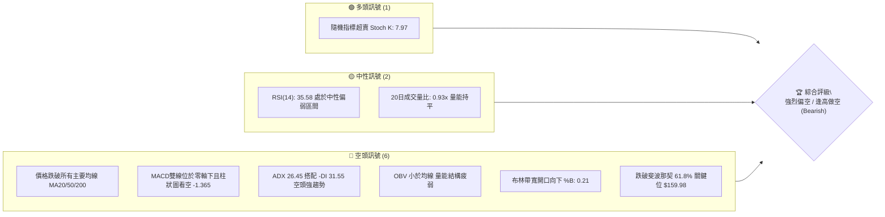
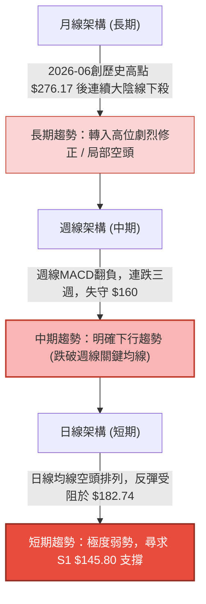
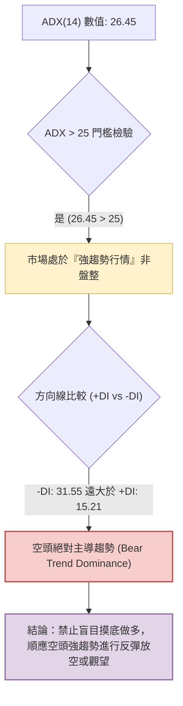
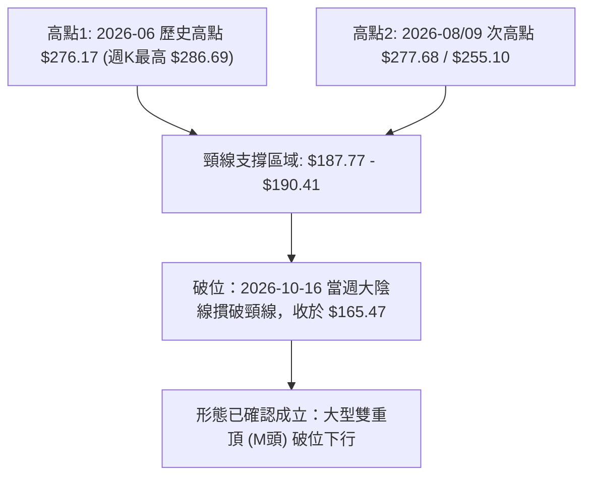
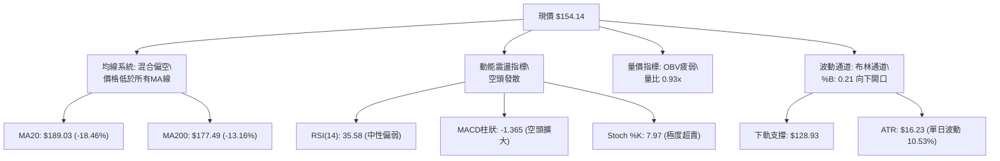
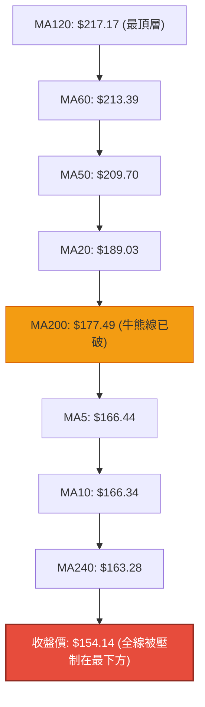
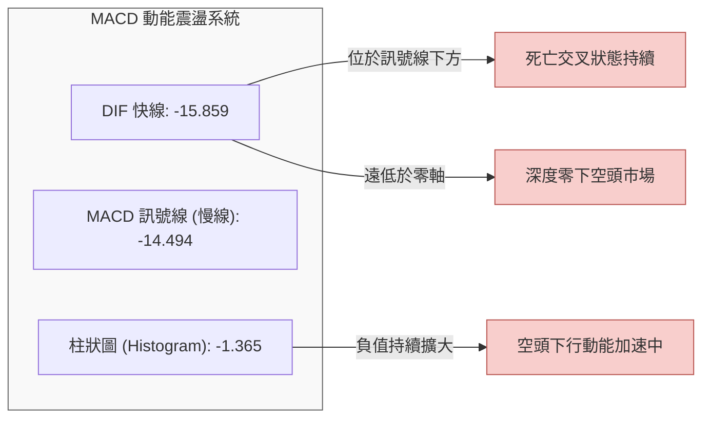
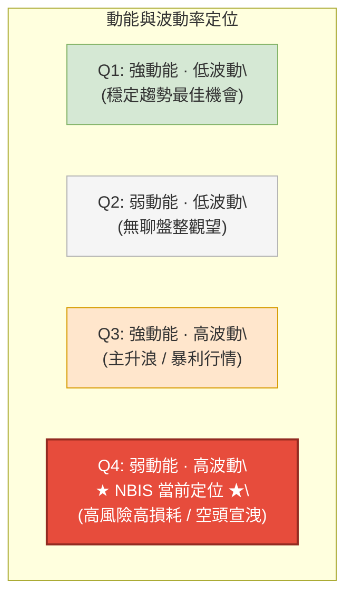
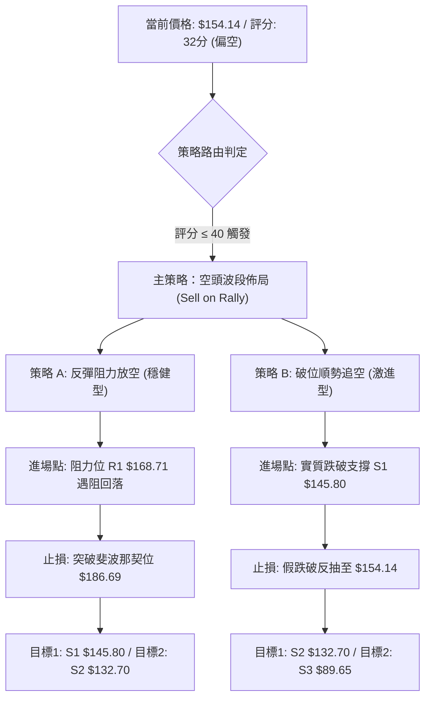
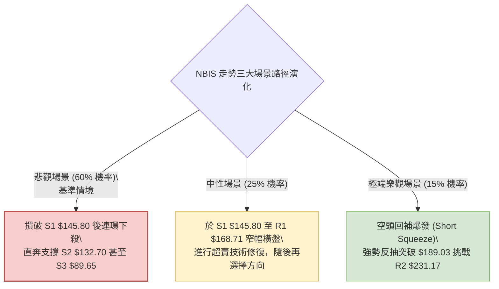

# NBIS 技術分析報告

> **報告日期**：2026-10-31 ｜ **語言**：繁體中文 ｜ **數據來源**：Yahoo Finance ｜ **當前價格**：$154.14

---

## 目錄

| 章節 | 內容 |
|------|------|
| [1. 技術面概覽](#1-技術面概覽) | 訊號儀表板、核心指標、評分卡 |
| [2. 趨勢分析](#2-趨勢分析) | 多時框趨勢、長中短期走勢、ADX解讀 |
| [3. 圖表形態分析](#3-圖表形態分析) | 形態識別、K線組合、目標價推算 |
| [4. 支撐與阻力](#4-支撐與阻力) | 關鍵價位、斐波那契回調結構 |
| [5. 技術指標深度解讀](#5-技術指標深度解讀) | MA/RSI/MACD/布林/成交量量價關係 |
| [6. 動能與波動率](#6-動能與波動率) | 動能四象限、ATR風險度量、Beta相關性 |
| [7. 多時框架總結](#7-多時框架總結) | 時框架評分矩陣、多時框收斂結論 |
| [8. 交易策略建議](#8-交易策略建議) | 策略路由、空頭主策略、風險報酬比 |
| [9. 風險提示與監控](#9-風險提示與監控) | 監控清單、極端風險場景、部位管理 |

---

## 1. 技術面概覽

### 🎯 技術訊號儀表板



### 📊 核心指標速覽表

| 指標類別 | 指標名稱 | 當前數值 | 訊號 | 解讀 |
|----------|----------|----------|------|------|
| **價格** | 當前收盤價 | $154.14 | 🔴 | 位於52週區間35.6%處，全線跌破短中長期均線 |
| **均線** | MA20 | $189.03 | 🔴 | 價格低於MA20達 -18.46%，短線下行斜率陡峭 |
| **均線** | MA50 | $209.70 | 🔴 | 中期生命線大幅下行，構成中期強大反彈壓力 |
| **均線** | MA200 | $177.49 | 🔴 | 股價失守牛熊分界線MA200（-13.16%），轉入熊市格局 |
| **動能** | RSI(14) | 35.58 | 🟡 | 位於30-70中性偏空區間，尚未進入極端超賣，下行動能未竭 |
| **動能** | MACD (12,26,9) | -15.859 / 柱: -1.365 | 🔴 | 雙線深陷零軸之下且負向柱狀圖放大，空方動能主導 |
| **趨勢** | ADX(14) / ±DI | ADX: 26.45 / -DI: 31.55 | 🔴 | ADX>25確認趨勢成形，-DI遠高於+DI(15.21)，空頭趨勢強烈 |
| **波動** | ATR(14) | $16.23 (10.53%) | 🔴 | 極高波動水準，單日價格震幅大，需拉寬風控間距 |
| **通道** | 布林通道 %B | 0.21 (帶寬: $128.93-$249.13)| 🔴 | 貼近下軌運行，通道呈現向下發散擴張態勢 |
| **量能** | OBV 趨勢 | OBV < MA | 🔴 | 成交量指標跌破均線，資金持續淨流出，無主力吸籌跡象 |

### 🏆 技術評分卡

```
╔══════════════════════════════════════════════════════════════╗
║                 技術評分卡 — NBIS (2026-10-31)              ║
╠══════════════════════════════════════════════════════════════╣
║ 趨勢強度 (ADX & 方向)   ████████████░░░░░░░░  60/100  🔴 空頭強║
║ 動能指標 (RSI & MACD)   ████░░░░░░░░░░░░░░░░  20/100  🔴 動能疲║
║ 支撐穩定度 (結構支撐)   ██████░░░░░░░░░░░░░░  30/100  🔴 支撐破║
║ 成交量配合 (OBV & 量比) ██████░░░░░░░░░░░░░░  30/100  🔴 量價背║
║ 形態完整度 (頭肩 & 破位) ████████░░░░░░░░░░░░  40/100  🟡 構築中║
║ 均線排列 (MA系統狀態)   ██░░░░░░░░░░░░░░░░░░  10/100  🔴 空頭排║
╠══════════════════════════════════════════════════════════════╣
║ 綜合評分                ████░░░░░░░░░░░░░░░░  32/100  🔴 強烈偏空║
╚══════════════════════════════════════════════════════════════╝
```
*註：綜合評分由六項子評分算術平均得出：(60 + 20 + 30 + 30 + 40 + 10) ÷ 6 = 31.67 ≈ 32/100（依規則 18 四捨五入至整數）。*

---

## 2. 趨勢分析

### 🌐 多時框趨勢分析



### 📈 長期趨勢 — 12個月走勢圖（Unicode）

依據月線收盤歷史數據（2025-11 至 2026-10）繪製之 12 個月走勢圖：

```
NBIS 月線走勢圖（2025-11 至 2026-10）
價格軸 ($)
$280 ┤                                      ● (2026-06: $276.17 高點)
$250 ┤                                  ●   │
$220 ┤                              ●   │   │       ● (2026-09: $235.88)
$190 ┤                              │   │   │   ●   │
$160 ┤                      ●       │   │   │   │   │       ●←現價 $154.14
$130 ┤              ●       │       │   │   │   │   │   │   │
$100 ┤  ●       ●   │       │       │   │   │   │   │   │   │
$70  ┤  │   ●(低點) │       │       │   │   │   │   │   │   │
     └──┴───┴───┴───┴───────┴───────┴───┴───┴───┴───┴───┴───┴─────
       11  12  01  02      03      04  05  06  07  08  09  10 (月份)
     (2025)                (2026)
```

#### 走勢特徵分析表格

| 階段區間 | 起止月份 | 起止價格 | 累計漲跌幅 | 主要走勢特徵解讀 |
|:---|:---|:---|:---:|:---|
| **築底蓄勢期** | 2025-11 ~ 2026-01 | $94.87 → $85.19 | -10.20% | 於 52W 低點 $73.52 上方構築雙底平台，成交量萎縮整固 |
| **主升推升期** | 2026-02 ~ 2026-06 | $91.19 → $276.17 | **+202.85%** | 伴隨 AI 基礎設施爆發式增長，月線連五紅，均線多頭發散，創下歷史天價 |
| **高位派發期** | 2026-07 ~ 2026-09 | $190.41 → $235.88 | +23.88% | 劇烈震盪，07月暴跌至 $190 後反抽至 $235.88，主力高位派發形成雙頂結構 |
| **破位下殺期** | 2026-09 ~ 2026-10 | $235.88 → $154.14 | **-34.65%** | 單月暴跌超過 80 美元，連續摜破多道關鍵均線與斐波那契回調位 |

### 📊 中期趨勢（週線分析）

```
NBIS 週線壓力與支撐階梯示意圖
價格 ($)
$254.92 ────────────────────────── [R3 強阻力聚類 / 9-10月頂部平台]
                                     ▲
$231.17 ────────────────────────── [R2 次級阻力 / 8-9月密集成交區]
                                     ▲
$168.71 ────────────────────────── [R1 近期突破頸線阻力 / 近週高點]
================================== [現價 $154.14] ==================
                                     ▼
$145.80 ────────────────────────── [S1 第一線支撐 / 近期日K波段低點聚類]
                                     ▼
$132.70 ────────────────────────── [S2 第二線支撐 / 歷史波段密集成交支撐]
                                     ▼
$89.65  ────────────────────────── [S3 長期強支撐 / 2026年初起漲基底平台]
```

### ⚡ 趨勢強度評估（ADX 解讀）



#### ADX 指標強度對照表

| 指標變數 | 當前數值 | 參考門檻 | 狀態診斷 | 交易意涵 |
|:---|:---:|:---:|:---:|:---|
| **ADX(14)** | **26.45** | > 25.00 | 強趨勢成形 | 價格脫離無方向盤整，動量策略主導市場，擺動指標容易鈍化 |
| **+DI** | **15.21** | < 20.00 | 多方動能衰竭 | 多頭無力組織連續進攻，向上突破難度極大 |
| **-DI** | **31.55** | > 30.00 | 空方力量擴張 | 賣盤主導市場定價權，空方下殺動能強烈且具持續性 |
| **綜合判定** | **空頭趨勢確立** | -DI > +DI 且 ADX 升溫 | 🔴 強烈看空 | 中期操作以順向放空或持幣觀望為主，逆勢多單風險極高 |

---

## 3. 圖表形態分析

### 🔍 形態識別系統



#### 圖表形態信心度評估表（依規則 15）

| 形態名稱 | 信心度 | 判斷依據（嚴格引用數據） | 完成度 | 目標價（附嚴謹計算式） |
|:---|:---:|:---|:---:|:---|
| **週線大型雙頂 (M-Top)** | **85%** | 兩次波段高點分別為 2026-06 週收盤 $286.69 與 2026-08-14 週收盤 $277.68；中間頸線低點為 2026-07-24 週收盤 $187.77。2026-10-16 週收盤 $165.47 正式摜破頸線。 | **95%** (已破位展開) | 依形態高度推算：頸線 $187.77 − (高點 $277.68 − 頸線 $187.77) = $187.77 − $89.91 = **$97.86**（向數據中 S3 $89.65 靠攏） |
| **日線下降通道** | **75%** | 近10根日K高點由 10/28 的 $182.74 下降至 10/30 的 $161.42；低點由 10/22 的 $155.73 跌破至 10/26 的 $149.48。 | **80%** (通道下軌測試中) | 通道下軌下探支撐 S1 **$145.80**，若失守則指向 S2 **$132.70** |
| **均線死叉形態** | **90%** | MA5 ($166.44) < MA10 ($166.34) < MA20 ($189.03) < MA50 ($209.70)，且價格全面位於均線下方。 | **100%** (已完成) | 訊號顯示均線全面下壓，指向前波低點聚類支撐 S1 **$145.80** |

### 🕯️ 重要K線形態分析

嚴格依據數據中「近 10 根日 K」與「近 8 根週 K」之精確 OHLC 數據進行識別（依規則 19）：

| 日期與週期 | 開盤價 | 最高價 | 最低價 | 收盤價 | K線形態名稱 | 技術解讀與量價意涵 | 多空訊號 |
|:---|:---:|:---:|:---:|:---:|:---|:---|:---:|
| **2026-10-16 (週K)** | 217.20 | 217.20 | 163.27 | 165.47 | **光頭大陰線 (Marubozu Bear)** | 開盤即最高點，單週爆出 148,676,100 股巨量暴跌 -23.77%，正式宣告雙頂頸線破位 | 🔴 強烈看空 |
| **2026-10-26 (日K)** | 153.96 | 165.86 | 149.48 | 153.27 | **長上影流星陰線** | 盤中反彈遭空方強烈壓制，收盤接近全日最低，成交量放大至 30,698,500 股，多方無力 | 🔴 看空 |
| **2026-10-28 (日K)** | 173.49 | 182.74 | 168.92 | 182.34 | **光腳大陽線 (Bullish Rebound)** | 伴隨 25,056,800 股放量強彈，但最高點 $182.74 於 MA20 ($189.03) 下方嘎然而止 | 🟡 誘多反彈 |
| **2026-10-29 (日K)** | 173.18 | 178.33 | 168.76 | 171.99 | **下行抱線孕線** | 高低點均受制於前一日區間內部，動能迅速停滯，顯示 10/28 之強彈僅為死貓跳 | 🔴 轉弱 |
| **2026-10-30 (日K)** | 157.05 | 161.42 | 149.96 | 154.14 | **低開破位長陰線** | 跳空低開，盤中最低下探 $149.96，完全回吐前兩日漲幅，空方再度掌控盤面 | 🔴 續跌訊號 |
| **2026-10-30 (週K)** | 153.96 | 182.74 | 149.48 | 154.14 | **長上影假突破倒錘頭** | 週線衝高受阻於 $182.74 後大幅回落，收盤跌破開盤，確認反彈失敗且週跌幅擴大 | 🔴 空方壓制 |

### 📉 ASCII 走勢形態示意圖

```
NBIS 週線級別雙頂形態 (M-Top) 示意圖
價格軸
$286.69 ┤            ● 頂部1 (2026-06)         ● 頂部2 (2026-08: $277.68)
        │           / \                       / \
$230.00 ┤          /   \                     /   \
        │         /     \                   /     \
$187.77 ┼────────/───────\─────────────────/───────\────── [頸線水平線 $187.77]
        │                 \               /         \
$165.47 ┤                  \             /           ▼ 破位確認 (10-16 週K)
        │                   ● 頸線低點  /             \
$154.14 ┤                     ($187.77)                ● 現價 $154.14
        │                                               │
$132.70 ┤                                               ▼ 指向第一目標 S2
        │                                               │
$89.65  ┤                                               ▼ 指向終極目標 S3
        └─────────────────────────────────────────────────────────────
```

### 🎯 形態目標價計算

根據經典技術分析形態學幾何等幅測距法則（Measured Move Rule），雙頂破位後之下行目標價測算如下：

1. **頸線確認位**：取 2026-07-24 當週之收盤低點 **$187.77**（亦與 2026-07-31 收盤 $190.41 構成密集共振帶）。
2. **頂部基準高點**：取次頂 2026-08-14 週收盤價 **$277.68**（保守測算，若取歷史最高收盤 $286.69 則幅度更大）。
3. **形態垂直高度 ($H$)**：
   $$H = \text{頂部高點} - \text{頸線位} = 277.68 - 187.77 = 89.91$$
4. **理論最小量度跌幅目標價 (Target Price)**：
   $$\text{目標價} = \text{頸線位} - H = 187.77 - 89.91 = \mathbf{\$97.86}$$
5. **數據價位對照收斂**：計算出的理論目標價 $97.86 極度接近數據中波段低點聚類第三支撐 **S3: $89.65**。因此，一旦短中期支撐 S1 ($145.80) 與 S2 ($132.70) 相繼失守，價格具有向 $97.86 ~ $89.65 深度回調的強大形態重力。

---

## 4. 支撐與阻力

### 🗺️ 關鍵價位分布圖（Unicode）

```
NBIS 關鍵價位結構分布圖 (由 OHLCV 與歷史波段聚類精確計算)
═════════════════════════════════════════════════════════════════
$254.92 ║████████████████████████████████║ 強阻力 R3 (波段密集高點聚類)
$246.44 ║▒▒▒▒▒▒▒▒▒▒▒▒▒▒▒▒▒▒▒▒▒▒▒▒▒▒▒▒▒▒  ║ 斐波那契 23.6% 回調位
$231.17 ║████████████████████████        ║ 阻力 R2 (反彈高點聚類)
$213.40 ║▒▒▒▒▒▒▒▒▒▒▒▒▒▒▒▒▒▒▒▒▒▒▒▒        ║ 斐波那契 38.2% 回調位
$189.03 ║▓▓▓▓▓▓▓▓▓▓▓▓▓▓▓▓▓▓▓▓            ║ MA20 動態均線阻力
$186.69 ║▒▒▒▒▒▒▒▒▒▒▒▒▒▒▒▒▒▒▒▒            ║ 斐波那契 50.0% 關鍵平衡位
$168.71 ║████████████████                ║ 關鍵阻力 R1 (短線波段高點/頸線共振)
$159.98 ║▒▒▒▒▒▒▒▒▒▒▒▒▒▒▒▒                ║ 斐波那契 61.8% 黃金分割破位處
════════╬════════════════════════════════╬ ◄ 當前收盤價 $154.14
$145.80 ║▓▓▓▓▓▓▓▓▓▓▓▓▓▓                  ║ 近期第一支撐 S1 (近一年波段低點聚類)
$132.70 ║████████████████████            ║ 強支撐 S2 (次級防線/下行第一防禦)
$121.96 ║▒▒▒▒▒▒▒▒▒▒▒▒                    ║ 斐波那契 78.6% 回調位
$89.65  ║████████████████████████████████║ 核心強支撐 S3 (長期底部平台聚類)
$73.52  ║▒▒▒▒▒▒▒▒                        ║ 52週最低價 (斐波那契 100.0%)
═════════════════════════════════════════════════════════════════
```

### 🚧 阻力位分析表

阻力位嚴格引用技術數據中「關鍵價位」區塊之波段高點聚類數值：

| 阻力級別 | 價位 ($) | 距離現價 (%) | 形成原因與結構強度 | 突破難度評估 | 重要性等級 |
|:---|:---:|:---:|:---|:---:|:---:|
| **R1** | **$168.71** | +9.45% | 近期日K反彈密集成交平台頂部，10/19~10/21多次收盤阻力聚類 | 🟡 中等 (需放量突破MA10) | ★★★☆☆ (短線強弱水嶺) |
| **R2** | **$231.17** | +49.97% | 2026年08月至09月箱體震盪之中軸核心高點，大量套牢籌碼沉澱區 | 🔴 極高 (面臨中期MA50壓制)| ★★★★☆ (中期反轉關鍵) |
| **R3** | **$254.92** | +65.38% | 2026-09-11至10-09週K連續衝高受阻之絕對頂部平台，歷史套牢重災區 | 🔴 極度堅硬 (短期無法企及) | ★★★★★ (多頭終極堡壘) |

### 🛡️ 支撐位分析表

支撐位嚴格引用技術數據中「關鍵價位」區塊之波段低點聚類數值：

| 支撐級別 | 價位 ($) | 距離現價 (%) | 形成原因與結構強度 | 守住機率評估 | 重要性等級 |
|:---|:---:|:---:|:---|:---:|:---:|
| **S1** | **$145.80** | -5.41% | 近期下殺波段低點密集聚類（10/26低點 $149.48 與 10/30低點 $149.96 之下方防守區）| 🟡 45% (面臨考驗，隨時可能下破) | ★★★☆☆ (短線生命防線) |
| **S2** | **$132.70** | -13.91% | 2026年04月起漲爆發期之跳空突破平台高點轉化之實質結構支撐 | 🟢 65% (具備強大技術買盤緩衝) | ★★★★☆ (波段調整核心目標) |
| **S3** | **$89.65** | -41.84% | 2025年底至2026年初長達三個月築底平台箱體上緣，歷史強支撐共振區 | 🟢 85% (長期價值投資防線) | ★★★★★ (牛熊終極底線) |

### 📐 斐波那契回調位分析

依據 52 週極端區間（最低點 $73.52 至最高點 $299.86）計算之黃金分割水準解析如下：

```
斐波那契層級與現價對照位置：
  0.0%  (52W High)   $299.86  ══════════════════════════════════
  23.6%              $246.44  ----------------------------------
  38.2%              $213.40  ---------------------------------- (接近 MA60: $213.39)
  50.0%              $186.69  ---------------------------------- (接近 MA20: $189.03)
  61.8%              $159.98  ================================== [關鍵黃金分割破位點]
  ── 當前價格: $154.14 ───   ▼ 落在 61.8% ($159.98) 與 78.6% ($121.96) 之間
  78.6%              $121.96  ----------------------------------
 100.0% (52W Low)    $73.52   ══════════════════════════════════
```

- **位置判定**：當前收盤價 **$154.14** 已經正式**跌破**斐波那契 61.8% 的關鍵防禦位 **$159.98**。
- **技術解讀**：
  1. 在道氏理論與斐波那契波浪體系中，回調跌破 61.8% 意味著先前的整段多頭推升浪（$73.52 → $299.86）結構已經遭到破壞，不再屬於強勢回檔，而是轉變為「深幅回撤」或「趨勢反轉」。
  2. $159.98 已由支撐轉化為強大反壓。在未能有效放量站回 $160 之前，下方空間被完全打開，下一道理論回調目標為 78.6% 回調位 **$121.96**。該位置與波段支撐 **S2: $132.70** 構成了未來空頭下行的磁吸區間。

---

## 5. 技術指標深度解讀

### 🎛️ 指標訊號總覽



### 📈 移動平均線排列分析



#### 均線數據深度解讀表

| 均線名稱 | 數值 ($) | 乖離率 (%) | 走勢特徵 | 解讀與多空研判 |
|:---|:---:|:---:|:---|:---|
| **MA5** | $166.44 | -7.39% | 急速下彎 | 短線第一道壓制線，任何反抽無法越過 MA5 皆屬弱勢整理 |
| **MA10** | $166.34 | -7.33% | 下行發散 | 與 MA5 粘合下行，構成短線反彈的重壓區 |
| **MA20** | $189.03 | -18.46% | 陡峭向下 | 20日布林中軌，負乖離率達 -18.46%，顯示短線嚴重超賣但趨勢向下 |
| **MA50** | $209.70 | -26.50% | 轉折下行 | 中期生命線徹底失守，宣告中期多頭架構瓦解 |
| **MA60** | $213.39 | -27.77% | 走平轉跌 | 季線下彎，上檔累積龐大套牢沉積盤 |
| **MA120**| $217.17 | -29.02% | 高位鈍化 | 半年線位居最上方，代表過去半年買入之平均成本均處於嚴重虧損 |
| **MA200**| $177.49 | -13.16% | 下方被跌破 | 長期牛熊分水嶺遭帶量摜破，技術派機構止損盤湧出，轉入技術性熊市 |
| **MA240**| $163.28 | -5.60% | 走平 | 年線最後防線亦於本週宣告失守，價格全面沉淪於均線網之下 |

*均線系統狀態結論：均線呈現「空頭混亂向下發散排列」，價格位於所有長中短期均線下方，任何反彈均面臨層層解套賣壓。*

### 📉 RSI(14) 分析

- **當前數值**：**35.58**（Wilder 計算方法）。
- **數值進度條**：
  `0  [███████░░░░░░░░░░░░░] 100` （35.58% 位於中性偏弱區）
- **超買超賣區間診斷**：
  - 標準超賣門檻為 30，當前數值 35.58 尚未進入絕對超賣區（< 30），這表明市場雖然經歷大幅下殺，但空頭拋壓並未釋放完畢，未出現極端恐慌性賣過頭訊號，後續仍有進一步下探動能。
- **背離分析**：
  - 根據技術數據中近 20 根 K 棒的首尾比對，**「無明顯背離」**。
  - 價格自 10/19 的收盤 $170.24 跌至 10/30 的 $154.14，RSI 亦同步維持在 30~35 低位區間徘徊，呈現**「價格創新低、指標同步疲弱」**之走勢，量化驗證了空頭趨勢的健康度（對空方而言），無任何底背離之反轉訊號。

### 📊 MACD(12/26/9) 訊號解讀



- **MACD 數值解析**：DIF 線為 **-15.859**，DEA 訊號線為 **-14.494**，柱狀圖為 **-1.365**。
- **結構研判**：
  1. 雙線深度潛伏於零軸（0.00）極深位置，代表大週期已被空頭完全統治。
  2. 快線 DIF 處於慢線 DEA 之下，且負向柱狀圖（-1.365）持續向下延展，顯示空方動能不僅未衰退，反而處於重新加速階段。
  3. 週線 MACD 柱狀圖在近三週分別為 -7.494、-6.208、-1.365，日線柱狀圖再度翻黑走低，杜絕了任何V型反轉之可能性。

### 📦 布林通道分析

```
NBIS 布林通道 (20, 2) 結構示意圖
價格軸 ($)
$249.13 ┼────────────────────────────── BB上軌 (偏離極遠，強烈反壓)
        │
        │
$189.03 ┼────────────────────────────── BB中軌 (MA20 生命線，下行斜率陡峭)
        │
$154.14 ┼───● 現價 (位於中下軌弱勢區，%B = 0.21)
        │    │
$128.93 ┼────┴───────────────────────── BB下軌 (動態極限支撐目標)
```

- **軌道數值**：上軌 **$249.13** ｜ 中軌 **$189.03** ｜ 下軌 **$128.93**。
- **%B 指標分析**：當前 %B 數值為 **0.21**（計算式：$(154.14 - 128.93) \div (249.13 - 128.93) = 25.21 \div 120.20 = 0.2097 \approx 0.21$）。
- **帶寬與形態解讀**：
  - %B 位於 0.20 附近，代表股價極度貼近下軌運行。布林通道帶寬高達 $120.20（佔股價近 78%），呈現向下發散擴張態勢（Walking the Lower Band），這是典型的**「空頭趨勢強烈主導」**形態，切勿將貼近下軌誤判為買入訊號。
  - 下軌動態位置 **$128.93** 與第二支撐 **S2: $132.70** 相互重疊，構成未來空頭下衝時的潛在減速緩衝帶。

### 💹 成交量分析（量價配合度）

- **量能數據維度**：
  - 最新交易日成交量：**21,462,400 股**
  - 20日均量：**22,958,505 股**（量比：**0.93x**，量能相對均衡）
  - 50日均量：**18,092,830 股**（高於長期平均 18.6%）
- **OBV (能量潮) 趨勢診斷**：
  - 數據明確給出：**`OBV < MA → 量能疲弱`**。
  - 解讀：OBV 跌破其自身的移動平均線，代表在過去一段時間的價格下跌過程中，伴隨的是主動性賣盤的主導，而在反彈過程中（如 10/28 放量 2500 萬股拉出大陽線）隨後立即在 10/29、10/30 縮量破位，呈現標準的「反彈無量、下跌有量」之量價背離特徵。
  - 機構法人持股比例高達 70.6%，在 OBV 出現止跌向上拐點之前，顯示機構籌碼仍在持續離場進行風險暴露縮減。

---

## 6. 動能與波動率

### ⚡ 動能評估四象限

根據技術數據中「動能（RSI 35.58、MACD 下行）」與「波動率（ATR 10.53%、Beta 1.46）」進行四象限劃分：



| 象限標記 | 動能維度 | 波動維度 | 典型市場特徵 | NBIS 符合狀態與戰略評估 |
|:---:|:---:|:---:|:---|:---|
| **Q1** | 強 | 低 | 趨勢穩健推升，回撤小 | 否 |
| **Q2** | 弱 | 低 | 橫盤窄幅震盪，缺乏方向 | 否 |
| **Q3** | 強 | 高 | 狂暴主升浪，成交量爆棚 | 否 |
| **Q4** | **弱 (負向強)** | **高** | **高波動下行，單日振幅巨大，做多極易被套** | **✓ 完全符合**：動能全線向下，ATR 佔比破 10%，空頭殺跌迅猛，嚴禁輕易抄底 |

### 📊 ATR 波動率分析

- **ATR(14) 數值**：**$16.23**（採用 Wilder 平滑算法）。
- **價格波動率佔比**：
  $$\text{ATR 百分比} = \frac{\$16.23}{\$154.14} \times 100\% = \mathbf{10.53\%}$$
- **技術解讀與交易風控意義**：
  1. 單日 10.53% 的真實波動幅度在美股大型科技/通訊板塊中屬於**極端高波動標的**。
  2. **止損間距設定指導**：
     - 日內極端噪音極大，常規的 1%~2% 窄止損會被市場日常波動瞬間掃出場。
     - 順勢波段交易者必須採用 **1.0x ~ 1.5x ATR** 作為安全止損防禦緩衝（即 $16.23 ~ $24.35 的價格間距）。
     - 倉位規模必須與 ATR 成反比壓縮（見第 8 章具體風控建議）。

### 📐 Beta 與市場相關性

- **Beta 係數**：**1.46**。
- **技術解讀**：
  - NBIS 的股價彈性相對於標普 500 指數高出 46%。在系統性市場環境承壓或 AI 板塊集體回調時（如近期新聞所指之「AI 雲計算板塊受大型科技 Capex 縮減拖累重挫」），NBIS 展現出顯著的放大下行特徵。
  - 放空或避險該標的可獲得高於大盤的負 Beta 收益，但反向波動風險亦大幅提高。

---

## 7. 多時框架總結

### 📋 時框架評分表

| 時框架 | 趨勢方向 | 動能狀態 | 均線排列 | 形態結構 | 綜合評分 | 操作建議方向 |
|:---|:---:|:---:|:---:|:---:|:---:|:---|
| **月線 (長期)** | 🔴 轉弱回撤 | 🟡 中性減弱 | 🟢 位於MA240上方 | 高位長陰吞噬 | **40/100** | 終止長期盲目看多，防範深度回調 |
| **週線 (中期)** | 🔴 強勢空頭 | 🔴 MACD柱下挫 | 🔴 摜破MA20/50 | 雙頂破位成形 | **25/100** | 中期波段做空，以反彈逢高布空為主 |
| **日線 (短期)** | 🔴 下行通道 | 🔴 -DI 壓制 | 🔴 混合死叉向下 | 10/30大陰吞噬 | **30/100** | 短線禁止逆勢接飛刀，等待S1考驗 |

### 🔲 綜合訊號矩陣

```
訊號維度對齊分析矩陣：
╔═════════════╦══════════════╦══════════════╦══════════════╦══════════════╗
║ 時框層級    ║ 趨勢訊號     ║ 動能訊號     ║ 量價配合     ║ 一致性判定   ║
╠═════════════╬══════════════╬══════════════╬══════════════╬══════════════╣
║ 長期 (月線) ║ 🟡 中性偏弱  ║ 🟡 頂部鈍化  ║ 🔴 放量滯漲  ║ 偏空收斂     ║
║ 中期 (週線) ║ 🔴 明確看空  ║ 🔴 空方加速  ║ 🔴 破位放量  ║ 🔴 高度一致  ║
║ 短期 (日線) ║ 🔴 極度弱勢  ║ 🔴 零下空頭  ║ 🔴 OBV跌破均 ║ 🔴 高度一致  ║
╚═════════════╩══════════════╩══════════════╩══════════════╩══════════════╝
```

### ⚖️ 多時框收斂結論

依據多時框收斂規則（規則 14）：
1. **行情模式檢驗**：當前日線 **ADX(14) 數值為 26.45**，明確突破 25 臨界門檻，市場正式處於**「強趨勢行情」**而非無方向盤整。
2. **主導優先級收斂**：在趨勢行情中，中長期（週線/MA50、MA200）方向具有最高決定權，日線維度僅能作為尋找精確進場觸發點與風控節點之工具。
   - 週線級別雙頂破位、MA50/MA200 牛熊均線遭摜破；
   - 日線級別雖出現 Stoch %K 極度超賣 (7.97)，但此類震盪指標超賣在 ADX>25 的強空頭趨勢中極易發生「鈍化」，不可作為逆勢做多之依據。
3. **唯一方向性結論**：**【強烈偏空 (Strong Bearish)】**。
   - 本報告最終戰略結論維持與第 1 章技術評分卡（32/100）、第 2 章趨勢分析、第 5 章技術指標全線收斂：**順應空頭強趨勢，主推逢反彈建立做空部位**。

---

## 8. 交易策略建議

### 🗺️ 策略決策流程圖



### 🧭 策略路由（依評分卡分流，不得兩頭下注）

> **當前主策略方向 = 【逢高放空 / 順勢做空】（依據綜合評分 32/100，處於 ≤ 40 之強烈偏空區間）**

本報告堅決杜絕多空兩頭下注。基於日線/週線多指標空頭共振與 ADX>25 強空頭趨勢，主推兩套做空戰術；多頭訊號僅作為空單防守與對沖提示。

### 🎯 價格情境階梯（Price Scenarios）

價位嚴格引用第 4 章由 OHLCV 精確計算之波段聚類數值：

| 觸發條件 | 下一目標 | 後續延伸目標 | 情境技術含義解讀 |
|:---|:---:|:---:|:---|
| **強勢反彈突破 R1 $168.71** | **R2 $231.17** | **R3 $254.92** | 短線超賣強烈修復，若能越過 MA20 則空頭結構短暫緩解（小機率） |
| **跌破第一支撐 S1 $145.80** | **S2 $132.70** | **斐波 $121.96** | 確立日線下行波段展開，開啟向第二級強支撐的加速尋底 |
| **重挫跌破第二支撐 S2 $132.70**| **S3 $89.65** | **52W低 $73.52** | 中期雙頂形態量度跌幅全面宣洩，邁向長期起漲基底平台（恐慌主跌） |

### 📊 情境機率分佈

| 價格演進情境 | 發生機率 | 主要技術與量價依據 |
|:---|:---:|:---|
| **向下破位尋底 (主跌情境)** | **60%** | ADX 26.45 搭配 -DI 31.55 空頭主導；MACD 負向柱擴大；OBV 跌破均線量能潰散。 |
| **弱勢區間震盪 (以橫代跌)** | **25%** | Stoch %K 出現 7.97 極度超賣，可能在 S1 $145.80 與 R1 $168.71 間藉由震盪消化短線賣壓。 |
| **強烈反轉上攻 (多頭逆襲)** | **15%** | 需完全修復跌破的 61.8% 斐波位 $159.98，且放量攻克 MA200 牛熊分界線 $177.49。 |

### 🟢 主策略詳情（做空為主）

所有價位均嚴格引用數據庫「關鍵價位」數值，風險報酬比嚴格按公式 $(進場價 - 目標價T1) \div (止損價 - 進場價)$ 驗算（依規則 17）：

| 策略要素 | 策略 A（穩健型：反彈至阻力位放空） | 策略 B（激進型：摜破支撐位順勢追空） |
|:---|:---|:---|
| **進場條件** | 股價弱勢反彈測試 R1 阻力位受阻，出現滯漲陰線 | 盤中實質跌破第一支撐 S1，日K收盤確認破位 |
| **進場價格** | **$168.71**（精確引用 R1） | **$145.80**（精確引用 S1 破位進場） |
| **目標價 T1** | **$145.80**（回測第一支撐 S1） | **$132.70**（下探第二支撐 S2） |
| **目標價 T2** | **$132.70**（深度回測第二支撐 S2） | **$89.65**（直指雙頂量度與第三支撐 S3） |
| **止損價格** | **$186.69**（斐波那契 50.0% 回調位） | **$154.14**（當前最新收盤價 / 突破原跌破點） |
| **風險報酬比 (以 T1 計)**| **1 : 1.27**<br>計算式：$(168.71 - 145.80) \div (186.69 - 168.71) = 22.91 \div 17.98 \approx 1.27$ | **1 : 1.57**<br>計算式：$(145.80 - 132.70) \div (154.14 - 145.80) = 13.10 \div 8.34 \approx 1.57$ |
| **風險報酬比 (以 T2 計)**| **1 : 2.00**<br>計算式：$(168.71 - 132.70) \div (186.69 - 168.71) = 36.01 \div 17.98 \approx 2.00$ | **1 : 6.73**<br>計算式：$(145.80 - 89.65) \div (154.14 - 145.80) = 56.15 \div 8.34 \approx 6.73$ |
| **預估勝率** | **65%** | **58%** |
| **建議總倉位** | **8% ~ 10%**（控制單筆風險不超過總資產 1.5%）| **5% ~ 7%**（破位追空倉位宜輕） |

### 🔴 反向風險觸發點（對沖與風控提示）

若出現以下情境，宣告空頭主策略失效，空單必須立即無條件止損離場：
1. **關鍵價位收復**：日線連續兩日強勢收盤站穩在 **$168.71 (R1)** 與斐波那契 50.0% **$186.69** 上方。
2. **指標轉折確認**：日線 MACD 柱狀圖由負翻正，且 RSI(14) 突破 50 中性分界線。
3. **空頭擠壓訊號 (Short Squeeze)**：由於 Short % Float 高達 **20.2%**、Short Ratio 為 2.61，若市場爆發突發重磅利多導致股價放量衝過 MA20 ($189.03)，極易觸發空頭踩踏式回補暴拉，空單需嚴格執行止損紀律。

### ⭐ 整體訊號強度評星

```
做多訊號強度：★☆☆☆☆  (1/5星 — 僅超賣指標孤立支撐，逆勢風險極高)
做空訊號強度：★★★★☆  (4/5星 — 趨勢、均線、形態、量價多維共振)
整體可信度：  ★★★★☆  (4/5星 — ADX>25 強趨勢確立，技術面收斂一致)
```

---

## 9. 風險提示與監控

### ✅ 關鍵監控指標 Checklist

```
╔══════════════════════════════════════════════════════════════╗
║               NBIS 技術面日常監控清單 (Checklist)            ║
╠══════════════════════════════════════════════════════════════╣
║ [ ] 價格是否跌破 S1 $145.80 ── 破位則開啟主跌浪              ║
║ [ ] RSI(14) 是否跌破 30.00 ── 檢驗是否進入恐慌拋售鈍化期    ║
║ [ ] ADX(14) 是否持續上升 > 30.00 ── 驗證空頭趨勢是否加速     ║
║ [ ] 成交量是否異常放大至 3000 萬股以上 ── 判斷主力換手或洗盤 ║
║ [ ] 價格反彈是否無法觸及 MA5 $166.44 ── 驗證極弱勢空頭格局   ║
║ [ ] 盤中是否異常拉升突破 R1 $168.71 ── 空單停損警戒線觸發   ║
║ [ ] 借券賣出比例 (Short Float 20.2%) 是否有軋空異動          ║
╚══════════════════════════════════════════════════════════════╝
```

### ⚠️ 風險場景分析



### 🛡️ 風險管理重要提醒

1. **波動率與部位規模匹配**：
   NBIS 的日波幅 ATR 高達 **$16.23 (10.53%)**，屬於極度凶悍之高波標的。在交易中，絕不可使用操作低波權值股之倉位規模。建議單筆交易風險敞口（虧損金額）嚴格限制在投資組合總資產的 **1.0% ~ 1.5%** 範圍內。
2. **高做空比例 (Short Float 20.2%) 雙面刃防範**：
   高達 20.2% 的流通盤放空比例意味著市場空頭部位極為擁擠。雖然基本面（營業利潤率負 50.5%、自由現金流負 58.8 億美元）與技術面高度支持做空，但一旦遭遇板塊重大情緒利多，極易出現「非理性暴力的軋空行情（Short Squeeze）」。因此，**任何做空部位必須預先掛設硬性止損單（如 R1 上方或 $186.69），嚴禁抱持僥倖心理抗單**。

---

## 📋 報告總結

```
╔══════════════════════════════════════════════════════════════╗
║                    NBIS 技術分析報告總結                     ║
╠══════════════════════════════════════════════════════════════╣
║ 報告日期：2026-10-31                                         ║
║ 當前價格：$154.14                                            ║
║ 綜合技術評分：32 / 100                                       ║
║ 分析評級：🔴 強烈偏空 / 逢高做空 (Strong Bearish)             ║
╠══════════════════════════════════════════════════════════════╣
║ 關鍵結論：                                                   ║
║ ├─ 長期趨勢：🟡 月線自天價 $276.17 回撤，多頭結構受損破位    ║
║ ├─ 中期趨勢：🔴 週線確認雙頂破位，跌破 MA200 牛熊線與黃金分割║
║ ├─ 短期趨勢：🔴 ADX 26.45 趨勢成形，-DI 31.55 統治盤面       ║
║ ├─ 核心支撐：S1 $145.80 ｜ S2 $132.70 ｜ S3 $89.65           ║
║ ├─ 核心阻力：R1 $168.71 ｜ R2 $231.17 ｜ R3 $254.92           ║
║ └─ 波動警示：ATR $16.23 (10.53%)，Beta 1.46，嚴控部位規模    ║
╠══════════════════════════════════════════════════════════════╣
║ 最優策略組合：                                               ║
║ 1. 🥇 最佳機會：策略 A (反彈至 R1 $168.71 遇阻做空，風報比 1:1.27)║
║ 2. 🥈 次選機會：策略 B (跌破 S1 $145.80 追空下探 S2，風報比 1:1.57)║
║ 3. 🥉 保守選擇：完全空倉觀望，耐心等待 S2 $132.70 止跌結構出現║
╚══════════════════════════════════════════════════════════════╝
```

---

> ⚠️ **免責聲明**：本報告為 AI 自動生成之技術分析，所有數據及估算均嚴格基於所提供的歷史價格與市場資訊。本報告**僅供研究與學術參考**，**不構成任何形式之投資建議或買賣邀約**。金融市場投資具有極高風險，標的價格波動劇烈，投資人應獨立思考並自行承擔交易風險。

---

*報告生成時間：2026-10-31 ｜ 數據來源：Yahoo Finance ｜ 分析框架：多時框技術分析體系*