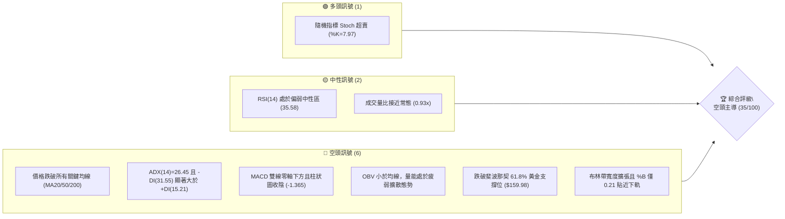
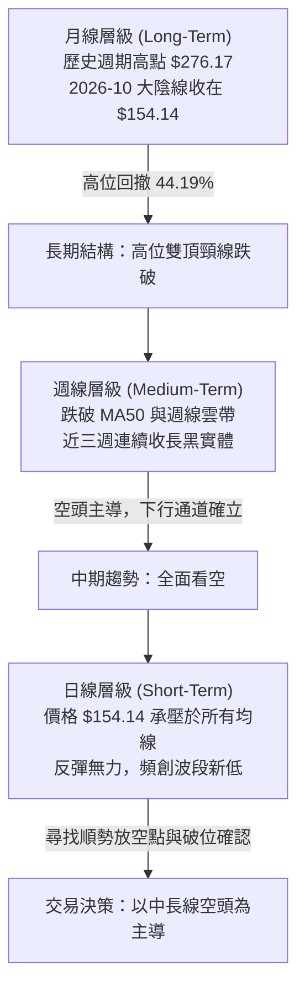
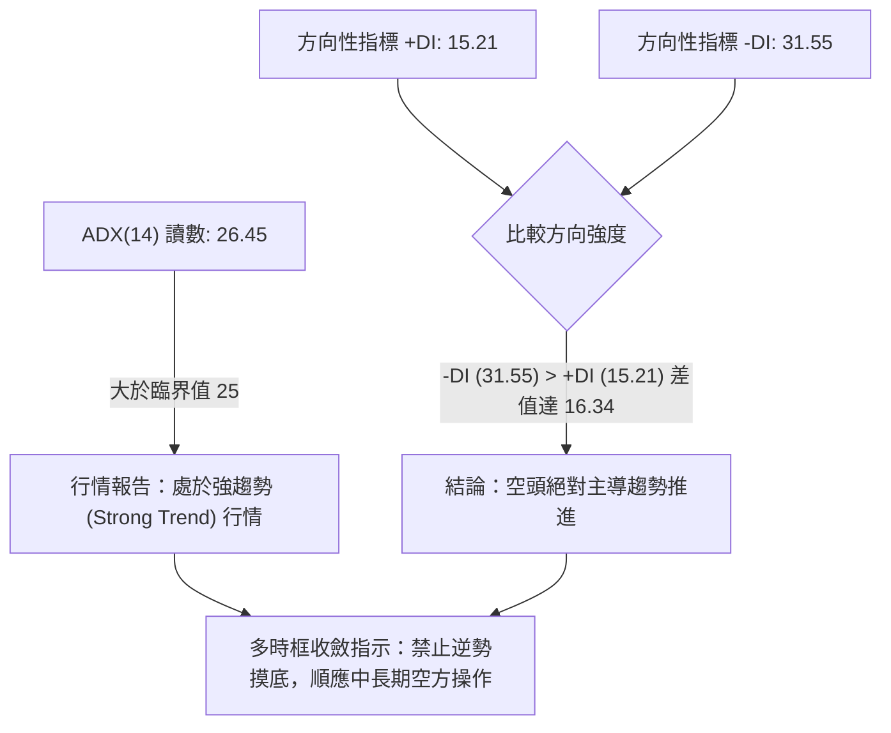
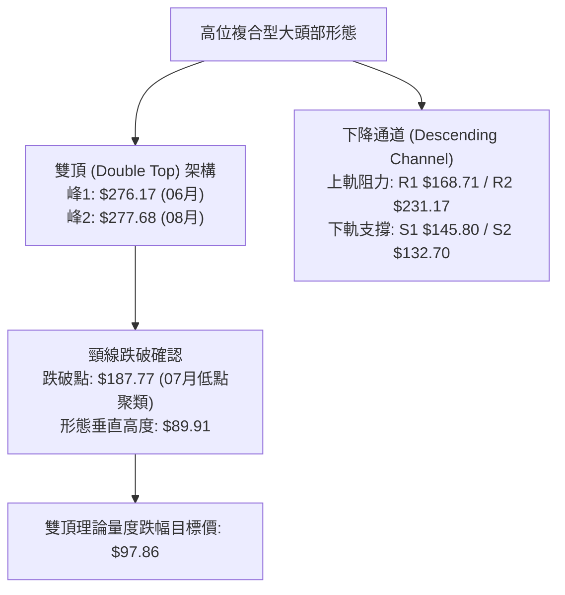
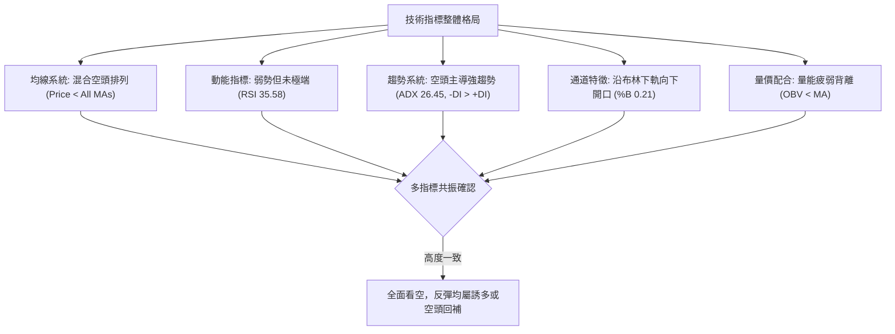
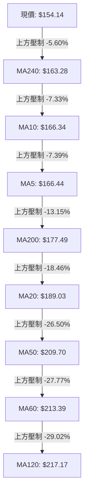
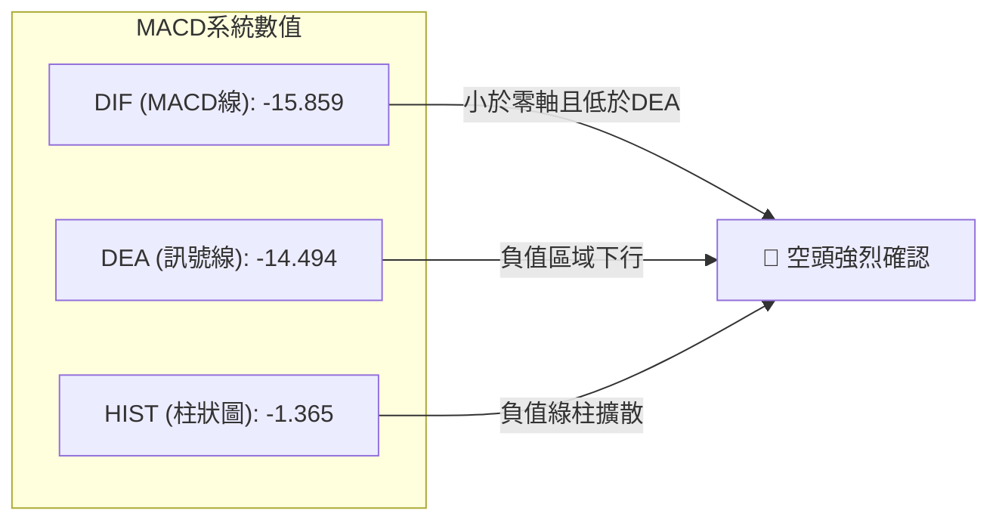
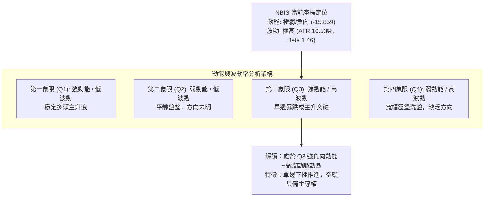
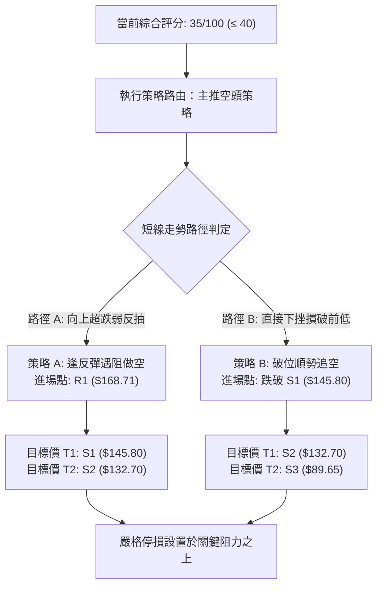
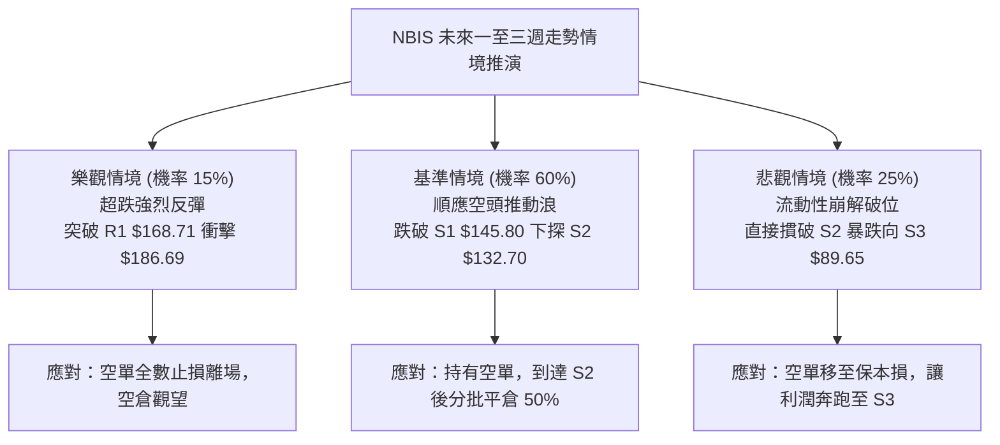

# NBIS 技術分析報告

> **報告日期**：2026-11-01 ｜ **語言**：繁體中文 ｜ **數據來源**：Yahoo Finance ｜ **當前價格**：$154.14 USD

---

## 目錄

| 章節 | 內容 |
|------|------|
| [1. 技術面概覽](#1-技術面概覽) | 訊號儀表板、核心指標、評分卡 |
| [2. 趨勢分析](#2-趨勢分析) | 多時框趨勢、長中短期走勢、ADX解讀 |
| [3. 圖表形態分析](#3-圖表形態分析) | 形態識別、K線組合、形態目標價 |
| [4. 支撐與阻力](#4-支撐與阻力) | 關鍵價位分布、波段聚類、斐波那契回調 |
| [5. 技術指標深度解讀](#5-技術指標深度解讀) | 均線系統、RSI、MACD、布林通道、OBV |
| [6. 動能與波動率](#6-動能與波動率) | 動能四象限、ATR、Beta與高空單比例 |
| [7. 多時框架總結](#7-多時框架總結) | 時框架矩陣、趨勢收斂規則驗證 |
| [8. 交易策略建議](#8-交易策略建議) | 策略路由、空頭主策略、價格情境、風控 |
| [9. 風險提示與監控](#9-風險提示與監控) | 關鍵監控清單、情境推演、資金管理 |

---

## 1. 技術面概覽

### 🎯 技術訊號儀表板



---

### 📊 核心指標速覽表

| 指標類別 | 指標名稱 | 當前數值 | 訊號 | 解讀 |
| :--- | :--- | :--- | :---: | :--- |
| **價格** | 當前收盤價 | $154.14 | 🔴 | 位於 52 週高低區間之 35.6%，短期處於深幅回撤格局 |
| **短期均線** | MA20 | $189.03 | 🔴 | 現價低於 MA20 達 -18.46%，短線下行斜率陡峭 |
| **中期均線** | MA50 | $209.70 | 🔴 | 現價低於 MA50 達 -26.50%，中期趨勢轉入明確空頭排列 |
| **長期均線** | MA200 | $177.49 | 🔴 | 價格跌破年線關鍵分水嶺，長期牛市支撐已遭摜破 |
| **動能震盪** | RSI(14) | 35.58 | 🟡 | 進入弱勢區間（30–70），未觸發 30 以下極端超賣，下行動能仍存 |
| **趨勢動能** | MACD (12,26,9) | -15.859 | 🔴 | 快慢線均深處零軸下方，柱狀體為 -1.365，空方動能持續釋放 |
| **趨勢強度** | ADX (14) | 26.45 | 🔴 | ADX > 25 確認為強趨勢行情，-DI (31.55) 碾壓 +DI (15.21) |
| **通道位置** | Bollinger %B | 0.21 | 🔴 | 緊貼布林通道下軌（$128.93），通道向下開口，空頭趨勢延續 |
| **波動幅度** | ATR(14) | $16.23 | 🔴 | ATR 佔股價高達 10.53%，日均震盪極大，單日洗盤風險顯著 |
| **量能指標** | OBV 趨勢 | OBV < MA | 🔴 | 能量潮指標低於均線，資金呈現持續淨流出特徵 |

---

### 🏆 技術評分卡

```
╔══════════════════════════════════════════════════════════════════╗
║                   技術評分卡 — NBIS (2026-11-01)                 ║
╠══════════════════════════════════════════════════════════════════╣
║ 趨勢強度 (Trend Strength)   ██████░░░░░░░░░░░░░░  30/100  🔴 空頭 ║
║ 動能指標 (Momentum)         ███████░░░░░░░░░░░░░  35/100  🔴 疲弱 ║
║ 支撐穩定度 (Support Level)  █████████░░░░░░░░░░░  45/100  🟡 脆弱 ║
║ 成交量配合 (Volume Flow)    ███████░░░░░░░░░░░░░  35/100  🔴 淨流 ║
║ 形態完整度 (Pattern Status) ████████░░░░░░░░░░░░  40/100  🔴 頭部 ║
║ 均線排列 (MA Alignment)     █████░░░░░░░░░░░░░░░  25/100  🔴 空排 ║
╠══════════════════════════════════════════════════════════════════╣
║ 綜合評分 (Overall Score)    ███████░░░░░░░░░░░░░  35/100  🔴 強烈看空║
╚══════════════════════════════════════════════════════════════════╝
```
*註：綜合評分係依規則 18，由上列六項維度之算術平均計算：(30 + 35 + 45 + 35 + 40 + 25) ÷ 6 = 35/100。*

---

## 2. 趨勢分析

### 🌐 多時框趨勢分析



---

### 📈 長期趨勢 — 12 個月走勢圖（Unicode）

以下為 NBIS 過去 12 個月（2025-11 至 2026-10）之月線收盤走勢與關鍵轉折點標註：

```
NBIS 月線收盤走勢圖（2025-11 至 2026-10）
價格 ($)
$280 ┤                                      ● $276.17 (2026-06 歷史天花板)
$250 ┤                                    ╱   ╲
$230 ┤                                  ●      ╲        ● $235.88 (次高點)
$200 ┤                                ╱          ●    ╱   ╲
$170 ┤                              ╱              ●        ╲
$150 ┤                            ╱                           ● $154.14 (現價)
$130 ┤                          ╱
$100 ┤  ● $94.87              ● $103.76
$80  ┤    ╲        ● $85.19 ╱
$70  ┤      ● $83.71 (區間築底)
     └─────────────────────────────────────────────────────────────►
        11   12   01   02   03   04   05   06   07   08   09   10  (月份)
       (2025)                     (2026)
```

#### 走勢特徵分析表格

| 階段歷史 | 涵蓋月份 | 起訖價格區間 | 累積漲跌幅 | 價量特徵與技術解讀 |
| :--- | :--- | :--- | :---: | :--- |
| **底部吸籌期** | 2025-11 ~ 2026-02 | $94.87 → $91.19 | -3.88% | 股價於 $83.71–$95.00 築底，成交量萎縮，籌碼沉澱 |
| **主升浪推進** | 2026-03 ~ 2026-06 | $103.76 → $276.17 | +166.16% | 月線連出大陽線，突破歷史高點，主升段狂飆，量能極度放大 |
| **高位派發期** | 2026-07 ~ 2026-09 | $190.41 → $235.88 | +23.88% | 劇烈震盪，高位出現次高點 $235.88，主力機構逐步出脫獲利多單 |
| **趨勢崩解期** | 2026-10 | $235.88 → $154.14 | -34.65% | 單月重挫逾 34%，跌破所有短期波段支撐，確立中長線頭部形態 |

---

### 📊 中期趨勢（週線分析）

中期走勢顯示出強烈的頂部反轉與下行擴散形態。最近 8 週（2026-09-11 至 2026-10-30）呈現「高點逐步下移（Lower Highs）」與「低點加速破底（Lower Lows）」的標準空頭推動浪。

```
NBIS 週線波段架構示意圖
$255.10 ───┐ (2026-10-09 當週高點)
           └───► $217.20 ───┐ (2026-10-16 暴跌開盤價)
                            └───► $178.85 ───┐ (2026-10-23 反彈高點)
                                             └───► $149.48 ───► $154.14 (現價低檔徘徊)
──────────────────────────────────────────────────────────────────
支撐帶考驗：S1 ($145.80) ────► 若跌破將直測 S2 ($132.70)
```

1. **破位暴跌**：2026-10-16 當週出現爆量長黑，週成交量放大至 148,676,100 股，單週由開盤 $217.20 重挫至收盤 $165.47（跌幅達 -23.8%），確認破位。
2. **弱勢反抽**：10-23 當週高點僅達 $178.85 即告力竭，收於 $158.74；10-30 當週雖一度因日線超跌反抽至 $182.74，但週五收盤再度被壓制至 $154.14，下影線極其脆弱。

---

### ⚡ 趨勢強度評估（ADX 解讀）



#### ADX 趨勢強度對照表

| 指標變數 | 當前讀數 | 門檻區間 | 當前狀態判定 | 交易意涵 |
| :--- | :---: | :---: | :---: | :--- |
| **ADX(14)** | 26.45 | > 25.0 | 強趨勢 (Trend-Driven) | 盤整策略失效，趨勢突破與順勢做空策略權重提升至最高 |
| **-DI (空方動能)**| 31.55 | > 30.0 | 極強空方動能 | 拋售壓力持續主導市場，空頭籌碼具備定價權 |
| **+DI (多方動能)**| 15.21 | < 20.0 | 多方動能極度渙散 | 缺乏機構主動性買盤，僅存技術性空頭回補 |
| **DI 差值離散度**| 16.34 | > 10.0 | 發散狀態 (Divergent) | 下行趨勢尚未衰竭，不具備左側抄底的量化基礎 |

---

## 3. 圖表形態分析

### 🔍 形態識別系統



#### 圖表形態信心度評估表（依規則 15）

| 識別形態名稱 | 信心度 (%) | 判斷依據（嚴格引用歷史數據） | 形態完成度 (%) | 理論目標價（附精確計算式） |
| :--- | :---: | :--- | :---: | :--- |
| **大級別雙頂 (Double Top)** | 85% | 頂1為 2026-06 收盤 $276.17；頂2為 2026-08-14 週收盤 $277.68。波谷頸線為 2026-07-24 收盤 $187.77。現價 $154.14 已實質跌破頸線。 | 90% | 頸線 $187.77 − 形態高度 ($277.68 − $187.77 = $89.91) = **$97.86**（對應下方支撐 S3 $89.65 附近） |
| **短期下降通道 (Descending Channel)** | 75% | 近 10 個交易日高點由 $182.74 下移至 $161.42，低點由 $168.92 跌至 $149.48，日K線呈現標準斜向下走勢。 | 80% | 通道下軌測算：跌破 S1 $145.80 後指向通道目標 **$132.70** (即 S2 價位) |
| **頭肩頂 (Head & Shoulders)** | 35% | 左肩 $240.30、頭部 $277.68、右肩 $242.81。 | 35% | *訊號不足，信心度 < 50%，依規則僅作指標型觀察，不予採納為主要決策依據。* |

---

### 🕯️ 重要 K 線形態分析

依規則 19，以下嚴格挑選數據中「近 10 根日 K」與「近 8 根週 K」之關鍵 K 棒，進行開、高、低、收四值比對與形態解讀：

| 日期與週期 | 開盤價 ($) | 最高價 ($) | 最低價 ($) | 收盤價 ($) | K 線形態分類 | 專業技術解讀 | 訊號評級 |
| :--- | :---: | :---: | :---: | :---: | :--- | :--- | :---: |
| **2026-10-26 (日K)** | 153.96 | 165.86 | 149.48 | 153.27 | **長下影紡錘線** | 盤中下探破底至 $149.48 後引發技術性回補，收盤仍低於開盤，多頭防守偏被動 | 🟡 中性偏空 |
| **2026-10-28 (日K)** | 173.49 | 182.74 | 168.92 | 182.34 | **光頭大陽線** | 單日強彈，收在接近全天最高點 $182.34，但成交量僅 2,505 萬股，屬超跌反抽 | 🟢 短線反彈 |
| **2026-10-29 (日K)** | 173.18 | 178.33 | 168.76 | 171.99 | **衝高回落流星線** | 開盤即承壓，上影線顯示反彈遇阻，多頭無法站穩昨日成果，成交量縮至 1,770 萬股 | 🔴 多頭衰竭 |
| **2026-10-30 (日K)** | 157.05 | 161.42 | 149.96 | 154.14 | **空頭反撲破位陰線** | 跳空低開低走，盤中再次下探 $149.96，完全吞噬前兩日反彈漲幅，重回弱勢探底 | 🔴 空頭吞噬 |
| **2026-10-16 (週K)** | 217.20 | 217.20 | 163.27 | 165.47 | **光頭光腳大陰破位K** | 週開盤即為最高價，全週單邊暴跌 51.73 元，成交量擴大至 1.48 億股，主力全面出逃 | 🔴 崩解訊號 |
| **2026-10-30 (週K)** | 153.96 | 182.74 | 149.48 | 154.14 | **長上影墓碑十字線** | 週中反彈至 $182.74 遭空頭全數壓制，收盤退回 $154.14，表明反彈即為空方加倉點 | 🔴 續跌訊號 |

---

### 📉 ASCII 走勢形態示意圖

```
NBIS 高位雙頂與下降通道推進圖解
價格 ($)
$280 ┤               [頂1: $276.17]           [頂2: $277.68]
     ┤                     ▲                        ▲
$240 ┤                    ╱ ╲                      ╱ ╲
     ┤                   ╱   ╲                    ╱   ╲
$200 ┤                  ╱     ╲                  ╱     ╲
     ┤                 ╱       ▼ [波谷: $187.77] ╱       ▼ 頸線水平阻力區
$180 ┤════════════════════════════════════════════════════════════════════
     ┤                                                     ╲
$160 ┤ [下降通道上軌 R1: $168.71] ───────────────────────────╲──► 現價 $154.14
     ┤   ╲                                                   ▼
$140 ┤    ▼ [通道下軌支撐 S1: $145.80] ───────────────────────► 測試中
     ┤      ╲
$100 ┤       ▼ 理論雙頂目標: $97.86 ──► 延伸至 S3: $89.65
     └─────────────────────────────────────────────────────────────► 時間軸
```

---

### 🎯 形態目標價計算

根據經典技術分析形態學理論，計算 NBIS 頭部反轉形態與短線通道之理論價格投影：

1. **宏觀雙頂形態計算**：
   - 頂部最高價：$277.68 (2026-08-14 週收盤)
   - 形態頸線價：$187.77 (2026-07-24 週收盤低點)
   - 垂直形態高度 $H = \$277.68 - \$187.77 = \$89.91$
   - 理論下跌投射目標價 $T_{DoubleTop} = \text{頸線價} - H = \$187.77 - \$89.91 = \mathbf{\$97.86}$
   - *驗證：該目標價落於關鍵支撐 S2 ($132.70) 與 S3 ($89.65) 之間，具備高度幾何對稱性。*

2. **短線下降通道階梯推算**：
   - 通道上軌近期壓制點：$168.71 (R1)
   - 通道下軌近期防守點：$145.80 (S1)
   - 通道寬度 $W = \$168.71 - \$145.80 = \$22.91$
   - 跌破 S1 後向下平移一倍通道幅度：$\$145.80 - \$22.91 = \mathbf{\$122.89}$（精確逼近 78.6% 斐波那契回調位 **$121.96**）。

---

## 4. 支撐與阻力

### 🗺️ 關鍵價位分布圖（Unicode）

```
╔══════════════════════════════════════════════════════════════════╗
║                   NBIS 關鍵價位結構分布圖                        ║
╠══════════════════════════════════════════════════════════════════╣
║ $254.92 ║██████████████████████████████║ 強阻力 R3 (波段頂部密集群)║
║ $231.17 ║████████████████████░░░░░░░░░░║ 中期阻力 R2 (反彈起跌點)  ║
║ $168.71 ║████████████████████████░░░░░░║ 關鍵阻力 R1 (短期通道上軌)║
║ $159.98 ║┈┈┈┈┈┈┈┈┈┈┈┈┈┈┈┈┈┈┈┈┈┈┈┈┈┈┈┈┈┈║ 斐波那契 61.8% 跌破轉阻力 ║
║ $154.14 ╠══════════════════════════════╣ ◄ 現價 (Last Close)     ║
║ $145.80 ║▓▓▓▓▓▓▓▓▓▓▓▓▓▓▓▓░░░░░░░░░░░░░░║ 近期波段支撐 S1 (前低防線)║
║ $132.70 ║████████████████████████░░░░░░║ 強支撐 S2 (密集換手平台)  ║
║ $121.96 ║┈┈┈┈┈┈┈┈┈┈┈┈┈┈┈┈┈┈┈┈┈┈┈┈┈┈┈┈┈┈║ 斐波那契 78.6% 回調位     ║
║ $ 89.65 ║██████████████████████████████║ 終極防守支撐 S3 (歷史起漲)║
╚══════════════════════════════════════════════════════════════════╝
```

---

### 🚧 阻力位分析表

*嚴格引用數據中由 OHLCV 計算之阻力聚類點：*

| 阻力級別 | 精確價位 | 距現價空間 (%) | 形成原因與籌碼解讀 | 突破難度 | 重要性權重 |
| :--- | :---: | :---: | :--- | :---: | :---: |
| **R1** | **$168.71** | +9.45% | 近一年日線波段高點聚類；與 10 月下旬密集跳空缺口重疊，短線反彈首要壓制 | 🟡 中等偏高 | ★★★★☆ |
| **R2** | **$231.17** | +49.97% | 2026 年 5 月月線起跌收盤點，中期籌碼套牢密集帶，多空分水嶺 | 🔴 極高難度 | ★★★★★ |
| **R3** | **$254.92** | +65.38% | 近 8 週週線高點聚類（2026-09-11 週高 $254.74 與 10-09 週高 $255.10 形成之雙頂高位天花板） | 🔴 難以踰越 | ★★★★★ |

---

### 🛡️ 支撐位分析表

*嚴格引用數據中由 OHLCV 計算之支撐聚類點：*

| 支撐級別 | 精確價位 | 距現價空間 (%) | 形成原因與籌碼解讀 | 守住機率 | 重要性權重 |
| :--- | :---: | :---: | :--- | :---: | :---: |
| **S1** | **$145.80** | -5.41% | 近一年波段低點聚類，與 10-26 日低 $149.48 形成短線護盤緩衝區 | 🟡 40% (偏低) | ★★★★☆ |
| **S2** | **$132.70** | -13.91% | 2025 年 10 月月線收盤平台 ($130.82) 向上延伸之波段密集成交帶，具備實質買盤承接力 | 🟢 65% (中等) | ★★★★★ |
| **S3** | **$89.65** | -41.84% | 2026 年 1–2 月起漲基底平台 ($85.19–$91.19) 核心聚類點，機構長期底倉籌碼防線 | 🟢 85% (極高) | ★★★★★ |

---

### 📐 斐波那契回調位分析

依據 52 週絕對極值（波段起點 $73.52 至最高點 $299.86，垂直落差 $226.34）計算之標準黃金分割序列：

```
0.0%  (52W High) ───────────────────────── $299.86
23.6%            ───────────────────────── $246.44
38.2%            ───────────────────────── $213.40 (與 60日均線 $213.39 重疊)
50.0% (中位分水嶺) ─────────────────────── $186.69 (與 MA20 $189.03 重疊)
61.8% (黃金分割位) ─────────────────────── $159.98 ◄───【關鍵失守點】
現價 (Current)   ┄┄┄┄┄┄┄┄┄┄┄┄┄┄┄┄┄┄┄┄┄ $154.14 (目前位於 61.8% 與 78.6% 之間)
78.6%            ───────────────────────── $121.96
100.0%(52W Low)  ───────────────────────── $ 73.52
```

#### 技術意義深度解讀：
1. **失守 61.8% 之空頭意義**：$159.98 為技術派普遍認可的多頭「最後防線」。收盤價 $154.14 已實質跌破該黃金支撐位，意味著自 $73.52 發動的全年多頭上漲波段結構已遭破壞，市場由「多頭回調」轉質為「空頭推動浪」。
2. **運行區間**：現價目前懸於 61.8% ($159.98) 與 78.6% ($121.96) 之間的真空帶。下方距離 78.6% 回調位仍有 -$32.18 (-20.87%) 的下探空間，多方若無法於 3 個交易日內迅速收復 $159.98，將引發被動拋盤下測 $132.70 (S2) 與 $121.96。

---

## 5. 技術指標深度解讀

### 🎛️ 指標訊號總覽



---

### 📈 移動平均線排列分析



#### 均線數據明細與趨勢分析

| 均線名稱 | 當前價位 ($) | 距現價差距 (%) | 走勢特徵條 | 技術狀態解讀 |
| :--- | :---: | :---: | :--- | :--- |
| **MA 5** | 166.44 | -7.39% | ▆▇▇████████████▇▆▅▅▄▃▂▂▁▁▁▁▁▁▁ | 短期均線快速滑落，形成第一道貼身反壓 |
| **MA 10** | 166.34 | -7.33% | ▇▇▇▇▇▇██████████▇▇▆▆▅▄▃▃▂▁▁▁▁▁ | 與 MA5 形成死叉聚攏，壓制短線反抽 |
| **MA 20** | 189.03 | -18.46%| ▆▆▆▇▇▇▇████████████▇▇▆▅▅▄▃▂▂▁▁ | 月線斜率急遽向下，多空分水嶺徹底失守 |
| **MA 50** | 209.70 | -26.50%| ▂▂▂▁▁▁▂▃▃▄▄▅▆▆▇███▇▆▆▅▅▆▅▄▃▂▁▁ | 季線轉為下彎，中期趨勢正式翻空 |
| **MA 60** | 213.39 | -27.77%| ▂▂▂▁▁▁▂▃▃▄▄▅▆▆▇███▇▆▆▅▅▆▅▄▃▂▁▁ | 密集成交區完全轉為上檔強大套牢阻力 |
| **MA 120**| 217.17 | -29.02%| ▁▁▂▂▃▄▄▅▅▅▆▆▆▇▇▇██████████████ | 半年線走平轉跌，長週期多頭能量消退 |
| **MA 200**| 177.49 | -13.15%| (牛熊分水嶺) | **跌破年線**：確認長期上行軌道遭到根本性破壞 |
| **MA 240**| 163.28 | -5.60% | ▁▁▁▂▂▂▃▃▃▄▄▄▅▅▆▆▆▆▆▇▇▇▇▇▇█████ | 現價亦已摜破 240 日均線，下方無中短期均線支撐 |

*排列結論：現價已全數跌破 8 條移動平均線，且 MA5 < MA10 < MA20 < MA50 < MA60，呈現典型的空頭擴散排列。*

---

### 📉 RSI(14) 分析

```
RSI(14) 當前讀數: 35.58 (Wilder 計算)
0 ──────────── 30 ────────────────────── 70 ─────────── 100
[██████████████░░░░░░░░░░░░░░░░░░░░░░░░░░] 35.58%
                ▲
           弱勢中性區間
```

- **超買超賣狀態**：RSI 讀數為 **35.58**。技術上尚未跌入 30 以下之「極端超賣區」，這表明當前股價雖然連續重挫，但空頭拋壓仍具備常態推動力，尚未引發超賣狀態下的報復性技術反彈。
- **背離嚴格檢驗**：
  - 根據系統近 20 根 K 棒首尾檢驗：價格從 2026-10-19 之 $170.24 下跌至 10-30 之 $154.14，RSI 亦由 40 附近同步下移至 35.58。
  - **結論**：**無底背離，亦無頂背離**。指標與價格呈現同向下挫，確認當前下行屬於「價跌指標跌」之順勢空頭推動，並非衰竭性下跌。

---

### 📊 MACD(12,26,9) 訊號解讀



1. **零軸下方運行**：DIF (-15.859) 與 DEA (-14.494) 雙雙深陷負值區深處，表明市場處於強勢空頭週期。
2. **死叉向下發散**：DIF 線持續位於 DEA 線下方，且柱狀圖讀數為 **-1.365**，柱體呈現負向增長，意味著做空動能仍在加速，未見任何零軸下金叉轉強跡象。

---

### 📦 布林通道分析

```
NBIS 布林通道 (20, 2) 結構示意圖
價格 ($)
$249.13 ┤══════════════════════════════════════════ 上軌 (Band Upper)
        ┤
$219.00 ┤
        ┤
$189.03 ┤────────────────────────────────────────── 中軌 (Band Mid / MA20)
        ┤
$154.14 ┤  ◄ 現價 (%B = 0.21, 嚴重偏向弱勢區)
        ┤
$128.93 ┤══════════════════════════════════════════ 下軌 (Band Lower)
```

- **通道帶寬與形態**：布林帶帶寬達 $120.20（上軌 $249.13 至下軌 $128.93），帶寬極度張開，屬於典型的「向下開口暴跌形態」。
- **指標位置 %B**：當前 %B 讀數為 **0.21**（0 代表下軌，$128.93；0.5 代表中軌，$189.03）。%B 遠低於 0.5 且貼近下軌，表明股價正沿著布林下軌進行空頭尋底，下軌並未對當前價格形成有力阻截，通道維持下推走勢。

---

### 💹 成交量分析（量價配合度）

```
成交量對比柱狀圖 (股)
最新成交量 (10-30):  21,462,400  [██████████████████░░] (0.93x)
20日平均量 (20MA):  22,958,505  [████████████████████] (基準 1.0x)
50日平均量 (50MA):  18,092,830  [███████████████░░░░░] (0.79x)
```

1. **量比分析**：最新日成交量為 21,462,400 股，相較於 20 日均量（22,958,505 股）之量比為 **0.93x**，未出現恐慌性拋售爆量（如 10 月 16 日週線級別的 1.48 億股天量）。量能未放大意味著多頭承接意願薄弱，缺乏機構進場護盤跡象。
2. **能量潮指標 (OBV)**：官方快照明確顯示「**OBV < MA → 量能疲弱**」。這表明在近幾週的下行過程中，下跌日的成交量普遍高於反彈日的成交量，籌碼持續由多方換手流向散戶，空方籌碼鎖定度高，確認量價同步走空。

---

## 6. 動能與波動率

### ⚡ 動能評估四象限



| 象限分區 | 動能特性 | 波動率狀態 | NBIS 當前定位 | 操作評估與戰略指引 |
| :---: | :---: | :---: | :---: | :--- |
| **Q1** | 強 (多頭) | 低波動 | — | 最佳買點，趨勢穩健 |
| **Q2** | 弱 (中性) | 低波動 | — | 觀望等待放量突破 |
| **Q3** | **強 (空頭)**| **高波動** | **✔ (命中)** | **下行高風險區：做空性價比高，嚴禁左側抄底** |
| **Q4** | 弱 (發散) | 高波動 | — | 無序震盪，容易雙向停損 |

---

### 📊 ATR 波動率分析

- **ATR(14) 絕對數值**：**$16.23**。
- **ATR 佔價格比重**：高達 **10.53%**（以現價 $154.14 計算）。
- **實戰風控意義**：
  1. 該股單日平均正常波動區間即超過 16 美元，屬於極端高波動性科技成長標的。
  2. **止損緩衝設定**：日內噪音極大，常規的 2%–3% 緊密止損會被頻繁觸發。在設定做空或防守點位時，合理的技術性止損緩衝必須至少為 **1.0x 至 1.2x ATR**（即 $16.23 至 $19.50 之空間），否則極易被日內毛刺打出場。

---

### 📐 Beta 與市場相關性

1. **Beta 係數**：**1.46**。
   - 表現出比標普 500 指數高出 46% 的系統性波動風險。在當前整體大科技股與 AI 基礎設施資本支出（Capex）預期降溫的宏觀逆風下，高 Beta 特性導致其股價跌幅被顯著放大。
2. **高放空比例（Short % of Float）**：高達 **20.2%**（空頭回補天數 Short Ratio 為 2.61）。
   - 空頭部位佔流通盤兩成以上，表明專業機構空頭部隊深度介入。
   - **潛在風險**：高空單比例宛如雙刃劍，一旦遇到重磅利多或超跌觸發技術性反抽，容易引發劇烈的空頭踩踏式軋空（Short Squeeze）；但在跌破關鍵支撐時，亦會成為滾動做空的加速推手。

---

## 7. 多時框架總結

### 📋 時框架評分表

| 分析週期 | 主導趨勢 | 動能狀態 | 均線排列型態 | 圖表形態識別 | 週期評分 | 戰略建議 |
| :--- | :---: | :---: | :---: | :---: | :---: | :---: |
| **長期 (月線)** | 空頭反轉 | 嚴重轉弱 | 跌破 5 月平台，測試年線 | 雙頂成型破頸線 | **30/100** | 長期投資者減倉或避險 |
| **中期 (週線)** | 強烈空頭 | MACD 綠柱擴張 | 均線高位死叉向下 | 下降通道運行 | **35/100** | 逢反彈順勢佈局做空 |
| **短期 (日線)** | 偏弱震盪 | Stoch 超賣/RSI 35.58| 跌破全均線，空頭排列 | 長上影十字反抽受阻 | **40/100** | 尋找反彈阻力點進場放空 |

---

### 🔲 綜合訊號矩陣

```
╔══════════════════════════════════════════════════════════════════╗
║                   NBIS 多時框技術共振矩陣                         ║
╠══════════════╦══════════════╦══════════════╦═════════════════════╣
║ 維度         ║ 短期 (日線)  ║ 中期 (週線)  ║ 長期 (月線)         ║
╠══════════════╬══════════════╬══════════════╬═════════════════════╣
║ 趨勢方向     ║ 🔴 探底走弱  ║ 🔴 空頭推動  ║ 🔴 雙頂崩解         ║
║ 均線結構     ║ 🔴 空頭發散  ║ 🔴 死叉下行  ║ 🟡 逼近年線支撐     ║
║ 震盪動能     ║ 🟡 接近超賣  ║ 🔴 動能充沛  ║ 🔴 負向發散         ║
║ 量價關係     ║ 🔴 量縮無承接║ 🔴 爆量破位  ║ 🔴 主力出逃         ║
║ 波動狀態     ║ 🔴 ATR>10%   ║ 🔴 振幅擴大  ║ 🔴 波動率加劇       ║
╠══════════════╬══════════════╬══════════════╬═════════════════════╣
║ 綜合共振結論 ║        🔴 全時框強烈共振看空 (Strong Bearish)        ║
╚══════════════╩══════════════╩══════════════╩═════════════════════╝
```

---

### ⚖️ 多時框收斂結論

**嚴格執行規則 14 之多時框收斂收斂法則**：
1. **趨勢/盤整判定**：當前 ADX(14) 讀數為 **26.45 > 25.0**，量化定義當前盤面為**標準的「強趨勢行情（Trending Market）」**，而非無序的「區間盤整行情」。
2. **時框優先級權重**：依規則，在強趨勢行情中，必須以中長期（週線級別及 MA50、MA200 結構）的運行方向為主導方向，日線級別僅用於捕捉細微的進場時機與反彈力竭點。
3. **最終唯一方向性結論**：**【強烈偏空（Bearish）】**。
   - 儘管日線隨機指標（Stoch %K=7.97）出現技術性超賣，日線可能存在短線 1–2 天的脈衝反彈，但由於週線與月線已呈現破位性空頭排列，且現價全面承壓於 MA200 年線（$177.49），日線的反彈絕非反轉信號，而是空頭趨勢中的「次級折返走勢（Secondary Reaction）」。
   - **收斂指引**：嚴禁於現階段進行左側做多摸底；交易策略必須全面鎖定「逢反彈遇阻做空」或「向下破位順勢做空」，此結論與下方第 8 章交易策略完全收斂一致。

---

## 8. 交易策略建議

### 🗺️ 策略決策流程圖



---

### 🧭 策略路由（依評分卡分流）

> **當前主策略方向 = 【逢高做空 / 破位追空（主推空頭策略）】**  
> *判定依據：第 1 章技術評分卡之綜合評分為 **35/100**，符合規則「綜合評分偏空（≤40）主推空頭策略，多頭僅列為反轉風險提示」之硬性標準。*

---

### 🎯 價格情境階梯（Price Scenarios）

*本階梯所有價位完全依據第 4 章由 OHLCV 與斐波那契計算得出之實際聚類數值：*

| 階梯觸發條件 | 下一目標價位 | 後續延伸測試 | 情境技術含義與交易應對 |
| :--- | :---: | :---: | :--- |
| **向上突破 R1 $168.71** | R2 $231.17 | R3 $254.92 | 短線跌勢暫緩，空單必須全數停損，進入寬幅震盪修復 |
| **站穩現價區間 ($154.14)** | R1 $168.71 | — | 短期低檔拉鋸，弱勢橫盤，等待 10 日均線下壓確認 |
| **向下跌破 S1 $145.80** | S2 $132.70 | S3 $89.65 | 中期支撐崩解，觸發新一輪止損拋盤，空頭推動浪全面展開 |

---

### 📊 情境機率分佈

| 運行情境預測 | 機率估計 (%) | 核心支撐指標與技術依據 |
| :--- | :---: | :--- |
| **情境一：順勢下挫 / 破位探底** | **60%** | ADX=26.45 且 -DI(31.55) 強勢；MACD 零軸下綠柱擴散；跌破斐波那契 61.8% ($159.98) 後缺乏承接買盤。 |
| **情境二：低位弱勢震盪 / 蓄勢** | **25%** | 日線 Stoch 指標進入超賣 (%K=7.97)，且布林通道下軌 ($128.93) 斜率過陡，空方短線可能放緩下殺節奏進行換手。 |
| **情境三：強勢反彈 / V型回升** | **15%** | 目前成交量未見異動，OBV 持續疲軟，突破 R1 難度極高，此情境機率極低，僅在重磅突發政策利多下成立。 |

---

### 🟢 主策略詳情（空頭專屬策略）

*嚴格執行規則 17 之風險報酬比定義：做空風險報酬比 = (進場價 − 目標價 T1) ÷ (止損價 − 進場價)，格式為「1 : X.XX（以 T1 計）」：*

| 策略維度要素 | 策略 A：反彈逢高做空 (Pullback Short) | 策略 B：破位順勢做空 (Breakdown Short) |
| :--- | :--- | :--- |
| **適用市場環境** | 短線出現技術性回抽，測試上方均線與通道反壓 | 跌勢凌厲，日內放量直接擊穿前期低點密集區 |
| **進場觸發條件** | 股價反彈至 R1 遇阻回落，日 K 出現長上影線 | 價格實質擊穿 S1 支撐位（收盤價跌破或盤中跌逾 1%） |
| **進場價格** | **$168.71** (精確對應 R1 阻力位) | **$145.80** (精確對應 S1 支撐位) |
| **目標價 T1** | **$145.80** (對應 S1 支撐位) | **$132.70** (對應 S2 支撐位) |
| **目標價 T2** | **$132.70** (對應 S2 支撐位) | **$89.65** (對應 S3 長期支撐位) |
| **止損價格** | **$186.69** (精確對應 50.0% 斐波那契回調位) | **$159.98** (精確對應 61.8% 斐波那契回調位) |
| **風險報酬比 (T1)** | **1 : 1.27（以 T1 計）**<br/>計算式：($168.71 − $145.80) ÷ ($186.69 − $168.71) = $22.91 ÷ $17.98 | **1 : 0.92（以 T1 計）**<br/>計算式：($145.80 − $132.70) ÷ ($159.98 − $145.80) = $13.10 ÷ $14.18 |
| **延伸風報比 (T2)** | **1 : 2.00（以 T2 計）**<br/>計算式：($168.71 − $132.70) ÷ ($186.69 − $168.71) = $36.01 ÷ $17.98 | **1 : 3.96（以 T2 計）**<br/>計算式：($145.80 − $89.65) ÷ ($159.98 − $145.80) = $56.15 ÷ $14.18 |
| **策略勝率評估** | 65% (逢高做空具備較大安全邊際) | 55% (需防範虛假破位，但順延空間極大) |
| **建議配置倉位** | 10%–15% 總資金倉位 | 5%–10% 總資金倉位（確認破位後加碼） |

---

### 🔴 反向風險觸發點（對沖與止損提示）

非做多建議，此處列出會「**徹底推翻主推空頭策略**」之關鍵反轉信號，供空頭部位嚴格風控：
1. **價格強勢收復 $168.71 (R1)**：若日線以大陽線收盤站穩 $168.71，意味著下降通道上軌被有效突破，空單應立即手動平倉離場。
2. **站回 50% 斐波那契回調位 $186.69 與 MA20 ($189.03)**：若多頭收復此中軸帶，表明中級反彈形成，空頭結構暫告瓦解，需全面轉入觀望。
3. **空頭擠壓（Short Squeeze）異動**：鑑於空單比例高達 20.2%，若單日成交量暴增至 6,000 萬股以上且跳空高開，應警惕軋空風險，第一時間保護本金。

---

### ⭐ 整體訊號強度評星

```
╔══════════════════════════════════════════════════════════════════╗
║                   NBIS 技術操作評星標準                          ║
╠══════════════════════════════════════════════════════════════════╣
║ 做多訊號強度：★☆☆☆☆  (1/5星 — 缺乏多頭催化劑，逆勢勝率極低)   ║
║ 做空訊號強度：★★★★☆  (4/5星 — 均線空排、指標死叉、順勢交易)   ║
║ 整體可信度：  ★★★★☆  (4/5星 — ADX>25 趨勢明確，多指標強共振) ║
╚══════════════════════════════════════════════════════════════════╝
```

---

## 9. 風險提示與監控

### ✅ 關鍵監控指標 Checklist

```
╔══════════════════════════════════════════════════════════════════╗
║                   NBIS 每日盤後風控監控清單                      ║
╠══════════════════════════════════════════════════════════════════╣
║ [ ] 監控項 1: 收盤價是否實質跌破 S1 ($145.80)？                  ║
║     └─ 觸發後：空頭策略 B 追空進場，目標下移至 S2 ($132.70)。    ║
║ [ ] 監控項 2: 價格是否反彈測試 R1 ($168.71)？                    ║
║     └─ 觸發後：觀察盤中動能，若滯漲出現上影線，執行策略 A 做空。  ║
║ [ ] 監控項 3: RSI(14) 是否跌破 30 進入超賣？                     ║
║     └─ 觸發後：警惕短線技術性抽頭，空單分批獲利了結部分倉位。    ║
║ [ ] 監控項 4: 單日成交量是否異常超越 5,000 萬股？                ║
║     └─ 觸發後：檢視是否發生主力機構換手或空頭軋空踩踏。          ║
║ [ ] 監控項 5: MACD 柱狀圖 HIST 是否收窄至 0 軸附近？             ║
║     └─ 觸發後：若柱狀圖翻紅，空方應將移動止損拉緊至保本點。      ║
╚══════════════════════════════════════════════════════════════════╝
```

---

### ⚠️ 風險場景分析



---

### 🛡️ 風險管理重要提醒

1. **基本面基本盤考量與高現金消耗**：
   - NBIS 財務數據顯示自由現金流（FCF TTM）為 **$-5.88B**（資本支出高達 $11.14B，營運現金流僅 $5.26B），營運利潤率為 **-50.5%**。在基本面尚未轉正前，缺乏估值底部的強大托底效應，技術面破位容易演變為價值重估的深度回調。
2. **高放空佔比與軋空踩踏防護**：
   - 目前高達 **20.2%** 的流通股被做空。若市場突發傳出大型雲端合約斬獲，可能引發空頭集中買回回補（Short Squeeze）。**因此任何做空策略均嚴禁不設止損裸空**，必須將硬性止損鎖定在阻力位之上。
3. **倉位管理紀律**：
   - 由於該股 ATR 佔比高達 10.53%，波動劇烈，單一標的的風險暴露不可超過總投資組合的 **2% 最大風險虧損額度**。依據策略 A 停損幅度（$17.98/股），每一萬美元資產之做空配置規模應嚴格限制在 10–15 股之內，嚴防極端波動造成的本金侵蝕。

---

## 📋 報告總結

```
╔══════════════════════════════════════════════════════════════════╗
║                   NBIS 技術分析報告總結                          ║
╠══════════════════════════════════════════════════════════════════╣
║ 報告日期：2026-11-01                                             ║
║ 當前價格：$154.14 USD                                            ║
║ 分析評級：🔴 強烈看空 (Bearish) ｜ 綜合評分：35 / 100            ║
╠══════════════════════════════════════════════════════════════════╣
║ 關鍵結論：                                                       ║
║ ├─ 長期趨勢：🔴 雙頂頸線失守，月線深幅回調，確認頭部構築完畢     ║
║ ├─ 中期趨勢：🔴 跌破 MA50 與週線支撐，下降通道加速推進中         ║
║ ├─ 短期趨勢：🔴 價格全面承壓於全均線之下，反抽動能衰竭           ║
║ ├─ 關鍵支撐：S1: $145.80 ｜ S2: $132.70 ｜ S3: $89.65           ║
║ ├─ 關鍵阻力：R1: $168.71 ｜ R2: $231.17 ｜ R3: $254.92           ║
║ └─ 分析師目標價：均值 $281.00 (低標 $84.00 / 高標 $410.00)       ║
╠══════════════════════════════════════════════════════════════════╣
║ 最優策略組合：                                                   ║
║ 1. 🥇 最佳機會：策略 A (反彈至 R1 $168.71 做空，停損設 $186.69，  ║
║                  T1 $145.80，風報比 1 : 1.27，T2 $132.70)       ║
║ 2. 🥈 次選機會：策略 B (破位 S1 $145.80 順勢追空，停損設 $159.98， ║
║                  T1 $132.70，風報比 1 : 0.92，T2 $89.65)        ║
║ 3. 🥉 防守選擇：完全空倉觀望，耐心等待價格下探至 S2/S3 築底確認   ║
╚══════════════════════════════════════════════════════════════════╝
```

---

> ⚠️ **免責聲明**：本報告為 AI 量化系統自動生成之技術分析，所有數據及估算均嚴格基於歷史量價與已公開財務資訊。本報告**僅供研究與學術參考**，**不構成任何要約、招攬或具體投資建議**。市場有風險，交易需嚴守停損與紀律。

---

*報告生成時間：2026-11-01 ｜ 數據來源：Yahoo Finance ｜ 分析框架：多時框技術分析體系*