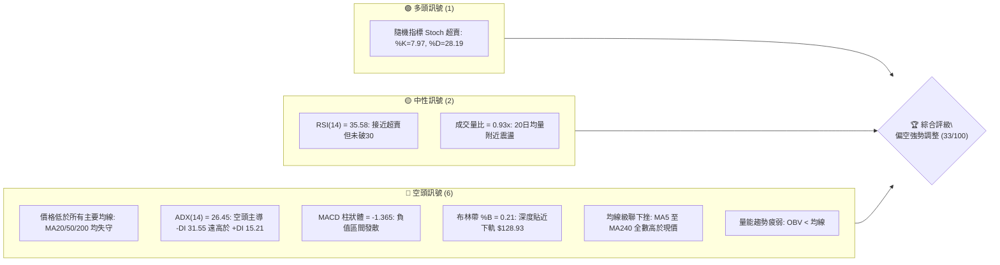
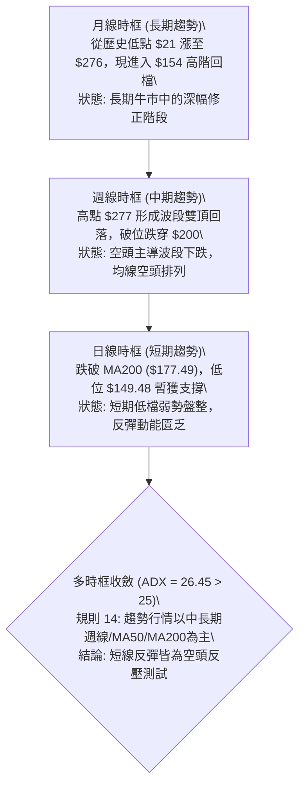
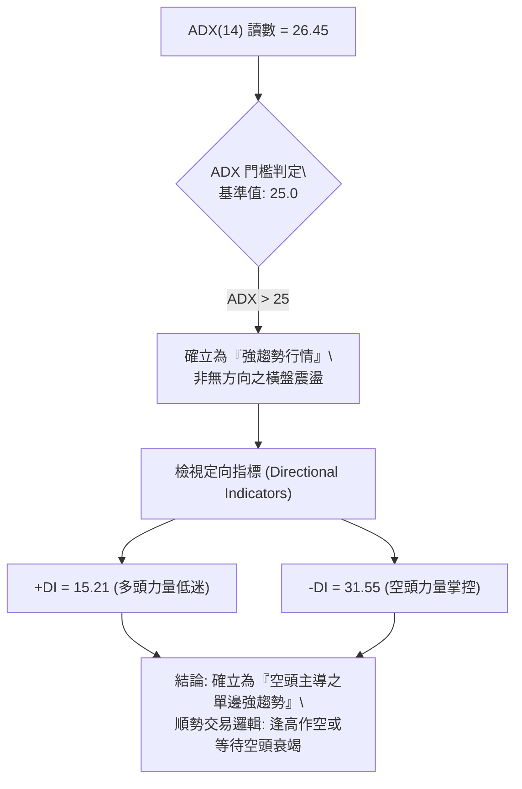
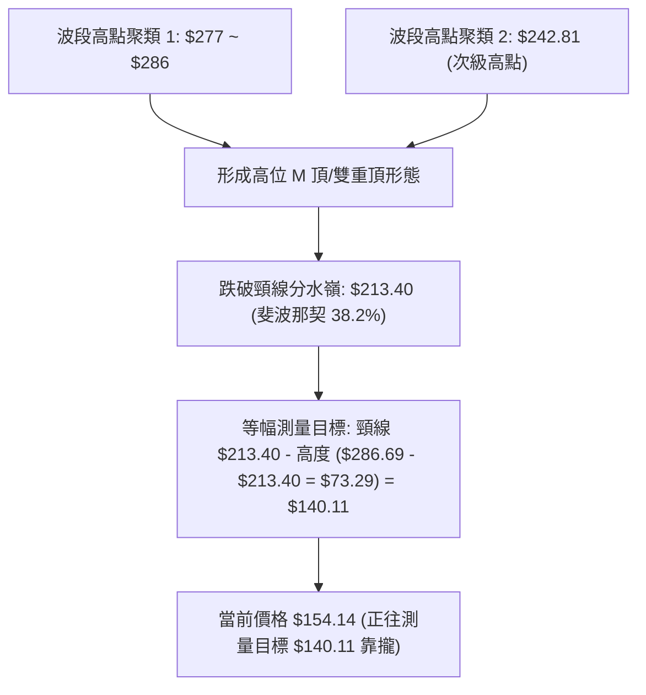
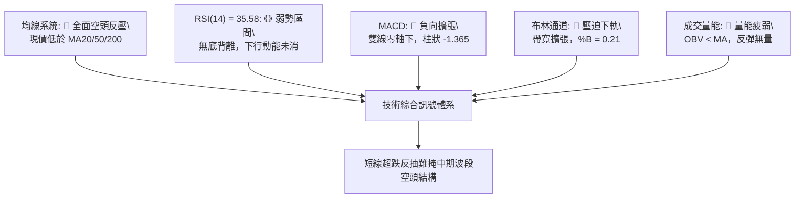
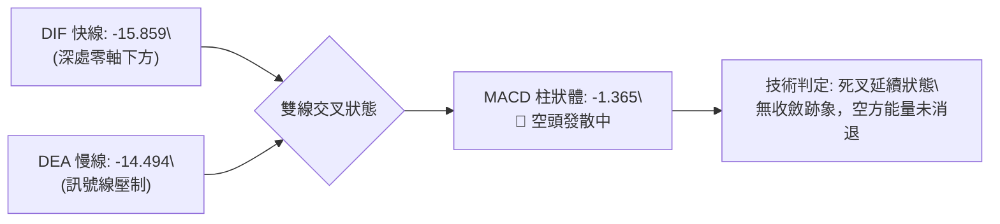
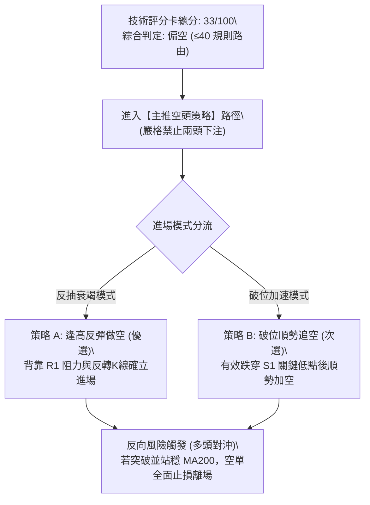
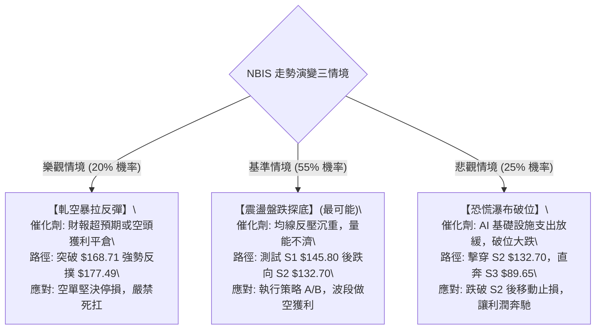

# NBIS 技術分析報告

> **報告日期**：2026-11-02 ｜ **語言**：繁體中文 ｜ **數據來源**：Yahoo Finance ｜ **當前價格**：$154.14

---

## 目錄

| 章節 | 內容 |
|------|------|
| [1. 技術面概覽](#1-技術面概覽) | 訊號儀表板、核心指標速覽表、技術評分卡 |
| [2. 趨勢分析](#2-趨勢分析) | 多時框趨勢遞進、12個月走勢圖、週線波段、ADX 趨勢強度 |
| [3. 圖表形態分析](#3-圖表形態分析) | 形態識別與信心度、近10日/8週K線組合精解、形態示意圖 |
| [4. 支撐與阻力](#4-支撐與阻力) | 價位結構分布圖、阻力位/支撐位聚類、斐波那契回調結構 |
| [5. 技術指標深度解讀](#5-技術指標深度解讀) | 均線系統級聯、RSI(14)、MACD、布林通道與量價配合度 |
| [6. 動能與波動率](#6-動能與波動率) | 動能四象限定位、ATR 波動率與止損設定、Beta 與空頭回補風險 |
| [7. 多時框架總結](#7-多時框架總結) | 時框架評分矩陣、綜合訊號矩陣、多時框收斂定論 |
| [8. 交易策略建議](#8-交易策略建議) | 策略決策流程、策略路由、價格情境階梯、主策略詳解與風報比 |
| [9. 風險提示與監控](#9-風險提示與監控) | 關鍵監控 Checklist、情境推演圖、倉位管理與極端風險防範 |
| [📋 報告總結](#-報告總結) | 核心技術結論矩陣與操作指引摘要 |

---

## 1. 技術面概覽

### 🎯 技術訊號儀表板



### 📊 核心指標速覽表

| 指標類別 | 指標名稱 | 當前數值 | 訊號 | 解讀 |
| :--- | :--- | :--- | :---: | :--- |
| **價格** | 當前收盤價 | $154.14 | 🔴 | 位於 52 週高低區間 35.6%，空頭持續壓制 |
| **均線** | MA20 (月線) | $189.03 | 🔴 | 現價低於 MA20 達 -18.46%，短中期下行壓力沉重 |
| **均線** | MA50 (季線) | $209.70 | 🔴 | 現價低於 MA50 達 -26.49%，中期趨勢轉空 |
| **均線** | MA200 (年線) | $177.49 | 🔴 | 現價跌破牛熊分界線 -13.16%，長期上升通道受損 |
| **動能** | RSI(14) | 35.58 | 🟡 | 位於弱勢區間（30–70 中性偏弱），尚未出現背離 |
| **動能** | MACD (12,26,9) | -15.859 / -14.494 | 🔴 | 雙線於零軸下方運行，柱狀體 -1.365 持續負向擴張 |
| **擺動** | Stoch %K / %D | 7.97 / 28.19 | 🟢 | 進入極度超賣區（<20），短線具備技術性抽頭動能 |
| **趨勢** | ADX(14) / ±DI | 26.45 (強趨勢) | 🔴 | -DI (31.55) 壓制 +DI (15.21)，空頭趨勢強烈確立 |
| **通道** | 布林通道 (%B) | 0.21 (帶寬擴張) | 🔴 | 現價壓迫下軌（$128.93），中軌（$189.03）形成重壓 |
| **波動** | ATR(14) | $16.23 (10.53%) | 🔴 | 極高單日波動率，單日波幅擴大，止損空間需放大 |
| **籌碼** | 空頭比例 / 天數 | 20.2% / 2.61 天 | 🟡 | 放空比例偏高，具備微弱的空頭回補（Short Squeeze）潛力 |

### 🏆 技術評分卡

```
╔══════════════════════════════════════════════════════════════════╗
║                   技術評分卡 — NBIS (2026-11-02)                ║
╠══════════════════════════════════════════════════════════════════╣
║ 趨勢強度 (Trend Strength)   ██████░░░░░░░░░░░░░░  30/100 🔴 空頭強勢  ║
║ 動能指標 (Momentum Health)  ███████░░░░░░░░░░░░░  35/100 🔴 動能疲軟  ║
║ 支撐穩定度 (Support Robust) █████████░░░░░░░░░░░  45/100 🟡 逼近關鍵  ║
║ 成交量配合 (Volume Flow)    ███████░░░░░░░░░░░░░  35/100 🔴 OBV低迷   ║
║ 形態完整度 (Pattern Health) ██████░░░░░░░░░░░░░░  30/100 🔴 頂部破位  ║
║ 均線排列 (Moving Averages)  █████░░░░░░░░░░░░░░░  25/100 🔴 全面反壓  ║
╠══════════════════════════════════════════════════════════════════╣
║ 綜合評分 (Composite Score)  ███████░░░░░░░░░░░░░  33/100 🔴 偏空調整  ║
║ 評分公式：(30 + 35 + 45 + 35 + 30 + 25) ÷ 6 = 33.33 → 33/100    ║
╚══════════════════════════════════════════════════════════════════╝
```

---

## 2. 趨勢分析

### 🌐 多時框趨勢分析



### 📈 長期趨勢 — 12個月走勢圖（Unicode）

```
NBIS 月線走勢圖（過去12個月：2025-11 至 2026-10）
價格軸 ($)
$280 ┤                                      ● (2026-06: $276.17)
$250 ┤                                  ●   │
$220 ┤                              ●   │   │       ● (2026-09: $235.88)
$190 ┤                              │   │   │   ●   │
$160 ┤                          ●   │   │   │   │   │   ●← 現價 ($154.14)
$130 ┤                      ●   │   │   │   │   │   │   │
$100 ┤  ●                   │   │   │   │   │   │   │   │
$70  ┤  │   ●   ●   ●   ●   │   │   │   │   │   │   │   │
     └──┴───┴───┴───┴───┴───┴───┴───┴───┴───┴───┴───┴───┴───
       11  12  01  02  03  04  05  06  07  08  09  10  月份 (2025-11 ~ 2026-10)
```

#### 走勢特徵分析表格

| 階段區間 | 起訖月份 | 收盤價變化 | 區間漲跌幅 | 結構性特徵與技術解讀 |
| :--- | :---: | :---: | :---: | :--- |
| **底部蓄勢期** | 2025-11 ~ 2026-02 | $94.87 → $91.19 | -3.88% | 於 $83.71 ~ $95.00 間進行橫盤築底，消化歷史獲利盤 |
| **主升啟動期** | 2026-03 ~ 2026-06 | $103.76 → $276.17 | +166.16% | 爆發性五浪主升，連破百元與兩百元關卡，創歷史高點 $299.86 |
| **高位派發期** | 2026-07 ~ 2026-09 | $190.41 → $235.88 | +23.88% | 劇烈寬幅震盪（$177 ~ $277），籌碼由大戶轉移至散戶，形成頭部雙頂 |
| **破位下行期** | 2026-10 | $235.88 → $154.14 | -34.65% | 單月重挫逾 34%，失守頸線與季線，形成空頭破位加速形態 |

### 📊 中期趨勢（週線分析）

```
NBIS 週線波段架構示意圖（近期關鍵攻防）
$280 ┤      ▲ 頂部 1 ($286.69)
$270 ┤      │           ▲ 頂部 2 ($277.68)
$240 ┤──────┼───────────┼─────── 波段頸線區 ($242.81) ─── 破位確認
$210 ┤      │           │   ▲ 次級反彈高點 ($226.39)
$180 ┤──────┼───────────┼───┼─── 核心多空分水嶺 (MA200: $177.49)
$154 ┤───────────────────┼───┼─── 現價 ($154.14) 弱勢盤整
$145 ┤                      ▼ 近期測試低點聚類 (S1: $145.80)
```

從週線收盤數據檢視，自 2026-08-14 創下週收盤高點 $277.68 後，行情呈現「一頂低於一頂」的下行軌道。特別是 2026-10-16 當週出現爆量大陰線（成交量達 148,676,100 股），單週由 $221.07 崩跌至 $165.47，一舉擊穿 MA200 關鍵防線，確認了中期上升趨勢的終結與空頭波段的展開。

### ⚡ 趨勢強度評估（ADX 解讀）



| 指標名稱 | 數值 | 參考閾值 | 趨勢狀態 | 操作意涵 |
| :--- | :---: | :---: | :---: | :--- |
| **ADX (14)** | 26.45 | > 25.0 | 強趨勢建立 | 排除純橫盤整理，趨勢跟隨策略（Trend Following）有效性高 |
| **+DI (14)** | 15.21 | < 20.0 | 多頭衰竭 | 買盤極度匱乏，多方無力組織連續性進攻 |
| **-DI (14)** | 31.55 | > 30.0 | 空方主控 | 空頭動能充沛，下方賣壓未完全宣洩完畢 |

---

## 3. 圖表形態分析

### 🔍 形態識別系統



#### 形態識別與信心度評估表（依規則 15）

| 識別形態 | 信心度 (%) | 判斷依據（嚴格引用歷史數據） | 當前完成度 (%) | 理論目標價（附精確計算式） |
| :--- | :---: | :--- | :---: | :--- |
| **高位雙頂 (Double Top)** | **75%** | 兩次波段高點分別為 2026-06-18 週收盤 $286.69 與 2026-08-14 週收盤 $277.68，頸線位於 2026-07-17 週低點連線及斐波那契 38.2% ($213.40) | 85% | 頸線 $213.40 − 形態高度 ($286.69 − $213.40 = $73.29) = **$140.11**（逼近 S2 支撐 $132.70） |
| **中期下降通道 (Bearish Channel)** | **80%** | 上軌由 2026-10-09 高點 $255.10 與 2026-10-28 高點 $182.74 連結；下軌由 2026-10-16 低點 $163.27 與 2026-10-26 低點 $149.48 構成 | 90% | 通道下軌延伸支撐位為 **$145.80**（對齊 S1） |
| **頭肩頂形態** | 40% | 左肩 $249.19、頭部 $286.69、右肩 $242.81，但右肩結構不對稱且回檔斜率過陡 | 40% | **訊號不足，僅做指標型解讀**（不列入主交易依據） |

### 🕯️ 重要K線形態分析（嚴格依據近10日與近8週數據，規則 19）

#### 近 10 根日 K 線形態解讀

| 日期 (日K) | 開盤價 | 最高價 | 最低價 | 收盤價 | 成交量 | K線形態名稱 | 技術解讀與多空意涵 | 訊號 |
| :---: | :---: | :---: | :---: | :---: | :---: | :---: | :--- | :---: |
| 2026-10-19 | 176.51 | 176.69 | 166.59 | 170.24 | 26,881,200 | 中黑陰線 | 跳空開低，反彈無力，空方牢牢佔據主導 | 🔴 |
| 2026-10-20 | 163.99 | 174.74 | 160.25 | 171.45 | 22,615,600 | 帶下影長陽 | 開低走高，測試 $160 整數關卡獲得短線買盤支撐 | 🟢 |
| 2026-10-21 | 176.46 | 178.85 | 164.00 | 171.57 | 19,693,900 | 墓碑十字變體 | 盤中衝擊 $178.85 受阻於 MA200，留長上影線，多頭受挫 | 🔴 |
| 2026-10-22 | 164.75 | 167.50 | 155.73 | 159.17 | 26,221,800 | 光頭中陰線 | 破位下挫，直接擊破 $160 關卡，空頭重啟跌勢 | 🔴 |
| 2026-10-23 | 158.90 | 162.99 | 155.86 | 158.74 | 13,496,800 | 縮量十字星 | 成交量急劇萎縮至 13.5M，多空雙方於低檔暫時觀望 | 🟡 |
| 2026-10-26 | 153.96 | 165.86 | 149.48 | 153.27 | 30,698,500 | 放量長下影陰 | 創波段新低 $149.48，爆出 30.7M 大量，低檔浮現抄底盤 | 🟡 |
| 2026-10-27 | 159.00 | 171.53 | 158.30 | 170.47 | 20,596,400 | 光腳中陽線 | 自低檔強勁反彈，吞噬前一日實體，超跌反彈展開 | 🟢 |
| 2026-10-28 | 173.49 | 182.74 | 168.92 | 182.34 | 25,056,800 | 實體大陽線 | 強勢挑戰 MA20 ($189) 與前高阻力，但量能未能突破前高 | 🟢 |
| 2026-10-29 | 173.18 | 178.33 | 168.76 | 171.99 | 17,700,300 | 倒轉中陰線 | 高檔遭遇解套賣壓，開低走低，反彈夭折之空頭吞噬特徵 | 🔴 |
| 2026-10-30 | 157.05 | 161.42 | 149.96 | 154.14 | 21,462,400 | 低開下探小陽 | 跳空低開再次考驗 $149.96，收於 $154.14，弱勢結構未變 | 🔴 |

#### 近 8 根週 K 線形態解讀

| 日期 (週K) | 開盤價 | 最高價 | 最低價 | 收盤價 | 週成交量 | K線形態名稱 | 技術結構解讀 | 訊號 |
| :---: | :---: | :---: | :---: | :---: | :---: | :---: | :--- | :---: |
| 2026-09-11 | 234.85 | 254.74 | 223.64 | 224.55 | 62,424,000 | 帶長上影倒錘 | 高檔 $254.74 阻力沉重，衝高受阻回落 | 🔴 |
| 2026-09-18 | 204.98 | 232.85 | 203.87 | 223.54 | 90,247,300 | 下影長陽線 | 測試 $200 整數支撐成功，多頭強勢回擊 | 🟢 |
| 2026-09-25 | 225.96 | 249.19 | 221.30 | 237.33 | 79,317,300 | 溫和多頭陽線 | 持續反彈上攻，但未能攻克 $250 關卡 | 🟢 |
| 2026-10-02 | 235.20 | 250.48 | 228.38 | 242.81 | 65,179,600 | 高位窄幅小陽 | 上升動能減弱，量價背離，呈現高檔做頂跡象 | 🟡 |
| 2026-10-09 | 244.10 | 255.10 | 217.73 | 221.07 | 86,070,300 | 長陰包陽吞噬 | 衝擊 $255.10 後重挫，跌破前三週低點，確立做頂 | 🔴 |
| 2026-10-16 | 217.20 | 217.20 | 163.27 | 165.47 | 148,676,100 | 爆量長黑大陰 | 光頭暴跌長黑，破 MA200，主力恐慌性拋售 | 🔴 |
| 2026-10-23 | 176.51 | 178.85 | 155.73 | 158.74 | 108,909,300 | 下跌中繼中陰 | 連續第二週收於極低位，空頭慣性下挫 | 🔴 |
| 2026-10-30 | 153.96 | 182.74 | 149.48 | 154.14 | 115,514,400 | 長上下影紡錘 | 寬幅震盪（$149.48 ~ $182.74），多空激烈博弈，收盤依然偏弱 | 🟡 |

### 📉 ASCII 走勢形態示意圖

```
雙頂破位與下降楔形測試示意圖
$280 ┤        頂 1                     頂 2
$260 ┤       ╭───╮                    ╭───╮
$240 ┤───────╯   ╰───────── 頸線 ────╯   ╰─────── 次級反抽高點 ($242.81)
$210 ┤                      破位點 ↓             ╲
$180 ┤────────────────────────────┼───────────────╲── MA200 反壓 ($177.49)
$160 ┤                                             ╲   反彈高點 ($182.74)
$154 ┤──────────────────────────────────────────────●  現價 ($154.14)
$145 ┤                                              ▼ S1 支撐 ($145.80)
$132 ┤                                                 S2 強支撐 ($132.70)
```

---

## 4. 支撐與阻力

### 🗺️ 關鍵價位分布圖（Unicode）

```
╔══════════════════════════════════════════════════════════════════╗
║                   NBIS 關鍵價位結構分布圖                        ║
╠══════════════════════════════════════════════════════════════════╣
║ $254.92 ║████████████████████████║ 強阻力 R3 (波段高點/通道頂)   ║
║ $231.17 ║████████████████████    ║ 次級阻力 R2 (前高波段聚類)    ║
║ $168.71 ║████████████████████████║ 核心阻力 R1 (反彈頸線壓制)    ║
║ ─────── ╫────────────────────────╫ ───────────────────────────── ║
║ $154.14 ╠════════════════════════╣ ◄ 當前收盤價                  ║
║ ─────── ╫────────────────────────╫ ───────────────────────────── ║
║ $145.80 ║▓▓▓▓▓▓▓▓▓▓▓▓▓▓▓▓        ║ 近期關鍵支撐 S1 (近期波段低點)║
║ $132.70 ║████████████████████    ║ 強力防守支撐 S2 (密集支撐帶)  ║
║ $ 89.65 ║████████████████████████║ 終極深幅支撐 S3 (歷史起漲聚類)║
╚══════════════════════════════════════════════════════════════════╝
```

### 🚧 阻力位分析表（嚴格引用系統計算之波段高點聚類）

| 阻力級別 | 精確價位 | 距現價幅寬 | 技術形成原因與籌碼解讀 | 突破難度 | 重要性 |
| :--- | :---: | :---: | :--- | :---: | :---: |
| **R1 (核心阻力)** | **$168.71** | +9.45% | 近一年波段高點聚類；近 10 日多次反彈的高點密集區（10-21、10-27、10-29 重合區），亦為 MA5 ($166.44) 與 MA10 ($166.34) 重疊反壓 | 🟡 中等 | ★★★★☆ |
| **R2 (強阻力)** | **$231.17** | +49.97% | 近一年波段高點聚類；為 9 月下旬震盪箱體下緣與反彈高點聚類，季線 MA50 ($209.70) 及 MA60 ($213.39) 於此形成雙重空頭堡壘 | 🔴 極高 | ★★★★★ |
| **R3 (終極阻力)** | **$254.92** | +65.38% | 近一年波段高點聚類；2026-09-11 週高點 $254.74 與 2026-10-09 週高點 $255.10 之雙頂高點聚類，布林上軌 ($249.13) 壓制 | 🔴 極高 | ★★★★★ |

### 🛡️ 支撐位分析表（嚴格引用系統計算之波段低點聚類）

| 支撐級別 | 精確價位 | 距現價幅寬 | 技術形成原因與籌碼解讀 | 守住機率 | 重要性 |
| :--- | :---: | :---: | :--- | :---: | :---: |
| **S1 (首要支撐)** | **$145.80** | -5.41% | 近一年波段低點聚類；與 10-26 低點 $149.48 及 10-30 低點 $149.96 形成短線水平買盤緩衝帶，具短線雙底雛形支撐效應 | 🟡 50% | ★★★★☆ |
| **S2 (核心支撐)** | **$132.70** | -13.91% | 近一年波段低點聚類；極度接近布林下軌 ($128.93)，且為雙頂破位後的理論等幅測量目標區間 ($140.11 ~ $132.70) | 🟢 65% | ★★★★★ |
| **S3 (終極支撐)** | **$89.65** | -41.84% | 近一年波段低點聚類；歷史築底平台（2025-12 至 2026-02 震盪中樞 $83.71 ~ $91.19）之籌碼密集成交區，牛市大底防線 | 🟢 85% | ★★★★★ |

### 📐 斐波那契回調位分析（52週區間 $73.52 → $299.86）

```
斐波那契回調階梯分布
 0.0% ── $299.86 (52週歷史最高點)
23.6% ── $246.44 (高檔派發反壓區)
38.2% ── $213.40 (牛熊初級回檔分界，已失守)
50.0% ── $186.69 (多空對稱均衡軸，MA20 位於 $189.03)
61.8% ── $159.98 (黃金分割關鍵支撐防線，已被跌破) ◄── 關鍵破位
[現價 $154.14 處於 61.8% ($159.98) 與 78.6% ($121.96) 之間]
78.6% ── $121.96 (深幅極限回調目標位)
100.0% ── $ 73.52 (52週歷史最低點)
```

- **位置解讀**：當前收盤價 $154.14 已正式收於黃金分割 61.8%（$159.98）下方。在經典技術分析理論中，跌破 61.8% 意味著原主升浪的幾何級數健康回調已被破壞，行情由「強勢回檔」演變為「深度趨勢反轉」。
- **下行磁吸力**：現價落於 61.8% ($159.98) 至 78.6% ($121.96) 的價格真空中。若多頭無法在 3 個交易日內迅速放量收復 $159.98，下方的技術引力將直接導向 78.6% 回調位 $121.96，此位置恰好與布林下軌 $128.93 及支撐 S2 $132.70 形成共振防禦區。

---

## 5. 技術指標深度解讀

### 🎛️ 指標訊號總覽



### 📈 移動平均線排列分析

```
╔══════════════════════════════════════════════════════════════════╗
║                    NBIS 均線系統級聯空頭壓制                     ║
╠══════════════════════════════════════════════════════════════════╣
║ MA120: $217.17 ── 偏離 -29.02% (半年線絕對壓制)                  ║
║ MA 60: $213.39 ── 偏離 -27.77% (中季線反壓)                      ║
║ MA 50: $209.70 ── 偏離 -26.49% (波段空頭防線)                    ║
║ MA 20: $189.03 ── 偏離 -18.46% (月線動態阻力)                    ║
║ MA200: $177.49 ── 偏離 -13.16% (年線牛熊線，已跌破)              ║
║ MA  5: $166.44 ── 偏離  -7.39% (超短線第一反壓)                  ║
║ MA 10: $166.34 ── 偏離  -7.33% (短線雙均線糾纏壓制)              ║
║ MA240: $163.28 ── 偏離  -5.60% (長期成本線失守)                  ║
║ ─────────────────────────────────────────────────────────────── ║
║ 現價 : $154.14 ── 處於所有均線下方，均線呈現標準瀑布式空頭排列   ║
╚══════════════════════════════════════════════════════════════════╝
```

- **均線排列狀態**：系統判定為「混合偏空排列」，實質上各週期均線（MA5 至 MA240）全面位於現價上方，形成了極為罕見的「八線泰山壓頂」格局。
- **牛熊分水嶺失守**：特別關鍵的是 MA200（$177.49）的實質跌破。現價距離 MA200 達 -13.16%，且 10-28 盤中反彈最高觸及 $182.74 後隨即遭到空頭無情回擊（10-29 與 10-30 快速回落），表明 MA200 已由前期的長期支撐徹底轉化為強大反壓。

### 📉 RSI(14) 分析

- **RSI 當前數值**：**35.58**（Wilder 計算方法）。
- **區間進度條**：
  `RSI(14) = 35.58: ███████░░░░░░░░░░░░░ 35.58% (弱勢空方主導)`
- **超買超賣評估**：RSI 位於 30 至 70 的中性區間偏下緣。雖然接近 30 的傳統超賣門檻，但尚未觸發極端恐慌性超賣鈍化（<30）。
- **背離分析判斷**：
  嚴格比對近 20 根 K 棒的首尾走勢：
  - 價格端：由 2026-10-16 收盤價 $165.47 下挫至 2026-10-30 收盤價 $154.14（價格創新低）。
  - RSI 端：由 2026-10-16 的 30.6 微幅上升至 2026-10-30 的 35.6。
  - **背離結論**：系統官方標註為「無明顯背離」。雖然 RSI 讀數微幅高於 10-16 低點，但日線形態上 10-26 創出 $149.48 價格新低時，RSI 未能形成具備兩個清晰波谷的經典「W 底背離」架構，僅能定性為跌勢中的指標鈍化修復，**不存在強烈反轉的多頭底背離**。

### 📊 MACD(12,26,9) 訊號解讀



- **雙線位置**：DIF (-15.859) 與 DEA (-14.494) 均在遠離零軸的負值深淵運行，展現出強烈的空頭熊市屬性。
- **柱狀體形態**：柱狀體讀數為 -1.365，較前期低檔雖有收斂，但近 3 個交易日柱狀體再度擴大，顯示空方動能二度發力，並未形成柱狀體由負翻正的買入訊號（金叉預期落空）。

### 📦 布林通道分析

```
NBIS 日線布林通道 (20, 2) 結構圖
$249.13 ┤  ══════════════════════════════════════ 上軌 (Upper Band)
         │
$189.03 ┤  ────────────────────────────────────── 中軌 (MA20)
         │
$154.14 ┤  ──● (現價, %B = 0.21, 緊貼下軌下墜)
         │
$128.93 ┤  ══════════════════════════════════════ 下軌 (Lower Band)
```

- **軌道狀態**：布林帶寬呈現向下開口發散狀態。中軌（MA20）急劇下彎至 $189.03。
- **%B 指標解析**：當前 %B 讀數為 **0.21**（0 代表下軌，0.5 代表中軌，1.0 代表上軌）。數值深度處於 0.20 附近，代表價格貼著下軌運行，呈現典型的「空頭沿下軌暴跌」走勢，未見通道收窄之築底特徵。

### 💹 成交量分析（量價配合度）

```
成交量多空結構對比
最新成交量 (2026-10-30):  21,462,400 股
20 日均量 (Volume MA20):  22,958,505 股  [量比: 0.93x — 量能中性]
50 日均量 (Volume MA50):  18,092,830 股  [相對中長期處於高換手]
OBV 趨勢狀態:             OBV < MA      [🔴 資金呈現淨流出]
```

- **量價關係解讀**：
  1. **下挫放量，反彈縮量**：在 10-26 暴跌探底時成交量放大至 30,698,500 股，10-16 暴跌週爆出 148,676,100 股歷史級巨量；然而在 10-28 展開強反彈時，成交量僅有 25,056,800 股，10-29 反彈受阻時萎縮至 17,700,300 股。典型的「放量下跌、縮量反彈」空頭量價特徵。
  2. **OBV 能量潮**：OBV 線持續運行於其均線下方，反映自 2026 年 8 月高點以來，主力機構資金呈現持續性的單向撤離與派發，散戶承接盤薄弱，缺乏機構建倉的量價配合。

---

## 6. 動能與波動率

### ⚡ 動能評估四象限

```
動能與波動率四象限矩陣
   高動能 ↑
          │      Q1 (強動能 / 低波動)      │      Q3 (強動能 / 高波動)
          │            最佳機會            │         高風險高收益
          │                                │
──────────┼────────────────────────────────┼──────────────────────────────
          │      Q2 (弱動能 / 低波動)      │  ★ Q4 (弱動能 / 高波動) ★
          │            謹慎觀望            │      NBIS 當前位置 (避免做多)
   弱動能 ↓────────────────────────────────┴──────────────────────────────
          └── 低波動率 ───────────────────→ 高波動率
```

| 象限分類 | 象限屬性 | NBIS 指標依據 | 技術狀態評定與操作策略 |
| :---: | :---: | :--- | :--- |
| **Q4** | **弱動能 / 高波動** | **ATR% = 10.53% (極高波動)**<br>**ADX = 26.45, -DI = 31.55 (強空頭)**<br>**MACD Hist = -1.365 (負向擴張)** | **危險區域（高風險作空/觀望）**：價格處於高波動率劇烈震盪下行階段，多頭承接極易被高波動洗盤觸發止損；空頭順勢波段利潤豐厚，但亦須防範劇烈反抽。 |

### 📊 ATR 波動率分析

- **ATR(14) 絕對值**：**$16.23**。
- **ATR 相對波動比率**：$16.23 ÷ $154.14 = **10.53%**。
- **波動率特性**：單日平均潛在波幅超過 10%，屬於極度高波動個股。這意味著正常的單日隨機噪聲波動即可達 $15 ~ $16，傳統小區間止損極易被假突破掃出場。
- **止損距離動態計算表**：

| 風險偏好 | ATR 倍數 | 理論止損點數值 (以現價 $154.14 為基準) | 建議應用場景 |
| :--- | :---: | :---: | :--- |
| **激進短線** | 1.0 × ATR | **$16.23** (做空止損設 $170.37；做多止損設 $137.91) | 日內當沖或極短線日內突破交易 |
| **標準波段** | 1.5 × ATR | **$24.35** (做空止損設 $178.49；做多止損設 $129.79) | 核心波段交易，容忍日線級別正常雜訊 |
| **保守寬鬆** | 2.0 × ATR | **$32.46** (做空止損設 $186.60；做多止損設 $121.68) | 大波段持有，防範極端空頭回補軋空 |

### 📐 Beta 與市場相關性

- **Beta 係數**：**1.46**。
  - NBIS 表現出顯著高於大盤（S&P 500）46% 的波動敏感度。當市場整體風險偏好惡化時，NBIS 跌幅將被顯著放大；反之，若大盤出現強力反彈，其超跌彈升斜率亦將非常可觀。
- **籌碼面放空指標與軋空風險**：
  - **Short % of Float**：**20.2%**（高度擁擠之空頭部位）。
  - **Short Ratio (天數)**：**2.61 天**。
  - **技術隱患分析**：超過 20% 的流動盤處於借券做空狀態，空頭籌碼過於擁擠。雖然當前技術面由空頭絕對主導，但極高的做空比例意味著一旦出現超預期的基本面催化劑（如新聞所提第三季財報發布或空頭獲利平倉潮），極易引發猛烈的**軋空踩踏（Short Squeeze）**，短線拉升速度將極為迅猛。

---

## 7. 多時框架總結

### 📋 時框架評分表

| 時框架 | 趨勢方向 | 動能狀態 | 均線排列 | 關鍵圖表形態 | 綜合評分 | 戰略建議 |
| :---: | :---: | :---: | :---: | :---: | :---: | :---: |
| **月線 (長期)** | 🟡 中性回檔 | 減弱 | 偏多 (MA240 支撐) | 兩年大牛市高位深幅修正 | **50/100** | 長線多頭暫停加碼，等待修正落地 |
| **週線 (中期)** | 🔴 強烈看空 | 負向加速 | 空頭排列 (破 MA200) | 高位雙頂 ($286/$277) 破位 | **28/100** | 波段順勢逢高沽空，禁止盲目抄底 |
| **日線 (短期)** | 🔴 偏空震盪 | 超賣修復 | 瀑布式空頭壓制 | 下降通道延伸，考驗 $145 支撐 | **32/100** | 日內反彈遇壓減倉，背靠阻力空 |

### 🔲 綜合訊號矩陣

```
╔══════════════════════════════════════════════════════════════════╗
║                   多維度時框訊號一致性矩陣                       ║
╠══════════════════════════════════════════════════════════════════╣
║ 維度 / 時框     │   短期 (日線)   │   中期 (週線)   │  長期 (月線)  ║
╠─────────────────┼─────────────────┼─────────────────┼───────────────╣
║ 趨勢方向        │ 🔴 下行通道     │ 🔴 雙頂破位     │ 🟡 高位回調   ║
║ 動能指標        │ 🟡 超賣修復     │ 🔴 負向發散     │ 🔴 快速衰退   ║
║ 支撐/阻力交互   │ 🔴 壓在阻力下   │ 🔴 跌破核心頸線 │ 🟢 尚在歷史腰部║
║ 均線壓制        │ 🔴 八線全面反壓 │ 🔴 失守年線     │ 🟡 逼近長均線 ║
║ 籌碼量價        │ 🔴 OBV 疲弱     │ 🔴 恐慌放量跌   │ 🟡 長期資金沉澱║
╠══════════════════════════════════════════════════════════════════╣
║ 總結評定        │ 🔴 偏空短修     │ 🔴 強烈空頭     │ 🟡 趨勢考驗   ║
╚══════════════════════════════════════════════════════════════════╝
```

### ⚖️ 多時框收斂結論（嚴格遵循規則 14）

1. **行情性質判定**：
   當前日線 ADX(14) 讀數為 **26.45**，明確超越 25 的趨勢分水嶺，且 -DI (31.55) 遠凌駕於 +DI (15.21) 之上。因此，**當前市場定性為標準的『空頭趨勢行情』，徹底排除盤整市道**。
2. **優先級權重收斂**：
   依據多時框收斂收斂規則：在 ADX > 25 的趨勢行情中，交易邏輯**必須以中長期（週線波段及 MA50、MA200）方向為絕對主導**，日線時框的一切指標僅能用於尋找順應中長週期的具體進場時機與點位精確化。
3. **唯一收斂方向定論**：
   **【強烈偏空（Bearish Dominated）】**。
   日線 Stoch 的短線極度超賣（%K=7.97）僅代表超跌後的脈衝式反彈可能，週線的均線破位與高位雙頂下墜才是主控全域的支配力量。任何日線級別朝向 MA200 ($177.49) 或 R1 ($168.71) 的抽頭反彈，均屬於次級反抽，必須服從週線向下尋找 S1 ($145.80) 及 S2 ($132.70) 的主要運行路徑。此結論與第 8 章之空頭主策略完全一致。

---

## 8. 交易策略建議

### 🗺️ 策略決策流程圖



### 🧭 策略路由（依規則 18 評分卡分流）

> **當前主策略方向 = 【逢高做空 / 破位追空（主推空頭策略）】**  
> （決策依據：第 1 章技術評分卡綜合評分為 **33/100**，符合 ≤40 偏空區間，主推空頭策略，多頭僅列為反轉風險對沖提示）。

### 🎯 價格情境階梯（Price Scenarios，嚴格引用第 4 章數值）

| 觸發條件 | 下一目標 | 後續延伸 | 情境含義與技術演變路徑 |
| :--- | :---: | :---: | :--- |
| **強勢向上突破 R1 ($168.71)** | **R2 ($231.17)** | **R3 ($254.92)** | **空頭被破壞 / 軋空反轉**：有效站上 MA200 ($177.49)，引發 20.2% 空頭回補踩踏，短線轉強 |
| **受阻於現價至 R1 區間** | **S1 ($145.80)** | **S2 ($132.70)** | **中繼弱勢整理 / 空方主控**：反彈無量，沿布林通道下軌弱勢滑落，符合當前主基調 |
| **有效跌破 S1 ($145.80)** | **S2 ($132.70)** | **S3 ($89.65)** | **主跌浪延伸 / 恐慌破位**：創下近一年波段新低，下探雙頂測量目標與布林下軌 |

### 📊 情境機率分佈

| 情境劃分 | 發生機率 | 主要技術與量化指標依據 |
| :--- | :---: | :--- |
| **回落再探底 / 順勢下行 (主情境)** | **55%** | ADX=26.45 確立空頭趨勢；-DI=31.55 壓制；現價壓在全均線下方；OBV 疲軟無資金承接 |
| **區間震盪 / 超跌低檔修復** | **25%** | Stoch %K=7.97 極度超賣；RSI 逼近 30；S1 ($145.80) 附近具備波段低點買盤守護 |
| **強勢向上反彈 / 觸發軋空** | **20%** | 空頭比例達 20.2%；財報在即若釋放重大利好可能誘發爆發性空頭回補 |

### 🟢 主策略詳情（空頭交易策略，嚴格遵守規則 17 風報比精算）

| 策略要素 | 策略 A：逢高反彈受阻作空 (Rebound Short) | 策略 B：跌破關鍵支撐追空 (Breakdown Short) |
| :--- | :--- | :--- |
| **進場條件** | 股價弱勢反彈測試 R1 或 10-21 高點受阻，出現日線長上影線或轉折黑K | 股價日線收盤確認實體跌破 S1 支撐位（帶量突破確認） |
| **進場價格** | **$165.00**（位於現價與 R1 $168.71 間之反壓區） | **$144.50**（明確跌破 S1 $145.80 後順勢進場） |
| **止損價格** | **$177.50**（嚴格設於牛熊線 MA200 $177.49 之上） | **$154.50**（設於當前收盤價 $154.14 上方，假跌破保護） |
| **目標價 T1** | **$145.80**（近期核心支撐 S1） | **$132.70**（強支撐位 S2，雙頂等幅測量區） |
| **目標價 T2** | **$132.70**（強支撐位 S2） | **$121.96**（斐波那契 78.6% 深幅回調位） |
| **風險報酬比 (T1)** | **1 : 1.54（以 T1 計）**<br>計算式：($165.00 − $145.80) ÷ ($177.50 − $165.00) = $19.20 ÷ $12.50 = 1.536 | **1 : 1.18（以 T1 計）**<br>計算式：($144.50 − $132.70) ÷ ($154.50 − $144.50) = $11.80 ÷ $10.00 = 1.180 |
| **風險報酬比 (T2)** | **1 : 2.58（以 T2 計）**<br>計算式：($165.00 − $132.70) ÷ ($177.50 − $165.00) = $32.30 ÷ $12.50 = 2.584 | **1 : 2.25（以 T2 計）**<br>計算式：($144.50 − $121.96) ÷ ($154.50 − $144.50) = $22.54 ÷ $10.00 = 2.254 |
| **預估勝率** | **65%** | **55%** |
| **建議配置倉位** | **10% ~ 15% 投資組合資金** | **5% ~ 8% 投資組合資金** |

### 🔴 反向風險觸發點（對沖與停損提示）

若出現以下情況，主空頭策略全面失效，必須無條件平倉觀望或反手對沖：
1. **關鍵點位翻轉**：日線收盤價**強勢站穩 MA200 ($177.49)** 且成交量放大至 20 日均量之 1.5 倍（>34.4M）。
2. **形態突破**：突破並站上波段反彈高點 $182.74，宣告下降通道上軌被向上摧毀。
3. **對沖建議**：持有空單者，若價格觸及 $177.50 必須立即全數停損；激進交易者可在帶量突破 $178.00 後，以小倉位（3%–5%）介入做多，博弈高達 20.2% 放空比率所驅動的軋空回補行情，第一目標看至 R2 ($231.17)。

### ⭐ 整體訊號強度評星

```
做多訊號強度：★★☆☆☆  (2/5 星 — 僅為超賣反抽，逆勢風險極高)
做空訊號強度：★★★★☆  (4/5 星 — 順應週線強趨勢，多重指標確認)
整體可信度：  ★★★★☆  (4/5 星 — 數據結構一致，多時框收斂清晰)
```

---

## 9. 風險提示與監控

### ✅ 關鍵監控指標 Checklist

```
╔══════════════════════════════════════════════════════════════════╗
║                   關鍵技術監控指標 CHECKLIST                     ║
╠══════════════════════════════════════════════════════════════════╣
║ [ ] 支撐防守測試：S1 $145.80 是否被日K實體有效擊穿               ║
║ [ ] 均線動態反壓：反彈是否於 MA5 ($166.44) 或 R1 ($168.71) 遇阻  ║
║ [ ] 動能背離驗證：日線破低時 RSI(14) 是否跌破 30 出現底背離      ║
║ [ ] 擺動指標超賣：Stoch %K 是否自 <10 極端超賣區金叉 %D 回升      ║
║ [ ] MACD 柱狀體：負值是否收斂至 -0.50 之內，出現鈍化跡象         ║
║ [ ] 籌碼放空動態：空頭比例 (20.2%) 是否伴隨財報消息出現軋空      ║
║ [ ] 異常巨量監控：日成交量是否超過 35,000,000 股爆量換手         ║
╚══════════════════════════════════════════════════════════════════╝
```

### ⚠️ 風險場景分析



### 🛡️ 風險管理重要提醒

1. **極端波動率防範（ATR = $16.23 / 10.53%）**：
   NBIS 的每日標準波動空間超過 $16 美元。嚴禁在未計算倉位規模的情況下滿倉交易。建議單筆交易承擔之淨值風險不應超過投資組合總資金的 **1.0% ~ 1.5%**。
   > **倉位規模計算範例**：  
   > 假設帳戶資金為 $100,000 美元，單筆最大容忍虧損為 1.5%（即 $1,500 美元）。若執行策略 A，進場價 $165.00，止損價 $177.50，單股止損風險為 $12.50。  
   > 則最大允許下單股數 = $1,500 ÷ $12.50 = **120 股**（持倉市值僅約 $19,800，佔總資金約 19.8%），絕不可過度槓桿。
2. **財報日前後的跳空風險**：
   新聞顯示 Nebius 即將公布 2026 第三季財報。高 Beta（1.46）加上高空頭比例（20.2%），往往會在財報公布隔日出現 15%–30% 的非連續性跳空（Gap Opening）。若持倉跨越財報發布日，必須將倉位縮減至原本的 1/3 以下，或使用期權（Options）建立保護性跨式組合以鎖定尾部風險。

---

## 📋 報告總結

```
╔══════════════════════════════════════════════════════════════════╗
║                   NBIS 技術分析報告總結                          ║
╠══════════════════════════════════════════════════════════════════╣
║ 報告日期：2026-11-02             當前收盤價：$154.14             ║
║ 綜合評分：33/100 (偏空)          分析評級  ：🔴 偏空強勢調整     ║
╠══════════════════════════════════════════════════════════════════╣
║ 關鍵技術維度結論：                                              ║
║ ├─ 長期趨勢 (月線)：🟡 中性修正，自 $276 高峰回落，考驗起漲中樞 ║
║ ├─ 中期趨勢 (週線)：🔴 強烈偏空，高位雙頂頸線破位，失守年線     ║
║ ├─ 短期趨勢 (日線)：🔴 空頭下行，均線瀑布壓制，貼下軌弱勢尋底   ║
║ ├─ 趨勢強度 (ADX) ：26.45 (強趨勢確立，-DI 31.55 主控市場)      ║
║ ├─ 關鍵核心支撐   ：S1 $145.80 (短底) ｜ S2 $132.70 (測量目標)   ║
║ ├─ 關鍵核心阻力   ：R1 $168.71 (動態壓) ｜ MA200 $177.49 (牛熊線)║
║ └─ 華爾街目標均價 ：$281.00 (分析師共識 Buy，呈現極端基本面分歧) ║
╠══════════════════════════════════════════════════════════════════╣
║ 最優交易策略組合指引：                                          ║
║ 1. 🥇 最佳機會（策略 A）：反抽 $165.00 逢高做空，止損 $177.50， ║
║                        目標 $145.80 / $132.70，風報比 1:1.54   ║
║ 2. 🥈 次選機會（策略 B）：跌破 $145.80 追空，止損 $154.50，     ║
║                        目標 $132.70 / $121.96，風報比 1:1.18   ║
║ 3. 🥉 防守對沖警告     ：帶量站回 $177.50 必須全數停損，警惕軋空║
╚══════════════════════════════════════════════════════════════════╝
```

---

> ⚠️ **免責聲明**：本報告為基於量化技術指標與歷史行情數據之技術分析，所有數據、支撐阻力點位及估算均嚴格基於所提供之金融歷史數據。本報告**僅供研究與學術參考**，**不構成任何要約、招攬或具體投資建議**。高波動個股具備本金完全虧損之高度風險，投資決策請務必恪守個人風控準則，入市需獨立審慎評估。

---

*報告生成時間：2026-11-02 ｜ 數據來源：Yahoo Finance ｜ 分析框架：多時框架量化技術分析*