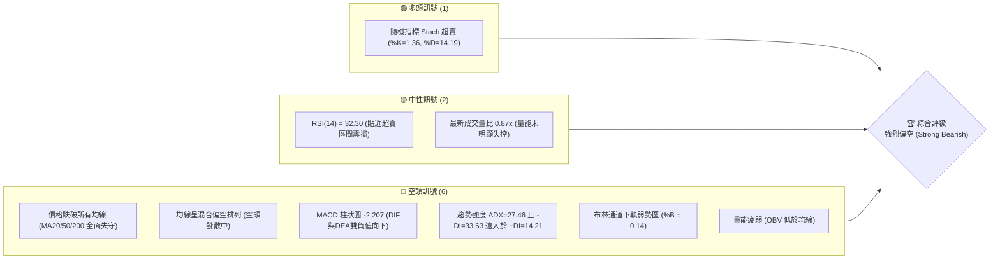
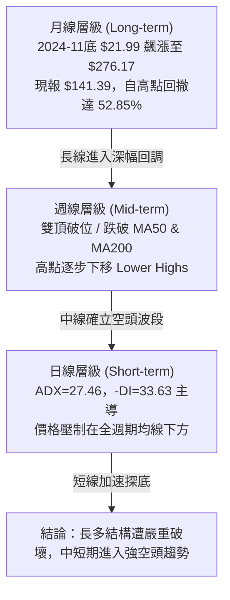
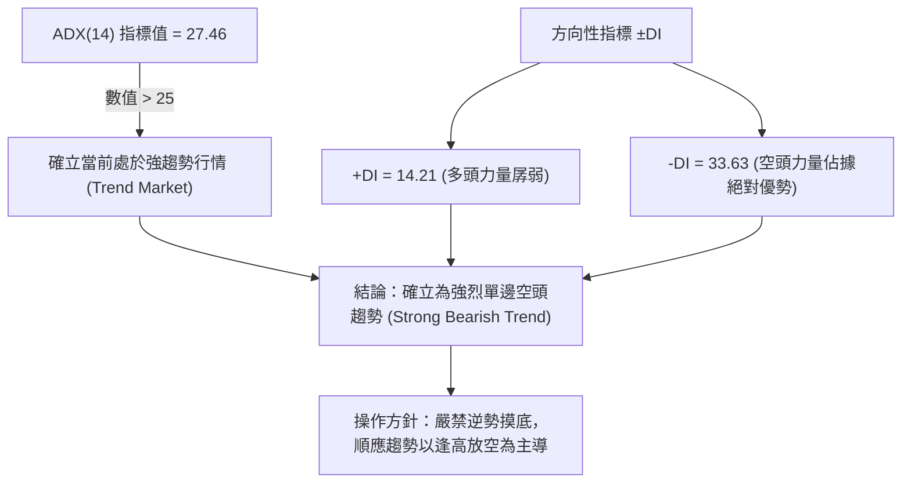
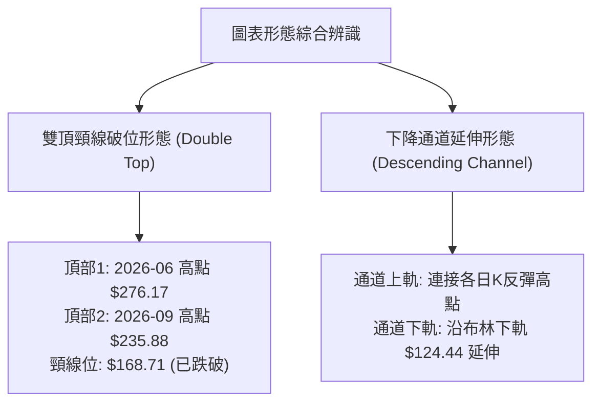
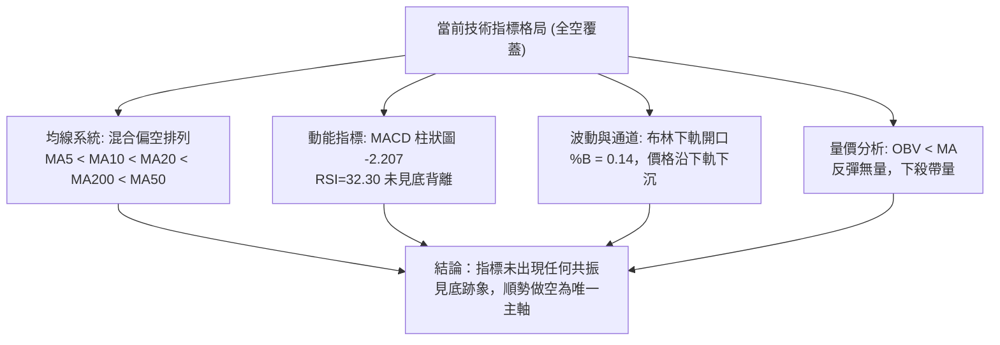
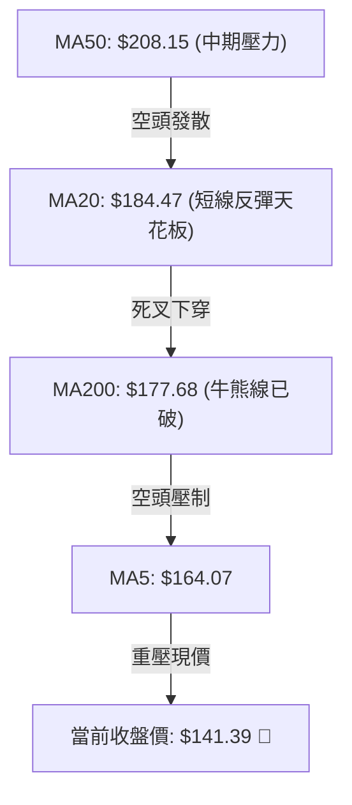
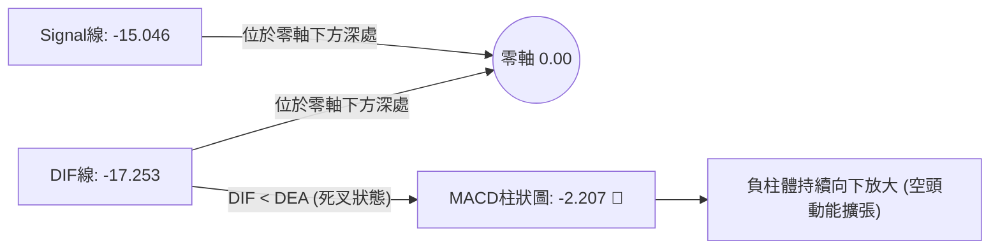
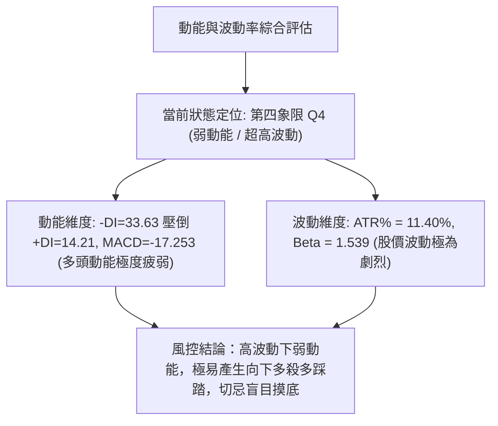
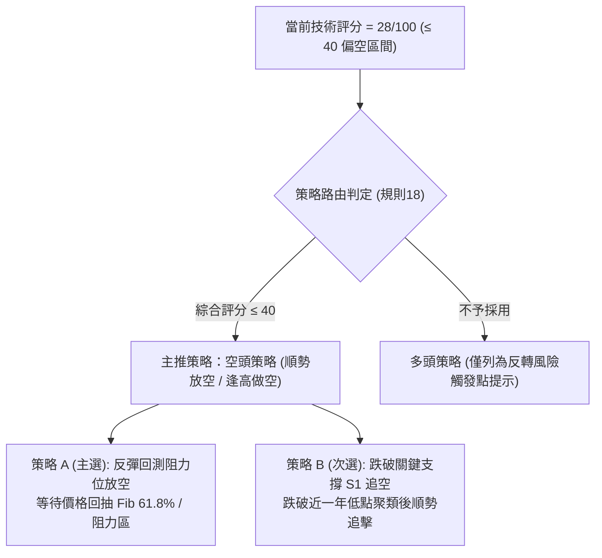
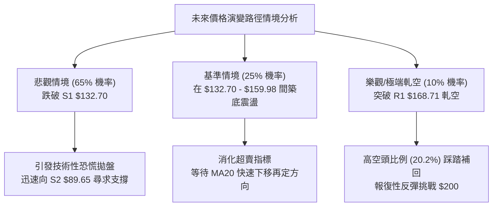

# NBIS 技術分析報告

> **報告日期**：2026-11-03 ｜ **語言**：繁體中文 ｜ **數據來源**：Yahoo Finance ｜ **當前價格**：$141.39 USD

---

## 目錄

| 章節 | 內容 |
|------|------|
| [1. 技術面概覽](#1-技術面概覽) | 訊號儀表板、核心指標、評分卡 |
| [2. 趨勢分析](#2-趨勢分析) | 多時框趨勢、長中短期走勢、ADX解讀 |
| [3. 圖表形態分析](#3-圖表形態分析) | 形態識別、K線組合、形態目標價 |
| [4. 支撐與阻力](#4-支撐與阻力) | 關鍵價位分佈、斐波那契回調位分析 |
| [5. 技術指標深度解讀](#5-技術指標深度解讀) | MA/RSI/MACD/布林通道/成交量與OBV |
| [6. 動能與波動率](#6-動能與波動率) | 動能四象限、ATR波動率、Beta風險 |
| [7. 多時框架總結](#7-多時框架總結) | 時框架評分矩陣、多時框收斂結論 |
| [8. 交易策略建議](#8-交易策略建議) | 策略路由、主策略詳情、風險報酬比 |
| [9. 風險提示與監控](#9-風險提示與監控) | 監控清單、情境模型、風控指引 |

---

## 1. 技術面概覽

### 🎯 技術訊號儀表板



### 📊 核心指標速覽表

| 指標類別 | 指標名稱 | 當前數值 | 訊號 | 解讀 |
|----------|----------|----------|:----:|------|
| **價格** | 當前收盤價 | $141.39 | 🔴 | 位於52週區間30.0%分位，短期處於加速探底走勢 |
| **均線** | MA20 | $184.47 | 🔴 | 價格遠在MA20下方 -23.35%，短線下行斜率極陡 |
| **均線** | MA50 | $208.15 | 🔴 | 價格遠在MA50下方 -32.07%，中期波段完全轉空 |
| **均線** | MA200 | $177.68 | 🔴 | 價格跌破年線關鍵牛熊分水嶺 -20.42%，長期結構轉弱 |
| **動能** | RSI(14) | 32.30 | 🟡 | 位於30-70中性區間偏下緣，尚未進入極端超賣（無背離） |
| **動能** | MACD (12,26,9) | -17.253 | 🔴 | DIF (-17.253) 低於 Signal (-15.046)，Hist -2.207 空頭擴散 |
| **動能** | Stoch %K / %D | 1.36 / 14.19 | 🟢 | 進入極度超賣區，存在技術性短線抽頭反彈可能 |
| **趨勢** | ADX(14) / ±DI | 27.46 | 🔴 | ADX > 25 確立強趨勢，-DI (33.63) 主導，為典型空頭趨勢 |
| **通道** | 布林通道 %B | 0.14 | 🔴 | 價格貼近下軌 ($124.44)，軌道向下張口，空頭動能強勁 |
| **量能** | 20日成交量比 | 0.87x | 🔴 | OBV < MA，反彈縮量、下殺放量，量能未確認底部 |
| **波動** | ATR(14) | $16.12 | 🔴 | ATR佔比達11.40%，單日波動極高，持倉風險大 |

### 🏆 技術評分卡

```
╔══════════════════════════════════════════════════════════════╗
║               技術評分卡 — NBIS (2026-11-03)                 ║
╠══════════════════════════════════════════════════════════════╣
║ 趨勢強度 (Trend)     █████░░░░░░░░░░░░░░░  25/100 🔴 空頭強趨勢   ║
║ 動能指標 (Momentum)  ██████░░░░░░░░░░░░░░  30/100 🔴 動能深跌擴大 ║
║ 支撐穩定度 (Support) ███████░░░░░░░░░░░░░  35/100 🔴 逼近S1考驗脆弱║
║ 成交量配合 (Volume)  ██████░░░░░░░░░░░░░░  30/100 🔴 價跌量弱無承接║
║ 形態完整度 (Pattern) ██████░░░░░░░░░░░░░░  30/100 🔴 頂部破位下殺 ║
║ 均線排列 (MAs)       ███░░░░░░░░░░░░░░░░░  18/100 🔴 全線空頭壓制 ║
╠══════════════════════════════════════════════════════════════╣
║ 綜合評分 (Overall)   ██████░░░░░░░░░░░░░░  28/100 🔴 強烈偏空     ║
║ 計算依據：(25 + 30 + 35 + 30 + 30 + 18) ÷ 6 = 28/100 (規則18)║
╚══════════════════════════════════════════════════════════════╝
```

---

## 2. 趨勢分析

### 🌐 多時框趨勢分析



### 📈 長期趨勢 — 12個月走勢圖（Unicode）

依據過去 12 個月收盤數據（2025-11 至 2026-11），股價經歷了從 $94.87 到高點 $276.17（月線收盤高點）/ $299.86（52週最高點），隨後急劇下挫至當前的 $141.39。

```
NBIS 月線收盤走勢圖（過去12個月：2025-11 至 2026-11）
價格軸 ($)
$280 ┤                            ● $276.17 (2026-06 峰值)
$250 ┤                                      
$220 ┤                      ● $231.09        ● $235.88
$190 ┤                                  ● $190.41    ● $206.32
$160 ┤                                                      ● $154.14
$130 ┤                ● $138.23                                  ● $141.39 (現價)
$100 ┤          ● $103.76
$90  ┤ ● $94.87     ● $91.19
$80  ┤    ● $83.71  ● $85.19
     └─────────────────────────────────────────────────────────────
       11   12   01   02   03   04   05   06   07   08   09   10   11 (月份)
       2025 ──── 2026 ──────────────────────────────────────────────
```

**12個月走勢特徵分析表**：

| 階段區間 | 時間跨度 | 起訖價位 | 區間漲跌幅 | 走勢結構與技術特徵 |
|----------|----------|----------|:----------:|--------------------|
| **築底蓄勢期** | 2025-11 ~ 2026-02 | $94.87 → $91.19 | -3.88% | 在 $83.71 - $94.87 區間形成狹幅橫盤箱體，量能沈澱 |
| **主升主浪期** | 2026-02 ~ 2026-06 | $91.19 → $276.17 | +202.85% | 伴隨 AI 基礎設施爆發式營收成長，均線多頭發散，推升至歷史極限 |
| **高位派發期** | 2026-06 ~ 2026-09 | $276.17 → $235.88 | -14.59% | 劇烈震盪洗盤，形成雙峰形態（06月 $276.17 與 09月 $235.88） |
| **破位崩跌期** | 2026-09 ~ 2026-11 | $235.88 → $141.39 | -40.06% | 籌碼崩解，連續跌破所有短中長期均線，現報 $141.39 逼近前低 |

### 📊 中期趨勢（週線分析）

從近 20 週收盤走勢可見，股價在 2026-08-14 創下週收盤高點 $277.68 後，反彈高點遞減（2026-10-02 收盤 $242.81）。自 2026-10-09 起，週K線出現斷崖式下跌，跌破頸線與年線：

```
中期週線支撐與阻力階梯示意圖
────────────────────────────────────────────────────────────────
$254.92 ─── R3 強阻力（10月初週高點密集區 $250.48-$255.10）
           │
$231.17 ─── R2 次級阻力（9月震盪箱體中軸）
           │
$168.71 ─── R1 近期關鍵阻力（10月中旬破位大陰線密集區）
           │
$141.39 ─── [ 當前現價 ] ── 處於自由落體探底中
           │
$132.70 ─── S1 近期支撐（近一年波段低點聚類核心）
           │
$89.65  ─── S2 歷史強支撐（2025年底至2026年初起漲平台）
────────────────────────────────────────────────────────────────
```

### ⚡ 趨勢強度評估（ADX 解讀）



**ADX 趨勢強度對照表**：

| ADX 數值區間 | 當前狀態 | 趨勢屬性判斷 | 交易策略導引 |
|--------------|:--------:|--------------|--------------|
| 0 ~ 20 | 否 | 無趨勢 / 窄幅盤整 | 網格交易、通道高拋低吸 |
| 20 ~ 25 | 否 | 趨勢萌芽 / 方向未明 | 觀望，等待突破確立 |
| **25 ~ 50** | **27.46 (是)** | **強趨勢形成（當前為空頭主導）** | **趨勢跟隨交易（順勢做空，不猜底）** |
| 50 ~ 75 | 否 | 極強單邊趨勢 | 嚴格移動止損，提防超買超賣衰竭 |
| 75 ~ 100 | 否 | 極端非理性行情 | 隨時可能出現暴跌暴漲反轉 |

---

## 3. 圖表形態分析

### 🔍 形態識別系統



**形態信心度與目標價計算表（依規則 15）**：

| 形態名稱 | 信心度 | 判斷依據（引用數據） | 完成度 | 目標價（附嚴格計算式） |
|----------|:------:|----------------------|:------:|------------------------|
| **雙頂破位 (Double Top)** | 75% | 2026-06 收盤 $276.17 與 2026-09 收盤 $235.88 形成雙峰，頸線即近一年波段高點聚類 R1 $168.71。當前價格 $141.39 已有效跌破頸線。 | 90% | 形態理論目標價 = 頸線 $168.71 − (次頂 $235.88 − 頸線 $168.71) = $168.71 − $67.17 = **$101.54**；若以絕對高點推算則直接指向歷史支撐 S2 **$89.65** |
| **布林通道破位下軌** | 80% | 布林下軌 $124.44，%B 為 0.14，連續多根日K貼軌下殺，無止跌信號。 | 85% | 依通道下飄斜率，測試近一年支撐位 S1 **$132.70** |
| **頭肩頂形態** | 40% | 數據中左肩與右肩對稱性不足（左肩時間結構稀疏），數據不足以支撐幾何對稱。 | 30% | 訊號不足，不予推算幾何目標，僅做指標型偏空解讀 |

### 🕯️ 重要 K 線形態分析

依據提供的「近10根日K」與「近8根週K」實際開高低收數據進行嚴格判定（規則 19）：

**近 10 根日 K 線形態解讀表**：

| 日期（日K） | 開 | 高 | 低 | 收 | 成交量 | K線形態名稱 | 技術解讀與訊號判定 | 訊號 |
|:-----------:|:----:|:----:|:----:|:----:|:------:|:-----------:|--------------------|:----:|
| 2026-10-20 | 163.99 | 174.74 | 160.25 | 171.45 | 22,615,600 | 實體中陽線 | 自低檔反彈，短暫站上 $170，但量能未放大 | 🟡 |
| 2026-10-21 | 176.46 | 178.85 | 164.00 | 171.57 | 19,693,900 | 衝高回落倒錘頭 | 開高走低，上方遭遇 MA200 壓制，多頭乏力 | 🔴 |
| 2026-10-22 | 164.75 | 167.50 | 155.73 | 159.17 | 26,221,800 | 破位中陰線 | 跳空開低破位，收在最低點附近，空頭吞噬 | 🔴 |
| 2026-10-23 | 158.90 | 162.99 | 155.86 | 158.74 | 13,496,800 | 縮量十字星 | 多空僵持，成交量腰斬，顯示買盤極度匱乏 | 🟡 |
| 2026-10-26 | 153.96 | 165.86 | 149.48 | 153.27 | 30,698,500 | 放量下影陰線 | 跌破 $150 關卡引發停損潮，量能暴增至3000萬股 | 🔴 |
| 2026-10-27 | 159.00 | 171.53 | 158.30 | 170.47 | 20,596,400 | 反彈長陽線 | 跌深技術性抽頭，回補前日跌幅 | 🟡 |
| 2026-10-28 | 173.49 | 182.74 | 168.92 | 182.34 | 25,056,800 | 光頭中大陽線 | 向上挑戰 MA20 ($184.47)，成為本輪反彈最高點 | 🟢 |
| 2026-10-29 | 173.18 | 178.33 | 168.76 | 171.99 | 17,700,300 | 高位吞噬陰線 | 開低走低，完全吞噬前一日漲幅，形成假突破 | 🔴 |
| 2026-10-30 | 157.05 | 161.42 | 149.96 | 154.14 | 21,564,800 | 跳空跳水長陰線 | 跳空低開低走，再度摜破 $150 心理防線 | 🔴 |
| 2026-11-02 | 154.56 | 155.35 | 140.60 | 141.39 | 20,280,200 | 光腳大陰線 | 幾乎收在全日最低點 $140.60 附近，恐慌賣壓持續 | 🔴 |

**近 8 根週 K 線形態解讀表**：

| 日期（週K） | 開 | 高 | 低 | 收 | 週成交量 | K線形態名稱 | 技術解讀與訊號判定 | 訊號 |
|:-----------:|:----:|:----:|:----:|:----:|:--------:|:-----------:|--------------------|:----:|
| 2026-09-18 | 204.98 | 232.85 | 203.87 | 223.54 | 90,247,300 | 震盪實體長陽 | 多頭最後反撲，測試 $230 阻力 | 🟢 |
| 2026-09-25 | 225.96 | 249.19 | 221.30 | 237.33 | 79,317,300 | 上影小陽線 | 逼近 R3 ($254.92) 遇阻回落，顯露疲態 | 🟡 |
| 2026-10-02 | 235.20 | 250.48 | 228.38 | 242.81 | 65,179,600 | 縮量高位星線 | 量價背離，動能竭盡形成第二個頂部 | 🔴 |
| 2026-10-09 | 244.10 | 255.10 | 217.73 | 221.07 | 86,070,300 | 烏雲蓋頂長陰 | 週線實體跌破5週均線，頂部確認確立 | 🔴 |
| 2026-10-16 | 217.20 | 217.20 | 163.27 | 165.47 | 148,676,100 | 斷頭鍘刀巨量陰 | 週暴跌近 25%，跌破頸線 R1，爆出近1.5億股天量 | 🔴 |
| 2026-10-23 | 176.51 | 178.85 | 155.73 | 158.74 | 108,909,300 | 空頭延續陰線 | 跌破 $160，均線全面反轉下扣 | 🔴 |
| 2026-10-30 | 153.96 | 182.74 | 149.48 | 154.14 | 115,616,800 | 長上影十字陰線 | 盤中反抽 $182.74 遭均線無情打回，反彈夭折 | 🔴 |
| 2026-11-02 | 154.56 | 155.35 | 140.60 | 141.39 | 20,280,200 | 單日破位大陰棒 | 單日即跌破前一週低點 $149.48，探尋新低 | 🔴 |

### 📉 ASCII 走勢形態示意圖

```
NBIS 日線雙頂破位與下降階梯示意圖
價格 ($)
$254.92 ┤       頂1 (10-02)
        │       ╭───╮             R3 強阻力區
$231.17 ┤  ╭────╯   ╰────╮        R2 次級阻力
        │  │             ╰─╮
$184.47 ┤──┼───────────────╰───╮─── MA20 中軌防線
$168.71 ┤══╪═══════════════════╪══════ R1 頸線破位點（由支撐轉為重壓）
        │  │                   ╰──╮ (10-28 假突破反抽 $182.74)
$141.39 ┤──┼───────────────────────● 現價 $141.39 (自由落體階段)
        │  │                       │
$132.70 ┤┈┈┴┈┈┈┈┈┈┈┈┈┈┈┈┈┈┈┈┈┈┈┈┈┈┈▼── S1 近期支撐（第一防守線）
        │
$89.65  ┤══════════════════════════════ S2 長期結構強支撐（雙頂理論回歸位）
```

---

## 4. 支撐與阻力

### 🗺️ 關鍵價位分布圖（Unicode）

```
NBIS 價位結構分布圖
══════════════════════════════════════════════════════════════
$254.92 ║████████████████████████████████║ 強阻力 R3 (52W 次高回調區)
$246.44 ║▒▒▒▒▒▒▒▒▒▒▒▒▒▒▒▒▒▒▒▒▒▒▒▒▒▒▒▒    ║ 斐波那契 23.6% 回調位
$231.17 ║████████████████████████        ║ 阻力 R2 (中期波段密集成交高點)
$213.40 ║▒▒▒▒▒▒▒▒▒▒▒▒▒▒▒▒▒▒▒▒            ║ 斐波那契 38.2% 回調位 (MA60 重疊)
$186.69 ║▒▒▒▒▒▒▒▒▒▒▒▒▒▒▒▒                ║ 斐波那契 50.0% 多空分水嶺
$168.71 ║████████████████████████████████║ 關鍵阻力 R1 (原頸線，極強反壓)
$159.98 ║▒▒▒▒▒▒▒▒▒▒▒▒                    ║ 斐波那契 61.8% 黃金分割阻力位
$141.39 ╠════════════════════════════════╣ ◄ 當前收盤價 ($141.39)
$132.70 ║▓▓▓▓▓▓▓▓▓▓▓▓▓▓▓▓▓▓▓▓▓▓▓▓        ║ 近期支撐 S1 (-6.15%, 近一年低點)
$121.96 ║▒▒▒▒▒▒▒▒                        ║ 斐波那契 78.6% 回調位 (極度回撤點)
$89.65  ║████████████████████████████████║ 強支撐 S2 (-36.59%, 2026初起漲平台)
$83.22  ║████████████████████████        ║ 強支撐 S3 (-41.15%, 2025底歷史底部)
$73.52  ║▒▒▒▒                            ║ 52週最低價 (100.0% 基準線)
══════════════════════════════════════════════════════════════
```

### 🚧 阻力位分析表

所有數值均嚴格引用 OHLCV 計算之關鍵價位：

| 阻力級別 | 價位 | 距現價幅動 | 形成原因與籌碼結構 | 突破難度 | 重要性 |
|:--------:|:----:|:----------:|--------------------|:--------:|:------:|
| **R1** | **$168.71** | +19.32% | 近一年波段高點聚類形成的破位頸線，10月中旬大量套牢盤（單週成交逾1.48億股）之停損與解套賣壓匯集區。 | 🔴 極高 | ★★★★★ |
| **R2** | **$231.17** | +63.50% | 9月震盪構築頂部之密集換手區間中軸，亦為 MA60 附近之中期趨勢反轉防線。 | 🔴 極高 | ★★★★☆ |
| **R3** | **$254.92** | +80.30% | 10月初次頂回落點（最高達 $255.10），為本輪多頭牛市崩解前的最後抵抗高點。 | 🔴 難以踰越 | ★★★☆☆ |

### 🛡️ 支撐位分析表

所有數值均嚴格引用 OHLCV 計算之關鍵價位：

| 支撐級別 | 價位 | 距現價幅動 | 形成原因與籌碼結構 | 守住機率 | 重要性 |
|:--------:|:----:|:----------:|--------------------|:--------:|:------:|
| **S1** | **$132.70** | -6.15% | 近一年波段低點聚類核心支撐，現價下探的第一道技術緩衝墊，距離現價僅 1 個 ATR 左右。 | 🟡 45% (較弱) | ★★★★☆ |
| **S2** | **$89.65** | -36.59% | 2025年12月至2026年2月長達數月的歷史橫盤起漲大底（月線收盤 $83.71-$91.19），具備極強結構性買盤支撐。 | 🟢 75% (極強) | ★★★★★ |
| **S3** | **$83.22** | -41.15% | 2025-12 之月線最低收盤點聚類，52週絕對低點 $73.52 前的最後防線。 | 🟢 85% (鋼鐵底) | ★★★☆☆ |

### 📐 斐波那契回調位分析

依據 52 週絕對波動區間（$73.52 至 $299.86）計算所得之精確斐波那契回調位：

| 分割比例 | 精確價位 | 技術狀態 | 深度解讀與歷史意義 |
|:--------:|:--------:|:--------:|--------------------|
| 0.0% | $299.86 | 52W 最高點 | 歷史極限多頭頂部 |
| 23.6% | $246.44 | 跌破 | 頂部震盪失守的第一道防線 |
| 38.2% | $213.40 | 跌破 | 傳統健康回調位，失守代表多頭主趨勢遭破壞 |
| 50.0% | $186.69 | 跌破 | 多空勢力均衡點，目前在此下方運行，空方全面控盤 |
| 61.8% | $159.98 | 跌破 | **黃金分割牛熊界限**。10月30日收盤 $154.14 正式確認跌破，確立深幅雄勢 |
| **當前現價** | **$141.39** | **運行區間** | **現價落於 61.8% ($159.98) 與 78.6% ($121.96) 之間，呈空頭加速下探形態** |
| 78.6% | $121.96 | 未觸及 | 最後一道防守性斐波那契位，若失守將全數回吐本輪主升浪行情 |
| 100.0% | $73.52 | 52W 最低點 | 本輪牛市起點 |

---

## 5. 技術指標深度解讀

### 🎛️ 指標訊號總覽



### 📈 移動平均線排列分析



**移動平均線數值與乖離率一覽表**：

| 均線名稱 | 當前數值 | 價格相對於均線乖離 | 走勢狀態 | 評估與解讀 |
|:--------:|:--------:|:------------------:|:--------:|------------|
| **MA 5** | $164.07 | -13.82% | ▁▁▁▁▁▁▁▁ 急跌 | 超短線第一阻力，下行斜率極陡 |
| **MA 10** | $163.45 | -13.50% | ▁▁▁▁▁ 陡降 | 短線反彈極限，與 MA5 形成死亡黏合 |
| **MA 20** | $184.47 | -23.35% | ▁▁ 快速下沉 | 短期生命線，已由支撐徹底轉為沉重反壓 |
| **MA 60** | $212.62 | -33.50% | ▁▁ 拐頭向下 | 季線下彎，中期波段徹底走熊 |
| **MA 120** | $216.86 | -34.80% | ████ 高位走平 | 半年線壓頂，大週期籌碼全線被套 |
| **MA 200** | $177.68 | -20.42% | 下穿破位 | 跌破長期牛熊分界線，宣告牛市行情終結 |
| **MA 240** | $163.51 | -13.53% | █████ 緩慢走平| 年線附近支撐徹底失效 |

### 📉 RSI(14) 分析

*   **當前數值**：**32.30**（Wilder 計算）
*   **強度進度條**：
    ```
    RSI(14) = 32.30  [██████░░░░░░░░░░░░░░] 32.3% 🟡 處於中性偏空 / 弱勢區
    ```
*   **區間解讀**：
    *   數值位於 30 至 70 之中性區間邊緣，尚未跌破 30 進一步進入極端超賣區。
    *   這意味著儘管價格跌幅巨大，但空頭賣壓尚未完全釋放至動能衰竭程度，技術指標仍具備向下宣洩的空間。
*   **背離檢驗結論**：
    *   比對近 20 根 K 棒走勢，價格自 10 月中旬 $171.45 跌至 $141.39（創新低），RSI 亦同步自 46.7 降至 32.30（同步探低）。
    *   **明確結論：當前無任何底背離跡象（No Bullish Divergence）**，亦無頂背離。指標完全確認價格弱勢下行走勢，不支持任何反轉假說。

### 📊 MACD(12, 26, 9) 訊號解讀



*   **數值解讀**：DIF 線為 -17.253，訊號線 Signal 為 -15.046，兩者皆處於零軸下方極深位置（代表長期趨勢極弱）。
*   **柱狀圖狀態**：柱狀圖值為 -2.207，呈現負向擴張態勢。在經歷了 10 月底短暫的收斂反彈後（10-30 為 -1.365），最新柱體再度擴大至 -2.207，顯示空頭在日線層面發動新一輪下殺，短線下行動能正在加速。

### 📦 布林通道分析

```
NBIS 布林通道 (20, 2) 當前結構圖
價格 ($)
$244.50 ────────────────────────────────────────────── 布林上軌 (Upper Band)
        │
$184.47 ────────────────────────────────────────────── 中軌 (MA20 基準線)
        │
$141.39 ───────────────● 現價 ($141.39, %B = 0.14)
        │              ↓ 沿通道下軌滑落
$124.44 ────────────────────────────────────────────── 布林下軌 (Lower Band)
```

*   **帶寬與位置**：通道上軌 $244.50，中軌 $184.47，下軌 $124.44。
*   **%B 指標**：精確值為 **0.14**，顯示價格極度貼近下軌（0 代表下軌，0.5 為中軌）。
*   **形態解讀**：布林通道上下軌開口呈現發散狀（Bandwidth 擴大），價格緊貼下軌下移，此為典型的「沿軌下跌（Walking the lower band）」空頭單邊暴跌形態。在未出現帶量長下影線拉回中軌之前，任何觸及下軌均非買點，而是空頭強勢信號。

### 💹 成交量分析（量價配合度）

*   **最新成交量**：20,280,200 股。
*   **均量對比**：相對於 20 日均量 23,224,300 股，量比為 **0.87x**；但高於 50 日均量 18,095,688 股。
*   **OBV（能量潮）趨勢**：數據明確標示 **OBV < MA → 量能疲弱**。
*   **量價關係深度診斷**：
    1.  **反彈無量**：回顧 10-27 與 10-28 股價反彈至 $170-$182 時，成交量僅 2059 萬至 2505 萬股，未現增量資金搶籌；
    2.  **下殺放量**：在 10-16 破位大陰線當週，爆出 1.48 億股天量下殺，10-26 亦爆出 3069 萬股跌破 $150；
    3.  **量價背離驗證**：OBV 跌破均線並持續創波段新低，說明機構主力資金處於淨流出（Distribution）狀態，量能結構完全確認空頭走勢，未見主力進場承接底倉信號。

---

## 6. 動能與波動率

### ⚡ 動能評估四象限



**市場狀態矩陣定位表**：

| 象限 | 動能維度 (Momentum) | 波動率維度 (Volatility) | 當前狀態判定 | 操作風險評估 |
|:----:|:-------------------:|:------------------------:|:------------:|--------------|
| **Q1** | 強 (Bullish) | 低 (Low Vol) | — | 最佳波段做多機會（平穩主升） |
| **Q2** | 弱 (Neutral) | 低 (Low Vol) | — | 橫盤窄幅震盪，觀望為主 |
| **Q3** | 強 (Bullish) | 高 (High Vol) | — | 高風險高收益，激進多頭突破 |
| **Q4** | **弱 (Bearish)** | **高 (High Vol)** | **✓ (當前歸屬)** | **極度危險區，避免做多，做空嚴設停損** |

### 📊 ATR 波動率分析

*   **ATR(14) 絕對值**：**$16.12**。
*   **ATR 佔比**：高達股價的 **11.40%**（依據 Wilder 計算）。
*   **波動深度解讀**：NBIS 單日平均真實波幅高達 $16.12，意味著任何單日的日內雜訊都可能吞噬 10% 以上的本金。
*   **動態止損距離設定建議**：
    *   **短線日內交易**：建議止損距離至少設定為 $1.0 \times \text{ATR} = \$16.12$。
    *   **波段交易**：建議止損距離設定為 $1.5 \times \text{ATR} = \$24.18$，以防範高 Beta 帶來的假突破掃損。

### 📐 Beta 與市場相關性

*   **Beta 係數**：**1.539**。
*   **空頭槓桿與板塊聯動性解讀**：
    *   Beta 為 1.539，顯示該股對大盤（S&P 500 / Nasdaq）之波動敏感度為 153.9%。
    *   近期新聞面顯示 AI 基礎設施板塊（如 CoreWeave 債務隱憂、Applied Digital 融資困難）面臨整體系統性回調壓力。在板塊情緒惡化與高 Beta 疊加下，NBIS 跌幅被顯著放大（近一個月暴跌逾 35%）。
    *   Short Float 達 20.2%（空頭回補天數 Short Ratio 為 2.61），顯示市場充斥大量投機空頭籌碼，助長了向下的動能。

---

## 7. 多時框架總結

### 📋 時框架評分表

| 時框架 | 趨勢方向 | 動能狀態 | 均線排列 | 形態結構 | 綜合評分 | 建議方針 |
|:------:|:--------:|:--------:|:--------:|:--------:|:--------:|----------|
| **長期 (月線)** | 🟡 中性轉弱 | RSI跌向中軸，長期升浪遭攔腰折斷 | 價格跌破MA5/MA10，逼近MA20 | 高位大雙頂回撤，深幅洗盤 | 42/100 | 長期牛市架構破壞，多單離場 |
| **中期 (週線)** | 🔴 強烈看空 | MACD柱連續負值，成交量下殺爆量 | 跌破所有中短期週均線，週MA下彎 | 烏雲蓋頂後形成破位斷頭鍘刀 | 25/100 | 中線放空，反彈均線加空 |
| **短期 (日線)** | 🔴 極度看空 | RSI=32.30，Stoch超賣但MACD續挫 | 均線混合空頭排列，價格貼布林下軌 | 光腳大陰線探底，下降通道延伸 | 22/100 | 順勢逢高做空，禁止抄底 |

### 🔲 綜合訊號矩陣

```
訊號維度一致性檢驗：
┌─────────────────────────┬─────────┬─────────┬─────────┐
│ 分析維度                │ 長期(月)│ 中期(週)│ 短期(日)│
├─────────────────────────┼─────────┼─────────┼─────────┤
│ 1. 均線排列狀態         │  🟡中性 │  🔴空頭 │  🔴空頭 │
│ 2. 擺動指標 (RSI/Stoch) │  🟡中性 │  🔴看空 │  🟡超賣 │
│ 3. 趨勢跟隨 (MACD/ADX)  │  🔴轉空 │  🔴強空 │  🔴強空 │
│ 4. 價量結構配合 (OBV)   │  🔴轉弱 │  🔴背離 │  🔴疲弱 │
├─────────────────────────┼─────────┼─────────┼─────────┤
│ 總體共振方向            │ 偏空下修│ 強烈空頭│ 空頭主導│
└─────────────────────────┴─────────┴─────────┴─────────┘
```

### ⚖️ 多時框收斂結論（依規則 14）

依據嚴格要求第 14 條之收斂規則執行決策判定：
1.  **趨勢行情確立**：當前日線 ADX(14) 數值為 **27.46**，明確大於 25 臨界線，確立當前市場處於**標準趨勢行情**（而非無方向之區間盤整）；
2.  **主導時框優先權**：在趨勢行情下，必須以中長期（週線、MA50、MA200）方向為絕對主導，日線僅能作為輔助尋找順勢切入時機；
3.  **多時框方向收斂**：週線實體連續長陰摜破頸線，MA50 ($208.15) 與 MA200 ($177.68) 全面居於現價上方形成堅固反壓；日線隨機指標（Stoch %K=1.36）雖達極端超賣，但**在強空頭趨勢下，短線超賣不得作為抄底依據，僅能解讀為反彈修正過大乖離的潛在契機**；
4.  **唯一方向性結論**：**【強烈偏空（Strong Bearish）】**。多時框訊號收斂指向空方絕對控盤，一切策略制定必須服從中期空頭大趨勢。

---

## 8. 交易策略建議

### 🗺️ 策略決策流程圖



### 🧭 策略路由（依評分卡分流）

> **當前主策略方向 = 【空頭主導（Short-Dominated）】（依據綜合評分 28/100，嚴格屬於 ≤40 偏空範疇）**

根據規則路由，本報告全面主推空頭交易策略；任何多頭思維僅作為「空頭回補」或「極端風控對沖提示」，嚴禁兩頭下注。

### 🎯 價格情境階梯（Price Scenarios）

價位嚴格引用 OHLCV 關鍵價位與斐波那契回調位：

| 觸發條件 | 下一目標 | 後續延伸 | 情境含義與技術演變 |
|----------|----------|----------|--------------------|
| **向上反抽受阻於 $159.98 / $168.71** | 下測 $141.39 | 探底 S1 $132.70 | **短線反彈確認結束**，空頭絕佳高割離場與反手加空點 |
| **強勢向上突破 R1 $168.71** | 考驗 MA20 $184.47 | 挑戰 R2 $231.17 | **空頭結構遭短暫破壞**，空單全數止損離場，行情轉為寬幅震盪 |
| **現價直接跌破 S1 $132.70** | 測 Fib 78.6% $121.96 | 暴跌至 S2 $89.65 | **中期波段下殺加速**，觸發停損賣盤，展開新一輪主跌浪 |

### 📊 情境機率分佈

| 預測情境 | 發生機率 | 主要依據（指標狀態與市場行為） |
|----------|:--------:|--------------------------------|
| **情境一：震盪走低或跌破 S1 探底** | **65%** | ADX=27.46 確立空頭趨勢；-DI(33.63)遠大於+DI(14.21)；MACD柱狀圖負值放大(-2.207)；OBV處於均線下方無增量資金。 |
| **情境二：超賣引發技術性弱勢反彈** | **25%** | Stoch %K=1.36 / %D=14.19 進入極度超賣；RSI=32.30 接近30臨界值；可能出現回抽 Fib 61.8% ($159.98) 的修復走勢。 |
| **情境三：強勢反轉突破 R1 頸線** | **10%** | 需要板塊重大融資利好逆轉，但在全週期均線空頭排列與高達20.2%的做空比率壓制下，機率極低。 |

### 🟢 主策略詳情（空頭主推策略）

嚴格執行規則 17 之風險報酬比計算標準：
$$\text{做空風險報酬比} = \frac{\text{進場價} - \text{目標價 T1}}{\text{止損價} - \text{進場價}}$$

| 策略要素 | 策略 A：反彈逢高受阻做空（主選） | 策略 B：跌破關鍵支撐 S1 順勢追空（次選） |
|----------|----------------------------------|------------------------------------------|
| **進場條件** | 股價受超賣帶動反彈，但在 Fib 61.8% ($159.98) 遇阻收上影線時進場 | 盤中實體跌破近一年支撐位 S1 ($132.70) 且收盤確認時追空 |
| **進場價格** | **$159.98**（Fib 61.8% 回調位） | **$132.70**（S1 支撐破位處） |
| **止損價格** | **$168.71**（R1 關鍵阻力位上方） | **$141.39**（當前收盤價 / 破位回抽停損線） |
| **目標價 T1** | **$132.70**（近期支撐 S1） | **$89.65**（強支撐 S2，雙頂理論目標） |
| **目標價 T2** | **$121.96**（Fib 78.6% 回調位） | **$83.22**（歷史強支撐 S3） |
| **價差計算** | 風險：$168.71 - $159.98 = $8.73<br/>利潤 T1：$159.98 - $132.70 = $27.28<br/>利潤 T2：$159.98 - $121.96 = $38.02 | 風險：$141.39 - $132.70 = $8.69<br/>利潤 T1：$132.70 - $89.65 = $43.05<br/>利潤 T2：$132.70 - $83.22 = $49.48 |
| **風險報酬比** | **1 : 3.12（以 T1 計）**<br/>*(另列：1 : 4.35（以 T2 計）)* | **1 : 4.95（以 T1 計）**<br/>*(另列：1 : 5.69（以 T2 計）)* |
| **預估成功率** | **65%** | **55%** |
| **建議倉位** | **10% ~ 15% 總資金** | **5% ~ 8% 總資金（追空防抽頭）** |

### 🔴 反向風險觸發點（對沖提示）

若出現以下情境，宣告空頭主策略失效，空單必須無條件離場甚至啟動對沖：
1.  **日線收盤價有效站穩 R1 ($168.71) 之上**：此舉意味著雙頂頸線被重新收復，空頭破位形態失敗，可能引發軋空（Short Squeeze，當前空頭比例達 20.2%）；
2.  **MACD 出現底背離且金叉翻紅**：若價格再破 $140 但 MACD 柱狀圖顯著收窄並形成 DIF 上穿 DEA，則空頭動能衰竭，應立即平倉。

### ⭐ 整體訊號強度評星

```
做多訊號強度：★☆☆☆☆  (1.0/5星 — 僅超賣指標支撐，逆勢極度危險)
做空訊號強度：★★★★☆  (4.5/5星 — 均線、趨勢、量能、通道全面共振看空)
整體可信度：  ★★★★☆  (4.0/5星 — ADX=27.46 趨勢明確，信號高度一致)
```

---

## 9. 風險提示與監控

### ✅ 關鍵監控指標 Checklist

```
╔══════════════════════════════════════════════════════════════╗
║               NBIS 關鍵技術防線動態監控清單                  ║
╠══════════════════════════════════════════════════════════════╣
║ [ ] 支撐防守測試：關注 S1 $132.70 是否出現大成交量跌破      ║
║ [ ] 動能背離檢驗：若價格跌破 $132.70，RSI 是否守住 30 之上  ║
║ [ ] 均線動態反壓：觀察反彈是否受制於 MA5 ($164.07) 下沉阻力 ║
║ [ ] 空頭回補力道：觀察空頭比率 (20.2%) 是否引發短線暴力軋空 ║
║ [ ] 布林通道走勢：價格是否持續脫離布林下軌 ($124.44) 弱勢區 ║
║ [ ] 能量潮配合度：OBV 是否能扭轉劣勢上穿均線（機構回流）    ║
╚══════════════════════════════════════════════════════════════╝
```

### ⚠️ 風險場景分析



### 🛡️ 風險管理重要提醒

1.  **高波動風險控管**：NBIS 之 ATR(14) 高達 $16.12（佔比 11.40%），Beta 達 1.539，此類資產具備高槓桿特性。投資人切忌重倉交易，單筆交易虧損額度嚴格限制在總資本的 **1.0% ~ 1.5%** 範圍內。
2.  **基本面虧損與槓桿風險**：公司自由現金流為負（$-5.88B），且長期負債高達 $10.20B。近期 AI 數據中心基礎設施板塊之融資成本飆升，市場信貸違約情緒蔓延，基本面暫無法提供股價下檔安全墊。
3.  **軋空風險防範**：由於 Short % Float 高達 **20.2%**，一旦有大資金逆勢拉抬或出現超預期重組公告，極易誘發單日暴漲 15%-25% 的劇烈軋空走勢。因此，所有空頭頭寸**必須設置硬性止損點（如 $168.71）**，絕不容許任何僥倖扛單行為。

---

## 📋 報告總結

```
╔══════════════════════════════════════════════════════════════╗
║                    NBIS 技術分析報告總結                     ║
╠══════════════════════════════════════════════════════════════╣
║ 報告日期：2026-11-03                                         ║
║ 當前價格：$141.39 USD                                        ║
║ 技術評級：🔴 強烈偏空 / 順勢逢高放空 (總評分: 28/100)        ║
╠══════════════════════════════════════════════════════════════╣
║ 關鍵技術結論：                                               ║
║ ├─ 長期趨勢：🟡 月線高位深幅回撤達 52.85%，大牛市格局遭破壞 ║
║ ├─ 中期趨勢：🔴 週線雙頂跌破頸線與年線，ADX=27.46 強空主導  ║
║ ├─ 短期趨勢：🔴 價格跌破所有均線，沿布林下軌加速探底       ║
║ ├─ 關鍵支撐：S1 $132.70 ｜ S2 $89.65 ｜ S3 $83.22             ║
║ ├─ 關鍵阻力：R1 $168.71 ｜ R2 $231.17 ｜ R3 $254.92          ║
║ └─ 分析師目標：均價 $281.00 (低標 $84.00，現價嚴重偏離預期)  ║
╠══════════════════════════════════════════════════════════════╣
║ 最優交易策略組合：                                           ║
║ 1. 🥇 最佳機會：策略 A (反彈受阻放空)                        ║
║    進場 $159.98 ｜ 止損 $168.71 ｜ 目標 $132.70              ║
║    風險報酬比：1 : 3.12（以 T1 計）                          ║
║ 2. 🥈 次選機會：策略 B (跌破 S1 順勢追空)                    ║
║    進場 $132.70 ｜ 止損 $141.39 ｜ 目標 $89.65               ║
║    風險報酬比：1 : 4.95（以 T1 計）                          ║
║ 3. 🥉 保守選擇：空倉觀望                                     ║
║    等待價格在 S2 $89.65 附近出現成交量放大且日線底背離再審視 ║
╚══════════════════════════════════════════════════════════════╝
```

---

> ⚠️ **免責聲明**：本報告為依據量化技術指標與歷史行情數據所撰寫之技術研究分析，所有數據及推算均基於所提供的歷史價格與市場資訊。本報告**僅供研究與學術參考**，**不構成任何形式的證券買賣、投資或財務建議**。金融市場瞬息萬變，高 Beta 及高做空比例標的風險極高，投資人應依個人財務狀況與風險承受能力審慎評估，自行承擔所有投資風險。

---
*報告生成時間：2026-11-03 ｜ 數據來源：Yahoo Finance ｜ 分析框架：多時框技術分析體系*