# NBIS 技術分析報告

> **報告日期**：2026-11-04 ｜ **語言**：繁體中文 ｜ **數據來源**：Yahoo Finance ｜ **當前價格**：$151.64

---

## 目錄

| 章節 | 內容 |
|------|------|
| [1. 技術面概覽](#1-技術面概覽) | 訊號儀表板、核心指標、評分卡 |
| [2. 趨勢分析](#2-趨勢分析) | 多時框趨勢、長中短期走勢 |
| [3. 圖表形態分析](#3-圖表形態分析) | 形態識別、K線組合、目標價 |
| [4. 支撐與阻力](#4-支撐與阻力) | 關鍵價位、斐波那契回調 |
| [5. 技術指標深度解讀](#5-技術指標深度解讀) | MA/RSI/MACD/布林/成交量 |
| [6. 動能與波動率](#6-動能與波動率) | 動能評估、ATR、Beta |
| [7. 多時框架總結](#7-多時框架總結) | 時框架評分矩陣 |
| [8. 交易策略建議](#8-交易策略建議) | 多空策略、風險報酬比 |
| [9. 風險提示與監控](#9-風險提示與監控) | 監控指標、風險場景 |

---

## 1. 技術面概覽

### 🎯 技術訊號儀表板

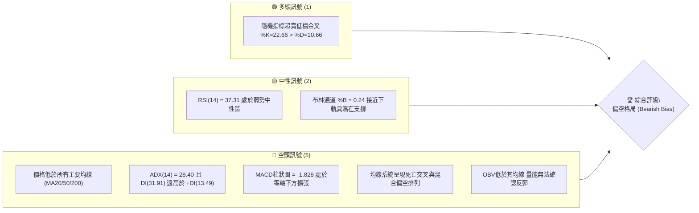

### 📊 核心指標速覽表

| 指標類別 | 指標名稱 | 當前數值 | 訊號 | 解讀 |
|----------|----------|----------|:---:|------|
| **價格** | 當前價格 | $151.64 | 🔴 | 位於 52 週區間之 34.5%，自高點回調近半 |
| **均線** | MA20 | $179.56 | 🔴 | 價格低於 MA20 達 -15.55%，短線下行趨勢顯著 |
| **均線** | MA50 | $206.96 | 🔴 | 價格低於 MA50 達 -26.73%，中期生命線遭受實質跌破 |
| **均線** | MA200 | $177.89 | 🔴 | 跌破牛熊分界線 MA200 達 -14.76%，長線轉弱 |
| **動能** | RSI(14) | 37.31 | 🟡 | 位於弱勢中性區間 (30–70)，未觸及極端超賣 (<30) |
| **動能** | MACD | -17.331 | 🔴 | DIF (-17.331) < DEA (-15.503)，MACD 柱狀圖為 -1.828，空頭主導 |
| **波動** | ATR(14) | $15.78 | 🔴 | ATR 佔股價高達 10.40%，單日價格高波動性，交易風險極高 |

### 🏆 技術評分卡

```
╔══════════════════════════════════════════════════════════════╗
║                技術評分卡 — NBIS (2026-11-04)               ║
╠══════════════════════════════════════════════════════════════╣
║ 趨勢強度      ██████░░░░░░░░░░░░░░  30/100  🔴 空頭強趨勢主導 ║
║ 動能指標      ███████░░░░░░░░░░░░░  35/100  🔴 動能指標弱勢偏空 ║
║ 支撐穩定度    ████████░░░░░░░░░░░░  40/100  🟡 臨近S1考驗支撐 ║
║ 成交量配合    ██████░░░░░░░░░░░░░░  30/100  🔴 量能萎縮且OBV疲弱 ║
║ 形態完整度    ████████░░░░░░░░░░░░  40/100  🟡 破位後構築整理 ║
║ 均線排列      ████░░░░░░░░░░░░░░░░  20/100  🔴 全面承壓於各均線 ║
╠══════════════════════════════════════════════════════════════╣
║ 綜合評分      ██████░░░░░░░░░░░░░░  33/100  🔴 偏空弱勢格局   ║
╚══════════════════════════════════════════════════════════════╝
```
*註：綜合評分 = (30 + 35 + 40 + 30 + 40 + 20) ÷ 6 = 32.5，四捨五入為 33/100。*

---

## 2. 趨勢分析

### 🌐 多時框趨勢分析

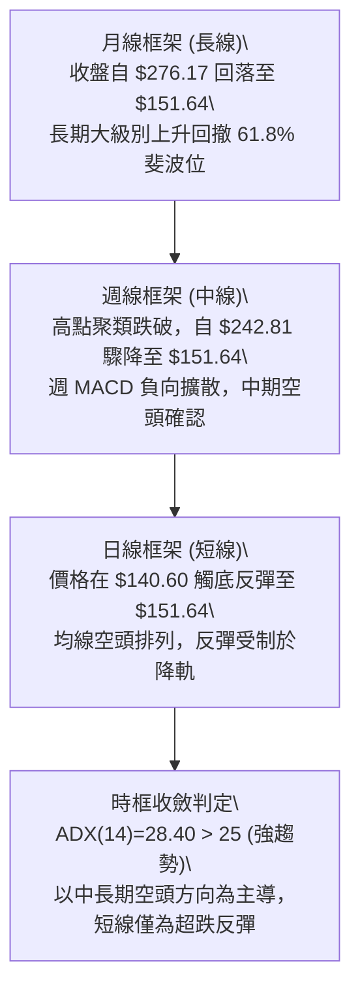

### 📈 長期趨勢 — 12個月走勢圖（Unicode）

```
NBIS 月線收盤走勢圖（2025-12 至 2026-11）
價格軸 ($)
$280 ┤                                  ● $276.17 (2026-06 高點)
$240 ┤                              ●                ● $235.88
$200 ┤                                      ●    ●
$160 ┤                          ●                          ● $154.14
$151 ┤━━━━━━━━━━━━━━━━━━━━━━━━━━━━━━━━━━━━━━━━━━━━━━━━━━━━━● $151.64 (當前)
$120 ┤                      ●
$80  ┤  ●        ●     ●
     └────────────────────────────────────────────────────────
       12   01   02   03   04   05  06   07   08   09   10   11 (月份)
```

#### 長期走勢特徵分析表

| 階段區間 | 起訖月份 | 價格變動 | 區間漲跌幅 | 主要走勢特徵 |
|:---|:---:|:---:|:---:|:---|
| 第一階段：蓄勢築底 | 2025-12 → 2026-02 | $83.71 → $91.19 | +8.94% | 於 $80–$90 區間縮量整理，構築中期底部 |
| 第二階段：主升暴漲 | 2026-02 → 2026-06 | $91.19 → $276.17 | +202.85% | 爆發性多頭單邊推升，創下 52 週歷史高點 $299.86 |
| 第三階段：高位劇震 | 2026-06 → 2026-09 | $276.17 → $235.88| -14.59% | 在 $190–$277 巨幅雙向洗盤，籌碼劇烈換手 |
| 第四階段：破位下挫 | 2026-09 → 2026-11 | $235.88 → $151.64| -35.71% | 連續單邊破位下殺，回吐前波漲幅並回測支撐 |

### 📊 中期趨勢（週線分析）

中期走勢圖示展現近 8 週由頂部急殺之空頭軌道：

```
週線走勢結構示意圖
$255.10 ┬─ 頂部反轉 (2026-10-09 當週高點)
        │ ╲
$221.07 ┼── 破位大黑K (2026-10-16 帶巨量 1.48億股跳空下殺)
        │    ╲
$182.74 ┼───── 弱勢反抽高點 (2026-10-30 當週高點)
        │       ╲
$151.64 ┼────────● 當前收盤價位 (回測斐波 61.8% $159.98 下方)
        │         │
$140.60 ┴─────────┴ 探底低點 (2026-11-03 測得波段低點)
```

週線指標顯示，RSI 已從高檔回落至 37.3，MACD 柱狀圖在近兩週連續維持負值（-1.365 與 -1.828），成交量在破位下殺週（10-16）達到 148,676,100 股的天量，代表機構籌碼出現集中式出脫，中期格局呈現標準的空頭下行通道。

### ⚡ 趨勢強度評估（ADX 解讀）

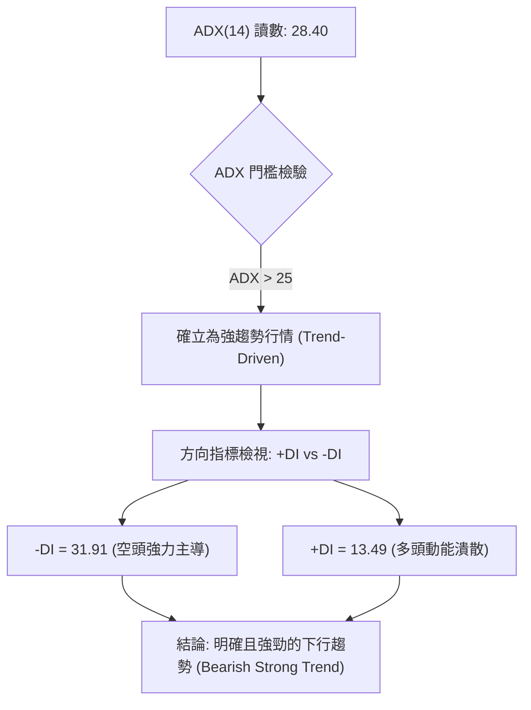

#### ADX 趨勢強度對照表

| 指標名稱 | 實際數值 | 參考標準區間 | 當前狀態解讀 |
|:---|:---:|:---:|:---|
| **ADX(14)** | 28.40 | > 25 為強趨勢；< 20 為無趨勢盤整 | 處於強勢單邊行情區間，趨勢延續性強 |
| **+DI(14)** | 13.49 | 越高多頭越強 | 處於極低水平，買盤主動攻擊力匱乏 |
| **-DI(14)** | 31.91 | 越高空頭越強 | 處於主導壓制高位，空方掌控盤面節奏 |
| **差值 (-DI - +DI)**| +18.42 | > 10 表空頭壓倒性優勢 | 呈現空頭絕對控制狀態，逆勢摸底風險極大 |

---

## 3. 圖表形態分析

### 🔍 形態識別系統

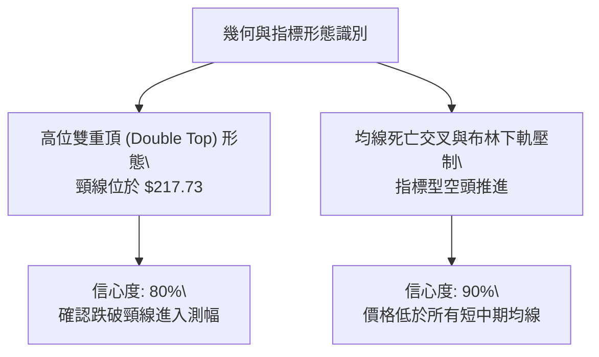

#### 圖表形態信心度與目標價計算表

| 形態名稱 | 信心度 | 判斷依據（引用數據） | 完成度 | 目標價（附計算式） |
|:---|:---:|:---|:---:|:---|
| **雙重頂 (Double Top)** | 80% | 頂部一高點 $255.10 (10-09)，頂部二高點 $250.48 (10-02)，跌破頸線 $217.73 (10-09 週低點) | 100%（已跌破） | 由形態高度推算：頸線 $217.73 − (高點 $255.10 − 頸線 $217.73) = $180.36（已達標）；延伸測幅引導至支撐位 S1 $145.80 及 S2 $132.70 |
| **短線下降旗形 / 破位整理** | 65% | 10-28 向上反抽至 $182.74 受阻，隨後連續回落跌破 $154.14 | 85% | 由旗形高度推算：旗桿起跌點 $182.74 − 旗面回踩幅點 $149.48 = 測幅下看 S2 $132.70 |
| **頭肩底 / 大型底部形態** | 0% | 數據中未偵測到任何反轉幾何底部結構 | 0% | 訊號不足，僅做指標型解讀 |

### 🕯️ 重要K線形態分析

根據「近10根日K」與「近8根週K」實際開高低收數據進行嚴格檢驗：

| 日期（日K/週K） | 開 | 高 | 低 | 收 | K線形態 | 技術解讀 | 訊號 |
|:---|:---:|:---:|:---:|:---:|:---|:---|:---:|
| 2026-10-16 (週K) | 217.20 | 217.20 | 163.27 | 165.47 | 光頭大黑K (破位長陰) | 開盤即最高，爆量1.48億股長陰摜破均線支撐 | 🔴 |
| 2026-10-28 (日K) | 173.49 | 182.74 | 168.92 | 182.34 | 光腳大陽線 (假突破) | 向上測試 MA20 ($179.56) 遇阻，為空頭結構中的誘多反抽 | 🟡 |
| 2026-10-30 (日K) | 157.05 | 161.42 | 149.96 | 154.14 | 破位跳空中黑K | 破壞前兩日反彈走勢，空頭重新掌握主導權 | 🔴 |
| 2026-11-02 (日K) | 154.56 | 155.35 | 140.60 | 141.39 | 帶長下影之大陰線 | 盤中殺跌創 $140.60 新低，雖有低接買盤但收盤極弱 | 🔴 |
| 2026-11-03 (日K) | 145.35 | 152.67 | 143.71 | 151.64 | 實體低檔陽線 (反彈K) | 低開高走收復 $150 關卡，形成初步止跌嘗試，量能偏低 | 🟢 |

### 📉 ASCII 走勢形態示意圖

```
NBIS 近兩週日K線走勢結構圖
$185 ┬                     ╭─ 10-28 假突破高點 $182.74
     │                    ┌┴┐
$170 ┼             ┌┐    │ │  ┌┐
     │      ┌┐    │ │    │ │  ││
$155 ┼─ ┌┐ ││    ││    └┬┘  ││    ┌┐             ╭─ 11-03 收盤 $151.64
     │  ││ └┴┐ ┌┐ ││         └┴┐ ┌┐││ ┌┐        ┌┴┐
$140 ┴──┴┘   └─┴┘ └┘           └─┴┘└┘ └┴┐     │ │
                                         └┬┘     └─┘
                                          ╰─ 11-02 最低 $140.60
       10-21 10-23 10-26 10-27 10-28 10-29 10-30 11-02 11-03 (日期)
```

### 🎯 形態目標價計算

根據雙重頂破位與波動階梯進行計算：
- **雙重頂頸線**：$217.73
- **形態波段頂點**：$255.10
- **垂直形態幅度**：$255.10 − $217.73 = $37.37
- **量度下行第一目標**：$217.73 − $37.37 = $180.36（此價位已被跌破，轉化為上方壓制層）
- **形態下行倍率測幅（1.618 倍）**：$217.73 − ($37.37 × 1.618) = $217.73 − $60.46 = $157.27（現價 $151.64 正處於該目標消化區）
- **延伸極限目標**：若無法收復 $159.98，量度跌幅將直接指向波段低點聚類支撐 S2 **$132.70**。

---

## 4. 支撐與阻力

### 🗺️ 關鍵價位分布圖（Unicode）

```
NBIS 價位結構分布圖
═══════════════════════════════════════════════════════════════
$254.92 ║██████████████████████████████║ 強阻力 R3 (歷史波段高點密集區)
$246.44 ║──────────────────────────────║ 斐波那契 23.6% 回調位
$231.17 ║████████████████████          ║ 重度阻力 R2 (反彈高點聚類)
$213.40 ║──────────────────────────────║ 斐波那契 38.2% 回調位
$186.69 ║──────────────────────────────║ 斐波那契 50.0% 中樞平衡位
$168.71 ║████████████████████████      ║ 關鍵阻力 R1 (近期反彈強壓)
$159.98 ║┈┈┈┈┈┈┈┈┈┈┈┈┈┈┈┈┈┈┈┈┈┈┈┈┈┈┈┈┈┈║ 斐波那契 61.8% 黃金分割線
$151.64 ╠══════════════════════════════╣ ◄ 現價 (2026-11-03 收盤價)
$145.80 ║▓▓▓▓▓▓▓▓▓▓▓▓▓▓▓▓              ║ 近期支撐 S1 (波段低點聚類)
$132.70 ║████████████████████████      ║ 強支撐 S2 (下軌與中期買盤密集區)
$121.96 ║──────────────────────────────║ 斐波那契 78.6% 極限回調位
$89.65  ║██████████████████████████████║ 核心防守 S3 (年內低位起漲聚合區)
═══════════════════════════════════════════════════════════════
```

### 🚧 阻力位分析表

所有阻力數值完全引用自系統計算之波段高點聚類：

| 阻力級別 | 價位 | 形成原因 | 突破難度 | 重要性 |
|:---|:---:|:---|:---:|:---:|
| **R1** | $168.71 | 近期波段反彈高點聚類，與下降趨勢線交叉，上方套牢盤密集 | 中等偏高 | 🟢 短期多空分水嶺，站上才具備技術性修復條件 |
| **R2** | $231.17 | 2026年9月至10月多次震盪平台高點聚類，伴隨鉅額成交量 | 極高 | 🔴 中期多頭反轉關鍵防線，未收復前均屬空頭趨勢 |
| **R3** | $254.92 | 歷史頂部波段高點聚類（逼近 10-09 高點 $255.10），主力出貨密集區 | 極高 | 🔴 強阻力天花板，中短期內難以逾越 |

### 🛡️ 支撐位分析表

所有支撐數值完全引用自系統計算之波段低點聚類：

| 支撐級別 | 價位 | 形成原因 | 守住機率 | 重要性 |
|:---|:---:|:---|:---:|:---:|
| **S1** | $145.80 | 近一年波段低點聚類，緊鄰 11-02 探底實體區，短線多頭第一防線 | 50% | 🟡 極為關鍵，失守則引發停損賣壓 |
| **S2** | $132.70 | 次級波段低點聚類，接近布林通道下軌 ($126.38) 之重要防護帶 | 65% | 🟢 中期強力支撐位，機構空頭獲利了結區 |
| **S3** | $89.65 | 2026年年初起漲平台聚合區，為基本面防守之極限底線 | 85% | 🟢 終極長線戰略支撐，破位則長期架構瓦解 |

### 📐 斐波那契回調位分析

依據 52 週區間 **$73.52 → $299.86** 計算之精準回調位：

- **0.0% (52W High)**: $299.86
- **23.6%**: $246.44
- **38.2%**: $213.40
- **50.0%**: $186.69
- **61.8%**: $159.98
- **78.6%**: $121.96
- **100.0% (52W Low)**: $73.52

#### 斐波那契區間深度解讀
當前現價 **$151.64** 坐落於 **61.8% ($159.98)** 與 **78.6% ($121.96)** 之間。
黃金分割位 61.8% ($159.98) 原為牛市最強回調支撐，但已被實質性擊穿，表明此輪下跌已超出健康回檔範疇，演變為深幅回撤。若現價無法迅速以帶量紅K逆轉收復 $159.98，價格在技術慣性驅使下，將進一步下探次級斐波那契回調位 78.6%（$121.96），該位置緊扣支撐位 S2 ($132.70)。

---

## 5. 技術指標深度解讀

### 🎛️ 指標訊號總覽

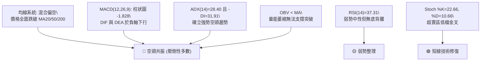

### 📈 移動平均線排列分析

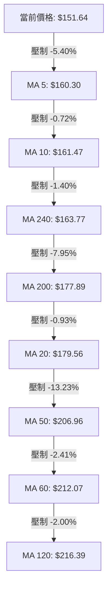

#### 均線架構解讀表

| 均線名稱 | 數值 | 價格相對於均線幅度 | 走勢特徵與解讀 |
|:---|:---:|:---:|:---|
| **MA 5** | $160.30 | -5.40% | 短期極速下壓線，構成超短線反彈首道天花板 |
| **MA 20** | $179.56 | -15.55% | 月線級生命線，快速向下傾斜，展現中期殺跌慣性 |
| **MA 50** | $206.96 | -26.73% | 季線中期趨勢指標，高位死叉 MA120，結構遭嚴重破壞 |
| **MA 200**| $177.89 | -14.76% | 長期牛熊分水嶺，跌破該線代表長線多頭架構轉入休眠 |
| **MA 240**| $163.77 | -7.41% | 接近價格之上方密集帶，為空方反撲集結點 |

當前均線系統呈現「混合偏空排列」，短中長期均線呈現向下覆蓋式壓制，股價居於全部均線下方，任何未放量的抽升均屬均線負乖離率過大所引發的技術性修復。

### 📉 RSI(14) 分析

```
RSI(14) 動能刻度尺
0 ─────────── 30 ──────── 37.31 ──────── 50 ─────────── 70 ─────────── 100
[  極端超賣區  ] [當前讀數]             [  中軸強弱分界  ] [  極端超買區  ]
進度條: ███████████████░░░░░░░░░░░░░░░░░░░░ 37.31%
```

- **超買超賣判定**：RSI(14) 當前讀數為 **37.31**，位於 30 至 70 的中性偏弱區間，尚未跌破 30 進入技術超賣區，表示空頭殺跌動能尚未完全衰竭，市場尚未出現恐慌性情緒洗盤。
- **背離檢驗**：近 20 根 K 棒中，價格自 10-21 收盤 $171.57 下跌至當前 $151.64，RSI 自 10-16 週的 30.6 緩慢回升至 37.31。但比對價格低點（11-02 創 $140.60 新低）與 RSI 軌跡，系統確認**無明顯背離**（僅為隨機震盪指標與小幅反彈波動），缺乏支撐反轉的底背離架構。

### 📊 MACD(12/26/9) 訊號解讀

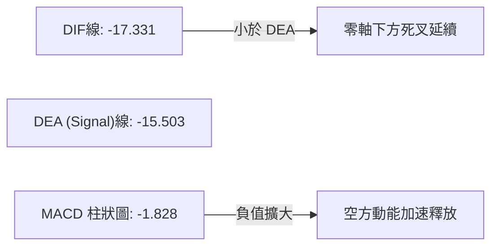

- **MACD 線**：-17.331
- **訊號線 (Signal)**：-15.503
- **柱狀圖 (Histogram)**：-1.828
- **深度研判**：DIF 與 DEA 均位於零軸深處下方，且 DIF 處於 Signal 線之下，顯示中長線空方勢力占據絕對主導。柱狀圖持續呈現負值（-1.828），雖較 10-16 當週的 -7.494 負值有所收斂，但日線動能仍持續由空頭控盤，未見柱狀圖由負翻正之多頭逆轉信號。

### 📦 布林通道分析

```
ASCII 布林通道位置圖 (帶寬: $106.36)
$232.74 ┬──────────────────────────────────────── 布林上軌 (阻力帶)
        │
$179.56 ┼ - - - - - - - - - - - - - - - - - - - - 布林中軌 (MA20 壓制線)
        │
$151.64 ┼──────● 當前收盤價位 (%B = 0.24)
        │
$126.38 ┴──────────────────────────────────────── 布林下軌 (支撐極限)
```

- **上軌**：$232.74 ｜ **中軌 (MA20)**：$179.56 ｜ **下軌**：$126.38
- **%B 指標**：**0.24**（接近下軌 0 軸，遠離中軌 0.5）
- **形態分析**：通道帶寬開口大幅擴張（上軌與下軌相差 $106.36），%B 為 0.24 意味價格正沿著下軌區域進行弱勢尋底。股價在跌破中軌後未能快速收復，布林通道中軌 $179.56 已構築為短中期反彈的堅固堡壘。

### 💹 成交量分析（量價配合度）

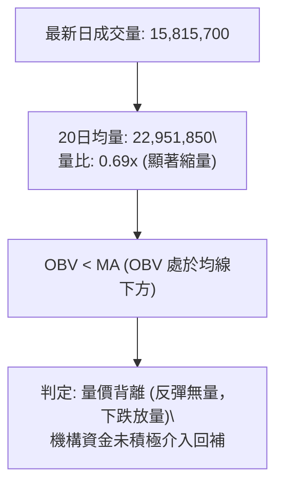

- **量能萎縮**：最新成交量為 15,815,700 股，相較於 20 日均量（22,951,850 股），量比僅為 **0.69x**，表明 11-03 價格回升至 $151.64 僅為無量反抽。
- **OBV 能量潮**：OBV 指標持續位於其均線下方運作，顯示資金籌碼仍在淨流出通道中。在下殺波段（如 10-16 週量達 1.48 億股）成交量急劇放大，而在止跌收紅時成交量銳減，呈現經典的「放量下跌、縮量反彈」空頭量價配合模式。

---

## 6. 動能與波動率

### ⚡ 動能評估四象限

| 象限 | 動能狀態 | 波動率狀態 | 當前標的吻合度 | 市場操作涵義 |
|:---:|:---:|:---:|:---:|:---|
| **Q1** | 強多頭動能 | 低波動率 | 否 | 最佳趨勢性買入持有區 |
| **Q2** | 弱多頭動能 | 低波動率 | 否 | 橫盤窄幅震盪，觀望為主 |
| **Q3** | 強空頭動能 | 高波動率 | **✓ (當前狀態)** | **高風險高破壞性空頭單邊區，嚴禁盲目摸底** |
| **Q4** | 弱空頭動能 | 高波動率 | 否 | 築底洗盤階段，具備潛在反轉契機 |

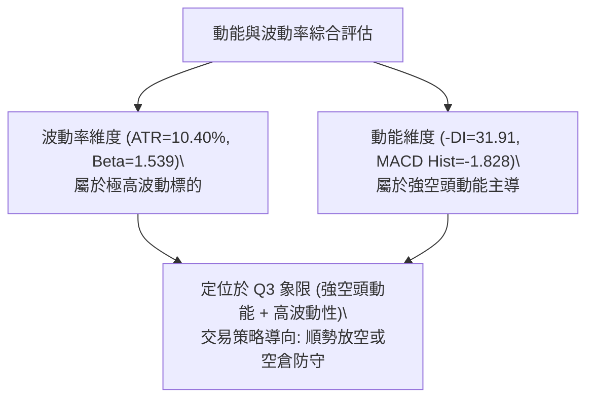

### 📊 ATR 波動率分析

- **ATR(14) 數值**：**$15.78**
- **ATR 佔比**：高達股價的 **10.40%**（Wilder 標準），說明該股單日平均正常震盪空間可達 $15 以上。
- **止損距離建議**：
  - 超短線策略止損距：至少需設定 1.0 × ATR = **$15.78**
  - 波段順勢策略止損距：建議設定 1.5 × ATR = **$23.67**
  - **風控指引**：由於 ATR 佔比逾 10%，任何過於狹窄的止損（如 3%–5%）極易被日常隨機雜訊掃出場，部位規模必須嚴格縮減至標準部位的 1/3 以下。

### 📐 Beta 與市場相關性

- **Beta 係數**：**1.539**
- **市場特徵解讀**：NBIS 具備高 Beta 成長型與投機型科技股特徵，其價格波動幅度為大盤（S&P 500）的 1.54 倍。在大盤處於調整或市場風險偏好（Risk-off）降溫時，高 Beta 特性將加速其回撤速度；高空頭部位比率（Short % Float 達 **20.2%**，Short Ratio 2.61）顯示市場空方籌碼重度鎖定，放大了流動性踩踏與單邊下行的烈度。

---

## 7. 多時框架總結

### 📋 時框架評分表

| 時框架 | 趨勢方向 | 動能狀態 | 均線排列 | 形態結構 | 綜合評分 | 建議 |
|:---|:---:|:---:|:---:|:---:|:---:|:---|
| **短期 (日線)** | 偏空震盪反彈 | 隨機指標超賣金叉，RSI=37.31 | 全面承壓於 MA5/10/20 | 探底 $140.60 弱勢回抽 | 35/100 | 嚴控多頭倉位，逢高減碼 |
| **中期 (週線)** | 空頭單邊主導 | 週 MACD 負向放大，週量能渙散 | 跌破 20 週均線支撐 | 雙頂跌破頸線進入測幅 | 28/100 | 波段順勢放空或全面觀望 |
| **長期 (月線)** | 長期回撤修正 | 高檔獲利回吐，未見逆轉紅K | 跌破 MA200，考驗起漲均線 | 回撤 52W 區間 61.8% | 36/100 | 長期投資者暫停定投進場 |

### 🔲 綜合訊號矩陣

| 維度 | 短期 (日線) | 中期 (週線) | 長期 (月線) | 訊號一致性評估 |
|:---|:---:|:---:|:---:|:---|
| **趨勢強度 (ADX)** | 強 (ADX=28.40) | 強 (-DI 遠大於 +DI) | 強 (單邊回撤) | 🟢 三時框完全一致，確立強下行趨勢 |
| **動能指標** | 弱反彈 (Stoch 金叉) | 極弱 (MACD 負向) | 轉弱 (回吐漲幅) | 🟡 短期動能超跌，但中長線動能壓制 |
| **關鍵支撐** | 測試 S1 $145.80 | 考驗 S2 $132.70 | 防守 S3 $89.65 | 🟢 支撐逐級下移，重心下沉 |

### ⚖️ 多時框收斂結論

依據多時框收斂規則進行層級判定：
1. **趨勢/盤整檢驗**：當前 ADX(14) = **28.40 > 25**，市場確認處於**強趨勢行情**而非震盪盤整行情。
2. **時框主導優先級**：在強趨勢格局下，必須以**中長期（週線 / MA50 / MA200）方向為主導**，日線級別的指標反彈（如隨機指標低檔金叉、單日收紅）僅作為空頭趨勢中的次級折返走勢，絕不可視為逆轉反轉信號。
3. **唯一方向性結論**：**🔴 偏空弱勢格局 (Bearish Bias)**。整體技術架構完全受制於均線死亡交叉與空頭趨勢推進，交易思維以「順勢逢高沽空」或「場外空倉觀望」為核心，日線之任何反抽均為尋求逢高佈空之防守點位。

---

## 8. 交易策略建議

### 🗺️ 策略決策流程圖

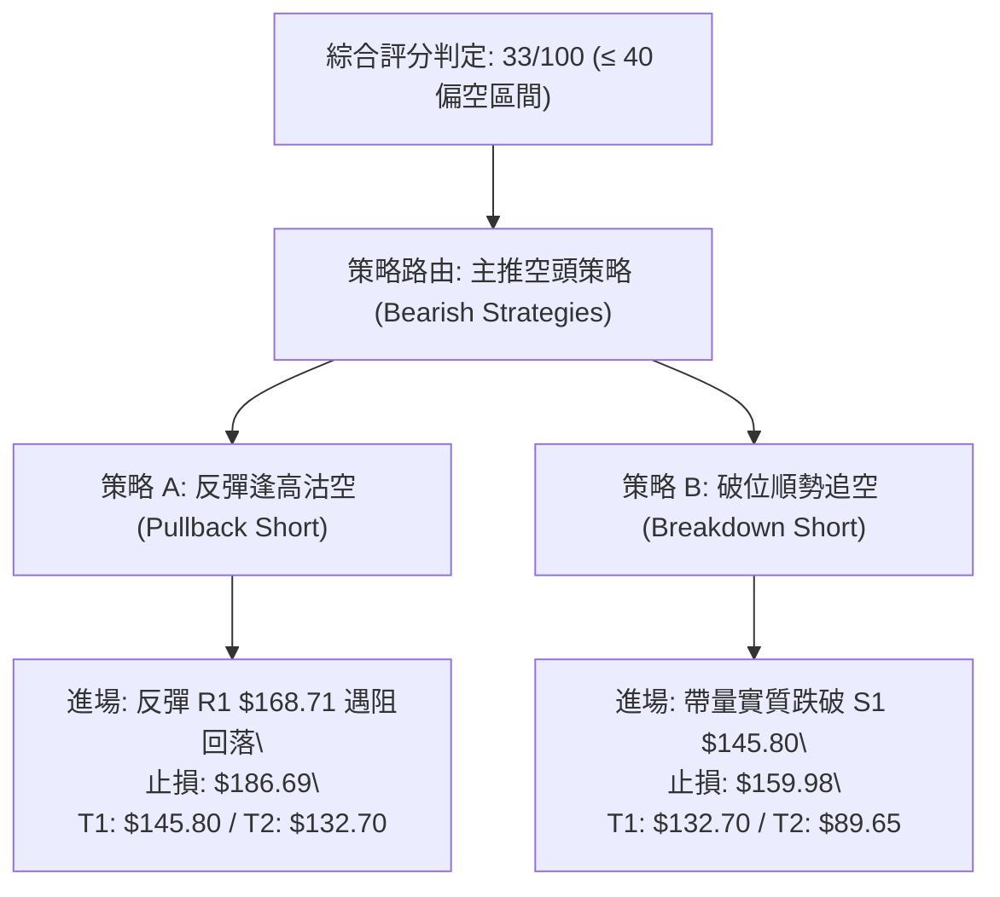

### 🧭 策略路由（依評分卡分流）

> **當前主策略方向 = 主推空頭策略（依綜合評分 33/100 判定）**
> 
> 依據技術評分卡標準，綜合評分低於 40 分（現為 33 分），市場由強烈空頭趨勢統治。本報告嚴禁多空兩頭下注，交易策略**主推空頭做空與風險防護配置**；多頭反彈僅作為「反轉風險觸發點（對沖提示）」監控，不予推薦主動開倉做多。

### 🎯 價格情境階梯（Price Scenarios）

價位完全嚴格引用自數據之「關鍵價位」與「斐波那契回調位」：

| 觸發條件 | 下一目標 | 後續延伸 | 情境技術含義 |
|:---|:---:|:---:|:---|
| **反彈受阻於 R1 $168.71** | S1 $145.80 | S2 $132.70 | 短線反彈動能衰竭，空頭趨勢重啟向下測底 |
| **向下擊穿 S1 $145.80** | S2 $132.70 | S3 $89.65 | 中期支撐潰散，下行空間全面打開進入極限下探 |
| **強勢突破 R1 $168.71** | R2 $231.17 | R3 $254.92 | 短線嚴重超賣修正，空頭結構遭遇初步威脅 |

### 📊 情境機率分佈

| 情境名稱 | 機率 | 主要依據（指標狀態引用） |
|:---|:---:|:---|
| **情境一：震盪回落 / 跌破探底** | **60%** | ADX=28.40 且 -DI=31.91 強勢主導，MACD 柱狀圖為 -1.828，OBV 疲軟量能不濟 |
| **情境二：S1 至 R1 區間弱勢震盪**| **25%** | 布林通道 %B=0.24 接近下軌，Stoch %K 產生低檔金叉，存在技術性弱反彈拉扯 |
| **情境三：強勢反轉持續上行** | **15%** | 均線系統呈重重壓制，未形成任何底部形態，機率極低，需天量資金扭轉 |

### 🟢 主策略詳情（方向依上方路由：空頭策略）

進場價採區間中點或精準觸發價計算，風險報酬比格式嚴格遵循規範：

| 策略要素 | 策略 A：反彈逢高沽空 (Pullback Short) | 策略 B：跌破關鍵支撐追空 (Breakdown Short) |
|:---|:---|:---|
| **進場條件** | 價格反彈至阻力位 R1 附近出現滯漲阻力訊號 | 價格實體大陰線跌破支撐位 S1 並確認收盤有效 |
| **進場價格** | **$168.71** (阻力位 R1 精確價) | **$145.80** (支撐位 S1 精確破位點) |
| **止損價格** | **$186.69** (斐波那契 50.0% 關鍵位上方) | **$159.98** (斐波那契 61.8% 關鍵回調位) |
| **目標價 T1** | **$145.80** (支撐位 S1) | **$132.70** (支撐位 S2) |
| **目標價 T2** | **$132.70** (支撐位 S2) | **$89.65** (核心防守 S3) |
| **風險報酬比** | **1 : 1.27（以 T1 計）**<br>*註：(168.71-145.80)/(186.69-168.71) = 22.91/17.98 = 1.27*<br>*另列至 T2：1 : 2.00（以 T2 計）* | **1 : 0.92（以 T1 計）**<br>*註：(145.80-132.70)/(159.98-145.80) = 13.10/14.18 = 0.92*<br>*另列至 T2：1 : 3.96（以 T2 計）* |
| **成功機率** | 65% | 60% |
| **建議倉位** | 10%–15% 總資金倉位 | 5%–10% 總資金倉位 |

### 🔴 反向風險觸發點（對沖提示）

若出現以下異常訊號，表明主推之空頭策略遭到嚴重挑戰，必須無條件執行空頭止損並進行部位避險：
1. **價格突破 R1 $168.71** 且日 K 線收盤站穩其上方，代表短線下行通道破裂。
2. **日線 MACD 柱狀圖翻正**（升穿 0 軸），且伴隨單日成交量突破 20 日均量之 1.5 倍（> 34,400,000 股）。
3. **空頭止損警戒總界線**：**$179.56 (MA20)**。若價格重返 MA20 上方，所有做空部位全數平倉觀望。

### ⭐ 整體訊號強度評星

```
做多訊號強度：★☆☆☆☆  (1/5星)  — 極弱，僅隨機指標超賣，缺乏買盤支撐
做空訊號強度：★★★★☆  (4/5星)  — 極強，均線、動能與趨勢指標形成共振
整體可信度：  ★★★★☆  (4/5星)  — 高度可信，多時框空頭結構特徵鮮明
```

---

## 9. 風險提示與監控

### ✅ 關鍵監控指標 Checklist

```
╔══════════════════════════════════════════════════════════════╗
║               NBIS 技術面每日監控檢查清單 (Checklist)        ║
╠══════════════════════════════════════════════════════════════╣
║ [ ] 價格能否有效防守 S1 關鍵支撐 ($145.80)                  ║
║ [ ] RSI(14) 是否跌破 30 進入極度超賣或形成強勢底背離         ║
║ [ ] 成交量是否連續超越 20日均量 (22,951,850 股) 出現爆量承接 ║
║ [ ] ADX(14) 讀數是否回落至 25 以下，表徵空頭趨勢衰竭轉盤整 ║
║ [ ] 價格反彈測試 MA20 ($179.56) 是否產生放量真突破          ║
║ [ ] 軋空風險監控：Short Float 達 20.2%，警惕空頭回補爆發脈衝║
╚══════════════════════════════════════════════════════════════╝
```

### ⚠️ 風險場景分析

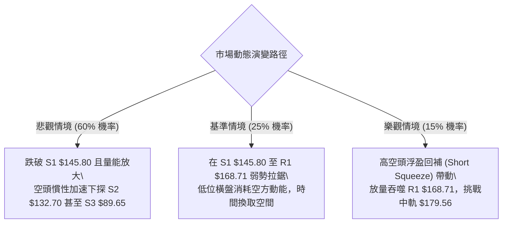

### 🛡️ 風險管理重要提醒

1. **極度波動性風險（ATR 高達 10.40%）**：
   - NBIS 單日 ATR 高達 $15.78，標的資產的日內高低點震盪劇烈。普通帳戶絕不可採取重倉交易模式，單一交易策略之停損損失金額，嚴格控制在總投資組合淨值的 **1.0% 以內**。
2. **軋空（Short Squeeze）潛在風險**：
   - 儘管當前空頭趨勢強烈，但其 Short % Float 高達 **20.2%**，短期流通盤中每 5 股即有 1 股處於被借券做空狀態。一旦出現突發性利好或大盤暴力拉升，極易引發做空資金踩踏式平倉回補，導致股價短線暴拉（如 10-28 單日大漲逾 7% 的情況）。因此，所有空頭頭寸必須嚴格設定強制止損點，不得進行無保護的裸空操作。
3. **資金管理與部位規模計算**：
   - 假定投資組合資產為 $100,000，單筆容忍最大虧損為 1% ($1,000)。
   - 執行策略 A（進場 $168.71，止損 $186.69，每股風險 = $17.98）：
   - 最大可配置股數 = $1,000 ÷ $17.98 ≈ **55 股**（持倉市值約 $9,279，佔比約 9.3%，符合低於 15% 倉位之風控標準）。

---

## 📋 報告總結

```
╔══════════════════════════════════════════════════════════════╗
║                   NBIS 技術分析報告總結                      ║
╠══════════════════════════════════════════════════════════════╣
║ 報告日期：2026-11-04                                         ║
║ 當前價格：$151.64                                            ║
║ 綜合評分：33 / 100                                           ║
║ 分析評級：🔴 偏空弱勢格局 (Bearish Bias)                     ║
╠══════════════════════════════════════════════════════════════╣
║ 關鍵結論：                                                   ║
║ ├─ 長期趨勢：🔴 跌破 MA200，回吐 52W 漲幅逾 61.8%           ║
║ ├─ 中期趨勢：🔴 雙頂頸線跌破，ADX=28.40 強下行趨勢主導      ║
║ ├─ 短期趨勢：🟡 探底 $140.60 後超賣小幅反抽，但上方受均線壓制║
║ ├─ 關鍵支撐：S1 $145.80 ｜ S2 $132.70 ｜ S3 $89.65           ║
║ ├─ 關鍵阻力：R1 $168.71 ｜ R2 $231.17 ｜ R3 $254.92          ║
║ └─ 分析師共識目標：$281.00 (基本面長期目標，目前與技術面背離) ║
╠══════════════════════════════════════════════════════════════╣
║ 最優策略組合：                                               ║
║ 1. 🥇 最佳機會：策略 A (反彈至 R1 $168.71 逢高放空，看 S1/S2)║
║ 2. 🥈 次選機會：策略 B (帶量跌破 S1 $145.80 追空，看 S2 $132)║
║ 3. 🥉 保守選擇：保持 100% 空倉觀望，耐心等待底部確立結構    ║
╚══════════════════════════════════════════════════════════════╝
```

---

> ⚠️ **免責聲明**：本報告為依據量化技術指標與價格數據所生成之技術分析，所有數據及估算均基於市場歷史行情資訊。本報告**僅供研究與學術參考**，**不構成任何要約、推薦或投資建議**。金融市場投資具備極高風險，投資人應獨立評估自身風險承受能力並自行承擔交易結果。

---

*報告生成時間：2026-11-04 ｜ 數據來源：Yahoo Finance ｜ 分析框架：資深多時框技術分析模型*