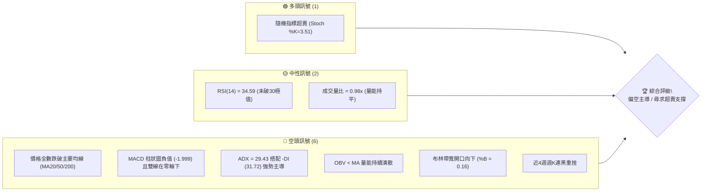
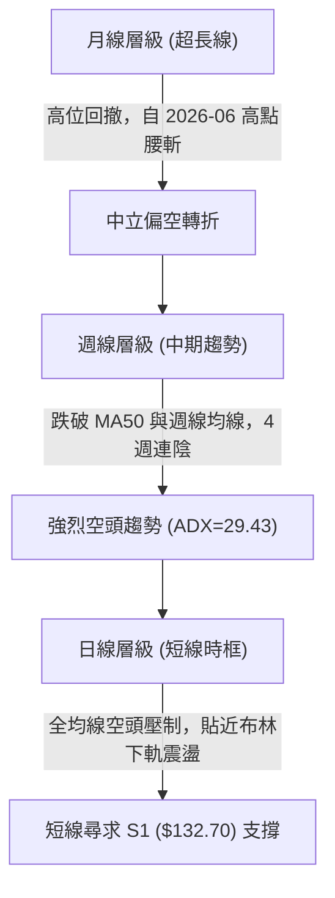
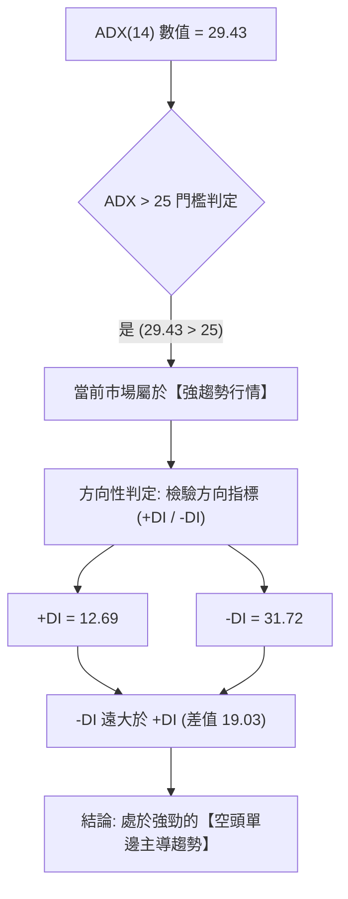
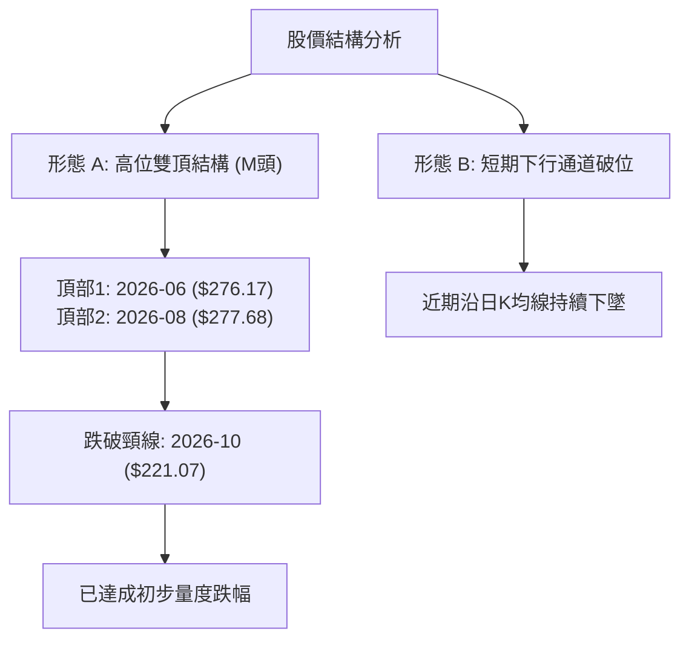
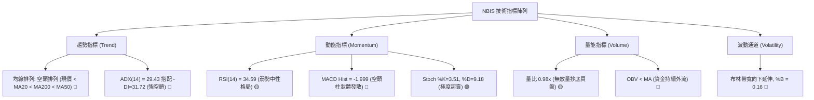
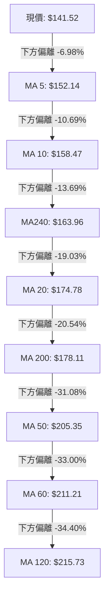
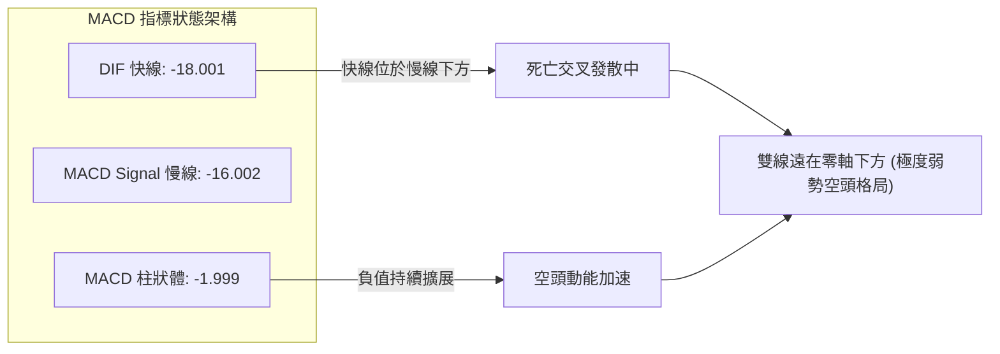
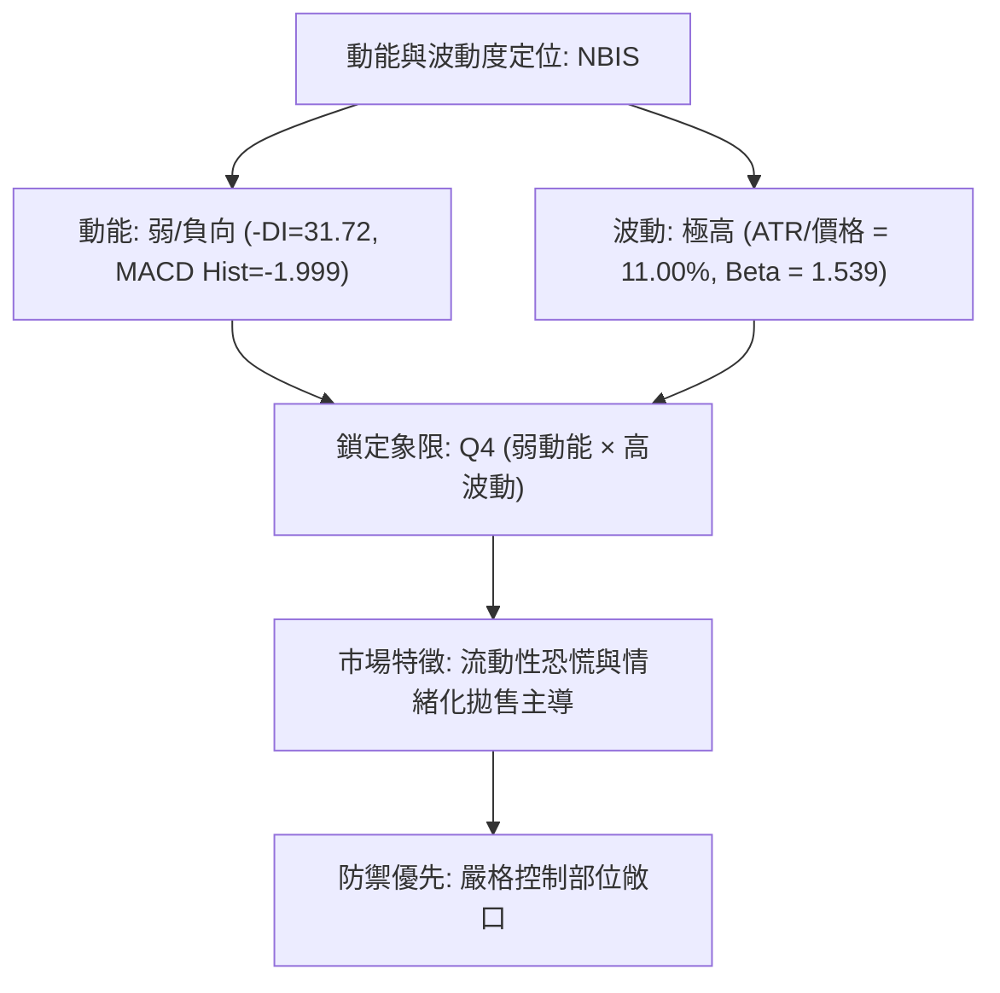
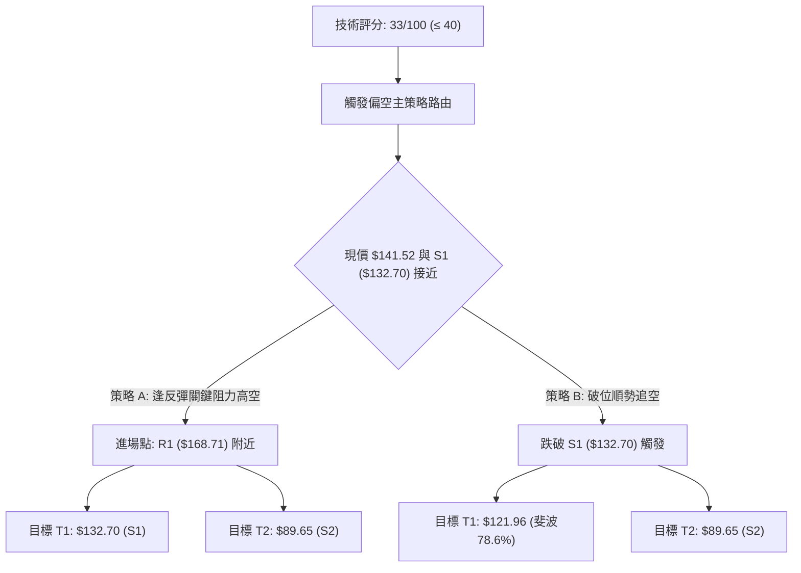
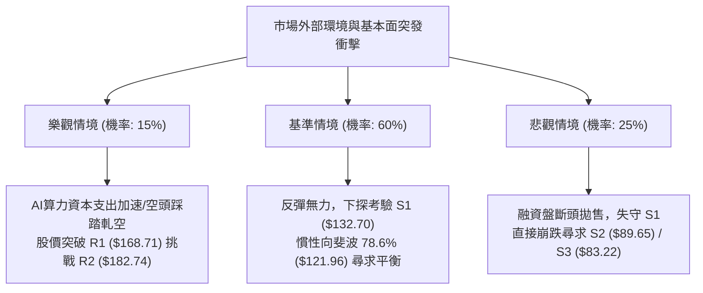

# NBIS 技術分析報告

> **報告日期**：2026-11-05 ｜ **語言**：繁體中文 ｜ **數據來源**：Yahoo Finance ｜ **當前價格**：$141.52

---

## 目錄

| 章節 | 內容 |
|------|------|
| [1. 技術面概覽](#1-技術面概覽) | 訊號儀表板、核心指標、評分卡 |
| [2. 趨勢分析](#2-趨勢分析) | 多時框趨勢、長中短期走勢 |
| [3. 圖表形態分析](#3-圖表形態分析) | 形態識別、K線組合、目標價 |
| [4. 支撐與阻力](#4-支撐與阻力) | 關鍵價位、斐波那契回調 |
| [5. 技術指標深度解讀](#5-技術指標深度解讀) | MA/RSI/MACD/布林/成交量 |
| [6. 動能與波動率](#6-動能與波動率) | 動能評估、ATR、Beta |
| [7. 多時框架總結](#7-多時框架總結) | 時框架評分矩陣 |
| [8. 交易策略建議](#8-交易策略建議) | 多空策略、風險報酬比 |
| [9. 風險提示與監控](#9-風險提示與監控) | 監控指標、風險場景 |

---

## 1. 技術面概覽

### 🎯 技術訊號儀表板



### 📊 核心指標速覽表

| 指標類別 | 指標名稱 | 當前數值 | 訊號 | 解讀 |
|----------|----------|----------|------|------|
| **價格** | 當前收盤價 | $141.52 | 🔴 | 位於52週區間 30.0%，自歷史高位大幅回撤 |
| **均線** | MA20 | $174.78 | 🔴 | 現價低於 MA20 達 -19.03%，短線處於下行通道 |
| **均線** | MA50 | $205.35 | 🔴 | 現價低於 MA50 達 -31.08%，中期空頭主導 |
| **均線** | MA200 | $178.11 | 🔴 | 現價低於長線生命線 MA200 達 -20.54%，長空格局確立 |
| **動能** | RSI(14) | 34.59 | 🟡 | 位於弱勢中性格局，逼近 30 超賣門檻但未現背離 |
| **動能** | MACD Hist | -1.999 | 🔴 | MACD (-18.001) 低於訊號線 (-16.002)，空頭動能擴散 |
| **動能** | Stoch %K / %D | 3.51 / 9.18 | 🟢 | 進入極度超賣區間，短線存在技術性反抽動能 |
| **趨勢** | ADX(14) | 29.43 | 🔴 | ADX > 25 且 -DI(31.72) 遠高於 +DI(12.69)，空頭趨勢強烈 |
| **波動** | ATR(14) | $15.57 | 🔴 | ATR 佔股價 11.00%，每日震幅極大，風險係數高 |
| **量能** | OBV 趨勢 | OBV < MA | 🔴 | 資金持續淨流出，量能疲弱未見實質買盤進駐承接 |

### 🏆 技術評分卡

```
╔══════════════════════════════════════════════════════════════╗
║              技術評分卡 — NBIS (2026-11-05)                   ║
╠══════════════════════════════════════════════════════════════╣
║ 趨勢強度      ████████░░░░░░░░░░░░  40/100  🔴 空頭強勢       ║
║ 動能指標      ██████░░░░░░░░░░░░░░  30/100  🔴 負向擴散       ║
║ 支撐穩定度    ████████░░░░░░░░░░░░  40/100  🟡 臨近S1考驗     ║
║ 成交量配合    ██████░░░░░░░░░░░░░░  30/100  🔴 量價疲弱       ║
║ 形態完整度    ████████░░░░░░░░░░░░  40/100  🔴 下行破位       ║
║ 均線排列      ████░░░░░░░░░░░░░░░░  20/100  🔴 全面承壓       ║
╠══════════════════════════════════════════════════════════════╣
║ 綜合評分      ███████░░░░░░░░░░░░░  33/100  🔴 偏空格局       ║
╚══════════════════════════════════════════════════════════════╝
```
*註：綜合評分由六項子評分算術平均所得：(40 + 30 + 40 + 30 + 40 + 20) ÷ 6 = 33.33，四捨五入為 33/100。*

---

## 2. 趨勢分析

### 🌐 多時框趨勢分析



### 📈 長期趨勢 — 12個月走勢圖（Unicode）

```
NBIS 月線收盤走勢圖（過去12個月：2025-12 至 2026-11）
價格軸 ($)
$300 ┤                                
$275 ┤                           ●(2026-06: $276.17)
$250 ┤                                 
$225 ┤                      ●(05: $231.09)     ●(09: $235.88)
$200 ┤                               ●(07: $190.41)  
$175 ┤                                    ●(08: $206.32)
$150 ┤                                            ●(10: $154.14)
$125 ┤                 ●(04: $138.23)                 ●←現價 $141.52 (11月)
$100 ┤            ●(03: $103.76)
 $75 ┤ ●(12: $83.71)  ●(02: $91.19)
     └─┬────┬────┬────┬────┬────┬────┬────┬────┬────┬────┬────
      12   01   02   03   04   05   06   07   08   09   10   11 (月份)
     [---------- 2025-2026 階段升浪 ----------][-- 雙峰回落破位段 --]
```

#### 走勢特徵分析表格

| 階段區間 | 時間跨度 | 起始價 → 終止價 | 漲跌幅 | 結構特徵與技術意義 |
|----------|----------|-----------------|--------|--------------------|
| 第一階段：基礎築底 | 2025-11 ~ 2026-02 | $94.87 → $91.19 | -3.88% | 80-95 美元低檔箱型橫盤整理，浮額沉澱完成 |
| 第二階段：主升推升 | 2026-02 ~ 2026-06 | $91.19 → $276.17 | +202.85% | 伴隨 AI 基礎設施爆發式營收成長，月線呈現拋物線主升段 |
| 第三階段：高位分歧 | 2026-06 ~ 2026-09 | $276.17 → $235.88 | -14.59% | 劇烈寬幅洗盤，兩次反彈衝擊 $270 上方未果，形成雙頂隱患 |
| 第四階段：加速崩跌 | 2026-09 ~ 2026-11 | $235.88 → $141.52 | -40.00% | 跌破多道中期均線，單月跌幅近百點，空頭趨勢加速成形 |

### 📊 中期趨勢（週線分析）

從近 20 週收盤走勢可見，股價在 2026-08-14 創下週收盤高點 $277.68 後，動能迅速衰竭。在 2026-10-09 當週跌破關鍵頸線後，連續四週收黑（$221.07 → $165.47 → $158.74 → $154.14 → $141.52），週成交量在破位第一週暴增至 148,676,100 股，顯現機構出逃跡象。

```
週線關鍵壓力與支撐階梯示意圖：
$231.17 ────────────────────────────── R3 強阻力（前波震盪平台下緣）
         ▼ 崩跌區間（量能放大）
$182.74 ────────────────────────────── R2 波段阻力
$168.71 ────────────────────────────── R1 短期反彈阻力
$141.52 ══════════════════════════════ [現價位置 $141.52]
$132.70 ------------------------------ S1 近期支撐（前波波段低點）
$ 89.65 ══════════════════════════════ S2 長期強支撐（2026年初起漲平台）
```

### ⚡ 趨勢強度評估（ADX 解讀）



#### ADX 趨勢強度對照表

| 指標名稱 | 當前數值 | 參考標準 | 狀態評估 | 實質交易意義 |
|----------|----------|----------|----------|--------------|
| **ADX(14)** | 29.43 | > 25 (強趨勢) | 🟢 強趨勢確認 | 宣告盤整策略失效，市場處於明確趨勢軌道中 |
| **+DI(14)** | 12.69 | < 20 (多頭動能低迷) | 🔴 多方完全失守 | 買盤力量渙散，無力組織持續性上攻 |
| **-DI(14)** | 31.72 | > 30 (空頭強烈主導) | 🔴 空方力量極盛 | 賣壓強勁且持續控盤，下行風險依舊佔優 |

---

## 3. 圖表形態分析

### 🔍 形態識別系統



#### 圖表形態信心度表格

| 形態名稱 | 信心度 | 判斷依據（引用數據） | 完成度 | 目標價（附計算式） |
|----------|--------|----------------------|--------|--------------------|
| **大型雙重頂 (M-Top)** | 85% | 頂部一為 2026-06 週收盤高點附近 $276.17，頂部二為 2026-08-14 週收盤 $277.68；跌破波段低點頸線（約 2026-07-17 收盤 $177.71）。 | 90% | 頸線 $177.71 − 形態高度 ($277.68 − $177.71 = $99.97) = **$77.74**（極度貼近 52W 低點 $73.52 及 S3 $83.22 聚類區）。 |
| **短線反彈旗形向下破位** | 70% | 2026-10-27 至 10-29 日K出現小幅反彈至高點 $182.74（觸及 R2），隨後於 10-30 吞噬下破。 | 100% | 由旗形上軌 $182.74 跌破旗形低點 $154.14，高度差 $28.60；破位點 $154.14 − $28.60 = **$125.54**（貼近布林下軌 $126.42）。 |

### 🕯️ 重要K線形態分析

根據提供的近 10 根日K與近 8 根週K數據，進行嚴格的 K 線組合形態分析：

#### 近 10 根日 K 線形態解讀

| 日期 | 開 | 高 | 低 | 收 | 成交量 | K線形態 | 解讀與訊號 |
|------|----|----|----|----|--------|---------|------------|
| 2026-10-22 | 164.75 | 167.50 | 155.73 | 159.17 | 26,221,800 | 中黑K棒 | 延續下跌，實體收於低檔，空頭延續 🔴 |
| 2026-10-23 | 158.90 | 162.99 | 155.86 | 158.74 | 13,496,800 | 縮量十字星 | 成交量減半，空方動能暫歇，多空觀望 🟡 |
| 2026-10-26 | 153.96 | 165.86 | 149.48 | 153.27 | 30,698,500 | 長上影紡錘黑K | 盤中反彈遭強大拋壓壓回，量能放大，多頭潰敗 🔴 |
| 2026-10-27 | 159.00 | 171.53 | 158.30 | 170.47 | 20,596,400 | 中長紅K棒 | 低檔長紅反包前日，形成短線超跌反彈 🟢 |
| 2026-10-28 | 173.49 | 182.74 | 168.92 | 182.34 | 25,056,800 | 光頭強勢大紅K | 衝高觸及 R2 阻力 $182.74，多頭反撲極限 🟢 |
| 2026-10-29 | 173.18 | 178.33 | 168.76 | 171.99 | 17,700,300 | 帶上影中黑K | 遭遇阻力壓制，回吐前日漲幅，反彈動能衰竭 🔴 |
| 2026-10-30 | 157.05 | 161.42 | 149.96 | 154.14 | 21,564,800 | 跳空下行中黑K | 開盤即跳空摜破多條短均線，空方重掌絕對主導 🔴 |
| 2026-11-02 | 154.56 | 155.35 | 140.60 | 141.39 | 20,434,700 | 光腳大黑K | 幾乎無下影線，收在全日最低點附近，破位下行 🔴 |
| 2026-11-03 | 145.35 | 152.67 | 143.71 | 151.64 | 16,195,600 | 縮量小紅K | 抵抗性微幅反彈，但未能越過前日跌幅半數，量能不足 🟡 |
| 2026-11-04 | 145.81 | 152.88 | 140.02 | 141.52 | 22,698,600 | 實體黑K棒 | 盤中回補後再次下壓破底至 $140.02，收盤逼近低點，空方主控 🔴 |

#### 近 8 根週 K 線形態解讀

| 日期 (週末) | 開 | 高 | 低 | 收 | 成交量 | K線形態 | 解讀與訊號 |
|-------------|----|----|----|----|--------|---------|------------|
| 2026-09-18 | 204.98 | 232.85 | 203.87 | 223.54 | 90,247,300 | 長紅帶上影 | 高檔震盪洗盤，多方試圖反攻 🟡 |
| 2026-09-25 | 225.96 | 249.19 | 221.30 | 237.33 | 79,317,300 | 溫和走高中紅 | 反彈觸及頂部震盪區間，量能未有效放大 🟡 |
| 2026-10-02 | 235.20 | 250.48 | 228.38 | 242.81 | 65,179,600 | 滯漲型陀螺線 | 高檔量縮滯漲，顯示買盤追高意願嚴重不足 🔴 |
| 2026-10-09 | 244.10 | 255.10 | 217.73 | 221.07 | 86,070,300 | 長黑下穿K棒 | 創反彈高點後重挫跌破開盤價，形成週線「烏雲罩頂」 🔴 |
| 2026-10-16 | 217.20 | 217.20 | 163.27 | 165.47 | 148,676,100 | 巨量斷頭大長黑 | 無任何上影線開盤即崩，暴量 1.48 億股破位，空方宣洩 🔴 |
| 2026-10-23 | 176.51 | 178.85 | 155.73 | 158.74 | 108,909,300 | 續跌中黑K | 跳空下挫，多方毫無反擊力道 🔴 |
| 2026-10-30 | 153.96 | 182.74 | 149.48 | 154.14 | 115,616,800 | 長上影墓碑十字 | 盤中強彈至 $182.74 後被全面壓回，上檔套牢賣壓極沉重 🔴 |
| 2026-11-04 | 154.56 | 155.35 | 140.02 | 141.52 | 59,328,900 | 弱勢下挫黑K | 交易日未滿一週但已跌破前週低點，空頭趨勢強烈延續 🔴 |

### 📉 ASCII 走勢形態示意圖

```
NBIS 日線雙頂破位與下降通道示意圖
價格
$185 ┤         [頂部 R2: $182.74]
$180 ┤            /\  
$175 ┤           /  \      /\
$170 ┤          /    \    /  \
$165 ┤         /      \  /    \
$160 ┤  ──────/────────\/──────\─────── 頸線區域 / 短線破位點
$155 ┤        /                  \
$150 ┤       /                    \    /\
$145 ┤      /                      \  /  \
$140 ┤     /                        \/    ● 現價 $141.52 (逼近 S1: $132.70)
$135 ┤    /
$130 ┤   / 支撐帶 S1: $132.70 ------------------------------
     └─────────────────────────────────────────────────────
```

### 🎯 形態目標價計算

依據標準圖表測量法則，以日線級別 2026-10-28 高點 $182.74 至 10-30 破位平台進行幾何投射：
1. **反彈高點（旗頭/反轉頂）**：$182.74
2. **基底破位支撐位（起跌頸線）**：$154.14
3. **垂直垂直測量幅度（形態高度 $H$）**：
   $$H = \$182.74 - \$154.14 = \$28.60$$
4. **形態第一下行延伸目標價（$T_1$）**：
   $$T_1 = \$154.14 - \$28.60 = \$125.54$$
   *(該推算目標與日線布林通道下軌 \$126.42 及斐波那契 78.6% 回調位 \$121.96 形成嚴密共振)*

---

## 4. 支撐與阻力

### 🗺️ 關鍵價位分布圖（Unicode）

```
NBIS 價位結構分布圖
════════════════════════════════════════════════════════════════
$299.86 ║████████████████████████║ 52週歷史高點 (0.0% 回調)
$246.44 ║████████████████████    ║ 斐波那契 23.6% 阻力
$231.17 ║████████████████████████║ 強阻力 R3 (波段高點聚類 / 2026-09平臺)
$213.40 ║██████████████████      ║ 斐波那契 38.2% 回調位
$186.69 ║████████████████████    ║ 斐波那契 50.0% 中樞平衡位
$182.74 ║████████████████████    ║ 阻力 R2 (2026-10-28 波段反彈頂點)
$168.71 ║████████████████        ║ 關鍵阻力 R1 (波段反彈第一阻力)
$159.98 ║██████████████          ║ 斐波那契 61.8% 黃金分割分水嶺
$141.52 ╠════════════════════════╣ ◄ 當前收盤價 $141.52
$132.70 ║▓▓▓▓▓▓▓▓▓▓▓▓▓▓▓▓        ║ 近期核心支撐 S1 (近一年波段低點聚類)
$121.96 ║▓▓▓▓▓▓▓▓▓▓▓▓            ║ 斐波那契 78.6% 深幅回調位
$ 89.65 ║████████████████████████║ 強支撐 S2 (2026年Q1打底平台聚類)
$ 83.22 ║████████████████████████║ 極限強支撐 S3 (2025-12月低點聚類)
$ 73.52 ║████████████████████████║ 52週歷史低點 (100.0% 回調)
════════════════════════════════════════════════════════════════
```

### 🚧 阻力位分析表

*(註：價位完全引用自關鍵數據 OHLCV 計算聚類)*

| 阻力級別 | 價位 | 與現價距離 | 形成原因與技術背景 | 突破難度 | 重要性 |
|----------|------|------------|--------------------|----------|--------|
| **R1** | $168.71 | +19.21% | 近一年波段高點聚類、10-29 盤中反彈密集換手區下緣 | 🟡 中等偏高 | ★★★☆☆ |
| **R2** | $182.74 | +29.13% | 2026-10-28 反彈最高點，重疊 MA200 ($178.11) 與 MA20 ($174.78) | 🔴 極高 | ★★★★☆ |
| **R3** | $231.17 | +63.35% | 前期高位整理中樞下軌，長達數月的籌碼套牢密集峰 | 🔴 堅不可摧 | ★★★★★ |

### 🛡️ 支撐位分析表

*(註：價位完全引用自關鍵數據 OHLCV 計算聚類)*

| 支撐級別 | 價位 | 與現價距離 | 形成原因與技術背景 | 守住機率 | 重要性 |
|----------|------|------------|--------------------|----------|--------|
| **S1** | $132.70 | -6.23% | 近一年波段低點聚類，短線多頭最後防線 | 🟡 45% (面臨考驗) | ★★★★☆ |
| **S2** | $89.65 | -36.65% | 2026 年初起漲基底平台（2026-02 收盤 $91.19 區域聚類） | 🟢 75% (強支撐) | ★★★★★ |
| **S3** | $83.22 | -41.20% | 2025 年末波段起漲底（2025-12 收盤 $83.71 聚類） | 🟢 85% (鐵底) | ★★★★★ |

### 📐 斐波那契回調位分析

依據 52 週絕對波動區間（低點 $73.52 至 高點 $299.86，垂直落差 $226.34）進行回調測算：

| 斐波那契層級 | 精確價位 | 技術地位解讀 | 當前價格相對位置 |
|--------------|----------|--------------|------------------|
| 0.0% (52W High) | $299.86 | 歷史天花板，本輪 AI 浪潮估值頂點 | 現價位於其下方 -52.80% |
| 23.6% | $246.44 | 第一次回檔支撐（已徹底跌破） | 現價位於其下方 -42.57% |
| 38.2% | $213.40 | 中期牛熊分水嶺，重疊 MA60 ($211.21) | 現價位於其下方 -33.68% |
| 50.0% | $186.69 | 半數回撤中樞，強阻力密集區 | 現價位於其下方 -24.19% |
| 61.8% | $159.98 | 黃金分割強防線，跌破象徵多頭結構瓦解 | **現價剛有效跌破 (-11.54%)** |
| **78.6%** | **$121.96** | **深幅回調最後防禦線，下行磁吸目標** | **現價上方 +16.04% (正向其靠攏)** |
| 100.0% (52W Low) | $73.52 | 週期性絕對起點 | 現價位於其上方 +92.49% |

**深度解讀**：
當前收盤價 **$141.52** 正處於 **61.8% 回調位 ($159.98)** 與 **78.6% 回調位 ($121.96)** 之間的「破位真空區」。依據道氏理論與斐波那契結構，一旦關鍵的 61.8% 防線告破，空頭慣性往往將價格直接拖拽至 78.6%（即 $121.96 附近）。因此，$132.70 (S1) 為短線緩衝，若無法迅速重返 $159.98 之上，下探 $121.96 幾成定局。

---

## 5. 技術指標深度解讀

### 🎛️ 指標訊號總覽



### 📈 移動平均線排列分析



#### 均線系統詳細參數與偏離度

| 均線名稱 | 數值 | 現價偏離幅度 | 方向走勢軌跡 | 形態意涵與防守意義 |
|----------|------|--------------|--------------|--------------------|
| **MA 5** | $152.14 | -6.98% | 快速下彎 ▼ | 超短線動能壓制線，未站上前不可輕言止跌 |
| **MA 10** | $158.47 | -10.69% | 快速下彎 ▼ | 短線波段下行軌道上緣 |
| **MA 20** | $174.78 | -19.03% | 下彎壓制 ▼ | 月均線，布林通道中軌，中期空頭防禦線 |
| **MA 50** | $205.35 | -31.08% | 加速下彎 ▼ | 季線，跌破此線代表中期多頭波段徹底瓦解 |
| **MA 60** | $211.21 | -33.00% | 下彎 ▼ | 中期下行壓力密集帶 |
| **MA 120** | $215.73 | -34.40% | 高檔走平下垂 ▼ | 半年線，長期成本高懸，構成巨大解套枷鎖 |
| **MA 200** | $178.11 | -20.54% | 走低下彎 ▼ | 牛熊生命線已被長黑實體有效貫穿，空頭格局確立 |
| **MA 240** | $163.96 | -13.69% | 緩步上行後走平 | 年線支撐已被跌破，支撐轉為強阻力 |

### 📉 RSI(14) 分析

當前 Wilder RSI(14) 讀數為 **34.59**。
```
RSI(14) 數值儀表板:
0 ────────── 30 ────── 34.59 ────────────── 70 ────────── 100
[  極度超賣  ]   ▲現值   [     常態震盪弱勢區間     ] [  極度超買  ]
進度條: ███████░░░░░░░░░░░░░ 34.59% (🟡 弱勢區間，逼近超賣)
```

- **超買超賣判定**：數值 34.59 尚未觸及 30 以下極端超賣區，表示雖然短線跌幅巨大，但下行動能尚未引發恐慌性多頭力竭，下行慣性依然存在。
- **背離分析判斷**：
  依據近 20 根 K 棒數據檢驗，日線價格從 10 月中旬破位低點 $155.73 跌至最新低點 $140.02，而 RSI 數值在首尾對比中未見明顯底背離（由 30.6 微幅回升至 34.59，但價格隨後創下新低），**確認當前無底背離形態**。空頭趨勢在動能指標上完全合拍，不可視為見底訊號。

### 📊 MACD(12/26/9) 訊號解讀



- **精確數值解讀**：DIF (-18.001) 位於 Signal (-16.002) 之下，柱狀圖為 **-1.999**。
- **形態意義**：雙線深陷負值區且柱狀圖維持綠柱擴大，顯示中長線賣壓尚未釋放完畢，空頭仍握有盤面絕對定價權。

### 📦 布林通道分析

```
NBIS 日線布林通道 (20, 2) 結構示意圖：
$223.13 ┬──────────────────────────────────────── 上軌 (阻力)
        │
$174.78 ┼────────────────── 中軌 (MA20: 下行壓制)
        │
$141.52 │                   ● 現價 ($141.52, %B = 0.16)
$126.42 ┴──────────────────────────────────────── 下軌 (動態支撐)
```

- **通道帶寬與形態**：中軌位於 $174.78，正急速下彎；上軌 $223.13 與下軌 $126.42 帶寬大幅張開，為標準的「開口下行突破」走勢。
- **%B 指標解析**：當前 %B 僅為 **0.16**，股價緊貼下軌下行。雖然貼近下軌可能引發技術性乖離修復，但在帶寬擴張期，常出現沿下軌「鈍化單邊下挫」現象，切忌單憑觸及下軌盲目接刀。

### 💹 成交量分析（量價配合度）

1. **量能對比**：最新日成交量為 **22,698,600 股**，對比 20 日均量 23,203,090 股（量比 0.98x），基本持平；但顯著高於 50 日均量 18,268,058 股。
2. **週線天量破位**：回溯 2026-10-16 當週，成交量飆升至 **148,676,100 股**，當週以光頭大長黑暴跌，屬於典型的「機構主力高位斷頭出貨」放量形態。
3. **OBV 能量潮判讀**：OBV 當前明確低於其均線系統（OBV < MA），呈現持續下傾走勢。價格下破伴隨能量潮重心下移，確認量能完全配合空頭走向，**量價齊跌、下行獲得成交量驗證**。

---

## 6. 動能與波動率

### ⚡ 動能評估四象限

| 象限 | 動能維度 | 波動維度 | 典型特徵 | NBIS 當前歸屬 | 交易處置策略 |
|:---:|:---:|:---:|:---:|:---:|:---|
| **Q1** | 強動能 (多方) | 低波動 | 溫和走升主升段 | — | 順勢抱波段、順加倉 |
| **Q2** | 弱動能 (中性) | 低波動 | 底部橫盤死水期 | — | 區間高拋低吸或觀望 |
| **Q3** | 強動能 (多方) | 高波動 | 飆升末段瘋狂期 | — | 緊縮止損、逢高分批獲利 |
| **Q4** | **弱動能 (空方強)** | **高波動** | **單邊破位下殺段** | **✓ 當前狀態** | **絕對禁止盲目抄底、順空或空倉防守** |



### 📊 ATR 波動率分析

- **ATR(14) 數值**：**$15.57**。
- **波動佔比**：佔當前收盤價 $141.52 的 **11.00%**。這意味著在常態交易日中，單日震盪幅度極容易超過 15 美元。
- **止損與風控設置量化建議**：
  - 超短線交易（1-3日）：止損距離應不小於 $1.0 \times \text{ATR} = \$15.57$。
  - 波段交易（1-4週）：止損空間建議拉寬至 $1.5 \sim 2.0 \times \text{ATR}$（即 $\$23.36 \sim \$31.14$），以防被高波動洗盤出場。

### 📐 Beta 與市場相關性

- **Beta 係數**：**1.539**。
- **市場屬性解讀**：NBIS 具備極強的高 Beta 投機屬性，對納斯達克指數與科技股大盤的敏感度高達 1.54 倍。在大盤微幅調整時，該股極易發生劇烈深跌；而目前做空比例（Short % Float）高達 **20.2%**（空頭回補天數 2.61 天），屬於典型的高擁擠空頭部位，雖有潛在空頭軋空（Short Squeeze）機會，但在籌碼鬆動之際，脆弱性同樣遠超一般權值股。

---

## 7. 多時框架總結

### 📋 時框架評分表

| 時框架 | 趨勢方向 | 動能狀態 | 均線排列 | 圖表形態 | 綜合評分 | 戰術建議 |
|--------|----------|----------|----------|----------|:--------:|----------|
| **月線** (長期) | 🟡 中性偏空 | 轉弱回吐 | 價格回測MA240附近 | 歷史雙頭回撤 | 40/100 | 長期投資者切勿過早建倉，靜待底部扎實 |
| **週線** (中期) | 🔴 強烈看空 | 空頭加速 | 貫穿 MA50 與週線群 | 大型雙頂破位 | 30/100 | 波段順勢做空，或逢反彈出清多頭持倉 |
| **日線** (短期) | 🔴 空頭主導 | 極度超賣 | 全均線下彎空頭壓制 | 下行通道推進中 | 33/100 | 短線存在超賣反抽，但空間受制於 MA5/MA10 |

### 🔲 綜合訊號矩陣

```
訊號一致性檢驗矩陣：
╔═════════════════╦════════════╦════════════╦════════════╦═════════════════════╗
║ 指標維度        ║ 日線 (短)  ║ 週線 (中)  ║ 月線 (長)  ║ 一致性研判          ║
╠═════════════════╬════════════╬════════════╬════════════╬═════════════════════╣
║ 趨勢方向        ║ 🔴 下跌    ║ 🔴 下跌    ║ 🟡 偏空修正║ 🟢 高度共振 (偏空)   ║
║ 動能指標        ║ 🟡 超賣中  ║ 🔴 負向發散║ 🔴 頂部回落║ 🟢 趨勢向下確立     ║
║ 均線排列        ║ 🔴 全空排列║ 🔴 跌破生命║ 🟡 尚在長均║ 🟡 中短線完全共振空 ║
║ 成交量能        ║ 🔴 OBV跌破 ║ 🔴 放量下殺║ 🟡 高位換手║ 🟢 機構拋壓明確     ║
╚═════════════════╩════════════╩════════════╩════════════╩═════════════════════╝
```

### ⚖️ 多時框收斂結論

依據多時框收斂優先級規則：
1. **行情定性**：當前日線 ADX(14) 讀數為 **29.43 > 25**，市場處於標準的**強趨勢行情**而非震盪行情。
2. **時框主導取捨**：依規則，趨勢行情必須以中長期（週線級別及 MA50、MA200）方向為絕對主導，日線僅能作為尋找精確進場時機與風控點位的輔助工具。當前週線級別已呈現四連陰暴跌並擊破 MA200 牛熊分水嶺，中長期趨勢完全轉空。
3. **收斂唯一方向**：**偏空主導（Sell on Rallies / 逢高做空）**。任何日線級別由於 RSI 或隨機指標超賣（Stoch %K=3.51）引發的反抽，在未放量站穩週線阻力之前，均定性為技術性誘多修正，不可逆勢長線做多。

---

## 8. 交易策略建議

### 🗺️ 策略決策流程圖



### 🧭 策略路由

> **當前主策略方向 = 強烈偏空（依評分卡 33/100）**
> 綜合評分 33 分落在偏空區間（≤ 40），依交易紀律，本報告**主推空頭策略**。多頭交易僅列為超跌反轉風險提示，嚴禁在趨勢未反轉前重倉逆勢抄底。

### 🎯 價格情境階梯（Price Scenarios）

*(註：價位嚴格引用自數據之 R1/R2/R3 與 S1/S2/S3 及斐波那契點位)*

| 觸發條件 | 下一目標 | 後續延伸 | 情境含義與操作指引 |
|----------|----------|----------|--------------------|
| **強勢突破 R1 ($168.71)** | R2 ($182.74) | R3 ($231.17) | 短線超賣強烈反抽，空頭全面減倉避險 |
| **站穩現價區間 ($132.70 ~ $159.98)** | — | — | 於布林下軌展開築底修復，以時間換取空間 |
| **有效跌破 S1 ($132.70)** | S2 ($89.65) | S3 ($83.22) | 空頭趨勢主跌浪延伸，向下尋求年初起漲鐵底 |

### 📊 情境機率分佈

| 情境劇本 | 機率 | 主要依據與指標佐證 |
|----------|:----:|--------------------|
| **情境一：跌破 S1 再度探底** | **60%** | ADX 達 29.43 且 -DI(31.72) 強烈主導；MACD 柱狀體維持負向發散 (-1.999)；OBV 持續低迷破線。 |
| **情境二：區間震盪築底** | **25%** | 隨機指標 Stoch %K(3.51) 進入極度超賣，股價已觸及布林下軌 (%B=0.16)，隨時可能引發技術性抵抗。 |
| **情境三：強勢反彈衝擊 R1** | **15%** | Short % Float 高達 20.2%，若突發利多極易引發軋空，但上方 MA20 ($174.78) 與 MA200 壓制重重。 |

### 🟢 主策略詳情（空頭專屬策略）

依規則 17，做空風險報酬比定義為：
$$\text{風險報酬比} = \frac{\text{進場價} - \text{目標價 T1}}{\text{止損價} - \text{進場價}}$$

| 策略要素 | 策略 A（逢高佈空 — 穩健型） | 策略 B（破位追空 — 激進型） |
|----------|-----------------------------|-----------------------------|
| **策略邏輯** | 待超跌反抽遇阻 R1 乏力時進場放空 | 跌破波段低點 S1 確認下行延伸順勢做空 |
| **進場條件** | 反彈至 R1 附近出現長上影或日K黑吞噬 | 日K實體跌破 $132.70 收盤確認 |
| **進場價格** | **$168.71** (引用 R1) | **$131.00** (跌破 S1 $132.70 後確認進場) |
| **目標價 T1** | **$132.70** (引用 S1) | **$121.96** (引用斐波那契 78.6%) |
| **目標價 T2** | **$89.65** (引用 S2) | **$89.65** (引用 S2) |
| **止損價格** | **$182.74** (引用 R2，上方阻力防守) | **$135.50** (拉回假破位洗盤止損點) |
| **風險報酬比** | **1 : 2.57**（以 T1 計）<br/>*(計算式: (168.71 - 132.70) ÷ (182.74 - 168.71) = 36.01 ÷ 14.03 = 2.57)* | **1 : 2.01**（以 T1 計）<br/>*(計算式: (131.00 - 121.96) ÷ (135.50 - 131.00) = 9.04 ÷ 4.50 = 2.01)* |
| **目標 T2 風報比** | 1 : 5.63（以 T2 計，分子為 79.06） | 1 : 9.19（以 T2 計，分子為 41.35） |
| **成功機率** | 65% | 55% |
| **建議倉位** | 15% 總資金敞口 | 8% 總資金敞口 (高波動嚴格控倉) |

### 🔴 反向風險觸發點（多頭軋空對沖提示）

若出現以下情況，主空頭策略必須立即無條件止損或反向對沖：
1. **價格強勢站穩 R2 ($182.74)**：若日K以大長紅越過 $182.74，意味著一舉收復 MA20 ($174.78) 與牛熊分水嶺 MA200 ($178.11)，宣告雙頂破位被無效化，形成假跌破真軋空。
2. **Short Squeeze 觸發訊號**：單日成交量突破 60,000,000 股（近 20 日均量的 2.5 倍以上）且日線跳空高開越過 MA10 ($158.47)。
3. **動能底背離確立**：RSI 在 30 下方形成清晰的「W 底」並突破前高。

### ⭐ 整體訊號強度評星

```
做多訊號強度：★☆☆☆☆  (1/5星 — 僅隨機指標超賣，勝率偏低)
做空訊號強度：★★★★☆  (4/5星 — 趨勢、均線、動能全面共振)
整體可信度：  ★★★★☆  (4/5星 — 數據結構清晰，量價邏輯吻合)
```

---

## 9. 風險提示與監控

### ✅ 關鍵監控指標 Checklist

```
╔══════════════════════════════════════════════════════════════╗
║               NBIS 每日交易風控監控清單                      ║
╠══════════════════════════════════════════════════════════════╣
║ [ ] 1. S1 支撐檢驗: 收盤價是否跌破 $132.70？ (破位引發踩踏)  ║
║ [ ] 2. R1 反彈測試: 觸及 $168.71 時量能是否迅速萎縮？        ║
║ [ ] 3. 均線壓制: MA5 ($152.14) 是否持續構成日內壓制？        ║
║ [ ] 4. 動能翻轉: MACD 柱狀體負值是否縮小至 -0.500 以內？     ║
║ [ ] 5. 軋空風險: 空頭部位是否出現非理性跳空暴拉？            ║
║ [ ] 6. 波動風控: 單日波動是否超出 ATR ($15.57) 警戒範圍？    ║
╚══════════════════════════════════════════════════════════════╝
```

### ⚠️ 風險場景分析



### 🛡️ 風險管理重要提醒

1. **極度波動性風險**：
   NBIS 的 Beta 值為 **1.539**，且 ATR 高達 **$15.57（股價的 11.00%）**。在任何交易部位建立前，必須以 ATR 作為部位規模測算（Position Sizing）的基準。單筆交易的最大潛在虧損不可超過總投資組合淨值的 **1.0%**。
2. **高比例空頭部位（Short Squeeze）雙刃劍**：
   雖然高達 **20.2%** 的 Short Float 為空頭提供了豐厚的趨勢同向動能，但一旦遭遇整體 AI 板塊情緒反轉（如科技巨頭資本支出超預期），高空頭標的容易出現「流動性軋空暴拉」。因此，空頭部位必須設定嚴格的硬止損（如策略 A 的 $182.74），**嚴禁抱持僥倖心理抗單**。
3. **基本面流動性與現金流折損警訊**：
   技術面走勢實質反映了財務面惡化。財務數據顯示 Nebius TTM 自由現金流為 **-$5.88B**（營運現金流 $5.26B 遠不足以支撐 $11.14B 的資本支出），淨負債達 **-$2.15B**，市場正在對高槓桿 AI 基礎設施資產進行重新定價。若資本市場信貸收緊，技術面下破 S1 後將面臨極大估值下修空間。

---

## 📋 報告總結

```
╔══════════════════════════════════════════════════════════════╗
║                   NBIS 技術分析報告總結                      ║
╠══════════════════════════════════════════════════════════════╣
║ 報告日期：2026-11-05                                         ║
║ 當前價格：$141.52                                            ║
║ 分析評級：🔴 偏空主導 (綜合技術評分: 33/100)                  ║
║                                                              ║
║ 關鍵結論：                                                   ║
║ ├─ 長期趨勢：🟡 自高點回撤腰斬，牛市主升段告終進入深度修正  ║
║ ├─ 中期趨勢：🔴 週線四連陰跌破 MA200，空頭結構加速展開      ║
║ ├─ 短期趨勢：🔴 全均線空頭排列，緊貼布林下軌尋求 S1 支撐    ║
║ ├─ 關鍵支撐：S1 $132.70 ｜ S2 $89.65 ｜ S3 $83.22            ║
║ ├─ 關鍵阻力：R1 $168.71 ｜ R2 $182.74 ｜ R3 $231.17          ║
║ └─ 華爾街分析師平均目標：$281.00 (低檔 $84.00 / 高檔 $410.00) ║
║                                                              ║
║ 最優策略組合：                                               ║
║ 1. 🥇 最佳機會：策略 A — 逢反彈至 R1 ($168.71) 佈空，目標 S1 ║
║    (風報比 1 : 2.57，勝率 65%)                               ║
║ 2. 🥈 次選機會：策略 B — 跌破 S1 ($132.70) 順勢追空至 $121.96 ║
║    (風報比 1 : 2.01，勝率 55%)                               ║
║ 3. 🥉 保守選擇：完全空倉觀望，耐心等待股價落入 S2/S3 雙底再行║
║    評估多頭建倉時機。                                        ║
╚══════════════════════════════════════════════════════════════╝
```

---

> ⚠️ **免責聲明**：本報告為技術分析研究，所有數據、圖表及估算均基於歷史價格資訊與量化指標運算。本報告**僅供學術研究與投資架構參考**，**不構成任何買賣要約或投資建議**。市場具有高風險與不可預測性，投資者應獨立評估財務狀況並自負盈虧。

---

*報告生成時間：2026-11-05 ｜ 數據來源：Yahoo Finance ｜ 分析框架：多時框技術分析體系*