# NBIS 技術分析報告

> **報告日期**：2026-11-06 ｜ **語言**：繁體中文 ｜ **數據來源**：Yahoo Finance ｜ **當前價格**：$120.37

---

## 目錄

| 章節 | 內容 |
|------|------|
| [1. 技術面概覽](#1-技術面概覽) | 訊號儀表板、核心指標、評分卡 |
| [2. 趨勢分析](#2-趨勢分析) | 多時框趨勢、長中短期走勢、12個月走勢圖、ADX 解讀 |
| [3. 圖表形態分析](#3-圖表形態分析) | 形態識別、K線組合、ASCII形態示意圖、目標價計算 |
| [4. 支撐與阻力](#4-支撐與阻力) | 關鍵價位分布圖、阻力位分析、支撐位分析、斐波那契回調 |
| [5. 技術指標深度解讀](#5-技術指標深度解讀) | MA均線系統、RSI背離、MACD、布林通道、量價配合與OBV |
| [6. 動能與波動率](#6-動能與波動率) | 動能四象限評估、ATR 波動率與止損計算、Beta 與市場相關性 |
| [7. 多時框架總結](#7-多時框架總結) | 時框架評分表、綜合訊號矩陣、多時框收斂唯一結論 |
| [8. 交易策略建議](#8-交易策略建議) | 策略路由、價格情境階梯、主策略詳情（精確風報比）、反向風險點 |
| [9. 風險提示與監控](#9-風險提示與監控) | 監控指標清單、三情境風險路徑、風控管理提醒 |

---

## 1. 技術面概覽

### 🎯 技術訊號儀表板

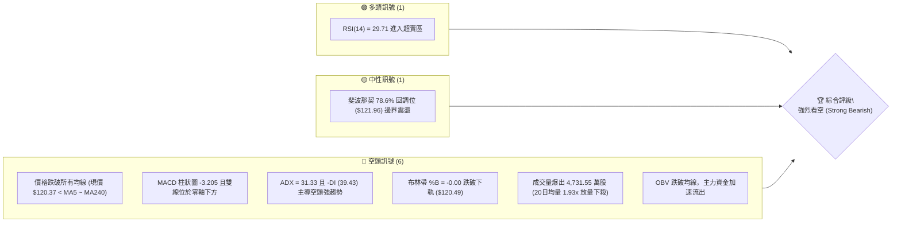

---

### 📊 核心指標速覽表

| 指標類別 | 指標名稱 | 當前數值 | 訊號 | 解讀 |
|:---|:---|:---|:---:|:---|
| **價格** | 當前收盤價 | $120.37 | 🔴 | 位於 52 週區間 ($73.52 - $299.86) 之 20.7% 低檔位置 |
| **均線** | MA20 (月線) | $169.81 | 🔴 | 價格低於 MA20 達 -29.11%，短期下行斜率陡峭 |
| **均線** | MA50 (季線) | $203.48 | 🔴 | 價格低於 MA50 達 -40.85%，中期趨勢徹底破位 |
| **均線** | MA200 (年線) | $178.21 | 🔴 | 價格跌破年線達 -32.46%，且 MA50 下穿 MA200 呈死亡交叉 |
| **動能** | RSI(14) | 29.71 | 🟢 | 跌破 30 超賣門檻，短線具技術性抽頭動能，但尚未出現底背離 |
| **動能** | MACD (12,26,9) | -20.009 / -16.804 | 🔴 | 柱狀圖 -3.205，DIF 與 DEA 於零軸深處發散，空方動能充沛 |
| **動能** | Stoch %K / %D | 10.18 / 12.12 | 🟢 | 雙線均落於 20 以下嚴重超賣區，醞釀低檔金叉預期 |
| **趨勢** | ADX(14) / ±DI | 31.33 / -DI: 39.43 | 🔴 | ADX > 25 確立強趨勢，-DI (39.43) 遠高於 +DI (11.14)，空頭全盤主控 |
| **通道** | 布林帶 (%B) | 下軌 $120.49 (%B: -0.00) | 🔴 | 價格擊穿布林帶下軌，呈現開口放大的「走軌下行」極弱態勢 |
| **波動** | ATR(14) | $16.47 (13.68%) | 🔴 | 日均波幅極大，屬極高波動資產，持倉風險劇烈 |
| **量能** | 當日量 / 20日均量 | 47.32M / 24.49M (1.93x) | 🔴 | 放量暴跌破位，恐慌盤湧出，機構籌碼籌碼鬆動外逃 |

---

### 🏆 技術評分卡

```
╔══════════════════════════════════════════════════════════════════╗
║                   技術評分卡 — NBIS (2026-11-06)                 ║
╠══════════════════════════════════════════════════════════════════╣
║ 趨勢強度 (Trend)       ████░░░░░░░░░░░░░░░░  20/100   🔴 極度看空 ║
║ 動能指標 (Momentum)    █████░░░░░░░░░░░░░░░  25/100   🔴 空方主導 ║
║ 支撐穩定度 (Support)   ███████░░░░░░░░░░░░░  35/100   🔴 破位下挫 ║
║ 成交量配合 (Volume)    ████░░░░░░░░░░░░░░░░  20/100   🔴 帶量破線 ║
║ 形態完整度 (Pattern)   ██████░░░░░░░░░░░░░░  30/100   🔴 空頭破頸 ║
║ 均線排列 (MAs)         ███░░░░░░░░░░░░░░░░░  14/100   🔴 空頭排列 ║
╠══════════════════════════════════════════════════════════════════╣
║ 綜合評分 (Overall)     █████░░░░░░░░░░░░░░░  24/100   🔴 強烈看空 ║
╚══════════════════════════════════════════════════════════════════╝
```
> **計算依據**：（20 + 25 + 35 + 20 + 30 + 14）÷ 6 = 24.0，四捨五入取整為 **24/100**。依評分規則屬於 ≤ 40 區間，主策略嚴格鎖定**順勢空頭主推**，多頭僅限極短線超賣反彈之風控對沖提醒。

---

## 2. 趨勢分析

### 🌐 多時框趨勢分析

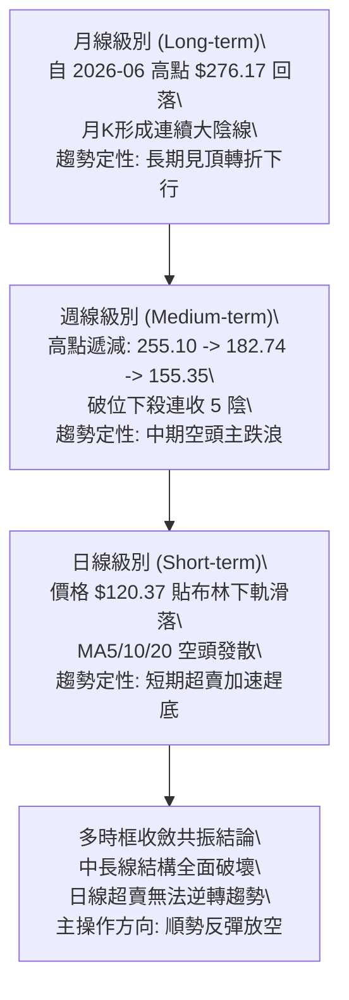

---

### 📈 長期趨勢 — 12個月走勢圖（Unicode）

以下為 NBIS 過去 12 個月（2025-12 至 2026-11）的歷史月線走勢圖與關鍵轉折標註：

```
NBIS 月線走勢圖（過去12個月：2025-12 至 2026-11）
價格軸 ($)
$280 ┤                                      ● $276.17 (2026-06 歷史收盤高點)
$260 ┤                                     ╱ ╲
$240 ┤                                    ╱   ╲      ● $235.88 (2026-09 次高點)
$220 ┤                             ● $231.09   ╲    ╱ ╲
$200 ┤                            ╱             ●──●   ╲
$180 ┤                           ╱            $190.41   ╲
$160 ┤                          ╱                         ╲
$140 ┤                   ● $138.23                         ● $154.14 (2026-10)
$120 ┤            ● $103.76                                  ╲
$100 ┤     ●──●──●                                            ● $120.37 (現價)
 $80 ┤  ● $83.71 (2025-12 築底)
     └─────┬─────┬─────┬─────┬─────┬─────┬─────┬─────┬─────┬─────┬─────┬─────
         25-12 26-01 26-02 26-03 26-04 26-05 26-06 26-07 26-08 26-09 26-10 26-11
```

#### 走勢特徵分析表格

| 階段區間 | 時間跨度 | 起訖價位 | 漲跌幅 | 成交結構與特徵 | 趨勢定性 |
|:---|:---:|:---:|:---:|:---|:---:|
| **一、底部蓄勢期** | 2025-12 ~ 2026-02 | $83.71 → $91.19 | +8.94% | 於 $80 - $90 區間窄幅整理，籌碼沉澱 | 底部盤整 |
| **二、主升浪推升** | 2026-02 ~ 2026-06 | $91.19 → $276.17 | +202.85% | 逐月爆發式拉升，月線連五紅，創天價 $299.86 | 強勢主升浪 |
| **三、雙頂高位盤整** | 2026-06 ~ 2026-09 | $276.17 → $235.88 | -14.59% | 高檔巨幅震盪，09 月反彈至 $235.88 形成頭肩頂右肩 | 高位出貨期 |
| **四、崩跌破位主跌浪**| 2026-09 ~ 2026-11 | $235.88 → $120.37 | -48.97% | 連續兩個月斷崖式下跌，完全吞噬上半年漲幅 | 空頭主跌浪 |

---

### 📊 中期趨勢（週線分析）

從近 8 週收盤與高低點觀察，NBIS 中期呈現標準的**高點下移（Lower Highs）與低點下移（Lower Lows）**之階梯式潰敗走勢：
- 2026-10-09 週 K 高點衝至 $255.10 未果，收盤大跌至 $221.07。
- 2026-10-16 週 K 直接擊穿 $200 整數大關，爆出 148,676,100 股歷史級天量陰線，確立中期崩盤。
- 2026-10-30 週 K 嘗試反抽至 $182.74，但隨即遭空頭無情摜壓，當週收盤僅 $154.14。
- 2026-11-05 當週更是打穿所有短期均線，最低觸及 $113.30，收盤 $120.37。

```
週線級別價格階梯與壓力支撐示意圖
$255.10 ──┐ (10-09 週高點)
          └───► 阻力群 R3: $182.74 (10-30 週高點，反彈天花板)
                └───► 阻力群 R2: $168.71 (10-23 週反彈密集成交區)
                      └───► 阻力群 R1: $132.30 (破位平台阻力)
                            └───► 當前現價: $120.37
                                  ├───► 支撐 S1: $89.65 (前期歷史低點波段)
                                  └───► 支撐 S2: $83.22 / S3: $78.21
```

---

### ⚡ 趨勢強度評估（ADX 解讀）

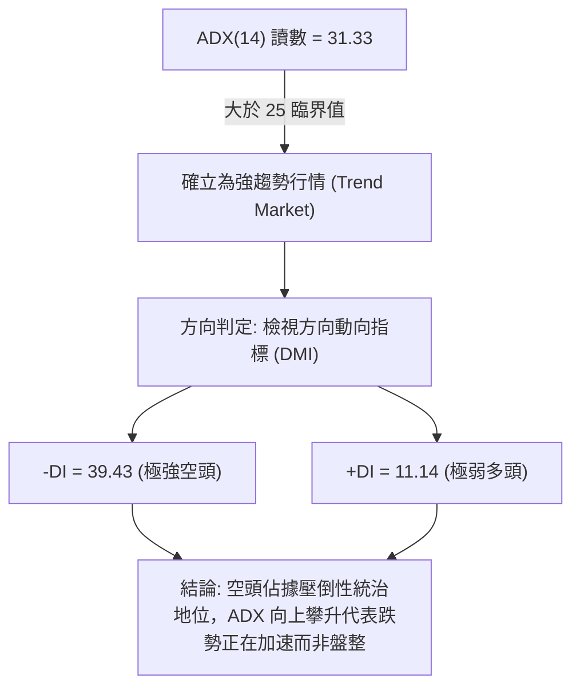

#### ADX 趨勢強度量化對照表

| 指標名稱 | 當前數值 | 參考門檻 | 當前技術含義 | 交易指引 |
|:---|:---:|:---:|:---|:---|
| **ADX (14)** | 31.33 | > 25 (趨勢確立) | 市場脫離無趨勢盤整，進入高速定向趨勢階段 | **嚴禁逆勢摸底，禁止採用區間震盪策略** |
| **+DI (14)** | 11.14 | < 20 (多方匱乏) | 多頭買盤動能枯竭，市場缺乏主動承接意願 | 不得建立左側多單 |
| **-DI (14)** | 39.43 | > 30 (空方主導) | 空頭賣壓具有持續性、全面性與破壞力 | 順勢操作，逢高尋找空頭賣點 |
| **ADX 變化斜率** | 陡峭上升 | 向上傾斜 | 空頭動能持續擴張，下跌加速度尚未衰減 | 等待 ADX 於高檔轉折平緩方可考慮平倉 |

---

## 3. 圖表形態分析

### 🔍 形態識別系統

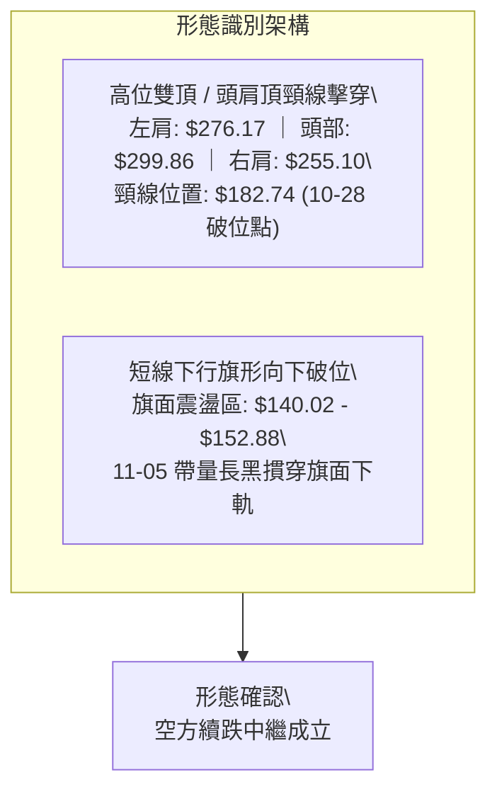

#### 圖表形態信心度評估表（依規則 15）

| 形態名稱 | 信心度 | 判斷依據（嚴格引用數據） | 完成度 | 目標價計算式（依規則 13 & 15） |
|:---|:---:|:---|:---:|:---|
| **大型頭肩頂 / 雙重頂** | 85% | 頸線位置確立於日線波段反彈高點聚類 R3 ($182.74)。2026-10-16 帶量跌破 $200 後，10-28 反抽至高點 $182.74 遭壓回，確立頸線失守。 | 100% (已完全跌破) | 形態高度 = $255.10 (右肩高點) − $182.74 (頸線) = $72.36。<br>由破位點推算目標 = $182.74 − $72.36 = **$110.38**（目前已逼近，最低 $113.30）。若依歷史高點 $299.86 計算，更深目標直指波段支撐 **S1 ($89.65)**。 |
| **下行旗形 (Bear Flag) 破位** | 75% | 11-02 至 11-04 在 $140.02 ~ $152.88 窄幅整理，11-05 跳空低開 $134.16 並以大陰線收在 $120.37，直接摜破旗形下軌。 | 90% (破位中) | 旗桿長度 = 10-28 高點 $182.74 − 11-02 低點 $140.60 = $42.14。<br>破位點 $141.52 (11-04收盤) − $42.14 = **$99.38**。向下首要考驗 **S1 ($89.65)**。 |

---

### 🕯️ 重要 K 線形態分析（依規則 19）

嚴格依據數據中「近 10 根日 K」與「近 8 根週 K」實際數據進行客觀解讀：

#### 近 10 根日 K 形態解讀

| 日期 | 開盤價 | 最高價 | 最低價 | 收盤價 | 成交量 | K線形態名稱 | 技術解讀 | 訊號 |
|:---|:---:|:---:|:---:|:---:|:---:|:---|:---|:---:|
| 2026-10-23 | 158.90 | 162.99 | 155.86 | 158.74 | 13,496,800 | 窄幅十字小陰線 | 空頭殺跌後暫時停歇，成交量急縮，顯示反彈乏力 | 🟡 |
| 2026-10-26 | 153.96 | 165.86 | 149.48 | 153.27 | 30,698,500 | 長下影紡錘線 | 盤中下探 $149.48 獲逢低承接，但收盤依舊收低，多空拉鋸 | 🟡 |
| 2026-10-27 | 159.00 | 171.53 | 158.30 | 170.47 | 20,596,400 | 中陽線突破 | 實體飽滿陽線，買盤推升突破短期五日均線 | 🟢 |
| 2026-10-28 | 173.49 | 182.74 | 168.92 | 182.34 | 25,056,800 | 光頭強中陽線 | 觸及關鍵阻力 R3 ($182.74)，多頭反撲極限，量能放大 | 🟢 |
| 2026-10-29 | 173.18 | 178.33 | 168.76 | 171.99 | 17,700,300 | 高位跳空小陰線 | 無法延續前日強勢，開盤即承壓回落，高檔套牢賣壓湧現 | 🔴 |
| 2026-10-30 | 157.05 | 161.42 | 149.96 | 154.14 | 21,564,800 | 跳空放量大陰線 | 跳空低開低走，完全吞噬前三天反彈成果，確認反抽結束 | 🔴 |
| 2026-11-02 | 154.56 | 155.35 | 140.60 | 141.39 | 20,434,700 | 光腳中長陰線 | 破位下挫，最低探至 $140.60，空方展現絕對壓制力 | 🔴 |
| 2026-11-03 | 145.35 | 152.67 | 143.71 | 151.64 | 16,195,600 | 縮量小陽線 | 超跌後弱勢縮量抽頭，未能收復前一日陰線實體半數 | 🟡 |
| 2026-11-04 | 145.81 | 152.88 | 140.02 | 141.52 | 23,044,500 | 衝高回落倒錘頭陰線 | 盤中反抽 $152.88 遇阻狂瀉，收盤逼近全天最低，形成看跌中繼 | 🔴 |
| 2026-11-05 | 134.16 | 134.80 | 113.30 | 120.37 | 47,315,500 | 放量巨陰破位線 | 跳空低開低走，盤中重挫至 $113.30，成交量飆至 4,731.55 萬股，典型恐慌殺跌破位 | 🔴 |

#### 近 8 根週 K 形態解讀

| 日期 | 開盤價 | 最高價 | 最低價 | 收盤價 | 週成交量 | 週K線形態名稱 | 技術解讀 | 訊號 |
|:---|:---:|:---:|:---:|:---:|:---:|:---|:---|:---:|
| 2026-09-18 | 204.98 | 232.85 | 203.87 | 223.54 | 90,247,300 | 寬幅長陽線 | 震盪衝高，多頭仍試圖守穩 $200 關卡 | 🟢 |
| 2026-09-25 | 225.96 | 249.19 | 221.30 | 237.33 | 79,317,300 | 衝高震盪陽線 | 測試 $250 關卡，高位量縮，追價動能不足 | 🟡 |
| 2026-10-02 | 235.20 | 250.48 | 228.38 | 242.81 | 65,179,600 | 高位十字小陽星 | 逼近前高未果，顯示高位買盤耗竭，主力進入派發階段 | 🟡 |
| 2026-10-09 | 244.10 | 255.10 | 217.73 | 221.07 | 86,070,300 | 長上影看跌烏雲罩頂 | 創波段高點 $255.10 後狂瀉，實體由紅翻黑，頂部反轉確認 | 🔴 |
| 2026-10-16 | 217.20 | 217.20 | 163.27 | 165.47 | 148,676,100 | 斷頭鍘刀巨量長黑 | 一舉跌破多條均線，暴跌超 25%，成交量飆至近 1.5 億股，主力全面出逃 | 🔴 |
| 2026-10-23 | 176.51 | 178.85 | 155.73 | 158.74 | 108,909,300 | 低位橫盤小陰線 | 下跌中繼，雖有抵抗但始終受制於 $180 之下 | 🔴 |
| 2026-10-30 | 153.96 | 182.74 | 149.48 | 154.14 | 115,616,800 | 衝高假突破長上影陰線 | 盤中暴拉至 $182.74 後被空頭徹底壓垮，多頭最後反撲徹底潰敗 | 🔴 |
| 2026-11-05 | 154.56 | 155.35 | 113.30 | 120.37 | 106,990,300 | 大陰破底線 | 連續第二週帶量破底，低點觸及 $113.30，跌破布林下軌，空方主導一切 | 🔴 |

---

### 📉 ASCII 走勢形態示意圖

```
NBIS 日線雙頂頸線破位與下行旗形結構
價格 ($)
$182.74 ┤             ▲ R3 (10-28 假突破高點 / 反抽頸線天花板)
        │            ╱ ╲
$170.00 ┤           ╱   ╲
        │          ╱     ╲
$154.14 ┤─────────●───────●──────┐ 旗面區間上限 ($152.88)
        │        ╱         ╲    │  [下行旗形整理]
$140.02 ┤───────●           ●────┴─● 旗面區間下限 ($140.02 - 11-04 破位)
        │      ╱                    ╲
$120.37 ┤─────● 現價 $120.37          ╲
        │                               ▼ 11-05 恐慌破位長陰 ($113.30)
$110.00 ┤                                 :
        │                                 :
 $89.65 ┴─────────────────────────────────● 形態測幅終極支撐 S1 ($89.65)
```

---

### 🎯 形態目標價計算

依據形態學標準理論與數據嚴格推算：

1. **頭肩頂 / 頸線反抽破位測算**：
   - 頸線壓力點：$182.74（R3，10-28 波段反彈高點）
   - 形態頭部高點：$255.10（10-09 週 K 高點）
   - 形態垂直高度 $H = $255.10 − $182.74 = $72.36
   - 破位第一目標價 $T_{1} = $182.74 − $72.36 = **$110.38**
   - *驗證*：11-05 日 K 最低已殺至 $113.30，精準驗證第一形態目標已基本達成。

2. **短線下行旗形向下等長延伸測算**：
   - 旗桿起跌點：$182.74（10-28 高點）
   - 旗桿落底點：$140.60（11-02 低點），旗桿幅度 $\Delta P = $42.14
   - 旗形破位起算點：$141.52（11-04 收盤價）
   - 旗形延伸第二目標價 $T_{2} = $141.52 − $42.14 = **$99.38**
   - 若空頭動能進一步宣洩，下方直接連通近一年波段低點聚類核心支撐 **S1 ($89.65)**。

---

## 4. 支撐與阻力

### 🗺️ 關鍵價位分布圖（Unicode）

```
NBIS 價位結構分布圖（OHLCV 聚類計算）
══════════════════════════════════════════════════════════════════
$182.74 ║████████████████████████████████████║ 強阻力 R3 (頸線/10-28高點)
$168.71 ║████████████████████████░░░░░░░░░░░░║ 中期阻力 R2 (反彈高點聚類)
$132.30 ║████████████████░░░░░░░░░░░░░░░░░░░░║ 近端關鍵阻力 R1 (反抽首要防線)
$121.96 ╟────────────────────────────────────╢ 斐波那契 78.6% 回調位
$120.37 ╠════════════════════════════════════╣ ◄ 當前收盤價 ($120.37)
$113.30 ╟┈┈┈┈┈┈┈┈┈┈┈┈┈┈┈┈┈┈┈┈┈┈┈┈┈┈┈┈┈┈┈┈┈┈┈┈╢ 11-05 當日最低點 (日線防線)
 $89.65 ║▓▓▓▓▓▓▓▓▓▓▓▓▓▓▓▓▓▓▓▓▓▓▓▓░░░░░░░░░░░░║ 核心支撐 S1 (近一年波段低點聚類)
 $83.22 ║████████████████████████████████████║ 次級支撐 S2 (2025-12月低點聚類)
 $78.21 ║████████████████████████████████████║ 強力支撐 S3 (52週區間底部聚類)
 $73.52 ╟────────────────────────────────────╢ 52週最低價 (100.0% 斐波那契位)
══════════════════════════════════════════════════════════════════
```

---

### 🚧 阻力位分析表

以下阻力位皆嚴格引用數據中「關鍵價位」區塊由 OHLCV 聚類計算之數值：

| 阻力級別 | 價位 | 與現價距離 (%) | 形成原因與籌碼解讀 | 突破難度 | 重要性 |
|:---|:---:|:---:|:---|:---:|:---:|
| **R1 (近端阻力)** | **$132.30** | +9.91% | 近一年波段密集換手區下沿；同時為 11-05 跳空長黑跌破口（11-05 開盤 $134.16 下方），構成短線多頭反彈的第一道厚重蓋頭套牢層。 | 🟡 中等偏高 | ★★★★☆ |
| **R2 (中期阻力)** | **$168.71** | +40.16% | 近一年波段高點聚類次核心；精準共振 20 日均線 MA20 ($169.81) 與布林中軌，多頭唯有收復此處方能逆轉中線跌勢。 | 🔴 極高 | ★★★★★ |
| **R3 (強阻力)** | **$182.74** | +51.82% | 10-28 反彈波段頂部高點；頭肩頂頸線反壓樞紐。聚集 10 月底巨量反彈套牢盤，為中期空頭趨勢防守之鐵壁。 | 🔴 極難跨越 | ★★★★★ |

---

### 🛡️ 支撐位分析表

以下支撐位皆嚴格引用數據中「關鍵價位」區塊由 OHLCV 聚類計算之數值：

| 支撐級別 | 價位 | 與現價距離 (%) | 形成原因與籌碼解讀 | 守住機率 | 重要性 |
|:---|:---:|:---:|:---|:---:|:---:|
| **S1 (關鍵支撐)** | **$89.65** | -25.52% | 近一年波段低點聚類；2026 年初起漲平台關鍵換手點（2026-02 收盤 $91.19 區域），也是頭肩頂向下測幅第一主防禦區。 | 🟡 55% | ★★★★★ |
| **S2 (強支撐)** | **$83.22** | -30.87% | 2025-12 月歷史低點聚類點（該月收盤 $83.71）；機構法人大週期底倉成本線，具有強烈基本面價值買盤支撐。 | 🟢 70% | ★★★★☆ |
| **S3 (極限支撐)** | **$78.21** | -35.03% | 逼近 52 週最低點 $73.52 前的最後防禦碉堡，為近兩年大型箱體底部換手支撐區。 | 🟢 85% | ★★★★★ |

---

### 📐 斐波那契回調位分析

依據 52 週價格極值區間（低點 $73.52 → 高點 $299.86）計算，各關鍵黃金分割位與現價位置解讀如下：

```
0.0%  (52W High)   $299.86 ──────────────────────────────────────
23.6%              $246.44 ───────────────── (10-02 高點遇阻)
38.2%              $213.40 ───────────────── (10-16 帶量跌破)
50.0%              $186.69 ───────────────── (半數漲幅吐回，轉入弱勢)
61.8%              $159.98 ───────────────── (黃金分割防線，10-30 宣告失守)
78.6%              $121.96 ────────────┬──── (目前剛跌破此防線)
                   $120.37 ◄───[現價]  │ 處於 78.6% 至 100.0% 之「極度崩塌區間」
100.0% (52W Low)   $ 73.52 ────────────┴──── (終極起漲原點)
```

- **當前位置解讀**：現價 **$120.37** 剛好跌破斐波那契 **78.6% 回調位 ($121.96)** 達 -1.30%。
- **技術意義**：在斐波那契回撤理論中，一旦回調幅度實質跌破 61.8% ($159.98) 且進一步貫穿 78.6% ($121.96)，代表前期整輪大級別上漲波段的結構已遭到不可逆的破壞，市場不再屬於正常回調範疇，而是高機率「向 100% 全額回吐原點 ($73.52)」尋求支撐。
- 短線上若多頭數日內無法迅速放量站回 $121.96 之上，價格將順勢滑向下方由 S1 ($89.65) 與 52 週低點 ($73.52) 構成的重度回撤帶。

---

## 5. 技術指標深度解讀

### 🎛️ 指標訊號總覽

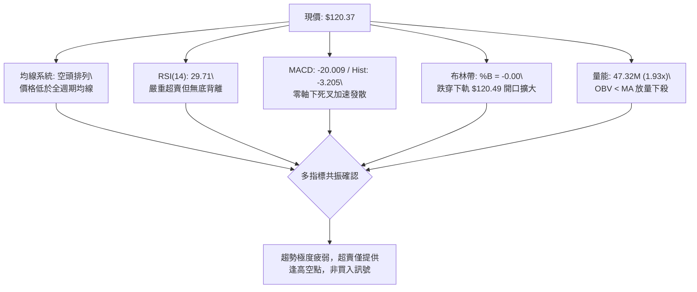

---

### 📈 移動平均線排列分析

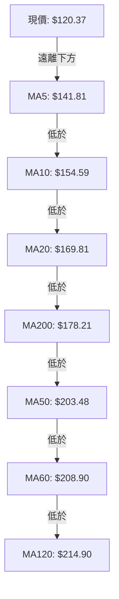

#### 移動平均線數據對照表

| 均線名稱 | 數值 | 現價偏離幅度 (%) | 走勢特徵與微型火柴圖解讀 | 排列定性 |
|:---|:---:|:---:|:---|:---:|
| **MA5** | $141.81 | -15.12% | 陡峭俯衝 `████████████▇▆▅▅▄▃▃▃▃▂▂▂▃▃▂▂▁▁` | 極弱空頭 |
| **MA10** | $154.59 | -22.13% | 持續向下傾斜 `▇▇███████████▇▇▆▅▅▄▃▃▂▂▂▂▂▁▁▁▁` | 空頭壓制 |
| **MA20** | $169.81 | -29.11% | 中期生命線加速下墜 `▇███████████████▇▇▆▆▅▅▄▄▄▃▂▂▁▁` | 空頭主導 |
| **MA50** | $203.48 | -40.85% | 季線下穿半年線，高位反轉下行 | 空頭防線 |
| **MA60** | $208.90 | -42.38% | 剛從高檔拐頭向下 `▄▄▅▅▅▆▆▆▇▇█████▇▇▇▇▇▆▆▅▅▄▄▃▃▂▁` | 中期見頂 |
| **MA120** | $214.90 | -43.99% | 半年線開始走平下彎 `▁▁▂▃▃▄▄▅▆▆▆▇▇▇█████████████▇▇▆` | 長期受阻 |
| **MA200** | $178.21 | -32.46% | 年線失守，長期牛熊分界線遭擊破 | 空頭宣告 |
| **MA240** | $164.11 | -26.65% | 價格擊穿 240 日均線 | 熊市確立 |

- **均線綜合評述**：短期、中期均線呈現標準的「由小到大、自下而上」的**完全空頭排列**。現價距離 MA5 乖離達 -15.12%，距離 MA20 達 -29.11%，雖然負乖離率過大容易引發短線技術性回抽，但上方每一條均線都已轉化為沉重的動態反壓。

---

### 📉 RSI(14) 分析

- **當前 RSI(14) 數值**：**29.71**（Wilder 計算方法）
- **超買超賣刻度展示**：
  ```
  超賣區 (<30)              中性區 (50)             超買區 (>70)
  ├───●───────────────┼───────────────────────────────┤
  0  29.71           50                              100
  進度: ▓▓▓▓▓▓░░░░░░░░░░░░░░░░░░░░░░░░░░ 29.71% 🟢 超賣
  ```
- **背離分析與結論**：
  - **背離研判**：嚴格比對近 20 根 K 棒，價格自 10-28 高點 $182.74 一路下挫至 11-05 最低 $113.30（創下波段新低），而 RSI(14) 指標自 10-30 的 35.6 持續滑落至 29.71（亦同步創出近期新低）。
  - **背離結論**：**無底背離（明確結論）**。量化指標與價格走勢同向共振破底，顯示這波下跌屬於真實的資金撤離與拋盤宣洩，而非動能竭盡的虛假破位。在強趨勢行情（ADX > 25）中，RSI 經常會出現「鈍化於超賣區內持續破底」的現象，不可單憑 RSI < 30 作為買入理由。

---

### 📊 MACD(12,26,9) 訊號解讀

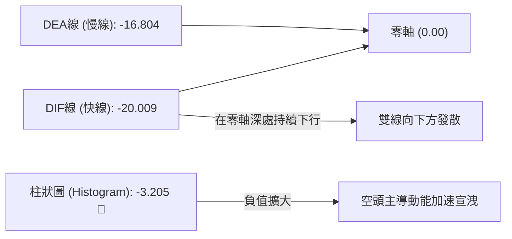

- **MACD 詳細數值**：
  - DIF（快線）：`-20.009`
  - DEA（慢線）：`-16.804`
  - MACD 柱狀圖：`-3.205`（看空 🔴）
- **解讀**：
  1. 快線與慢線深度浸泡於零軸之下，且 DIF 加速遠離 DEA，柱狀圖負值自前幾週的 -1.365 擴大至 -3.205，表明空方下殺動能不但沒有減弱，反而在進一步增強。
  2. 此種「零軸下方死叉發散」屬於典型的高風險空頭主跌形態，歷史數據顯示此形態出現後通常伴隨持續的慣性尋底。

---

### 📦 布林通道分析

```
NBIS 布林通道截面示意圖（20日週期，2倍標準差）
價位 ($)
$219.13 ┤ ══════════════════════════════════════ 上軌 (Upper Band)
        │
$169.81 ┤ -------------------------------------- 中軌 (MA20 生命線)
        │
$120.49 ┤ ══════════════════════════════════════ 下軌 (Lower Band)
$120.37 ┼ ◄── ● 現價 ($120.37，%B = -0.00 跌破下軌)
$113.30 ┤     ▼ 盤中下影破軌最低點
```

- **通道帶寬與形態特徵**：
  - 上軌：**$219.13**
  - 中軌 (MA20)：**$169.81**
  - 下軌：**$120.49**
  - 布林通道帶寬 $(219.13 - 120.49) \div 169.81 = 58.09\%$，帶寬劇烈擴張。
  - **%B 指標**：`-0.00`（代表價格已實質擊穿下軌）。
- **解讀**：當前布林通道呈現標準的「喇叭口向下張開」並伴隨價格「走軌（Walking the band）」狀態。收盤價微幅低於下軌，顯示短期市場處於極度恐慌之單邊拋售狀態。若後續價格無法立即縮回下軌之上，將形成強烈的下軌推壓效應。

---

### 💹 成交量分析（量價配合度）

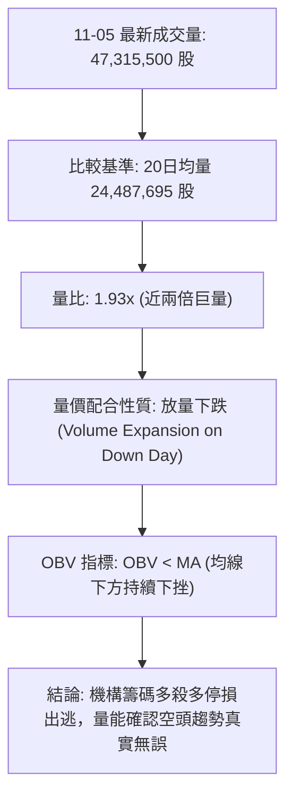

- **量價配合度分析**：
  - 2026-11-05 成交量激增至 **47,315,500 股**，較 20 日均量（24,487,695 股）放大近 **1.93 倍**，較 50 日均量（19,010,030 股）更大增 **2.49 倍**。
  - **價跌量增**屬於最惡劣的量價結構，表明在該價位不是少數散戶踩踏，而是有大型機構資金進行堅決清倉。
- **OBV（能量潮）走勢**：
  - 技術快照顯示「OBV < MA → 量能疲弱」。
  - 伴隨 10 月中旬與 11 月初的兩次破位大陰線，OBV 曲線出現陡峭下行且持續受制於其自身均線下方，證明過去兩個月的反彈（如 10-28 縮量推升）皆為主力誘多拉高派發，真實籌碼流向呈持續淨流出。

---

## 6. 動能與波動率

### ⚡ 動能評估

#### 動能與波動率定位

| 象限區間 | 動能狀態 | 波動率狀態 | NBIS 當前歸屬 | 行情特徵與交易指引 |
|:---:|:---:|:---:|:---:|:---|
| **Q1** | 強多頭動能 | 低波動 | — | 穩定牛市推升波段，持股待漲 |
| **Q2** | 弱動能 | 低波動 | — | 典型箱體震盪盤整，高拋低吸 |
| **Q3** | 強空頭動能 | 低波動 | — | 陰跌行情，緩步探底 |
| **Q4** | **強空頭動能** | **極高波動** | **✓ 本標的處於此象限** | **恐慌主跌段，單日波幅劇烈，空方掌控絕對優勢** |

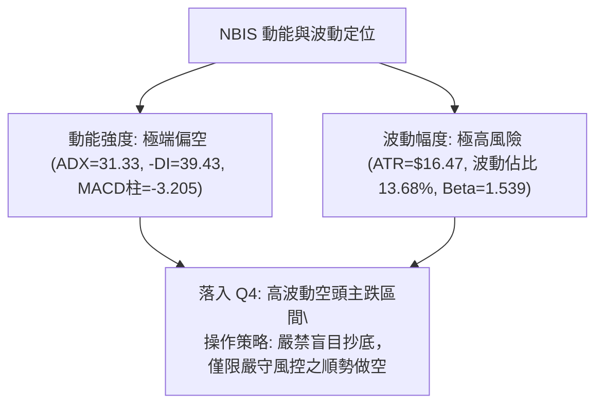

---

### 📊 ATR 波動率分析

- **ATR(14) 當前數值**：**$16.47**
- **波動佔比**：高達現價的 **13.68%**（Wilder 平滑計算）
- **止損距離建議與倉位管控**：
  - 由於 NBIS 日內波動空間極大（單日 1 倍 ATR 即超過 16 美元），過窄的止損極易被市場雜訊掃出場。
  - **短線空單跟蹤止損**：建議設定為 1.0 倍 ATR = **$16.47**。
  - **波段空單防守止損**：建議設定為 1.5 倍 ATR = **$24.71**。
  - **倉位規模計算公式**：
    $$\text{建議倉位} = \frac{\text{單筆交易最大容忍虧損額度 (如總資金 1\%)}}{\text{止損距離 ($16.47)}}$$
    鑑於高達 13.68% 的 ATR 佔比，投資人應將總倉位控制在正常部位的 **30% ~ 40%** 以內，避免被劇烈跳空或長影線造成本金永久性損傷。

---

### 📐 Beta 與市場相關性

- **Beta 係數**：**1.539**
- **解讀**：
  - NBIS 展現出相較於標普 500 指數高出 53.9% 的超高系統性波動特徵。
  - 在大盤整體承壓或 AI 基礎設施板塊遭遇情緒逆風時（如近期新聞提及的「投資人重新評估產能交付風險」、「AI 數據中心受限疑慮」），NBIS 往往會以 1.5 倍以上的倍率放大跌幅。
  - 融資空頭比例（Short % Float）高達 **20.2%**，Short Ratio 為 **2.61**。高達兩成的放空比例顯示空頭資金極度集結，雖然超賣時容易因空頭回補引發暴烈反彈，但在基本面資本支出（Capex 111.4 億、FCF 為負 58.8 億）沉重與技術破位的雙重共振下，高 Beta 成為下行趨勢的助推器。

---

## 7. 多時框架總結

### 📋 時框架評分表

| 時框架 | 趨勢方向 | 動能狀態 | 均線排列 | 圖表形態 | 綜合評分 | 交易建議 |
|:---|:---:|:---:|:---:|:---:|:---:|:---|
| **月線 (長期)** | 🔴 轉入下行 | 🔴 MACD高位死叉下行 | 🟡 MA240下方掙扎 | 歷史高點 $299.86 見頂反轉 | **30/100** | 長期投資人不宜進場，規避估值殺跌 |
| **週線 (中期)** | 🔴 主跌趨勢 | 🔴 週MACD負值擴大 | 🔴 跌破週線MA50/MA200 | 雙頂與大型頭肩頸線破位 | **20/100** | 中期主策略為反抽阻力放空 |
| **日線 (短期)** | 🔴 單邊跌勢 | 🟢 RSI超賣 (<30) | 🔴 完全空頭排列 | 下行旗形帶量破位下殺 | **22/100** | 日線超賣隨時有技術反彈，切勿追低 |

---

### 🔲 綜合訊號矩陣

```
╔══════════════════════════════════════════════════════════════════╗
║                    NBIS 多時框技術訊號矩陣                       ║
╠══════════════════╦══════════════╦══════════════╦═════════════════╣
║ 分析維度         ║ 短期 (日線)  ║ 中期 (週線)  ║ 長期 (月線)     ║
╠══════════════════╬══════════════╬══════════════╬═════════════════╣
║ 趨勢方向         ║ 🔴 極度看空  ║ 🔴 強烈看空  ║ 🔴 轉空尋底     ║
║ 均線系統         ║ 🔴 完全空頭  ║ 🔴 跌破多均  ║ 🟡 測試年線     ║
║ 動能指標         ║ 🟢 嚴重超賣  ║ 🔴 動能加速  ║ 🔴 高檔鈍化下行 ║
║ 成交量結構       ║ 🔴 帶量恐慌  ║ 🔴 出貨天量  ║ 🔴 逢高派發     ║
║ 關鍵支撐狀態     ║ 🔴 擊穿下軌  ║ 🔴 破斐波78.6║ 🟡 逼近前期平台 ║
╠══════════════════╬══════════════╬══════════════╬═════════════════╣
║ 多時框收斂共識   ║ 🔴 空方取得完全壓倒性共振優勢 (超賣反彈為空點) ║
╚══════════════════╩════════════════════════════════════════════════╝
```

---

### ⚖️ 多時框收斂結論（依規則 14）

1. **行情定性**：當前 ADX(14) 讀數為 **31.33**，遠超 25 臨界值，確立市場處於**強趨勢行情（Trend Market）**，嚴禁以盤整震盪邏輯應對。
2. **時框優先級取捨**：依規則 14 規定，趨勢行情下必須**以中長期（週線 / MA50 / MA200）方向為絕對主導**。週線連 5 陰破位，MA50 ($203.48) 與 MA200 ($178.21) 均被實質擊穿，中期趨勢徹底看空；日線級別出現的 RSI = 29.71 極度超賣，僅能作為尋找短線反彈高位「次級逆向波結束、再次放空」的時機依據，絕對不能作為反轉做多之信號。
3. **唯一方向性結論**：**強烈偏空（Bearish）**。日線、週線與月線結構高度向下共振，任何未放量突破關鍵阻力 R1 ($132.30) 的反抽皆定性為弱勢技術修正。

---

## 8. 交易策略建議

### 🗺️ 策略決策流程圖

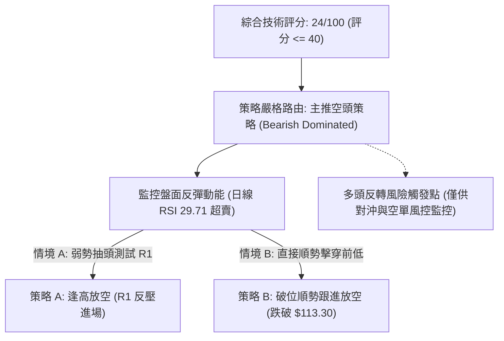

---

### 🧭 策略路由

> **當前主策略方向 = 強烈偏空放空（依綜合評分 24/100）**
> 
> 依嚴格規定，綜合評分 24/100 落在 ≤ 40 區間，本報告**主推空頭交易策略**（包含反彈受阻放空與破位追空），多頭部位嚴禁重倉介入，僅列出反轉風控點以供對沖參考。

---

### 🎯 價格情境階梯（Price Scenarios）

以當前收盤價 **$120.37** 為基準，嚴格引用第 4 章由 OHLCV 聚類計算之數值構建情境階梯：

| 觸發條件 | 下一目標 | 後續延伸 | 情境技術含義與應對 |
|:---|:---:|:---:|:---|
| **向上反抽觸及 R1 ($132.30)** | 阻力 R2 ($168.71) | 阻力 R3 ($182.74) | 超賣引發的技術性抽頭，只要無法有效站穩 R1，皆視為絕佳空單加碼點。 |
| **於現價區間 ($113.30 - $121.96) 震盪** | — | — | 消化超賣指標，布林帶下軌走平，暫時進入低檔弱勢換手。 |
| **跌破當日前低 ($113.30) 與 S1 ($89.65)** | 支撐 S2 ($83.22) | 支撐 S3 ($78.21) | 恐慌主跌浪延續，價格開啟奔向 52 週最低點 $73.52 之旅。 |

---

### 📊 情境機率分佈

| 價格情境演變 | 預估機率 | 主要量化依據與技術支撐 |
|:---|:---:|:---|
| **回落 / 再探底破位 (主情境)** | **65%** | ADX 高達 31.33 且 -DI 主導；成交量爆出 1.93x 恐慌殺跌，OBV 疲軟破線；均線完全空頭排列且布林帶向下開口擴大。 |
| **超賣弱勢反彈 / 測試 R1** | **25%** | 日線 RSI(14) 跌破 30 至 29.71，隨機指標 Stoch %K=10.18 極度超賣，負乖離率過大，具備短線技術性回抽需求。 |
| **低檔窄幅橫盤震盪** | **10%** | 空方短期獲利了結回補，但在高達 16.47 的 ATR 波動下，維持窄幅橫盤的難度極高。 |

---

### 🟢 主策略詳情（空頭交易策略）

所有價位均嚴格引用第 4 章關鍵價位區塊與當日 OHLCV 實際數值，風報比嚴格依規則 17 計算（公式：`(進場價 − 目標價 T1) ÷ (止損價 − 進場價)`）：

| 策略要素 | 策略 A（逢高反抽阻力放空） | 策略 B（跌破前低順勢放空） |
|:---|:---|:---|
| **策略類型** | 逆短線超賣、順中期大勢之逢高放空 | 突破延續之順勢破位追空 |
| **進場條件** | 股價弱勢反彈測試關鍵阻力 R1 附近受阻回落 | 價格實質擊穿 11-05 當日最低價 $113.30 |
| **進場價格** | **$132.30**（精確引用 R1 阻力位） | **$113.00**（以破位 $113.30 預留滑點計算） |
| **目標價 T1** | **$89.65**（精確引用關鍵支撐 S1） | **$89.65**（精確引用關鍵支撐 S1） |
| **目標價 T2** | **$83.22**（精確引用關鍵支撐 S2） | **$78.21**（精確引用關鍵支撐 S3） |
| **止損價格** | **$141.81**（精確引用 MA5 移動平均線防守） | **$120.49**（精確引用布林帶下軌線作為假突破防守） |
| **風險報酬比** | **1 : 4.49（以 T1 計）**<br>*(計算式: (132.30 - 89.65) ÷ (141.81 - 132.30) = 42.65 ÷ 9.51 = 4.4847)* | **1 : 3.12（以 T1 計）**<br>*(計算式: (113.00 - 89.65) ÷ (120.49 - 113.00) = 23.35 ÷ 7.49 = 3.1175)* |
| **成功機率** | 65% | 60% |
| **建議倉位** | 總資金之 **15%**（分批掛單） | 總資金之 **10%**（破位確認後介入） |

---

### 🔴 反向風險觸發點（對沖與空單風控提示）

若市場出現以下情況，主空頭策略前提將被推翻，空單必須無條件止損或反向對沖：
1. **收盤價放量站上 R1 ($132.30)**：代表 11-05 的放量大陰線形成「力竭性誘空洗盤」，短線下跌動能暫告中斷。
2. **日線級別收復布林中軌 / MA20 ($169.81)**：空頭中期結構被嚴重破壞，需平倉所有中線空單。
3. **日 K 出現帶長下影線之放量十字星並伴隨 RSI 底背離**：超賣引發實質抄底資金進場，應提防軋空（Short Squeeze，當前空頭佔流通盤高達 20.2%）。

---

### ⭐ 整體訊號強度評星

```
╔══════════════════════════════════════════════════╗
║ 做多訊號強度：★☆☆☆☆  (1/5星 - 僅超賣，無形態確認)║
║ 做空訊號強度：★★★★☆  (4/5星 - 趨勢、量價全面共振)║
║ 整體可信度：  ★★★★☆  (4/5星 - ADX>25 趨勢明確)  ║
╚══════════════════════════════════════════════════╝
```

---

## 9. 風險提示與監控

### ✅ 關鍵監控指標 Checklist

```
╔══════════════════════════════════════════════════════════════════╗
║                     NBIS 每日交易監控清單 (Checklist)            ║
╠══════════════════════════════════════════════════════════════════╣
║ [ ] 監控一：收盤價是否跌破 11-05 恐慌低點 $113.30？             ║
║     └─ 若跌破，將打開直通 S1 ($89.65) 的下行空間。              ║
║ [ ] 監控二：反彈能否觸及並突破第一阻力 R1 ($132.30)？            ║
║     └─ 若受阻，為絕佳空單回補或加碼點；突破則空單嚴格止損。      ║
║ [ ] 監控三：成交量是否持續萎縮（低於 20日均量 2,448 萬股）？      ║
║     └─ 縮量反彈為假突破，放量反彈需警惕軋空風險。              ║
║ [ ] 監控四：RSI(14) 能否走出超賣區（回升至 30 以上）？          ║
║     └─ 若持續鈍化於 30 以下，代表下殺動能具毀滅性。             ║
║ [ ] 監控五：融券賣空比例（Short % Float = 20.2%）變化            ║
║     └─ 留意是否出現突發利好引發的被迫空頭平倉踩踏潮。          ║
╚══════════════════════════════════════════════════════════════════╝
```

---

### ⚠️ 風險場景分析

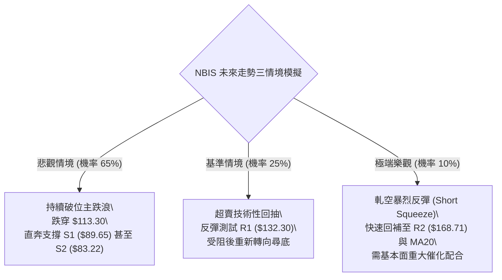

---

### 🛡️ 風險管理重要提醒

1. **基本面與估值風險警示**：
   - 財務數據顯示，NBIS 過去十二個月（TTM）營業利益率為 **-50.5%**，資本支出高達 **111.4 億美元**，導致自由現金流（FCF）為負 **58.8 億美元**（FCF Yield 為 **-19.25%**）。公司負債達 **102 億美元**，淨債務 **21.5 億美元**。在市場重新評估 AI 數據中心交付風險與資本開支可持續性的宏觀背景下，高估值與高虧損標的極易遭受機構投資人無情拋售。
2. **高波動倉位保護**：
   - 本標的 ATR 高達 **$16.47**，Beta 高達 **1.539**。這意味著單日價格波動超過 10% 屬於常態。嚴格禁止在單一標的上配置超過投資組合 **5%** 的風險敞口（Risk at Cost）。
3. **隔夜跳空防範**：
   - 由於 11-05 剛出現長達 10 美元以上的跳空缺口（前日收 $141.52，當日開 $134.16），投資人應採取限價單與保證止損單，嚴禁重倉隔夜持有逆勢多單。

---

## 📋 報告總結

```
╔══════════════════════════════════════════════════════════════════╗
║                    NBIS 技術分析報告總結                         ║
╠══════════════════════════════════════════════════════════════════╣
║ 報告日期：2026-11-06                                             ║
║ 當前收盤價：$120.37                                              ║
║ 技術面綜合評分：24 / 100 (算術平均)                              ║
║ 分析評級：🔴 強烈看空 (Strong Bearish / 順勢逢高做空)            ║
╠══════════════════════════════════════════════════════════════════╣
║ 關鍵結論：                                                       ║
║ ├─ 長期趨勢：🔴 月線自 $299.86 高點見頂反轉，步入熊市尋底期     ║
║ ├─ 中期趨勢：🔴 頭肩頂頸線實質破位，週線連收巨陰，跌破所有均線   ║
║ ├─ 短期趨勢：🔴 帶量貫穿布林下軌，ADX=31.33 空頭強勢加速向下    ║
║ ├─ 關鍵支撐：S1: $89.65 ｜ S2: $83.22 ｜ S3: $78.21              ║
║ ├─ 關鍵阻力：R1: $132.30 ｜ R2: $168.71 ｜ R3: $182.74           ║
║ └─ 分析師目標區間：低標 $84.00 ｜ 均標 $281.00 ｜ 高標 $410.00   ║
╠══════════════════════════════════════════════════════════════════╣
║ 最優交易策略組合：                                               ║
║ 1. 🥇 最佳機會：策略 A — 逢弱勢反彈至 R1 ($132.30) 受阻放空，     ║
║                 目標 S1 ($89.65)，止損 MA5 ($141.81)，風報比 1:4.49║
║ 2. 🥈 次選機會：策略 B — 帶量摜穿 $113.30 順勢追空，目標 S1/S3， ║
║                 止損下軌 $120.49，風報比 1:3.12                  ║
║ 3. 🥉 保守選擇：空倉觀望，耐心等待價格下探至 S1/S2 區間且 RSI    ║
║                 構築明確底背離形態後，再評估左側博弈機會。        ║
╚══════════════════════════════════════════════════════════════════╝
```

---

> ⚠️ **免責聲明**：本報告為 AI 自動生成之技術分析，所有數據及估算均基於所提供的歷史價格與市場資訊。本報告**僅供研究與學術參考**，**不構成任何形式的投資建議、買賣邀約或推薦**。金融市場具有極高風險，投資人應獨立評估自身財務狀況與風險承受能力，入市需極度謹慎。

---

*報告生成時間：2026-11-06 ｜ 數據來源：Yahoo Finance ｜ 分析框架：資深多時框量化技術分析*