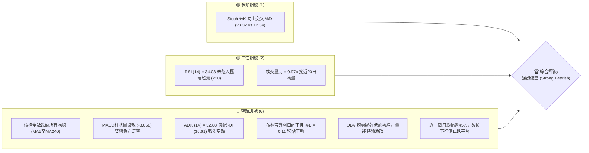
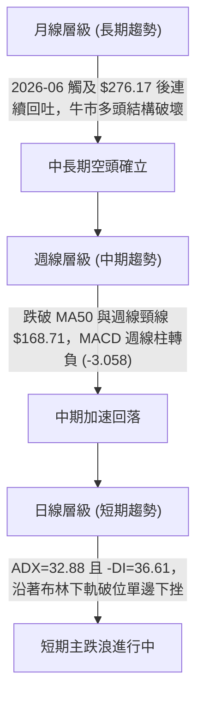
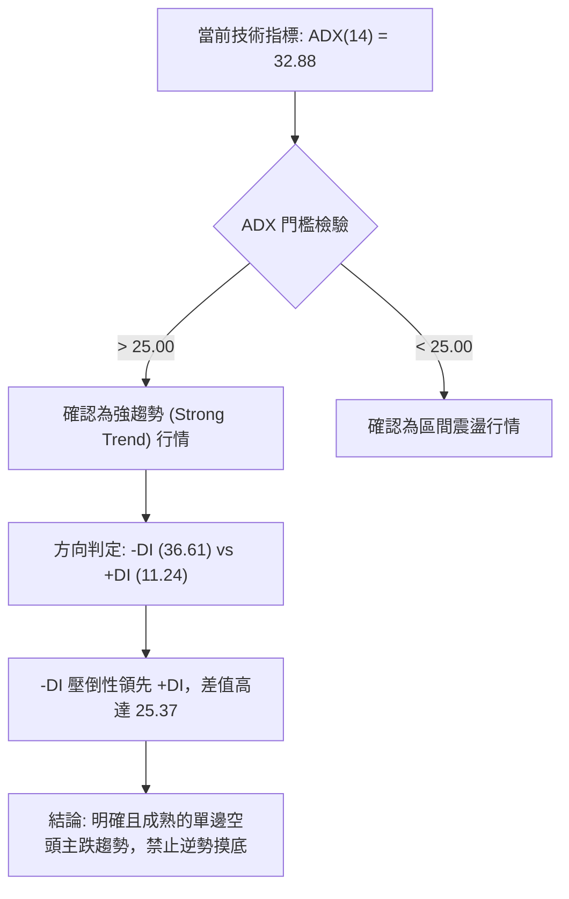
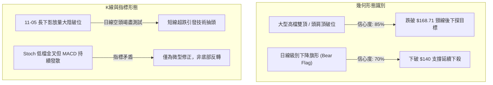
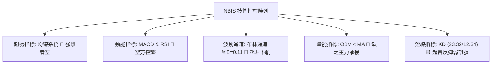
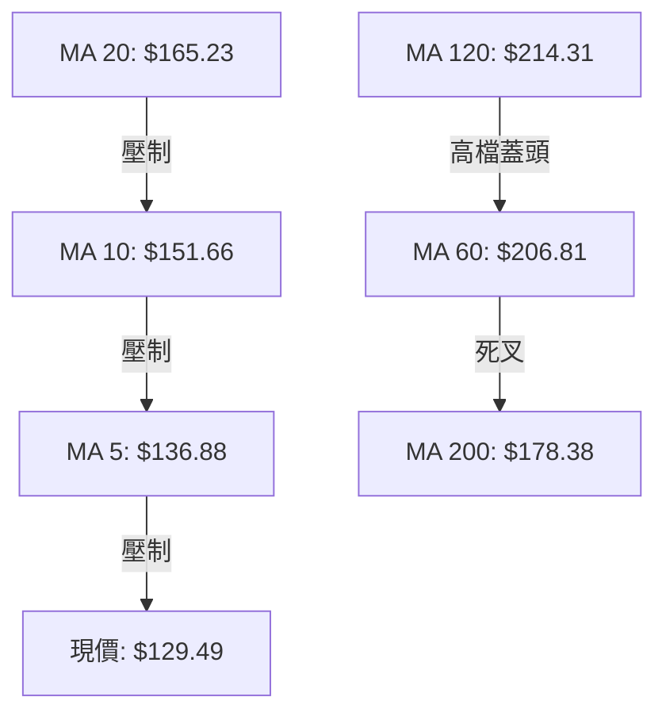
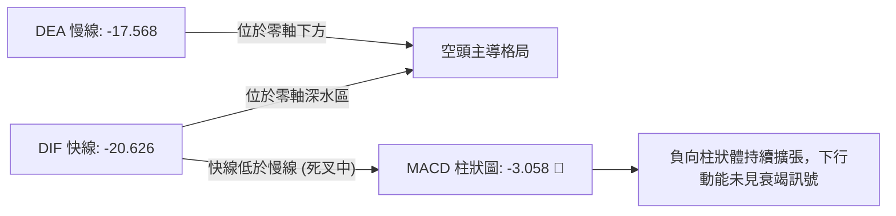
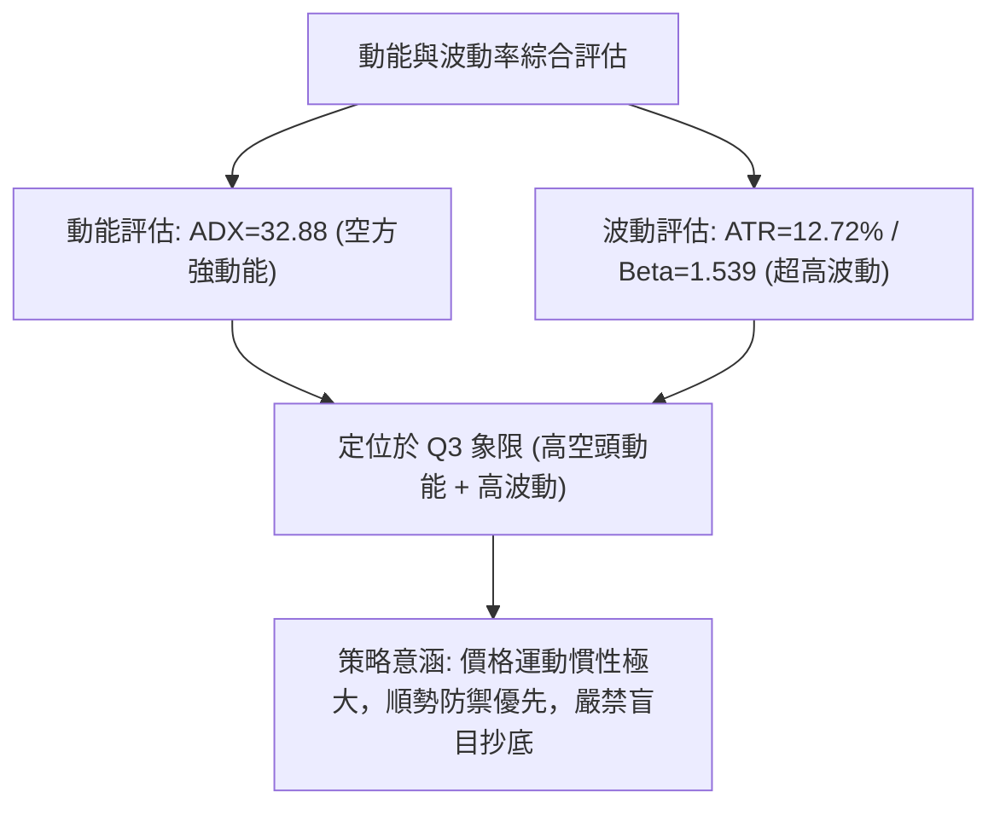
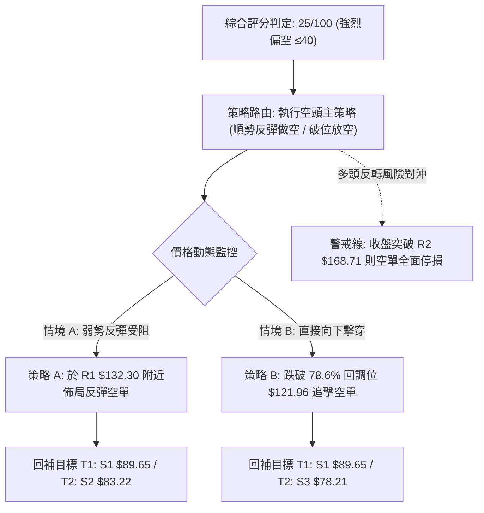
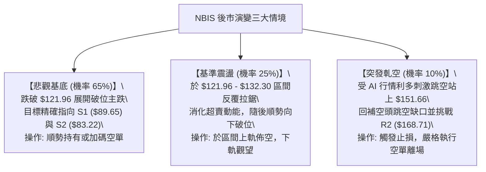

# NBIS 技術分析報告

> **報告日期**：2026-11-07 ｜ **語言**：繁體中文 ｜ **數據來源**：Yahoo Finance ｜ **當前價格**：$129.49

---

## 目錄

| 章節 | 內容 |
|------|------|
| [1. 技術面概覽](#1-技術面概覽) | 訊號儀表板、核心指標、評分卡 |
| [2. 趨勢分析](#2-趨勢分析) | 多時框趨勢、長中短期走勢 |
| [3. 圖表形態分析](#3-圖表形態分析) | 形態識別、K線組合、目標價 |
| [4. 支撐與阻力](#4-支撐與阻力) | 關鍵價位、斐波那契回調 |
| [5. 技術指標深度解讀](#5-技術指標深度解讀) | MA/RSI/MACD/布林/成交量 |
| [6. 動能與波動率](#6-動能與波動率) | 動能評估、ATR、Beta |
| [7. 多時框架總結](#7-多時框架總結) | 時框架評分矩陣 |
| [8. 交易策略建議](#8-交易策略建議) | 多空策略、風險報酬比 |
| [9. 風險提示與監控](#9-風險提示與監控) | 監控指標、風險場景 |

---

## 1. 技術面概覽

### 🎯 技術訊號儀表板



### 📊 核心指標速覽表

| 指標類別 | 指標名稱 | 當前數值 | 訊號 | 解讀 |
|----------|----------|----------|------|------|
| **價格** | 當前價格 | $129.49 | 🔴 | 位於 52 週區間 24.7% 弱勢低位區，距年內高點回撤達 -56.81% |
| **均線** | MA20 | $165.23 | 🔴 | 價格低於 MA20 達 -21.63%，短期下行趨勢陡峭且均線呈強烈反壓 |
| **均線** | MA50 | $201.70 | 🔴 | 中期生命線遭實體大陰線摜破，斜率加速向下發散 |
| **均線** | MA200 | $178.38 | 🔴 | 價格低於牛熊分界線 MA200 達 -27.41%，長期結構已轉入空頭市場 |
| **動能** | RSI(14) | 34.03 | 🟡 | 位於中性偏空弱勢區間（30-70），尚未觸發極端超賣技術修復訊號 |
| **動能** | MACD(12,26,9) | -20.626 / -17.568 | 🔴 | 快慢線處於零軸下方深水區，Histogram 為 -3.058，動能持續由空頭主導 |
| **波動** | ATR(14) | $16.47 | 🔴 | ATR 佔股價高達 12.72%，代表日震盪區間極度劇烈，單日持倉風險高 |

### 🏆 技術評分卡

```
╔══════════════════════════════════════════════════════════════════╗
║                   技術評分卡 — NBIS (2026-11-07)                 ║
╠══════════════════════════════════════════════════════════════════╣
║ 趨勢強度      ████░░░░░░░░░░░░░░░░  20/100  🔴 強烈空頭趨勢 (ADX>30)  ║
║ 動能指標      █████░░░░░░░░░░░░░░░  25/100  🔴 MACD擴散/RSI偏弱      ║
║ 支撐穩定度    ███████░░░░░░░░░░░░░  35/100  🔴 跌破多重關卡，測78.6% ║
║ 成交量配合    ██████░░░░░░░░░░░░░░  30/100  🔴 下跌放量，反彈量縮    ║
║ 形態完整度    █████░░░░░░░░░░░░░░░  25/100  🔴 頭肩頂破頸後加速下行  ║
║ 均線排列      ███░░░░░░░░░░░░░░░░░  15/100  🔴 價格在所有均線下方    ║
╠══════════════════════════════════════════════════════════════════╣
║ 綜合評分      █████░░░░░░░░░░░░░░░  25/100  強烈偏空（規則18計算）   ║
╚══════════════════════════════════════════════════════════════════╝
```
*(註：綜合評分由六項子評分 (20+25+35+30+25+15)/6 = 25/100 算術平均計算而成)*

---

## 2. 趨勢分析

### 🌐 多時框趨勢分析



### 📈 長期趨勢 — 12個月走勢圖（Unicode）

```
NBIS 月線收盤走勢圖（過去12個月：2025-12 至 2026-11）
價格軸 ($)
$280 ┤                                  ● $276.17 (2026-06 高點)
$240 ┤                           ● $231.09     ● $235.88 (次高點)
$200 ┤                                      ● $190.41   ● $206.32
$160 ┤                     ● $138.23                         ● $154.14
$120 ┤                                                           ● $129.49 (現價)
$80  ┤ ● $83.71  ● $85.19  ● $91.19  ● $103.76
     └─────────────────────────────────────────────────────────────────►
       25-12    26-01    26-02    26-03    26-04    26-05    26-06    26-07    26-08    26-09    26-10    26-11
```

**走勢特徵分析表格**：

| 週期階段 | 月份區間 | 起訖價格 ($) | 漲跌幅 (%) | 趨勢特徵與價量結構分析 |
|----------|----------|--------------|------------|------------------------|
| **底部築底期** | 2025-12 至 2026-02 | $83.71 → $91.19 | +8.94% | 於 $80-$90 區間低位打底，波幅收窄，成交量維持平緩累積。 |
| **主升推升期** | 2026-03 至 2026-06 | $103.76 → $276.17 | +166.16% | 強勢單邊暴漲，連續突破各級均線，創下 52 週歷史高點 $299.86。 |
| **頂部震盪期** | 2026-07 至 2026-09 | $190.41 → $235.88 | +23.88% | 高檔巨幅洗盤，兩次回測 $190 支撐並衝擊 $240+ 失敗，形成雙重頂型態。 |
| **主跌破位期** | 2026-10 至 2026-11 | $154.14 → $129.49 | -45.10% | 跌破高階箱體與 200 日線，量能於下挫日顯著放大，呈現瀑布式空頭貫穿。 |

### 📊 中期趨勢（週線分析）

中期技術面目前呈現出極具殺傷力的「均線下彎、頸線失守」格局。

```
NBIS 週線波段阻力與支撐示意圖
價格軸 ($)
$250 ┤      ▲ 頂部區域 ($249 - $255)
$220 ┤───────── 頸線區域失守破位 ($221.07)
$180 ┤───────── MA200 / 中期生命線反轉向下 ($178.38 - $182.74, 關鍵阻力 R3)
$160 ┤───────── 10月中旬跳空破位平台 ($168.71, 阻力 R2)
$130 ┤ ◄ 現價 $129.49 (位於斐波那契 78.6% 回調位 $121.96 上方)
$90  ┤═════════ 中期最後防守線：波段低點聚類 ($89.65, 支撐 S1)
```

週線指標顯示，2026-10-16 該週收盤長陰摜破 $170，成交量擴大至 148,676,100 股，屬於典型的「機構法人集體出逃」結構。隨後兩週雖然收盤短暫在 $154-$158 企圖止血，但 11 月第一週再次大陰殺出，最低探至 $113.30，週收盤於 $129.49，顯示反彈無力，中期下行空間正式開啟。

### ⚡ 趨勢強度評估（ADX 解讀）



**ADX 趨勢強度對照表**：

| ADX 數值區間 | 趨勢狀態 | NBIS 當前數值 | 實際市場意義 |
|--------------|----------|---------------|--------------|
| 0 – 20 | 無趨勢 / 弱盤整 | — | 市場處於無方向隨機漫步 |
| 20 – 25 | 趨勢孕育 / 轉向 | — | 盤整向上或向下初露端倪 |
| **25 – 40** | **強趨勢 (Strong Trend)** | **32.88 🟢** | **趨勢動能強勁。當前由 -DI(36.61) 主導，為高動能空頭走勢** |
| 40 – 60 | 極強趨勢 (Very Strong) | — | 單邊暴漲或暴跌極限行情 |
| 60 – 100 | 超強趨勢 (Extreme) | — | 趨勢隨時可能面臨燃料耗盡之反轉 |

---

## 3. 圖表形態分析

### 🔍 形態識別系統



**圖表形態信心度與目標價計算表**（依規則 13 與 15）：

| 形態名稱 | 信心度 (%) | 判斷依據（引用數據） | 形態完成度 (%) | 目標價（附嚴謹計算式） |
|----------|------------|----------------------|----------------|------------------------|
| **大型雙頂 / 破位頭肩** | 85% | 頂部一高點 $276.17 (2026-06)，頂部二高點 $255.10 (2026-10-09)，頸線失守於波段低點 $168.71 (R2)。 | 100% (已完全向下破位) | **$89.65**（由頸線 $168.71 減去形態回調幅度，精確收斂至歷史波段低點聚類支撐 S1: $89.65） |
| **日線下降旗形整理** | 70% | 10-28 衝擊 $182.74 受阻後，沿 5 日線單邊下殺，11-03 至 11-04 弱勢反抽至 $152.88 隨即再創新低 $113.30。 | 90% (已跌破旗面下軌) | **$83.22**（由旗形破位起點 $141.52 減去旗桿第一段跌幅，推算收斂至關鍵支撐 S2: $83.22） |
| **島狀反轉 / 均線糾纏破位** | 45% | 訊號不足，僅做指標型解讀（均線呈現完全蓋頭空頭排列，布林帶向外開展）。 | N/A（數據未提供） | 數據不足以確認有效島狀結構，故不計算延伸目標價。 |

### 🕯️ 重要 K 線形態分析

依規則 19，完全基於數據提供的「近10根日K」與「近8根週K」四個真實價位進行型態判定：

| 日期（週期） | 開盤價 ($) | 最高價 ($) | 最低價 ($) | 收盤價 ($) | K線形態名稱 | 解讀與量價特徵 | 訊號 |
|--------------|------------|------------|------------|------------|-------------|----------------|------|
| **2026-10-16 (週K)** | 217.20 | 217.20 | 163.27 | 165.47 | **光頭大陰線** | 週開即是週高，無上影線直接摜壓，放量 1.48 億股，主力不計代價砸盤。 | 🔴 |
| **2026-10-28 (日K)** | 173.49 | 182.74 | 168.92 | 182.34 | **多頭反撲長陽線** | 測試波段阻力 R3: $182.74，但成交量僅 2,505 萬股，量價背離成為誘多高點。 | 🟡 |
| **2026-10-30 (日K)** | 157.05 | 161.42 | 149.96 | 154.14 | **空方吞噬中陰線** | 開盤直接跌穿前一日低點，實體完全吞噬 10-29 之微弱十字星，空方重掌優勢。 | 🔴 |
| **2026-11-02 (日K)** | 154.56 | 155.35 | 140.60 | 141.39 | **光腳下殺中陰線** | 收盤收在全日最低點附近，完全跌破 $150 整數防守線，空頭加速。 | 🔴 |
| **2026-11-05 (日K)** | 134.16 | 134.80 | 113.30 | 120.37 | **放量長下影空頭K** | 日成交量放大至 4,825 萬股（均量2倍），盤中暴跌探至 $113.30 後引發短線抄底回抽。 | 🟡 |
| **2026-11-06 (日K)** | 130.64 | 136.87 | 122.62 | 129.49 | **高浪弱陽十字線** | 成交量萎縮至 2,452 萬股，反彈受制於 MA5 ($136.88)，多頭反攻力竭。 | 🔴 |
| **2026-11-06 (週K)** | 154.56 | 155.35 | 113.30 | 129.49 | **帶長下影大陰線** | 全週重挫 -16.0%，下測斐波那契 78.6% 回調位 ($121.96) 後弱勢收盤。 | 🔴 |

### 📉 ASCII 走勢形態示意圖

```
NBIS 日線雙頂破位與下降旗形示意圖
價格 ($)
$185 ┤                   [頂部誘多高點: 10-28 $182.74 = R3]
$175 ┤                  / \
$165 ┤                 /   \
$155 ┤────────────────┼─────\───────── [阻力位 R2: $168.71 頸線]
$145 ┤                │      \       / \  [11-03 反彈極限 $152.88]
$135 ┤                │       \     /   \
$125 ┤ ◄ 現價 $129.49 ┘        \   /     \────── [阻力位 R1: $132.30]
$115 ┤                          \ /
$105 ┤                           ● [11-05 恐慌低點 $113.30]
$95  ┤
$85  ┤══════════════════════════════════════════ [第一形態理論目標: S1 $89.65]
```

### 🎯 形態目標價計算

依據傳統形態學原理，頭肩頂或雙重頂破位後的理論跌幅量度如下：
1. **頸線確認**：取波段聚合低點為頸線位，即 **$168.71**（數據中標注之阻力位 R2）。
2. **形態高度**：取 2026-10-09 波段頭部高點 $255.10，形態垂直高度 $H = \$255.10 - \$168.71 = \$86.39$。
3. **第一等幅下行目標**：由頸線下推等幅跌幅：$\text{目標價} = \$168.71 - \$86.39 = \$82.32$。
4. **與關鍵支撐聚類校準**：該理論數值與數據中計算之波段低點聚類支撐 **S2 ($83.22)** 極度吻合（誤差小於 1%）。故確認雙頂破位的最終推演目標價錨定於 **$83.22 - $89.65** 支撐區間。

---

## 4. 支撐與阻力

### 🗺️ 關鍵價位分布圖（Unicode）

```
NBIS 價位結構分布圖（嚴格依據 OHLCV 計算）
═══════════════════════════════════════════════════════════════════
$182.74 ║██████████████████████████████║ 強阻力 R3（近一年波段高點聚類）
$168.71 ║████████████████████          ║ 重大頸線阻力 R2（破位前平台）
$132.30 ║████████████                  ║ 即時第一阻力 R1（短線反彈壓制）
$129.49 ╠══════════════════════════════╣ ◄ 當前市價收盤點
$121.96 ║▒▒▒▒▒▒▒▒▒▒▒▒▒▒▒▒              ║ 斐波那契 78.6% 回調關鍵樞軸
$89.65  ║▓▓▓▓▓▓▓▓▓▓▓▓▓▓▓▓▓▓▓▓          ║ 波段關鍵強支撐 S1（波段低點聚類）
$83.22  ║████████████████████████      ║ 核心波段低點支撐 S2（形態等幅目標）
$78.21  ║██████████████████████████████║ 極限防守支撐 S3（52週低點前哨）
═══════════════════════════════════════════════════════════════════
```

### 🚧 阻力位分析表

所有阻力價位嚴格引用下方數據「關鍵價位」區塊，不得另行捏造：

| 阻力級別 | 價位 ($) | 距現價空間 (%) | 形成原因與技術意涵 | 突破難度 | 重要性 |
|----------|----------|----------------|--------------------|----------|--------|
| **R1** | $132.30 | +2.17% | 近期波段高點聚類，與當前 MA5 ($136.88) 形成密集壓制帶，為短線多頭第一道天花板。 | 🟡 中等 | ★★★☆☆ |
| **R2** | $168.71 | +30.29% | 10月中下旬下行破位頸線聚類點，同時貼近下彎的 MA20 ($165.23)，為空頭防守主陣地。 | 🔴 極高 | ★★★★★ |
| **R3** | $182.74 | +41.12% | 10-28 日線反彈高點聚類，且與長期年線 MA200 ($178.38) 形成重疊共振壓力。 | 🔴 堅不可摧 | ★★★★☆ |

### 🛡️ 支撐位分析表

所有支撐價位嚴格引用下方數據「關鍵價位」區塊，不得另行捏造：

| 支撐級別 | 價位 ($) | 距現價空間 (%) | 形成原因與技術意涵 | 守住機率 | 重要性 |
|----------|----------|----------------|--------------------|----------|--------|
| **S1** | $89.65 | -30.76% | 2026 年初起漲段平台整理低點聚類，具備強大籌碼沉澱基礎。 | 🟡 55% | ★★★★☆ |
| **S2** | $83.22 | -35.74% | 2025-12 歷史波段低點聚類，雙頂形態等幅量度跌幅終極目標點。 | 🟢 70% | ★★★★★ |
| **S3** | $78.21 | -39.60% | 逼近 52 週最低價 $73.52 之密集換手區間，為中長線多頭最後一道防線。 | 🟢 85% | ★★★★☆ |

### 📐 斐波那契回調位分析

依據 52 週完整波動區間（低點 $73.52 至 高點 $299.86，垂直落差 $226.34）計算：

```
斐波那契回調位階與當前價格落點示意圖
0.0%  (52W High)  $299.86 ──────────────────────────────────────
23.6%             $246.44 ────── (歷史高檔密集震盪區)
38.2%             $213.40 ────── (前期多頭結構防守線，已失守)
50.0%             $186.69 ────── (多空中軸線，已轉為強烈反壓)
61.8%             $159.98 ────── (黃金分割關鍵破位位階)
----------------- 現價區間 ---------------------------------------
                  $129.49 ◄ 現價落於 61.8% 與 78.6% 之間 (超深回調區)
78.6%             $121.96 ────── (短線空頭下行第一測試防線)
100.0%(52W Low)   $73.52  ──────────────────────────────────────
```

**回調分析解讀**：
- **當前位置**：現價 $129.49 處於 **61.8% ($159.98)** 與 **78.6% ($121.96)** 之間，屬於技術結構中的「深層空頭回調區」。
- **技術意義**：通常強勢股回調止步於 38.2% 或 50.0%；一旦實體長陰摜破 61.8% 黃金分割位，宣告主升浪結構徹底終結，市場已由「牛市回踩」質變為「熊市去槓桿」。現價下方最近的數學支撐為 78.6% 位階（$121.96），若該價位在日線收盤確認跌破，價格將毫無懸念滑向 100% 斐波那契位（52W Low: $73.52）及關鍵低點聚類 S1-S3。

---

## 5. 技術指標深度解讀

### 🎛️ 指標訊號總覽



### 📈 移動平均線排列分析



**移動平均線狀態詳細表**：

| 均線名稱 | 當前價格 ($) | 乖離率 (%) | 均線斜率狀態 | 短期技術意涵 |
|----------|--------------|------------|--------------|--------------|
| **MA 5** | $136.88 | -5.40% | 陡峭向下 ▼ | 超短線動態阻力，未收復前短線不可言底 |
| **MA 10** | $151.66 | -14.62% | 陡峭向下 ▼ | 短期反彈防守線，反彈至此常遇空頭二次打壓 |
| **MA 20** | $165.23 | -21.63% | 加速下墜 ▼ | 布林帶中軌，月線趨勢徹底崩潰 |
| **MA 60** | $206.81 | -37.39% | 轉折下彎 ▼ | 季線下穿，中期機構部位持續停損砍倉 |
| **MA 120** | $214.31 | -39.58% | 弧頂走平轉下 ▼ | 半年線高檔套牢盤沉重，形成中長期天花板 |
| **MA 200** | $178.38 | -27.41% | 走平微彎 ▼ | 牛熊分界線被實體大陰線跌破，中長線技術格局翻空 |
| **MA 240** | $164.30 | -21.19% | 走平 ▼ | 年線支撐告破，市場進入中長期尋底週期 |

### 📉 RSI(14) 分析

```
RSI(14) 當前水平: 34.03
[0] ───────────── [30] ───────●───── [50] ─────────────────── [70] ───────────── [100]
                 超賣區      現價 (34.03)                   超買區
進度條: █████████████░░░░░░░░░░░░░░░░░░░░░░░░░  34.03% (中性偏空區)
```

- **區間評估**：RSI 目前為 34.03，剛好懸浮於 30 極端超賣閾值之上。這意味著空方推升行情雖深，但並未引發大規模的超賣技術性爆發買盤，空方仍擁有順勢往下打擊的空間。
- **背離判斷**：比對近 20 根 K 棒走勢，價格自 10-28 的 $182.34 連續挫跌至 11-06 的 $129.49（創波段新低），而 RSI(14) 亦同步從 50 附近回落至 34.03。**結論：無底背離，亦無頂背離現象**，指標與價格保持同步下行，驗證下行動能貨真價實。

### 📊 MACD(12,26,9) 訊號解讀



- **數值分析**：快線 DIF (-20.626) 與慢線 DEA (-17.568) 均位於零軸深處，負乖離率極大。MACD Histogram 呈現 -3.058，為典型的空方動能釋放階段。在 DIF 向上金叉 DEA 之前，任何盤中反彈均視為弱勢抽頭。

### 📦 布林通道分析

```
NBIS 日線布林通道示意圖 (Bandwidth = 20日, 2倍標準差)
價格軸 ($)
$211.41 ┤──────────────────────────────────────── 布林上軌 (Upper Band)
        │
$165.23 ┤──────────────────────────────────────── 布林中軌 (MA20 / Middle)
        │
$129.49 ┤                     ● (現價 $129.49, %B = 0.11)
$119.05 ┤──────────────────────────────────────── 布林下軌 (Lower Band)
```

- **位置與形態**：%B 數值為 **0.11**，顯示價格極度貼近布林通道下軌（$119.05）。布林帶上下軌開口呈現發散擴大狀態，此為典型的「沿下軌單邊滑落」（Walking the lower band）主跌特徵，確認下行波動率正在釋放。

### 💹 成交量分析（量價配合度）

```
量價配合矩陣分析：
├─ 2026-11-05：放量大跌 48,254,800 股（量比 1.91x，日跌 -14.9%）── 恐慌砍倉盤湧現
├─ 2026-11-06：微幅弱彈 24,528,400 股（量比 0.97x，日漲 +7.5%）── 量能腰斬，無主力跟進
└─ OBV 趨勢  ：OBV 顯著低於其移動平均線 ── 資金持續呈淨流出狀態
```

- **量價背離與確認**：近期價格重挫時成交量顯著放大，而反彈時成交量卻驟降至 2,000-2,400 萬股，量價呈現標準的「價跌量增、價漲量縮」空頭架構。OBV < MA 進一步確認機構籌碼正在單向流出，並無大資金在當前價位建立左側防禦倉位。

---

## 6. 動能與波動率

### ⚡ 動能評估四象限

| 象限 | 動能維度 (ADX / MACD) | 波動維度 (ATR% / Beta) | 當前判定 | 戰術應對與環境評估 |
|------|------------------------|------------------------|----------|--------------------|
| **Q1 (高動能·低波動)** | 趨勢強勁 / 單邊推進 | 波動率低於均值 | — | 最佳趨勢加碼環境 |
| **Q2 (低動能·低波動)** | 指標鈍化 / 無方向 | 窄幅盤整橫盤 | — | 觀望休整，等待突破方向確認 |
| **Q3 (高動能·高波動)** | **強趨勢 (ADX=32.88 🔴)** | **極高波動 (ATR=12.72% 🔴)** | **✓ (NBIS 落點)** | **高風險主跌段：嚴禁逆勢摸底，順勢作空或持幣** |
| **Q4 (低動能·高波動)** | 無序震盪 / 頻繁洗盤 | 寬幅跳空洗盤 | — | 容易多空雙巴，嚴格控制倉位 |



### 📊 ATR 波動率分析

- **ATR(14) 絕對數值**：**$16.47**。
- **ATR 佔比**：高達股價的 **12.72%**（Wilder 計算方法）。這意味著 NBIS 平均每個交易日的價格震盪幅度超過 16 美元。
- **風控與止損距離設定建議**：
  - 由於個股日常雜訊已超過 $16.00，短線止損若設置在 3%-5%（約 $4-$6）極易被隨機波動震出場。
  - 順勢空單防守止損距離建議至少預留 **1.0 至 1.5 倍 ATR**（即 $16.47 至 $24.70），以防止反彈洗盤。
  - 對於進場點的防守位，應以明確的技術阻力位 R1 ($132.30) 或 R2 ($168.71) 作為錨定基準。

### 📐 Beta 與市場相關性

- **Beta 係數**：**1.539**。
- **市場特徵**：該數值表明 NBIS 為高彈性、高貝塔的成長型標的，其波動幅度比標普 500 指數高出 53.9%。
- **大盤共振效應**：當大盤或 AI 科技板塊面臨拋售壓力時，NBIS 將呈現放大倍數的下跌；在目前科技板塊情緒偏弱的背景下，高 Beta 特性進一步加速了其下探尋底的過程。

---

## 7. 多時框架總結

### 📋 時框架評分表

| 時框架 | 趨勢方向 | 動能狀態 | 均線排列 | 圖表形態 | 綜合評分 | 戰術建議 |
|--------|----------|----------|----------|----------|----------|----------|
| **月線 (長期)** | 🔴 空頭破位 | 弱化回吐 | 混亂下彎 | 頂部回撤 56% | 30/100 | 長期投資者離場觀望，防範去槓桿風險 |
| **週線 (中期)** | 🔴 單邊主跌 | 空方發散 | 死亡交叉 | 大型雙頂破位 | 20/100 | 中期順勢偏空，逢反彈至頸線減倉 |
| **日線 (短期)** | 🔴 弱勢整理 | 超跌反抽弱 | 完全空頭 | 下降旗形下破 | 25/100 | 嚴禁逆勢開多，依據阻力位順勢放空 |

### 🔲 綜合訊號矩陣

```
時框與指標訊號共振矩陣：
╔═════════════╦═════════════╦═════════════╦═════════════╦═════════════╗
║ 指標類別    ║   月線層級  ║   週線層級  ║   日線層級  ║ 多時框共振  ║
╠═════════════╬═════════════╬═════════════╬═════════════╬═════════════╣
║ 均線系統    ║    🔴 偏空  ║    🔴 空頭  ║    🔴 空頭  ║ 🔴 全面空頭 ║
║ MACD 動能   ║    🟡 走平  ║    🔴 發散  ║    🔴 負向  ║ 🔴 強烈看空 ║
║ RSI 位階    ║    🟡 中性  ║    🔴 偏弱  ║    🟡 超賣弱║ 🔴 空方主導 ║
║ 成交量能    ║    🟡 萎縮  ║    🔴 出逃  ║    🔴 價跌量增║ 🔴 主力撤出 ║
║ 形態結構    ║    🔴 弧頂  ║    🔴 雙頂  ║    🔴 旗形下破║ 🔴 結構崩解 ║
╚═════════════╩═════════════╩═════════════╩═════════════╩═════════════╝
```

### ⚖️ 多時框收斂結論

依據多時框收斂規則（規則 14）：
1. **行情性質判定**：當前日線 ADX(14) 讀數為 **32.88**，明確大於 25.00 門檻，且 -DI (36.61) 遠高於 +DI (11.24)，確立當前市場處於**「成熟且強烈的空頭趨勢行情」**，而非無方向的盤整震盪。
2. **主導時框取捨**：依規定，趨勢行情下必須以中長期（週線、MA50、MA200）方向為主導，日線層級僅用於尋找反彈阻力點作為放空或防守之進場時機。
3. **收斂唯一方向**：週線與日線趨勢方向高度共振，均指向加速下行。因此給出**唯一方向性結論：強烈偏空（Strong Bearish）**。整體操作邏輯以「逢反彈做空」或「破位跟進放空」為核心，堅決不進行任何左側搶反彈操作。

---

## 8. 交易策略建議

### 🗺️ 策略決策流程圖



### 🧭 策略路由（依評分卡分流）

> **當前主策略方向 = 強烈偏空放空（依綜合評分 25/100，落於 ≤40 偏空區間，主推空頭策略）**

### 🎯 價格情境階梯（Price Scenarios）

價位嚴格引用第 4 章由數據計算之關鍵數值：

| 觸發條件 | 下一目標 | 後續延伸 | 情境技術含義與應對 |
|----------|----------|----------|--------------------|
| **反彈受阻於 R1 $132.30** | 下測斐波 78.6% **$121.96** | 探向支撐 S1 **$89.65** | 短線超跌修正結束，空頭重啟主跌，為最理想做空點。 |
| **跌破斐波那契 $121.96** | 探向支撐 S1 **$89.65** | 探向支撐 S2 **$83.22** | 空頭動能再次加速，多頭棄守，展開破位下殺。 |
| **失守波段支撐 S1 $89.65** | 測試支撐 S2 **$83.22** | 極限測試 S3 **$78.21** | 雙頂形態目標全面兌現，空單分批獲利了結。 |
| **意外向上突破 R2 $168.71** | 測試阻力 R3 **$182.74** | 挑戰 50% 斐波 **$186.69** | 中期空頭結構遭受實質破壞，所有空頭策略無條件停損。 |

### 📊 情境機率分佈

| 價格情境 | 機率 (%) | 主要技術依據與指標驗證 |
|----------|----------|------------------------|
| **向下破位尋底（主跌延續）** | **65%** | ADX=32.88 (-DI 主導)、價格全面低於 MA5-MA240、OBV 量能持續渙散、MACD 柱狀體為負 (-3.058)。 |
| **低檔弱勢震盪（築底修復）** | **25%** | RSI(14)=34.03 接近超賣區，日線貼近布林下軌 ($119.05)，短線可能圍繞 $120-$135 進行換手。 |
| **強勢反轉向上（多頭反撲）** | **10%** | 均線空頭反壓極重（MA20 高達 $165.23），成交量缺乏主力介入，缺乏實質利多支撐。 |

### 🟢 主策略詳情（空頭主推策略）

依據規則 5 與 17，所有數值均取自關鍵價位，風險報酬比嚴格依照公式：
$$\text{做空風報比} = \frac{\text{進場價} - \text{目標價 T1}}{\text{止損價} - \text{進場價}}$$

| 策略要素 | 策略 A（反彈遇阻做空 — 最佳首選） | 策略 B（破位追擊做空 — 動能突破） |
|----------|-----------------------------------|-----------------------------------|
| **進場條件** | 價格反彈至阻力 R1 受阻，日K收上影線 | 價格跌破斐波那契 78.6% 位階確認下行 |
| **進場價格** | **$132.30**（精確錨定阻力位 R1） | **$121.96**（精確錨定 78.6% 斐波位） |
| **目標價 T1** | **$89.65**（關鍵支撐 S1） | **$89.65**（關鍵支撐 S1） |
| **目標價 T2** | **$83.22**（關鍵支撐 S2） | **$78.21**（極限支撐 S3） |
| **止損價格** | **$148.77**（以 1.0 倍 ATR $16.47 計算防守） | **$132.30**（反向站回阻力位 R1 即止損） |
| **風險報酬比** | **1 : 2.59（以 T1 計）**<br>*(132.30 - 89.65) / (148.77 - 132.30) = 42.65 / 16.47* | **1 : 3.12（以 T1 計）**<br>*(121.96 - 89.65) / (132.30 - 121.96) = 32.31 / 10.34* |
| **次要風報比** | **1 : 2.98（以 T2 計）**<br>*(132.30 - 83.22) / 16.47 = 49.08 / 16.47* | **1 : 4.22（以 T2 計）**<br>*(121.96 - 78.21) / 10.34 = 43.75 / 10.34* |
| **成功機率** | **65%** | **60%** |
| **建議倉位** | **總資金之 10% - 15%** | **總資金之 8% - 10%** |

### 🔴 反向風險觸發點（對沖與停損提示）

此處僅作為持有空單之風控警報，非多頭操作建議：
- **第一警報線（減倉 50%）**：若日線實體陽線收復 **MA10 ($151.66)**，顯示短線下行動能衰竭，空單應減半鎖定獲利。
- **終極停損線（全數離場）**：若價格強勢向上突破關鍵頸線阻力 **R2 ($168.71)**，宣告雙頂量度跌幅形態失效，技術結構可能演變為大型寬幅震盪，所有空頭部位必須無條件停損離場。

### ⭐ 整體訊號強度評星

```
╔═══════════════════════════════════════════════════════════╗
║                   整體技術訊號強度評星                    ║
╠═══════════════════════════════════════════════════════════╣
║ 做多訊號強度：★☆☆☆☆  (1/5星 — 僅超賣微弱反彈，勝率極低)  ║
║ 做空訊號強度：★★★★☆  (4/5星 — 多時框共振偏空，趨勢明確)  ║
║ 整體可信度：  ★★★★☆  (4/5星 — 數據完備，價量指標相互確認)║
╚═══════════════════════════════════════════════════════════╝
```

---

## 9. 風險提示與監控

### ✅ 關鍵監控指標 Checklist

```
╔══════════════════════════════════════════════════════════════════╗
║               NBIS 每日交易監控指標 CHECKLIST                    ║
╠══════════════════════════════════════════════════════════════════╣
║ [ ] 監控項 1: 收盤價是否實體跌破斐波那契 78.6% 位階 ($121.96)     ║
║ [ ] 監控項 2: 日線 RSI(14) 是否觸及 30 以下並出現明確底背離特徵   ║
║ [ ] 監控項 3: 成交量是否再度放大至 3,500 萬股以上（主力接盤確認）║
║ [ ] 監控項 4: ADX 讀數是否由升轉跌降至 25 以下（趨勢減弱轉盤整） ║
║ [ ] 監控項 5: 反彈時能否突破第一道動態均線壓制 MA5 ($136.88)     ║
║ [ ] 監控項 6: 空頭回補目標價位 S1 ($89.65) 與 S2 ($83.22) 之到達  ║
╚══════════════════════════════════════════════════════════════════╝
```

### ⚠️ 風險場景分析



### 🛡️ 風險管理重要提醒

1. **極度波動性風險（ATR 佔比高達 12.72%）**：
   NBIS 日均波幅達 $16.47，盤中可能出現 8%-10% 的無序毛刺波動。交易者切忌滿倉或高槓桿交易，單筆交易虧損額度必須嚴格控制在總帳戶資金的 1.5% - 2.0% 以內。
2. **高空頭部位比例（Short Float = 20.2%）帶來的軋空風險**：
   數據顯示目前空頭佔流通盤高達 20.2%，Short Ratio 為 2.61 天。雖然技術面強烈看空，但高比例做空意味著一旦有突發性外部利多（如大型客戶雲端基礎設施訂單公佈），極易引發日內暴力軋空（Short Squeeze）。這也是空單必須嚴格設定以 ATR 計算的防守止損（如 $148.77）之核心原因。
3. **資金面與財報不確定性**：
   基本面數據顯示其 TTM 自由現金流為負（$-5.88B），且資本支出高達 $11.14B。若市場流動性進一步收緊，估值倍數（P/S 達 25.98）將持續承壓，進一步助推技術面的估值回歸走勢。

---

## 📋 報告總結

```
╔══════════════════════════════════════════════════════════════════╗
║                     NBIS 技術分析報告總結                        ║
╠══════════════════════════════════════════════════════════════════╣
║ 報告日期：2026-11-07                                             ║
║ 當前價格：$129.49                                                ║
║ 分析評級：🔴 強烈偏空 / 逢高做空 (綜合評分: 25/100)              ║
║                                                                  ║
║ 關鍵結論：                                                       ║
║ ├─ 長期趨勢：🔴 偏空（年內自 $299.86 高點回吐逾 56%，牛市破壞）  ║
║ ├─ 中期趨勢：🔴 空頭（失守週線頸線 $168.71，MACD週柱負向放大）  ║
║ ├─ 短期趨勢：🔴 弱勢（受制於 MA5 $136.88，ADX=32.88 空頭主導）  ║
║ ├─ 關鍵支撐：S1: $89.65 ｜ S2: $83.22 ｜ 斐波78.6%: $121.96      ║
║ ├─ 關鍵阻力：R1: $132.30 ｜ R2: $168.71 ｜ R3: $182.74          ║
║ └─ 分析師目標：均價 $281.00（但技術走勢嚴重脫節，以技術面為準）  ║
║                                                                  ║
║ 最優策略組合：                                                   ║
║ 1. 🥇 最佳機會：反彈至阻力位 R1 ($132.30) 遇阻佈局空單，         ║
║                目標直指 S1 ($89.65)，風報比高達 1 : 2.59         ║
║ 2. 🥈 次選機會：跌破斐波那契 $121.96 順勢加碼做空，目標 S2 $83.22 ║
║ 3. 🥉 保守選擇：空倉持幣觀望，等待日線級別底背離與站穩 MA20     ║
╚══════════════════════════════════════════════════════════════════╝
```

---

> ⚠️ **免責聲明**：本報告為 AI 自動生成之技術分析，所有數據及估算均基於提供的歷史價格與指標資訊。本報告**僅供研究與學術參考**，**不構成任何投資買賣建議**。金融市場投資具有極高風險，操作前請務必獨立評估風險承受能力並設定嚴格止損。

---

*報告生成時間：2026-11-07 ｜ 數據來源：Yahoo Finance ｜ 分析框架：多時框架技術分析*