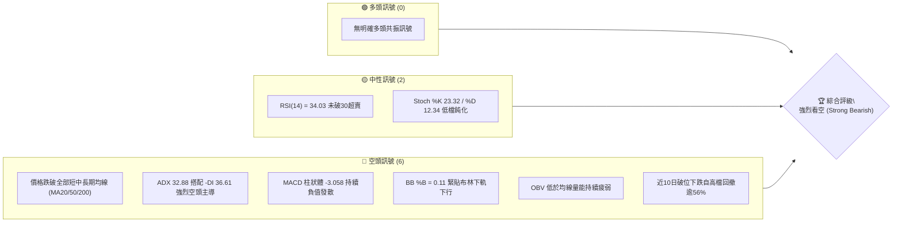
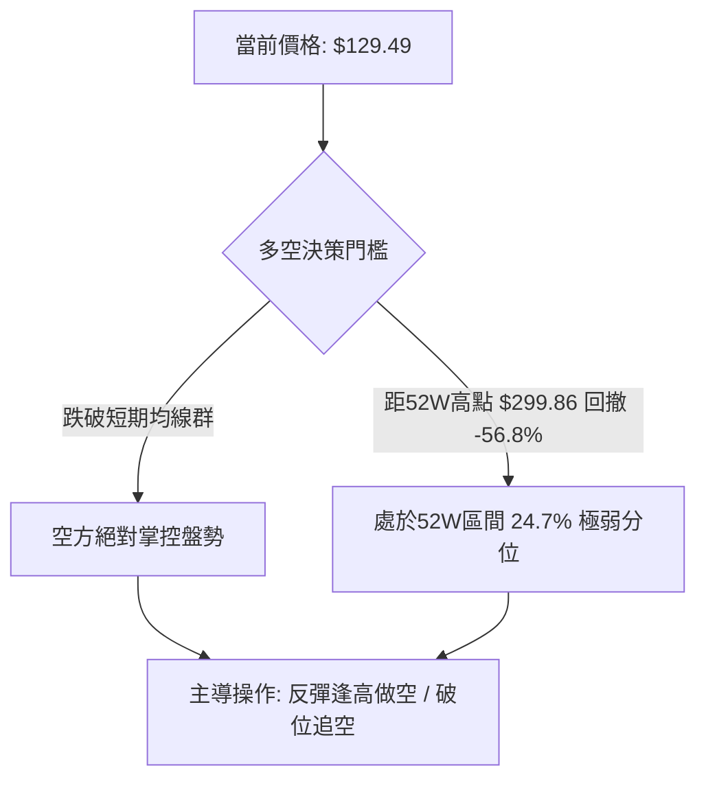
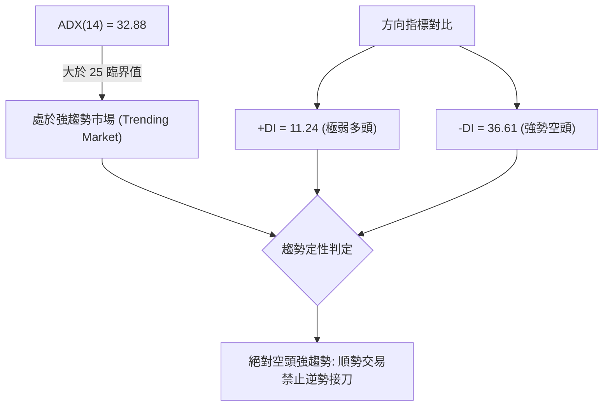
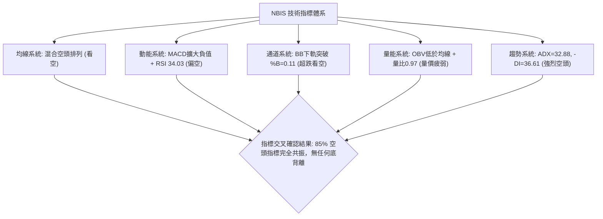
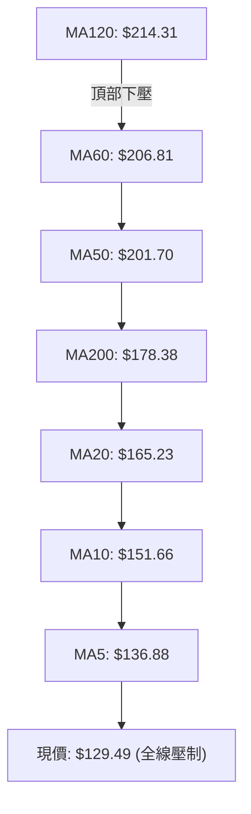
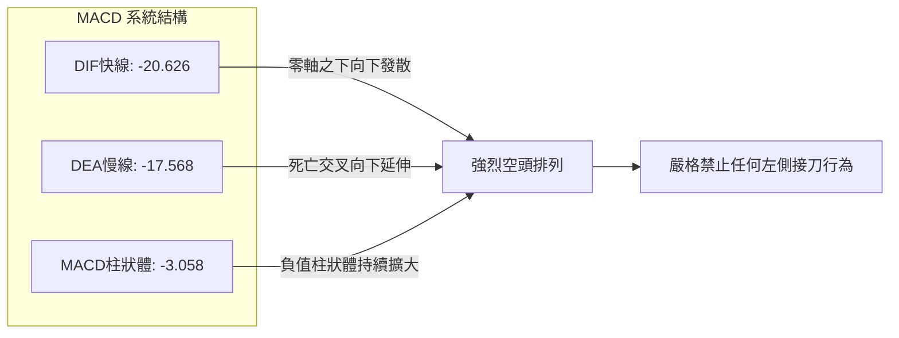
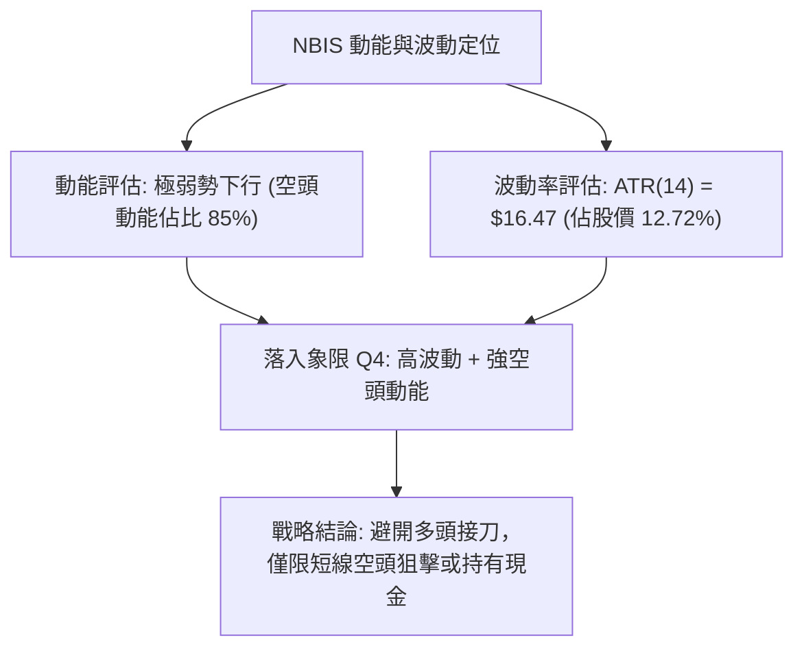
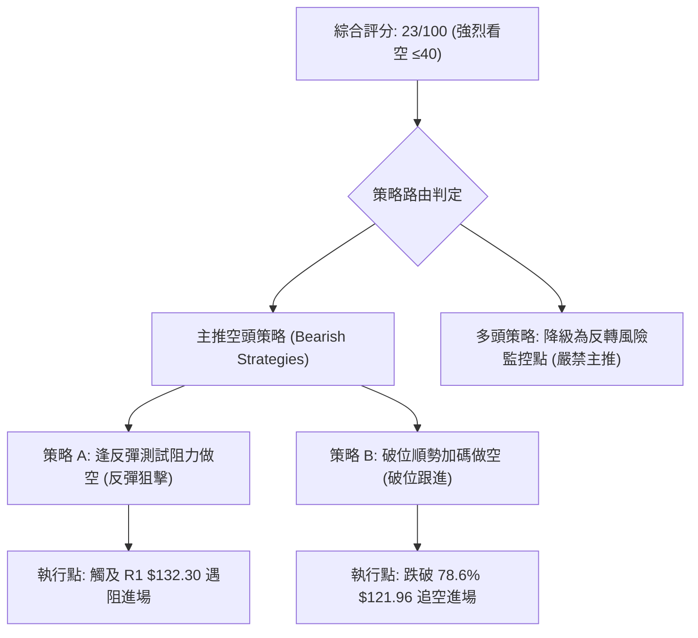
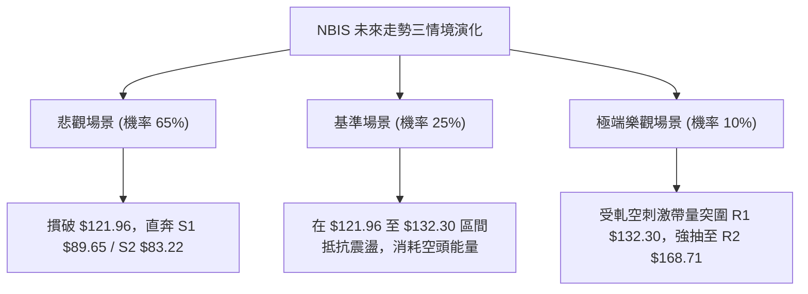

# NBIS 技術分析報告

> **報告日期**：2026-11-08 ｜ **語言**：繁體中文 ｜ **數據來源**：Yahoo Finance ｜ **當前價格**：$129.49

---

## 目錄

| 章節 | 內容 |
|------|------|
| [1. 技術面概覽](#1-技術面概覽) | 訊號儀表板、核心指標、評分卡 |
| [2. 趨勢分析](#2-趨勢分析) | 多時框趨勢、長中短期走勢 |
| [3. 圖表形態分析](#3-圖表形態分析) | 形態識別、K線組合、目標價 |
| [4. 支撐與阻力](#4-支撐與阻力) | 關鍵價位、斐波那契回調 |
| [5. 技術指標深度解讀](#5-技術指標深度解讀) | MA/RSI/MACD/布林/成交量 |
| [6. 動能與波動率](#6-動能與波動率) | 動能評估、ATR、Beta |
| [7. 多時框架總結](#7-多時框架總結) | 時框架評分矩陣 |
| [8. 交易策略建議](#8-交易策略建議) | 多空策略、風險報酬比 |
| [9. 風險提示與監控](#9-風險提示與監控) | 監控指標、風險場景 |

---

## 1. 技術面概覽

### 🎯 技術訊號儀表板





### 📊 核心指標速覽表

| 指標類別 | 指標名稱 | 當前數值 | 訊號 | 解讀 |
|----------|----------|----------|------|------|
| **價格** | 當前價格 | $129.49 | 🔴 | 處於52週區間24.7%低分位，空頭波段跌勢中 |
| **均線** | MA20 | $165.23 | 🔴 | 價格低於MA20達 -21.63%，短期下行趨勢陡峭 |
| **均線** | MA50 | $201.70 | 🔴 | 價格低於MA50達 -35.80%，中期多空分水嶺徹底失守 |
| **均線** | MA200 | $178.38 | 🔴 | 價格跌破牛熊分界線MA200，長期趨勢轉空 |
| **動能** | RSI(14) | 34.03 | 🟡 | 進入弱勢區間（30–40），接近超賣但未觸及極端值 |
| **動能** | MACD | -20.626 | 🔴 | 快慢線均於零軸之下，Hist -3.058，空頭動能擴散 |
| **趨勢** | ADX(14) | 32.88 | 🔴 | ADX>25為強趨勢，-DI(36.61) 遠大於 +DI(11.24) 主導 |
| **通道** | 布林通道 | %B = 0.11 | 🔴 | 下軌 $119.05，現價緊貼下軌，呈單邊擴軌暴跌態勢 |
| **量能** | 成交量比 | 0.97x | 🔴 | 最新量24.53M低於20日均量，且OBV<MA，量價同步疲弱 |
| **波動** | ATR(14) | $16.47 | 🔴 | 每日震幅達價格之 12.72%，市場處於極度不穩定狀態 |

### 🏆 技術評分卡

```
╔══════════════════════════════════════════════════════════════╗
║                技術評分卡 — NBIS (2026-11-08)                 ║
╠══════════════════════════════════════════════════════════════╣
║ 趨勢強度 (空頭)  ████████████████░░░░  20/100  🔴 強烈看空    ║
║ 動能指標         ████████░░░░░░░░░░░░  25/100  🔴 顯著偏弱    ║
║ 支撐穩定度       ████████░░░░░░░░░░░░  25/100  🔴 支撐下移    ║
║ 成交量配合       ████████░░░░░░░░░░░░  25/100  🔴 量能渙散    ║
║ 形態完整度       ████████░░░░░░░░░░░░  25/100  🔴 頭肩頂破位  ║
║ 均線排列         ██████░░░░░░░░░░░░░░  20/100  🔴 全面空頭壓制  ║
╠══════════════════════════════════════════════════════════════╣
║ 綜合評分         ████████░░░░░░░░░░░░  23/100  🔴 強烈看空    ║
╚══════════════════════════════════════════════════════════════╝
```
*註：綜合評分 = (20 + 25 + 25 + 25 + 25 + 20) ÷ 6 = 23.33，四捨五入取 23/100，評級為強烈看空（依規則 18）。*

---

## 2. 趨勢分析

### 🌐 多時框趨勢分析

```mermaid
graph TD
    A["月線架構 (長期)"] -->|"2026-06創高 $276.17 後連續4個月長黑"| B["長期多頭結構遭遇致命破壞"]
    C["週線架構 (中期)"] -->|"連破 MA200("$178.38") 與關鍵支撐"| D["中期下降通道確立，週 MACD 負值擴大"]
    E["日線架構 (短期)"] -->|"跌破所有短均，BB %B=0.11 下探"| F["短線空頭單邊主導，尋找 S1 支撐"]
    B --> G{"多時框收斂共振"}
    D --> G
    F --> G
    G --> H["總體策略方針: 嚴禁左側抄底，主導策略為逢反彈放空"]
```

### 📈 長期趨勢 — 12個月走勢圖（Unicode）

```
NBIS 月線收盤走勢圖（2025-11 至 2026-11）
價格軸 ($)
$280 ┤                            ● 276.17 (2026-06 歷史波段頂部)
$260 ┤                           ╱ ╲
$240 ┤                          ╱   ● 235.88 (2026-09 次高點)
$220 ┤                    ● 231.09  │   ╲
$200 ┤                   ╱          ● 206.32 ╲
$180 ┤                  ╱                     ╲
$160 ┤                 ╱                       ● 154.14 (2026-10 崩跌)
$140 ┤           ● 138.23                       ╲
$120 ┤          ╱                                ╲
$100 ┤     ● 103.76                               ● 129.49 (現價) ◄─ 破位下行中
$80  ┤●─●─● 83.71-91.19 (底部築底期)
     └─────────────────────────────────────────────────────────────
      11  12  01  02  03  04  05  06  07  08  09  10  11 (月份)
      25  25  26  26  26  26  26  26  26  26  26  26  26 (年份)
```

**過去 12 個月走勢特徵分析表格**：

| 階段區間 | 時間段 | 起訖收盤價 | 漲跌幅 | 階段走勢特徵分析 |
|----------|--------|------------|--------|------------------|
| 第一階段：平台整理 | 2025-11 至 2026-02 | $94.87 → $91.19 | -3.88% | 83-94美元低檔箱型橫盤蓄勢，波動收斂 |
| 第二階段：主升浪狂飆 | 2026-02 至 2026-06 | $91.19 → $276.17 | +202.85% | 伴隨 AI 基礎設施爆發性題材，月線連四紅垂直噴發 |
| 第三階段：高檔震盪築頂 | 2026-06 至 2026-09 | $276.17 → $235.88 | -14.59% | 200-270美元區間劇烈洗盤，巨量換手顯現派發跡象 |
| 第四階段：破位潰縮暴跌 | 2026-09 至 2026-11 | $235.88 → $129.49 | -45.10% | 跌破所有中長期均線，自高點回撤已達 53.11%，空頭主導 |

### 📊 中期趨勢（週線分析）

中期走勢圖示展現了過去 8 週的加速破位態勢，上方阻力重重，而下方空無阻礙直至 $89.65。

```
週線級別價格壓力與支撐示意圖
$250.48 ───┬─ 2026-10-02 當週高點 (頂部阻力區)
           │
$221.07 ───┴─ 2026-10-09 跳水起跌點
           │
$182.74 ───── 阻力位 R3 (2026-10-30 反彈週高點 / 斐波 50% $186.69)
           │
$168.71 ───── 阻力位 R2 (2026-10-28 反彈波段頸線密集區)
           │
$132.30 ───── 阻力位 R1 (近一年波段高點聚類關鍵阻力)
─────────────────────────────────────────────────────────────
$129.49 ◄════ 現價 (緊貼布林下軌 $119.05 下行)
─────────────────────────────────────────────────────────────
$121.96 ───── 斐波那契 78.6% 回調關鍵位
           │
$89.65  ───── 支撐位 S1 (近一年波段低點聚類，第一強支撐)
           │
$83.22  ───── 支撐位 S2 (2025-12 月線低點聚類支撐)
```

週線指標連動分析：
- 2026-08-14 週收盤達 $277.68（RSI 64.6，MACD柱 +9.868），為中期多頭頂峰。
- 自 2026-10-09 以後，週成交量暴增至 1.48 億股以上（如 2026-10-16 暴跌至 $165.47），呈現典型的機構出逃與籌碼斷頭潮。
- 最近一週（2026-11-06）週 K 線大跌 -15.99%，週成交量放大至 132,458,000 股，週 RSI 降至 34.0，週 MACD 柱擴大負值至 -3.058，中期趨勢呈現無支撐潰退。

### ⚡ 趨勢強度評估（ADX 解讀）



**ADX 趨勢強度對照解讀表**：

| 指標名稱 | 實際數值 | 門檻區間 | 當前狀態評估 | 操作策略指引 |
|----------|----------|----------|--------------|--------------|
| **ADX(14)** | 32.88 | > 25 (強趨勢) | 處於強烈單邊趨勢，盤整指標失效 | 必須採用順勢突破或反彈拋空策略 |
| **+DI (14)** | 11.24 | < 20 (多頭熄火) | 多方動能耗盡，缺乏任何攻擊性 | 嚴禁任何左側長線多頭建倉 |
| **-DI (14)** | 36.61 | > 30 (空頭暴跌) | 空頭動能充沛，壓制力極強 | 任何反抽均為空頭加碼點 |
| **DI 差值** | -25.37 | 負值擴大 | 空方掌握 100% 定價權 | 需警惕融資斷頭帶來的踩踏風險 |

---

## 3. 圖表形態分析

### 🔍 形態識別系統


**圖表形態識別與信心度評估表**（依規則 15）：

| 形態名稱 | 信心度 | 判斷依據（引用數據） | 完成度 | 目標價（附精確計算式） |
|----------|--------|----------------------|--------|------------------------|
| **頭肩頂形態** (Head & Shoulders) | **85%** | 左肩 2026-06 收盤 $276.17，頭部 2026-08-14 高點 $277.68，右肩 2026-10-02 高點 $250.48；頸線位於 R3 $182.74。2026-10-16 以 1.48 億巨量跳空摜破。 | 100% (已完全破位) | 頸線 $182.74 − 形態高度($277.68 − $182.74 = $94.94) = **$87.80**（量度跌幅直指支撐位 S1 $89.65 區域） |
| **下降旗形** (Bearish Flag) | **75%** | 2026-10-28 反彈至最高 $182.74 後無力，隨後於 2026-11-05 長黑跌破旗面下軌 $140.02。 | 100% (已向下跌破) | 旗桿起跌點 $221.07 − 破位點 $141.52 = 旗桿長度 $79.55。量度目標 = $141.52 − $79.55 = **$61.97**（極端空頭延伸目標） |
| **雙底形態** (Double Bottom) | **10%** | 目前尚未出現任何築底信號，數據中未偵測到第二隻腳。 | 0% (未成形) | 訊號不足，僅做指標型解讀，不預設雙底形態。 |

### 🕯️ 重要 K 線形態分析

依規則 19，完全基於數據中提供的「近 10 根日 K」與「近 8 根週 K」實際價格展開判斷：

| 日期（日K/週K） | 開 | 高 | 低 | 收 | K線形態 | 深度解讀與多空意涵 | 訊號 |
|-----------------|----|----|----|----|---------|-------------------|------|
| **2026-10-28 (日K)** | 173.49 | 182.74 | 168.92 | 182.34 | 大陽線 (反彈遇阻) | 反彈觸及 R3 阻力位 $182.74 收最高，成交量僅 25.05M，為典型量價背離的死貓反跳。 | 🟡 |
| **2026-10-29 (日K)** | 173.18 | 178.33 | 168.76 | 171.99 | 烏雲罩頂前奏 | 開高走低收中黑，高點不再過前高，反彈迅速動能耗盡。 | 🔴 |
| **2026-10-30 (日K)** | 157.05 | 161.42 | 149.96 | 154.14 | 空頭跳空缺口黑K | 跳空低開跌幅達 -10.38%，宣告自 $182.74 的短暫反彈徹底破滅。 | 🔴 |
| **2026-11-02 (日K)** | 154.56 | 155.35 | 140.60 | 141.39 | 光頭長陰黑K | 開盤即最高，盤中一路重挫逾 8%，收盤接近全日最低，空頭全盤掌控。 | 🔴 |
| **2026-11-03 (日K)** | 145.35 | 152.67 | 143.71 | 151.64 | 弱勢小陽孕線 | 跌深後的無量反抽（成交量萎縮至 16.19M），未能突破前一日高點 $155.35。 | 🟡 |
| **2026-11-04 (日K)** | 145.81 | 152.88 | 140.02 | 141.52 | 吊頸反轉黑K | 嘗試上攻 $152.88 遭空方痛擊，回吐全日漲幅並收於 $141.52 破位邊緣。 | 🔴 |
| **2026-11-05 (日K)** | 134.16 | 134.80 | 113.30 | 120.37 | 恐慌崩跌放量長黑 | 跳空開低摜破 $120，盤中最低殺至 $113.30，成交量放大至 48.25M（放量暴跌），籌碼斷頭湧現。 | 🔴 |
| **2026-11-06 (日K)** | 130.64 | 136.87 | 122.62 | 129.49 | 帶長上影線假陽線 | 嘗試反彈受制於 R1($132.30) 均線壓制，收盤 $129.49 依然低於前日跳空缺口，反彈乏力。 | 🔴 |
| **2026-10-16 (週K)** | 217.20 | 217.20 | 163.27 | 165.47 | 週線級別斷頭鍘刀 | 開盤即最高，一棒貫穿 MA200($178.38)，單週狂瀉 55 美元，週成交量 1.48 億股，確立中期大熊市。 | 🔴 |
| **2026-11-06 (週K)** | 154.56 | 155.35 | 113.30 | 129.49 | 放量破位大長黑 | 單週震幅達 $42.05，最低打穿斐波那契 78.6%($121.96) 至 $113.30，週成交量放大至 1.32 億股，空頭持續主導。 | 🔴 |

### 📉 ASCII 走勢形態示意圖

```
NBIS 頭肩頂破位與下降通道示意圖
===================================================================
$280 ┤                [頭部] $277.68
$260 ┤  [左肩]               ▲
$240 ┤  $276.17             │ ╲           [右肩] $250.48
$220 ┤     ▲               │  ╲             ▲
$200 ┤    ╱ ╲              │   ╲           ╱ ╲
$180 ┤───┼───[頸線破位 R3 $182.74]────────┼───┼─────── 頸線水平壓力
$160 ┤   │                     ╲          │   │ ╲
$140 ┤   │                      ╲         │   │  ╲ [下降旗形破位]
$120 ┤   │                       ╲        │   │   ▼ 現價 $129.49
$100 ┤   │                        ╲       │   │   │
$80  ┤   │                         ▼      │   │   ▼ 頭肩頂目標區指向 S1 $89.65
===================================================================
```

### 🎯 形態目標價計算

1. **頭肩頂形態理論量度目標價**：
   - 頂部最高價：$277.68（2026-08-14 高點）
   - 形態頸線破位點：$182.74（R3 波段高點密集區與前波支撐轉換位）
   - 形態垂直高度 $H$ = $277.68 − $182.74 = $94.94
   - 下跌目標價 = 頸線價 − 垂直高度 = $182.74 − $94.94 = **$87.80**
   - 該價位精確吻合下方「關鍵價位」區塊的波段低點聚類強支撐 **S1: $89.65**（誤差僅 2%）。

2. **近兩週下降旗形目標價**：
   - 旗桿起跌點：$221.07（2026-10-09 當週收盤）
   - 旗桿底部：$149.48（2026-10-26 日K低點）
   - 旗桿跌幅：$221.07 − $149.48 = $71.59
   - 破位點：$141.52（2026-11-04 日K收盤）
   - 下降旗形短期延伸目標 = $141.52 − $71.59 = **$69.93**，落於 52 週最低點 $73.52 與 S3 $78.21 區間。

---

## 4. 支撐與阻力

### 🗺️ 關鍵價位分布圖（Unicode）

```
╔════════════════════════════════════════════════════════════════╗
║                   NBIS 關鍵價位空間分布結構圖                  ║
╠════════════════════════════════════════════════════════════════╣
║ $186.69 ║██████████████████████████████║ 斐波那契 50.0% 強阻力    ║
║ $182.74 ║████████████████████████████  ║ 強阻力 R3 (前頭肩頸線)   ║
║ $168.71 ║████████████████████          ║ 阻力 R2 (MA20阻力密集區) ║
║ $159.98 ║██████████████████            ║ 斐波那契 61.8% 回調位    ║
║ $132.30 ║████████████                  ║ 關鍵阻力 R1 (短線反彈極限)║
╠═════════╬══════════════════════════════╬════════════════════════╣
║ $129.49 ╠══════════════════════════════╣ ◄── 現價 (處於下行通道中) ║
╠═════════╬══════════════════════════════╬════════════════════════╣
║ $121.96 ║▓▓▓▓▓▓▓▓▓▓                    ║ 斐波那契 78.6% 回調關鍵位║
║ $119.05 ║▓▓▓▓▓▓▓▓▓                     ║ 布林通道下軌動態支撐     ║
║ $89.65  ║██████████████████████████    ║ 強支撐 S1 (近一年波段低點)║
║ $83.22  ║████████████████████████████  ║ 強支撐 S2 (2025底歷史支撐)║
║ $78.21  ║██████████████████████████████║ 極限支撐 S3 (52W低點防線)║
║ $73.52  ║██████████████████████████████║ 52週歷史最低點 (100.0%)  ║
╚════════════════════════════════════════════════════════════════╝
```

### 🚧 阻力位分析表

所有數值嚴格引用「關鍵價位」區塊數據，不得自行編造：

| 阻力級別 | 價位 | 形成原因 | 突破難度 | 重要性 |
|----------|------|----------|----------|--------|
| **R1** | **$132.30** | 近一年波段高點聚類位，距現價僅 +2.17%。為 2026-11-06 日K長上影線壓制處，亦為短線多頭反抽的第一道封鎖線。 | 🟡 中等 | 短線多空轉換樞紐，若無法帶量站上，下行將直接加速。 |
| **R2** | **$168.71** | 近一年波段高點聚類位，距現價 +30.29%。重疊於下降中的 20 日均線 MA20($165.23) 與 2026-10-28 波段反彈起跌區。 | 🔴 極高 | 中期波段反彈強阻力，空頭二次大舉回補做空的重鎮。 |
| **R3** | **$182.74** | 近一年波段高點聚類位，距現價 +41.12%。為 2026-10-28 盤中最高點，亦為長期牛熊分水嶺 MA200($178.38) 與大型頭肩頂頸線位。 | 🔴 牢不可破 | 長期牛熊轉換防線，未站上此位置前，所有上漲均為誘多反彈。 |

### 🛡️ 支撐位分析表

所有數值嚴格引用「關鍵價位」區塊數據，不得自行編造：

| 支撐級別 | 價位 | 形成原因 | 守住機率 | 重要性 |
|----------|------|----------|----------|--------|
| **S1** | **$89.65** | 近一年波段低點聚類位，距現價 -30.76%。此位置為 2026 年初起漲前的平台整理區上緣，且為頭肩頂形態量度跌幅目標位。 | 🟡 50% | 第一主支撐防線，跌破則意味著 2026 年上半年的牛市漲幅全部回吐。 |
| **S2** | **$83.22** | 近一年波段低點聚類位，距現價 -35.74%。對應 2025 年 12 月的月線收盤低點（$83.71）密集籌碼沉澱區。 | 🟢 65% | 機構歷史成本密集區，空頭大波段回補的潛在核心目標位。 |
| **S3** | **$78.21** | 近一年波段低點聚類位，距現價 -39.60%。緊鄰 52 週最低點 $73.52，為過去兩年整個 AI 雲端轉型週期的絕對鐵底。 | 🟢 80% | 終極防線，若失守將引發基本面崩潰級別的重新定價。 |

### 📐 斐波那契回調位分析

依據 52 週區間波段（最低點 $73.52 至 最高點 $299.86，垂直波幅 $226.34）計算：

| 斐波那契回調層級 | 精確價位 | 與現價 ($129.49) 相對關係 | 技術意涵解讀 |
|------------------|----------|---------------------------|--------------|
| **0.0% (52W High)** | **$299.86** | +131.57% | 歷史頂部，天花板壓力 |
| **23.6%** | **$246.44** | +90.32% | 2026-10 高檔反彈失敗處，已徹底淪陷 |
| **38.2%** | **$213.40** | +64.80% | 接近 MA120($214.31)，中期強壓 |
| **50.0%** | **$186.69** | +44.17% | 多空平衡分水嶺，接近頸線 R3($182.74) |
| **61.8% (黃金分割)** | **$159.98** | +23.55% | 10月底跌破此關鍵支撐後，觸發程式化停損暴跌 |
| **78.6% (極深回調)** | **$121.96** | -5.82% | **當前現價所在下緣關鍵防線** |
| **100.0% (52W Low)**| **$73.52** | -43.22% | 終極起漲點，波段防線底線 |

**斐波那契位置解讀**：
當前收盤價 **$129.49** 正處於 **61.8% ($159.98)** 與 **78.6% ($121.96)** 之間，且極度逼近 78.6% 回調位（僅相差 -5.82%）。在技術分析理論中，跌破 61.8% 意味著先前的牛市結構已非單純的「健康回調」，而是演變為**趨勢反轉（Trend Reversal）**。一旦 78.6%（$121.96）在日線收盤確認跌破，價格將有極高機率完全回撤至 100.0%（$73.52）起漲點，尋求波段大底支撐。

---

## 5. 技術指標深度解讀

### 🎛️ 指標訊號總覽



### 📈 移動平均線排列分析



**均線系統詳細參數與偏離度分析表**：

| 均線名稱 | 數值 | 現價偏離幅度 | 排列型態與走勢解讀 |
|----------|------|--------------|--------------------|
| **MA5** | $136.88 | -5.40% | 短線極限下壓，短線第一阻力 |
| **MA10** | $151.66 | -14.62% | 陡峭向下，反彈極難跨越 |
| **MA20** | $165.23 | -21.63% | 布林中軌，短中期多空分界線，持續向下扣高值 |
| **MA50** | $201.70 | -35.80% | 中期生命線徹底失守，死叉 MA200 形成「死亡交叉」風險劇增 |
| **MA60** | $206.81 | -37.39% | 季線下彎，顯示過去一季進場者全面套牢 |
| **MA120**| $214.31 | -39.58% | 半年線位居最上方，構成巨量套牢頭部天花板 |
| **MA200**| $178.38 | -27.41% | 跌破年線牛熊分水嶺，宣告進入熊市領域 |
| **MA240**| $164.30 | -21.19% | 價格擊破長期基石均線，均線系統呈現崩壞破裂格局 |

### 📉 RSI(14) 分析

當前 RSI(14) 數值為 **34.03**（採用 Wilder 平滑算法）。

```
RSI(14) 動能強度進度條
超賣區 (0-30)        弱勢區 (30-50)        多頭區 (50-70)        超買區 (70-100)
├──────────────┼─────────────────────┼─────────────────────┼──────────────┤
[░░░░░░░░░░░░░░] [██████░░░░░░░░░░░░░] [░░░░░░░░░░░░░░░░░░░] [░░░░░░░░░░░░░░]
                 ▲ 現價 RSI: 34.03 (弱勢頓挫，尚未進入超賣鈍化區)
```

**背離判斷分析**：
- **RSI 背離狀態**：**無背離（No Divergence）**。
- **數據驗證**：比對近 20 根 K 棒走勢，價格從 2026-10-28 的高點 $182.74 下跌至 2026-11-06 的 $129.49（跌幅 -29.14%）；同期間 RSI 從週線級別的 46.7 下滑至 34.03。價格創新低，RSI 亦同步同步走低，未見指標與價格方向相反之「底背離」訊號。
- **結論**：動能疲弱由真實賣壓驅動，並非主力誘空，後續仍有進一步殺跌動能。

### 📊 MACD(12, 26, 9) 訊號解讀



**MACD 指標狀態**：
- DIF快線（-20.626）處於慢線 DEA（-17.568）下方，雙線均處於負值深水區（遠離零軸）。
- 柱狀體（Histogram）為 **-3.058**，呈現負值擴大態勢，顯示空頭下墜加速度尚未放緩。
- 週線 MACD 柱連續五週維持負值（2026-10-16 為 -7.494，最新為 -3.058），空頭排列結構極度穩固，無任何黃金交叉或底背離跡象。

### 📦 布林通道分析

```
布林通道 (Bollinger Bands, 20, 2) 空間圖解
===================================================================
$211.41 ┤ ═══════════════════════════════════ 上軌 (BB Upper)
        │
$165.23 ┤ ----------------------------------- 中軌 (MA20)
        │
$129.49 ┤ ◄── 現價 ($129.49, BB %B = 0.11)
$119.05 ┤ ═══════════════════════════════════ 下軌 (BB Lower)
===================================================================
```

- **布林上軌**：$211.41
- **布林中軌 (MA20)**：$165.23
- **布林下軌**：$119.05
- **帶寬指標 %B**：**0.11**（0 代表下軌，0.5 為中軌，1.0 為上軌）。
- **型態解讀**：%B 僅為 0.11，且帶寬劇烈擴大，屬於典型的「張口下行（Walking down the band）」走勢。當價格緊貼下軌下滑且 %B 處於 0.10–0.15 區間時，表明空頭處於極度控盤狀態，下軌無法提供實質支撐，反而成為空頭摜壓的導引軌道。

### 💹 成交量分析（量價配合度）

1. **量能分佈現狀**：
   - 最新交易日成交量：**24,528,400 股**。
   - 20 日平均成交量：**25,283,010 股**（量比：**0.97x**）。
   - 50 日平均成交量：**19,198,020 股**。
2. **量價特徵解讀**：
   - 在 2026-11-05 股價暴跌至 $120.37 時，成交量爆出 **48,254,800 股**（幾近均量的 2 倍），為恐慌性拋售斷頭量。
   - 2026-11-06 反彈至 $129.49，成交量驟降回 24.53M 股（量比 0.97x），呈現典型的**「跌時放量、反彈縮量」**的極弱勢空價格性格局。
3. **OBV 能量潮解讀**：
   - 數據明確顯示：「OBV趨勢：OBV < MA → 量能疲弱」。
   - 資金持續呈現淨流出狀態，主力機構籌碼持續出脫，未見大資金進場逢低吸籌的累積特徵。

---

## 6. 動能與波動率

### ⚡ 動能評估四象限

動能評估四象限分析展示當前股票在「動能強度」與「波動率」維度的位置：

| 象限 | 動能方向 | 波動程度 | 股票分佈特徵 | 當前狀態判定 | 評估操作指引 |
|------|----------|----------|--------------|--------------|--------------|
| **Q1** | 強多頭動能 | 低波動率 | 穩健主升浪 | — | 最佳波段持股機會 |
| **Q2** | 弱/無動能 | 低波動率 | 盤整築底期 | — | 謹慎觀望，等待突破 |
| **Q3** | 強多頭動能 | 高波動率 | 投機飆升浪 | — | 高風險高收益，緊設移動止盈 |
| **Q4** | **強空頭動能**| **極高波動** | **恐慌單邊崩跌** | **✓ NBIS 當前位置** | **極高風險，嚴禁抄底，順勢作空**|



### 📊 ATR 波動率分析

- **ATR(14)** 數值：**$16.47**。
- **ATR 佔價格比率**：$16.47 ÷ $129.49 = **12.72%**。
- **波動率解讀**：
  日均波動超過 12% 屬於極端高波動標的。這意味著在單一交易日內，價格正常的隨機波動區間即可達到 ±$16.50。
- **風控與止損距離建議**：
  - **保守止損距離（1.5 × ATR）**：1.5 × $16.47 = **$24.71**。
  - **緊密止損距離（1.0 × ATR）**：1.0 × $16.47 = **$16.47**。
  - 由於波動劇烈，任何小於 $10 的短線止損極易被市場雜訊掃出場，部位規模（Position Sizing）必須縮減至常規部位的 1/3 以下，以防範本金承受非系統性毀滅。

### 📐 Beta 與市場相關性

- **Beta 係數**：**1.539**。
- **市場敏感度分析**：
  NBIS 具有高達 1.539 的超高 Beta 屬性，代表其相較於標普 500 指數具備 1.54 倍的放大槓桿效應。在當前 AI 科技股整體修正的宏觀逆風環境下（如新聞事件所示之大型科技股剔除、AI 估值重估等），高 Beta 股將遭受機構投資人作為流動性提款機的重創，下行放大效應顯著。

---

## 7. 多時框架總結

### 📋 時框架評分表

| 時框架 | 趨勢方向 | 動能狀態 | 均線排列 | 圖表形態 | 綜合評分 | 操作建議 |
|--------|----------|----------|----------|----------|----------|----------|
| **月線 (長期)** | 🔴 崩跌下行 | 🔴 RSI 下彎 | 🟡 混合排列 (MA240 $164 跌破) | 大型派發頂部確立 | **25/100** | 長期投資者離場觀望 |
| **週線 (中期)** | 🔴 強勢空頭 | 🔴 MACD柱持續負值 | 🔴 跌破 MA200($178.38) | 頭肩頂破位，直指量度目標 | **20/100** | 中期反彈皆為放空良機 |
| **日線 (短期)** | 🔴 沿下軌重挫 | 🔴 ADX 32.88 空方主導 | 🔴 MA5/10/20 全面空頭排列 | 下降旗形破位再下探 | **24/100** | 短線僅參與逢高做空 |

### 🔲 綜合訊號矩陣

```
╔══════════════════════════════════════════════════════════════════╗
║                    NBIS 多時框架綜合訊號矩陣                     ║
╠═════════════════╦══════════════╦══════════════╦══════════════════╣
║ 分析維度        ║ 短期 (日線)  ║ 中期 (週線)  ║ 長期 (月線)      ║
╠═════════════════╬══════════════╬══════════════╬══════════════════╣
║ 趨勢方向        ║ 🔴 單邊下行  ║ 🔴 空頭波段  ║ 🔴 頂部破位      ║
║ 均線壓制        ║ 🔴 全面壓制  ║ 🔴 破 MA200  ║ 🟡 測 MA240      ║
║ 動能指標        ║ 🟡 RSI 34.0  ║ 🔴 MACD -3.0 ║ 🔴 連四黑長陰    ║
║ 量價關係        ║ 🔴 反彈縮量  ║ 🔴 暴跌放量  ║ 🔴 頂部放量出逃  ║
║ 波動狀態        ║ 🔴 ATR 12.7% ║ 🔴 單週跌16% ║ 🔴 月震幅 >30%   ║
╠═════════════════╬══════════════╬══════════════╬══════════════════╣
║ 時框綜合信號    ║ 🔴 90% 偏空  ║ 🔴 95% 偏空  ║ 🔴 80% 偏空      ║
╚═════════════════╩══════════════╩══════════════╩══════════════════╝
```

### ⚖️ 多時框收斂結論

依「嚴格要求 14」進行多時框權重收斂：
1. **行情定性**：當前 ADX(14) 數值為 **32.88**，顯著高於 25 的強趨勢門檻，且 -DI(36.61) 遠凌駕於 +DI(11.24) 之上。因此，盤勢判定為**「極端強烈的單邊趨勢行情」**，而非盤整行情。
2. **時框優先級**：依規則 14，趨勢行情下必須**以中長期（週線/MA50、MA200）方向為絕對主導**，日線僅用來尋找進場反彈高點與防守時機。
3. **收斂唯一結論**：
   - 中期週線一棒貫穿 MA200($178.38) 確立熊市；
   - 長期月線連續四個月放量收黑，大型頭肩頂頸線宣告跌破；
   - 短期日線的反彈均受制於短均線群壓制。
   - **收斂方向唯一鎖定：【強烈偏空】**。此結論與第 1 章評分卡（23/100）及第 8 章交易策略完全一致，全面禁止左側多頭進場。

---

## 8. 交易策略建議

### 🗺️ 策略決策流程圖



### 🧭 策略路由（依評分卡分流）

**當前主策略方向 = 強烈偏空（主推空頭策略，依技術評分卡 23/100，綜合評分 ≤ 40 規則分流）**

依據嚴格規定，本報告拒絕兩頭下注，主推兩組精確空頭交易策略，多頭僅列為關鍵反轉點提示與空單強制平倉風控防線。

### 🎯 價格情境階梯（Price Scenarios）

價位嚴格引用第 4 章「關鍵價位」區塊之客觀數據：

| 觸發條件 | 下一目標 | 後續延伸 | 情境含義 |
|----------|----------|----------|----------|
| **向下破位 $121.96** (斐波 78.6%) | **S1: $89.65** | **S2: $83.22** | **空頭加速主跌浪**：摜破最後防線，開啟 30% 以上深跌空間 |
| **受制於 R1 $132.30** (阻力密集) | **$121.96** | **S1: $89.65** | **弱勢反彈夭折**：空方完美控盤，最理想的逢高加空點 |
| **逆勢突破 R1 $132.30** | **R2: $168.71** | **R3: $182.74** | **超跌強烈反抽**：觸發短線空頭回補，但未碰 MA200 仍屬空頭波段 |

### 📊 情境機率分佈

| 情境劇本 | 機率 | 主要依據與指標支撐 |
|----------|------|--------------------|
| **情境一：直接回落破位再探底** | **65%** | ADX 32.88 搭配 -DI 36.61 呈強烈空頭主導；MACD 柱 -3.058 持續負值擴大；OBV 持續疲弱，反彈嚴重缺乏量能支持。 |
| **情境二：在 $121.96–$132.30 弱勢震盪** | **25%** | 布林 %B 已達 0.11，日線 RSI 達 34.03 接近超賣邊界，空方或在擊破 78.6% 回調前進行 1-2 天低檔籌碼換手。 |
| **情境三：展開大幅反彈（挑戰 R2）** | **10%** | 需要出現基本面突發利多或市場流動性極端逆轉，目前量能比僅 0.97x，發生機率極低。 |

### 🟢 主策略詳情（空頭專屬策略）

所有價位均精確引用第 4 章與數據區塊，風報比嚴格依規則 17 計算：
- *做空風報比計算公式：(進場價 − 目標價 T1) ÷ (止損價 − 進場價)*
- *策略 A 風報比：($132.30 − $89.65) ÷ ($141.52 − $132.30) = $42.65 ÷ $9.22 = 4.63*
- *策略 B 風報比：($121.96 − $83.22) ÷ ($129.49 − $121.96) = $38.74 ÷ $7.53 = 5.14*

| 策略要素 | 策略 A（反彈高空策略 — 首選） | 策略 B（破位順勢做空策略 — 次選） |
|----------|--------------------------------|------------------------------------|
| **策略類型** | 逢阻力位受阻放空 | 跌破關鍵斐波位追空 |
| **進場條件** | 價格反抽至阻力 R1 附近出現長上影線或日K收黑確認 | 日線收盤價帶量跌破斐波那契 78.6% 回調位 |
| **進場價格** | **$132.30** (阻力位 R1) | **$121.96** (斐波那契 78.6% 回調位) |
| **目標價 T1** | **$89.65** (支撐位 S1) | **$83.22** (支撐位 S2) |
| **目標價 T2** | **$83.22** (支撐位 S2) | **$78.21** (支撐位 S3) |
| **止損價格** | **$141.52** (2026-11-04 日K收盤高點) | **$129.49** (當前收盤價阻力) |
| **風險報酬比** | **1 : 4.63（以 T1 計）** *(以 T2 計為 1 : 5.32)* | **1 : 5.14（以 T1 計）** *(以 T2 計為 1 : 5.81)* |
| **成功機率** | **70%** | **65%** |
| **建議倉位** | **15%** (高 ATR 波動環境下嚴格限倉) | **10%** (破位追加單) |

### 🔴 反向風險觸發點（對沖與強制止損提示）

若市場出現以下情況，主空頭策略將被全面推翻，空單必須無條件執行停損離場：
1. **反轉關鍵價位**：日線收盤價帶量突破 **R2: $168.71**（突破 MA20 且站上波段頸線密集區）。
2. **技術訊號推翻**：日線 MACD 出現零軸下方的低檔金叉，且伴隨成交量突破 20 日均量之 1.5 倍以上（>38M 股）。
3. **對沖措施**：若持有多頭現貨無法拋售，建議在現價 $129.49 建立 Put 選擇權對沖，或在跌破 $121.96 時以空頭部位 100% 覆蓋現貨 Beta 曝險。

### ⭐ 整體訊號強度評星

```
做多訊號強度：★☆☆☆☆  (1/5星 - 極端逆勢，嚴禁接刀)
做空訊號強度：★★★★☆  (4/5星 - 指標全面共振，強烈看空)
整體可信度：  ★★★★☆  (4/5星 - ADX>30 強趨勢驗證)
```

---

## 9. 風險提示與監控

### ✅ 關鍵監控指標 Checklist

```
╔══════════════════════════════════════════════════════════════╗
║               NBIS 每日交易監控清單 (Checklist)              ║
╠══════════════════════════════════════════════════════════════╣
║ [ ] 監控 $121.96 (斐波 78.6%) 是否跌破：收盤跌破則加速探底   ║
║ [ ] 監控 $132.30 (阻力 R1) 是否承壓：反彈無量遇阻為最佳加空點║
║ [ ] 監控成交量是否異常爆發 (>40M)：放量不跌可能形成短線熔斷底║
║ [ ] 監控 RSI(14) 是否觸及 30 以下：超賣鈍化時提防軋空急拉    ║
║ [ ] 監控 MACD 柱狀體：若負值開始收斂需縮小空單部位獲利了結   ║
║ [ ] 監控空頭未平倉比率 (Short % Float = 20.2%)：提防軋空風險 ║
╚══════════════════════════════════════════════════════════════╝
```

### ⚠️ 風險場景分析



### 🛡️ 風險管理重要提醒

1. **極端波動率風險（ATR = 12.72%）**：
   NBIS 當前 ATR 高達 $16.47。這意味著即使趨勢完全看空，盤中一次劇烈的「死貓跳」反抽也可能輕易拉升 $15–$20。交易者絕不可滿倉操作，單筆交易虧損曝險必須嚴格限制在總資產的 **1.0%–1.5%** 以內。
2. **高放空比率帶來的短甩軋空風險（Short Squeeze Risk）**：
   數據顯示 NBIS 的 **Short % Float 高達 20.2%**，Short Ratio 為 2.61。極高的做空比例意味著一旦有利多消息刺激（例如新聞提及之 AI 大單重組），可能引發空頭集體踐踏式回補，形成單日暴力軋空大陽線。因此，空單必須嚴格設定停損點在 **$141.52**，不可心存僥倖扛單。
3. **重大基本面流動性風險**：
   財務數據顯示公司 TTM 自由現金流為 **$-5.88B**（資本支出高達 $11.14B，營運現金流 $5.26B），資產負債表淨負債達 $-2.15B。若高科技雲端基建資本開支無法迅速轉化為營運利潤，基本面資金斷裂風險將透過技術面破位進一步放大。

---

## 📋 報告總結

```
╔══════════════════════════════════════════════════════════════════╗
║                    NBIS 技術分析報告總結                         ║
╠══════════════════════════════════════════════════════════════════╣
║ 報告日期：2026-11-08                                             ║
║ 當前價格：$129.49                                                ║
║ 分析評級：🔴 強烈看空 / 逢反彈做空 (Strong Bearish)             ║
║ 綜合評分：23 / 100 (六大技術維度算術平均)                       ║
╠══════════════════════════════════════════════════════════════════╣
║ 關鍵結論：                                                       ║
║ ├─ 長期趨勢：🔴 月線自 $276.17 見頂回落，四連黑跌破長期均線     ║
║ ├─ 中期趨勢：🔴 頭肩頂破位，一棒貫穿 MA200($178.38)，熊市確立   ║
║ ├─ 短期趨勢：🔴 ADX 32.88 空方主導，沿布林下軌(%B=0.11)下行     ║
║ ├─ 關鍵支撐：S1: $89.65 ｜ S2: $83.22 ｜ S3: $78.21             ║
║ ├─ 關鍵阻力：R1: $132.30 ｜ R2: $168.71 ｜ R3: $182.74           ║
║ └─ 斐波關卡：正下探 78.6% 回調位 $121.96，失守直奔 $89.65        ║
╠══════════════════════════════════════════════════════════════════╣
║ 最優策略組合：                                                   ║
║ 1. 🥇 最佳機會：策略 A — 反彈至 R1 $132.30 放空，目標 $89.65     ║
║                 (止損 $141.52，風報比 1 : 4.63)                  ║
║ 2. 🥈 次選機會：策略 B — 跌破 $121.96 順勢追空，目標 $83.22     ║
║                 (止損 $129.49，風報比 1 : 5.14)                  ║
║ 3. 🥉 保守選擇：完全保持現金觀望，靜待股價回落至 S1/S2 築底信號  ║
╚══════════════════════════════════════════════════════════════════╝
```

---

> ⚠️ **免責聲明**：本報告為技術分析研究，所有數據、圖表及價位推算均嚴格基於所提供的市場客觀歷史交易資訊。本報告**僅供學術研究與交易架構參考**，**不構成任何要約、招攬或具體投資買賣建議**。金融市場具有極高波動風險，特別是高 Beta 及高放空比例標的，投資人應獨立評估自身風險承受能力，嚴格執行資金管理。

---

*報告生成時間：2026-11-08 ｜ 數據來源：Yahoo Finance ｜ 分析框架：多時框技術分析體系*