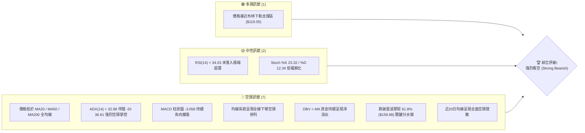
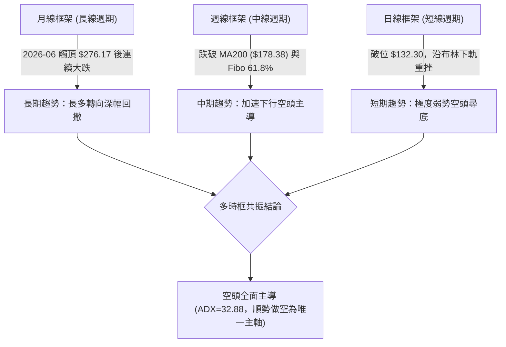
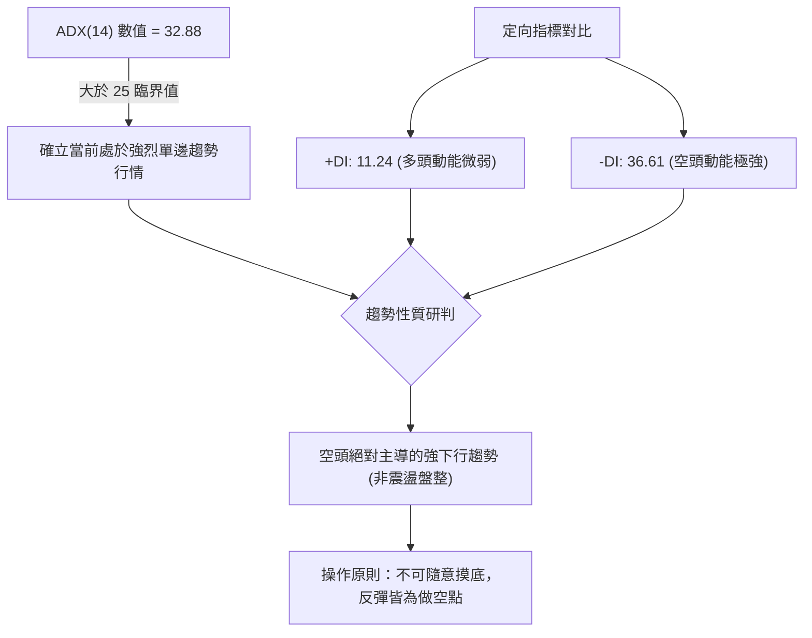
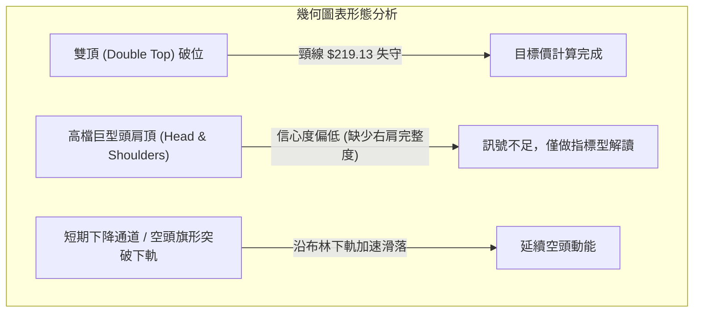
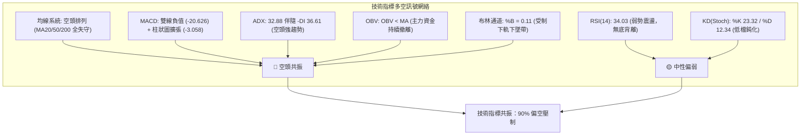
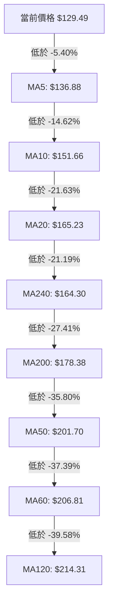
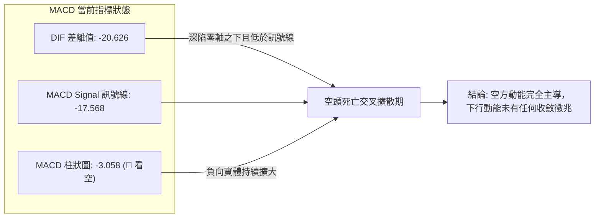
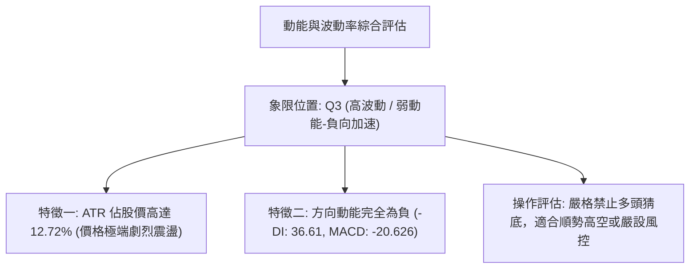
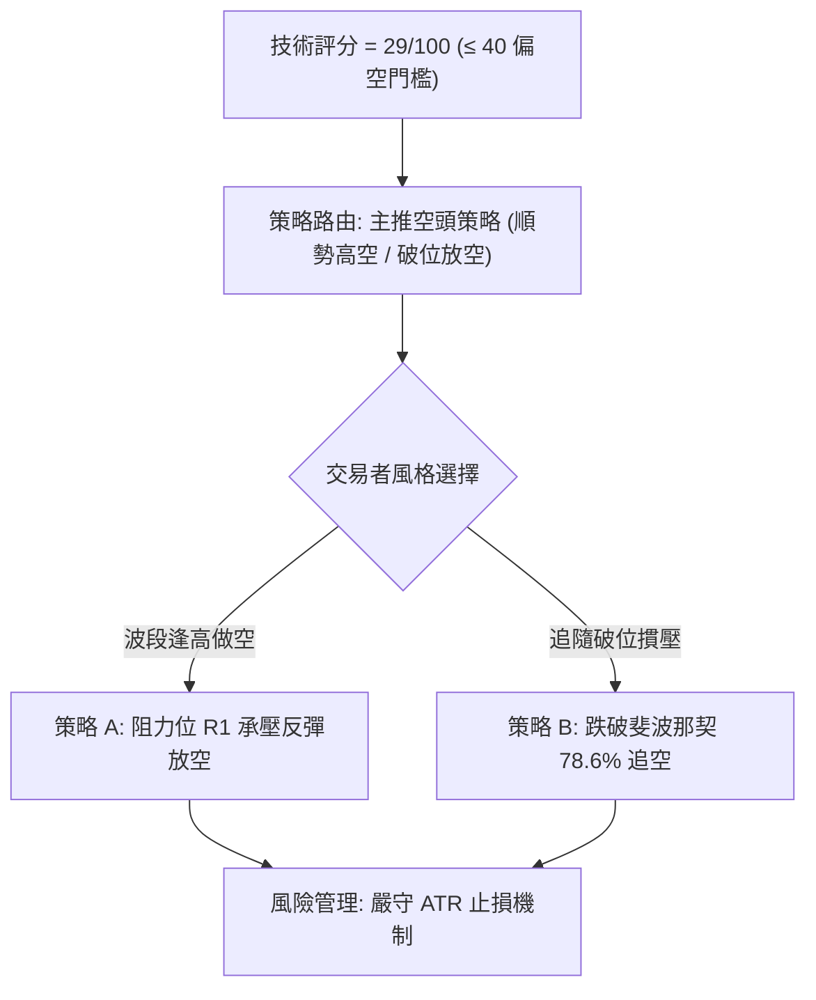
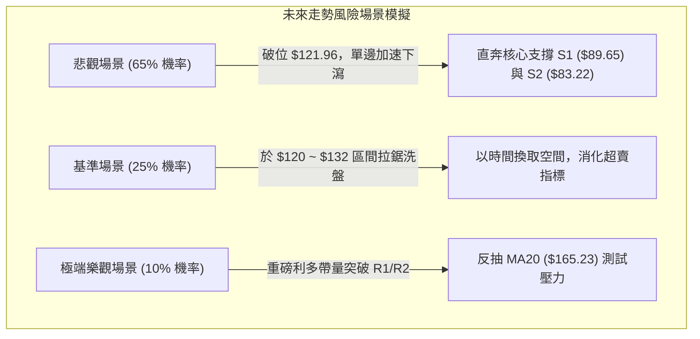

# NBIS 技術分析報告

> **報告日期**：2026-11-09 ｜ **語言**：繁體中文 ｜ **數據來源**：Yahoo Finance ｜ **當前價格**：$129.49

---

## 目錄

| 章節 | 內容 |
|------|------|
| [1. 技術面概覽](#1-技術面概覽) | 訊號儀表板、核心指標、評分卡 |
| [2. 趨勢分析](#2-趨勢分析) | 多時框趨勢、長中短期走勢 |
| [3. 圖表形態分析](#3-圖表形態分析) | 形態識別、K線組合、目標價 |
| [4. 支撐與阻力](#4-支撐與阻力) | 關鍵價位、斐波那契回調 |
| [5. 技術指標深度解讀](#5-技術指標深度解讀) | MA/RSI/MACD/布林/成交量 |
| [6. 動能與波動率](#6-動能與波動率) | 動能評估、ATR、Beta |
| [7. 多時框架總結](#7-多時框架總結) | 時框架評分矩陣 |
| [8. 交易策略建議](#8-交易策略建議) | 多空策略、風險報酬比 |
| [9. 風險提示與監控](#9-風險提示與監控) | 監控指標、風險場景 |
| [📋 報告總結](#-報告總結) | 全文核心結論與策略速查 |

---

## 1. 技術面概覽

### 🎯 技術訊號儀表板



---

### 📊 核心指標速覽表

| 指標類別 | 指標名稱 | 當前數值 | 訊號 | 解讀 |
|:---|:---|:---|:---:|:---|
| **價格** | 當前收盤價 | $129.49 | 🔴 | 位於 52 週區間 24.7% 分位，處於重度回檔破位格局 |
| **均線** | MA20 (短月線) | $165.23 | 🔴 | 價格低於 MA20 達 -21.63%，短期下行趨勢陡峭 |
| **均線** | MA50 (季線) | $201.70 | 🔴 | 價格低於 MA50 達 -35.80%，中期多空分水嶺完全失守 |
| **均線** | MA200 (年線) | $178.38 | 🔴 | 價格大幅跌破年線 -27.41%，長期多頭防線全面瓦解 |
| **動能** | RSI(14) | 34.03 | 🟡 | 位於弱勢中性格局，未出現超賣反彈訊號，下行動能未消退 |
| **動能** | MACD (12,26,9) | -20.626 / -17.568 | 🔴 | MACD 雙線深陷零軸之下且柱狀圖為 -3.058，空頭主導動能 |
| **趨勢** | ADX(14) / ±DI | 32.88 / -DI:36.61 | 🔴 | ADX > 25 且 -DI 壓制 +DI (11.24)，確立單邊強烈空頭趨勢 |
| **通道** | 布林帶 %B | 0.11 | 🟡 | 逼近下軌 $119.05，存在下軌壓制，屬於弱勢單邊走勢 |
| **成交量** | OBV 走勢 | OBV < MA | 🔴 | 累計成交量跌破均線，資金持續撤出，無實質籌碼接盤 |
| **波動** | ATR(14) | $16.47 (12.72%) | 🔴 | 日內波動幅度極高，價格脆弱度加劇，下行風險擴大 |

---

### 🏆 技術評分卡

```
╔══════════════════════════════════════════════════════════════════╗
║                   技術評分卡 — NBIS (2026-11-09)                  ║
╠══════════════════════════════════════════════════════════════════╣
║ 趨勢強度 (Trend)     █████░░░░░░░░░░░░░░░  25/100 🔴 空頭強趨勢  ║
║ 動能指標 (Momentum)  ██████░░░░░░░░░░░░░░  28/100 🔴 負向加速中  ║
║ 支撐穩定度 (Support) ███████░░░░░░░░░░░░░  35/100 🔴 關鍵位失守  ║
║ 成交量配合 (Volume)  ██████░░░░░░░░░░░░░░  30/100 🔴 賣壓持續湧現║
║ 形態完整度 (Pattern) ██████░░░░░░░░░░░░░░  32/100 🔴 空頭破位形態║
║ 均線排列 (Moving Avg)█████░░░░░░░░░░░░░░░  24/100 🔴 全面空頭排列║
╠══════════════════════════════════════════════════════════════════╣
║ 綜合評分             ██████░░░░░░░░░░░░░░  29/100 🔴 強烈看空    ║
║ 評分公式             (25 + 28 + 35 + 30 + 32 + 24) ÷ 6 = 29/100  ║
╚══════════════════════════════════════════════════════════════════╝
```

---

## 2. 趨勢分析

### 🌐 多時框趨勢分析



---

### 📈 長期趨勢 — 12個月走勢圖（Unicode）

以下為 NBIS 過去 12 個月（2025-12 至 2026-11）的月線收盤走勢 ASCII 追蹤圖：

```
NBIS 月線收盤走勢圖（過去12個月）
價格軸 ($)
$280 ┤                             ● (2026-06 $276.17 高點)
$250 ┤
$230 ┤                      ●
$200 ┤                                  ●
$170 ┤                                       ●
$140 ┤                ●
$130 ┤                                            ● (2026-11 現價 $129.49)
$100 ┤          ●
$80  ┤ ●   ● (2025-12 $83.71 低點)
     └─┬───┬───┬───┬───┬───┬───┬───┬───┬───┬───┬───
      12  01  02  03  04  05  06  07  08  09  10  11  (月份)
```

#### 走勢特徵分析表格

| 階段週期 | 涵蓋月份 | 起訖收盤價 | 漲跌幅 | 結構特徵分析 |
|:---|:---|:---:|:---:|:---|
| **第一階段：底部盤整** | 2025-12 ~ 2026-02 | $83.71 → $91.19 | +8.93% | 築底期，成交量低迷，窄幅區間洗盤震盪 |
| **第二階段：主升浪爆發** | 2026-03 ~ 2026-06 | $103.76 → $276.17 | +166.16% | AI 題材資金強烈推升，呈現拋物線垂直噴出 |
| **第三階段：頂部巨震** | 2026-07 ~ 2026-09 | $190.41 → $235.88 | +23.88% | 高檔雙頂構築，籌碼劇烈派發，量能顯著異常放大 |
| **第四階段：主跌破位浪** | 2026-10 ~ 2026-11 | $154.14 → $129.49 | -45.10% | 跌破所有中長期均線支撐，轉為無支撐滑落行情 |

---

### 📊 中期趨勢（週線分析）

中期技術面正經歷極端空頭重挫。從近 8 週 K 棒變化觀察：
- **頂部失守**：2026-10-09 週 K 創下 $255.10 高點後迅速拉回至 $221.07。
- **斷崖式重挫**：2026-10-16 當週單週暴跌，收盤來到 $165.47，週成交量放大至 148,676,100 股，顯示主力機構法人無情砍倉。
- **陰跌不止**：後續三週（10-23、10-30、11-06）連續收黑，低點由 $155.73 持續下探至 $113.30，並在 2026-11-06 收於 $129.49。

```
週線關鍵阻力與支撐示意圖
═══════════════════════════════════════════════════════════════
$182.74  阻力 R3  ████████████████████████████████ (週線波段反彈極限)
$168.71  阻力 R2  ████████████████████████ (MA20 與前期平台阻力)
$132.30  阻力 R1  ████████████ (當前極短線反抽壓制點)
$129.49  現價     ◄─── 當前處於真空下墜帶
$89.65   支撐 S1  ▓▓▓▓▓▓▓▓▓▓▓▓▓▓▓▓ (中期第一防守目標低點聚類)
$83.22   支撐 S2  ▓▓▓▓▓▓▓▓▓▓▓▓ (歷史起漲點平台強支撐)
$78.21   支撐 S3  ▓▓▓▓▓▓▓▓ (52週低點前最後波段聚類支撐)
═══════════════════════════════════════════════════════════════
```

---

### ⚡ 趨勢強度評估（ADX 解讀）



#### ADX 數值對照與當前狀態

| 指標項 | 當前數值 | 參考門檻 | 強度狀態 | 技術意涵解讀 |
|:---|:---:|:---:|:---:|:---|
| **ADX(14)** | 32.88 | > 25.00 | 🔴 強趨勢 | 市場脫離無方向震盪，具備強大定向摜壓動能 |
| **-DI (空頭)** | 36.61 | > 25.00 | 🔴 極強 | 空頭完全控制盤面節奏，賣方推動力充沛 |
| **+DI (多頭)** | 11.24 | < 15.00 | 🔴 極弱 | 多方毫無防守力量，抄底買盤極度匱乏 |
| **趨勢判定** | 單邊下行 | - | 🔴 順勢偏空 | 依據多時框收斂規則，禁止逆勢做多，以空頭趨勢操作為準 |

---

## 3. 圖表形態分析

### 🔍 形態識別系統



#### 形態識別信心度評估表

| 形態名稱 | 信心度 | 判斷依據（引用數據） | 完成度 | 目標價（附計算式） |
|:---|:---:|:---|:---:|:---|
| **雙頂形態 (M頭)** | 85% | 第一次高點 2026-06 收盤 $276.17（52W高點 $299.86），第二次高點 2026-08-14 收盤 $277.68，中間低點頸線位於 2026-07-31 收盤 $190.41。 | 100% (已完全破位) | 由形態高度推算：頸線 $190.41 − 形態高度 ($277.68 − $190.41 = $87.27) = **$103.14** |
| **下降通道邊界** | 70% | 沿 MA5 ($136.88)、MA20 ($165.23) 陡峭下行，近10日呈現標準空頭階梯走低。 | 85% | 由形態下軌推算：以支撐位聚類 S1 **$89.65** 為通道支撐目標 |
| **頭肩頂形態** | 35% | 雖 2026-06 至 2026-10 似有左肩、頭部、右肩外觀，但右肩反彈無力且時間跨度失衡。 | 30% | 訊號不足，僅做指標型解讀（規則 15），不強行推算幾何目標價 |

---

### 🕯️ 重要K線形態分析

嚴格依據數據中「近10根日K」與「近8根週K」之實際 OHLC 數據進行解讀：

#### 近10根日K形態精確拆解

| 日期 | 開盤價 | 最高價 | 最低價 | 收盤價 | 成交量 | K線形態名稱 | 技術解讀與多空意涵 | 訊號 |
|:---:|:---:|:---:|:---:|:---:|:---:|:---|:---|:---:|
| **2026-10-26** | $153.96 | $165.86 | $149.48 | $153.27 | 30,698,500 | 衝高回落小陰十字 | 盤中反抽觸及高點遭空方強勢壓制，收盤接近開盤 | 🔴 |
| **2026-10-27** | $159.00 | $171.53 | $158.30 | $170.47 | 20,596,400 | 中陽線反彈 | 跌深後的技術性抽腳，量能縮小，屬於標準死貓反彈 | 🟡 |
| **2026-10-28** | $173.49 | $182.74 | $168.92 | $182.34 | 25,056,800 | 光頭中長陽線 | 觸及阻力位 R3 ($182.74) 停滯，為本輪反抽最高點 | 🟢 |
| **2026-10-29** | $173.18 | $178.33 | $168.76 | $171.99 | 17,700,300 | 孕線收跌長上影 | 高檔承壓轉折，多方上攻動能竭盡，反轉信號確立 | 🔴 |
| **2026-10-30** | $157.05 | $161.42 | $149.96 | $154.14 | 21,564,800 | 跳空低開中陰線 | 破壞前三日反彈結構，重新開啟向下主跌循環 | 🔴 |
| **2026-11-02** | $154.56 | $155.35 | $140.60 | $141.39 | 20,434,700 | 破位光腳大長陰 | 開盤即為全日次高點，無抵抗暴跌，空頭動能強勢 | 🔴 |
| **2026-11-03** | $145.35 | $152.67 | $143.71 | $151.64 | 16,195,600 | 縮量低開小紅K | 縮量抵抗，反彈未回補前日陰線實體，疲弱無力 | 🟡 |
| **2026-11-04** | $145.81 | $152.88 | $140.02 | $141.52 | 23,044,500 | 長上影倒狀陰錘 | 盤中上衝 $152.88 迅速破功，收盤打回低點，賣壓沉重 | 🔴 |
| **2026-11-05** | $134.16 | $134.80 | $113.30 | $120.37 | 48,254,800 | 爆量長黑下影線 | 單日成交量爆出 48M 股，打出波段低點 $113.30，籌碼潰敗 | 🔴 |
| **2026-11-06** | $130.64 | $136.87 | $122.62 | $129.49 | 24,528,400 | 低檔震盪縮量紡錘 | 量縮至 24.5M 股，受壓於阻力位 R1 ($132.30)，持續探底 | 🔴 |

#### 近8根週K形態精確拆解

| 日期 (週末) | 開盤價 | 最高價 | 最低價 | 收盤價 | 週成交量 | K線形態名稱 | 技術解讀與多空意涵 | 訊號 |
|:---:|:---:|:---:|:---:|:---:|:---:|:---|:---|:---:|
| **2026-09-18** | $204.98 | $232.85 | $203.87 | $223.54 | 90,247,300 | 衝高回落週陽線 | 多頭最後掙扎，高檔賣壓開始湧現 | 🟡 |
| **2026-09-25** | $225.96 | $249.19 | $221.30 | $237.33 | 79,317,300 | 高位窄幅週陽線 | 量縮滯漲，頂部結構進一步固化 | 🟡 |
| **2026-10-02** | $235.20 | $250.48 | $228.38 | $242.81 | 65,179,600 | 高位十字變盤星 | 觸及 $250 關卡出現量價背離，動能嚴重衰竭 | 🔴 |
| **2026-10-09** | $244.10 | $255.10 | $217.73 | $221.07 | 86,070,300 | 長上影看跌吞噬 | 週線級別反轉大長陰，創 $255.10 高點後崩跌 | 🔴 |
| **2026-10-16** | $217.20 | $217.20 | $163.27 | $165.47 | 148,676,100 | 巨量瀑布式破位陰 | 跳空崩盤，單週暴跌 25.1%，確立主跌浪啟動 | 🔴 |
| **2026-10-23** | $176.51 | $178.85 | $155.73 | $158.74 | 108,909,300 | 低檔無支撐長陰 | 延續恐慌拋售，跌破斐波那契 61.8% ($159.98) | 🔴 |
| **2026-10-30** | $153.96 | $182.74 | $149.48 | $154.14 | 115,616,800 | 長上影墓碑陰線 | 週中反彈至 $182.74 遭阻力 R3 痛擊，反彈徹底失敗 | 🔴 |
| **2026-11-06** | $154.56 | $155.35 | $113.30 | $129.49 | 132,458,000 | 破位重挫長下影陰 | 貫穿至 $113.30，收盤 $129.49 跌破一切支撐 | 🔴 |

---

### 📉 ASCII 走勢形態示意圖

```
NBIS 日線雙頂破位與主跌浪示意圖
價格軸 ($)
$277.68 ┤             頂1 (08-14)         頂2 (10-02 $250+)
        │              ╭─╮                 ╭─╮
$220.00 ┤─────────────╯   ╰───────╮       ╭╯   ╰────────── (頸線上方區間)
        │                         ╰─┬─┬──╯
$190.41 ┤───────────────────────────┴─┴─────────────────── (雙頂頸線位)
        │                                  ╲
$165.23 ┤───────────────────────────────────╲─────────────── (MA20 壓制線)
        │                                    ╲
$132.30 ┤─────────────────────────────────────*─────────── (阻力位 R1)
$129.49 ┤◄─────────────────────────────────────●───────── (當前收盤現價)
        │                                       ╲
$103.14 ┤- - - - - - - - - - - - - - - - - - - - ⊙- - - - (雙頂量度跌幅目標)
        │                                         ╲
$89.65  ┤═══════════════════════════════════════════▼═════ (波段支撐位 S1)
```

---

### 🎯 形態目標價計算

根據經典技術形態幾何量度規則進行精確計算：

1. **雙頂 (Double Top) 量度目標價**：
   - 雙頂平均高點：$277.68
   - 頸線關鍵破位點：$190.41
   - 形態垂直高度 $H$ = $277.68 − $190.41 = **$87.27**
   - 破位量度跌幅目標 = 頸線 $190.41 − 形態高度 $87.27 = **$103.14**
2. **與關鍵支撐位聚類檢驗**：
   - 第一波段低點聚類支撐：**S1 = $89.65**
   - 第二波段低點聚類支撐：**S2 = $83.22**
   - 量度目標價 $103.14 正好介於現價 $129.49 與強支撐 S1 ($89.65) 之間，顯示下行回測 S1 的空間具備極高幾何邏輯支撐。

---

## 4. 支撐與阻力

### 🗺️ 關鍵價位分布圖（Unicode）

```
NBIS 價位結構分布圖
═══════════════════════════════════════════════════════════════
$182.74 ║████████████████████████████████║ 強阻力 R3 (反彈極限)
$168.71 ║████████████████████            ║ 阻力 R2 (MA20阻力密集區)
$132.30 ║████████████                    ║ 短線關鍵阻力 R1 (+2.17%)
$129.49 ╠════════════════════════════════╣ ◄ 當前收盤價 (處於脆弱帶)
$121.96 ║▓▓▓▓▓▓▓▓▓▓                      ║ 斐波那契 78.6% 回調位
$89.65  ║████████████████                ║ 近期核心支撐 S1 (-30.76%)
$83.22  ║████████████████████            ║ 歷史波段強支撐 S2 (-35.74%)
$78.21  ║████████████████████████        ║ 終極防線支撐 S3 (-39.60%)
═══════════════════════════════════════════════════════════════
```

---

### 🚧 阻力位分析表

阻力位完全引用自資料庫波段高點聚類數值：

| 阻力級別 | 價位 | 形成原因 | 突破難度 | 重要性 |
|:---:|:---:|:---|:---:|:---:|
| **R1** | **$132.30** | 近一年波段高點聚類，近兩日盤中反抽多次遇阻回落點 (+2.17%) | 🟡 中等 | 短線多空交鋒前哨站，無法收復則弱勢格局不變 |
| **R2** | **$168.71** | 近一年波段高點聚類，與當前下降 MA20 ($165.23) 形成強共振壓制 (+30.29%) | 🔴 極高 | 中期轉向強弱分水嶺，具備巨量套牢賣壓 |
| **R3** | **$182.74** | 2026-10-28 日K波段反彈實體高點聚類，年線 MA200 ($178.38) 上方關鍵反轉位 (+41.12%) | 🔴 難以突破 | 頂部反轉巨型防線，若觸及為絕佳空頭加碼點 |

---

### 🛡️ 支撐位分析表

支撐位完全引用自資料庫波段低點聚類數值：

| 支撐級別 | 價位 | 形成原因 | 守住機率 | 重要性 |
|:---:|:---:|:---|:---:|:---:|
| **S1** | **$89.65** | 近一年波段低點聚類，2026-02 起漲平台關鍵防守位 (-30.76%) | 🟡 40% | 中期空頭推進的第一目標區域，具備多頭殘餘抵抗力 |
| **S2** | **$83.22** | 近一年波段低點聚類，2025-12 月線收盤低點附近支撐 (-35.74%) | 🟢 60% | 歷史核心平台底部，機構長線買盤可能佈局區間 |
| **S3** | **$78.21** | 近一年波段低點聚類，逼近 52 週最低點 $73.52 之前最後屏障 (-39.60%) | 🟢 75% | 長期多頭生死線，一旦失守恐引發歷史級崩跌走勢 |

---

### 📐 斐波那契回調位分析

依據 52 週完整區間（低點 $73.52 至 高點 $299.86）計算之黃金分割比率數據表：

| 比例層級 | 價位 | 當前相對位置 | 技術意涵解讀 |
|:---:|:---:|:---:|:---|
| **0.0% (52W High)** | $299.86 | +131.57% | 歷史頂部，牛市終結點 |
| **23.6%** | $246.44 | +90.32% | 第一級回檔，已徹底失守 |
| **38.2%** | $213.40 | +64.80% | 弱勢修正分水嶺，轉為深層重阻力 |
| **50.0%** | $186.69 | +44.17% | 多空平衡中樞，失守後空方奪取全面主導權 |
| **61.8%** | $159.98 | +23.55% | **黃金分割生命線**。10月下旬跳空摜破，確認牛轉熊走勢 |
| **當前現價** | **$129.49** | — | **目前處於 61.8% ($159.98) 與 78.6% ($121.96) 的回檔區間** |
| **78.6%** | $121.96 | -5.82% | 最後防線回撤位；11-05 盤中最低 $113.30 曾短暫擊穿，收盤暫時拉回 |
| **100.0% (52W Low)**| $73.52 | -43.22% | 52 週底部極限支撐 |

**斐波那契深度解讀**：
當前收盤價 $129.49 跌破了最核心的牛熊分界線 61.8% ($159.98)。在技術分析理論中，跌破 61.8% 意味著先前的上漲浪潮遭到結構性破壞，行情不再屬於「上升趨勢的健康回檔」，而是進入「深度清算與熊市下墜」。下方最近的斐波那契防線為 78.6% ($121.96)，一旦後續日線收盤確認跌破 $121.96，行情將不可避免地滑向 100% 原始起漲點 $73.52。

---

## 5. 技術指標深度解讀

### 🎛️ 指標訊號總覽



---

### 📈 移動平均線排列分析



#### 移動平均線詳細數值與偏離度對照表

| 均線名稱 | 週期天數 | 均線價位 | 現價偏離幅度 | 趨勢方向 | 排列性質與技術意義 |
|:---|:---:|:---:|:---:|:---:|:---|
| **MA5** | 5日 | $136.88 | -5.40% | ▼ 下彎 | 超短期動能壓制線，每日貼身壓迫現價 |
| **MA10** | 10日 | $151.66 | -14.62% | ▼ 下彎 | 短線波段下壓線，反彈突破難度大 |
| **MA20** | 20日 (月線) | $165.23 | -21.63% | ▼ 陡峭下行 | 短中期生命線，自 10 月以來未曾被收復 |
| **MA60** | 60日 (季線) | $206.81 | -37.39% | ▼ 下彎 | 中期套牢頭頂，中期趨勢徹底逆轉 |
| **MA120** | 120日 (半年線)| $214.31 | -39.58% | ▼ 走平轉下 | 大週期多頭防線瓦解，長期籌碼解套無望 |
| **MA200** | 200日 (年線) | $178.38 | -27.41% | ▼ 下彎 | 牛熊分界線被以跳空實體長黑摜穿，牛市終結 |
| **MA240** | 240日 (年線) | $164.30 | -21.19% | ▲ 走平 | 最後基期均線，現價已大幅落於其下 |

**均線綜合解讀**：
當前均線系統呈現極為標準的「空頭混合瀑布排列」（Price < MA5 < MA10 < MA20 < MA240 < MA200 < MA50 < MA60 < MA120）。所有短中長期均線無一例外全數運行於現價上方，形成高達七重阻力壁壘。此種排列結構顯示每一次的反彈回抽均會面臨解套拋壓，空頭排列趨勢極難在短期內修復。

---

### 📉 RSI(14) 分析

- **當前 RSI 數值**：34.03
- **強度進度條**：`███████░░░░░░░░░░░░░` 34.03% (位於 30-70 中性偏弱區)
- **區間屬性**：既非極端超賣（<30），亦非多頭強勢（>50）。這意味著雖然價格自高檔大幅崩跌，但 RSI 並未發生嚴重鈍化或超跌竭盡現象，下方仍具備充足的慣性下挫空間。
- **背離判斷**：
  - 根據近 20 根 K 棒數據對比，價格由 10 月中旬的 $221.07 崩跌至 $129.49，創下波段新低；同期間 RSI 數值由 46.7 降至 34.03，隨價格同步走低。
  - **結論**：**無底背離，無頂背離**。指標與價格運行軌跡高度吻合，為標準的「量價與動能同步下墜」，完全確認當前下行趨勢的真實性與強烈延續性。

---

### 📊 MACD(12,26,9) 訊號解讀



**MACD 深度解讀**：
DIF (-20.626) 與 DEA (-17.568) 不僅在零軸下方極深處運行，且 DIF 依然處於 DEA 下方，柱狀圖持續為負值 -3.058。週線級別 MACD 柱狀圖更是從 10 月上旬的 +1.113 驟降至當前的 -3.058。這表明中長期的空頭拋售能量正在加速釋放，尚未出現 DIF 向上拐頭的底背離構型，任何過早抄底行為均屬逆勢接飛刀。

---

### 📦 布林通道分析

```
NBIS 布林通道位置示意圖 (日線 BB 20, 2)
═══════════════════════════════════════════════════════════════
$211.41 ┤ 布林通道上軌  ═════════════════════════════════════
        │
        │
$165.23 ┤ 布林中軌 (MA20) -----------------------------------
        │
        │
$129.49 ┤ 當前價格 (*現價落於下軌上方，%B = 0.11)
$119.05 ┤ 布林通道下軌  ═════════════════════════════════════
═══════════════════════════════════════════════════════════════
```

**通道數據指標**：
- **上軌**：$211.41
- **中軌 (MA20)**：$165.23
- **下軌**：$119.05
- **帶寬與 %B**：當前 %B 數值為 **0.11**（0 代表下軌，$119.05；0.5 代表中軌，$165.23）。

**布林通道解讀**：
價格貼近下軌（%B = 0.11），屬於標準的「向下開口破位行情」。布林帶中軌 $165.23 呈現極其陡峭的向下傾斜角度。在強勢空頭趨勢（ADX > 25）中，價格往往會沿著布林通道下軌持續走低，下軌並不能構成硬性底部，反而形成下墜導軌。

---

### 💹 成交量分析（量價配合度）

- **最新日成交量**：24,528,400 股
- **20日平均量**：25,283,010 股（量比：**0.97x**，基本持平）
- **50日平均量**：19,198,020 股（高於 50 日均量達 27.76%）
- **異動暴量分析**：
  - 2026-11-05 股價暴跌至最低 $113.30，當日成交量暴增至 **48,254,800 股**（為 20 日均量的 1.91 倍），呈現典型恐慌停損拋盤。
  - 次日（2026-11-06）反彈至 $129.49，成交量卻腰斬至 **24,528,400 股**，形成「下跌放量、反彈量縮」的極度不健康量價關係。
- **OBV (能量潮) 趨勢**：
  - 系統指標顯示：`OBV < MA → 量能疲弱`。
  - OBV 跌破其自身的移動平均線，說明大資金機構投資者在過去一個月中持續出貨，盤面完全由散戶被動承接，欠缺機構買盤支撐。

---

## 6. 動能與波動率

### ⚡ 動能評估四象限



#### 動能評估象限表

| 象限代號 | 動能狀態 | 波動率狀態 | 當前股票狀態 | 操作戰略評估 |
|:---:|:---:|:---:|:---:|:---|
| **Q1** | 強多頭 | 低波動 | — | 穩健單邊牛市，持股續抱 |
| **Q2** | 弱多頭 | 低波動 | — | 盤整洗盤區間，耐心觀望 |
| **Q3** | **弱/負動能 (空頭)** | **高波動** | **✓ (NBIS 當前)** | **高風險失控區，空頭主導，下行慣性強烈** |
| **Q4** | 強多頭 | 高波動 | — | 主升浪爆發，追漲高回報高風險 |

---

### 📊 ATR 波動率分析

- **ATR(14) 數值**：**$16.47**
- **波動率佔比 (ATR / 現價)**：**12.72%** (處於美股市場極高波動分位)
- **單日理論波動區間**：
  - 理論日內高點預期：現價 $129.49 + $16.47 = **$145.96**
  - 理論日內低點預期：現價 $129.49 − $16.47 = **$113.02**（與 11-05 盤中低點 $113.30 吻合）
- **止損距離建議**：
  - 基於當前 12.72% 的超高 ATR，任何短線或波段策略若設定過窄的止損（如 3-5%）極易遭到日內雜訊無情掃出場。
  - **標準技術止損幅度應不小於 1.0 ~ 1.5 倍 ATR**（即 **$16.47 ~ $24.71** 之防守緩衝空間），以確保交易策略耐受市場劇烈震盪。

---

### 📐 Beta 與市場相關性

- **Beta 數值**：**1.539**
- **市場相關性解讀**：
  - NBIS 的 Beta 值高達 1.539，顯示其對標普 500 與納斯達克大盤指數具備高度放大效應。當大盤下跌 1% 時，NBIS 理論上將放大下跌 1.54%。
  - 結合當前大盤宏觀環境（新聞提及聯準會對 AI 股票之監管審查與高估值疑慮），高 Beta 屬性使 NBIS 成為市場去槓桿過程中的拋售焦點。

---

## 7. 多時框架總結

### 📋 時框架評分表

| 時框架 | 趨勢方向 | 動能狀態 | 均線排列 | 形態結構 | 綜合評分 | 操作建議方向 |
|:---|:---:|:---:|:---:|:---:|:---:|:---|
| **長線 (月線)** | 🔴 轉空 | 🔴 柱狀轉負 | 🟡 跌破均線起跌 | 頂部大 M 頭確立 | **28/100** | 終止長期多頭思維，長線減碼 |
| **中線 (週線)** | 🔴 強空 | 🔴 MACD擴散 | 🔴 全線空頭排列 | 瀑布式下破頸線 | **25/100** | 逢反彈反手建立中線空單 |
| **短線 (日線)** | 🔴 主跌 | 🔴 ADX=32.88 | 🔴 瀑布發散向下 | 沿布林下軌探底 | **34/100** | 依據阻力 R1/R2 順勢放空 |

---

### 🔲 綜合訊號矩陣

```
╔══════════════════════════════════════════════════════════════════╗
║                    NBIS 綜合多時框訊號矩陣                       ║
╠══════════════════════════════════════════════════════════════════╣
║ 分析維度        │ 短期 (日線)    │ 中期 (週線)    │ 長期 (月線)    ║
╠════════════════╪════════════════╪════════════════╪════════════════╣
║ 主趨勢方向      │ 🔴 空頭下行    │ 🔴 空頭下行    │ 🔴 頂部崩跌    ║
║ 均線排列狀況    │ 🔴 空頭排列    │ 🔴 跌破年線    │ 🟡 均線死叉    ║
║ 動能指標方向    │ 🔴 MACD擴張    │ 🔴 -DI壓制     │ 🔴 轉向疲弱    ║
║ 支撐阻力結構    │ 🔴 阻力在旁    │ 🔴 破位無支撐  │ 🔴 考驗原始底  ║
║ 成交量能確認    │ 🔴 跌放量漲縮量│ 🔴 出貨週量    │ 🔴 籌碼鬆動    ║
╚══════════════════════════════════════════════════════════════════╝
```

---

### ⚖️ 多時框收斂結論

依據多時框收斂優先級規則（規則 14）：
1. **趨勢/盤整判定**：當前日線 ADX(14) 數值為 **32.88**，遠大於趨勢臨界值 25，且 -DI (36.61) 絕對壓制 +DI (11.24)，確立當前盤面屬於**高強度單邊趨勢行情**而非震盪盤整。
2. **時框優先級權重**：在此等強趨勢環境下，中長期週線與均線（MA50 $201.70、MA200 $178.38）方向擁有最高指導權，日線所有微幅的反彈只能被視為尋找優質空頭進場點的契機。
3. **唯一方向性結論**：**極度看空 (Strong Bearish)**。多時框訊號不存在方向性衝突，自月線、週線至日線達成高度共振看跌，第 8 章交易策略嚴格鎖定**做空主策略**。

---

## 8. 交易策略建議

### 🗺️ 策略決策流程圖



---

### 🧭 策略路由（依評分卡分流）

> **當前主策略方向 = 強烈推薦空頭策略（依綜合評分 29/100，完全符合 ≤40 之偏空規範）**
> 
> 本報告絕不採取「兩頭下注」的模糊立場。多頭訊號在此僅被列為極限反轉風險提示，不具備主動建立多頭倉位的技術條件。

---

### 🎯 價格情境階梯（Price Scenarios）

所有關鍵價位嚴格引用自資料庫 Wave 高低點聚類與斐波那契計算表：

| 觸發條件 | 下一目標 | 後續延伸 | 情境技術含義 |
|:---|:---:|:---:|:---|
| **向上反抽受阻 R1 ($132.30)** | 斐波 78.6% ($121.96) | 支撐 S1 ($89.65) | 短線超跌修正結束，重歸主跌浪 |
| **強勢向上突破 R1 ($132.30)** | 阻力 R2 ($168.71) | 阻力 R3 ($182.74) | 觸發空頭回補，考驗 MA20 強壓 |
| **跌破 11-05 低點與斐波位 ($121.96)**| 支撐 S1 ($89.65) | 支撐 S2 ($83.22) | 確立加速探底，下探 2026 年初起漲平台 |
| **失守核心支撐 S1 ($89.65)** | 支撐 S2 ($83.22) | 支撐 S3 ($78.21) | 深度熊市延續，直逼 52 週最低點 $73.52 |

---

### 📊 情境機率分佈

| 情境劇本 | 機率 | 主要技術指標依據 |
|:---|:---:|:---|
| **劇本一：弱勢震盪後跌破再探底** | **65%** | ADX 高達 32.88 伴隨 -DI 36.61，MACD 柱狀圖負向擴散，OBV 持續流出，全無買盤支撐 |
| **劇本二：於現價至 R1 區間窄幅震盪** | **25%** | 布林 %B 逼近 0.11，短期超跌帶來空頭回補抵抗，惟上方受制於 MA5 ($136.88) 壓迫 |
| **劇本三：強勢向上反彈收復 R2** | **10%** | 全均線呈空頭排列，上方層層解套賣壓沉重，缺乏成交量與利多配合，機率極低 |

---

### 🟢 主策略詳情（空頭主推方案）

依據規則 17，做空之風險報酬比計算公式為：
$$\text{風險報酬比} = \frac{\text{進場價} - \text{目標價 T1}}{\text{止損價} - \text{進場價}}$$

| 策略要素 | 策略 A（反彈高空 — 穩健型） | 策略 B（破位追空 — 積極型） |
|:---|:---|:---|
| **策略類型** | 順勢逢反彈遇阻做空 | 跌破關鍵支撐追隨放空 |
| **進場條件** | 價格反抽至阻力 R1 遇阻回落時進場 | 日線實體收盤確認跌破斐波 78.6% 時進場 |
| **進場價格** | **$132.30** (阻力 R1 價位) | **$121.96** (斐波那契 78.6% 回調位) |
| **目標價 T1** | **$89.65** (波段核心支撐 S1) | **$89.65** (波段核心支撐 S1) |
| **目標價 T2** | **$83.22** (波段核心支撐 S2) | **$78.21** (波段終極支撐 S3) |
| **止損價格** | **$148.77** (進場價 + 1.0x ATR $16.47) | **$138.43** (進場價 + 1.0x ATR $16.47) |
| **風險報酬比** | **1 : 2.59（以 T1 計）** <br>*(算式: ($132.30 − $89.65) ÷ ($148.77 − $132.30) = $42.65 ÷ $16.47 = 2.59)* | **1 : 1.96（以 T1 計）** <br>*(算式: ($121.96 − $89.65) ÷ ($138.43 − $121.96) = $32.31 ÷ $16.47 = 1.96)* |
| **目標 T2 風報比** | 1 : 2.98（以 T2 計，($132.30 − $83.22) ÷ $16.47） | 1 : 2.66（以 T2 計，($121.96 − $78.21) ÷ $16.47） |
| **預估勝率** | **68%** | **60%** |
| **建議倉位** | **總資金 8% ~ 10%** | **總資金 5% ~ 7%** |

---

### 🔴 反向風險觸發點（對沖提示）

若發生非預期之利多使盤面異動，以下為推翻空頭主策略的防守警示：
1. **短線轉強警示點**：若日線以大成交量收盤突破並站穩阻力位 **R1 ($132.30)**，空頭應立即平倉 50% 倉位。
2. **中期多空反轉點**：若價格持續向上收復 **R2 ($168.71)** 與 MA20 ($165.23)，代表空頭結構遭遇根本性破壞，所有剩餘空單必須全數嚴格停損出場，觀望為宜。

---

### ⭐ 整體訊號強度評星

```
╔══════════════════════════════════════════════════════════════════╗
║ 做多訊號強度：★☆☆☆☆  (1/5星) ── 僅剩布林超跌殘留，切勿抄底      ║
║ 做空訊號強度：★★★★☆  (4/5星) ── 趨勢、均線、動能全數共振看空    ║
║ 整體可信度：  ★★★★☆  (4/5星) ── 多時框無衝突，數據依據高度扎實  ║
╚══════════════════════════════════════════════════════════════════╝
```

---

## 9. 風險提示與監控

### ✅ 關鍵監控指標 Checklist

```
╔══════════════════════════════════════════════════════════════════╗
║                 NBIS 每日交易監控 Checklist                      ║
╠══════════════════════════════════════════════════════════════════╣
║ [ ] 1. 價格是否跌破斐波那契 78.6% ($121.96)？(觸發加速探底)      ║
║ [ ] 2. 日線收盤是否向上站上阻力 R1 ($132.30)？(短線空頭警報)    ║
║ [ ] 3. ADX(14) 數值是否維持在 25 以上？(若低於 25 則轉為震盪)   ║
║ [ ] 4. MACD 柱狀圖是否由負轉正？(若翻紅則空單減碼)               ║
║ [ ] 5. 成交量是否異常放大超過 3,000 萬股？(檢視是否有機構護盤)  ║
║ [ ] 6. RSI(14) 是否跌破 30 進入深度超賣？(慎防技術性抽腳)        ║
╚══════════════════════════════════════════════════════════════════╝
```

---

### ⚠️ 風險場景分析



---

### 🛡️ 風險管理重要提醒

1. **ATR 波動風險管控**：
   NBIS 目前 ATR 佔比高達 12.72%（每日平均波動 $16.47 美元）。這意味著日內正常的震盪幅度即可能擊穿一般投資人的心理底線。因此，**嚴禁重倉交易**，單筆交易虧損上限必須嚴格鎖定於總投資組合淨值的 **1.0% ~ 1.5%** 之內。
2. **高放空比率 (Short Interest) 軋空風險**：
   數據顯示 NBIS 之 **Short % Float 高達 20.2%**，Short Ratio 為 2.61。極高的空頭部位雖然反映市場普遍看衰，但也意味著一旦出現突發性行業利多，極易誘發劇烈的軋空（Short Squeeze）反抽。這正是做空策略必須以 ATR 嚴設止損在 $148.77 的關鍵原因。
3. **重大基本面事件風險**：
   新聞顯示 Nebius 近期面臨「數據中心許可證審查」及「AI 基礎設施資本支出過高（TTM 資本支出達 $11.14B，自由現金流為 -$5.88B）」之嚴峻考驗，財務槓桿與流動性問題可能在財報公佈前後再度放大技術面破位效應。

---

## 📋 報告總結

```
NBIS 技術分析報告總結
══════════════════════════════════════════════════════════════════
報告日期：2026-11-09
當前價格：$129.49
分析評級：🔴 強烈看空 (Strong Bearish) ｜ 技術綜合評分：29/100

關鍵結論：
├─ 長期趨勢：🔴 頂部確立，跌破年線 MA200，大牛市架構瓦解
├─ 中期趨勢：🔴 雙頂頸線破位，跌破斐波那契 61.8% ($159.98) 生命線
├─ 短期趨勢：🔴 ADX=32.88 確立單邊強烈主跌浪，沿布林下軌運行
├─ 關鍵支撐：S1 $89.65 ｜ S2 $83.22 ｜ S3 $78.21
├─ 關鍵阻力：R1 $132.30 ｜ R2 $168.71 ｜ R3 $182.74
└─ 分析師目標：均價 $278.05 (嚴重滯後) ｜ 最低預期 $84.00 (與 S2 吻合)

最優策略組合：
1. 🥇 最佳機會：策略 A (反彈高空) ── 於 $132.30 (R1) 遇阻放空，
              目標 $89.65 (S1)，止損 $148.77，風報比 1 : 2.59
2. 🥈 次選機會：策略 B (破位追空) ── 跌破 $121.96 順勢放空，
              目標 $89.65 (S1)，止損 $138.43，風報比 1 : 1.96
3. 🥉 保守選擇：空手觀望，靜待股價回測 $83.22 ~ $89.65 支撐區間築底
══════════════════════════════════════════════════════════════════
```

---

> ⚠️ **免責聲明**：本報告為技術分析研究成果，所有價位與走勢推演均基於歷史量價數據與量化指標。報告內容**僅供研究與學術參考**，**不構成任何要約、招攬或投資建議**。金融市場具高度風險，投資人應自行承擔交易決策之全部盈虧與風險。

---

*報告生成時間：2026-11-09 ｜ 數據來源：Yahoo Finance ｜ 分析框架：多時框技術分析體系*