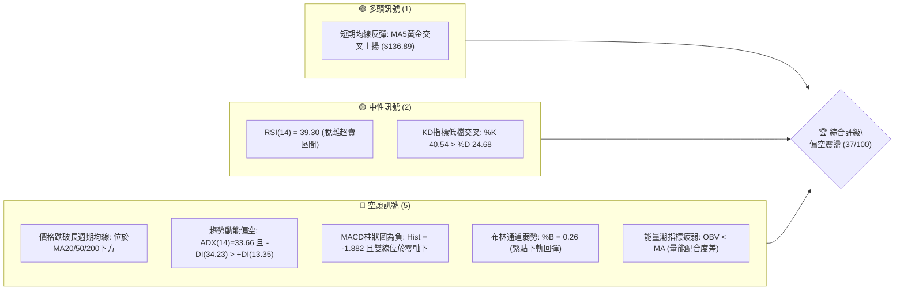
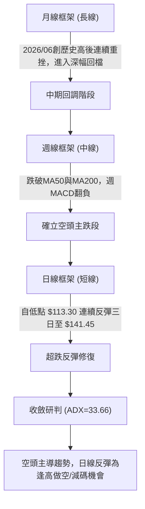
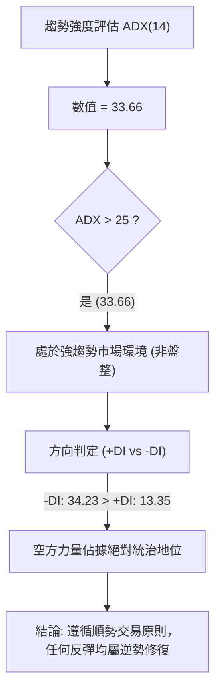
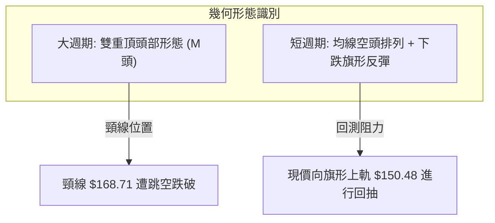
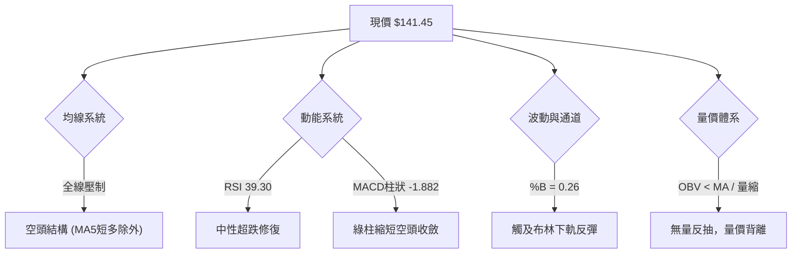
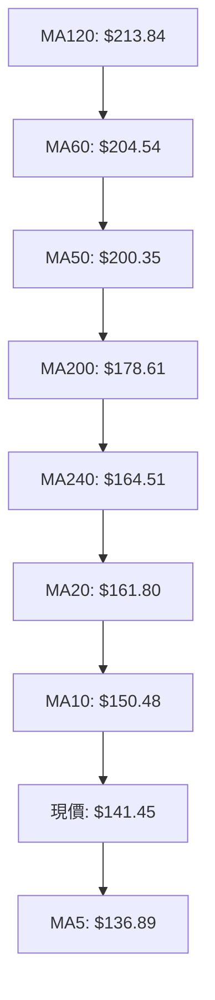
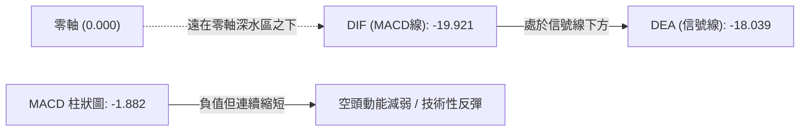
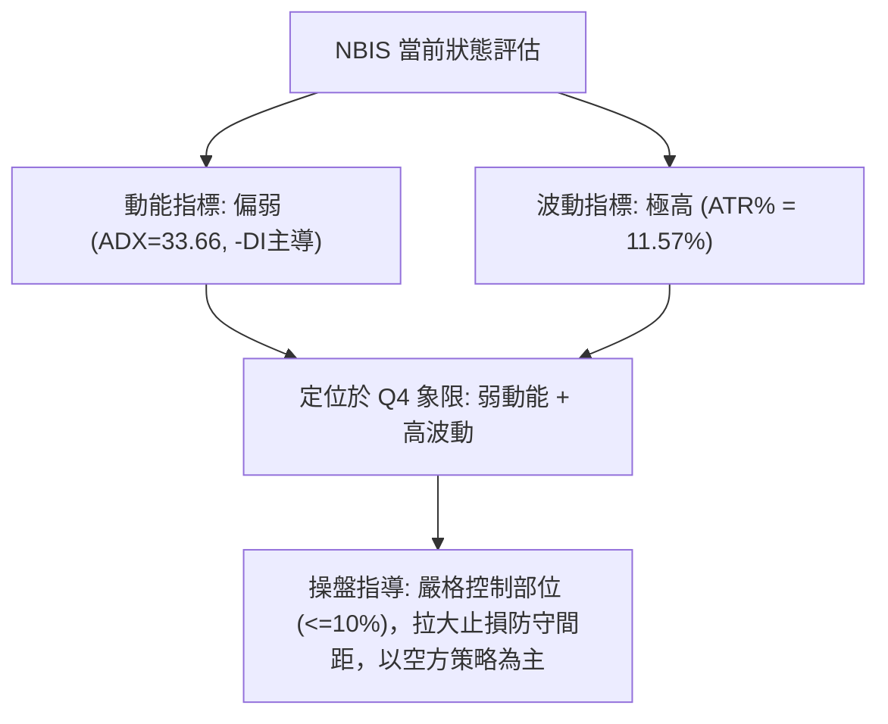
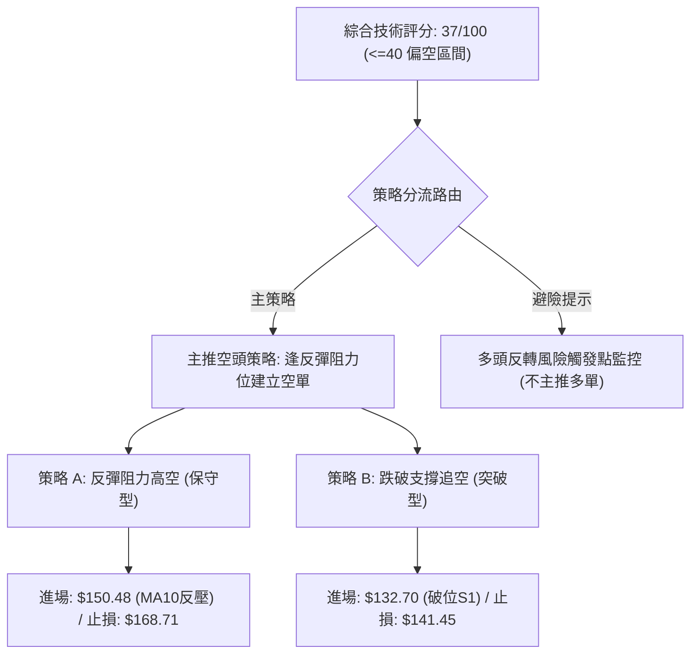
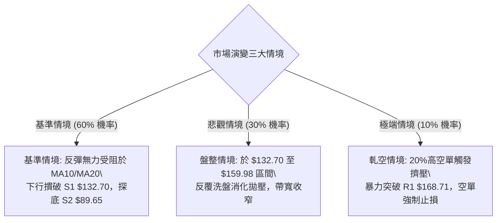

# NBIS 技術分析報告

> **報告日期**：2026-11-10 ｜ **語言**：繁體中文 ｜ **數據來源**：Yahoo Finance ｜ **當前價格**：$141.45 USD

---

## 目錄

| 章節 | 內容 |
|------|------|
| [1. 技術面概覽](#1-技術面概覽) | 訊號儀表板、核心指標、評分卡 |
| [2. 趨勢分析](#2-趨勢分析) | 多時框趨勢、長中短期走勢 |
| [3. 圖表形態分析](#3-圖表形態分析) | 形態識別、K線組合、目標價 |
| [4. 支撐與阻力](#4-支撐與阻力) | 關鍵價位、斐波那契回調 |
| [5. 技術指標深度解讀](#5-技術指標深度解讀) | MA/RSI/MACD/布林/成交量 |
| [6. 動能與波動率](#6-動能與波動率) | 動能評估、ATR、Beta |
| [7. 多時框架總結](#7-多時框架總結) | 時框架評分矩陣 |
| [8. 交易策略建議](#8-交易策略建議) | 多空策略、風險報酬比 |
| [9. 風險提示與監控](#9-風險提示與監控) | 監控指標、風險場景 |

---

## 1. 技術面概覽

### 🎯 技術訊號儀表板



### 📊 核心指標速覽表

| 指標類別 | 指標名稱 | 當前數值 | 訊號 | 解讀 |
|:---|:---|:---:|:---:|:---|
| **價格** | 當前收盤價 | $141.45 | 🔴 | 位於52週區間的 30.0% 低檔水位，中長線弱勢 |
| **均線** | MA20 | $161.80 | 🔴 | 現價低於MA20達 -12.58%，短線承壓 |
| **均線** | MA50 | $200.35 | 🔴 | 現價大幅落後中期生命線，中期空頭格局確立 |
| **均線** | MA200 | $178.61 | 🔴 | 現價跌破長期牛熊分界線達 -20.81%，長期趨勢翻空 |
| **動能** | RSI(14) | 39.30 | 🟡 | 脫離超賣區進入中性偏弱區，未見明顯背離 |
| **動能** | MACD (12,26,9) | -19.921 / -18.039 | 🔴 | MACD低於信號線，柱狀圖 -1.882，空頭動能主導 |
| **動能** | Stoch (14,3,3) | %K 40.54 / %D 24.68 | 🟢 | 低檔金叉反彈，短線具備技術性修復動能 |
| **趨勢** | ADX (14) | 33.66 (-DI: 34.23) | 🔴 | ADX > 25 且 -DI 具絕對優勢，強烈空頭趨勢 |
| **通道** | Bollinger Bands | 上軌 $203.98 / 下軌 $119.62 | 🟡 | %B = 0.26，自下軌獲得支撐，正向中軌 $161.80 修正 |
| **量能** | 成交量 / 20日均量 | 18,860,800 / 25,527,245 | 🔴 | 量比 0.74x，量縮反彈，OBV < MA 顯示資金流出 |
| **波動** | ATR(14) | $16.36 (11.57%) | 🔴 | 波動度極高，日震幅大，需擴大風控緩衝 |

### 🏆 技術評分卡

```
╔══════════════════════════════════════════════════════════════════════╗
║                   技術評分卡 — NBIS (2026-11-10)                     ║
╠══════════════════════════════════════════════════════════════════════╣
║ 趨勢強度 (Trend)      ██████░░░░░░░░░░░░░░  30/100  🔴 空頭強趨勢    ║
║ 動能指標 (Momentum)   ████████░░░░░░░░░░░░  40/100  🟡 短線反彈修復  ║
║ 支撐穩定度 (Support)  ████████░░░░░░░░░░░░  40/100  🟡 臨近S1考驗    ║
║ 成交量配合 (Volume)   ██████░░░░░░░░░░░░░░  30/100  🔴 量價出現背離  ║
║ 形態完整度 (Pattern)  ████████░░░░░░░░░░░░  40/100  🟡 構築弱勢反彈  ║
║ 均線排列 (MA System)  ████████░░░░░░░░░░░░  40/100  🔴 空頭排列下挫  ║
╠══════════════════════════════════════════════════════════════════════╣
║ 綜合評分 (Average)    ███████░░░░░░░░░░░░░  37/100  🔴 偏空震盪      ║
╚══════════════════════════════════════════════════════════════════════╝
```

---

## 2. 趨勢分析

### 🌐 多時框趨勢分析



### 📈 長期趨勢 — 12個月走勢圖（Unicode）

```
NBIS 月線收盤走勢圖（2025-12 至 2026-11）
價格軸 ($)
$280 ┤                               ● $276.17 (M7)
$250 ┤                                  │
$220 ┤                         ● $231.09│           ● $235.88 (M10)
$190 ┤                            (M6)  │     ● $206.32
$160 ┤                                  │  ● $190.41  ╲
$130 ┤                      ● $138.23   │    (M8)      ● $154.14 (M11)
$100 ┤                ● $103.76         │                ╲
$80  ┤ ● $83.71 ● $91.19                │                 ● $141.45 (M12)
      └─────────────────────────────────────────────────────────────────
       25-12   26-02    26-04   26-05  26-06  26-07 26-08 26-09 26-10 26-11
```

#### 長期走勢特徵分析

| 階段區間 | 起止價格 | 漲跌幅 | 趨勢特徵描述 |
|:---|:---:|:---:|:---|
| **築底啟動期** (2025-12 ~ 2026-03) | $83.71 → $103.76 | +23.95% | 窄幅區間整理，成交量溫和放大，完成底部打底 |
| **主升浪噴發期** (2026-03 ~ 2026-06) | $103.76 → $276.17 | +166.16% | 呈現拋物線噴發，均線多頭排列，創下52週高點 $299.86 |
| **雙頂巨震期** (2026-06 ~ 2026-09) | $276.17 → $235.88 | -14.59% | 巨幅震盪洗盤，於 $230~$270 形成頭部換手型態 |
| **懸崖下挫期** (2026-09 ~ 2026-11) | $235.88 → $141.45 | -40.03% | 斷崖式跳空下殺，連續跌破MA50與MA200，多頭全面潰敗 |

### 📊 中期趨勢（週線分析）

中期走勢自2026年10月初見頂 $255.10 後，週線連續開展五週下行波段，自 $242.81 驟降至 $129.49。

```
NBIS 週線關鍵結構與近期壓力支撐
   $255.10 ┬──────────────────────────────────────── (波段起跌點)
           │     ▼ 跌破週線支撐 $217.20
   $213.40 ┼ - - - - - - - - - - - - - - - - - - - - (斐波那契 38.2% 回調位)
           │           ▼ 貫穿半年線
   $186.69 ┼ - - - - - - - - - - - - - - - - - - - - (斐波那契 50.0% 中樞位)
           │                 ▼ 跌破波段頸線
   $159.98 ┼ - - - - - - - - - - - - - - - - - - - - (斐波那契 61.8% 關鍵阻力)
           │                       ▼ 下殺出量
   $141.45 ┼───────────────────────● 現價 (短線嘗試反彈)
           │           ▲ 近期波段低點反彈
   $113.30 ┴──────────────────────────────────────── (2026-11-06 當週極端低點)
```

### ⚡ 趨勢強度評估（ADX 解讀）



#### ADX 強度對照與市場狀態

| 指標 | 數值 | 臨界門檻 | 狀態評估 | 實戰交易指引 |
|:---|:---:|:---:|:---:|:---|
| **ADX(14)** | 33.66 | > 25 (強趨勢) | 處於強烈單邊空頭趨勢中 | 嚴禁逆勢左側重倉摸底；以空方順勢策略為主 |
| **-DI** | 34.23 | > 20 | 賣壓強勁，主導盤面結構 | 空方防守點明確，多頭缺乏主動性攻擊量 |
| **+DI** | 13.35 | < 20 | 買方動能枯竭，多頭疲弱 | 短期反彈僅能視為技術性回抽 |

---

## 3. 圖表形態分析

### 🔍 形態識別系統



#### 形態識別與信心度評估

| 形態類別 | 信心度 | 判斷依據（引用數據） | 完成度 | 目標價（附計算式） |
|:---|:---:|:---|:---:|:---|
| **雙重頂 (M頭)** | 75% | 左頂 $277.68 (08/14當週)，右頂 $255.10 (10/09當週)，跌破波段低點聚類阻力位 $168.71 | 100% (已跌破) | 形態等幅對稱測幅目標已達：頸線 $168.71 − (頂部 $255.10 − 頸線 $168.71) = $82.32 (接近支撐 S3 $83.22) |
| **下跌旗形反彈** | 60% | 旗桿為 10/28 高點 $182.74 下殺至 11/05 低點 $113.30，近三日呈量縮斜向上漂浮 | 50% | 旗形滿足目標跌幅：跌破旗形下軌後對稱推算，若跌破 $132.70(S1)，推算下看 $89.65 (S2) |
| **三重底 / 雙底** | <20% | 數據中未偵測到 | 0% | 訊號不足，僅做指標型解讀，不予以形態計算 |

### 🕯️ 重要K線形態分析

根據提供數據中近10根日K與近8根週K的實際 OHLCV 進行嚴格形態解讀：

| 日期（週期） | 開盤價 | 最高價 | 最低價 | 收盤價 | 成交量 | K線形態名稱 | 技術解讀與訊號指示 |
|:---|:---:|:---:|:---:|:---:|:---:|:---:|:---|
| **10-28 (日K)** | $173.49 | $182.74 | $168.92 | $182.34 | 25,056,800 | 衝高長上影大陽 | 觸及阻力位 R2 $182.74 受阻，為多頭最後反撲 🟡 |
| **10-30 (日K)** | $157.05 | $161.42 | $149.96 | $154.14 | 21,564,800 | 跳空下行陰線 | 破位下殺，全面失守短期均線，確認轉弱 🔴 |
| **11-05 (日K)** | $134.16 | $134.80 | $113.30 | $120.37 | 48,254,800 | 恐慌長下影大陰 | 爆量下探 $113.30 創波段新低，浮現非理性拋售 🔴 |
| **11-06 (日K)** | $130.64 | $136.87 | $122.62 | $129.49 | 24,614,500 | 低檔孕育陽線 | 實體收在昨日區間內，空頭下殺動能暫歇 🟡 |
| **11-09 (日K)** | $131.37 | $143.39 | $128.51 | $141.45 | 18,860,800 | 實體中陽線 | 站上 MA5 ($136.89)，展開超跌技術修復 🟢 |
| **10-16 (週K)** | $217.20 | $217.20 | $163.27 | $165.47 | 148,676,100 | 光頭跳水巨陰 | 週線實體長陰下挫，跌破MA50，確立長線崩跌 🔴 |
| **11-06 (週K)** | $154.56 | $155.35 | $113.30 | $129.49 | 132,544,100 | 探底長下影陰錘 | 測試 $113.30 支撐，爆量引發短線承接盤 🟡 |
| **11-09 (週K)** | $131.37 | $143.39 | $128.51 | $141.45 | 18,860,800 | 震盪反彈陽K | 延續上週下影線反彈，向上測試短期阻力 🟢 |

### 📉 ASCII 走勢形態示意圖

```
NBIS 日線走勢與反彈架構示意圖
  $182.74 (10-28 高點 R2)
     ●
      ╲
       ╲  $171.99
        ●────┐
              ╲  $154.14 (破位缺口)
               ●────┐
                     ╲  $141.52 (旗形高點)
                      ●─────┐            ● $141.45 (現價/測試阻力)
                             ╲          ╱
                              ●        ╱  $129.49
                            $120.37   ●
                                ╲     ╱
                                 ╲   ╱
                                  ╲ ╱
                                   ● $113.30 (11-05 極端低點)
```

### 🎯 形態目標價計算

1. **雙重頂頸線破位對稱測幅**：
   - 頭部高點：$255.10 (2026-10-09 週K高點)
   - 破位頸線：$168.71 (阻力位 R1)
   - 形態垂直幅度 = $255.10 − $168.71 = $86.39
   - 理論測幅低點 = $168.71 − $86.39 = **$82.32**（與歷史支撐位聚類 S3 **$83.22** 極度重合，吻合度極高）。
2. **反彈旗形通道測算**：
   - 反彈初級阻力位：MA10 壓力線 **$150.48**。
   - 若反彈無量受阻於 $150.48 重新跌破 S1 **$132.70**，則旗形向下延續，下一階段目標直指強支撐位 S2 **$89.65**。

---

## 4. 支撐與阻力

### 🗺️ 關鍵價位分布圖（Unicode）

```
NBIS 價位結構分布圖
══════════════════════════════════════════════════════════════════════
$231.17 ║████████████████████████████████████████║ 強阻力 R3 (多空巨震頂部)
$182.74 ║████████████████████████████            ║ 阻力 R2 (10/28反彈高點)
$168.71 ║████████████████████████████████        ║ 關鍵阻力 R1 (頸線聚類區)
$159.98 ║┈┈┈┈┈┈┈┈┈┈┈┈┈┈┈┈┈┈┈┈┈┈┈┈┈┈┈┈┈┈┈┈┈┈┈┈┈┈┈┈║ 斐波那契 61.8% 強阻力
$141.45 ╠════════════════════════════════════════╣ ◄ 現價 (短線反彈位)
$132.70 ║▓▓▓▓▓▓▓▓▓▓▓▓▓▓▓▓▓▓▓▓                    ║ 近期支撐 S1 (波段低點聚類)
$121.96 ║┈┈┈┈┈┈┈┈┈┈┈┈┈┈┈┈┈┈┈┈┈┈┈┈┈┈┈┈┈┈┈┈┈┈┈┈┈┈┈┈║ 斐波那契 78.6% 回調線
$89.65  ║████████████████████████████            ║ 強支撐 S2 (年度底部密集成交)
$83.22  ║████████████████████████████████████████║ 極限強支撐 S3 (雙頂測幅目標)
══════════════════════════════════════════════════════════════════════
```

### 🚧 阻力位分析表

| 阻力級別 | 具體價位 | 距現價幅標 | 形成原因與技術意涵 | 突破難度 | 重要性等級 |
|:---|:---:|:---:|:---|:---:|:---:|
| **阻力 R1** | **$168.71** | +19.27% | 近一年波段高點聚類、M頭頸線破位點，與MA20 ($161.80) 及 斐波那契 61.8% ($159.98) 形成重疊壓力帶 | 極高 🔴 | ★★★★★ |
| **阻力 R2** | **$182.74** | +29.19% | 2026-10-28 反彈波段頂點，與長期均線 MA200 ($178.61) 形成共振空方防守牆 | 極高 🔴 | ★★★★☆ |
| **阻力 R3** | **$231.17** | +63.43% | 2026年9月震盪箱體下緣聚類，中期空頭防守總指揮部 | 極度堅固 🔴 | ★★★☆☆ |

### 🛡️ 支撐位分析表

| 支撐級別 | 具體價位 | 距現價幅標 | 形成原因與技術意涵 | 守住機率 | 重要性等級 |
|:---|:---:|:---:|:---|:---:|:---:|
| **支撐 S1** | **$132.70** | -6.19% | 近一年波段低點聚類，此處為11月6日與9日低檔換手平台，跌破即確認旗形破位 | 45% 🟡 | ★★★★☆ |
| **支撐 S2** | **$89.65** | -36.62% | 2026年初起漲前形成的密集換手區波段低點聚類 | 65% 🟢 | ★★★★★ |
| **支撐 S3** | **$83.22** | -41.17% | 2025年12月波段歷史低點聚類，亦為M頭理論測幅極限終點 | 80% 🟢 | ★★★★★ |

### 📐 斐波那契回調位分析

依據 52 週絕對區間（$73.52 → $299.86）計算所得之關鍵黃金分割回調結構：

```
斐波那契回調位分布結構
  0.0%  (52W High) ───────────────────────── $299.86
 23.6%             ───────────────────────── $246.44
 38.2%             ───────────────────────── $213.40 (重疊MA120: $213.84)
 50.0%             ───────────────────────── $186.69 (重疊MA200: $178.61)
 61.8%             ───────────────────────── $159.98 (重疊MA20: $161.80)
 ═══════════════════════════════════════════
   ▲ 現價 $141.45 (處於 61.8% 與 78.6% 之間弱勢回調區間)
 ═══════════════════════════════════════════
 78.6%             ───────────────────────── $121.96 (11/05低點 $113.30 迅速收復此線)
100.0%  (52W Low)  ───────────────────────── $73.52
```

- **位置意義解讀**：現價 $141.45 處於 61.8% ($159.98) 與 78.6% ($121.96) 的深水回調區間內。根據道氏理論與斐波那契法則，當資產跌破黃金分割位 61.8% 後，牛市的多頭主推力已徹底瓦解，原趨勢已由「牛市回調」轉變為「大級別空頭熊市」。
- **反彈阻力壓制**：黃金分割 61.8% ($159.98) 與 MA20 ($161.80) 構成「雙重反壓帶」，只要反彈無法放量站穩 $160.00 之上，價格隨時有再次向下考驗 78.6% ($121.96) 乃至測試 100% 低點 $73.52 的巨大下行風險。

---

## 5. 技術指標深度解讀

### 🎛️ 指標訊號總覽



### 📈 移動平均線排列分析



#### 均線數據與結構分析

| 均線名稱 | 當前價格 | 距現價差幅 | 傾斜方向 | 均線歷史軌跡 | 解讀與意涵 |
|:---|:---:|:---:|:---:|:---|:---|
| **MA5** | $136.89 | +3.33% | ▲ 勾頭向上 | 短期止跌，現價站回5日線，提供超短線支撐 |
| **MA10** | $150.48 | -6.00% | ▼ 陡峭下行 | 第一道動態反彈壓力線，若無法突破反彈即告終 |
| **MA20** | $161.80 | -12.58% | ▼ 持續下壓 | 布林中軌所在，中期空頭強壓線 |
| **MA50** | $200.35 | -29.40% | ▼ 快速下墜 | 中期分水嶺，失守後中期轉空確立 |
| **MA200** | $178.61 | -20.81% | ▼ 走平下彎 | 牛熊分界線，現價大幅偏離，中長期走勢嚴重受損 |

**均線綜合研判**：當前除 MA5 呈現超跌反彈勾頭外，MA10、MA20、MA50、MA200 全數處於現價上方並呈現空頭傾斜排列，均線系統構成層層高壓套牢區。

### 📉 RSI(14) 分析

```
RSI(14) 當前位置：39.30 (中性偏弱區)
0           30        39.30        70          100
├───────────┼───────────●──────────┼───────────┤
│   超賣區  │      當前位置        │   超買區  │
 ▓▓▓▓▓▓▓▓▓▓▓ ░░░░░░░░░░░░░░░░░░░░░░░ ░░░░░░░░░░░
```

- **區間評估**：RSI 自上週 10/23 的 30.2 極度超賣區逐步爬升至 39.30，脫離超賣鈍化狀態，展現短線超跌反抽特徵。
- **背離診斷**：根據近20根K棒首尾之價格與RSI走向比對，**無明顯背離**（價格創低同時RSI同步於低檔徘徊後緩步上勾），此反彈為指標超賣後的自然回歸，缺乏多頭主力大舉建倉所形成的底背離支撐。

### 📊 MACD(12/26/9) 訊號解讀



- **數值狀態**：DIF (-19.921) 處於 DEA (-18.039) 下方，兩者深陷零軸以下，標誌著大週期處於極弱勢的空頭主導環境。
- **柱狀圖動態**：Hist 為 -1.882，相較於 10/16 當時的 -7.494 已大幅收斂，說明極端的拋售宣洩盤已經減弱，空方殺跌力道在衰竭，但由於未能在零軸上形成黃金交叉，反彈空間受到抑制。

### 📦 布林通道分析

```
NBIS 布林通道 (20, 2) 結構示意圖
$203.98 ┬────────────────────────────────────────── 布林上軌
        │
$161.80 ┼────────────────────────────────────────── 布林中軌 (MA20)
        │
$141.45 ┼─────────────────────● 現價 (%B = 0.26)
        │
$119.62 ┴────────────────────────────────────────── 布林下軌
```

- **帶寬與位置**：上軌 $203.98，下軌 $119.62，帶寬達 $84.36。現價 %B 數值為 **0.26**。
- **解讀**：現價於 11/05 下探 $113.30 跌破布林下軌觸發極端乖離，隨後拉回通道內。當前價格自下軌向中軌進行技術性修復，中軌 $161.80 為本波通道回抽的天然理論極限阻力。

### 💹 成交量分析（量價配合度）

```
近三日量價關係柱狀對比
  11-05 (下殺爆量): ████████████████████████ (48,254,800 股) -> 恐慌盤湧出
  11-06 (低檔小反): ████████████             (24,614,500 股) -> 量縮觀望
  11-09 (收陽反彈): █████████                 (18,860,800 股) -> 量能嚴重不足 (0.74x 均量)
```

- **量比與均量**：最新成交量 18,860,800 股，顯著低於 20日均量 25,527,245 股（量比僅 **0.74x**），呈現典型的「**量縮價漲**」量價背離格局。
- **OBV 走勢**：數據顯示 OBV < MA，能量潮處於均線下方，反映近期的反彈僅為場內籌碼的惜售反抽，缺乏機構資金與場外增量資金的實質回補，量能無法確認價格反轉。

---

## 6. 動能與波動率

### ⚡ 動能評估四象限

| 象限 | 動能維度 | 波動維度 | 當前狀態標註 | 市場特徵與操盤指導 |
|:---:|:---:|:---:|:---:|:---|
| **Q1** | 強 (多頭) | 低波動 | — | 穩健上升趨勢，最佳加碼與順勢持股環境 |
| **Q2** | 弱 (空頭) | 低波動 | — | 橫盤窄幅陰跌，市場交投清淡，資金離場 |
| **Q3** | 強 (多頭) | 高波動 | — | 主升浪瘋狂追逐，高收益伴隨高洗盤風險 |
| **Q4** | **弱 (空頭)** | **高波動** | **✓ (當前狀態)** | **空頭主導下的劇烈震盪，極易誘多並伴隨突發爆裂下殺，操作難度極高** |



### 📊 ATR 波動率分析

- **ATR(14) 數值**：**$16.36**，佔現價比例高達 **11.57%**。
- **波動意義**：單日平均潛在波動超過 16 美元，意味著市場處於極度情緒化定價狀態。
- **止損距離建議**：
  - 順勢短線交易至少需預留 1.0 ~ 1.5 倍 ATR 緩衝空間（即 **$16.36 ~ $24.54** 的波幅空間）。
  - 若止損幅度設定過窄（如低於 $10.00），極易在日內雜訊中被非理性洗出場。

### 📐 Beta 與市場相關性

- **Beta 係數**：**1.539**。
- **相關解讀**：NBIS 具備典型高 Beta 科技成長股屬性，波動敏感度高於那斯達克大盤 53.9%。當市場整體 AI 板塊出現流動性收縮時，NBIS 承擔更劇烈的下行貝塔衝擊；反之，在市場反彈時其彈性亦相對放大。高 Beta 配合負自由現金流 ($-5.88B) 與高空單比例 (Short % Float: 20.2%)，造就當前股價的大開大闔走勢。

---

## 7. 多時框架總結

### 📋 時框架評分表

| 時框架 | 趨勢方向 | 動能狀態 | 均線排列 | 形態特徵 | 綜合評分 | 操作建議 |
|:---|:---:|:---:|:---:|:---|:---:|:---|
| **月線 (長線)** | 🔴 空頭修復 | 弱 (高位腰斬回落) | 偏空 (跌破長期均線) | M頭雙頂破位下跌 | **30/100** | 長線多頭暫停，防範回測 $89.65 |
| **週線 (中線)** | 🔴 空頭排列 | 弱 (-DI > 34) | 空頭排列全面壓制 | 破位下殺尋找支撐 | **35/100** | 逢反彈中軌或壓力位建立空單 |
| **日線 (短線)** | 🟡 超跌反彈 | 偏弱但金叉上揚 | MA5向上，其餘下壓 | 自 $113.30 展開技術性回抽 | **45/100** | 短線僅限輕倉搶反彈或等待高空 |

### 🔲 綜合訊號矩陣

```
時框訊號一致性矩陣
指標維度            月線時框          週線時框          日線時框          多時框收斂判定
────────────────────────────────────────────────────────────────────────────────
趨勢方向 (Trend)      🔴 空頭          🔴 空頭          🟡 震盪反彈        🔴 空頭主導
均線排列 (MA)        🔴 破位          🔴 空頭排列      🔴 混合偏空        🔴 均線反壓
動能指標 (MACD/RSI)  🔴 下行          🔴 空頭延續      🟡 綠柱縮短        🟡 空頭動能衰退
量價結構 (Volume)    🔴 拋壓沉重      🔴 放量破位      🔴 量縮反抽        🔴 缺乏買盤確認
════════════════════════════════════════════════════════════════════════════════
總體訊號判定: 長中期趨勢強烈偏空，日線反彈屬於次級折返，嚴格服從大級別趨勢。
```

### ⚖️ 多時框收斂結論

依據多時框收斂原則判定：
1. **行情屬性判定**：當前 ADX(14) 數值高達 **33.66**，遠大於趨勢行情閾值 25，且 -DI (34.23) 佔據統治地位。市場處於**標準的強趨勢下行行情**，而非無方向的盤整震盪。
2. **時框優先級收斂**：在 ADX > 25 的趨勢行情下，中長期時框（週線下行、MA50/MA200 壓制）擁有絕對最高優先級；日線近期的連續上揚（MA5 金叉、收陽線）僅作為在次級逆向折返中尋找精確逢高進場做空時機的工具。
3. **唯一方向結論**：**強烈偏空震盪**（評分 37/100），交易決策以「**順應大級別空頭趨勢、逢反彈阻力做空**」為主軸。

---

## 8. 交易策略建議

### 🗺️ 策略決策流程圖



### 🧭 策略路由

**當前主策略方向 = 空頭主導 / 逢高做空（依評分 37/100）**
依據評分規則，當綜合評分 ≤ 40 分時，全面啟動做空主策略，多頭僅列為反轉風險對沖監控，不予主推。

### 🎯 價格情境階梯（Price Scenarios）

| 觸發條件 | 下一目標 | 後續延伸 | 情境含義與操作對策 |
|:---|:---:|:---:|:---|
| **反彈受阻於 R1 $168.71** | S1 **$132.70** | S2 **$89.65** | 反彈結束，重回主跌浪，為空頭最佳加碼區域 |
| **跌破近期支撐 S1 $132.70** | S2 **$89.65** | S3 **$83.22** | 確認短線反彈終結，開啟新一輪破位崩跌 |
| **強勢突破阻力 R1 $168.71** | R2 **$182.74** | R3 **$231.17** | 空頭形態被破壞，空單必須無條件止損離場觀望 |

### 📊 情境機率分佈

| 情境劇本 | 估計機率 | 主要技術依據 |
|:---|:---:|:---|
| **回落 / 再探底 (跌破S1走向S2)** | **60%** | ADX=33.66 展現強空頭趨勢；全週期均線空頭排列；反彈量縮 (0.74x) 量價背離 |
| **區間震盪 (於 $132.70 ~ $161.80 築底)** | **30%** | RSI 脫離超賣區回升；MACD 柱狀圖收斂至 -1.882；布林通道下軌出現支撐拉回 |
| **強勢反轉上行 (突破站穩 R1 $168.71)** | **10%** | 缺乏機構資金推動 (OBV < MA)，且上方套牢籌碼極其沉重，機率極低 |

### 🟢 主策略詳情（方向：空頭交易策略）

所有價位均嚴格取自數據中的關鍵價位與均線系統：

| 策略要素 | 策略 A（反彈高空 — 保守型） | 策略 B（破位追空 — 積極型） |
|:---|:---|:---|
| **策略邏輯** | 趁超跌反彈至均線強壓區建立空單 | 價格跌破近一年支撐位確認反彈結束追空 |
| **進場條件** | 反彈測試 MA10 或阻力位滯漲出現上影線 | 日線實體收盤跌破支撐位 S1 |
| **進場價格** | **$150.48** (精確取自 MA10 阻力) | **$132.70** (精確取自支撐位 S1) |
| **目標價 T1** | **$132.70** (支撐位 S1) | **$89.65** (強支撐位 S2) |
| **目標價 T2** | **$89.65** (強支撐位 S2) | **$83.22** (極限支撐位 S3) |
| **止損價格** | **$168.71** (關鍵阻力位 R1) | **$141.45** (當前價格 / 跌破前反彈平台) |
| **風險報酬比** | **1 : 0.98**（以 T1 計）<br>*(150.48-132.70)/(168.71-150.48) = 17.78/18.23*<br>*(以 T2 計則為 1 : 3.34)* | **1 : 4.92**（以 T1 計）<br>*(132.70-89.65)/(141.45-132.70) = 43.05/8.75*<br>*(以 T2 計則為 1 : 5.65)* |
| **成功機率** | **65%** | **55%** |
| **建議倉位** | **8%** | **5%** |

### 🔴 反向風險觸發點（對沖與風控提示）

若出現以下訊號，意味著空頭結構遭到根本性推翻，空單必須立即撤離：
1. **價格強勢站穩 R1 $168.71 之上**：此處為 M 頭破位頸線，若收盤價收復該位置，代表假突破確立。
2. **日成交量暴增至 50,000,000 股以上且收大實體陽線**：顯示機構資金進場暴力洗盤軋空。
3. **MACD 在零軸下方形成實質金叉且突破信號線**：終結下行波段。

### ⭐ 整體訊號強度評星

```
做多訊號強度：★☆☆☆☆  (1/5星 - 僅屬嚴重超跌之技術抽腳)
做空訊號強度：★★★★☆  (4/5星 - 大級別破位，空頭趨勢強烈)
整體可信度：  ★★★★☆  (4/5星 - 量價、通道與動能共振印證空頭)
```

---

## 9. 風險提示與監控

### ✅ 關鍵監控指標 Checklist

```
╔══════════════════════════════════════════════════════════════════════╗
║                    NBIS 交易日常監控清單 (Checklist)                 ║
╠══════════════════════════════════════════════════════════════════════╣
║ [ ] 監控 $150.48 (MA10) 是否構成即刻反彈反壓                        ║
║ [ ] 監控 $132.70 (S1) 是否被再次摜破，確認反彈結束                   ║
║ [ ] 監控 成交量是否持續低於 20日均量 (25,527,245)，維持無量反抽判定   ║
║ [ ] 監控 ADX(14) 數值是否維持在 25 以上，確認空頭趨勢未歇            ║
║ [ ] 監控 RSI(14) 能否突破 50 中軸，若在 40-45 滯漲回頭則加碼做空     ║
║ [ ] 監控 空單比例 (Short Float 20.2%) 引發突發軋空 (Short Squeeze)    ║
╚══════════════════════════════════════════════════════════════════════╝
```

### ⚠️ 風險場景分析



### 🛡️ 風險管理重要提醒

1. **極端波動率風險控管**：
   - 當前 ATR 高達 **$16.36 (11.57%)**，盤中跳空與假突破極為常見。嚴禁使用過大槓桿，單筆交易名義曝險建議壓縮至總資產 **10% 以內**，單筆停損金額不得超過總帳戶權益的 **1.5%**。
2. **軋空（Short Squeeze）風險防範**：
   - NBIS Short % of Float 高達 **20.2%**，Short Ratio 為 **2.61**。在融券放空比例偏高的背景下，一旦出現有利基本面新聞，極易引發日內暴拉式軋空，因此做空必須嚴格設定防守線（如 R1 **$168.71**），不可心存僥倖抱單。
3. **基本面催化劑風險**：
   - 公司處於高成長（營收季增 454.0%）但高資本支出與負自由現金流（TTM FCF: $-5.88B）的極端分化期，分析師目標價離散度極大（$84.00 ~ $410.00）。需隨時警惕非技術面的消息面突發干擾。

---

## 📋 報告總結

```
╔══════════════════════════════════════════════════════════════════════╗
║                      NBIS 技術分析報告總結                           ║
╠══════════════════════════════════════════════════════════════════════╣
║ 報告日期：2026-11-10                                                 ║
║ 當前價格：$141.45 USD                                                ║
║ 綜合評分：37 / 100                                                   ║
║ 分析評級：🔴 偏空震盪（逢高做空）                                    ║
╠══════════════════════════════════════════════════════════════════════╣
║ 關鍵技術結論：                                                       ║
║ ├─ 長期趨勢：🔴 空頭主導，跌破MA200牛熊線 ($178.61)，回調已逾61.8%  ║
║ ├─ 中期趨勢：🔴 雙頂結構完成，ADX=33.66 呈現強烈單邊下行趨勢        ║
║ ├─ 短期趨勢：🟡 自 $113.30 展開超跌量縮反抽，面臨 MA10 ($150.48) 考驗║
║ ├─ 關鍵阻力：R1: $168.71 ｜ R2: $182.74 ｜ R3: $231.17                ║
║ ├─ 關鍵支撐：S1: $132.70 ｜ S2: $89.65  ｜ S3: $83.22                 ║
║ └─ 均線排列：混合空頭壓制，現價僅高於 MA5 ($136.89)                  ║
╠══════════════════════════════════════════════════════════════════════╣
║ 最優策略指引：                                                       ║
║ 1. 🥇 最佳機會：策略 A (反彈至 MA10 $150.48 遇阻建立空單，看至 S1)   ║
║ 2. 🥈 次選機會：策略 B (實體跌破 S1 $132.70 追空，目標 S2 $89.65)     ║
║ 3. 🥉 防守基線：嚴守 $168.71 止損線，突破立即離場，杜絕扛單         ║
╚══════════════════════════════════════════════════════════════════════╝
```

---

> ⚠️ **免責聲明**：本報告為技術分析研究，所有數據、圖表及價位推算均基於客觀歷史量價與技術指標模型。本報告**僅供學術研究與參考**，**不構成任何要約、推薦或投資操作建議**。金融市場瞬息萬變，高波動股票具備極大本金虧損風險，投資人應獨立評估自身風險承受能力並自負盈虧。

---

*報告生成時間：2026-11-10 ｜ 數據來源：Yahoo Finance ｜ 分析框架：多時框技術分析模型*