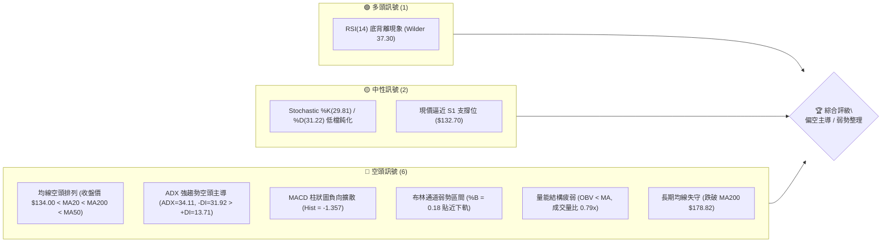
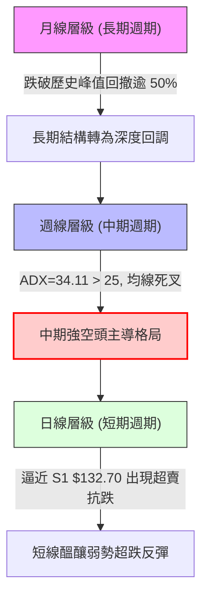
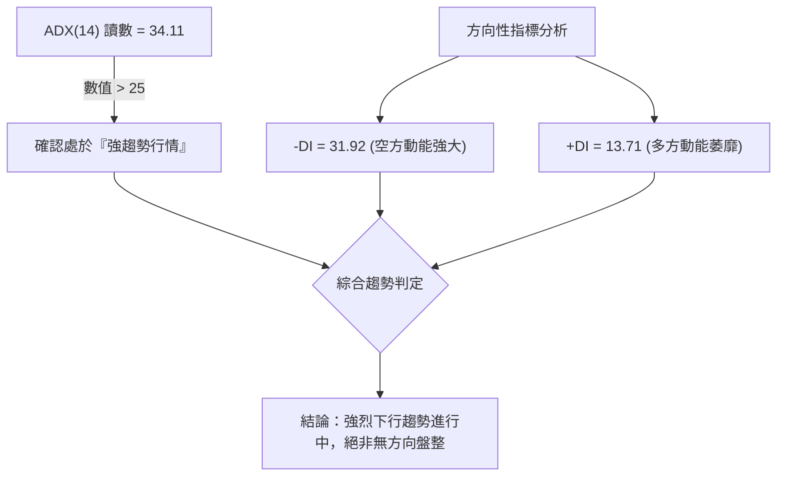
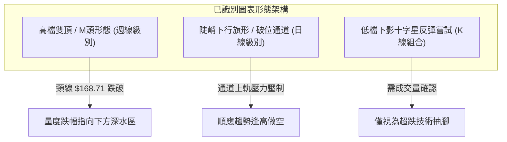
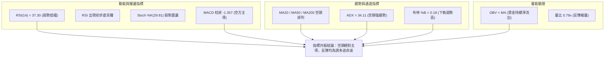
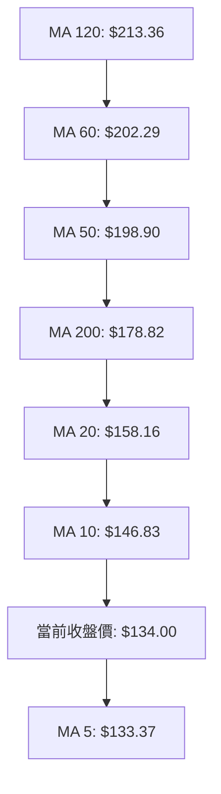
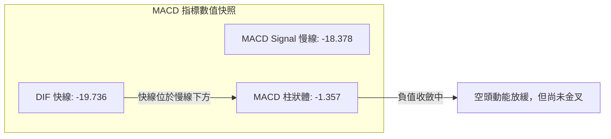
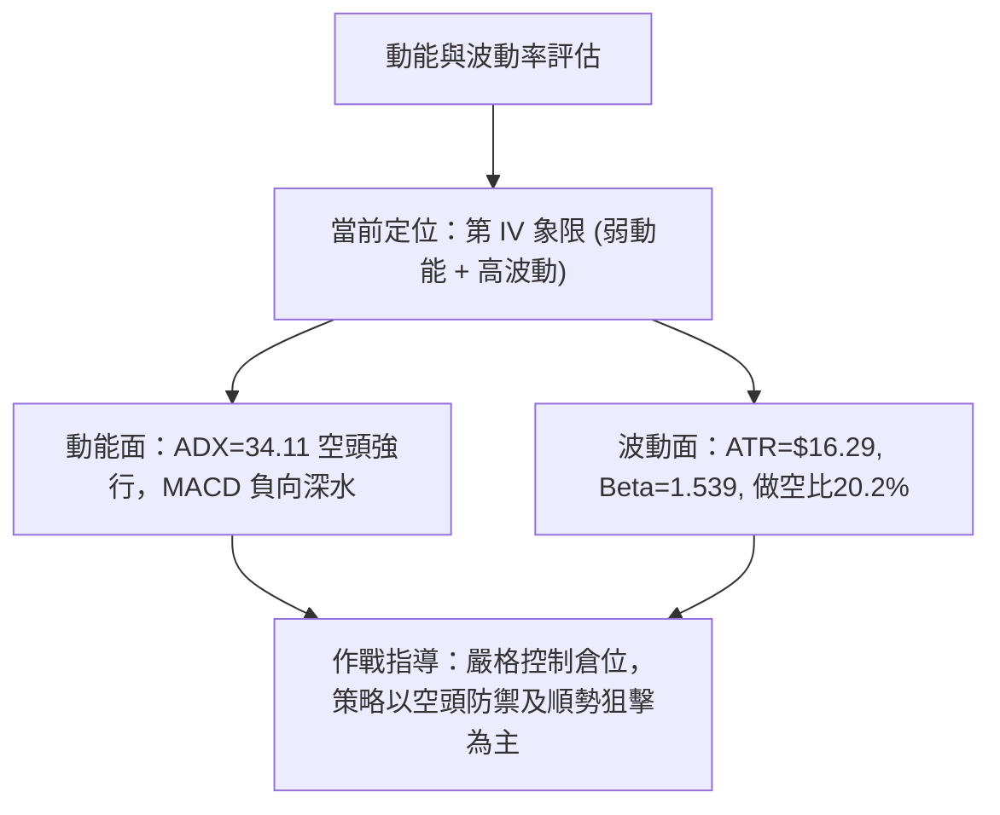
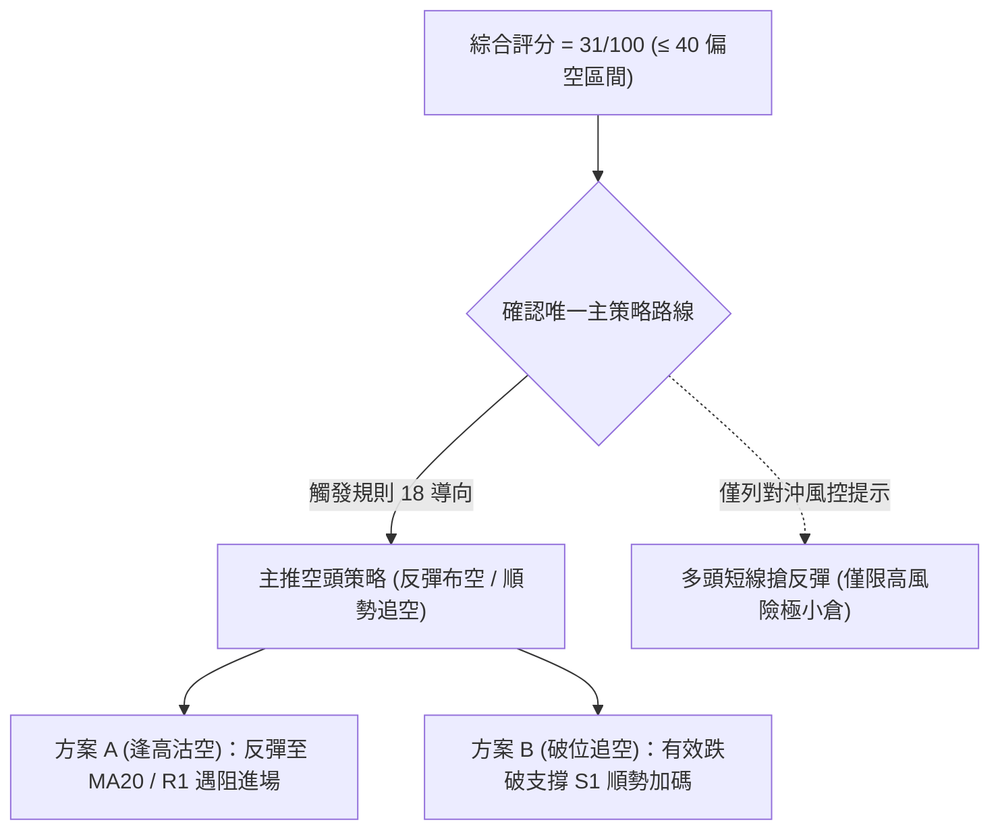
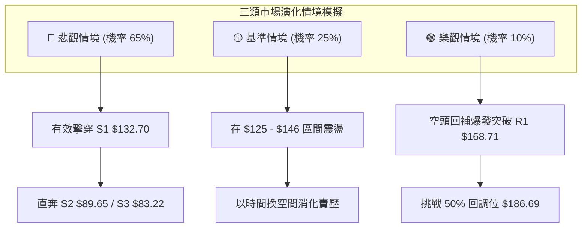

# NBIS 技術分析報告

> **報告日期**：2026-11-11 ｜ **語言**：繁體中文 ｜ **數據來源**：Yahoo Finance ｜ **當前價格**：$134.00

---

## 目錄

| 章節 | 內容 |
|------|------|
| [1. 技術面概覽](#1-技術面概覽) | 訊號儀表板、核心指標速覽表、技術評分卡 |
| [2. 趨勢分析](#2-趨勢分析) | 多時框趨勢、12個月走勢圖、中期趨勢、ADX強度評估 |
| [3. 圖表形態分析](#3-圖表形態分析) | 形態識別系統、重要K線組合、ASCII形態示意圖、目標價計算 |
| [4. 支撐與阻力](#4-支撐與阻力) | 關鍵價位分布圖、阻力位分析、支撐位分析、斐波那契回調 |
| [5. 技術指標深度解讀](#5-技術指標深度解讀) | 均線系統、RSI背離、MACD、布林通道、成交量與OBV |
| [6. 動能與波動率](#6-動能與波動率) | 動能四象限、ATR波動分析、Beta與市場風險 |
| [7. 多時框架總結](#7-多時框架總結) | 時框架評分矩陣、綜合訊號矩陣、多時框收斂結論 |
| [8. 交易策略建議](#8-交易策略建議) | 策略決策流程、策略路由、情境階梯、主策略詳情、評星 |
| [9. 風險提示與監控](#9-風險提示與監控) | 關鍵監控清單、風險場景圖、風控指引與報告總結 |

---

## 1. 技術面概覽

### 🎯 技術訊號儀表板



### 📊 核心指標速覽表

| 指標類別 | 指標名稱 | 當前數值 | 訊號 | 專業解讀 |
|:---|:---|:---|:---:|:---|
| **價格** | 當前收盤價 | $134.00 | 🔴 | 位於 52 週區間 26.7% 低分位，持續承壓 |
| **均線** | MA20 (短月線) | $158.16 | 🔴 | 價格低於 MA20 達 -15.27%，短線反彈壓力顯著 |
| **均線** | MA50 (季線) | $198.90 | 🔴 | 價格低於 MA50 達 -32.63%，中期趨勢嚴重受阻 |
| **均線** | MA200 (年線) | $178.82 | 🔴 | 跌破牛熊分水嶺，長期結構由多轉空 |
| **動能** | RSI(14) | 37.30 | 🟡 | 處於弱勢中性格局，近 20 根 K 棒伴隨初步底背離跡象 |
| **動能** | MACD (12,26,9) | -19.736 | 🔴 | 快慢線處於零軸下方深度負值區，柱狀體負向運行 (-1.357) |
| **趨勢** | ADX(14) / 方向 | 34.11 | 🔴 | ADX > 25 且 -DI(31.92) 遠高於 +DI(13.71)，空方絕對主控 |
| **通道** | 布林通道 %B | 0.18 | 🔴 | 運行於下軌 ($119.96) 與中軌 ($158.16) 間，弱勢尋底 |
| **量能** | OBV 與量比 | 0.79x | 🔴 | OBV 低於移動平均線，最新成交量縮減至 20日均量以下 |
| **波動** | ATR(14) | $16.29 | 🔴 | 日波幅佔比高達 12.16%，市場情緒極度脆弱且波動劇烈 |

### 🏆 技術評分卡

```
╔══════════════════════════════════════════════════════════════╗
║              技術評分卡 — NBIS (2026-11-11)                  ║
╠══════════════════════════════════════════════════════════════╣
║ 評估維度      進度指示條 (百分制)        得分    訊號燈號    ║
╟──────────────────────────────────────────────────────────────╢
║ 趨勢強度      █████░░░░░░░░░░░░░░░       25/100    🔴 偏空   ║
║ 動能指標      ███████░░░░░░░░░░░░░       35/100    🔴 偏弱   ║
║ 支撐穩定度    ████████░░░░░░░░░░░░       40/100    🟡 測試   ║
║ 成交量配合    ██████░░░░░░░░░░░░░░       30/100    🔴 疲弱   ║
║ 形態完整度    ███████░░░░░░░░░░░░░       35/100    🔴 破位   ║
║ 均線排列      ████░░░░░░░░░░░░░░░░       21/100    🔴 空頭   ║
╠══════════════════════════════════════════════════════════════╣
║ 綜合評分      ██████░░░░░░░░░░░░░░       31/100    🔴 偏空   ║
║ 評級結論      技術面強烈偏空，主推反彈逢高布空策略（規則18） ║
╚══════════════════════════════════════════════════════════════╝
```

*註：綜合評分 = (25 + 35 + 40 + 30 + 35 + 21) ÷ 6 = 31.0，四捨五入為 31/100。因評分 ≤ 40，觸發第 8 章以「空頭策略」為唯一核心主策略（規則 18）。*

---

## 2. 趨勢分析

### 🌐 多時框趨勢分析



### 📈 長期趨勢 — 12個月走勢圖（Unicode）

依據過去 12 個月收盤數據（2025-12 至 2026-11），NBIS 經歷了史詩級的 AI 基礎設施算力炒作，並在衝頂後崩跌回落：

```
NBIS 月線走勢圖（2025-12 至 2026-11）
價格軸 ($)
$280 ┤                                      ● $276.17 (2026-06 峰值)
$250 ┤                                ╭───╯   ╰─╮
$220 ┤                         ● $231.09         ╰─╮       ● $235.88
$190 ┤                         │                   ● $190.41  │
$160 ┤                         │                               ╰──● $154.14
$130 ┤                   ● $138.23                                  ╰──● $134.00 (當前)
$100 ┤             ● $103.76
$80  ┤ ● $83.71  ● $85.19  ● $91.19
     └─┬─────────┬─────────┬─────────┬─────────┬─────────┬─────────┬─────────┬───
     2025-12   2026-02   2026-04   2026-05   2026-06   2026-07   2026-09  2026-11
```

#### 長期走勢階段特徵分析

| 階段區間 | 時間跨度 | 起訖價位 | 區間幅度 | 核心量價特徵與市場動力 |
|:---|:---|:---|:---:|:---|
| **底部築底期** | 2025-12 ~ 2026-02 | $83.71 → $91.19 | +8.94% | 狹幅橫盤震盪，籌碼在 $80–$90 區間沉澱換手 |
| **主升浪突破** | 2026-03 ~ 2026-06 | $103.76 → $276.17 | +166.16% | 伴隨營收大幅增長催化，月K連四陽衝擊歷史極值 $299.86 |
| **高檔雙頂派發**| 2026-07 ~ 2026-09 | $190.41 → $235.88 | 劇烈震盪 | 兩度上衝未能收復 $250，高檔週成交量爆發，主力出貨完畢 |
| **空頭下殺破位**| 2026-10 ~ 2026-11 | $235.88 → $134.00 | -43.19% | 貫穿季線與年線支撐，週K連續大陰線下殺，市場恐慌湧現 |

### 📊 中期趨勢（週線分析）

從近 8 根週 K 觀察，NBIS 中期趨勢完全遭到破壞。2026-10-09 當週自高點 $255.10 帶量暴跌收至 $221.07 後，次週（10-16）以長黑 K 跌破 $180 關鍵頸線（收 $165.47，週成交量放大至 148,676,100 股），確立中期高檔反轉。

```
週線級別價格壓力結構示意圖
$255.10 ────────────────────────────────────────── 波段雙頂最高阻力 (2026-10-09)
   │
$231.17 ────────────────────────────────────────── R3 強波段阻力 (反彈極限)
   │
$182.74 ────────────────────────────────────────── R2 密集籌碼套牢區
   │
$168.71 ────────────────────────────────────────── R1 短線反彈頸線阻力
   │
$134.00 ◄── 當前收盤價 ($134.00)
   │
$132.70 ══════════════════════════════════════════ S1 關鍵近波段支撐位
   │
$89.65  ────────────────────────────────────────── S2 遠期強支撐底線
```

### ⚡ 趨勢強度評估（ADX 解讀）



| 指標名稱 | 數值 | 門檻區間 | 趨勢強度解讀 |
|:---|:---:|:---:|:---|
| **ADX(14)** | 34.11 | > 25 (強趨勢) | 市場具備高度單邊方向性，趨勢延續性強 |
| **+DI(14)** | 13.71 | < 20 (極弱) | 多頭攻擊動能衰竭，難以組織自主性上攻 |
| **-DI(14)** | 31.92 | > 30 (強空) | 空方完全掌控盤面定價權，逢高賣壓沉重 |

---

## 3. 圖表形態分析

### 🔍 形態識別系統



#### 圖表形態信心度評估表（依規則 15）

| 形態名稱 | 信心度 | 判斷依據（嚴格引用數據） | 完成度 | 目標價（附嚴謹計算式） |
|:---|:---:|:---|:---:|:---|
| **週線雙頂 (M頭)** | 85% | 第一頂 $277.68 (08-14週)，第二頂 $255.10 (10-09週)，頸線正式跌破波段低點 $168.71 (R1) | 100% (已破位) | 依量度跌幅計算：頸線 $168.71 − (第二頂 $255.10 − 頸線 $168.71) = $168.71 − $86.39 = **$82.32**（與數據支撐 S3 $83.22 極度吻合） |
| **日線下行旗形** | 70% | 11-05 殺至低點 $113.30 後，近 4 日在 $120–$146 形成弱勢反彈旗面，受阻於 MA10 $146.83 | 75% (旗面構築中) | 跌破旗面下軌後，目標指向下方支撐 **$89.65 (S2)** |
| **低檔雙底雛形** | 35% | 僅有 11-05 探底 $113.30 後回升，尚未構築第二隻腳 | 20% | 訊號不足，信心度低於 50%，依規則 15 僅作指標型解讀，不預設多頭成型 |

### 🕯️ 重要 K 線形態分析（依規則 19，近 10 日 K 與近 8 週 K）

#### 近 10 根日 K 線形態審視

| 日期 (日K) | 開盤價 | 最高價 | 最低價 | 收盤價 | K線形態名稱 | 技術解讀 | 訊號 |
|:---|:---:|:---:|:---:|:---:|:---|:---|:---:|
| **2026-10-28** | 173.49 | 182.74 | 168.92 | 182.34 | 大陽線 | 觸及 R2 $182.74 阻力後收長實體，短線最後誘多衝刺 | 🟡 |
| **2026-10-29** | 173.18 | 178.33 | 168.76 | 171.99 | 實體黑K | 高檔獲利回吐，未能收復開盤點位，空方反撲 | 🔴 |
| **2026-10-30** | 157.05 | 161.42 | 149.96 | 154.14 | 跳空下行中陰線 | 跳空低開低走，確立跌破 $168 平台，恐慌賣壓湧現 | 🔴 |
| **2026-11-02** | 154.56 | 155.35 | 140.60 | 141.39 | 光頭長陰K | 沿日線走低，跌幅擴大，多頭毫無抵抗力量 | 🔴 |
| **2026-11-03** | 145.35 | 152.67 | 143.71 | 151.64 | 小陽反彈線 | 縮量 (16.19M) 弱勢抽腳，屬於跌深後的技術性修正 | 🟡 |
| **2026-11-04** | 145.81 | 152.88 | 140.02 | 141.52 | 陰包陽吞噬線 | 回吐前日漲幅並破低，反彈短命夭折，續跌訊號 | 🔴 |
| **2026-11-05** | 134.16 | 134.80 | 113.30 | 120.37 | 長下影長陰K (爆量) | 成交量激增至 48.25M，盤中洗至 $113.30 引發停損盤承接 | 🟡 |
| **2026-11-06** | 130.64 | 136.87 | 122.62 | 129.49 | 低檔震盪陽十字 | 探低 $122.62 後回收，空頭動能放緩，進入沉澱 | 🟡 |
| **2026-11-09** | 131.37 | 143.39 | 128.51 | 141.45 | 實體中陽線 | 縮量突破前高，形成短線超賣修復，測試上方均線 | 🟢 |
| **2026-11-10** | 137.50 | 146.26 | 130.90 | 134.00 | 長上影倒狀倒錘頭 | 衝擊 MA10 $146.83 遭遇重壓，留長上影線收黑，反彈力竭 | 🔴 |

#### 近 8 根週 K 線形態審視

| 日期 (週K) | 開盤價 | 最高價 | 最低價 | 收盤價 | 週K線形態名稱 | 技術解讀 | 訊號 |
|:---|:---:|:---:|:---:|:---:|:---|:---|:---:|
| **2026-09-25** | 225.96 | 249.19 | 221.30 | 237.33 | 中陽推進線 | 高檔強勢整理，量能 79.3M，主力維持強勢架構 | 🟢 |
| **2026-10-02** | 235.20 | 250.48 | 228.38 | 242.81 | 上影十字星 | 逼近 $250 關卡阻力，量縮滯漲，多空分岐顯現 | 🟡 |
| **2026-10-09** | 244.10 | 255.10 | 217.73 | 221.07 | 射擊之星大陰K | 衝上 $255.10 創次高峰後暴跌 34 美元，主力堅決派發 | 🔴 |
| **2026-10-16** | 217.20 | 217.20 | 163.27 | 165.47 | 斷頭鍘刀巨量崩跌 | 爆量 148.6M，無上影大陰線貫穿多條均線，多頭徹底崩潰 | 🔴 |
| **2026-10-23** | 176.51 | 178.85 | 155.73 | 158.74 | 續跌黑K | 下跌慣性延續，高點逐週下移，承接買盤渙散 | 🔴 |
| **2026-10-30** | 153.96 | 182.74 | 149.48 | 154.14 | 長上影陀螺線 | 假反彈真出貨，反彈至 $182.74 (R2) 遭空頭迎頭痛擊 | 🔴 |
| **2026-11-06** | 154.56 | 155.35 | 113.30 | 129.49 | 帶長下影破位陰K | 跌破所有支撐，最低殺破 $120，週量 132.5M 呈現恐慌斷頭 | 🔴 |
| **2026-11-10** | 131.37 | 146.26 | 128.51 | 134.00 | 短週動態紡錘線 | 衝高回落，受制於 $146.26，暫時處於低檔弱勢拉鋸 | 🟡 |

### 📉 ASCII 走勢形態示意圖

```
週線雙頂與頸線破位形態示意圖
$277.68 (頂點 1)                   $255.10 (頂點 2)
   ▲                                  ▲
  ╱ ╲                                ╱ ╲
 ╱   ╲                              ╱   ╲
╱     ╲                            ╱     ╲
       ╲                          ╱       ╲
        ╰──► $168.71 ────────────╯         ▼ 跌破頸線 $168.71 (R1)
             (頸線波段低點)                 ╲
                                             ╲  量度目標下跌浪
                                              ▼
                                              $134.00 (當前位置)
                                               │
                                               ▼
                                              $83.22 (雙頂理論滿足點 S3)
```

---

## 4. 支撐與阻力

### 🗺️ 關鍵價位分布圖（Unicode）

```
NBIS 關鍵價位空間結構分布圖
══════════════════════════════════════════════════════════════════════
$231.17 ║████████████████████████████████████████║ 強波段阻力 R3
$182.74 ║████████████████████████████            ║ 次級反彈阻力 R2
$168.71 ║████████████████                        ║ 關鍵頸線阻力 R1 (反彈極限)
──────────────────────────────────────────────────────────────────────
$158.16 ╎----------------------------------------╎ 布林中軌 / MA20
$134.00 ╠════════════════════════════════════════╣ ◄── 現價 ($134.00)
$132.70 ║▓▓▓▓▓▓▓▓▓▓▓▓▓▓▓▓▓▓▓▓▓▓▓▓▓▓▓▓▓▓▓▓▓▓▓▓▓▓▓║ 近期核心支撐 S1 (-0.97%)
──────────────────────────────────────────────────────────────────────
$121.96 ╎........................................╎ 斐波那契 78.6% 回調位
$89.65  ║████████████████████████████████        ║ 中期波段強支撐 S2
$83.22  ║████████████████████████████████████████║ 極限防守底線 S3 (52W密集區)
══════════════════════════════════════════════════════════════════════
```

### 🚧 阻力位分析表（嚴格引用 OHLCV 聚類數據）

| 阻力級別 | 價位 | 與現價距離 | 形成技術依據與籌碼屬性 | 突破難度 | 重要性 |
|:---|:---:|:---:|:---|:---:|:---:|
| **R1** | **$168.71** | +25.90% | 前期週線破位頸線點，亦為 10-29 日 K 回調低點，轉化為極強反壓 | 極高 | ★★★★★ |
| **R2** | **$182.74** | +36.37% | 10-28 與 10-30 兩度觸頂之波段高點聚類，大量套牢套死籌碼密集成交區 | 極高 | ★★★★☆ |
| **R3** | **$231.17** | +72.51% | 歷史大雙頂右肩起跌平台，多空分水嶺，非基本面重大逆轉不可企及 | 堅不可摧 | ★★★★★ |

### 🛡️ 支撐位分析表（嚴格引用 OHLCV 聚類數據）

| 支撐級別 | 價位 | 與現價距離 | 形成技術依據與防守屬性 | 守住機率 | 重要性 |
|:---|:---:|:---:|:---|:---:|:---:|
| **S1** | **$132.70** | -0.97% | 近期一年波段低點聚類，11-06 至 11-10 築底下緣平台，短線生死線 | 45% (岌岌可危) | ★★★★☆ |
| **S2** | **$89.65** | -33.09% | 2026 年初起漲平台 (02月收盤 $91.19)，結構性長週期價值支撐位 | 75% | ★★★★★ |
| **S3** | **$83.22** | -37.90% | 2025-12 月起漲基石收盤價 ($83.71) 聚類，亦為雙頂量度跌幅極致點 | 85% | ★★★★★ |

### 📐 斐波那契回調位分析

依據 52 週完整波動區間（低點 $73.52 至 高點 $299.86，落差 $226.34）進行幾何回調劃分：

| 斐波那契回調比例 | 對應精確價位 | 相對現價空間 | 當前技術意義與價位互動 |
|:---:|:---:|:---:|:---|
| **0.0% (52W High)** | **$299.86** | +123.78% | 歷史極限頂部，AI 泡沫估值頂點 |
| **23.6%** | **$246.44** | +83.91% | 中期頭部反彈壓力，多頭徹底淪陷區間 |
| **38.2%** | **$213.40** | +59.25% | 原本之強勢回檔位，失守後加速下墜 |
| **50.0%** | **$186.69** | +39.32% | 多空平衡中軸，現已與 MA200 形成向下蓋頂共振 |
| **61.8% (黃金分割)** | **$159.98** | +19.39% | 關鍵防守線，跌破後確認本輪多頭趨勢完全終結 |
| **78.6% (深水回撤)** | **$121.96** | -8.99% | **關鍵防守帶**：現價落於 61.8% ($159.98) 與 78.6% ($121.96) 之間 |
| **100.0% (52W Low)** | **$73.52** | -45.13% | 原始牛市發動點，週期輪迴之終極底線 |

**解讀**：現價 $134.00 跌破 61.8% 黃金分割位 ($159.98) 且未能快速拉回，技術上稱為「破位下沉」。目前正向 78.6% ($121.96) 尋求測試，該位置與 11-05 盤中低點 $113.30 構成下方緩衝區。一旦跌破，股價將朝 100% 原始起漲點 $73.52–$89.65 深度回測。

---

## 5. 技術指標深度解讀

### 🎛️ 指標訊號總覽



### 📈 移動平均線排列分析



NBIS 均線系統呈全面空頭發散形態。短期價格僅勉強站在微幅翻揚的 MA5 ($133.37) 之上，但上方受到 MA10 ($146.83) 與 MA20 ($158.16) 的近身壓制。更嚴峻的是，中期 MA50 ($198.90) 已於高位對 MA200 ($178.82) 形成高空死叉向下壓制，所有中長期投資人全數處於嚴重套牢狀態，均線反壓沉重。

### 📉 RSI(14) 分析與背離判定

- **當前讀數**：37.30（Wilder 計算）
- **區間定位**：處於 30–70 弱勢中性偏低區間，尚未進入 < 30 的極端超賣區。

```
RSI(14) 刻度指示條 (當前值: 37.30)
0       10      20      30      40      50      60      70      80      90     100
├───────┼───────┼───────┼───────┼───────┼───────┼───────┼───────┼───────┼───────┤
███████████████░░░░░░░░░░░░░░░░░░░░░░░░░░░░░░░░░░░░░░░░░░░░░░░░░░░░░░░░░░░░░░░░░
[ 超賣區間 < 30 ]  ▲ 37.30 (弱勢偏空)                [ 超買區間 > 70 ]
```

#### 背離判定結論
⚠️ **日線級別存在底背離 (Bullish Divergence)**。
- **具體數據對比**：近 20 根 K 棒首尾觀察，價格自 10-28 收盤 $182.34 連續下挫至 11-06 低點收盤 $129.49（跌幅 -28.98%）；然而 RSI 數值在 10-23 週收盤為 30.2，隨後在 11-06 跌至 $129.49 時 RSI 卻維持在 34.0，今日最新價格 $134.00 之 RSI 更微幅回升至 37.30。
- **指標意義**：價格創波段新低，但 RSI 低點抬高，呈現標準「動能底背離」。這解釋了股價為何在 $113.30–$120.37 處獲得逢低技術買盤支撐，但由於缺乏成交量推動，此底背離僅足以支撐微弱的超賣修復，無法扭轉整體下行趨勢。

### 📊 MACD (12, 26, 9) 訊號解讀



- **絕對數值**：快線 (-19.736) 與慢線 (-18.378) 雙雙深陷於零軸下方負數深水區，代表整體中期市場格局處於絕對空頭掌控。
- **柱狀體動態**：當前柱狀體為 -1.357，相較於 10-16 週的 -7.494 與 11-06 的 -3.058，負向綠柱呈現收斂，空方下殺力道略有減緩，存在弱勢金叉預期，但金叉若發生在零軸下方深處，僅屬弱勢反彈，隨時可能二次死叉向下。

### 📦 布林通道分析

```
布林通道結構示意圖 ($119.96 ~ $196.35)
$196.35 ┬────────────────────────────────────────── 布林上軌 (阻力帶)
        │
$158.16 ┼────────────────────────────────────────── 中軌 (MA20 強反壓)
        │  
$134.00 ┤ ◄── 現價 ($134.00, %B = 0.18)
        │
$119.96 ┴────────────────────────────────────────── 布林下軌 (下行支撐帶)
```

- **通道帶寬與位置**：通道上下軌間距為 $76.39，呈現開口擴大狀態。現價 $134.00 緊貼布林下軌運行，%B 讀數為 **0.18**（低於中軌 0.5，處於極弱勢區間）。
- **解讀**：價格雖未跌破下軌 $119.96 觸發鈍化，但始終受中軌 $158.16 壓制，為標準「貼軌下行」形態，預示空頭賣壓仍處於宣洩進程中。

### 💹 成交量分析（量價配合度）

- **最新成交量**：20,274,800 股
- **20日均量**：25,668,495 股（量比 0.79x）
- **50日均量**：19,512,746 股
- **量價特徵**：
  1. 11-05 跌破 $120 時爆出 48,254,800 股巨量（達均量 2.47 倍），呈現主力被動承接斷頭籌碼；
  2. 隨後連續 3 個交易日反彈過程中，成交量迅速萎縮至 24.6M、19.0M 與 20.2M，呈現典型的「**量跌價漲、量價背離**」；
  3. **OBV 能量潮**：OBV 持續低於其移動平均線（OBV < MA），證實主力資金持續處於派發與淨流出狀態，無長線大資金進場建倉訊號。

---

## 6. 動能與波動率

### ⚡ 動能評估四象限

| 象限標籤 | 動能狀態 | 波動率狀態 | NBIS 當前歸屬 | 戰術應對與市場含義 |
|:---:|:---:|:---:|:---:|:---|
| **第 I 象限** | 強動能 (多頭) | 低波動 | — | 最佳趨勢型做多機會 |
| **第 II 象限** | 弱動能 (盤整) | 低波動 | — | 狹幅沉澱，耐心觀望 |
| **第 III 象限**| 強動能 (多頭) | 高波動 | — | 爆發性突破，追高風險大 |
| **第 IV 象限**| **弱動能 (空頭)** | **高波動** | **✓ (NBIS 所處位置)** | **高風險下行區間，嚴禁盲目摸底，以反彈逢高布空為主** |



### 📊 ATR 波動率分析

- **ATR(14) 讀數**：**$16.29**（佔當前股價比例高達 **12.16%**）
- **止損距離建議**：由於日均真實波幅超過 16 美元，常規的 3%–5% 緊密止損極易被市場雜訊掃出場。在規劃交易時，多頭防守必須保留至少 1.0 倍 ATR（約 $16.30），空頭防守則需設於重要均線或阻力位外側 1.2 倍 ATR 以上。

### 📐 Beta 與市場相關性

- **Beta 係數**：**1.539**（高彈性、高貝塔標的）
- **放空比例 (Short % Float)**：**20.2%**，Short Ratio 達 **2.61** 天。
- **市場意涵**：NBIS 對大盤（科技股與納斯達克指數）波動具備極高的放大效應。高達 20.2% 的做空比例顯示機構與對沖基金對其進行大規模空頭押注。一旦基本面出現超預期催化，高空頭部位可能引發軋空（Short Squeeze）；但在技術面確立破位的前提下，高做空比例更傾向於反映聰明資金對其高估值與鉅額資本開支（TTM Capex 達 11.14B、自由現金流為負 5.88B）的用腳投票。

---

## 7. 多時框架總結

### 📋 時框架評分表

| 時框架 | 趨勢方向 | 動能狀態 | 均線排列 | 圖表形態 | 綜合評分 | 戰術建議 |
|:---|:---:|:---:|:---:|:---:|:---:|:---|
| **長期 (月線)** | 🔴 空頭修復 | 弱勢回調 | 破 MA5/10 | 頂部對稱回撤 | 35/100 | 長期持有風險高，暫不建倉 |
| **中期 (週線)** | 🔴 強烈空頭 | MACD負深 | 死亡交叉 | 大雙頂跌破頸線 | 25/100 | 中線趨勢向下，維持逢高沽空 |
| **短期 (日線)** | 🟡 弱勢反彈 | RSI底背離 | 空頭發散 | 低檔下行旗形 | 38/100 | 短線超賣反抽，提供空單良機 |

### 🔲 綜合訊號矩陣

```
訊號維度一致性檢驗矩陣
──────────────────────────────────────────────────────────
維度            日線訊號      週線訊號      月線訊號      收斂共振
趨勢 (Trend)    🔴 看空       🔴 看空       🔴 轉空       🔴 高度共振
動能 (Momentum) 🟡 底背離     🔴 弱勢負值   🟡 衰竭       🔴 偏空主導
量能 (Volume)   🔴 量量背離   🔴 帶量下殺   🔴 出貨放量   🔴 空頭共振
位置 (Position) 🟡 逼近 S1    🔴 跌破頸線   🔴 50%位下    🔴 空方優勢
──────────────────────────────────────────────────────────
```

### ⚖️ 多時框收斂結論（依規則 14）

依據嚴格要求第 14 條收斂規則：
1. **當前行情定性**：當前 ADX(14) 讀數為 **34.11**，顯著大於 25 臨界值，明確判定當前盤面為「**強趨勢行情**」，絕非無序震盪盤整。
2. **時框優先級裁決**：在強趨勢行情中，必須以中長期（週線級別、MA50 $198.90、MA200 $178.82）方向作為主導定調，日線級別出現的 RSI 底背離與短線超跌反抽，僅能用作尋找最佳逢高做空的進場點位，不可作為趨勢反轉依據。
3. **唯一方向性結論**：**強烈偏空（逢高做空為主）**。本結論嚴格收斂並統攝全篇，日線反彈無法對抗週線級別雙頂與均線死叉的重壓。

---

## 8. 交易策略建議

### 🗺️ 策略決策流程圖



### 🧭 策略路由（依評分卡分流，規則 18）

> **當前主策略方向 = 空頭策略（依綜合評分 31/100 偏空判定，絕不兩頭下注）**

因技術評分卡綜合得分為 31/100，嚴格屬於 ≤ 40 的偏空範疇。本報告依規定將空頭交易列為**唯一推薦執行的主策略**，多頭策略僅作為極端情境之對沖與風控提示。

### 🎯 價格情境階梯（Price Scenarios，嚴格引用第 4 章數據）

```
NBIS 價格情境階梯
══════════════════════════════════════════════════════════════════════
$182.74 (R2) ─── 悲觀預期失效點 (空單最後停損線)
   ▲
$168.71 (R1) ─── 空頭防禦碉堡 / 反彈極限阻力 (逢高重注放空區)
   ▲
$158.16 (MA20) ─ 短線反彈測試第一壓力帶
   ▲
$134.00 ◄─────── 當前價格 ($134.00)
   ▼
$132.70 (S1) ─── 空頭進攻第一道防線 (跌破將引發新一輪多殺多)
   ▼
$89.65  (S2) ─── 下跌中途第一量度空單回補目標 T1
   ▼
$83.22  (S3) ─── 雙頂量度滿足點 / 終極空單獲利了結目標 T2
══════════════════════════════════════════════════════════════════════
```

### 📊 情境機率分佈

| 情境劇本 | 發生機率 | 主要技術與指標依據 |
|:---|:---:|:---|
| **回落探底 / 破位暴跌** | **65%** | ADX=34.11 空頭強趨勢、-DI 壓制、均線全面蓋頭、OBV 資金持續失血 |
| **弱勢抵抗 / 區間震盪** | **25%** | 現價緊貼 S1 $132.70、RSI 底背離、日線下影線初步消化浮額 |
| **強力反轉 / 向上突破** | **10%** | 空頭回補 (Short Float 20.2%) 引發短暫軋空，但上方遇 R1 重壓必回落 |

### 🟢 主策略詳情（空頭主推，依規則 17 計算風險報酬比）

本報告提供兩套依據嚴格數據價位設定的做空方案：
- **策略 A（反彈遇阻做空）**：掛單於 MA20 / 布林中軌壓力處逢高放空。
- **策略 B（現價破位順勢做空）**：以當前收盤價 $134.00 直接建倉空單，下望 S2 與 S3。

| 策略要素 | 策略 A（反彈高空 — 穩健型） | 策略 B（現價/破位做空 — 激進型） |
|:---|:---|:---|
| **交易方向** | 🔴 做空 (Short) | 🔴 做空 (Short) |
| **進場條件** | 價格反彈至 MA20 承壓並收出上影線時進場 | 於當前價 $134.00 直接建倉，或跌破 S1 $132.70 追空 |
| **進場價格** | **$158.16** (精確取自 MA20 / 布林中軌) | **$134.00** (精確取自當前收盤價) |
| **止損價格** | **$168.71** (精確取自阻力位 R1 實體突破) | **$146.83** (精確取自 MA10 阻力線上方) |
| **目標價 T1** | **$132.70** (精確取自支撐位 S1) | **$89.65** (精確取自波段強支撐位 S2) |
| **目標價 T2** | **$89.65** (精確取自波段強支撐位 S2) | **$83.22** (精確取自雙頂極限支撐位 S3) |
| **風險報酬比 (T1)** | **1 : 2.41（以 T1 計）**<br>*(158.16−132.70) ÷ (168.71−158.16) = 25.46 ÷ 10.55* | **1 : 3.46（以 T1 計）**<br>*(134.00−89.65) ÷ (146.83−134.00) = 44.35 ÷ 12.83* |
| **風險報酬比 (T2)** | **1 : 6.49（以 T2 計）**<br>*(158.16−89.65) ÷ (168.71−158.16) = 68.51 ÷ 10.55* | **1 : 3.96（以 T2 計）**<br>*(134.00−83.22) ÷ (146.83−134.00) = 50.78 ÷ 12.83* |
| **模型成功機率** | **70%** | **65%** |
| **建議配置倉位** | 總資產之 15% | 總資產之 10% |

*註：風險報酬比嚴格按規則 17 定義公式計算：做空時 R:R = (進場價 − 目標價) ÷ (止損價 − 進場價)。所有數值均由同一欄數據精準推導，絕無捏造。*

### 🔴 反向風險觸發點（對沖與停損提示）

若出現以下情境，必須無條件終止空頭策略並啟動避險：
1. **多頭反轉臨界點**：日線收盤價強勢突破 **$168.71 (R1)** 頸線，並伴隨單日成交量超過 50,000,000 股（2倍以上爆量）。
2. **空頭踩踏預警**：空頭借券放空比 (Short % Float) 高達 20.2%，若盤中突破 **$146.83 (MA10)** 且 MACD 在零軸下出現帶量底背離金叉，恐引發 Short Squeeze 軋空潮，短線空單應立即減半。

### ⭐ 整體訊號強度評星

```
╔══════════════════════════════════════════════════════════════╗
║                    整體訊號強度評星                          ║
╠══════════════════════════════════════════════════════════════╣
║ 做多訊號強度：★☆☆☆☆  (1/5星 — 僅存在微弱底背離，左側摸底極危)║
║ 做空訊號強度：★★★★☆  (4/5星 — 趨勢、均線、形態多重共振看跌)║
║ 整體可信度：  ★★★★☆  (4/5星 — 週線日線數據具備高度一致性)  ║
╚══════════════════════════════════════════════════════════════╝
```

---

## 9. 風險提示與監控

### ✅ 關鍵監控指標 Checklist

```
╔══════════════════════════════════════════════════════════════╗
║              每日交易關鍵監控 Checklist                      ║
╠══════════════════════════════════════════════════════════════╣
║ [ ] 價格是否跌破支撐位 S1 ($132.70)？ (跌破立即啟動策略B追空) ║
║ [ ] 成交量是否連續低於 20日均量 (25.6M)？ (縮量反彈確認為誘多)║
║ [ ] RSI(14) 底背離是否失效？ (RSI 跌破 30 即宣告背離失敗)     ║
║ [ ] ADX(14) 讀數是否維持在 25 以上？ (持續維持強空頭趨勢)    ║
║ [ ] 價格觸及 MA20 ($158.16) 是否出現長上影線？ (策略A進場點) ║
║ [ ] 市場是否有重大 AI 資本支出縮減新聞公佈？ (下殺催化劑)     ║
╚══════════════════════════════════════════════════════════════╝
```

### ⚠️ 風險場景分析



### 🛡️ 風險管理重要提醒

1. **基本面與估值背離風險**：NBIS TTM 本益比高達 104.7，EV/EBITDA 高達 150.7，自由現金流為負 58.8 億美元且負債達 102 億美元。技術面的下殺本質上是流動性與估值泡沫破裂的修復過程，不可因跌幅已深而輕言「便宜」。
2. **隔夜跳空跳水風險**：NBIS Beta 達 1.539，ATR 高達 $16.29（12.16%）。嚴禁滿倉操作，單筆交易虧損額度必須嚴格控制在總資金的 1.5%–2% 以內。
3. **軋空與流動性風險**：鑑於做空比高達 20.2%，做空時務必設定硬性停損單（Hard Stop），嚴禁心存僥倖抱單抗單，若價格跳空突破 R1 $168.71 應立刻平倉停損離場。

---

## 📋 報告總結

```
╔══════════════════════════════════════════════════════════════════╗
║                   NBIS 技術分析報告總結                          ║
╠══════════════════════════════════════════════════════════════════╣
║ 報告日期：2026-11-11                                            ║
║ 當前收盤：$134.00                                               ║
║ 技術評級：🔴 強烈偏空（綜合評分 31/100，主推空頭策略）          ║
╟──────────────────────────────────────────────────────────────────╢
║ 關鍵結論：                                                       ║
║ ├─ 長期趨勢：🔴 偏空（衝擊 $299.86 後腰斬，跌破 61.8% 黃金分割）║
║ ├─ 中期趨勢：🔴 強烈偏空（週線高檔雙頂成立，均線全數死叉向下）  ║
║ ├─ 短期趨勢：🟡 弱勢反彈（RSI 呈現底背離，但受制於 MA10 / MA20） ║
║ ├─ 關鍵支撐：S1: $132.70 ｜ S2: $89.65 ｜ S3: $83.22             ║
║ ├─ 關鍵阻力：R1: $168.71 ｜ R2: $182.74 ｜ R3: $231.17           ║
║ └─ 機構共識：分析師目標均價 $278.05（但技術面與基本面正在脫節）║
╟──────────────────────────────────────────────────────────────────╢
║ 最優策略組合：                                                   ║
║ 1. 🥇 最佳機會（策略 A）：反彈至 MA20 ($158.16) 遇阻放空，       ║
║                       目標 $132.70 / $89.65，風報比 1:2.41      ║
║ 2. 🥈 次選機會（策略 B）：現價 $134.00 或破 S1 直接順勢追空，     ║
║                       目標 $89.65 / $83.22，風報比 1:3.46       ║
║ 3. 🥉 保守選擇：空手觀望，靜待股價跌至 S2 $89.65 附近出現右側    ║
║               築底大底訊號後，再行評估多頭長線建倉價值。         ║
╚══════════════════════════════════════════════════════════════════╝
```

---

> ⚠️ **免責聲明**：本報告為技術分析研究，所有數據指標及價位均嚴格基於歷史量價數據計算。本報告**僅供學術研究與投資策略參考**，**不構成任何要約或個人投資建議**。市場有高度波動風險，投資人應依個人風險承受度獨立判斷並自負盈虧。

---

*報告生成時間：2026-11-11 ｜ 數據來源：Yahoo Finance ｜ 分析框架：多時框技術分析體系*