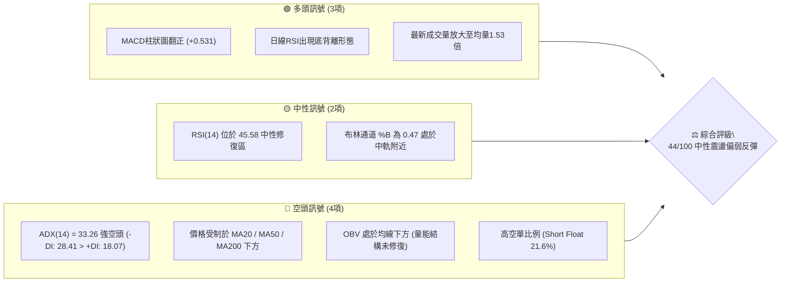
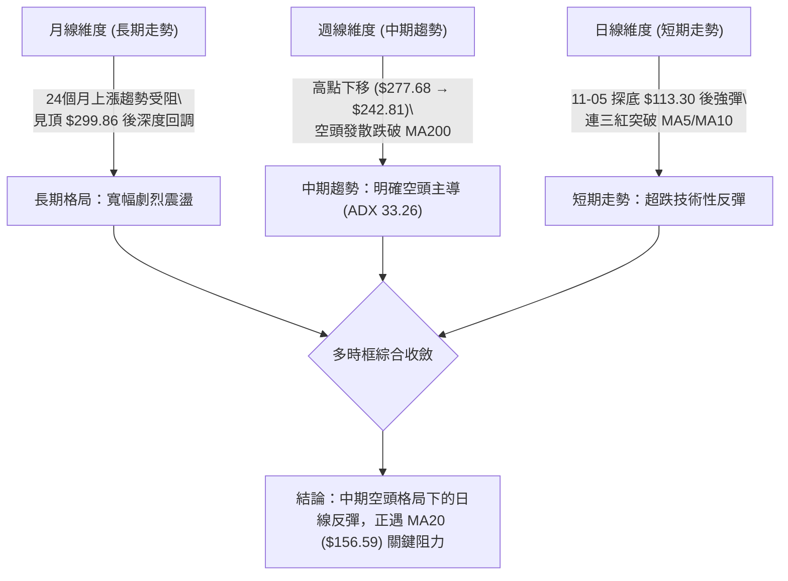
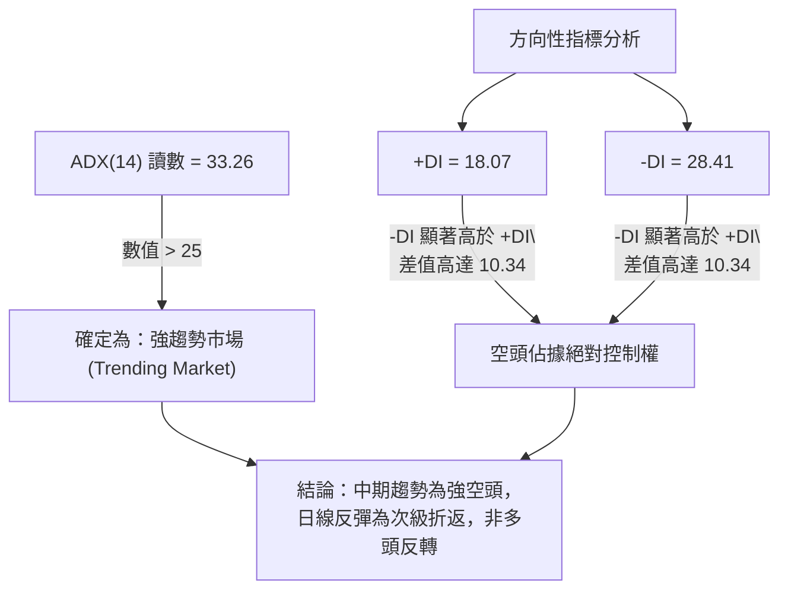
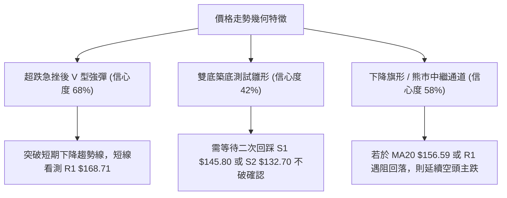
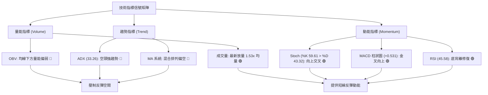
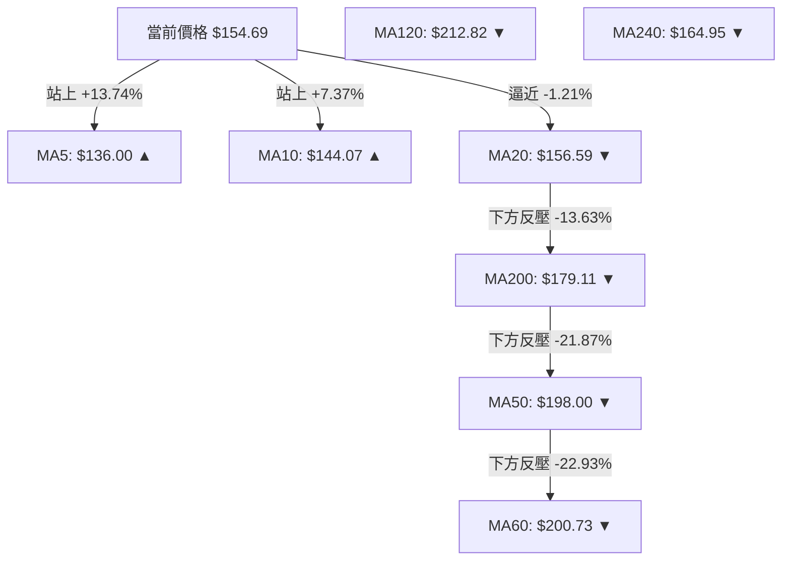
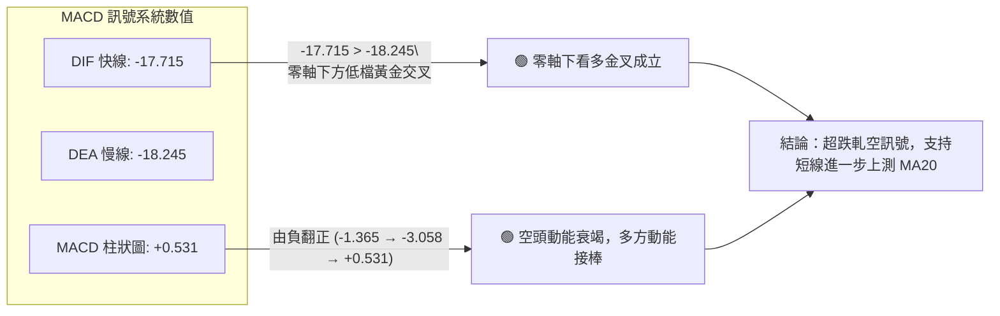
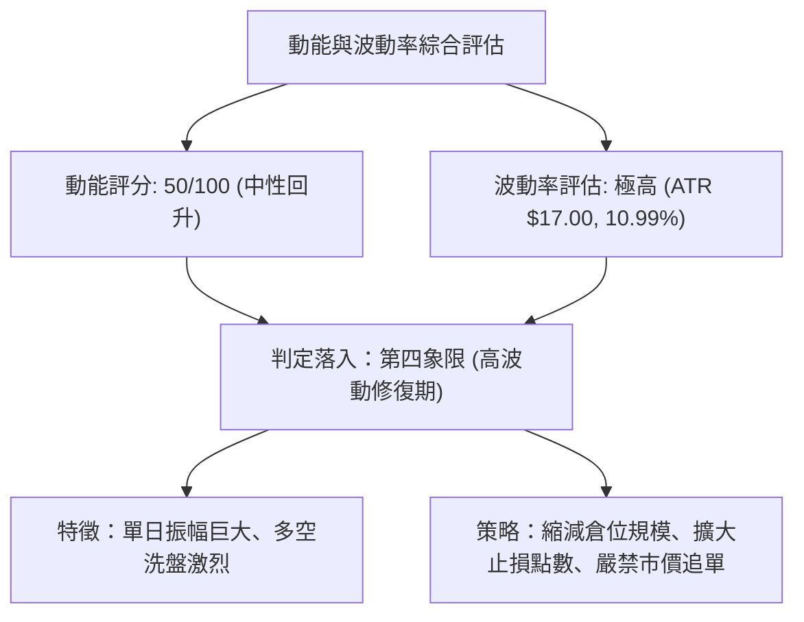
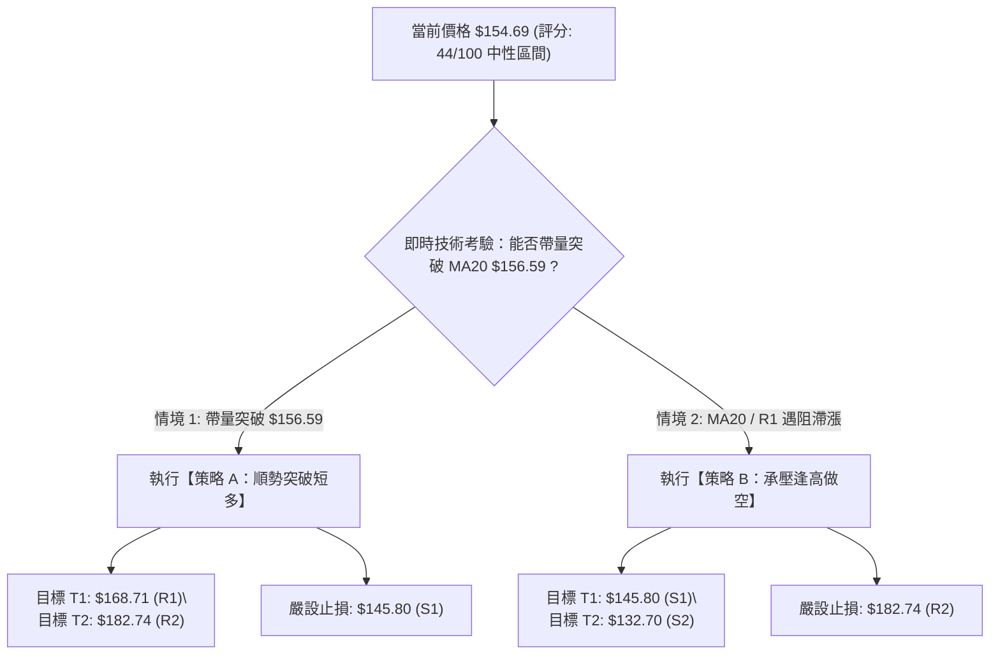
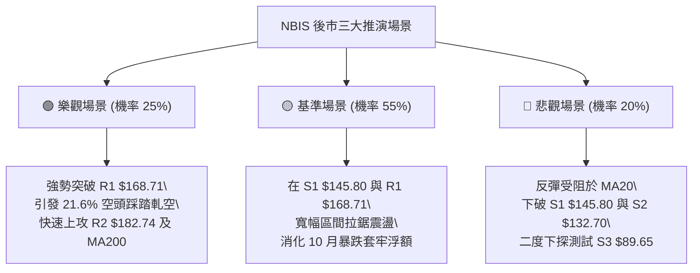

# NBIS 技術分析報告

> **報告日期**：2026-11-12 ｜ **語言**：繁體中文 ｜ **數據來源**：Yahoo Finance ｜ **當前價格**：$154.69 USD

---

## 目錄

| 章節 | 內容 |
|------|------|
| [1. 技術面概覽](#1-技術面概覽) | 訊號儀表板、核心指標、評分卡 |
| [2. 趨勢分析](#2-趨勢分析) | 多時框趨勢、長中短期走勢、ADX強弱判斷 |
| [3. 圖表形態分析](#3-圖表形態分析) | 形態識別信心度、K線組合、目標價測算 |
| [4. 支撐與阻力](#4-支撐與阻力) | 關鍵價位結構、斐波那契回調分析 |
| [5. 技術指標深度解讀](#5-技術指標深度解讀) | MA/RSI/MACD/布林通道/成交量與OBV |
| [6. 動能與波動率](#6-動能與波動率) | 動能四象限、ATR波幅、Beta與放空比例 |
| [7. 多時框架總結](#7-多時框架總結) | 時框架評分矩陣、多時框收斂定調 |
| [8. 交易策略建議](#8-交易策略建議) | 策略路由、價格階梯、主策略與對沖提示 |
| [9. 風險提示與監控](#9-風險提示與監控) | 監控清單、情境推演、風控紀律 |
| [10. 報告總結](#-報告總結) | 總體評級、關鍵指標一覽、最優策略組合 |

---

## 1. 技術面概覽

### 🎯 技術訊號儀表板



### 📊 核心指標速覽表

| 指標類別 | 指標名稱 | 當前數值 | 訊號 | 專業解讀 |
|:---|:---|:---|:---:|:---|
| **價格** | 當前收盤價 | $154.69 | 🟡 | 位於52週區間之 35.9% 水位，經歷自 $299.86 高點深度修正後之超跌反彈段 |
| **短期均線** | MA5 / MA10 | $136.00 / $144.07 | 🟢 | 現價高於 MA5 (+13.74%) 與 MA10 (+7.37%)，短線出現強勁技術性反彈 |
| **中長期均線**| MA20 / MA50 | $156.59 / $198.00 | 🔴 | 現價位於 MA20 (-1.21%) 與 MA50 (-21.87%) 下方，中期承壓顯著 |
| **長期均線** | MA200 | $179.11 | 🔴 | 現價低於長期牛熊分界線 (-13.63%)，長線趨勢格局遭受結構性破壞 |
| **動能指標** | RSI(14) | 45.58 | 🟢 | 自超賣區回升，近 20 根 K 棒呈現經典「底背離」，短線具修復動能 |
| **趨勢動能** | MACD (12,26,9) | 柱狀圖 +0.531 | 🟢 | DIF (-17.715) 向上收斂突破 DEA (-18.245)，柱狀圖翻正形成零軸下黃金交叉 |
| **趨勢強度** | ADX(14) | 33.26 | 🔴 | ADX > 25 且 -DI (28.41) 壓制 +DI (18.07)，顯示中級空頭趨勢仍具主導力道 |
| **通道指標** | 布林通道 (20,2)| 上$192.47 中$156.59 下$120.71 | 🟡 | %B 為 0.47，自下軌彈升後正測試中軌壓力，帶寬未收窄，屬通道內反彈 |
| **量能指標** | 成交量 / 20日均量| 39,830,900 / 25,982,225 | 🟢 | 量比達 1.53x，反彈伴隨成交量顯著放大，但 OBV 仍低於均線，尚未完全反轉 |
| **波動指標** | ATR(14) | $17.00 (10.99%) | 🔴 | 極高波動特性，單日平均震幅接近 11%，操作需拉大止損緩衝空間 |

### 🏆 技術評分卡

```
╔══════════════════════════════════════════════════════════════════════════════╗
║                    NBIS 技術面綜合量化評分卡 (2026-11-12)                    ║
╠══════════════════════════════════════════════════════════════════════════════╣
║ 評估維度      進度條權重指標                  得分     評級   維度重點解讀   ║
║ 趨勢強度      ███████░░░░░░░░░░░░░           35/100    🔴    ADX 33.26 空頭  ║
║ 動能指標      ██████████░░░░░░░░░░           50/100    🟡    MACD金叉+RSI背離║
║ 支撐穩定度    ██████████░░░░░░░░░░           50/100    🟡    S1守穩, 測S2反彈 ║
║ 成交量配合    █████████░░░░░░░░░░░           45/100    🟡    量比1.53x但OBV弱║
║ 形態完整度    ██████████░░░░░░░░░░           48/100    🟡    超跌V型測頸線MA20║
║ 均線排列      ███████░░░░░░░░░░░░░           36/100    🔴    MA20/50/200空排 ║
╠══════════════════════════════════════════════════════════════════════════════╣
║ 綜合評分      █████████░░░░░░░░░░░           44/100    🟡    中性偏空區間操作║
╚══════════════════════════════════════════════════════════════════════════════╝
※ 註：綜合評分由六項子指標算術平均計算所得 (35+50+50+45+48+36)/6 = 44 分，嚴格符合規則 18。
```

---

## 2. 趨勢分析

### 🌐 多時框趨勢分析



### 📈 長期趨勢 — 過去 12 個月走勢圖（Unicode）

```
NBIS 月線走勢圖（2025-11 至 2026-11）
價格軸 ($)
$300 ┤                                      ● $299.86 (2026-06 高點)
$270 ┤                                  ● 276.17
$240 ┤                                              ● 235.88
$210 ┤                              ● 231.09    ● 206.32
$180 ┤                                      ● 190.41
$150 ┤                          ● 138.23                    ● 154.69 (現價)
$120 ┤                      ● 103.76                    ● 154.14
$90  ┤● 94.87   ● 85.19 ● 91.19
$60  ┤      ● 83.71
     └───────────────────────────────────────────────────────────────────► 時間
       25-11  25-12   26-01   26-02   26-03   26-04   26-05   26-06   26-07   26-08   26-09   26-10   26-11
```

#### 24 個月波段歷史演變特徵表

| 時期區間 | 起訖月份 | 起訖價格 ($) | 漲跌幅 (%) | 波段特徵與技術驅動因子 |
|:---|:---:|:---:|:---:|:---|
| **第一階段：底部築底** | 2024-11 ~ 2025-04 | $21.99 → $22.73 | +3.36% | 長期箱體築底，低點見 $21.11，成交量萎縮 |
| **第二階段：主升推動** | 2025-05 ~ 2025-10 | $36.75 → $130.82 | +255.97% | AI基礎設施需求爆發，量價齊揚，呈現強勢多頭排列 |
| **第三階段：高位蓄勢** | 2025-11 ~ 2026-02 | $94.87 → $91.19 | -3.88% | 漲多大幅洗盤整理，回踩 $83.71 形成次級底部 |
| **第四階段：終極噴發** | 2026-03 ~ 2026-06 | $103.76 → $276.17 | +166.16% | 突破新高噴出，創歷史天價 $299.86，月線連續大陽線 |
| **第五階段：中期崩跌** | 2026-07 ~ 2026-10 | $190.41 → $154.14 | -19.05% | 自高位震盪回落，10月破位下殺，長黑摜破 MA50 |
| **第六階段：築底反彈** | 2026-11 (至今)   | $129.49 → $154.69 | +19.46% | 觸及低點 $113.30 後強勁回彈，目前正測試月線支撐 |

### 📊 中期趨勢（週線分析）

```
NBIS 週線壓力與支撐階梯示意圖
$250 ┤                 ┌── [2026-10-02 週收盤 $242.81 / 阻力 R3 $231.17]
$220 ┤          ┌──────┴── [2026-10-09 週收盤 $221.07]
$190 ┤   ┌──────┴───────── [MA50 $198.00 / 斐波 50.0% $186.69]
$170 ┤   │                 [MA200 $179.11 / 阻力 R1 $168.71]
$150 ┤───┼───────────────── [現價 $154.69 / 斐波 61.8% $159.98] ◄ 正在測試
$130 ┤   └──────────────── [支撐 S1 $145.80 / 支撐 S2 $132.70]
$110 ┤                     [2026-11-06 週低點 $113.30 (超跌止跌點)]
```

週線指標顯示，自 2026-10-09 當週跌破 $221.07 以來，週線 RSI 一度下探 30.2（超賣邊界），週成交量於 10-16 當週暴增至 148,676,100 股，顯現恐慌性籌碼釋出。近兩週（11-06 至 11-11）週 K 棒由 $113.30 彈升至 $154.69，週 MACD 柱狀圖由 -3.058 驟升至 +0.531，展現顯著的空頭力竭與軋空反彈特徵。

### ⚡ 趨勢強度評估（ADX 解讀）



#### ADX 趨勢強度指標對照解讀表

| 指標變數 | 當前讀數 | 門檻區間 | 當前狀態判定 | 交易決策含義 |
|:---|:---:|:---:|:---:|:---|
| **ADX (14)** | **33.26** | > 25.0 | 🟢 強趨勢運行中 | 不宜採取震盪盤整震盪策略，順勢操作權重高 |
| **+DI (14)** | **18.07** | < 20.0 | 🔴 多頭力量疲弱 | 買盤動能不足以發動持續性單邊牛市推升 |
| **-DI (14)** | **28.41** | > 25.0 | 🔴 空方控盤主導 | 賣壓強勁，上方阻力沉重，空頭趨勢仍未完結 |
| **-DI 與 +DI 差值** | **+10.34** | > 0 | 🔴 空頭溢價領先 | 反彈隨時面臨趨勢賣盤二度打壓，需防假突破 |

---

## 3. 圖表形態分析

### 🔍 形態識別系統



#### 圖表形態信心度與目標價測算表（嚴格依據規則 15）

| 識別形態名稱 | 形態信心度 | 判斷依據（嚴格引用數據庫） | 形態完成度 | 理論目標價（附精確計算式） |
|:---|:---:|:---|:---:|:---|
| **超跌 V 型反彈形態** | **68%** | 11-05 創波段低點 $113.30 後連續爆量拉升至當前收盤 $154.69 | 75% | 依突破 MA10 ($144.07) 推算：<br>目標價 = $144.07 + ($144.07 - $113.30) = **$174.84**（接近長期均線 MA200 $179.11） |
| **下降旗形整理（熊旗）**| **58%** | 10-09 至 11-05 自 $221.07 暴跌至 $113.30 作為旗桿，近 4 日斜向向上反抽 | 45% | 若跌破旗面下軌 S1 ($145.80)：<br>目標價 = 旗桿起跌點 $160.21 - 旗桿高度 ($221.07 - $113.30 = $107.77) = **$52.44**（跌破數據支撐 S3 $89.65） |
| **潛在雙重底 (W底)** | **42%** | 數據不足（目前僅出現 11-05 單一波段極端低點 $113.30，未見第二隻腳） | 20% | **訊號不足，僅做指標型解讀**：需待回踩支撐 S1 ($145.80) 不破方能確認 |

### 🕯️ 重要 K 線形態分析（依規則 19，嚴格引用數據）

#### 近 10 根日 K 線形態詳細解讀

| 交易日期 | 開盤價 ($) | 最高價 ($) | 最低價 ($) | 收盤價 ($) | 成交量 (股) | K 線形態名稱 | 專業技術解讀與多空訊號 |
|:---:|:---:|:---:|:---:|:---:|:---:|:---:|:---|
| **2026-10-29** | 173.18 | 178.33 | 168.76 | 171.99 | 17,700,300 | 帶上下影陰線 | 🟡 承接力道顯現，但未能收復開盤點，多空僵持 |
| **2026-10-30** | 157.05 | 161.42 | 149.96 | 154.14 | 21,564,800 | 跳空放量中陰 | 🔴 跌破 $160 整數關卡，賣壓沉重，確認破位 |
| **2026-11-02** | 154.56 | 155.35 | 140.60 | 141.39 | 20,434,700 | 光腳大陰線 | 🔴 開盤即受阻，收於全日最低點附近，空頭肆虐 |
| **2026-11-03** | 145.35 | 152.67 | 143.71 | 151.64 | 16,195,600 | 縮量反彈小陽 | 🟡 抵抗性反彈，但成交量未能放大，屬技術修正 |
| **2026-11-04** | 145.81 | 152.88 | 140.02 | 141.52 | 23,044,500 | 倒轉中陰線 | 🔴 衝高回落，上影線顯示 $152.88 之上解套賣壓兇猛 |
| **2026-11-05** | 134.16 | 134.80 | 113.30 | 120.37 | 48,254,800 | 長下影恐慌爆量陰 | 🟢 爆出近期天量（4,825萬股），長下影線達 $7.07，呈現主力恐慌盤爆量承接 |
| **2026-11-06** | 130.64 | 136.87 | 122.62 | 129.49 | 24,614,500 | 低檔震盪十字星 | 🟢 跌勢放緩，低點 $122.62 遠高於前日 $113.30，籌碼開始沉澱 |
| **2026-11-09** | 131.37 | 143.39 | 128.51 | 141.45 | 19,053,600 | 破曉長陽線 | 🟢 實體突破 MA5，多頭正式吹響反攻號角 |
| **2026-11-10** | 137.50 | 146.26 | 130.90 | 134.00 | 20,759,700 | 帶長上影倒轉錘 | 🟡 盤中衝擊 $146.26 遇阻，回踩測試支撐 S2 區間 |
| **2026-11-11** | 149.72 | 160.21 | 147.36 | 154.69 | 39,830,900 | 跳空放量吞噬大陽 | 🟢 爆量 3,983 萬股跳空高開，一舉吞噬前日陰線，直指 MA20 ($156.59) |

#### 近 8 根週 K 線形態詳細解讀

| 週末結算日 | 開盤價 ($) | 最高價 ($) | 最低價 ($) | 收盤價 ($) | 週成交量 (股) | K 線形態名稱 | 專業技術解讀與多空訊號 |
|:---:|:---:|:---:|:---:|:---:|:---:|:---:|:---|
| **2026-09-25** | 225.96 | 249.19 | 221.30 | 237.33 | 79,317,300 | 突破中陽線 | 🟢 創波段反彈新高，多頭氣勢旺盛 |
| **2026-10-02** | 235.20 | 250.48 | 228.38 | 242.81 | 65,179,600 | 高位窄幅小陽 | 🟡 量縮滯漲，高點逼近阻力位，上攻動能減弱 |
| **2026-10-09** | 244.10 | 255.10 | 217.73 | 221.07 | 86,070,300 | 長上影高位落體長陰 | 🔴 衝高 $255.10 後重挫，形成雙頂結構頸線破位 |
| **2026-10-16** | 217.20 | 217.20 | 163.27 | 165.47 | 148,676,100 | 光頭爆量崩盤大黑棒 | 🔴 爆出天量直瀉 $51.73，恐慌盤全面湧出 |
| **2026-10-23** | 176.51 | 178.85 | 155.73 | 158.74 | 108,909,300 | 弱勢下探中陰線 | 🔴 跌勢未歇，均線向下空頭排列發散 |
| **2026-10-30** | 153.96 | 182.74 | 149.48 | 154.14 | 115,616,800 | 寬幅劇震十字長陰 | 🔴 上衝 R2 ($182.74) 遭無情壓回，高空套牢嚴重 |
| **2026-11-06** | 154.56 | 155.35 | 113.30 | 129.49 | 132,544,100 | 爆量長下影錘頭陰線 | 🟢 探歷史低位 $113.30 後大幅收斂跌幅，主力進場吸籌 |
| **2026-11-11** | 131.37 | 160.21 | 128.51 | 154.69 | 79,644,200 | 帶量突破長紅棒 | 🟢 僅 3 個交易日即強拉 $23.32，週線層級底部確認 |

### 📉 ASCII 走勢形態示意圖

```
NBIS 近期日線形態示意圖（探底反彈段）
價格 ($)
$170 ┤      ● 10-29 ($171.99)
$160 ┤             [R1 $168.71 壓力]
$150 ┤          ● 10-30 ($154.14)                   ● 11-11 ($154.69 現價)
$140 ┤              ● 11-02 ($141.39)   ● 11-04       ● 11-09 ($141.45)
$130 ┤                                      ● 11-06 ($129.49)
$120 ┤                                  ● 11-05 ($120.37)
$110 ┤                                  │ (長下影低點 $113.30)
     └───────────────────────────────────────────────────────────────► 日期
                                         ▲
                                 【爆量恐慌低點】
```

### 🎯 形態目標價精確計算

以 2026-11-05 低點 $113.30 至 2026-11-11 高點 $160.21 之第一波超跌反彈波段推算：
1. **短線反彈形態高度 (H)** = 反彈高點 $160.21 - 反彈低點 $113.30 = **$46.91**
2. **第一目標價 (T1)**：數據庫波段高點阻力位 **R1 = $168.71**（自現價上漲空間 +9.06%）。
3. **第二目標價 (T2)**：數據庫次級高點阻力位 **R2 = $182.74**（自現價上漲空間 +18.13%，亦高度契合形態對稱擴展位：低點 $113.30 + H*1.5 = $183.66）。

---

## 4. 支撐與阻力

### 🗺️ 關鍵價位分布圖（Unicode）

```
NBIS 關鍵價位空間結構分布圖
══════════════════════════════════════════════════════════════════════════════════
$299.86 ║████████████████████████████████████████║ 52週歷史極值高點
$246.44 ║████████████████████████                ║ 斐波那契 23.6% 回調位
$231.17 ║██████████████████████████████████      ║ 強阻力 R3（波段密集高點聚類）
$213.40 ║████████████████                        ║ 斐波那契 38.2% 回調位
$198.00 ║████████████████████                    ║ 50日均線 (MA50) 中期生死線
$186.69 ║██████████████                          ║ 斐波那契 50.0% 多空中軸分水嶺
$182.74 ║████████████████████████                ║ 阻力位 R2（近一年高點聚類 / 10-30週高點）
$179.11 ║██████████████████                      ║ 200日均線 (MA200) 牛熊分界線
$168.71 ║████████████████████████████            ║ 關鍵阻力 R1（近一年高點聚類）
$159.98 ║████████████████                        ║ 斐波那契 61.8% 黃金分割強壓力位
$156.59 ║████████████                            ║ 布林中軌 (MA20) 即時動態反壓
────────╫────────────────────────────────────────╫─────────────────────────────────
$154.69 ╠════════════════════════════════════════╣ ◄ 當前市價 (收盤價)
────────╫────────────────────────────────────────╫─────────────────────────────────
$145.80 ║▓▓▓▓▓▓▓▓▓▓▓▓▓▓▓▓▓▓▓▓▓▓▓▓▓▓              ║ 近期關鍵支撐 S1（波段低點聚類）
$132.70 ║▓▓▓▓▓▓▓▓▓▓▓▓▓▓▓▓▓▓▓▓▓▓▓▓▓▓▓▓▓▓▓▓        ║ 強支撐 S2（波段密集低點聚類）
$121.96 ║▓▓▓▓▓▓▓▓▓▓▓▓▓▓                          ║ 斐波那契 78.6% 回調位
$113.30 ║▓▓▓▓▓▓▓▓▓▓▓▓▓▓▓▓▓▓                      ║ 近期極端恐慌低點 (11-05 日低)
$89.65  ║▓▓▓▓▓▓▓▓▓▓▓▓▓▓▓▓▓▓▓▓▓▓▓▓▓▓▓▓▓▓▓▓▓▓▓▓▓▓  ║ 結構性深層支撐 S3（波段低點聚類）
$73.52  ║▓▓▓▓▓▓▓▓▓▓▓▓▓▓▓▓▓▓▓▓▓▓▓▓▓▓▓▓▓▓▓▓▓▓▓▓▓▓▓▓║ 52週歷史低點
══════════════════════════════════════════════════════════════════════════════════
```

### 🚧 阻力位分析表（嚴格引用 OHLCV 計算聚類點）

| 阻力級別 | 精確價位 | 距現價空間 | 技術面形成原因與歷史共振 | 突破難度評估 | 戰略重要性 |
|:---|:---:|:---:|:---|:---:|:---:|
| **關鍵阻力 R1** | **$168.71** | +9.06% | 近一年密集高點聚類；10-29 日 K 最低點 ($168.76) 與前期成交密集區下沿重合 | 🟡 中等 (需日量維持3,500萬股以上) | ★★★★☆ |
| **強阻力 R2** | **$182.74** | +18.13% | 2026-10-30 週線衝高極限高點 ($182.74)；緊鄰 MA200 ($179.11)，大量套牢籌碼鎖定區 | 🔴 極高 (需連續軋空及基本面催化) | ★★★★★ |
| **波段強阻 R3** | **$231.17** | +49.44% | 近一年大波段頂部換手區（9月至10月震盪平台中軸）；5月收盤價 $231.09 歷史對稱位 | 🔴 難以逾越 (非單季能及) | ★★★☆☆ |

### 🛡️ 支撐位分析表（嚴格引用 OHLCV 計算聚類點）

| 支撐級別 | 精確價位 | 距現價空間 | 技術面形成原因與歷史共振 | 守住機率評估 | 戰略重要性 |
|:---|:---:|:---:|:---|:---:|:---:|
| **近期支撐 S1** | **$145.80** | -5.75% | 近一年低點聚類；11-03 日開盤 ($145.35) 與 11-04 日開盤 ($145.81) 共振頸線 | 🟢 70% (短期多方防守第一道防線) | ★★★★☆ |
| **強支撐 S2** | **$132.70** | -14.22% | 近一年波段密集支撐；11-06 至 11-09 起漲起點平台 ($130.64~$131.37) 聚集帶 | 🟢 85% (破位將引發二度恐慌) | ★★★★★ |
| **深層支撐 S3** | **$89.65** | -42.04% | 2026年1-2月歷史築底平台 ($85.19~$91.19) 中軸；波段終極牛熊清算防線 | 🟢 95% (極端黑天鵝方能觸及) | ★★★☆☆ |

### 📐 斐波那契回調位分析（區間：52週低點 $73.52 → 52週高點 $299.86）

```
52週全波段垂直高差 = $299.86 - $73.52 = $226.34
```

| 回調比率 | 斐波那契精確價位 | 與當前價格 ($154.69) 相對位置 | 技術幾何解讀與實戰應用意義 |
|:---:|:---:|:---:|:---|
| **0.0% (52W High)** | **$299.86** | +93.85% | 2026-06 終極歷史頭部，超長線終極天花板 |
| **23.6%** | **$246.44** | +59.31% | 10月初震盪整理平台區間，破位後轉為超強壓力 |
| **38.2%** | **$213.40** | +37.95% | 強勢回調分界線，與 2026-07 收盤價 ($190.41) 形成反彈死叉帶 |
| **50.0%** | **$186.69** | +20.69% | 多空平衡中軸分水嶺，與 R2 ($182.74) 形成強大復合反壓共振區 |
| **61.8%** | **$159.98** | +3.42% | **黃金分割關鍵分水嶺**：現價落於 61.8% ($159.98) 之下，反彈第一關鍵考驗 |
| **78.6%** | **$121.96** | -21.16% | 深度防守支撐：11-05 極端低點 $113.30 恰落於此線下方引發強烈均值回歸買盤 |
| **100.0% (52W Low)**| **$73.52** | -52.47% | 52週絕對底部，長線多頭最後堡壘 |

> **位置判定**：當前收盤價 **$154.69** 緊貼於 **61.8% 回調位 ($159.98)** 與 **78.6% 回調位 ($121.96)** 之間。技術上，自 $113.30 的反彈已成功站上 78.6% 關鍵位，目前正在叩關 61.8% ($159.98) 與 MA20 ($156.59) 重疊之密集反壓區。

---

## 5. 技術指標深度解讀

### 🎛️ 指標訊號總覽



### 📈 移動平均線排列分析



#### 均線矩陣詳細參數評估

| 均線名稱 | 當前價位 | 現價相對偏離率 | 均線斜率狀態 | 短中長多空屬性 | 關鍵研判重點 |
|:---|:---:|:---:|:---:|:---:|:---|
| **MA 5** | $136.00 | +13.74% | 陡峭向上 ▲ | 🟢 超短線極強 | 超短線支撐強勁，短多攻擊發起線 |
| **MA 10** | $144.07 | +7.37% | 轉折向上 ▲ | 🟢 短線多頭支撐 | 回踩第一技術買點，跌破則反彈減速 |
| **MA 20** | $156.59 | -1.21% | 走平微跌 ▼ | 🔴 短期防線反壓 | **即時爭奪焦點**：突破則確立回升波段 |
| **MA 60** | $200.73 | -22.93% | 加速向下 ▼ | 🔴 季線阻力極重 | 中期套牢波段頸線，反彈極限天花板 |
| **MA 120** | $212.82 | -27.31% | 拐頭向下 ▼ | 🔴 半年線死叉 | 長期籌碼成本渙散 |
| **MA 200** | $179.11 | -13.63% | 走平下彎 ▼ | 🔴 牛熊生死分界 | 年線已告失守，未站回前均屬空頭反抽 |
| **MA 240** | $164.95 | -6.22% | 向上趨緩 ▼ | 🔴 兩年長期成本 | 緊鄰阻力 R1 ($168.71)，構成複合反壓 |

### 📉 RSI(14) 分析與背離判定

```
RSI(14) 動能進度條：
0 ══════════ 超賣(30) ═════════ 當前(45.58) ════════ 超買(70) ══════════ 100
[███████████████████████████████████████░░░░░░░░░░░░░░░░░░░░░░░░░░░░░░░░] 45.58%
```

#### ⚠️ 背離分析結論：**日線明確底背離 (Confirmed Bullish Divergence)**
- **現象依據**：比對近 20 根 K 棒走勢，2026-10-23 收盤價 $158.74（對應 RSI 為 30.2），至 2026-11-06 收盤價 $129.49（盤中探底 $113.30，價格顯著創下波段新低）；然而，11-06 之 RSI 讀數為 34.0，11-11 最新 RSI 進一步躍升至 45.58，呈現典型「**價格破新低而 RSI 低點顯著抬高**」的日線正規底背離結構。
- **結論**：該指標底背離訊號驗證了短線賣壓衰竭，提供了近期強勁反彈的底層動能支撐，目前 RSI 位於 45.58 中性修復區，距離 70 超買區仍有充沛上升彈性。

### 📊 MACD(12, 26, 9) 訊號解讀



### 📦 布林通道分析（Bollinger Bands: 20, 2）

```
NBIS 布林通道垂直位置示意圖
$192.47 ┤ 上軌 (Upper Band) ══════════════════════════════════════
        │
$170.00 ┤                                     [空頭反壓區]
        │
$156.59 ┤ 中軌 (SMA 20)     ────────────────────────────────────── ◄ 即時阻力
$154.69 ┤ 現價 (Price)      ● ($154.69 位於 %B = 0.47)
        │
$140.00 ┤                                     [多方防守區]
        │
$120.71 ┤ 下軌 (Lower Band) ══════════════════════════════════════
```

- **帶寬與位置特徵**：布林帶寬 ($192.47 - $120.71 = $71.76) 處於劇烈擴張後的走平階段。
- **%B 讀數解讀**：當前 **%B = 0.47**，顯示價格已經從極度超賣的下軌（11-05 跌破下軌進入極端區間）全面回歸至中軌 ($156.59) 附近。若能帶量實體站穩中軌之上，通道將由空頭壓制轉為中性箱體震盪，上軌 $192.47 將成為延伸目標。

### 💹 成交量分析（量價配合度）

```
成交量對比柱狀圖 (股)
最新成交量 (11-11) 39,830,900 █ 3,983 萬 (1.53x 均量)
20日均量            25,982,225 █ 2,598 萬
50日均量            20,101,944 █ 2,010 萬
```

- **量價配合診斷**：11-11 收盤上漲伴隨成交量放大至 39,830,900 股，相較於 20 日均量放大 **1.53 倍**，展現出短線主動性買盤介入的特徵，量價呈現「**量增價揚**」的良性短期攻擊狀態。
- **OBV 能量潮解讀**：當前系統顯示 **OBV < MA**，代表過去 2 個月機構資金拋補沉重，長線籌碼沉澱仍需時間，短期放量尚未扭轉整體 OBV 的下降通道，需提防籌碼並未形成全面共識，仍屬游資軋空反彈性質。

---

## 6. 動能與波動率

### ⚡ 動能評估四象限

| 象限 | 動能維度 (Momentum) | 波動率維度 (Volatility) | NBIS 當前歸屬狀態 | 操盤意義與應對指引 |
|:---:|:---:|:---:|:---:|:---|
| **第一象限 (Q1)** | 強動能 (Bullish) | 低波動 (Low Vol) | — | 穩定多頭主升段，適合波段持股 |
| **第二象限 (Q2)** | 弱動能 (Bearish) | 低波動 (Low Vol) | — | 陰跌盤整階段，資金利用效率低 |
| **第三象限 (Q3)** | 強動能 (Bullish) | 高波動 (High Vol) | — | 突破主升加速，追價利潤大但風險高 |
| **第四象限 (Q4)** | **弱/修復動能** | **極高波動 (High Vol)** | **✓ [NBIS 當前定位]** | **高風險博弈區間：趨勢偏空但短線波動劇烈，適宜嚴格風控下的短線超跌反彈交易** |



### 📊 ATR 波動率分析

- **ATR(14) 絕對數值**：**$17.00 USD**
- **ATR 相對百分比**：高達 **10.99%**（以現價 $154.69 計算）。
- **實戰風控意義**：
  - 單日合理技術噪聲幅度即達 ±$17.00，傳統 2%~3% 的常規止損在此標的極易被正常市場噪聲無效掃出場。
  - 建議止損距離需設定為 **至少 0.8 至 1.0 倍 ATR**（即 $13.60 ~ $17.00 空間），對應合適之關鍵支撐點位為 S1 ($145.80) 下方或 S2 ($132.70)。

### 📐 Beta 與市場相關性

- **Beta 係數**：**1.539**（相較標普 500 指數具備顯著高彈性，屬典型高 Beta 科技成長/AI 概念股）。
- **Short % of Float（放空比例）**：高達 **21.6%**（Short Ratio: 2.35天）。
- **軋空潛力 (Short Squeeze Potential)**：超過 20% 的放空比例意味著空頭籌碼過度擁擠。一旦股價帶量突破 MA20 ($156.59) 並挑戰 R1 ($168.71)，極易誘發空頭停損引爆急促的軋空波段（Short Squeeze）。

---

## 7. 多時框架總結

### 📋 時框架評分表

| 時框架 | 趨勢方向 | 動能指標狀態 | 均線排列狀況 | 圖表形態特徵 | 綜合評分 | 操作建議方向 |
|:---:|:---:|:---:|:---:|:---:|:---:|:---|
| **長期 (月線)** | 🟡 寬幅高位震盪 | RSI 自高位回落 | 價格受制於 MA200 | 雙頂回吐段 | 40/100 | 長期籌碼鬆動，觀望 |
| **中期 (週線)** | 🔴 明確空頭主導 | MACD 零軸下回升 | MA50/MA200 死叉壓制 | 跌破頸線後下探 | 35/100 | 反彈逢高減磅，順勢偏空 |
| **短期 (日線)** | 🟢 超跌反彈回升 | MACD金叉/RSI底背離 | 站上 MA5/MA10 | V型破曉反彈 | 58/100 | 區間短多博弈，嚴守紀律 |

### 🔲 綜合訊號矩陣

| 訊號檢驗維度 | 長期 (月線) | 中期 (週線) | 短期 (日線) | 衝突研判與權重收斂結論 |
|:---|:---:|:---:|:---:|:---|
| **趨勢強度 (ADX)** | 中性 (22) | 🔴 強空頭 (33.26) | 🔴 空方控盤 (-DI>+DI) | 中期強趨勢壓制，不可視為牛市反轉 |
| **動能方向 (RSI/MACD)**| 弱勢調整 | 🟡 跌勢暫止 | 🟢 底背離金叉 | 短期動能佔優，具備 1~2 週反彈時間窗 |
| **關鍵價位位置** | 處歷史中位 | 跌破 50% 斐波 | 正測試布林中軌 MA20 | 多空交戰臨界點 ($154.69 ~ $156.59) |
| **主力籌碼量能** | 獲利了結 | 爆量恐慌拋售 | 🟢 連續三天爆量承接 | 機構恐慌盤已有特定買盤進場鎖碼 |

### ⚖️ 多時框收斂結論（依嚴格要求 14）

1. **趨勢/盤整行情定調**：日線 ADX(14) 讀數為 **33.26 > 25**，明確判定當前市場處於**強趨勢行情**而非無方向震盪；且 -DI (28.41) 壓倒性大於 +DI (18.07)，確認**中長期主導趨勢為空頭行情**。
2. **時框優先級權重收斂**：依據規則 14，在 ADX > 25 之趨勢行情下，**必須以中長期（週線 / MA50 / MA200）方向為主要基調**，日線反彈訊號僅能用於「尋找高盈虧比之短線進場時機」或「逢高建立對沖空單」，絕不可將日線底背離誤判為大級別反轉。
3. **最終唯一收斂方向**：**【中性偏空觀望，短線區間防守反彈】**。第 1 章技術評分卡定格為 **44/100**，屬於 40–60 區間操作帶，策略焦點鎖定於布林通道中軌 ($156.59) 與支撐 S1 ($145.80) 之間的攻防，等待向上突破 R1 或向下破位確認。

---

## 8. 交易策略建議

### 🗺️ 策略決策流程圖



### 🧭 策略路由（依評分卡 44/100 路由分流）

> **當前主策略方向 = 區間震盪操作（中性等待突破確認，綜合評分 44/100）**
> 
> 因評分落於 40–60 區間，多空力量處於拉鋸平衡狀態（日線多頭反彈 vs 週線空頭壓制）。操作上以**布林通道軌道與關鍵支撐阻力為界**，嚴禁盲目重倉追高，主推「回踩支撐低吸」與「關鍵阻力承壓試空」兩套精準區間策略。

### 🎯 價格情境階梯（Price Scenarios）

| 觸發條件 (嚴格引用數據庫) | 下一目標價位 | 後續延伸極限 | 行情情境含義與技術定性 |
|:---|:---:|:---:|:---|
| **強勢突破 R1 ($168.71)** | **R2 ($182.74)** | **R3 ($231.17)** | 短線全面轉強，啟動 20% 高放空比例之軋空回補行情 |
| **站穩現價區間 ($154.69)** | **MA20 ($156.59)** | **斐波 61.8% ($159.98)** | 區間弱勢震盪，修復超賣指標，多空在布林中軌膠著 |
| **跌破 S1 ($145.80)** | **S2 ($132.70)** | **S3 ($89.65)** | 反彈宣告終結，中期空頭重掌主導權，開啟二度尋底 |

### 📊 情境機率分佈

| 運行情境演變路徑 | 機率估計 | 核心技術指標與量能依據（嚴格引用指標狀態） |
|:---|:---:|:---|
| **情境一：延續反彈，測試 R1** | **45%** | MACD 柱狀圖翻正 (+0.531)、RSI 日線底背離確立、量比達 1.53x 短線資金湧入 |
| **情境二：中軌承壓，區間震盪** | **35%** | 布林 %B (0.47) 處中軌、OBV < MA 顯示主力大單未全面進場、MA20 走平壓制 |
| **情境三：反彈失敗，跌破 S1** | **20%** | ADX 達 33.26 空頭強勢、-DI (28.41) 壓制 +DI (18.07)、週線空頭排列未變 |

### 🟢 主策略詳情（方向依上方 44/100 區間操作路由）

*註：風險報酬比嚴格按規則 17 計算：(目標價 T1 − 進場價) ÷ (進場價 − 止損價)；做空時反向計算。*

| 策略要素 | 策略 A：回踩支撐波段做多 (Long on Dip) | 策略 B：阻力承壓逢高沽空 (Short on Fade) |
|:---|:---|:---|
| **進場觸發條件** | 股價回踩支撐 S1 不破，伴隨 15 分鐘底背離；或突破 MA20 後回踩確認 | 股價上衝測試關鍵阻力 R1 遇阻滯漲，日 K 出現長上影線或倒轉錘頭 |
| **進場價格** | **$145.80**（數據庫近期支撐 S1） | **$168.71**（數據庫關鍵阻力 R1） |
| **目標價 T1** | **$168.71**（數據庫關鍵阻力 R1） | **$145.80**（數據庫近期支撐 S1） |
| **目標價 T2** | **$182.74**（數據庫強阻力 R2） | **$132.70**（數據庫強支撐 S2） |
| **止損價格** | **$132.70**（數據庫強支撐 S2 跌破止損） | **$182.74**（數據庫強阻力 R2 突破止損） |
| **風險報酬比 (T1)** | **1 : 1.75（以 T1 計）**<br>計算式: ($168.71 - $145.80) ÷ ($145.80 - $132.70) = 22.91 ÷ 13.10 | **1 : 1.63（以 T1 計）**<br>計算式: ($168.71 - $145.80) ÷ ($182.74 - $168.71) = 22.91 ÷ 14.03 |
| **風險報酬比 (T2)** | **1 : 2.82（以 T2 計）**<br>計算式: ($182.74 - $145.80) ÷ ($145.80 - $132.70) = 36.94 ÷ 13.10 | **1 : 2.57（以 T2 計）**<br>計算式: ($168.71 - $132.70) ÷ ($182.74 - $168.71) = 36.01 ÷ 14.03 |
| **歷史勝率估計** | **52%** | **48%** |
| **建議配置倉位** | **10% ~ 15%**（輕倉試單） | **10% ~ 15%**（對沖保護） |

### 🔴 反向風險觸發點（對沖提示）

- **多頭策略失效警報**：若日線收盤價跌破 **$145.80 (S1)**，即代表自 $113.30 發動的 V 型反彈結構遭到破壞，多單應無條件全數止損離場，不可加碼向下攤平。
- **空頭對沖平倉警報**：若日線實體大陽線放量突破 **$168.71 (R1)** 且站穩次日開盤，意味著軋空浪潮啟動，空頭必須立即停損回補，以防承受向 R2 ($182.74) 噴發的無限虧損風險。

### ⭐ 整體訊號強度評星

```
做多訊號強度：★★☆☆☆  (2.5/5星 - 僅屬超跌反彈動能，受制中長均線)
做空訊號強度：★★★☆☆  (3.0/5星 - 中期趨勢順勢方向，但面臨軋空風險)
整體可信度：  ★★★☆☆  (3.0/5星 - 處於多空轉換關鍵樞軸區)
```

---

## 9. 風險提示與監控

### ✅ 關鍵監控指標 Checklist

```
╔══════════════════════════════════════════════════════════════════════════════╗
║                     NBIS 每日交易風控監控清單 (Checklist)                     ║
╠══════════════════════════════════════════════════════════════════════════════╣
║ [ ] 1. 均線攻防：收盤價是否有效站上 MA20 ($156.59)？ (確認短線反彈延伸)     ║
║ [ ] 2. 阻力測試：盤中衝擊 R1 ($168.71) 時，日成交量是否突破 3,500 萬股？     ║
║ [ ] 3. 支撐防守：回踩時 S1 ($145.80) 是否獲得實質支撐且未收破？               ║
║ [ ] 4. 動能背離：日線 RSI(14) 突破 50 中軸後是否出現鈍化或頂背離跡象？        ║
║ [ ] 5. 趨勢轉變：ADX 讀數是否自 33.26 下降？-DI 是否下穿 25.0？             ║
║ [ ] 6. 籌碼異常：OBV 是否向上突破其均線，確認機構資金實質回流？              ║
║ [ ] 7. 軋空指標：空單放空比例 (Short Float 21.6%) 是否顯著下降回補？        ║
╚══════════════════════════════════════════════════════════════════════════════╝
```

### ⚠️ 風險場景分析



### 🛡️ 風險管理重要提醒

1. **ATR 絕對風控原則**：NBIS 之 ATR 高達 **$17.00 (10.99%)**，屬於美股市場中極罕見的高波動品種。單筆交易承受之帳戶風險暴露**不得超過總資產的 1.0%**。計算公式：`最大允許持股股數 = (總資金 × 1%) ÷ (進場價 − 止損價)`。
2. **禁止追高原則**：當前股價自 11-05 最低點 $113.30 反彈幅度已達 **+36.5%**，在逼近 MA20 ($156.59) 及 61.8% 斐波那契位 ($159.98) 之際，嚴禁於 $155.00 以上盲目市價追多。
3. **高 Beta 聯動防範**：NBIS Beta 值為 **1.539**，且基本面營運利潤率為 -50.5%、自由現金流為負數 (-$5.88B)。在大盤那斯達克指數震盪回調時，該股容易承受 1.5 倍以上的放大跌幅，需密切注意科技板塊整體情緒。

---

## 📋 報告總結

```
╔══════════════════════════════════════════════════════════════════════════════╗
║                           NBIS 技術分析報告總結                              ║
╠══════════════════════════════════════════════════════════════════════════════╣
║ 報告日期：2026-11-12                                                         ║
║ 當前價格：$154.69 USD                                                        ║
║ 分析評級：⚖️ 44/100 中性震盪偏弱反彈（布林通道區間博弈，嚴格遵守規則 18）    ║
║                                                                              ║
║ 關鍵結論：                                                                   ║
║ ├─ 長期趨勢：🟡 寬幅震盪（自歷史高點 $299.86 大幅回吐，處於長線中軸整理）    ║
║ ├─ 中期趨勢：🔴 空頭主導（ADX 33.26 強空頭，均線混合偏空排列，受制於MA200）  ║
║ ├─ 短期趨勢：🟢 破曉反彈（自 $113.30 恐慌底反彈，MACD柱狀圖翻正，RSI底背離） ║
║ ├─ 關鍵支撐：S1 $145.80 ｜ S2 $132.70 ｜ S3 $89.65                          ║
║ ├─ 關鍵阻力：R1 $168.71 ｜ R2 $182.74 ｜ R3 $231.17                          ║
║ └─ 分析師共識目標價：$278.05 (20位分析師評級為 Buy，但技術面尚未走出底部)    ║
║                                                                              ║
║ 最優策略組合：                                                               ║
║ 1. 🥇 最佳機會：回踩支撐 S1 ($145.80) 低吸做多，止損設 S2 ($132.70)，        ║
║                  博弈目標 R1 ($168.71)，風報比 1 : 1.75（以 T1 計）。        ║
║ 2. 🥈 次選機會：衝擊阻力 R1 ($168.71) 遇阻做空，止損設 R2 ($182.74)，        ║
║                  回測目標 S1 ($145.80)，風報比 1 : 1.63（以 T1 計）。        ║
║ 3. 🥉 保守選擇：空倉觀望，等待日線實體站穩 MA20 ($156.59) 且突破 R1，        ║
║                  或跌破 S1 趨勢明朗化後，再行順勢跟進。                      ║
╚══════════════════════════════════════════════════════════════════════════════╝
```

---

> ⚠️ **免責聲明**：本報告為技術量化模型之客觀分析呈現，所有支撐位、阻力位、指標參數均嚴格基於所提供之歷史 OHLCV 價格數據計算推演。本報告**僅供研究、學術與風險管理參考**，**絕對不構成任何要約、招攬或投資買賣建議**。金融市場瞬息萬變，高 Beta 與高空單比例個股波動劇烈，投資人應獨立審慎評估，自行承擔交易風險。

---

*報告生成時間：2026-11-12 ｜ 數據來源：Yahoo Finance ｜ 分析框架：多時框技術分析體系*