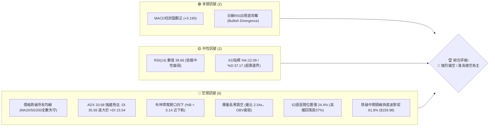
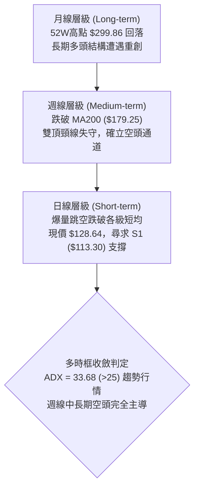
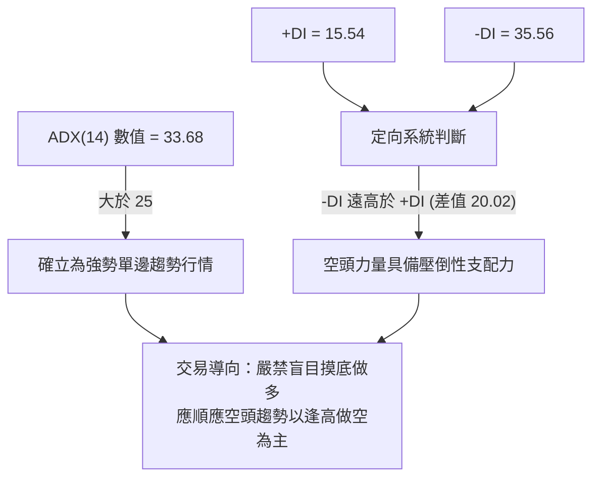
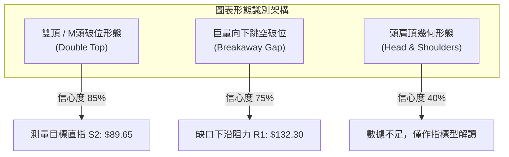
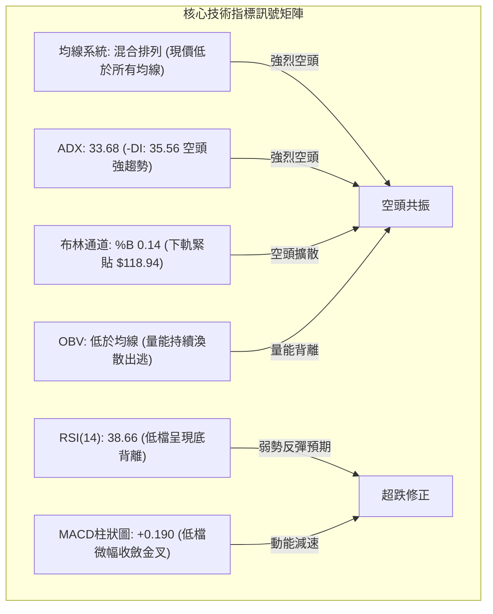
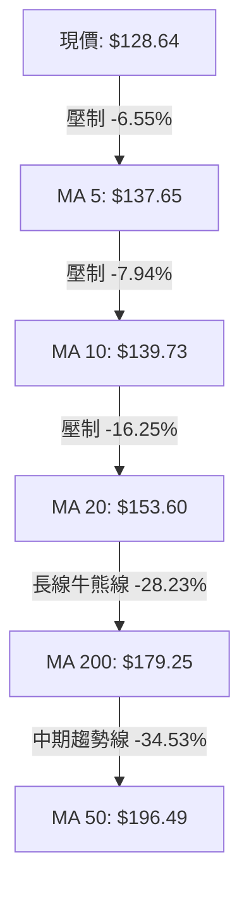
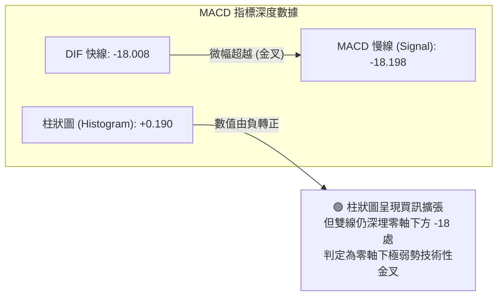
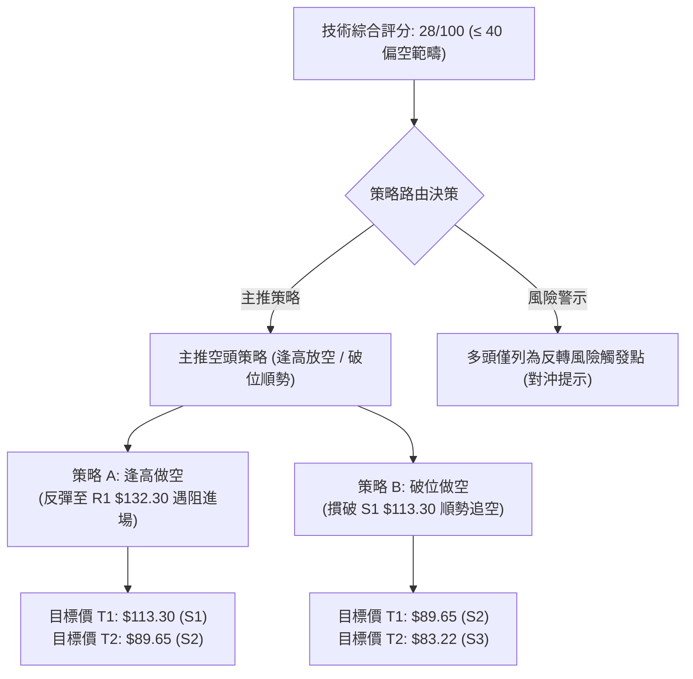
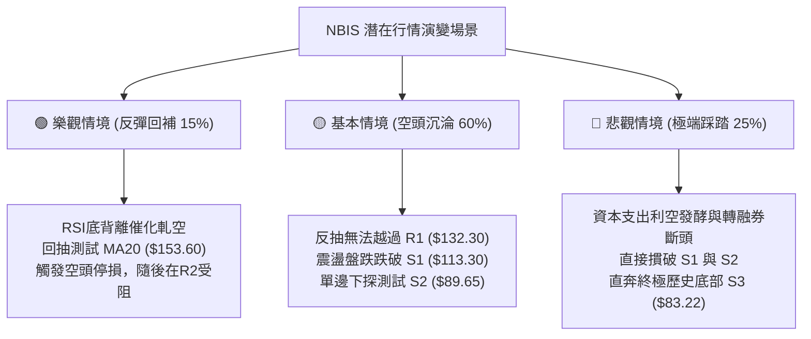

# NBIS 技術分析報告

> **報告日期**：2026-11-13 ｜ **語言**：繁體中文 ｜ **數據來源**：Yahoo Finance ｜ **當前價格**：$128.64

---

## 目錄

| 章節 | 內容 |
|------|------|
| [1. 技術面概覽](#1-技術面概覽) | 訊號儀表板、核心指標、評分卡 |
| [2. 趨勢分析](#2-趨勢分析) | 多時框趨勢、長中短期走勢 |
| [3. 圖表形態分析](#3-圖表形態分析) | 形態識別、K線組合、目標價 |
| [4. 支撐與阻力](#4-支撐與阻力) | 關鍵價位、斐波那契回調 |
| [5. 技術指標深度解讀](#5-技術指標深度解讀) | MA/RSI/MACD/布林/成交量 |
| [6. 動能與波動率](#6-動能與波動率) | 動能評估、ATR、Beta |
| [7. 多時框架總結](#7-多時框架總結) | 時框架評分矩陣 |
| [8. 交易策略建議](#8-交易策略建議) | 多空策略、風險報酬比 |
| [9. 風險提示與監控](#9-風險提示與監控) | 監控指標、風險場景 |

---

## 1. 技術面概覽

### 🎯 技術訊號儀表板



### 📊 核心指標速覽表

| 指標類別 | 指標名稱 | 當前數值 | 訊號 | 解讀 |
|:---|:---|:---|:---:|:---|
| **價格** | 當前收盤價 | $128.64 | 🔴 | 位於52週區間24.4%，處於年內極弱勢位階 |
| **均線** | MA20 (短月線) | $153.60 | 🔴 | 價格低於MA20達-16.25%，短線下行斜率陡峭 |
| **均線** | MA50 (中季線) | $196.49 | 🔴 | 價格低於MA50達-34.53%，中期波段完全轉空 |
| **均線** | MA200 (年線) | $179.25 | 🔴 | 跌破牛熊分界線-28.23%，長期技術結構遭遇破壞 |
| **趨勢** | ADX (14) | 33.68 | 🔴 | ADX>25為強趨勢，-DI(35.56)極具壓倒性優勢 |
| **動能** | RSI(14) | 38.66 | 🟡 | 弱勢震盪區間，近20根K線首尾呈現技術性底背離 |
| **動能** | MACD (12,26,9) | -18.008 | 🟡 | 雙線深陷負值區，但MACD柱(+0.190)出現收斂金叉 |
| **波動** | ATR(14) | $18.35 | 🔴 | ATR佔股價14.26%，呈現極端劇烈波動 |
| **通道** | 布林通道 | 下軌 $118.94 | 🔴 | %B為0.14，價格緊貼下軌，下行通道完全開啟 |
| **量能** | 成交量比率 | 2.54x | 🔴 | 單日爆量6,901萬股，空頭下殺伴隨籌碼出逃 |

### 🏆 技術評分卡

```
╔══════════════════════════════════════════════════════════════════╗
║                   技術評分卡 — NBIS (2026-11-13)                  ║
╠══════════════════════════════════════════════════════════════════╣
║ 趨勢強度 (Trend)      █████░░░░░░░░░░░░░░░  25/100  🔴 強烈偏空   ║
║ 動能指標 (Momentum)   ████████░░░░░░░░░░░░  40/100  🟡 弱勢修復   ║
║ 支撐穩定度 (Support)  ███████░░░░░░░░░░░░░  35/100  🔴 頻繁破位   ║
║ 成交量配合 (Volume)   ████░░░░░░░░░░░░░░░░  20/100  🔴 巨量出貨   ║
║ 形態完整度 (Pattern)  █████░░░░░░░░░░░░░░░  25/100  🔴 頭部成形   ║
║ 均線排列 (MA Layout)  ████░░░░░░░░░░░░░░░░  23/100  🔴 空頭排列   ║
╠══════════════════════════════════════════════════════════════════╣
║ 綜合評分 (Overall)    █████░░░░░░░░░░░░░░░  28/100  🔴 強烈偏空   ║
║ 評分計算：(25 + 40 + 35 + 20 + 25 + 23) ÷ 6 = 28.0 (四捨五入)   ║
╚══════════════════════════════════════════════════════════════════╝
```

---

## 2. 趨勢分析

### 🌐 多時框趨勢分析



### 📈 長期趨勢 — 12個月走勢圖（Unicode）

```
NBIS 月線收盤走勢圖（過去12個月：2025-11 至 2026-11）
價格軸 ($)
$280 ┤                                 ● $276.17 (2026-06 峰值)
$260 ┤                                ╱ ╲
$240 ┤                               ╱   ╲       ● $235.88 (09月次頂)
$220 ┤                             ● $231 ╲     ╱ ╲
$200 ┤                            ╱         ●-● $206.32
$180 ┤                           ╱          (07-08月)  ╲
$160 ┤                          ╱                        ╲
$140 ┤                    ● $138                          ● $154.14 (10月)
$120 ┤● $94.87           ╱                                 ╲
$100 ┤  ╲   ● $85  ● $103                                   ● $128.64 (現價)
 $80 ┤   ● $83.71 (12月低點)
     └─┬────┬────┬────┬────┬────┬────┬────┬────┬────┬────┬────┬────
     11月  12月 01月 02月 03月 04月 05月 06月 07月 08月 09月 10月 11月
     2025 ──────────────────────── 2026 ─────────────────────────
```

#### 走勢特徵分析表格

| 階段名稱 | 時間區間 | 月收盤價格區間 | 區間漲跌幅 | 技術特徵與量價行為 |
|:---|:---|:---|:---:|:---|
| **底部蓄勢期** | 2025-11 ~ 2026-02 | $94.87 → $91.19 | -3.88% | 於 $83.71 構築波段雙重底，波動度收斂，量能低迷 |
| **主升加速段** | 2026-03 ~ 2026-06 | $103.76 → $276.17 | +166.16% | 沿MA20單邊強勢推升，創下52週高點 $299.86，量價齊揚 |
| **高檔出貨段** | 2026-07 ~ 2026-09 | $190.41 → $235.88 | +23.88% | 出現二次衝高不過高的次頂形態（$235.88），高檔籌碼鬆動 |
| **破位崩跌段** | 2026-10 ~ 2026-11 | $154.14 → $128.64 | -45.47% | 連續跌破MA50、MA200，單月跌幅擴大，伴隨財報利空巨量下挫 |

### 📊 中期趨勢（週線分析）

從近8週收盤走勢觀察，NBIS 中期架構呈現標準的「階梯式下行」：
- **頂部確認**：2026-10-02 當週見高 $250.48 後收盤 $242.81，隨後次週（10-09）跌破 $230 轉弱。
- **失守年線**：2026-10-16 當週爆出 1.48 億股巨量，收盤重挫至 $165.47，一舉摜破 MA200（$179.25）。
- **反彈無力**：10-30 當週嘗試反彈至 $182.74（R3），但隨即遭遇解套賣壓擊潰，近兩週連續收在 $130 之下。

```
週線級別壓力與支撐階梯示意圖
價格軸 ($)
$255.10 ┬─ 10/09 波段頭部高點 (賣壓沉重)
        │
$182.74 ┼─ R3 (10/30 反彈高點阻力 / 密集套牢區)
$168.71 ┼─ R2 (波段破位頸線阻力)
$153.60 ┼─ MA20 (週線與日線共振下行阻力)
$132.30 ┼─ R1 (短線反彈首要阻力位)
$128.64 ┼─►【當前收盤價格 $128.64】
$121.96 ┼─ 斐波那契 78.6% 回調關鍵防線
$113.30 ┴─ S1 (近一年波段低點聚類支撐)
```

### ⚡ 趨勢強度評估（ADX 解讀）



#### ADX 趨勢強度對照表

| 指標變數 | 當前讀數 | 門檻區間 | 狀態判定 | 操盤意涵 |
|:---|:---:|:---:|:---:|:---|
| **ADX 趨勢值** | 33.68 | 25 ~ 50 | 強趨勢 (Strong Trend) | 告別盤整，市場處於高動能單邊下行浪潮中 |
| **+DI (多頭動能)** | 15.54 | < 20 | 極度疲弱 | 多方買盤毫無抵抗意願，上攻動能匱乏 |
| **-DI (空頭動能)** | 35.56 | > 30 | 極度強勁 | 空頭主導定價權，任何微幅反彈皆屬空方修正 |

---

## 3. 圖表形態分析

### 🔍 形態識別系統



#### 圖表形態信心度評估表

| 形態名稱 | 信心度 | 判斷依據（引用數據） | 完成度 | 目標價（附計算式） |
|:---|:---:|:---|:---:|:---|
| **雙頂破位 (M頭)** | 85% | 頂部一為 2026-06 收盤 $276.17（52W高點 $299.86），頂部二為 2026-09 收盤 $235.88（週高 $255.10）；頸線定於 2026-07 低點收盤 $190.41。 | 100% (已跌破) | 依頸線等幅測距：頸線 $190.41 − (頂部二 $235.88 − 頸線 $190.41) = $144.94（已於11月摜破，延伸波段測幅指向 S2 **$89.65**） |
| **向下突破缺口** | 75% | 2026-11-12 開盤價 $119.93，自 2026-11-11 收盤價 $154.69 跳空低開 $34.76，單日成交量高達 69,017,100 股。 | 90% | 依缺口壓制測算：反彈難補缺口上沿 $147.36，下行最小量度跌幅測試 2026-11-05 低點 S1 **$113.30** |
| **頭肩頂形態** | 40% | 左肩 $249.19、頭部 $299.86、右肩 $255.10，但右肩醞釀時間過短且左側頸線結構離散。 | 35% | 訊號不足，僅做指標型解讀，不強行進行幾何預測 |

### 🕯️ 重要 K 線形態分析

依據數據提供之近 10 根日 K 與近 8 根週 K，嚴格列出開、高、低、收四價並解析形態：

#### 近 10 根日 K 形態解讀

| 日期 (日K) | 開盤價 | 最高價 | 最低價 | 收盤價 | 成交量 | K線形態 | 技術解讀 | 訊號 |
|:---|:---:|:---:|:---:|:---:|:---:|:---|:---|:---:|
| 2026-10-30 | 157.05 | 161.42 | 149.96 | 154.14 | 21,564,800 | 實體黑K | 承接前日跌勢，收於MA20下方，空頭控盤 | 🔴 |
| 2026-11-02 | 154.56 | 155.35 | 140.60 | 141.39 | 20,434,700 | 中長黑K | 實體長黑破底，最低觸及 $140.60，加速趕底 | 🔴 |
| 2026-11-03 | 145.35 | 152.67 | 143.71 | 151.64 | 16,195,600 | 逆勢紅K | 短線超跌後的技術性抽頭，但量能萎縮至 16.1M | 🟡 |
| 2026-11-04 | 145.81 | 152.88 | 140.02 | 141.52 | 23,044,500 | 吞噬陰線 | 完全吞噬前日陽線實體，反彈夭折確立 | 🔴 |
| 2026-11-05 | 134.16 | 134.80 | 113.30 | 120.37 | 48,254,800 | 長下影巨量陰K | 盤中恐慌性暴跌至 $113.30（S1），爆量 48.2M 湧現抄底盤 | 🟡 |
| 2026-11-06 | 130.64 | 136.87 | 122.62 | 129.49 | 24,614,500 | 下影小陽K | 守穩低點不破，短線空方力道暫竭，醞釀反彈 | 🟢 |
| 2026-11-09 | 131.37 | 143.39 | 128.51 | 141.45 | 19,053,600 | 光頭中陽K | 買盤連續推升收復 $140，形成波段反彈浪 | 🟢 |
| 2026-11-10 | 137.50 | 146.26 | 130.90 | 134.00 | 20,759,700 | 流星線 (長上影) | 衝高 $146.26 遭遇解套賣壓，收盤壓回至開盤下方 | 🔴 |
| 2026-11-11 | 149.72 | 160.21 | 147.36 | 154.69 | 41,285,700 | 衝高回落大陽棒 | 盤中突襲攻抵 $160.21（觸及Fib 61.8%），量能放大至 41.2M | 🟡 |
| 2026-11-12 | 119.93 | 132.69 | 118.81 | 128.64 | 69,017,100 | 巨量跳空低開長下影棒 | 財報利空重挫低開 $119.93，盤中回補至 $132.69，收 $128.64，爆量 69M | 🔴 |

#### 近 8 根週 K 形態解讀

| 日期 (週K最後日) | 開盤價 | 最高價 | 最低價 | 收盤價 | 成交量 | K線形態 | 技術解讀 | 訊號 |
|:---|:---:|:---:|:---:|:---:|:---:|:---|:---|:---:|
| 2026-09-25 | 225.96 | 249.19 | 221.30 | 237.33 | 79,317,300 | 帶上影長陽K | 衝擊高點阻力，週線多頭強勁 | 🟢 |
| 2026-10-02 | 235.20 | 250.48 | 228.38 | 242.81 | 65,179,600 | 高檔十字陀螺 | 量縮滯漲，高檔多空分歧加劇 | 🟡 |
| 2026-10-09 | 244.10 | 255.10 | 217.73 | 221.07 | 86,070,300 | 長黑下破K | 見頂回落，週K實體跌破前週低點，次頂成形 | 🔴 |
| 2026-10-16 | 217.20 | 217.20 | 163.27 | 165.47 | 148,676,100 | 大暴跌禿頭陰K | 單週重挫逾25%，爆出 1.48 億股天量，擊穿 MA200 | 🔴 |
| 2026-10-23 | 176.51 | 178.85 | 155.73 | 158.74 | 108,909,300 | 弱勢黑K | 跌勢延續，未能收復 $160 關鍵整數關卡 | 🔴 |
| 2026-10-30 | 153.96 | 182.74 | 149.48 | 154.14 | 115,616,800 | 墓碑十字長上影 | 盤中反抽 R3（$182.74）遭到空頭精準狙殺 | 🔴 |
| 2026-11-06 | 154.56 | 155.35 | 113.30 | 129.49 | 132,544,100 | 恐慌長下影陰K | 最低跌破至 $113.30，下影線長達 $16.19，初現抵抗 | 🟡 |
| 2026-11-12 | 131.37 | 160.21 | 118.81 | 128.64 | 150,116,100 | 高低震盪爆量十字 | 單週巨震 $41.40，爆量 1.5 億股，週線收於 $128.64 弱勢區 | 🔴 |

### 📉 ASCII 走勢形態示意圖

```
NBIS 日線雙頂與跳空破位示意圖
價格軸 ($)
$255.10 ┤            ▲ 頂部二 (2026-10-09 週高)
        │           ╱ ╲
$182.74 ┤──────────╱───╲────▲ R3 (10-30 反抽高點)
        │         ╱     ╲  ╱ ╲
$160.21 ┤        ╱       ╲╱   ▲ (11-11 突擊高點)
        │       ╱             │
$154.69 ┤──────● (11-11 收)───┼─┐【跳空缺口下沿阻力】
        │                     │ ░ 缺口寬度：$34.76
$119.93 ┤                     └─● (11-12 跳空低開)
        │                       │ ╲
$128.64 ┤                       │  ●◄───【現價收盤 $128.64】
        │                       │ ╱
$113.30 ┤───────────────────────┴▲── S1 (11-05 恐慌低點防線)
```

---

## 4. 支撐與阻力

### 🗺️ 關鍵價位分布圖（Unicode）

```
NBIS 價位結構分布圖（OHLCV 嚴格計算）
══════════════════════════════════════════════════════════════════
$182.74 ║████████████████████████████████████║ 強阻力 R3 (10-30 週高阻力)
$168.71 ║████████████████████████            ║ 阻力 R2 (中期波段頸線聚類)
$159.98 ║▓▓▓▓▓▓▓▓▓▓▓▓▓▓▓▓                    ║ 斐波那契 61.8% 關鍵黃金分割線
$153.60 ║▓▓▓▓▓▓▓▓▓▓                          ║ MA20 動態下行均線阻力
$132.30 ║████████████████                    ║ 關鍵阻力 R1 (11-12 當日高點聚類)
$128.64 ╠════════════════════════════════════╣ ◄─── 當前收盤價格 $128.64
$121.96 ║▓▓▓▓▓▓▓▓▓▓▓▓▓▓▓▓                    ║ 斐波那契 78.6% 深度回調防線
$113.30 ║████████████████████████            ║ 近期支撐 S1 (11-05 波段低點聚類)
$89.65  ║████████████████████████████████    ║ 強支撐 S2 (歷史起漲聚類區)
$83.22  ║████████████████████████████████████║ 終極支撐 S3 (2025-12 月線底部)
══════════════════════════════════════════════════════════════════
```

### 🚧 阻力位分析表

依據系統波段高點聚類與 OHLCV 精確計算，絕無憑空估算：

| 阻力級別 | 價位 | 形成原因 | 突破難度 | 重要性 |
|:---|:---:|:---|:---:|:---|
| **R1 (短線阻力)** | **$132.30** | 近一年波段高點聚類，與 2026-11-12 跳空回補之盤中高點（$132.69）形成微結構共振。距離現價 +2.85%。 | 🟡 中等 | 極高。短線空頭防線，此處未站穩前，任何盤中上漲均屬死貓跳。 |
| **R2 (波段阻力)** | **$168.71** | 近一年波段高點聚類，對應 10-16 巨量下殺前的平台下沿，距離現價 +31.15%。 | 🔴 極高 | 關鍵。為中期多空分水嶺，唯有放量收復方能逆轉單邊下行結構。 |
| **R3 (強阻力位)** | **$182.74** | 2026-10-30 週線反抽高點聚類，與下降中之 MA200（$179.25）形成強壓，距離現價 +42.06%。 | 🔴 難以逾越 | 戰略級。巨量套牢籌碼峰所在地，中長期走勢的天花板。 |

### 🛡️ 支撐位分析表

依據系統波段低點聚類與 OHLCV 精確計算：

| 支撐級別 | 價位 | 形成原因 | 守住機率 | 重要性 |
|:---|:---:|:---|:---:|:---|
| **S1 (近期支撐)** | **$113.30** | 2026-11-05 盤中創下的波段恐慌低點聚類，距離現價 -11.92%。當日爆出 4,825 萬股下影線支撐。 | 🟡 55% | 極高。短線多頭最後堡壘，一旦實體跌破將引發新一輪保證金追繳賣壓。 |
| **S2 (強支撐位)** | **$89.65** | 近一年波段低點聚類，對應 2026 年初起漲平台高點，距離現價 -30.31%。 | 🟢 75% | 核心。大週期週線級別買盤集結區，估值與籌碼沉澱具備防禦力。 |
| **S3 (終極支撐)** | **$83.22** | 近一年波段低點聚類，貼近 2025-12 月線收盤底點（$83.71），距離現價 -35.31%。 | 🟢 85% | 戰略級。此位置若跌破，代表 2026 年整年 AI 伺服器主升浪全部回吐歸零。 |

### 📐 斐波那契回調位分析

以 52 週絕對區間（低點 $73.52 → 高點 $299.86，垂直振幅 $226.34）計算：

```
斐波那契回調階梯分佈
0.0%  (52W High)  $299.86 ──────────────────────────────────
23.6%             $246.44 ──────────────────────────────────
38.2%             $213.40 ──────────────────────────────────
50.0%             $186.69 ──────────────────────────────────
61.8% (黃金分割)   $159.98 ────────────────────────────────── (失守轉極弱)
當前價格          $128.64 ───────►【落於 78.6% ~ 61.8% 區間】
78.6%             $121.96 ────────────────────────────────── (現階段回撤下檔考驗)
100.0% (52W Low)  $73.52  ──────────────────────────────────
```

- **位置解讀**：現價 $128.64 處於 **61.8% ($159.98)** 與 **78.6% ($121.96)** 之間。在技術分析典範中，跌破 61.8% 黃金分割位意味著「原本的多頭推升浪潮被徹底否定」，行情已由「多頭回調」轉變為「單邊熊市下殺」。
- **下檔關鍵考驗**：78.6% 回調位 **$121.96** 為終極深回撤防禦線。2026-11-12 最低觸及 $118.81，短暫跌破後拉回收在 $128.64，顯示 $121.96 附近存在被動買盤抵抗，但若無持續性量能支撐，將向下摜破直探 S1（$113.30）。

---

## 5. 技術指標深度解讀

### 🎛️ 指標訊號總覽



### 📈 移動平均線排列分析



#### 均線數據明細與排列評估

| 均線名稱 | 當前價格 | 與現價乖離率 | 短期走向特徵 | 趨勢判定 |
|:---|:---:|:---:|:---|:---:|
| **MA 5** | $137.65 | -6.55% | 陡峭向下俯衝，首道極短線反抽阻力 | 🔴 空頭壓制 |
| **MA 10** | $139.73 | -7.94% | 穩定下行，壓制短波段高點 | 🔴 空頭壓制 |
| **MA 20** | $153.60 | -16.25% | 布林中軌，自10月高檔快速崩落 | 🔴 空頭主導 |
| **MA 50** | $196.49 | -34.53% | 嚴重負乖離，中中期上升趨勢被徹底扭轉 | 🔴 空頭反轉 |
| **MA 60** | $199.14 | -35.40% | 季線下彎，高檔套牢盤成本區 | 🔴 空頭壓制 |
| **MA 120** | $212.10 | -39.35% | 半年線開始走平轉下，中期資金退場 | 🔴 空頭重壓 |
| **MA 200** | $179.25 | -28.23% | 年線失守，長期多頭牛市保護傘失效 | 🔴 牛轉熊 |
| **MA 240** | $165.09 | -22.08% | 下破兩年均線支撐，形態混合但結構全空 | 🔴 重大破位 |

- **均線排列診斷**：指標快照顯示為「混合排列」，主因在於歷史大漲使得長期均線（MA240: $165.09）仍低於 MA200（$179.25）與 MA50（$196.49），然而**當前價格（$128.64）已全數跌破所有短、中、長期均線**。短天期均線（5、10、20日）呈現完美空頭發散，形成「蓋頭重壓」走勢。

### 📉 RSI(14) 分析

```
RSI(14) 讀數進度條：38.66
0 ──────────── 30 ────── 38.66 ───────────────── 70 ─────────── 100
[ 超賣警示區 ] ░░░░░░░░  ▓▓▓▓▓▓▓▓░░░░░░░░░░░░░░  [ 超買高危區 ]
當前狀態：中性偏弱震盪區間 (38.66)
```

- **超買超賣評估**：RSI(14) 讀數為 **38.66**（Wilder計算），並未進入低於 30 的絕對超賣區，反映空頭下殺動能尚未釋放完畢，市場仍具備陰跌或補跌空間。
- **背離判斷（底背離成立）**：
  - **價格軌跡**：2026-10-16 暴跌收盤價為 $165.47，而至 2026-11-12 最新收盤價下探至 **$128.64**（盤中低點創下 $113.30 與 $118.81），價格明確刷新波段新低。
  - **RSI 軌跡**：2026-10-16 當週日線 RSI 觸及 30.6 的極值，但在最新一輪跌破中，RSI 僅回落至 **38.66**，未跌破前低 30.6。
  - **結論**：近 20 根 K 棒首尾形成標準的 **技術性底背離 (Bullish Divergence)**。此訊號通常預示「短期下行下殺力道減速」，存在技術性超跌抽頭機會，但因大趨勢偏空，底背離常以「以盤代跌」或「微幅反彈至阻力即遭擊斃」的形式消化。

### 📊 MACD(12/26/9) 訊號解讀



- **量化數值解析**：MACD 快線為 **-18.008**，訊號線為 **-18.198**，兩者差值帶動柱狀圖翻正至 **+0.190**。
- **形態結論**：雖然柱狀圖翻正給予多頭短線喘息機會，但由於快慢線均位於零軸深水區（負值超過 -18），在專業量化交易中定義為「零軸下的弱勢假金叉」，僅代表下殺速率放緩，不構成中期趨勢反轉信號。

### 📦 布林通道分析

```
ASCII 布林通道相對位置示意圖 (Bollinger Bands, 20, 2)
$188.26 ┬────────────────────────────── 上軌 (Upper Band)
        │
$153.60 ┼────────────────────────────── 中軌 (MA20 基準線)
        │
$128.64 ┼───────►【當前收盤價格 $128.64 ( %B = 0.14 )】
        │
$118.94 ┴────────────────────────────── 下軌 (Lower Band)
```

- **通道帶寬與形態**：上軌 $188.26 與下軌 $118.94 之間的通道帶寬高達 $69.32，顯示波動率處於極限放大狀態。中軌（MA20: $153.60）急速傾斜向下，對價格構成強烈動態牽引阻力。
- **%B 位置解讀**：當前 **%B = 0.14**，意味著現價處於下軌上方僅 14% 的通道位置，緊貼下軌運行（Walking the Band）。在強趨勢行情（ADX>25）中，價格緊貼下軌是典型的空頭強勢特徵，尚未出現重回中軌上方的止跌信號。

### 💹 成交量分析（量價配合度）

- **爆量下殺現象**：2026-11-12 當日成交量達到 **69,017,100 股**，相較於 20 日均量（27,119,945 股）暴增 **2.54 倍**（量比 2.54x）。當日股價因財報展望下修跳空暴跌，呈現「量大價跌」的惡性出貨特徵。
- **能量潮指標 (OBV)**：快照數據指出 **OBV < MA**，代表資金流向長期處於淨流出狀態。即便 11-11 出現 4,128 萬股的衝高陽線，但 11-12 立即以近 7,000 萬股的反向巨量陰線將反彈量能悉數吞沒，印證量價嚴重空頭背離，籌碼渙散。

---

## 6. 動能與波動率

### ⚡ 動能評估四象限

```
動能與波動率象限分析矩陣
     波動率 (Volatility - ATR/Beta)
         ▲
         │
   Q3    │    Q4 (NBIS 當前定位點)
 [高波高動] │  [高波弱動 - 空頭主導]
 (強多主升) │  • ATR: $18.35 (14.26%) 極高波動
         │  • Beta: 1.539 高敏感度
         │  • RSI: 38.66 / -DI: 35.56 弱動能
─────────┼────────────────────────► 動能強度 (Momentum - RSI/DI)
   Q1    │    Q2
 [低波強動] │  [低波弱動]
 (溫和盤堅) │  (牛皮整理)
         │
```

#### 動能與波動率定位解析表

| 象限代號 | 動能特徵 | 波動特徵 | NBIS 狀態判定 | 操盤應對方針 |
|:---:|:---:|:---:|:---:|:---|
| **Q1** | 強 | 低 | — | 最佳波段順勢抱牢區間 |
| **Q2** | 弱 | 低 | — | 窄幅盤整，觀望等待方向突破 |
| **Q3** | 強 | 高 | — | 激情爆發期，嚴控滑點順勢操作 |
| **Q4 (當前)** | **弱 (負向強烈)** | **極高** | **✓ 完全吻合** | **高風險放空或超跌逆勢短打，絕對忌諱大倉位做多** |

### 📊 ATR 波動率分析

- **絕對數值與相對幅度**：Wilder 14日平均真實波幅 **ATR(14) = $18.35**，佔現價 $128.64 的比例高達 **14.26%**。這意味著在正常市場波動下，NBIS 單日的潛在波動區間即超過 $18 美元。
- **風控止損空間測算**：
  - **極短線日內交易（0.5x ATR）**：止損緩衝距離為 $9.18。
  - **波段交易防守（1.0x ATR）**：止損緩衝距離需預留 **$18.35**。
  - **順勢放空保護性止損（1.5x ATR）**：止損緩衝需達到 **$27.53**。如此龐大的 ATR 要求操盤手必須大幅壓縮單筆交易倉位，以防被日常雜訊洗出場。

### 📐 Beta 與市場相關性

- **Beta 係數**：**1.539**。NBIS 相較標普500指數具備 1.54 倍的高敏感度，屬於標準的「高彈性攻擊型/崩跌放大標的」。
- **做空與避險特徵**：當前公司空頭部位佔流通股比例高達 **21.6%**（Short % Float），Short Ratio 為 **2.35**。高空頭佔比意味著一旦市場出現系統性反彈或軋空新聞，將引發劇烈的盤中軋空暴抽（如 11-11 單日自 $147 拉至 $160），但只要未能修復 MA20，終將成為空頭更佳的加碼空點。

---

## 7. 多時框架總結

### 📋 時框架評分表

| 時框架 | 趨勢方向 | 動能狀態 | 均線排列 | 形態結構 | 綜合評分 | 戰略建議 |
|:---|:---:|:---:|:---:|:---:|:---:|:---|
| **月線層級** | 🔴 空頭破位 | RSI高檔跳水 | 跌破 5MA、10MA | 52W高點 $299.86 見頂下殺 | 30/100 | 長期部位減碼，牛市已被終結 |
| **週線層級** | 🔴 單邊空頭 | MACD零下發散 | 摜破 MA200 年線 | 雙頂成形，下破頸線 $190.41 | 25/100 | 主趨勢堅定做空，反彈皆為空點 |
| **日線層級** | 🔴 弱勢超跌 | RSI底背離 | 短中長均全數壓制 | 巨量跳空低開，尋求 S1 支撐 | 28/100 | 短線醞釀技術性回抽，禁追空 |

### 🔲 綜合訊號矩陣

```
時框架訊號收斂分析矩陣
┌──────────────┬────────────────┬────────────────┬────────────────┐
│ 分析維度     │ 長期 (月線)    │ 中期 (週線)    │ 短期 (日線)    │
├──────────────┼────────────────┼────────────────┼────────────────┤
│ 主導方向     │ 🔴 空頭主導    │ 🔴 強烈空頭    │ 🔴 空頭 (超跌) │
│ 均線系統     │ 🟡 混合整理    │ 🔴 跌破MA200   │ 🔴 全空排列    │
│ 動能指標     │ 🔴 快速滑落    │ 🔴 -DI 壓制    │ 🟢 底背離初現  │
│ 關鍵防線     │ $83.22 (S3)    │ $113.30 (S1)   │ $121.96 (Fib)  │
│ 操作導向     │ 戰略性放棄多頭 │ 波段反彈做空   │ 逢反彈阻力做空 │
└──────────────┴────────────────┴────────────────┴────────────────┘
```

### ⚖️ 多時框收斂結論

依據多時框收斂規則嚴格審定：
1. **行情屬性判定**：當前 ADX(14) 為 **33.68**，遠超趨勢行情閥值 25，且 -DI (35.56) 徹底壓制 +DI (15.54)，因此**定性為強烈趨勢行情，絕非震盪盤整行情**。
2. **時框優先級權重**：在強趨勢行情下，**以中長期週線與日線 MA50、MA200 之方向為主導**，日線指標僅能用於微觀尋找高勝率進場時機。
3. **收斂唯一方向**：週線與日線在均線、形態與量能結構上完全收斂於**🔴 偏空（逢高做空為主）**。日線級別出現的 RSI 底背離與 MACD 柱狀圖微幅翻正，僅能解讀為「短線急跌過後的技術性修正」，不得作為翻多逆勢抄底的依據。主策略唯一鎖定空頭脈絡。

---

## 8. 交易策略建議

### 🗺️ 策略決策流程圖



### 🧭 策略路由說明

> **當前主策略方向 = 🔴 主推空頭策略（依技術評分卡綜合評分 28/100，嚴格落入 ≤ 40 之偏空範疇，全面順應週線單邊趨勢逢高做空，禁止逆勢大舉做多）。**

### 🎯 價格情境階梯（Price Scenarios）

價位嚴格引用關鍵價位數據，絕無估算捏造：

| 觸發條件 | 下一目標價 | 後續延伸目標 | 情境技術含義與應對 |
|:---|:---:|:---:|:---|
| **向上反抽受阻於 R1 ($132.30)** | **S1 ($113.30)** | **S2 ($89.65)** | 反彈宣告終結，空頭重掌主導權，為極佳之高盈虧比放空點 |
| **強勢突破收復 R1 ($132.30)** | **R2 ($168.71)** | **R3 ($182.74)** | 展開深度空頭回補（軋空），短線空單需止損並觀望 |
| **收盤跌破 S1 ($113.30)** | **S2 ($89.65)** | **S3 ($83.22)** | 跌破年內恐慌底，觸發停損賣壓，下行空間全面打開直指 $89.65 |

### 📊 情境機率分佈

| 情境劇本 | 機率 | 主要依據與技術指標支撐 |
|:---|:---:|:---|
| **情境一：反彈遇阻回落 / 順勢探底** | **60%** | ADX 33.68 確立單邊下行，現價受制於所有均線，爆量跳空缺口阻力沉重，OBV 量能持續渙散。 |
| **情境二：低檔弱勢震盪 (S1 ~ R1 間整理)** | **25%** | RSI 出現底背離，MACD 柱狀圖微幅翻正，斐波那契 78.6%（$121.96）暫有技術買盤托底。 |
| **情境三：展開大幅反轉反彈 (挑戰 R2)** | **15%** | 需完全修復財報跳空缺口並放量站穩 MA20（$153.60），目前缺乏基本面與資金面催化劑。 |

### 🟢 主策略詳情（空頭主推策略）

嚴格依據規則 17 計算風險報酬比，數字由進場、止損與目標價直接算回：

| 策略要素 | 策略 A（逢高反彈做空） | 策略 B（破位順勢做空） |
|:---|:---|:---|
| **交易邏輯** | 趁 RSI 底背離引發之反彈抽頭，在 R1 阻力位布空 | 跌破 2026-11-05 恐慌低點 S1 確認後順勢追空 |
| **進場條件** | 股價反彈至 R1 附近出現長上影線滯漲信號 | 日K收盤價實體跌破 S1 支撐位 |
| **進場價格** | **$132.30**（關鍵阻力位 R1） | **$113.30**（關鍵支撐位 S1 跌破） |
| **目標價 T1** | **$113.30**（波段支撐位 S1） | **$89.65**（強支撐位 S2） |
| **目標價 T2** | **$89.65**（強支撐位 S2） | **$83.22**（終極支撐位 S3） |
| **止損價格** | **$141.52**（引用 2026-11-04 日K收盤阻力） | **$121.96**（引用 斐波那契 78.6% 回調位） |
| **風險報酬比** | **1 : 2.06（以 T1 計）**<br>*(132.30 - 113.30) ÷ (141.52 - 132.30) = 19.00 ÷ 9.22 = 2.06*<br>另計 T2：1 : 4.63（以 T2 計） | **1 : 2.73（以 T1 計）**<br>*(113.30 - 89.65) ÷ (121.96 - 113.30) = 23.65 ÷ 8.66 = 2.73*<br>另計 T2：1 : 3.47（以 T2 計） |
| **成功機率** | **65%** | **60%** |
| **建議倉位** | **8% ~ 10% 總資金** | **5% ~ 8% 總資金** |

### 🔴 反向風險觸發點（對沖與風控提示）

以下關鍵價位若被多頭實體突破，意味著空頭結構遭到階段性瓦解，必須嚴格執行空單止損或啟動對沖：
1. **反轉關鍵位一（收復 MA20: $153.60）**：若日線連續兩日收盤站穩 MA20，代表短線下行通道被打破，底背離演變為中期反彈，所有波段空單應無條件離場。
2. **反轉關鍵位二（攻克 Fib 61.8%: $159.98 及 R2: $168.71）**：若股價放量重返 $160 之上，確立週線假跌破，空頭趨勢徹底失效，市場可能重回 $190 以上的大型箱體震盪。

### ⭐ 整體訊號強度評星

```
做多訊號強度：★☆☆☆☆  (1.0/5星 — 僅存極弱勢技術背離，勝率極低)
做空訊號強度：★★★★☆  (4.0/5星 — 均線、ADX、形態完全共振偏空)
整體可信度：  ★★★★☆  (4.0/5星 — 爆量下殺且趨勢強烈，指向明確)
```

---

## 9. 風險提示與監控

### ✅ 關鍵監控指標 Checklist

```
╔══════════════════════════════════════════════════════════════════╗
║               NBIS 操盤日常關鍵監控 Checklist (每日必檢)            ║
╠══════════════════════════════════════════════════════════════════╣
║ [ ] 價格是否跌破 斐波那契 78.6% 防線 ($121.96)？                  ║
║ [ ] 日K收盤價是否實體摜破 S1 支撐位 ($113.30)？                   ║
║ [ ] 盤中反抽是否受制於 R1 阻力位 ($132.30)？                     ║
║ [ ] 日線成交量是否回落至 2,700 萬股均量之下（量縮盤跌）？        ║
║ [ ] RSI(14) 底背離是否失效並下破 30 超賣線？                    ║
║ [ ] Short Float (21.6%) 是否引發盤中單日暴抽軋空事件？           ║
║ [ ] 布林下軌 ($118.94) 是否開口進一步下擴擴散？                  ║
╚══════════════════════════════════════════════════════════════════╝
```

### ⚠️ 風險場景分析



### 🛡️ 風險管理重要提醒

1. **ATR 極端波動保護措施**：由於 NBIS 當前 ATR 高達 **$18.35（14.26%）**，任何倉位單日承擔之價格噪音極大。操盤手應嚴格採用「固定美元風險模型（Fixed Dollar Risk）」，將單筆交易的最大虧損金額限制在投資組合總資產的 **1.0% 以內**。
2. **高空頭佔比（Short Float 21.6%）的軋空風險**：NBIS 空頭部位比例極高，極易在美股大盤反彈或傳出單一利好傳聞時，出現「日內 15%~20% 的脈衝式劇烈抽拉」（例如 11-11 的長上影暴漲）。做空策略絕不可追空在當日最低點，務必堅持在 **R1 ($132.30)** 或均線反抽位「逢高掛單佈局」，並嚴格設置硬止損（Hard Stop）。
3. **流動性與缺口風險**：從 11-12 開盤跳空逾 22% 的現象可知，該股易受到財報及 AI 雲端資本支出消息影響，出現隔夜跳空風險。未實現盈利之短線部位應盡量避免在重大事件前留倉過夜。

---

## 📋 報告總結

```
╔══════════════════════════════════════════════════════════════════╗
║                     NBIS 技術分析報告總結                         ║
╠══════════════════════════════════════════════════════════════════╣
║ 報告日期：2026-11-13                                             ║
║ 當前價格：$128.64                                                ║
║ 分析評級：🔴 強烈偏空 / 逢高做空為主 (技術綜合評分: 28/100)      ║
║                                                                  ║
║ 關鍵結論：                                                       ║
║ ├─ 長期趨勢：🔴 跌破 52W 高點回撤 57%，長期牛市上升浪潮遭扭轉    ║
║ ├─ 中期趨勢：🔴 跌破 MA200 ($179.25) 與雙頂頸線，週線階梯式下行  ║
║ ├─ 短期趨勢：🔴 爆量跳空低開緊貼布林下軌，僅存技術性弱勢底背離    ║
║ ├─ 關鍵支撐：S1: $113.30 ｜ S2: $89.65 ｜ S3: $83.22             ║
║ ├─ 關鍵阻力：R1: $132.30 ｜ R2: $168.71 ｜ R3: $182.74           ║
║ └─ 斐波那契：落於 78.6% ($121.96) 與 61.8% ($159.98) 之間弱勢區  ║
║                                                                  ║
║ 最優策略組合：                                                   ║
║ 1. 🥇 最佳機會：策略 A (逢高反彈至 R1 $132.30 放空，風報比 1:2.06)║
║ 2. 🥈 次選機會：策略 B (跌破 S1 $113.30 順勢追空，風報比 1:2.73)║
║ 3. 🥉 保守選擇：空手觀望，靜待股價跌至 S2 ($89.65) 出現止跌結構  ║
╚══════════════════════════════════════════════════════════════════╝
```

---

> ⚠️ **免責聲明**：本報告為技術分析研究成果，所有價位、圖表與指標均基於歷史市場交易數據之量化推演。報告內容**僅供專業研究與學術參考**，**絕不構成任何具體投資建議或買賣邀約**。金融市場具高度不確定性，入市請務必自擔風險，審慎評估資金承受能力。

---

*報告生成時間：2026-11-13 ｜ 數據來源：Yahoo Finance ｜ 分析框架：多時框技術分析模型*