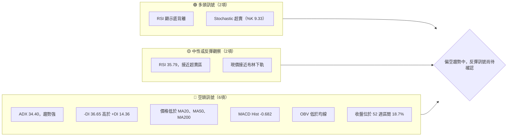
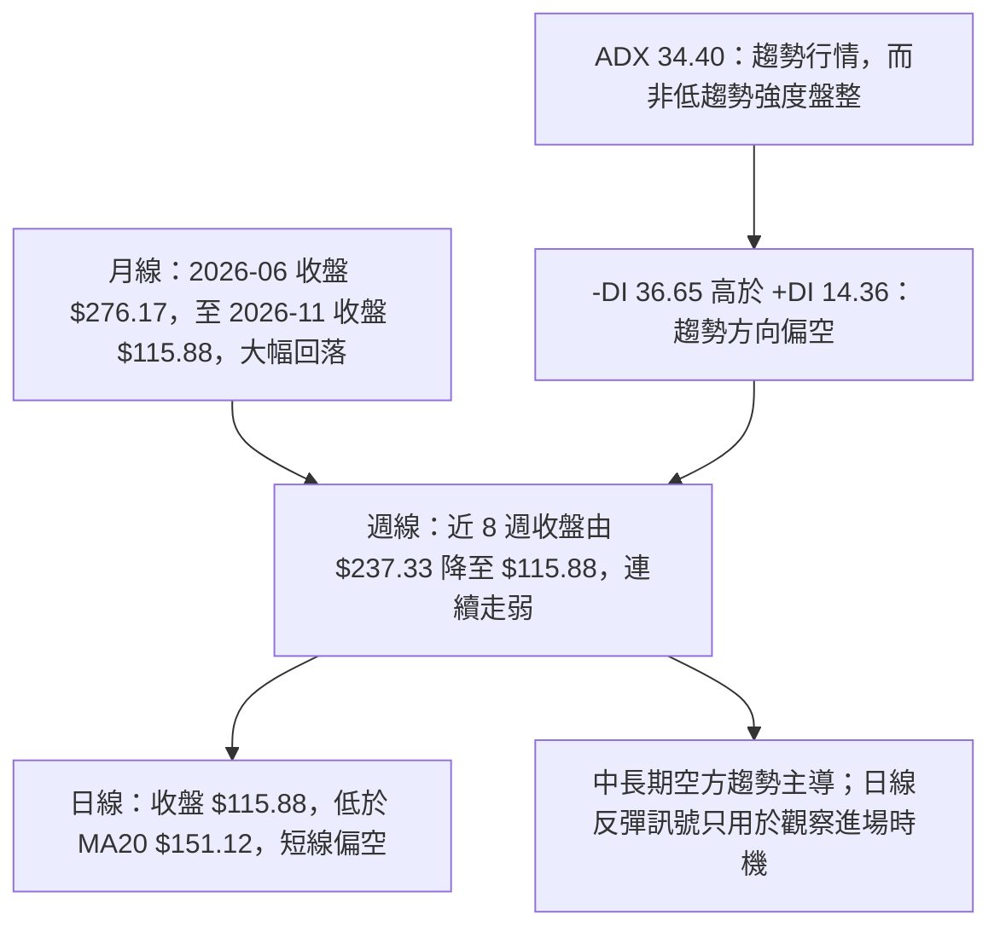
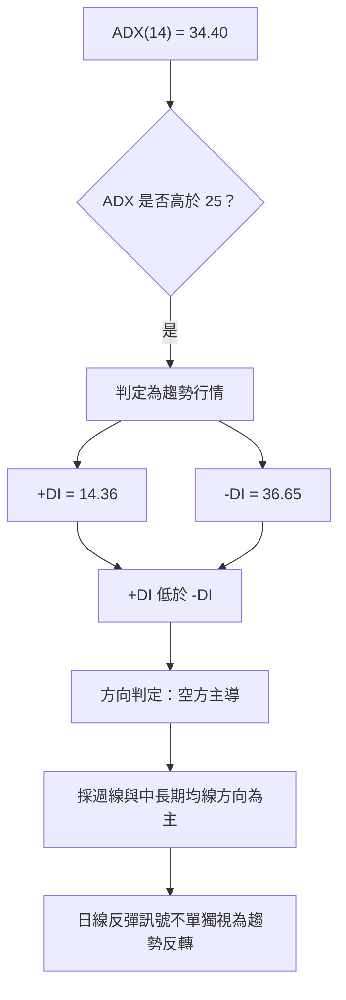
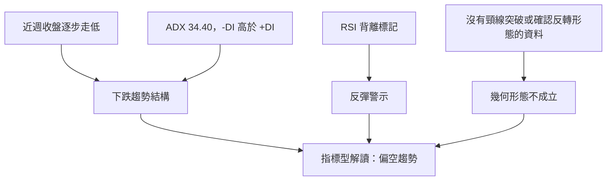
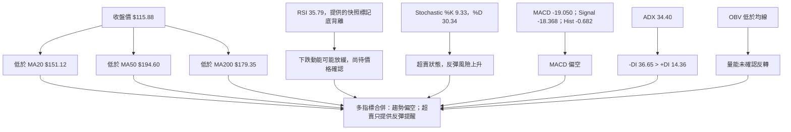
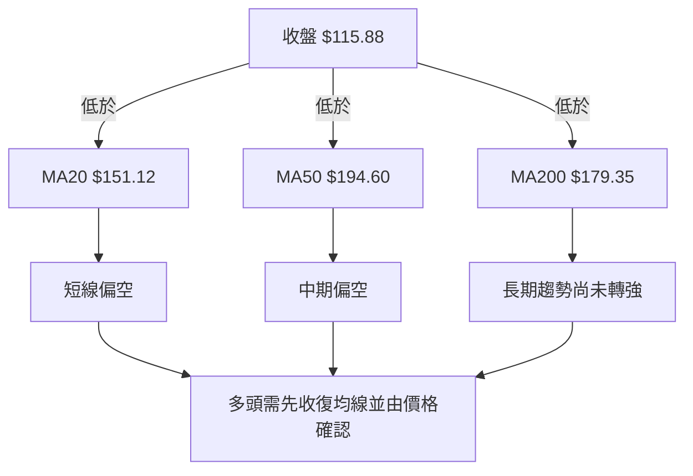
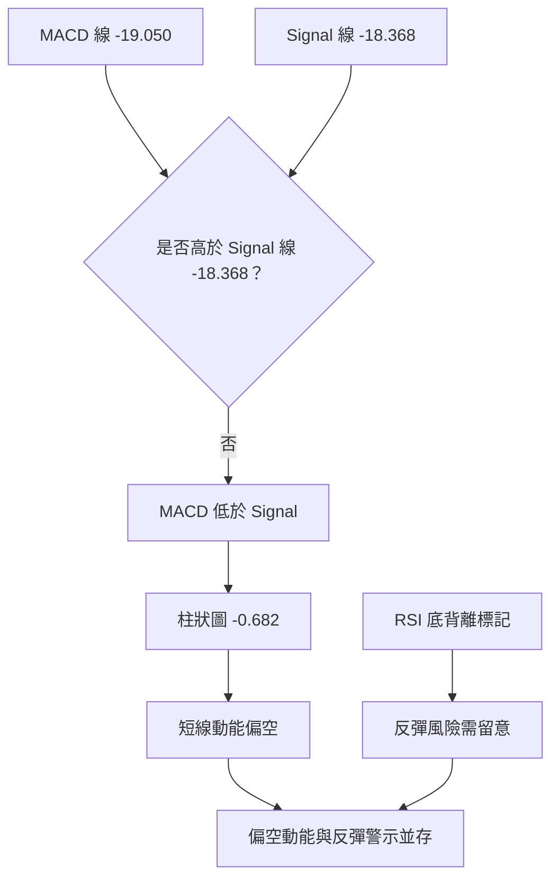
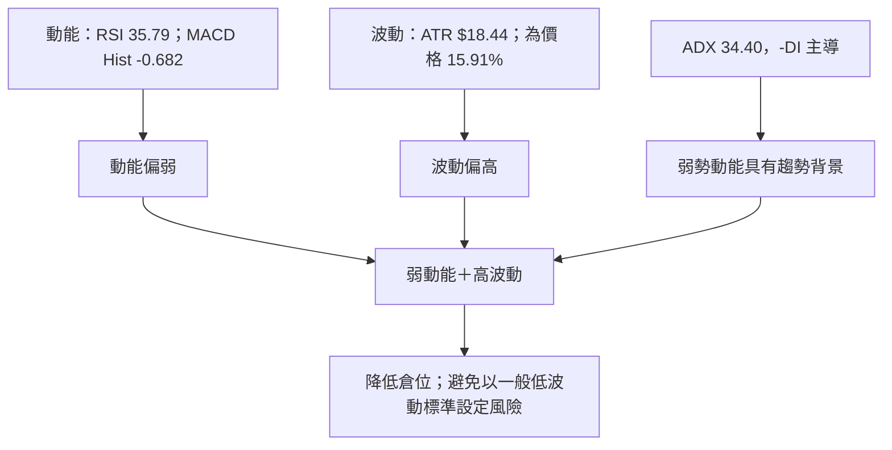
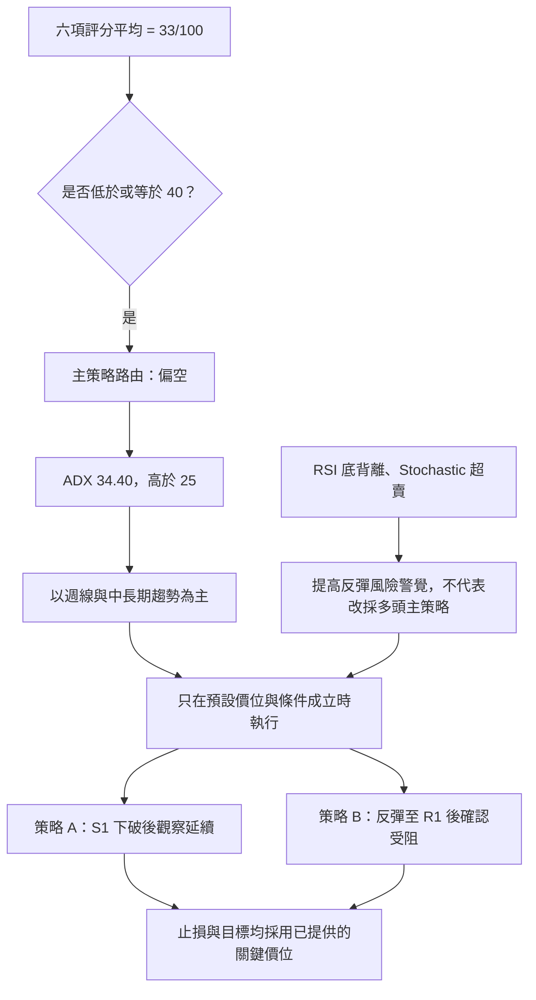
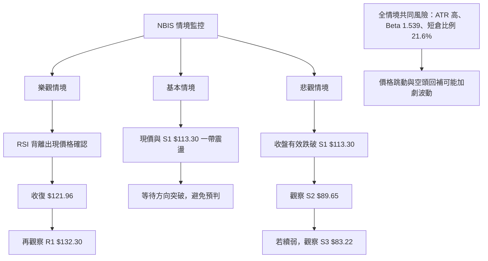

# NBIS 技術分析報告

> **報告日期**：2026-11-14 ｜ **語言**：繁體中文 ｜ **數據來源**：題示 Yahoo Finance 技術數據 ｜ **當前價格**：**$115.88**（2026-11-13 收盤）

---

## 目錄

| 章節 | 內容 |
|------|------|
| [1. 技術面概覽](#1-技術面概覽) | 訊號儀表板、核心指標、評分卡 |
| [2. 趨勢分析](#2-趨勢分析) | 多時框趨勢、長中短期走勢 |
| [3. 圖表形態分析](#3-圖表形態分析) | 形態識別、K 線組合、目標價 |
| [4. 支撐與阻力](#4-支撐與阻力) | 關鍵價位、斐波那契回調 |
| [5. 技術指標深度解讀](#5-技術指標深度解讀) | MA／RSI／MACD／布林／成交量 |
| [6. 動能與波動率](#6-動能與波動率) | 動能評估、ATR、Beta |
| [7. 多時框架總結](#7-多時框架總結) | 時框架評分矩陣 |
| [8. 交易策略建議](#8-交易策略建議) | 主策略、價格情境、風險報酬比 |
| [9. 風險提示與監控](#9-風險提示與監控) | 監控指標、風險場景 |

---

## 1. 技術面概覽

### 🎯 技術訊號儀表板

現價位於 52 週區間的 **18.7%** 位置，低於 MA20、MA50、MA200，且 ADX 為 34.40、-DI 明顯高於 +DI。這組合顯示目前不是單純的低波幅整理，而是**空方主導的強趨勢環境**。RSI 底背離與 Stochastic 超賣提供反彈可能性，但尚未抵銷均線、MACD、DI 與 OBV 的偏空訊號。



**儀表板解讀：**分類依提供的指標訊號作方向性整理，不是獨立勝率統計。空方訊號的趨勢性與均線確認度較高；多方訊號集中於超賣與背離，較適合解讀為「下跌趨勢中的反彈警示」，而不是趨勢反轉已成立。

### 📊 核心指標速覽表

| 指標類別 | 指標名稱 | 當前數值 | 訊號 | 解讀 |
|----------|----------|----------:|:---:|------|
| 價格 | 當前收盤價 | **$115.88** | 🔴 | 僅使用數據提供的 2026-11-13 收盤價 |
| 區間位置 | 52 週區間位置 | **18.7%** | 🔴 | 接近區間低位；低位本身不等同反轉 |
| 均線 | MA20 | $151.12 | 🔴 | 收盤低於 MA20，短線仍弱 |
| 均線 | MA50 | $194.60 | 🔴 | 收盤低於 MA50，中期趨勢偏空 |
| 均線 | MA200 | $179.35 | 🔴 | 收盤低於 MA200，長期方向尚未轉強 |
| 動能 | RSI(14) | 35.79 | 🟡 | 中性偏弱，提供的指標標記為底背離 |
| 動能 | MACD | -19.050 | 🔴 | MACD 線低於零軸 |
| 動能 | MACD Histogram | -0.682 | 🔴 | 柱狀圖仍為負值 |
| 趨勢 | ADX(14) | 34.40 | 🔴 | 大於 25，趨勢強；方向由 -DI 判定為偏空 |
| 波動 | ATR(14) | $18.44 | 🔴 | 相當於收盤價 15.91%，日波動偏高 |
| 波動 | 布林 %B | 0.04 | 🟡 | 靠近下軌，但沒有單獨構成買入確認 |
| 量能 | 最新成交量／20 日均量 | 1.75 倍 | 🔴 | 放量出現在下跌環境；OBV 仍低於均線 |

### 🏆 技術評分卡

評分採 0–100 分制，六項子評分的算術平均為 **32.5 分**，四捨五入為 **33 分**。由於分數低於 40，依本報告策略規則，主策略路由為偏空。

```text
技術評分卡 — NBIS（2026-11-14）
╔══════════════════════════════════════════════════════════╗
║ 趨勢強度      ██████░░░░░░░░░░░░░░  30/100  🔴          ║
║ 動能指標      ███████░░░░░░░░░░░░░  35/100  🔴          ║
║ 支撐穩定度    █████████░░░░░░░░░░░  45/100  🟡          ║
║ 成交量配合    █████░░░░░░░░░░░░░░░  25/100  🔴          ║
║ 形態完整度    ███████░░░░░░░░░░░░░  35/100  🔴          ║
║ 均線排列      █████░░░░░░░░░░░░░░░  25/100  🔴          ║
╠══════════════════════════════════════════════════════════╣
║ 六項平均      ███████░░░░░░░░░░░░░  33/100  🔴 偏空    ║
╚══════════════════════════════════════════════════════════╝
```

| 評分項目 | 分數 | 評分理由 |
|----------|---:|----------|
| 趨勢強度 | 30/100 | ADX 34.40 代表趨勢明確，但 -DI 大幅高於 +DI，方向為空方 |
| 動能指標 | 35/100 | RSI 底背離與 Stochastic 超賣改善反彈可能性；MACD 仍在負值區且柱狀圖為負 |
| 支撐穩定度 | 45/100 | 現價高於 S1 $113.30，但支撐尚未經足夠後續價格確認；週線低點已下探 $109.00，該數值不是另外指定的支撐位 |
| 成交量配合 | 25/100 | 最新日成交量 48,541,000，高於 20 日均量，但 OBV 低於均線，量價尚未確認反轉 |
| 形態完整度 | 35/100 | 下跌趨勢與超賣訊號明確，但目前資料不足以確認雙底、頭肩等完整反轉形態 |
| 均線排列 | 25/100 | 價格在 MA20、MA50、MA200 下方，均線排列欄標示為混合，沒有確認多頭排列 |

---

## 2. 趨勢分析

### 🌐 多時框趨勢分析



**時框收斂原則：**ADX 高於 25，因此以中長期方向為主，日線只用來尋找可能的進場時機。月線、週線與日線現況均未提供趨勢反轉確認；短線 RSI 背離不改變偏空主結論。

### 📈 長期趨勢 — 12 個月月收盤走勢圖

以下月份取 **2025-12 至 2026-11**，採題示月收盤價。圖形僅用於呈現月收盤價的相對高低，不代表月內最高或最低價。

```text
NBIS 月線收盤走勢圖（2025-12 至 2026-11）
價格方向（非等距刻度）
$276.17 ┤                                  ● 2026-06（本段月收盤高點）
$250.00 ┤                                ╱   ╲
$231.09 ┤                              ●       ╲
$206.32 ┤                            ╱           ╲        ● 2026-08
$190.41 ┤                           ╱             ╲      ╱  ╲
$154.14 ┤                          ╱               ╲    ╱    ● 2026-10
$115.88 ┤                    ●────╱                 ╲──╱       ● 2026-11
$ 83.71 ┤●────●────●────●
        └─────────────────────────────────────────────────────────
         Dec25 Jan26 Feb26 Mar26 Apr26 May26 Jun26 Jul26 Aug26 Sep26 Oct26 Nov26
```

| 月份 | 收盤價 | 月對月變化 | 階段特徵 |
|------|------:|-----------:|----------|
| 2025-12 | $83.71 | N/A（前月比較基準未列於本 12 個月表） | 低位整理區之一 |
| 2026-01 | $85.19 | +1.77% | 小幅上升 |
| 2026-02 | $91.19 | +7.04% | 延續回升 |
| 2026-03 | $103.76 | +13.78% | 上行加速 |
| 2026-04 | $138.23 | +33.21% | 明顯突破式上升 |
| 2026-05 | $231.09 | +67.22% | 大幅急升，價格波動風險增加 |
| 2026-06 | $276.17 | +19.51% | 此資料月收盤高點 |
| 2026-07 | $190.41 | -31.05% | 急劇回撤 |
| 2026-08 | $206.32 | +8.36% | 反彈，但未恢復 6 月收盤高位 |
| 2026-09 | $235.88 | +14.32% | 反彈延續 |
| 2026-10 | $154.14 | -34.65% | 明顯下跌 |
| 2026-11 | $115.88 | -24.83% | 月資料截至 11 月 13 日，仍偏弱 |

月收盤由 2026-06 的 $276.17 回落至 2026-11 的 $115.88，期間跌幅約 **58.0%**。計算使用兩個已提供收盤價：($115.88 ÷ $276.17) − 1。該數值反映月收盤比較，不等於 52 週高點回撤幅度。

### 📊 中期趨勢（週線分析）

近 20 週價格資料顯示，2026-09 末一度收於 $237.33，之後近 8 週收盤逐步下移至 $115.88。近期下跌伴隨成交量擴大：2026-11-13 當週成交量 199,178,400，為近 20 週所列最高值。這表示下行期間市場參與度升高，但單靠週成交量不能判斷是拋售耗竭或新增供給；需配合後續收盤、OBV 與 DI 變化確認。

```text
週線壓力與支撐示意（價位只採用提供的關鍵價位）
$182.74  ───────── R3：上方波段高點聚類阻力
$168.71  ───────── R2：上方波段高點聚類阻力
$159.98  ───────── 61.8% 斐波那契回調位
$132.30  ───────── R1：首要波段阻力
$121.96  ───────── 78.6% 斐波那契回調位
$115.88  ───────── 現價（低於 $121.96）
$113.30  ───────── S1：最近支撐聚類
 $89.65  ───────── S2：次級支撐聚類
 $83.22  ───────── S3：較低支撐聚類
```

### ⚡ 趨勢強度評估（ADX 解讀）

| ADX(14) 區間 | 常見解讀 | 本報告用途 |
|---:|----------|------------|
| 低於 20 | 趨勢強度弱 | 不適用於目前數值 |
| 20–25 | 趨勢形成或方向不明 | 不適用於目前數值 |
| 高於 25 | 趨勢強度較高 | NBIS 為 34.40，符合趨勢行情判定 |
| 高於 40 | 趨勢極強的常見參考區 | NBIS 尚未達此區間 |



---

## 3. 圖表形態分析

### 🔍 形態識別系統

目前可確認的是**趨勢與指標型訊號**，而不是信心度足夠的幾何反轉形態。近 8 週收盤連續從 $237.33 下滑至 $115.88，屬於下跌結構；但資料沒有證實雙底頸線突破、頭肩底右肩成形或下降楔形突破。因此不以不完整圖形推算形態目標價。



| 形態／訊號 | 信心度 | 判斷依據（引用數據） | 完成度 | 目標價 |
|------------|-------:|----------------------|-------:|--------|
| 近週下跌趨勢結構 | 80% | 近 8 週收盤由 $237.33 降至 $115.88；ADX 34.40；-DI 36.65 高於 +DI 14.36 | 進行中 | 不屬於固定幾何形態，目標價不適用 |
| RSI 底背離訊號 | 55% | 指標快照明確標記「底背離」，但其方法僅比較近 20 根 K 棒首尾價格與 RSI 方向 | 尚未由價格反轉確認 | 不提供形態目標價 |
| 雙底 | 低於 50% | 目前資料未提供可確認的兩個等高低點與頸線突破 | 未確認 | 訊號不足，僅做指標型解讀 |
| 頭肩頂／頭肩底 | 低於 50% | 可用數據不足以支撐肩、頭、頸線的完整幾何結構 | 未確認 | 訊號不足，僅做指標型解讀 |
| 三角形／旗形／下降楔形 | 低於 50% | 未提供足夠且明確的收斂邊界、旗桿或突破條件 | 未確認 | 訊號不足，僅做指標型解讀 |
| 布林下軌附近 | 70%（指標狀態） | %B 為 0.04；收盤 $115.88，布林下軌 $113.10 | 指標型，不是幾何形態 | 不推算額外目標價 |

### 🕯️ 重要 K 線形態分析

以下僅使用題示「近 10 根日 K」與「近 8 根週 K」的開高低收。形態描述以單根 K 棒幾何特徵為限，不把資料區塊以外日期的走勢套入 K 線判斷。

| 日期（日 K／週 K） | 開 | 高 | 低 | 收 | K 線形態 | 解讀 | 訊號 |
|--------------------|---:|---:|---:|---:|----------|------|:---:|
| 日 K 2026-11-05 | $134.16 | $134.80 | $113.30 | $120.37 | 長實體陰線，帶較長下影 | 收盤低於開盤，賣方占優；下影顯示低位有承接，但單根不足以確認反轉 | 🔴 |
| 日 K 2026-11-11 | $149.72 | $160.21 | $147.36 | $154.69 | 小實體陽線，上下影皆可見 | 多空均有活動，單根方向偏多但缺少後續確認 | 🟡 |
| 日 K 2026-11-12 | $119.93 | $132.69 | $118.81 | $128.64 | 陽線 | 收盤高於開盤，呈現短線反彈，但不能單獨推翻下跌趨勢 | 🟡 |
| 日 K 2026-11-13 | $123.55 | $123.97 | $109.00 | $115.88 | 陰線，實體偏大、下影可見 | 收盤回落至開盤下方；下影表示盤中低點曾有承接，但收盤仍偏弱 | 🔴 |
| 週 K 2026-10-02 | $235.20 | $250.48 | $228.38 | $242.81 | 小實體陽線，影線較明顯 | 該週上下均有波動，實體相對週內區間偏小；不作單獨趨勢反轉判定 | 🟡 |
| 週 K 2026-10-09 | $244.10 | $255.10 | $217.73 | $221.07 | 陰線，實體較大 | 收盤低於開盤，顯示該週賣壓占優 | 🔴 |
| 週 K 2026-11-06 | $154.56 | $155.35 | $113.30 | $129.49 | 長實體陰線，低位下影較長 | 賣方主導，但下方曾出現承接；收盤仍遠低於開盤 | 🔴 |
| 週 K 2026-11-13 | $131.37 | $160.21 | $109.00 | $115.88 | 陰線，上影較長 | 週內上探後回落，收盤低於開盤；上影反映高位賣壓，需留意高成交量背景 | 🔴 |

### 📉 ASCII 走勢形態示意圖

下圖是近週收盤價所呈現的趨勢示意；僅標示資料中提供的收盤價，不表示幾何形態已成立。

```text
NBIS 近週收盤走勢示意
$242.81 ┤● 2026-10-02
$221.07 ┤  ● 2026-10-09
$165.47 ┤      ● 2026-10-16
$158.74 ┤        ● 2026-10-23
$154.14 ┤          ● 2026-10-30
$129.49 ┤             ● 2026-11-06
$115.88 ┤                ● 2026-11-13
        └────────────────────────────────
          高位回落 → 連續走弱 → 現價接近 S1
```

### 🎯 形態目標價計算

| 計算方式 | 所需資料 | 本次處理 |
|----------|----------|----------|
| 頭肩形態目標 | 頭部、頸線及突破價 | 頸線及形態高度未被數據確認，因此不計算 |
| 雙底目標 | 雙底低點、頸線突破價 | 雙底未確認，因此不計算 |
| 旗形／三角形目標 | 形態邊界、突破價、形態高度 | 形態邊界未確認，因此不計算 |
| 交易情境目標 | 已提供支撐／阻力價位 | 第 8 章只使用已列出的 R1–R3、S1–S3 價位 |
| ATR 推算目標 | ATR 倍數或波幅模型 | 本報告不將 ATR 轉換為新的精確目標價 |

**結論：**沒有已確認且具足夠幾何依據的形態目標價；任何未列於數據中的精確形態價位均不推算。

---

## 4. 支撐與阻力

### 🗺️ 關鍵價位分布圖

下列關鍵價位均直接引用題示 OHLCV 計算區塊。圖形中的長短條僅用來區分層級，不代表交易量或價位強度的精確比例。

```text
NBIS 價位結構分布圖
═══════════════════════════════════════════════════════
$182.74 ║████████████████████████║ 阻力 R3
$168.71 ║████████████████████    ║ 阻力 R2
$159.98 ║▓▓▓▓▓▓▓▓▓▓▓▓▓▓▓▓        ║ 斐波那契 61.8%
$132.30 ║████████████████████████║ 阻力 R1
$121.96 ║▓▓▓▓▓▓▓▓▓▓▓▓▓▓          ║ 斐波那契 78.6%
$115.88 ╠════════════════════════╣ ◄ 現價
$113.30 ║▓▓▓▓▓▓▓▓▓▓▓▓▓▓▓▓        ║ 支撐 S1
 $89.65 ║████████████████████    ║ 支撐 S2
 $83.22 ║████████████████████████║ 支撐 S3
═══════════════════════════════════════════════════════
```

### 🚧 阻力位分析表

| 阻力級別 | 價位 | 形成原因 | 突破難度 | 重要性 |
|----------|-----:|----------|----------|--------|
| R1 | **$132.30** | 近一年波段高點聚類；亦高於現價 | 中 | 首要反彈觀察位；收復後才有理由評估短線改善 |
| R2 | **$168.71** | 近一年波段高點聚類 | 高 | 現價上方中期壓力區，並接近更高層的均線壓力背景 |
| R3 | **$182.74** | 近一年波段高點聚類 | 高 | 較高層波段阻力；需價格趨勢、動能與成交量同步改善 |

### 🛡️ 支撐位分析表

| 支撐級別 | 價位 | 形成原因 | 守住機率評估 | 重要性 |
|----------|-----:|----------|--------------|--------|
| S1 | **$113.30** | 近一年波段低點聚類 | 中低 | 現價 $115.88 僅高於此價位 $2.58；屬最接近的支撐觀察位 |
| S2 | **$89.65** | 近一年波段低點聚類 | 中 | 若 S1 失守，下一層提供的支撐參考 |
| S3 | **$83.22** | 近一年波段低點聚類 | 中 | 更下方支撐聚類；若價格到達，仍需觀察當時市場量價反應 |

**守住機率評估為定性判斷，不是統計勝率。**現價接近 S1，但 ADX 與 -DI 顯示下行趨勢仍強，故不把 S1 視為必然守住。

### 📐 斐波那契回調位分析

| 回調位 | 價位 | 對現價的關係 |
|------:|-----:|--------------|
| 23.6% | $246.44 | 高於現價 |
| 38.2% | $213.40 | 高於現價 |
| 50.0% | $186.69 | 高於現價 |
| 61.8% | $159.98 | 高於現價 |
| 78.6% | $121.96 | 高於現價 |
| 100.0% | $73.52 | 低於現價，為 52 週低點 |

**現價 $115.88 位於 78.6% 回調位 $121.96 與 100.0% 回調位 $73.52 之間。**價格已跌破 78.6% 回調位，表示從 52 週高點 $299.86 回落的幅度已深入高位回撤區。這不是獨立的買進訊號；若收盤未能重新站回 $121.96，弱勢解讀仍較合理。

---

## 5. 技術指標深度解讀

### 🎛️ 指標訊號總覽



### 📈 移動平均線排列分析

| 均線 | 數值 | 收盤相對位置 | 訊號 | 分析 |
|------|-----:|--------------|:---:|------|
| MA20 | $151.12 | 收盤低於均線 $35.24 | 🔴 | 短期價格弱於平均成本區 |
| MA50 | $194.60 | 收盤低於均線 $78.72 | 🔴 | 中期價格趨勢偏弱 |
| MA200 | $179.35 | 收盤低於均線 $63.47 | 🔴 | 長期趨勢尚未重新站回該均線 |
| MA5 | $134.93 | 收盤低於均線 | 🔴 | 短線反彈仍需面對短週期均線壓力 |
| MA10 | $135.91 | 收盤低於均線 | 🔴 | 與 MA5 同樣反映短期價格疲弱 |
| 均線排列 | 混合排列 | 非明確多頭排列 | 🟡／🔴 | 均線狀態欄為混合，但現價低於 MA20、MA50、MA200，價格位置偏空 |



**均線解讀注意：**資料將排列狀態標示為「混合排列」，因此不把均線稱作完整的空頭排列；但價格低於上述三條主要均線，代表均線的價格位置訊號一致偏弱。

### 📉 RSI(14) 分析

```text
RSI(14) 強度示意：35.79 / 100
超賣參考 30     中線 50                          超買參考 70
|----------------|----------------|----------------|
███████░░░░░░░░░░░░░░░░░░░░░░░░░░░░░░░░░░  35.79
```

- **數值：**RSI(14) 為 35.79，位於中性區間下側，尚未低於常見超賣參考值 30。
- **背離：**數據明確標示「底背離」，並註明僅比較近 20 根 K 棒首尾的價格與 RSI 方向。因此，本報告判斷為**有資料標記的 RSI 底背離訊號**，但可信度有限，需由收盤走勢與量價後續確認。
- **背離與趨勢的衝突：**RSI 底背離偏向提醒下跌動能可能減弱；但 ADX 34.40、-DI 36.65 高於 +DI 14.36、MACD Histogram 為負，仍支持空頭趨勢主導。
- **操作意義：**適合避免在沒有風控的情況下追空，不等於應立即做多。

### 📊 MACD(12/26/9) 訊號解讀

| MACD 元件 | 數值 | 訊號 |
|-----------|-----:|------|
| MACD 線 | -19.050 | 🔴 位於零軸下方 |
| Signal 線 | -18.368 | 🔴 高於 MACD 線 |
| Histogram | -0.682 | 🔴 負值，仍偏空 |



**MACD 背離判斷：**提供資料沒有列出 MACD 背離標記，也沒有提供可驗證的價格波峰／波谷與 MACD 波峰／波谷逐點資料。因此，**MACD 頂背離／底背離：N/A（數據未提供）**。不可將 RSI 底背離誤認為 MACD 背離。

### 📦 布林通道分析

| 布林指標 | 數值 |
|----------|-----:|
| 上軌 | $189.14 |
| 中軌（MA20） | $151.12 |
| 下軌 | $113.10 |
| 收盤 | $115.88 |
| %B | 0.04 |

```text
布林通道位置示意（依提供數值）
$189.14 ───────────────────── 上軌
          │
$151.12 ───────────────────── 中軌／MA20
          │
$121.96 ─ ─ ─ ─ ─ ─ ─ ─ ─ 78.6% 斐波那契位（比較參考）
$115.88 ● 現價，%B = 0.04
$113.10 ───────────────────── 下軌
```

現價距下軌只有 $2.78，%B 為 0.04，代表價格處於布林通道下緣。這可以支持「短期有反彈或均值回歸風險」的判斷；但下軌附近價格也可能在強趨勢中沿軌下行。由於 ADX 高於 25，依多時框收斂規則，布林下軌不能凌駕於中長期偏空趨勢判斷之上。

### 💹 成交量分析（量價配合度）

| 成交量項目 | 數值 | 解讀 |
|------------|-----:|------|
| 最新日成交量 | 48,541,000 | 高於 20 日均量 |
| 20 日均量 | 27,812,430 | 最新日量為均量的 1.75 倍 |
| 50 日均量 | 22,062,678 | 最新日量亦高於 50 日均量 |
| 近 20 週最大週量 | 199,178,400（2026-11-13） | 近週下跌時量能擴大 |
| OBV 趨勢 | OBV < MA | 題示標記為量能疲弱 |

成交量增加與價格走弱同時出現，短期更像是**下跌過程中的高參與度**，而非已確認的吸籌。最新日量雖達 20 日均量 1.75 倍，但 OBV 仍低於均線，因此尚無量能確認反轉的訊號。若後續價格反彈而 OBV 仍低於均線，反彈的量價確認度偏低；反之，若收盤改善且 OBV 回到均線上方，才有助於反轉判斷。

---

## 6. 動能與波動率

### ⚡ 動能評估四象限

當前 RSI 35.79、MACD Histogram -0.682、ADX 34.40、ATR 佔價格 15.91%。整體屬於**弱動能／高波動**區域，較接近「弱勢且風險高」的環境；RSI 背離與超賣指標使反彈風險升高，但不改變趨勢方向判斷。

| 象限 | 動能 | 波動 | 當前狀態 | 評估 |
|------|------|------|----------|------|
| Q1 | 強 | 低 | — | 趨勢延續但波動較可控 |
| Q2 | 弱 | 低 | — | 低波動整理，等待方向 |
| Q3 | 強 | 高 | — | 高風險、高延伸性的趨勢行情 |
| Q4 | 弱 | 高 | **✓** | 弱勢、急跌與反彈風險並存，控制曝險 |



### 📊 ATR 波動率分析

| 指標 | 數值 | 實務解讀 |
|------|-----:|----------|
| ATR(14) | $18.44 | 近期平均真實波幅參考值 |
| ATR／收盤價 | 15.91% | 每日波動相對股價偏高 |
| 收盤價 | $115.88 | 風險尺度參照 |
| 日內風險特徵 | 高波動 | 緊密止損容易被正常波動觸發，過寬止損則會擴大損失 |

ATR 是波動尺度，不是方向訊號，也不是保證的單日價格範圍。交易者可用 ATR 評估倉位：若單筆可承受金額固定，波動越大，倉位應相應降低。本報告不以 ATR 乘數自行推算新止損價；第 8 章止損均採用已提供的關鍵價位。

### 📐 Beta 與市場相關性

| 項目 | 數值 | 解讀 |
|------|-----:|------|
| Beta | 1.539 | 依數據欄位，股票對大盤系統性波動的敏感度高於 1 |
| 市場相關係數 | N/A（數據未提供） | Beta 不是相關係數，不能由 Beta 反推相關係數 |
| 個股波動 | ATR 為價格 15.91% | 個股自身波動相當顯著，市場風險之外還需承受公司特定波動 |

Beta 只能描述相對市場的歷史敏感度參考，不能保證未來與市場同步，也不代表個股必定按固定倍數漲跌。對交易規劃而言，Beta 與高 ATR 同時提示：在大盤急跌、AI 類股風險偏好收縮或個股消息衝擊時，實際波動可能擴大。

---

## 7. 多時框架總結

### 📋 時框架評分表

評分為本報告定性技術評分，不是外部回測結果。各時框架方向依現有月收盤、週收盤與日線指標資料判斷。

| 時框架 | 趨勢方向 | 動能 | 均線排列 | 形態 | 綜合評分 | 建議 |
|--------|----------|------|----------|------|---------:|------|
| 月線／長期 | 🔴 高位回撤 | 🔴 弱 | 🟡／🔴 低於 MA200 | 未確認反轉 | 30/100 | 不把歷史急升視為當前多頭趨勢延續 |
| 週線／中期 | 🔴 空方主導 | 🔴 週收盤走低 | 🔴 週線近況偏弱 | 下跌結構較明確 | 28/100 | 以反彈受阻或支撐失守觀察 |
| 日線／短期 | 🔴 偏空 | 🟡 超賣與 RSI 背離 | 🔴 低於 MA20 | 未確認反轉形態 | 35/100 | 等待價格確認，不將超賣視為直接買訊 |
| 整體評分 | 🔴 偏空 | — | — | — | **33/100** | **主策略偏空；反彈僅視為風險管理因素** |

### 🔲 綜合訊號矩陣

```text
NBIS 多時框訊號矩陣（2026-11-14）
╔══════════════╦══════════╦══════════╦══════════╗
║ 訊號面向     ║ 日線     ║ 週線     ║ 月線     ║
╠══════════════╬══════════╬══════════╬══════════╣
║ 價格方向     ║ 🔴 偏空  ║ 🔴 偏空  ║ 🔴 回撤  ║
║ 趨勢強度     ║ 🟡／🔴   ║ 🔴       ║ 🔴       ║
║ 動能         ║ 🔴 偏弱  ║ 🔴 偏弱  ║ N/A      ║
║ 反轉訊號     ║ 🟡 RSI   ║ 未確認   ║ 未確認   ║
║ 主導判斷     ║ 觀察進場 ║ 中期偏空 ║ 中長期偏空║
╚══════════════╩══════════╩══════════╩══════════╝
```

### ⚖️ 多時框收斂結論

1. **行情型態：**ADX(14) 為 34.40，大於 25，判定為趨勢行情，而非單純低趨勢強度盤整。
2. **主導時框：**依規則以週線與中長期方向為主；近週收盤走低，且價格低於 MA50、MA200。
3. **日線取捨：**RSI 底背離、Stochastic 超賣及布林下軌附近位置，代表反彈風險上升，但不是趨勢反轉確認。
4. **唯一方向性結論：****偏空。**日線的反彈警示不足以推翻週線與趨勢強度訊號。
5. **與交易策略一致性：**整體評分 33/100，依第 8 章分流規則，主策略為偏空策略，並保留反彈或支撐回升時的風險退出條件。

---

## 8. 交易策略建議

### 🗺️ 策略決策流程圖



### 🧭 策略路由

**當前主策略方向 = 偏空（依評分 33/100）。**

以下為技術條件式策略範例，不代表保證成交或報酬。所有進場、止損與目標價均使用已提供的關鍵價位；價格須由市場實際確認，並注意停損可能因跳空而出現滑價。

### 🎯 價格情境階梯（Price Scenarios）

| 觸發條件 | 下一目標 | 後續延伸 | 情境含義 |
|----------|----------|----------|----------|
| 突破 R1 **$132.30** 並能維持其上 | R2 **$168.71** | R3 **$182.74** | 反彈若持續，可能測試上方波段阻力；仍需確認均線與成交量 |
| 價格維持在現價與 S1 之間 | S1 **$113.30**／現價 **$115.88** | — | 近支撐區整理；不是已確認反轉 |
| 跌破 S1 **$113.30** | S2 **$89.65** | S3 **$83.22** | 支撐失守後，下一層支撐聚類成為觀察目標 |
| 收回斐波那契 78.6% 位 **$121.96** | R1 **$132.30** | R2 **$168.71** | 反彈結構改善，但仍須面對 R1 與均線壓力 |

### 📊 情境機率分佈

以下機率為依當前技術數據給出的**分析情境權重**，不是回測勝率或統計保證；三項合計為 100%。

| 情境 | 機率 | 主要依據 |
|------|-----:|----------|
| 反彈／短線回升 | 15% | RSI 35.79 並標示底背離；Stochastic %K 為 9.33；現價接近布林下軌 |
| 區間震盪 | 20% | 現價接近 S1 $113.30，可能出現買賣力量短期拉鋸；但 ADX 34.40 不支持把盤整視為主要行情假設 |
| 回落／再探底 | 65% | ADX 34.40、-DI 36.65 高於 +DI 14.36、MACD Histogram 為負、價格低於主要均線、OBV 低於均線 |

### 🔴 主策略詳情（偏空）

風險報酬比依題示公式計算。做空公式為 **(進場價 − 目標價) ÷ (止損價 − 進場價)**；表內結果寫作 **1 : X.XX**。策略 A、B 均使用單一進場價，沒有區間中點問題。

| 策略要素 | 策略 A：S1 下破延續 | 策略 B：反彈至 R1 後受阻 |
|----------|----------------------|---------------------------|
| 進場條件 | 價格有效跌破 S1 **$113.30**，且後續走勢仍顯示空方主導；避免僅因盤中短暫穿越而觸發 | 價格反彈至 R1 **$132.30**，並出現受阻訊號；未確認受阻前不預設進場 |
| 進場價格 | **$113.30** | **$132.30** |
| 止損價格 | **$132.30（R1）** | **$168.71（R2）** |
| 目標價 T1 | **$89.65（S2）** | **$113.30（S1）** |
| 目標價 T2 | **$83.22（S3）** | **$89.65（S2）** |
| 風險報酬比 | **1 : 1.24（以 T1 計）**；**1 : 1.58（以 T2 計）** | **1 : 0.52（以 T1 計）**；**1 : 1.17（以 T2 計）** |
| 計算驗證 | T1：(113.30−89.65)÷(132.30−113.30)=23.65÷19.00=1.24；T2：30.08÷19.00=1.58 | T1：(132.30−113.30)÷(168.71−132.30)=19.00÷36.41=0.52；T2：(132.30−89.65)÷36.41=42.65÷36.41=1.17 |
| 成功機率參考 | 55%（分析情境估計，非回測勝率） | 45%（分析情境估計，非回測勝率） |
| 建議倉位 | 以預設可承受風險核算；高波動環境下採較小倉位 | 以預設可承受風險核算；阻力反彈策略須等受阻確認 |
| 主要風險 | 跌破 S1 後迅速反彈，形成假跌破；RSI 背離提高反彈風險 | 價格有效突破 R1，空頭進場後遭反向擠壓 |

**比值核對：**策略 A 的止損距離為 $19.00，策略 B 的止損距離為 $36.41；上述風險報酬比均由同欄進場、止損與目標價計算。

### 🔴 反向風險觸發點（對沖提示）

- **重新收復 $121.96：**現價重新站回提供的 78.6% 斐波那契位，短線下行壓力可能緩和，但仍需進一步觀察 R1。
- **突破並維持在 R1 $132.30 上方：**空頭策略風險升高，應重新評估，而不是假設阻力必然有效。
- **觸及 R2 $168.71 或 R3 $182.74：**若價格到達更高阻力，空頭部位需重新評估；上述價位並不代表自動反轉點。
- **RSI 背離延續但價格仍下跌：**背離沒有價格確認前，不應把它當作空單立即反轉的充分理由。
- **OBV 回到均線上方且價格收復阻力：**若量能與價格同時改善，需承認原有偏空技術假設可能正在弱化。

### ⭐ 整體訊號強度評星

```text
做多訊號強度：★★☆☆☆  (2/5 星)
理由：RSI 底背離與 Stochastic 超賣有利反彈觀察，但均線、MACD、DI 與 OBV 尚未確認轉強。

做空訊號強度：★★★★☆  (4/5 星)
理由：ADX 高於 25、-DI 主導、收盤低於 MA20／MA50／MA200，且 MACD 與 OBV 偏弱。

整體可信度：  ★★★☆☆  (3/5 星)
理由：偏空趨勢訊號較一致，但 RSI 背離、超賣與接近支撐提高短線反彈／假跌破風險。
```

---

## 9. 風險提示與監控

### ✅ 關鍵監控指標 Checklist

```text
NBIS 交易監控清單（以收盤與指標確認為準）
╔══════════════════════════════════════════════════════╗
║ □ 收盤是否跌破 S1 $113.30？                           ║
║ □ 若失守 S1，是否向 S2 $89.65 延伸？                 ║
║ □ 收盤是否重新站回斐波那契 $121.96？                 ║
║ □ 是否突破 R1 $132.30，並有後續價格確認？            ║
║ □ -DI 36.65 是否仍高於 +DI 14.36？                    ║
║ □ ADX 是否維持在 25 以上？                            ║
║ □ RSI 底背離是否獲得價格反彈確認？                    ║
║ □ MACD Histogram 是否由負值轉向改善？                 ║
║ □ OBV 是否由低於均線轉為高於均線？                   ║
║ □ 成交量增加時，價格方向是上漲確認還是下跌擴量？      ║
║ □ ATR $18.44／價格 15.91% 是否要求降低倉位？          ║
║ □ 是否有跳空、財報或 AI 雲端產業消息導致滑價風險？    ║
╚══════════════════════════════════════════════════════╝
```

### ⚠️ 風險場景分析



### 🛡️ 風險管理重要提醒

1. **支撐不是保證。**S1 $113.30 是歷史低點聚類價位，不代表價格一定會在此止跌。ADX 34.40 與 -DI 主導的組合要求尊重趨勢延伸風險。
2. **超賣不是反轉訊號。**Stochastic %K 9.33 與 RSI 底背離可提示反彈風險，但在強趨勢中，超賣狀態可能持續。
3. **高 ATR 需降低曝險。**ATR 為 $18.44、相當於價格 15.91%。以固定股數操作可能令帳戶風險遠高於預期；應先確定可承受的單筆損失，再計算部位大小。
4. **空頭部位有非對稱風險。**空頭最大理論損失沒有固定上限；若出現跳空上漲、題材催化或空頭回補，止損成交價格可能高於預定價格。
5. **短倉比例與借券風險。**Short % Float 為 21.6%，Short Ratio 為 2.35。這些資料提示空頭部位可能集中，但不等同必然軋空；若價格快速上升，波動可能放大。
6. **成交量要看方向。**近期成交量偏高，但 OBV 低於均線。單日放量不能直接等同吸籌或派發完成，必須與後續收盤方向共同判讀。
7. **事件風險需獨立處理。**公司消息、財報、產業融資狀況、利率與 AI 雲端類股風險偏好，都可能令技術價位失效。技術分析無法預先排除跳空。
8. **情境機率不是保證。**第 8 章機率為當前訊號下的主觀情境權重，不是經歷史資料回測的統計勝率。
9. **避免在兩個相反方向同時加碼。**報告主策略為偏空；若價格收復 R1 並改變中長期訊號，應先重新評估既有假設，而非同時把多空兩套策略都視為高信心。
10. **止損執行可能有滑價。**本報告所列止損是計畫價格，不保證市場在該價格成交，尤其是高波動或跳空環境。

---

## 📋 報告總結

```text
NBIS 技術分析報告總結
════════════════════════════════════════════════════════
報告日期：2026-11-14
當前價格：$115.88
分析評級：🔴 偏空；下跌趨勢中存在超賣與反彈風險
技術綜合評分：33/100
主策略方向：偏空（依六項子評分算術平均，四捨五入）
════════════════════════════════════════════════════════
關鍵結論：
├─ 長期趨勢：🔴 2026-06 月收盤 $276.17 後大幅回撤
├─ 中期趨勢：🔴 週線收盤連續走弱，-DI 高於 +DI
├─ 短期趨勢：🔴 收盤低於 MA20、MA50、MA200
├─ 反彈風險：🟡 RSI 底背離、Stochastic 超賣、布林 %B 0.04
├─ 關鍵支撐：$113.30（S1）；其下為 $89.65（S2）
├─ 關鍵阻力：$132.30（R1）；其上為 $168.71（R2）
└─ 分析師平均目標：$257.20（分析師共識，非技術圖表目標）
════════════════════════════════════════════════════════
最優策略組合：
1. 🥇 優先觀察：S1 $113.30 失守後，依計畫評估策略 A；
   目標參考 S2 $89.65，止損參考 R1 $132.30。
2. 🥈 次選觀察：反彈至 R1 $132.30 並確認受阻後，評估策略 B；
   目標參考 S1 $113.30，止損參考 R2 $168.71。
3. 🥉 保守選擇：等待價格方向確認；若重新站回 $121.96 或突破
   R1 $132.30，重新評估偏空假設，不在超賣訊號下盲目追空。
════════════════════════════════════════════════════════
```

> ⚠️ **免責聲明**：本報告為依據題示歷史價格及技術指標生成的研究分析，不構成任何投資建議、買賣邀約或報酬保證。技術分析具有不確定性；市場跳空、成交滑價、公司消息與產業變化均可能使價位與情境判斷失效。投資有風險，入市需謹慎。

*報告生成時間：2026-11-14 ｜ 數據來源：題示 Yahoo Finance 資料 ｜ 分析框架：多時框技術分析*