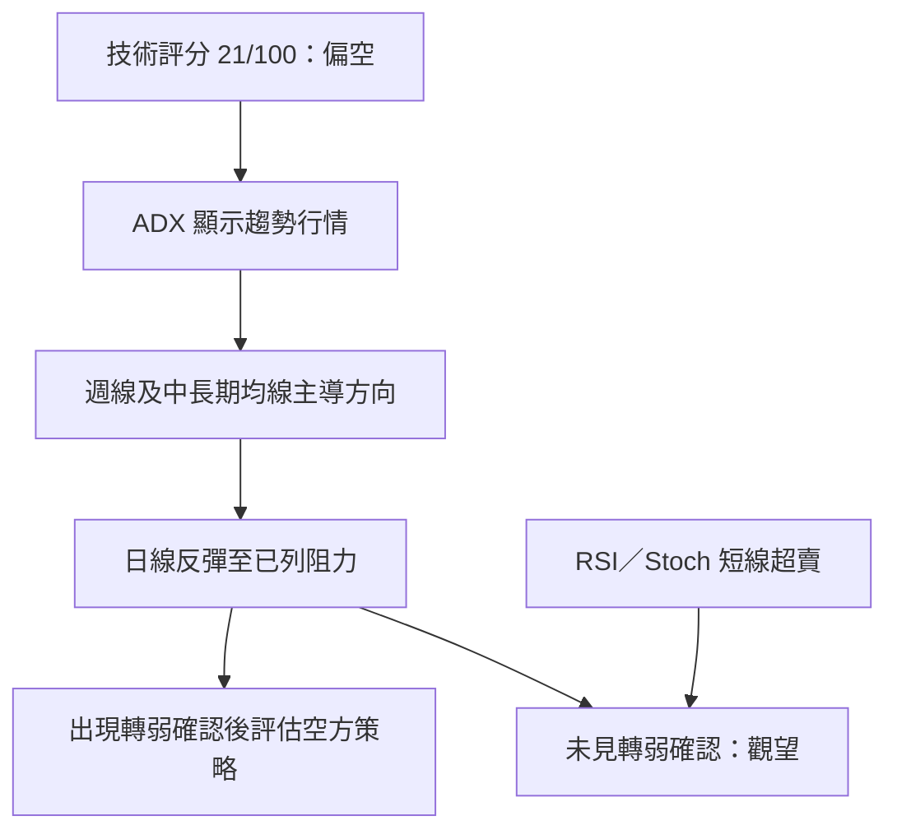

# NBIS 技術分析報告

> **報告日期**：2026-11-26 ｜ **語言**：繁體中文 ｜ **數據來源**：Yahoo Finance ｜ **當前價格**：US$84.99（2026-11-25 收盤）

---

## 目錄

| 章節 | 內容 |
|------|------|
| [1. 技術面概覽](#1-技術面概覽) | 核心指標速覽、評分卡 |
| [2. 趨勢分析](#2-趨勢分析) | 長中短期走勢、ADX |
| [3. 圖表形態分析](#3-圖表形態分析) | 形態、K 線、缺口 |
| [4. 支撐與阻力](#4-支撐與阻力) | 關鍵價位、斐波那契 |
| [5. 技術指標深度解讀](#5-技術指標深度解讀) | MA、RSI、MACD、布林、成交量、進階指標 |
| [6. 動能與波動率](#6-動能與波動率) | ATR、Beta、相對強度 |
| [7. 多時框架總結](#7-多時框架總結) | 時框架評分矩陣 |
| [8. 交易策略建議](#8-交易策略建議) | 歷史基準、策略、風險報酬比 |
| [9. 風險提示與監控](#9-風險提示與監控) | 監控指標、風險場景 |

---

## 1. 技術面概覽

NBIS 目前技術面偏空：價格位於主要均線下方，且日、週、月方向一致偏空。趨勢強度與負向方向指標支持空方主導，但 RSI 與隨機指標已接近超賣區，短線可能出現反彈或劇烈震盪。最大的反向風險是價格在低位急跌後反彈，令追空交易面臨高波動與跳空風險。

### 📊 核心指標速覽表

| 指標類別 | 指標名稱 | 當前數值 | 訊號 | 解讀 |
|----------|----------|----------|------|------|
| **價格** | 當前價格 | US$84.99 | 🔴 | 位於 52 週區間低檔，詳見第 4 章。 |
| **均線** | MA20 / MA50 / MA200 | 見第 5 章 | 🔴 | 收盤低於三條主要均線，均線呈空頭排列。 |
| **動能** | RSI(14)（日線） | 見第 5 章 | 🟡 | 接近超賣區，但尚未形成已確認的反轉訊號。 |
| **動能** | MACD 柱（日線） | 見第 5 章 | 🔴 | 位於零軸下方，空方動能仍占優勢。 |
| **趨勢** | ADX(14) | 見第 2 章 | 🔴 | 趨勢強度達趨勢行情門檻，且空方方向主導。 |
| **波動** | ATR(14) | 見第 6 章 | 🔴 | 日常價格波動幅度偏高，進場與停損需留有風險空間。 |
| **多時框** | 一致性 | 見第 7 章 | 🔴 | 日、週、月三個時框方向一致偏空。 |

### 🏆 技術評分卡

以下為本報告唯一評分卡。綜合評分為六項子評分的算術平均，四捨五入至整數。

| 維度 | 評分（0–100） | 訊號 | 主要依據 |
|------|---------------|------|----------|
| 趨勢強度 | 15 | 🔴 | 趨勢強度及空方主導方向見第 2 章。 |
| 動能指標 | 30 | 🔴 | 動能仍偏空，但短線超賣提高反彈風險，見第 5 章。 |
| 支撐穩定度 | 25 | 🔴 | 價格靠近下方波段支撐，且下跌趨勢尚未確認止穩，見第 4 章。 |
| 成交量配合 | 25 | 🔴 | OBV 與價格趨勢偏弱，A/D 顯示資金流向與跌勢同向，見第 5 章。 |
| 形態完整度 | 20 | 🟡 | 目前缺少足以確認傳統反轉形態的幾何結構，見第 3 章。 |
| 均線排列 | 10 | 🔴 | 主要均線空頭排列，價格低於各主要均線，見第 5 章。 |
| **綜合評分** | **21** | **偏空** | 六項平均為 20.83，四捨五入為 21。 |

---

## 2. 趨勢分析

### 📈 長期趨勢（近 12 個月）

長期走勢呈現先大幅上漲、後急速回撤的結構。月線收盤由低位攀升至高點後轉弱，近期跌勢已抹去相當部分此前升幅；因此，長期背景由強勢上升轉為高位反轉後的空方主導階段。

| 階段 | 起訖月收盤 | 漲跌幅 | 特徵 |
|------|------------|--------|------|
| 2025-12 至 2026-06 | US$83.71 → US$276.17 | +229.9% | 強勢上升，月收盤連續走高。 |
| 2026-06 至 2026-07 | US$276.17 → US$190.41 | -31.1% | 高位快速修正，升勢明顯受損。 |
| 2026-07 至 2026-09 | US$190.41 → US$235.88 | +23.9% | 出現反彈，但未重返前高。 |
| 2026-09 至 2026-11 | US$235.88 → US$84.99 | -64.0% | 跌勢加速，月線方向轉弱。 |

**判讀：**月線價格已低於自身趨勢均線，月 RSI 亦跌至 50 以下，支持中長期轉弱判斷。月 MACD 柱為 N/A（數據未提供），不以其他時框代替月線訊號。

### 📊 中期趨勢（週線）

週線收盤從夏季高位大幅下滑，週 RSI 與週 MACD 柱亦同步走弱。近幾週週成交量在下跌期間維持活躍，價格下跌與量能變化未形成足以確認反轉的背離。

- 週線趨勢均線方向偏空，收盤位於趨勢均線下方。
- 週 RSI 由先前較強區域回落至弱勢區，顯示中期動能惡化。
- 週 MACD 柱持續為負，且最新讀值進一步偏弱。
- 週線訊號與日線、月線同向，沒有可據以推翻空方主趨勢的時框衝突。

### ⚡ 趨勢強度（ADX）

| 指標 | 數值 | 解讀 |
|------|------:|------|
| ADX(14) | 37.49 | 高於趨勢門檻，屬趨勢行情，而非盤整行情。 |
| +DI | 15.97 | 多方方向力量較弱。 |
| −DI | 37.60 | 空方方向力量明顯較強。 |

**收斂規則：**目前屬趨勢行情，依多時框收斂規則，應以週線及中長期均線方向為主，日線僅用於選擇進場時機。這項判斷與多時框偏空、主要均線空頭排列一致；不採用盤整行情以布林通道上下軌作為主要區間的處理方式。

---

## 3. 圖表形態分析

### 🔍 形態識別

近端價格序列呈現明確下跌與均線下方運行，但現有資訊不足以確認具有完整頸線、兩個有效低點或明確旗形邊界的傳統幾何形態。因此不宣稱頭肩、雙底、旗形或其他未經數據支持的圖形；以下採指標型解讀。

| 形態／訊號 | 信心度 | 判斷依據 | 完成度 | 目標價 |
|------------|--------|----------|--------|--------|
| 主要均線下方運行、趨勢偏空 | 高 | 價格低於主要趨勢均線；ADX 顯示趨勢強度，且負向方向指標占優。 | 趨勢訊號已成立，但不代表跌勢必然延續。 | 不適用；不是具備可計算形態高度的幾何形態。 |
| 傳統反轉形態 | 低 | 近端 OHLC 資料不足以確認頸線及成對轉折結構。 | 訊號不足，僅作指標型解讀。 | N/A（數據未提供） |

### 🕯️ 重要 K 線形態

以下 K 線判讀只使用列示的日 K 或週 K OHLC。缺口另外列於後表，含缺口的 K 棒不以一般長紅或長黑取代缺口描述。

| 日期（日 K／週 K） | 開 | 高 | 低 | 收 | K 線形態 | 解讀 | 訊號 |
|--------------------|---:|---:|---:|---:|----------|------|------|
| 2026-11-20（日 K） | US$93.69 | US$94.04 | US$80.67 | US$81.31 | 向下跳空後收低，帶有限上影 | 跳空後仍收於低位，空方壓力延續；該日同時有已回補的跳空缺口。 | 🔴 |
| 2026-11-23（日 K） | US$110.00 | US$110.05 | US$95.73 | US$97.80 | 向上跳空後收低 | 開盤跳空未能轉化為持續買盤，收盤低於開盤；缺口已回補。 | 🔴 |
| 2026-11-25（日 K） | US$80.46 | US$87.26 | US$75.60 | US$84.99 | 下影線較長的反彈型 K 棒 | 低位有承接，但單根 K 棒不足以確認趨勢反轉，仍須後續價格確認。 | 🟡 |
| 2026-11-20（週 K） | US$106.80 | US$115.18 | US$80.67 | US$81.31 | 收低且下影線明顯 | 週內低位出現買盤，但週收仍弱，尚未構成週線反轉確認。 | 🔴 |

### 📉 跳空缺口

下表日期、方向、區間與回補狀態均依市場脈絡紀錄。未回補缺口只作為上方可能的供給／阻力參考，不視為必然回補目標。

| 日期 | 方向 | 缺口區間 | 回補狀態 | 技術含義 |
|------|------|----------|----------|----------|
| 2026-11-23 | 向上跳空 | US$94.04–US$95.73 | 已回補 | 向上缺口未能維持，對反彈延續性的確認不足。 |
| 2026-11-20 | 向下跳空 | US$94.04–US$96.54 | 已回補 | 短線缺口已消化，但不改變較大級別的偏空趨勢。 |
| 2026-11-12 | 向下跳空 | US$132.69–US$147.36 | 未回補 | 上方留有未回補缺口，可能構成反彈時的供給區。 |
| 2026-11-05 | 向下跳空 | US$134.80–US$140.02 | 已回補 | 缺口已回補，仍需以其他阻力訊號判斷反彈強度。 |
| 2026-10-30 | 向下跳空 | US$161.42–US$168.76 | 未回補 | 上方未回補缺口，若價格反彈，可能增加上方套牢供給。 |

---

## 4. 支撐與阻力

### 🚧 阻力位分析表

以下波段阻力來自近一年波段高點聚類。近期跌勢快速，這些價位屬可能的反彈阻力，不代表價格必然在該處反轉。

| 阻力級別 | 價位 | 形成原因 | 突破難度 | 重要性 |
|----------|-----:|----------|----------|--------|
| R1 | US$95.90 | 近一年波段高點聚類；亦是反彈後首先需重新收復的波段阻力。 | 中 | 重要短線反彈確認位。 |
| R2 | US$103.84 | 近一年波段高點聚類；位於 R1 上方，突破需買盤延續。 | 高 | 中短線關鍵供給區。 |
| R3 | US$108.32 | 近一年波段高點聚類；若無量能支持，突破難度較高。 | 高 | 上方主要波段阻力。 |

### 🛡️ 支撐位分析表

以下波段支撐來自近一年波段低點聚類。支撐能否發揮作用仍需觀察收盤、成交量及後續 K 棒確認。

| 支撐級別 | 價位 | 形成原因 | 守住可能性 | 重要性 |
|----------|-----:|----------|------------|--------|
| S1 | US$83.22 | 近一年波段低點聚類，屬現價附近的首要支撐參考。 | 中 | 短線多空分界；失守將提高測試更低支撐的風險。 |
| S2 | US$75.25 | 近一年波段低點聚類，位於 S1 下方。 | 低 | 下一級重要支撐參考。 |
| S3 | US$73.52 | 近一年波段低點聚類，並與 52 週低點重合。 | 低 | 重要低位支撐；有效跌破將代表低位支撐結構進一步惡化。 |

### 📌 未回補缺口參考區

未回補缺口的區間與狀態見第 3 章。兩個未回補缺口均位於現價上方，屬反彈時的潛在供給帶；由於它們不是波段高點聚類，以下以「缺口」名稱標示，不另改標為 R1–R3。

| 類型 | 價位 | 解讀 |
|------|-----:|------|
| 缺口（2026-11-12） | US$132.69–US$147.36 | 未回補向下缺口；反彈進入區間時需觀察賣壓。 |
| 缺口（2026-10-30） | US$161.42–US$168.76 | 未回補向下缺口；位於更高位置，屬較遠端供給區。 |

本次波段支撐與阻力均各有至少兩個資料點，故不以樞軸點補位，也不將公式樞軸混同為波段 R／S。

### 📐 斐波那契回調位分析

斐波那契價位依 52 週高低區間計算值照列。現價落在 **78.6% 回調位與 100.0%（52 週低點）之間**，表示先前升幅已大幅回吐，價格接近區間底部；此位置可能出現技術性承接，但不能單憑斐波那契位置判斷底部已形成。

| 回調比例 | 價位 |
|----------|-----:|
| 23.6% | US$246.44 |
| 38.2% | US$213.40 |
| 50.0% | US$186.69 |
| 61.8% | US$159.98 |
| 78.6% | US$121.96 |
| 100.0%（52 週低點） | US$73.52 |

---

## 5. 技術指標深度解讀

### 📈 均線、RSI、MACD、布林通道

| 指標 | 數值 | 訊號 | 解讀 |
|------|------|------|------|
| MA20／MA50／MA200 與排列 | MA20：US$122.68；MA50：US$174.12；MA200：US$179.74；MA20 < MA50 < MA200 | 🔴 | 價格低於三條主要均線，排列呈空頭結構；MA20、MA50、MA200 均位於收盤上方，反彈時可能形成層層阻力。 |
| RSI(14)（日線）與背離 | RSI：33.06；背離：無明顯背離 | 🟡 | RSI 接近超賣區，但仍未顯示明確底背離。依近 20 根 K 棒首尾比較，價格與 RSI 方向沒有形成可確認的背離；也未偵測到明確頂背離。 |
| MACD 線／Signal／柱 | MACD：-24.287；Signal：-22.526；Histogram：-1.761 | 🔴 | MACD 線低於 Signal，柱值為負，空方動能仍占優勢；目前沒有由 MACD 確認的多頭交叉訊號。 |
| 布林上軌／中軌／下軌／%B | 上軌：US$175.07；中軌：US$122.68；下軌：US$70.30；%B：0.14 | 🟡 | %B 接近通道下部，反映價格相對偏弱並接近下軌；但在趨勢強度偏高的環境中，貼近下軌不等同反轉確認。 |
| Stoch %K／%D | %K：11.10；%D：13.66 | 🟡 | 位於超賣區，支持短線反彈風險提示；仍須與價格結構及趨勢訊號一併判讀。 |

**指標整合：**均線排列、MACD 與趨勢方向互相確認偏空；RSI 與 Stoch 則顯示短線已接近超賣，對追空形成風險提醒。布林 %B 顯示價格靠近通道下部，與短線弱勢一致，但因目前屬趨勢行情，不能把下軌位置單獨解讀為買進訊號。RSI 未見明顯背離，也沒有足以推翻空方結構的多頭確認。

### 💹 成交量（量價配合度）

| 成交量／量價指標 | 數值或狀態 | 解讀 |
|------------------|------------|------|
| 最新成交量 | 40,180,600 股 | 高於 20 日均量，顯示當日交易活躍。 |
| 20 日均量 | 33,445,015 股 | 作為近期成交量比較基準。 |
| 量比 | 1.20 倍 | 當日成交量高於 20 日均量，但單日放量本身不能判斷買賣方向。 |
| 50 日均量 | 25,710,398 股 | 近期成交量水準高於較長期均量。 |
| OBV | OBV < MA | OBV 低於其均線，顯示量能趨勢疲弱，未確認價格反轉。 |
| A/D 線 | 近 20 根低於其 20 日均值；A/D 下降、價格下跌 | 資金流向與價格下跌同向，屬對跌勢的確認，而非底部背離。 |

**量價結論：**成交量活躍不代表買方已接管。OBV 低於其均線，A/D 下降並與價格下跌同向，量能尚未確認止跌；若後續出現反彈，仍需觀察量能能否持續改善，而非只依賴單日放量。

### 🧭 進階指標

| 指標 | 數值 | 收盤相對位置 | 解讀 |
|------|------|--------------|------|
| 一目均衡表（轉換線／基準線／雲層） | 轉換線：US$99.78；基準線：US$129.17；先行帶 A：US$202.44；先行帶 B：US$220.54。前方雲層先行帶 A：US$114.48；先行帶 B：US$165.35。 | 收盤位於雲層下方；轉換線低於基準線 | 一目結構偏空，與均線排列、MACD 及日線趨勢方向互相確認。前方雲層亦呈 A 線低於 B 線的偏空結構。 |
| 成交量分布（POC／價值區） | POC：US$97.10；價值區：US$73.52–US$214.98（含 72% 成交量） | 收盤位於價值區內、低於 POC | POC 位於收盤上方，代表較主要的成交成本集中參考區在上方；與價格低於均線的弱勢結構一致。 |
| 錨定 VWAP（自 52 週高點／低點） | 自 52 週高點起：US$187.41；自 52 週低點起：US$176.43 | 收盤均低於兩條錨定 VWAP | 不論以高點或低點作錨，價格均低於成交量加權成本參考，與中長期弱勢一致。 |
| A/D 線 | 近 20 根低於 20 日均值；A/D 下降 | — | A/D 與價格下跌同向，未顯示資金流向領先價格止跌。 |
| 經典樞軸點 | 樞軸 PR2：US$291.86；樞軸 PR1：US$223.00；樞軸 P：US$186.24；樞軸 PS1：US$117.38；樞軸 PS2：US$80.62 | 收盤低於樞軸 P，且高於樞軸 PS2 | 樞軸為公式值，不是波段高低點。本次波段支撐與阻力數量充足，故不將樞軸點作為第 4 章替代支撐或阻力。 |

---

## 6. 動能與波動率

### 📊 ATR 波動率分析

| 指標 | 數值 | 解讀 |
|------|------|------|
| ATR(14) | US$16.99 | 代表近期平均真實波幅；不代表價格必然朝任一方向移動。 |
| ATR 佔價格比例 | 19.99% | 相對價格的波動幅度偏高，部位規模及停損距離需特別審慎。 |
| 1.5 倍 ATR 風險距離參考 | US$25.49 | 作為波動風險距離的參考值，不是新增支撐、阻力或策略停損價。 |
| 2 倍 ATR 風險距離參考 | US$33.98 | 較寬的波動風險距離參考；若採用較寬停損，應相應降低部位。 |

ATR 所示波動相對價格偏大，固定股數可能造成不成比例的組合風險。策略停損仍須依第 8 章列出的已知價位設定，不以 ATR 乘數另行創造未提供的精確價位。

### 📐 Beta 與相對強度

Beta 顯示 NBIS 對市場波動具有較高敏感度。相對強度表顯示，NBIS 在各列示期間均落後 VTI 與 QQQ，且比值趨勢皆為相對走弱；因此相對強度不支持逆勢做多，與偏空主策略方向相符。

#### 相對強度 vs VTI（美國整體市場）

| 期間 | 本股報酬 | VTI 報酬 | 超額報酬 |
|------|---------:|---------:|---------:|
| 1 個月 | -43.0% | -5.8% | -37.2% |
| 3 個月 | -59.2% | -6.4% | -52.7% |
| 6 個月 | -58.1% | -4.2% | -53.9% |

**比值趨勢：**相對走弱，比值低於其 50 日均值。

#### 相對強度 vs QQQ（Nasdaq-100）

| 期間 | 本股報酬 | QQQ 報酬 | 超額報酬 |
|------|---------:|---------:|---------:|
| 1 個月 | -43.0% | -10.4% | -32.6% |
| 3 個月 | -59.2% | -10.3% | -48.9% |
| 6 個月 | -58.1% | -12.5% | -45.6% |

**比值趨勢：**相對走弱，比值低於其 50 日均值。

| 市場敏感度指標 | 數值 | 技術含義 |
|----------------|------|----------|
| Beta | 1.539 | 對市場波動的敏感度偏高；逆勢反彈與下跌延續時都可能伴隨較大振幅。 |

**主策略含義：**相對強度支持偏空方向，但不代表短線一定續跌。價格接近低位支撐且短線指標偏超賣，進場應等反彈至阻力並出現轉弱確認，避免在支撐附近追空。

---

## 7. 多時框架總結

### 📋 時框架評分表

下表方向、RSI、MACD 柱及趨勢均線依各時框資料列示；月線 MACD 柱資料不足時保留 N/A。

| 時框架 | 趨勢方向 | RSI(14) | MACD 柱 | 收盤 vs 趨勢均線 | 形態 | 建議 |
|--------|----------|---------|---------|------------------|------|------|
| 日線 | 偏空 | 33.06 | -1.761 | MA50：174.12；收盤低於均線 | 均線下方運行、動能偏空 | 以反彈找空方進場，不在支撐附近追空。 |
| 週線 | 偏空 | 32.69 | -18.477 | MA20：185.78；收盤低於均線 | 週線弱勢延續 | 以週線方向作主導，等待日線反彈至阻力。 |
| 月線 | 偏空 | 47.84 | N/A（數據未提供） | MA10：171.22；收盤低於均線 | 月線轉弱 | 中長期以風險控制為先，不以短線反彈預設趨勢反轉。 |

**多時框一致性 3/3 偏空。**

### ⚖️ 多時框收斂結論

目前 ADX 顯示為趨勢行情，因此依規則以週線與中長期均線方向為主，日線用於安排進場時機。日、週、月方向均偏空，短線超賣只構成反彈風險，尚未形成足以推翻中長期方向的確認訊號。

**唯一方向性結論：偏空。**此結論與第 1 章綜合評分及第 8 章主策略一致。

---

## 8. 交易策略建議

### 🧭 策略路由

**當前主策略方向 = 偏空（依評分 21/100）。**策略以反彈至已列阻力後出現轉弱確認為條件，不在支撐附近盲目追空。

### 📊 歷史基準機率

今日狀態定義為：**RSI(14) 位於 30–50 且收盤位於 MA200 下方**。樣本期間為 **2024-10-21 至 2026-11-25**，共 **527 個交易日**。

| 持有期 | 相同狀態樣本（段數） | 上漲比例 | 中位數報酬 | 25%–75% 分位 | 全部交易日上漲比例／中位數 |
|--------|----------------------|----------|------------|--------------|----------------------------|
| 5 日 | 22 日（5 段） | N/A（歷史樣本不足） | N/A（歷史樣本不足） | N/A（歷史樣本不足） | 50%／+0.2% |
| 20 日 | 8 日（3 段） | N/A（歷史樣本不足） | N/A（歷史樣本不足） | N/A（歷史樣本不足） | 57%／+4.5% |
| 60 日 | 1 日（1 段） | N/A（歷史樣本不足） | N/A（歷史樣本不足） | N/A（歷史樣本不足） | 63%／+10.8% |

相同狀態的交易日數與段數均不足以提供可靠的條件上漲比例；故不能以此宣稱今日狀態具有優於或劣於平常的歷史勝率。全部交易日的上漲比例僅作基準對照，不能代替今日狀態的條件機率。歷史頻率不是預測，且相同狀態的持有期互相重疊，段數更接近獨立事件數；本表不足以單獨支持交易方向，主策略仍依多時框、趨勢及風險報酬比判斷。

### 🎯 價格情境階梯

情境方向依目前偏空結構設定。表中價位以第 4 章的 R／S 標記引用，具體數值及來源見第 4 章。

| 觸發條件 | 下一目標 | 後續延伸 | 可能性 | 依據 |
|----------|----------|----------|--------|------|
| 有效突破並站穩 R1 | R2 | R3 | 低 | 需先收復近端阻力；均線、MACD 與多時框仍偏空，突破須有成交量延續確認。 |
| 在現價區域止跌並持續站穩 | — | — | 中 | 短線指標偏超賣，可能反彈；但未見明確底背離，且波段支撐是否守穩仍待確認。 |
| 有效跌破 S1 | S2 | S3 | 中 | 趨勢與相對強度均偏空；若跌破支撐，可能測試下方支撐，但短線超賣使延續路徑可能劇烈波動。 |

### 🟢 主策略詳情

下列策略均為**條件式空方計畫**，只有價格抵達指定進場位並出現轉弱確認後才考慮執行。若未達指定價位，或進場前趨勢訊號已改變，應取消策略而非追價。風險報酬比按進場價、止損價及 T1 計算。

| 策略要素 | 策略 A：R1 遇阻做空 | 策略 B：R2 遇阻做空 |
|----------|---------------------|---------------------|
| 進場條件 | 反彈至 R1 後無法站穩，且日線轉弱確認。 | 反彈至 R2 後出現明確轉弱，且未有效突破 R3。 |
| 進場價格 | US$95.90 | US$103.84 |
| 目標價 T1 | US$83.22 | US$95.90 |
| 目標價 T2 | US$75.25 | US$83.22 |
| 止損價格 | US$103.84 | US$108.32 |
| 風險報酬比 | 1 : 1.60（以 T1 計；計算： (95.90−83.22) ÷ (103.84−95.90) = 1.60） | 1 : 1.77（以 T1 計；計算： (103.84−95.90) ÷ (108.32−103.84) = 1.77） |
| 把握度 | 中：趨勢與多時框偏空；但短線超賣，且仍須等待阻力處轉弱確認。 | 低：需價格先反彈至較高阻力；若市場未反彈到位，策略不觸發。 |
| 建議倉位 | 不提供固定持倉比例；依帳戶風險預算及進場至止損距離換算，單筆風險宜受控。 | 不提供固定持倉比例；依帳戶風險預算及進場至止損距離換算，單筆風險宜受控。 |

兩項策略的 T1 風險報酬比均達到最低門檻。策略 A 是較接近現價的條件式機會；但若價格未反彈至進場位，或到位後沒有轉弱確認，應觀望，不以現價直接追空。策略 B 是更高價位的備選條件，不應與策略 A 同時無差別加碼。

### 🔴 反向風險觸發點（對沖提示）

- 若價格有效站上 R1 並持續收復上方阻力，短線空方策略應重新檢視；單次盤中觸及不等同有效突破。
- 若價格進一步站穩 R2，策略 A 的空方依據將顯著減弱；若接近或突破 R3，策略 B 亦應取消或依預先停損執行。
- 短線 RSI／Stoch 已偏超賣，若價格反彈同時 MACD、OBV 或 A/D 改善，空方動能可能降溫。
- 若價格在 S1、S2 或 S3 附近出現放量止跌，應避免在支撐位置追空；但目前沒有數據支持把該情形視為已確認反轉。

---

## 9. 風險提示與監控

### ✅ 關鍵監控指標

| 監控項目 | 觸發條件 | 建議動作 |
|----------|----------|----------|
| S1 支撐 | 收盤有效跌破或反覆測試後無法站回 | 暫停在支撐附近追空；若已持倉，按既定風險計畫管理。 |
| S2／S3 支撐 | 價格向下測試或有效跌破 | 觀察是否出現放量承接；若支撐失守，重新評估剩餘下行空間與停損安排。 |
| R1／R2／R3 阻力 | 價格反彈到阻力後出現轉弱，或反之有效站穩阻力 | 轉弱確認後才考慮條件式空方策略；有效站穩則取消相關空方計畫。 |
| RSI、MACD、OBV、A/D | RSI 回升且 MACD、OBV、A/D 同步改善，或弱勢延續 | 多項指標同步改善時降低空方倉位或重新評估；若量能仍確認跌勢，維持風險控制。 |
| VTI、QQQ 相對強度 | 比值仍低於 50 日均值，或相對走弱狀態改善 | 相對弱勢延續支持偏空判斷；若相對強度持續修復，降低空方信心。 |
| 下次財報日 | 2027-02-11；距最新收盤日 78 個日曆天 | 若部位持有期間涵蓋財報，應考慮縮小部位或事前降低風險；財報可能造成跳空，止損不保證按指定價格成交。 |

### ⚠️ 風險場景

| 情境 | 觸發條件 | 價位參考 | 可能性 | 應對 |
|------|----------|----------|--------|------|
| 樂觀：技術性反彈 | 低位支撐獲得承接，日線動能改善並收復近端阻力 | 先觀察 S1 是否守穩，再留意 R1 | 中 | 不因超賣單一訊號預設反轉；空方部位依停損紀律管理。 |
| 基本：偏空趨勢延續、過程伴隨反彈 | 多時框仍偏空，反彈至阻力後未能站穩 | R1、R2、S1 與 S2 | 中 | 等候阻力處轉弱確認，依第 8 章條件式策略執行；避免在支撐附近追空。 |
| 悲觀：支撐失守、跌勢擴大 | S1 失守後未能收復，並進一步測試下方支撐 | S2、S3 | 中 | 控制部位與單筆風險，不假定支撐必然守住；若跌勢加速，避免因恐慌追單。 |

### 🛡️ 風險管理提醒

1. **採條件式進場。**空方策略須等待阻力位出現轉弱確認，不在支撐附近直接追空。
2. **先定義單筆最大風險，再換算部位。**ATR 顯示波動偏高，不能以固定股數忽略停損距離。
3. **依預設停損執行。**價格跳空或流動性不足時，停損可能無法按指定價成交，實際損失可能高於計畫值。
4. **避免把超賣等同反轉。**RSI、Stoch 偏弱但接近超賣，應等待價格及量能訊號共同確認。
5. **財報前重新檢視部位。**若持倉期間涵蓋財報事件，應評估跳空風險與降低倉位的必要性。

---

## 📋 報告總結

| 項目 | 結論 |
|------|------|
| 報告日期 | 2026-11-26 |
| 當前價格 | 見標題列及第 1 章核心指標速覽表（收盤日期：2026-11-25） |
| 綜合評分／方向 | 21/100，偏空 |
| 長期／中期／短期趨勢 | 🔴 長期：高位反轉後明顯走弱；🔴 中期：週線偏空；🟡 短期：偏空但超賣，須防反彈。 |
| 關鍵支撐／關鍵阻力 | 支撐：S1、S2、S3；阻力：R1、R2、R3，數值見第 4 章。 |
| 🥇 最佳機會 | 條件式策略 A：反彈至 R1 並出現轉弱確認後評估做空；未到位或未確認則觀望。 |
| 最大風險 | 短線超賣後快速反彈、支撐附近追空，以及高波動或財報事件造成跳空。 |

> ⚠️ **免責聲明**：本報告為 AI 自動生成之技術分析，所有數據及估算均基於歷史價格資訊。本報告**僅供研究與學術參考**，**不構成任何投資建議**。投資有風險，入市需謹慎。

---

## 資料與來源

| 項目 | 內容 |
|------|------|
| 價格 | 84.99 USD，2026-11-25 收盤（Yahoo Finance 日線） |
| K 棒 | 501 根日線，2024-11-26 至 2026-11-25（Yahoo Finance）；較長期間的價位與基準機率取自價格資料庫 |
| 關鍵價位回溯期間 | 阻力 近一年、支撐 近一年 |
| 下次財報日 | 2027-02-11（Yahoo Finance，日期可能調整） |
| 有回應的資料來源 | Yahoo Finance、Finviz、StockAnalysis、Roic.ai |
| 由程式計算 | 所有指標、R1–S3 與斐波那契價位、多時框方向、相對強度、缺口、歷史基準機率、綜合評分 |
| 撰寫模型 | openai / gpt-6-luna |

> 本區塊由產生報告的程式依實際取得的資料填寫，非模型撰寫。「由程式計算」的數字不是模型的估計；其餘判斷（評分、情境、策略）是模型的分析。
