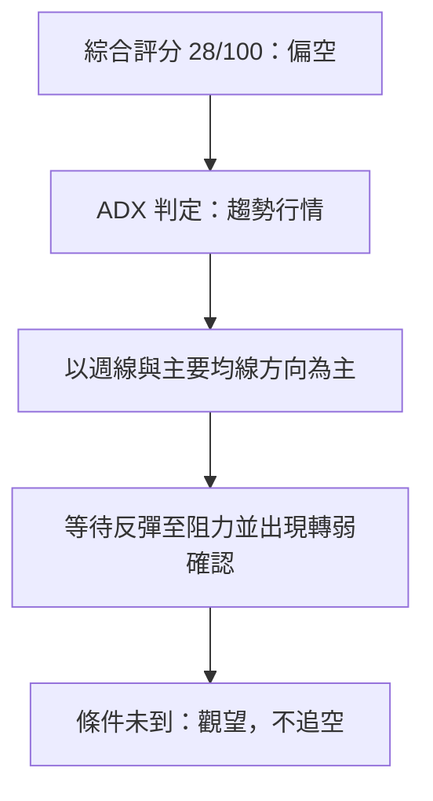

# NBIS 技術分析報告

> **報告日期**：2026-11-28 ｜ **語言**：繁體中文 ｜ **數據來源**：Yahoo Finance ｜ **當前價格**：$89.46（2026-11-27 收盤）

---

## 目錄

| 章節 | 內容 |
|------|------|
| [1. 技術面概覽](#1-技術面概覽) | 核心指標速覽、評分卡 |
| [2. 趨勢分析](#2-趨勢分析) | 長中短期走勢、ADX |
| [3. 圖表形態分析](#3-圖表形態分析) | 形態、K線、缺口 |
| [4. 支撐與阻力](#4-支撐與阻力) | 關鍵價位、斐波那契 |
| [5. 技術指標深度解讀](#5-技術指標深度解讀) | MA/RSI/MACD/布林/成交量/進階指標 |
| [6. 動能與波動率](#6-動能與波動率) | ATR、Beta、相對強度 |
| [7. 多時框架總結](#7-多時框架總結) | 時框架矩陣 |
| [8. 交易策略建議](#8-交易策略建議) | 歷史基準、策略、風險報酬比 |
| [9. 風險提示與監控](#9-風險提示與監控) | 監控指標、風險場景 |

---

## 1. 技術面概覽

NBIS 的技術面目前偏空：日、週、月三個時框方向一致，價格位於主要趨勢均線下方，且 ADX 顯示下跌趨勢有力度。週線動能、日線 MACD 與量價指標大致確認賣壓仍占優勢；短線隨機指標超賣則構成反彈風險。最大的反向風險是急跌後出現技術性反彈，尤其若價格重新站回主要阻力區，空頭策略需依規則停損而非加碼。

### 📊 核心指標速覽表

| 指標類別 | 指標名稱 | 當前數值 | 訊號 | 解讀 |
|----------|----------|----------|------|------|
| **價格** | 當前價格 | **$89.46** | 🔴 | 收盤位於 52 週價格區間下緣附近，整體趨勢偏弱。 |
| **均線** | MA20 / MA50 / MA200 | 見第 5 章 | 🔴 | 價格低於三條主要均線，均線呈空頭排列。 |
| **動能** | RSI(14)（日線） | 見第 5 章 | 🟡 | 接近超賣區但尚未進入傳統超賣範圍，動能仍弱。 |
| **動能** | MACD 柱（日線） | 見第 5 章 | 🔴 | MACD 柱為負值，空頭動能仍在。 |
| **趨勢** | ADX(14) | 見第 2 章 | 🔴 | 趨勢強度高，且空方 DI 占優。 |
| **波動** | ATR(14) | 見第 6 章 | 🔴 | 相對價格波動幅度高，部位與停損須保守。 |
| **多時框** | 一致性 | 見第 7 章 | 🔴 | 日、週、月三個時框方向一致偏空。 |

### 🏆 技術評分卡

本評分衡量技術訊號對多空方向的有利程度，而非單純衡量趨勢強弱。六項子評分的算術平均為 **27.5**，四捨五入後綜合評分為 **28**。

| 維度 | 評分（0–100） | 訊號 | 主要依據（引用數值所在章節） |
|------|---------------|------|------------------------------|
| 趨勢強度 | 25 | 🔴 | 趨勢雖強，但主導方向為空方，見第 2 章。 |
| 動能指標 | 35 | 🔴 | MACD 偏空、RSI 偏弱；隨機指標超賣帶來反彈風險，見第 5 章。 |
| 支撐穩定度 | 40 | 🟡 | 下方有已列出的波段支撐，但趨勢與量價訊號未確認止跌，見第 4、5 章。 |
| 成交量配合 | 25 | 🔴 | OBV 與 A/D 均未提供明確累積買盤確認，見第 5 章。 |
| 形態完整度 | 30 | 🔴 | 僅有指標型偏空訊號，缺少足以確認反轉或整理型態的幾何結構，見第 3 章。 |
| 均線排列 | 10 | 🔴 | 價格低於主要均線，均線排列偏空，見第 5 章。 |
| **綜合評分** | **28** | **偏空** | 六項平均：165 ÷ 6 = 27.5，四捨五入至整數。 |

---

## 2. 趨勢分析

**結論：長期走勢由快速上漲轉為大幅回落；週線與日線都偏空。** 月收盤階段表顯示近期下跌幅度明顯，週線收盤序列與週線 RSI、MACD 柱的變化亦確認賣壓增強。ADX 判定目前屬趨勢行情，因此依多時框收斂規則，以中長期週線及主要均線方向為主，日線僅用於尋找交易時機。

### 📈 長期趨勢（近 12 個月）

| 階段 | 起訖月收盤 | 漲跌幅 | 特徵 |
|------|------------|--------|------|
| 2025-12 至 2026-03 | $83.71 → $103.76 | +23.95% | 低位逐步回升，走勢偏穩健。 |
| 2026-03 至 2026-06 | $103.76 → $276.17 | +166.15% | 快速擴張式上漲，升勢陡峭。 |
| 2026-06 至 2026-07 | $276.17 → $190.41 | -31.05% | 高位快速回撤，趨勢轉弱。 |
| 2026-07 至 2026-09 | $190.41 → $235.88 | +23.88% | 反彈修復，但未能延續為新一輪穩定上升。 |
| 2026-09 至 2026-11 | $235.88 → 最新月收盤（數值見標題列） | -62.07% | 連續下跌，價格動能與多時框方向轉弱。 |

**長期解讀：**

- 月收盤序列顯示，前段漲幅集中且快速，之後回撤幅度擴大。
- 近期下跌不只是單月波動；週線指標也呈現趨勢性惡化，暫無足夠訊號確認長期底部。
- 月線方向依多時框指標判定為偏空；月 MACD 柱為 **N/A（數據未提供）**，不以缺漏值推導月線 MACD 動能。

### 📊 中期趨勢（週線）

| 觀察面向 | 週線證據 | 判讀 |
|----------|----------|------|
| 收盤走勢 | 近 20 週序列由夏季高位回落，近期連續收低後僅有有限反彈。 | 中期趨勢偏空。 |
| 週 RSI | 最新週線方向與多時框指標一致偏空。 | 動能仍弱，尚未形成可確認的週線反轉訊號。 |
| 週 MACD 柱 | 近幾週柱體持續處於負值區，負值擴大。 | 空頭動能延續；與收盤走低互相確認。 |
| 週成交量 | 下跌階段多週成交量偏高。 | 賣壓伴隨活躍成交，但單憑放量不能判定已完成換手或見底。 |
| 週均線位置 | 收盤低於多時框指標所列週線趨勢均線。 | 週線仍在主要趨勢均線下方。 |

### ⚡ 趨勢強度（ADX）

| 指標 | 數值 | 判讀 |
|------|------:|------|
| ADX(14) | 37.47 | 高於 25，屬趨勢行情，不是典型盤整。 |
| +DI | 16.75 | 多方方向指標較弱。 |
| −DI | 36.58 | 空方方向指標明顯領先。 |
| DI 關係 | −DI 高於 +DI | 趨勢方向偏空，與均線、MACD 及週線表現一致。 |

**規則收斂：** ADX 高於趨勢門檻，採用趨勢行情的優先級：中長期週線與 MA50、MA200 方向為主，日線只用於安排進場。日線短線反彈不構成獨立翻多依據。

---

## 3. 圖表形態分析

**結論：現有資料不足以高信心確認頭肩、雙底、旗形等幾何形態。** 可辨識的主要訊號是均線、動能與週線走勢形成的趨勢型偏空結構；這些訊號支持趨勢判讀，但不等同於可計算形態高度的價格形態。

### 🔍 形態識別

| 形態／訊號 | 信心度 | 判斷依據 | 完成度 | 目標價（附計算式） |
|-------------|--------|----------|--------|--------------------|
| 幾何反轉形態 | 低 | 近 10 根日 K 與近 8 根週 K 未提供足以確認頸線、兩次等高低點或肩部結構的完整幾何證據。 | 未確認；訊號不足，僅做指標型解讀。 | N/A（數據中未偵測到可計算形態高度的目標）。 |
| 趨勢延續型偏空訊號 | 中 | 多時框方向一致偏空，週 MACD 柱處於負值區，且 ADX 顯示趨勢強度偏高。 | 趨勢訊號成立；不宣稱已完成旗形或其他幾何形態。 | 不以形態高度推算；參考第 4 章已列價位。 |
| 短線超賣反彈風險 | 中 | 日線隨機指標進入超賣區，且近期 K 棒低位曾出現一定程度的下影線。 | 只代表短線反彈風險，不等於趨勢反轉。 | 不推算獨立目標價。 |

### 🕯️ 重要 K 線形態

下表僅使用「近 10 根日 K」與「近 8 根週 K」所列 OHLC。K 棒形態不外推至其他日期。

| 日期（時框） | 開 | 高 | 低 | 收 | K 線形態 | 解讀 | 訊號 |
|------|------:|------:|------:|------:|---------|------|------|
| 2026-11-25（日K） | $80.46 | $87.26 | $75.60 | $84.99 | 下影線較長的收升 K 棒 | 低位有買盤承接，但單根反彈不足以確認反轉；需後續價格行為確認。 | 🟡 |
| 2026-11-20（週K） | $106.80 | $115.18 | $80.67 | $81.31 | 長實體收跌 K 棒 | 一週內價格明顯走低，週線賣壓強；與週線 MACD 偏空方向一致。 | 🔴 |

### ⬆️⬇️ 近 60 個交易日跳空缺口

| 日期 | 方向 | 缺口區間 | 缺口幅度 | 是否回補 | 技術含義 |
|------|------|----------|----------|----------|----------|
| 2026-11-23 | 向上跳空 | $94.04–$95.73 | 2.1% | 已回補 | 回補後未形成有效的向上延續確認。 |
| 2026-11-20 | 向下跳空 | $94.04–$96.54 | 2.6% | 已回補 | 缺口已回補；不宜再視為未回補供給區。 |
| 2026-11-12 | 向下跳空 | $132.69–$147.36 | 9.5% | 未回補 | 上方未回補缺口構成潛在供給區。 |
| 2026-11-05 | 向下跳空 | $134.80–$140.02 | 3.7% | 已回補 | 已回補，不列為未回補缺口阻力。 |
| 2026-10-30 | 向下跳空 | $161.42–$168.76 | 4.3% | 未回補 | 上方仍有未回補缺口，反彈可能面臨供給壓力。 |

---

## 4. 支撐與阻力

**結論：價格下方有明確波段支撐參考，但尚未有量價與趨勢訊號證明支撐已獲有效確認。** 上方波段阻力、未回補缺口及長期均線形成多層供給區；反彈遇阻的技術條件較明顯。價位來源為程式由日線計算，波段支撐／阻力使用區塊標示的近一年聚類結果。

### 🚧 阻力位分析表

| 阻力級別 | 價位 | 形成原因 | 突破難度 | 重要性 |
|----------|------:|----------|----------|--------|
| R1 | $95.90 | 近一年波段高點聚類；亦接近短線成交與價格密集區。 | 中 | 短線第一道反彈驗證位。 |
| R2 | $103.84 | 近一年波段高點聚類；若反彈至此，需觀察賣壓是否重新擴大。 | 中高 | 中短線重要供給位。 |
| R3 | $108.32 | 近一年波段高點聚類；屬更高一級的反彈阻力。 | 高 | 若突破，空頭短線結構需重新評估。 |

### 🛡️ 支撐位分析表

| 支撐級別 | 價位 | 形成原因 | 守住可能性 | 重要性 |
|----------|------:|----------|------------|--------|
| S1 | $83.22 | 近一年波段低點聚類；是近期價格下方的第一層支撐參考。 | 中 | 短線關鍵觀察位，失守會增加向下延伸風險。 |
| S2 | $75.25 | 近一年波段低點聚類；靠近近期低位區域。 | 中低 | 若 S1 失守，屬下一層支撐參考。 |
| S3 | $73.52 | 近一年波段低點聚類，亦是資料所列 52 週低點。 | 中低 | 若跌破，原有 52 週支撐結構被破壞。 |

### 📐 斐波那契回調位分析

下列價位直接引用 52 週區間計算結果。斐波那契價位為區間參考，不代表價格必然反轉。

| 回調比例 | 價位 | 技術解讀 |
|----------|------:|----------|
| 23.6% | $246.44 | 遠高於現價的上方回檔參考區。 |
| 38.2% | $213.40 | 上方較深回檔阻力參考。 |
| 50.0% | $186.69 | 中位回檔參考，與主要均線區域相近但不等同。 |
| 61.8% | $159.98 | 上方回檔阻力參考。 |
| 78.6% | $121.96 | 現價位於此回調位與 100% 回撤端點之間，表示價格已回吐大部分 52 週升幅。 |

**位置判讀：** 現價落在 **78.6% 回調位與 100% 回撤端點（S3，見支撐表）之間**。此區域可能出現技術反彈，但若沒有價格收復阻力、量能改善與動能轉強，不能僅憑回調位判定築底。

**樞軸點補充：** 波段支撐與阻力均已列出至少兩個層級，故不以樞軸點取代 R/S 價位。本報告不另將樞軸公式值標示為波段支撐或阻力。

---

## 5. 技術指標深度解讀

本章為日線主要指標數值的呈現章節。整體而言，均線與 MACD 明確偏空，RSI 尚未顯示強勢反轉；布林位置反映價格偏弱但尚未觸及下軌。隨機指標超賣與長下影線構成短線反彈風險，並未推翻中期偏空訊號。

### 📈 均線、RSI、MACD、布林通道

| 指標 | 數值 | 訊號 | 解讀 |
|------|------|------|------|
| MA20 / MA50 / MA200 與排列 | MA20：$118.56；MA50：$171.55；MA200：$179.75；排列：MA20 < MA50 < MA200 | 🔴 | 收盤低於三條均線，且均線由短至長呈空頭排列。趨勢修復至少需要價格重新站回短中期均線，不能以短暫反彈視為翻多。 |
| RSI(14)（日線）與背離 | RSI：35.17；程式提供的近 20 根 K 棒首尾比較：無明顯背離 | 🟡 | 位於弱勢區但未達傳統超賣門檻。未見可確認 RSI 頂背離或底背離；此指標不能單獨確認反轉。 |
| MACD 線 / Signal / 柱 | MACD：-23.788；Signal：-22.778；柱：-1.010 | 🔴 | MACD 低於 Signal 且柱為負，屬空頭訊號。現有日線快照未提供完整 MACD 擺動高低序列，因此無法確認日線 MACD 頂背離或底背離；週線序列則與價格下跌方向一致，沒有可確認底背離證據。 |
| Stoch %K / %D | %K：16.38；%D：11.94 | 🟡 | 兩線位於超賣區，存在反彈風險；但在 ADX 強勢偏空時，超賣可維持一段時間，不作為單獨買入訊號。 |
| 布林上軌 / 中軌 / 下軌 / %B | 上軌：$167.48；中軌：$118.56；下軌：$69.64；%B：0.20 | 🔴 | 價格位於布林通道下半部，距中軌仍遠；未貼近下軌，故目前不是典型的下軌觸及反彈訊號。 |

**指標整合：** 均線空頭排列、MACD 負柱、RSI 弱勢與價格位於布林中軌下方互相確認偏空。Stoch 超賣是短線反向因素，RSI 未達超賣區且沒有明確背離，故其訊號不足以抵銷趨勢訊號。日線量價訊號也未顯示明確吸籌，整體仍以反彈偏空看待。

### 💹 成交量（量價配合度）

| 指標 | 數值／狀態 | 解讀 |
|------|------------|------|
| 最新成交量 | 20,241,600 股 | 低於 20 日與 50 日均量，最新單日成交量未顯示強烈買盤承接。 |
| 20 日均量 | 33,601,390 股 | 最新量比低於 1，當日成交活躍度低於近期均值。 |
| 50 日均量 | 25,511,602 股 | 最新量亦低於 50 日均量。 |
| 量比 | 0.60x | 反映當日量能低於 20 日平均；不能單憑量縮推論賣壓已結束。 |
| OBV 趨勢 | OBV < MA；量能疲弱 | 未確認價格下跌期間有持續的累積買盤，量能對反轉缺乏支持。 |
| A/D 線 | 近 20 根不高於其 20 日均值；A/D 下降、價格下跌 | A/D 與價格同向下行，確認近期價格弱勢，與 OBV 及均線偏空訊號一致。 |

**量價結論：** OBV 顯示量能疲弱，A/D 線則與價格下跌同向，兩者沒有提供明確底部吸籌確認。下跌週成交量較活躍，支持賣壓仍存在；不過最新單日量低於均量，不能把單日量縮解讀為趨勢反轉。

### 🧭 進階指標

| 指標 | 數值 | 收盤相對位置 | 解讀 |
|------|------|--------------|------|
| 一目均衡表（轉換線／基準線／雲層） | 轉換線 $95.39；基準線 $129.17；最新雲層先行帶 A $200.23、先行帶 B $220.54；前方 26 根雲層先行帶 A $112.28、B $165.35 | 收盤位於最新雲層下方；轉換線低於基準線 | 一目均衡表偏空，與均線排列、RSI 及 MACD 方向一致。前方雲層 A 在 B 下方，顯示前方雲層偏空。 |
| 成交量分布（POC／價值區） | POC $97.10；價值區 $73.52–$214.98（含 72% 成交量） | 收盤位於價值區內，且低於 POC | 價格仍在價值區範圍，但處於 POC 下方，表示目前價格低於近一年成交量集中參考點；與短中期偏空方向一致。 |
| 錨定 VWAP（自 52 週高點／低點） | 自 2026-06-22 高點起：$186.60；自 2026-02-05 低點起：$175.98 | 收盤均在兩條錨定 VWAP 下方 | 從高點與低點錨定的成交量加權成本線均位於上方，反彈可能面臨成本供給；與均線、MACD 偏空結論確認。 |
| A/D 線 | 近 20 根不高於其 20 日均值；A/D 下降、價格下跌 | — | 資金流向未顯示累積買盤，與 OBV 疲弱及價格弱勢一致。 |

---

## 6. 動能與波動率

**結論：NBIS 波動幅度高，且相對大盤與科技股基準明顯走弱。** ATR 顯示單日價格波動距離相對股價偏大；Beta 亦代表其市場敏感度高於大盤。相對強度在各觀察期間均為負超額報酬，與本報告的偏空主策略方向一致。

### 📊 ATR 波動率分析

| 指標 | 數值 | 技術含義 |
|------|------:|----------|
| ATR(14) | $16.22 | 近期平均真實波幅較大，固定狹窄停損容易被正常波動觸發。 |
| ATR 占價格比例 | 18.13% | 相對股價屬高波動，倉位須配合停損距離調整。 |
| 1.5 倍 ATR 距離 | $24.33 | 由 ATR 換算的參考距離，不取代第 8 章策略表中依規定選用的明確止損價。 |
| 2 倍 ATR 距離 | $32.44 | 較寬的波動容忍參考；若採用，須同步縮小部位。 |

### 📐 Beta 與相對強度

| 比較基準 | 期間 | 本股價格報酬 | 基準價格報酬 | 超額報酬 | 比值趨勢 |
|----------|------|-------------:|-------------:|---------:|----------|
| VTI（美國整體市場） | 1 個月 | -50.1% | -6.5% | -43.6% | 相對走弱；比值低於其 50 日均值。 |
| VTI（美國整體市場） | 3 個月 | -61.1% | -7.2% | -53.9% | 相對走弱；比值低於其 50 日均值。 |
| VTI（美國整體市場） | 6 個月 | -62.5% | -5.0% | -57.5% | 相對走弱；比值低於其 50 日均值。 |
| QQQ（Nasdaq-100） | 1 個月 | -50.1% | -12.1% | -38.0% | 相對走弱；比值低於其 50 日均值。 |
| QQQ（Nasdaq-100） | 3 個月 | -61.1% | -12.1% | -49.0% | 相對走弱；比值低於其 50 日均值。 |
| QQQ（Nasdaq-100） | 6 個月 | -62.5% | -13.8% | -48.6% | 相對走弱；比值低於其 50 日均值。 |
| Beta | — | 1.539 | — | — | 歷史敏感度高於大盤；遇到市場波動時，個股波動風險可能放大。 |

**相對強度判讀：** 相對 VTI 與 QQQ，各觀察期間的超額報酬均為負，且比值趨勢均低於 50 日均值。這是明顯的相對弱勢，支持「反彈後偏空」而非直接追多的主策略方向。上述相對強度為截至區塊標示日期的價格報酬，不含股息。

---

## 7. 多時框架總結

**結論：日線、週線與月線方向皆偏空，多時框一致性為 3/3。** 依趨勢行情的收斂規則，週線與主要均線方向優先；日線訊號僅用於尋找反彈進場點，不用短線超賣訊號推翻中長期方向。

### 📋 時框架評分表

| 時框架 | 趨勢方向 | RSI(14) | MACD 柱 | 收盤 vs 趨勢均線 | 形態 | 建議 |
|--------|----------|---------|---------|------------------|------|------|
| 日線 | 偏空 | 35.17 | -1.010 | MA50 171.55；收盤低於 MA50 | 空頭均線排列、MACD 負柱；未確認幾何反轉形態。 | 以反彈找空方進場，不追空擴大波動。 |
| 週線 | 偏空 | 33.81 | -18.192 | MA20 186.00；收盤低於 MA20 | 週線收盤走低，MACD 柱為負且近期負值加深。 | 中期方向仍偏空；等待價格反彈至阻力區再評估。 |
| 月線 | 偏空 | 48.32 | N/A（數據未提供） | MA10 171.67；收盤低於 MA10 | 月線方向依多時框指標為偏空；月 MACD 柱缺值，不作推算。 | 長期仍以保守為主，等待月線訊號改善。 |

**多時框一致性：3/3 偏空。** 上表日、週、月方向與各自多時框指標區塊一致；未以日線超賣條件自行改判週線或月線方向。

### ⚖️ 多時框收斂結論

ADX 高於趨勢門檻，當前按趨勢行情處理。週線位於趨勢均線下方、週線 MACD 柱為負，月線方向亦偏空，因此由中長期方向主導；日線 RSI 與 Stoch 僅用於辨識反彈風險。**唯一方向性結論：偏空。** 第 8 章以反彈至阻力後的條件式做空為主，不在低位無條件追空。

---

## 8. 交易策略建議

### 🧭 策略路由

**當前主策略方向 = 偏空（依評分 28/100）。**

### 📊 歷史基準機率

歷史基準狀態為 **RSI(14) 30–50 且收盤在 MA200 下方**；樣本期間為 **2024-10-21 至 2026-11-27**，共 **528 個交易日**。下表為價格報酬、不含股息。

| 持有期 | 相同狀態樣本（段數） | 上漲比例 | 中位數報酬 | 25%–75% 分位 | 全部交易日上漲比例／中位數 |
|--------|----------------------|----------|------------|--------------|---------------------------|
| 5 日 | 23（5 段） | N/A（相同狀態的交易日少於 30 個） | N/A（數據未提供） | N/A（數據未提供） | 50%／+0.1% |
| 20 日 | 9（4 段） | N/A（相同狀態的交易日少於 30 個） | N/A（數據未提供） | N/A（數據未提供） | 57%／+4.4% |
| 60 日 | 1（1 段） | N/A（相同狀態的交易日少於 30 個） | N/A（數據未提供） | N/A（數據未提供） | 63%／+10.6% |

**歷史解讀：** 今日狀態各持有期樣本均未達可報告上漲比例的門檻，因此不能由此判定同狀態後的上漲機率高於或低於平常。特別是 60 日樣本僅有單一段，代表性極低；20 日亦只有少數段數。這些結果是歷史頻率，不是預測，對主策略方向不構成可靠的量化確認或反證；偏空主策略仍主要依據多時框趨勢與技術指標。

### 🎯 價格情境階梯（Price Scenarios）

| 觸發條件 | 下一目標 | 後續延伸 | 可能性 | 依據 |
|----------|----------|----------|--------|------|
| 反彈突破並站穩 R1 | R2 | R3 | 低 | 均線、MACD 與多時框偏空，需有持續量價改善才支持進一步反彈。 |
| 在 S1 上方止跌，並反彈至 R1 | R1 | R2 | 中低 | 超賣指標提供反彈條件，但 OBV 與 A/D 尚未確認底部買盤。 |
| 有效跌破 S1 | S2 | S3 | 中 | 空頭趨勢、週線賣壓與相對弱勢支持向下延伸；若跌破後快速收復，則需降低空方信心。 |

### 🟢 主策略詳情

策略價格均使用第 4 章已列出的波段阻力與支撐。風險報酬比按做空公式計算：**（進場價 − T1）÷（止損價 − 進場價）**。

| 策略要素 | 策略 A：阻力一反彈做空 | 策略 B：阻力二反彈做空 |
|----------|------------------------|------------------------|
| 參考收盤價 | **$89.46（2026-11-27）** | **$89.46（2026-11-27）** |
| 進場條件 | 反彈至 R1 後出現轉弱確認；若直接下跌，不追價。 | 反彈至 R2 後出現轉弱確認；若未到價，不提前建立完整部位。 |
| 進場價格 | R1：**$95.90** | R2：**$103.84** |
| 目標價 T1 | S1：**$83.22** | S1：**$83.22** |
| 目標價 T2 | S2：**$75.25** | S2：**$75.25** |
| 止損價格 | R2：**$103.84** | R3：**$108.32** |
| 風險報酬比 | **1 : 1.60（以 T1 計）**；計算：($95.90 − $83.22) ÷ ($103.84 − $95.90) = $12.68 ÷ $7.94 | **1 : 4.60（以 T1 計）**；計算：($103.84 − $83.22) ÷ ($108.32 − $103.84) = $20.62 ÷ $4.48 |
| 把握度 | 中；多時框偏空，但短線反彈與高波動可能使進場確認不穩。 | 中低；風報比較佳，但需更深反彈才觸發，且不保證價格到達。 |
| 建議倉位 | 不預設固定資金比例；按止損距離計算股數，單筆風險須受帳戶風險上限約束。 | 不預設固定資金比例；按止損距離計算股數，單筆風險須受帳戶風險上限約束。 |
| 執行備註 | 以觸及進場位後的轉弱確認為條件；若未確認，維持觀望。 | 僅在較高阻力位出現明確轉弱時考慮；不可因預期風報比較高而預先追空。 |

**交易可行性檢查：** 兩個方案的 T1 風險報酬比均達到最低門檻，且目標價不等於當前收盤價。不過兩者皆為條件式策略，並非當下立即執行的市價指令。若價格未反彈至相應進場區，主策略為觀望，不追空。

### 🔴 反向風險觸發點（對沖提示）

| 觸發訊號 | 風險含義 | 風控應對 |
|----------|----------|----------|
| 價格突破 R2，並進一步向 R3 推進 | 反彈強度高於原先空方假設，策略 A 尤其需要按止損紀律處理。 | 不攤平空單；按策略止損執行，等待新的時框確認。 |
| 日線重新站回主要短中期均線，且 RSI、MACD 同步改善 | 空頭趨勢可能轉弱，原偏空訊號需重新評估。 | 暫停新增空單，觀察週線是否同步改善。 |
| 價格在 S1 附近快速止跌，且 OBV、A/D 轉強 | 支撐與買盤開始形成反向確認。 | 不在支撐位附近追空；評估減倉或等待新的價格訊號。 |

---

## 9. 風險提示與監控

**結論：風險管理重點是高波動、未回補缺口、趨勢反彈與財報事件。** 交易計畫應以已列出的進場、停損與目標為準；不因短線超賣而提前反向交易，也不因趨勢偏空而在支撐附近追空。

### ✅ 關鍵監控指標

| 監控項目 | 價位／事件 | 觸發後動作 |
|----------|------------|------------|
| 第一阻力 | R1，見第 4 章 | 觀察是否出現轉弱確認；未確認前不建立空單。 |
| 次級阻力 | R2、R3，見第 4 章 | 評估反彈是否削弱空頭假設；策略停損必須遵守。 |
| 第一支撐 | S1，見第 4 章 | 觀察是否守住；未有量價止跌確認，不把支撐視作必然反轉。 |
| 下方支撐 | S2、S3，見第 4 章 | 若價格接近，評估空單分段停利及支撐反彈風險。 |
| 未回補缺口 | 日期與缺口區間見第 3 章 | 反彈接近缺口時觀察供給反應，不假設缺口必然回補。 |
| 趨勢指標 | ADX、週線方向、主要均線 | 若週線方向改善或多時框不再一致偏空，重新檢視主策略。 |
| 成交量與資金流 | OBV、A/D、相對均量 | 若價格走穩且 OBV、A/D 持續轉強，降低空方信心。 |
| 下次財報日 | **2027-02-11；距最新收盤日 76 個日曆天**（Yahoo Finance，日期可能調整） | 策略持有期間若涵蓋財報，需考慮跳空風險；止損不保證按指定價成交。 |

### ⚠️ 風險場景

| 情境 | 觸發條件 | 參考價位 | 可能性 | 應對 |
|------|----------|----------|--------|------|
| 樂觀反彈 | 支撐附近出現持續買盤，日線動能改善並突破近端阻力。 | R1、R2，見第 4 章 | 低 | 不逆勢追空；等待週線是否同步改善，再評估空方策略是否失效。 |
| 基本情境 | 反彈受阻，價格仍在主要均線下方，空頭方向延續。 | R1 為反彈觀察位；S1 為下行觀察位，見第 4 章 | 中 | 只按策略 A 或 B 的條件執行，設定停損與分段止盈。 |
| 悲觀下跌 | 支撐失守，週線賣壓延續且相對弱勢未改善。 | S2、S3，見第 4 章 | 中 | 空單可依計畫管理，但靠近支撐時避免追單，並留意急跌反彈。 |

### 🛡️ 風險管理提醒

1. **避免在支撐附近追空。** 若價格已離開策略進場區，不以擴大停損或追價方式補救錯過的交易。
2. **部位大小應由停損距離決定。** ATR 顯示波動幅度大，固定股數可能造成實際風險失控。
3. **停損不代表一定按該價成交。** 高波動、跳空與流動性變化可能使成交價偏離設定值。
4. **策略失效時不攤平。** 若價格突破策略止損位，按計畫退出，待多時框訊號重新收斂後再評估。
5. **財報前重新核對持有期間。** 財報可能帶來跳空，限價或停損指令均不能保證完全消除事件風險。

---

## 📋 報告總結

| 項目 | 結論 |
|------|------|
| 報告日期 | 2026-11-28 |
| 當前價格 | 見報告標題；收盤日期為 2026-11-27。 |
| 綜合評分／方向 | **28/100，偏空** |
| 長期／中期／短期趨勢 | 🔴 長期回撤明顯；🔴 週線趨勢偏空；🟡 日線短線偏弱但有反彈風險。 |
| 關鍵支撐／關鍵阻力 | 支撐參考 S1、S2、S3；阻力參考 R1、R2、R3，數值見第 4 章。 |
| 🥇 最佳機會 | **策略 B：等待反彈至 R2 並出現轉弱確認後做空；未到價則觀望。** |
| 最大風險 | 急跌後技術性反彈、跳空或財報事件可能令價格快速反向，止損未必按指定價格成交。 |

> ⚠️ **免責聲明**：本報告為 AI 自動生成之技術分析，僅供研究與學術參考，不構成投資建議。技術指標和歷史價格資料無法保證未來走勢，投資有風險，入市需謹慎。

---

## 資料與來源

| 項目 | 內容 |
|------|------|
| 價格 | 89.46 USD，2026-11-27 收盤（Yahoo Finance 日線） |
| K 棒 | 500 根日線，2024-11-29 至 2026-11-27（Yahoo Finance）；較長期間的價位與基準機率取自價格資料庫 |
| 關鍵價位回溯期間 | 阻力 近一年、支撐 近一年 |
| 下次財報日 | 2027-02-11（Yahoo Finance，日期可能調整） |
| 有回應的資料來源 | Yahoo Finance、Finviz、StockAnalysis、Roic.ai |
| 由程式計算 | 所有指標、R1–S3 與斐波那契價位、多時框方向、相對強度、缺口、歷史基準機率、綜合評分 |
| 撰寫模型 | openai / gpt-6-luna |

> 本區塊由產生報告的程式依實際取得的資料填寫，非模型撰寫。「由程式計算」的數字不是模型的估計；其餘判斷（評分、情境、策略）是模型的分析。
