# NU 技術分析報告

> **報告日期**：2026-10-11 ｜ **語言**：繁體中文 ｜ **數據來源**：Yahoo Finance ｜ **當前價格**：$16.12

---

## 目錄

| 章節 | 內容 |
|------|------|
| [1. 技術面概覽](#1-技術面概覽) | 訊號儀表板、核心指標、評分卡 |
| [2. 趨勢分析](#2-趨勢分析) | 多時框趨勢、長中短期走勢、ADX強弱判斷 |
| [3. 圖表形態分析](#3-圖表形態分析) | 形態識別信心度、K線組合、目標價推算 |
| [4. 支撐與阻力](#4-支撐與阻力) | 關鍵價位結構、斐波那契回調位分析 |
| [5. 技術指標深度解讀](#5-技術指標深度解讀) | MA系統/RSI/MACD/布林通道/量價配合 |
| [6. 動能與波動率](#6-動能與波動率) | 動能四象限、ATR波動分析、Beta風險特徵 |
| [7. 多時框架總結](#7-多時框架總結) | 多時框評分矩陣與優先級收斂 |
| [8. 交易策略建議](#8-交易策略建議) | 策略路由分流、具體交易計劃、風險報酬比 |
| [9. 風險提示與監控](#9-風險提示與監控) | 關鍵監控Checklist、三情境壓力測試與風控 |
| [📋 報告總結](#-報告總結) | 核心要點與操作結論彙整 |

---

## 1. 技術面概覽

### 🎯 技術訊號儀表板

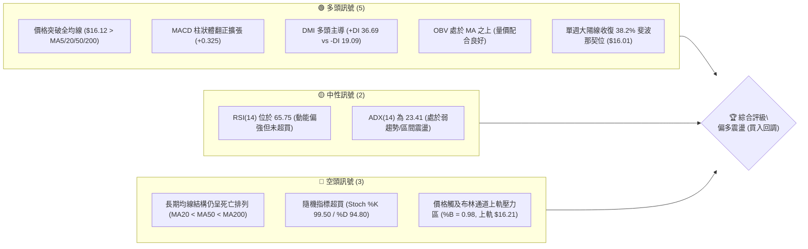

---

### 📊 核心指標速覽表

| 指標類別 | 指標名稱 | 當前數值 | 訊號 | 解讀 |
|:---|:---|:---|:---:|:---|
| **價格** | 當前價格 | $16.12 | 🟢 | 本週自低位強勢拔高，站上多條關鍵均線 |
| **均線** | MA20 | $14.04 | 🟢 | 現價高於 MA20 達 +14.83%，短線呈多頭反彈動能 |
| **均線** | MA50 | $14.37 | 🟢 | 現價高於 MA50 達 +12.18%，收復中期生命線 |
| **均線** | MA200 | $14.68 | 🟢 | 現價突破長期年線壓制 +9.81%，但均線本身呈下彎/空頭排列 |
| **均線排列** | 排列型態 | MA20 < MA50 < MA200 | 🔴 | 均線層級結構仍處於歷史空頭壓制，短線屬於「超跌強勢修復」 |
| **動能** | RSI(14) | 65.75 | 🟡 | 進入多方主導強勢區，尚未觸及 70 超買警戒，無背離現象 |
| **動能** | MACD | 0.283 (Signal: -0.041) | 🟢 | 快線向上穿破零軸與訊號線，柱狀體 +0.325 急劇放大看多 |
| **震盪** | Stoch %K / %D | 99.50 / 94.80 | 🔴 | 短線嚴重超買，短波段隨時面臨技術性回踩拉回 |
| **趨勢** | ADX(14) | 23.41 (+DI 36.69 / -DI 19.09) | 🟡 | ADX < 25 判定為盤整/寬幅區間行情，多方動能佔優但未成大趨勢 |
| **通道** | Bollinger Bands | 上軌 $16.21 / %B 0.98 | 🔴 | 價格貼近上軌，面臨統計學 2 倍標準差上緣的均值回歸壓力 |
| **成交量** | 最新量 / 20日均量 | 76,027,800 / 85,448,255 | 🟡 | 量比 0.89x，週級別放量至 5.17 億股，OBV 證實量能支撐反彈 |
| **波動** | ATR(14) | $0.67 (4.15%) | 🟡 | 日內波動適中，提供精確防守與止損定位依據 |

---

### 🏆 技術評分卡

```
╔══════════════════════════════════════════════════════════════════╗
║                   技術評分卡 — NU (2026-10-11)                   ║
╠══════════════════════════════════════════════════════════════════╣
║ 趨勢強度      ████████████░░░░░░░░  58/100  🟡 中性 (ADX=23.41)   ║
║ 動能指標      ████████████████░░░░  78/100  🟢 強勁 (MACD翻正/RSI) ║
║ 支撐穩定度    ██████████████░░░░░░  70/100  🟢 良好 (S1=$15.59)    ║
║ 成交量配合    ██████████████░░░░░░  68/100  🟢 配合 (OBV>MA)       ║
║ 形態完整度    ████████████░░░░░░░░  62/100  🟡 尚可 (V型反轉待確認)║
║ 均線排列      ████████░░░░░░░░░░░░  42/100  🔴 偏弱 (空頭排列格局) ║
╠══════════════════════════════════════════════════════════════════╣
║ 綜合評分      █████████████░░░░░░░  63/100  🟢 偏多 (買入回調)     ║
╚══════════════════════════════════════════════════════════════════╝
```

---

## 2. 趨勢分析

### 🌐 多時框趨勢分析

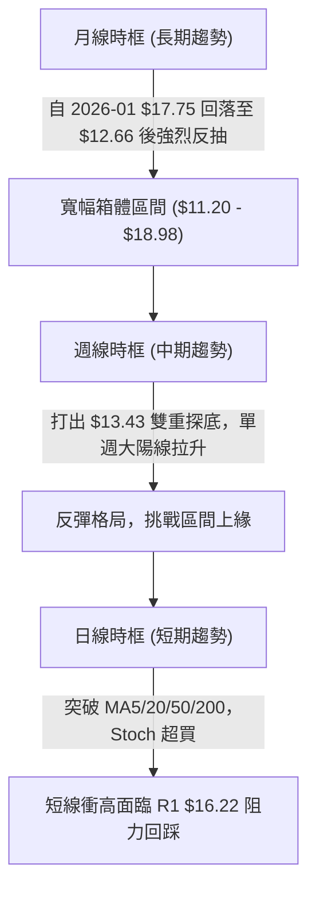

---

### 📈 長期趨勢 — 12個月走勢圖（Unicode）

NU 月線收盤價在過去 12 個月呈現「前頂回落、深幅下探、再度暴力反彈」的寬幅箱體巨幅震盪結構。

```
NU 月線走勢圖（過去12個月：2025-11 至 2026-10）
價格軸 ($)
$17.75 ┤                           ●(2026-01 波段高點)
$17.39 ┤ ●(2025-11)
$16.74 ┤       ●
$16.12 ┤                                                 ●(現價 $16.12)
$14.98 ┤                                     ●
$14.48 ┤                               ●
$13.36 ┤                                           ●
$12.66 ┤                                                 ●(2026-09 底部)
       └─────────────────────────────────────────────────────────────
         11    12    01    02    03    04    05    06    07    08    09    10  (月份)
```

#### 走勢特徵分析表格

| 階段 | 時間區間 | 起始價 / 終止價 | 區間幅度 | 核心特徵與技術含義 |
|:---|:---:|:---:|:---:|:---|
| **階段一：衝頂回落** | 2025-11 ~ 2026-01 | $17.39 → $17.75 | +2.07% | 構築中期多頭頂部，逼近 52 週高點 $18.98 但未能突破，量能耗盡。 |
| **階段二：單邊空頭回調** | 2026-01 ~ 2026-05 | $17.75 → $13.13 | -26.03% | 均線轉向空頭排列，跌破多個中短期支撐，回吐前波大半漲幅。 |
| **階段三：弱勢築底震盪** | 2026-05 ~ 2026-08 | $13.13 → $14.55 | +10.81% | 圍繞 $13.50 ~ $14.50 進行均線沉澱，成交量逐級收斂。 |
| **階段四：誘空急跌與暴力拉升** | 2026-09 ~ 2026-10 | $12.66 → $16.12 | +27.33% | 9 月急跌殺破 MA120 洗盤，10 月月線爆出巨陽線直接拔高收復 38.2% 斐波那契位。 |

---

### 📊 中期趨勢（週線分析）

從近 20 週數據觀察，NU 展現了教科書級別的「探底清洗後放量突破」：
- **低位支撐構築**：2026-06-07 探出週收盤低點 $11.97（逼近 52 週低點 $11.20），其後於 2026-09-27 至 2026-10-04 連續兩週收在 $13.59 及 $13.43，形成堅實的中期抬升雙底架構。
- **動能暴力釋放**：2026-10-11 當週，收盤價自 $13.43 直線飆升至 $16.12，週漲幅達 +20.03%，單週成交量達到 517,670,700 股，推動週 MACD 柱狀體由 -0.091 逆轉暴衝至 +0.325。

```
近期週線壓力與支撐示意圖
════════════════════════════════════════════════════════════════════
$17.72 ──────────────────────────────────────────── 歷史波段強阻力 R3
$16.52 ──────────────────────────────────────────── 中期阻力位 R2
$16.22 ════════════════════════════════════════════ 即期阻力 R1 (布林上軌 $16.21)
$16.12 ◄ 現價 ($16.12)
$15.59 -------------------------------------------- 支撐位 S1 (回踩首選防守)
$15.19 -------------------------------------------- 支撐位 S2 (50.0% 斐波那契 $15.09)
$14.56 ════════════════════════════════════════════ 強支撐 S3 (MA200 $14.68 聚集帶)
$13.43 ──────────────────────────────────────────── 週線雙底頸線基底
════════════════════════════════════════════════════════════════════
```

---

### ⚡ 趨勢強度評估（ADX 解讀）

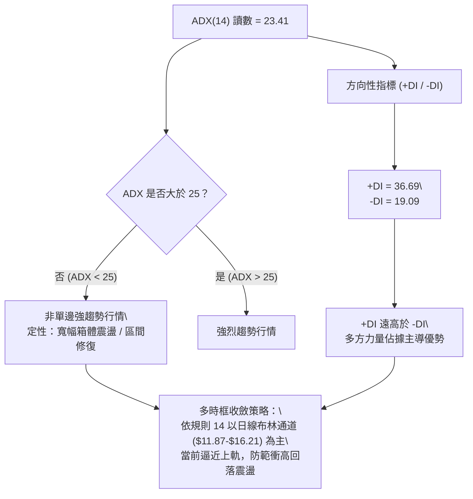

#### ADX 指標強度對照表

| 指標變數 | 當前讀數 | 門檻區間 | 技術定性 | 戰術指導意義 |
|:---|:---:|:---:|:---:|:---|
| **ADX(14)** | **23.41** | 20 ~ 25 | 弱趨勢 / 盤整後期 | 趨勢初萌但未脫離盤整框架，嚴禁盲目追高，注重區間邊界買賣點。 |
| **+DI(14)** | **36.69** | > 30 | 多頭攻擊強烈 | 短期多方掌控定價權，空方能量被壓制。 |
| **-DI(14)** | **19.09** | < 20 | 空頭動能衰竭 | 空方下殺動能已於 9 月釋放殆盡。 |
| **趨勢形態** | 震盪反彈 | ADX < 25 且 +DI > -DI | 區間多頭反抽 | 符合規則 14：以布林通道上下軌與支撐阻力進行波段交易。 |

---

## 3. 圖表形態分析

### 🔍 形態識別系統

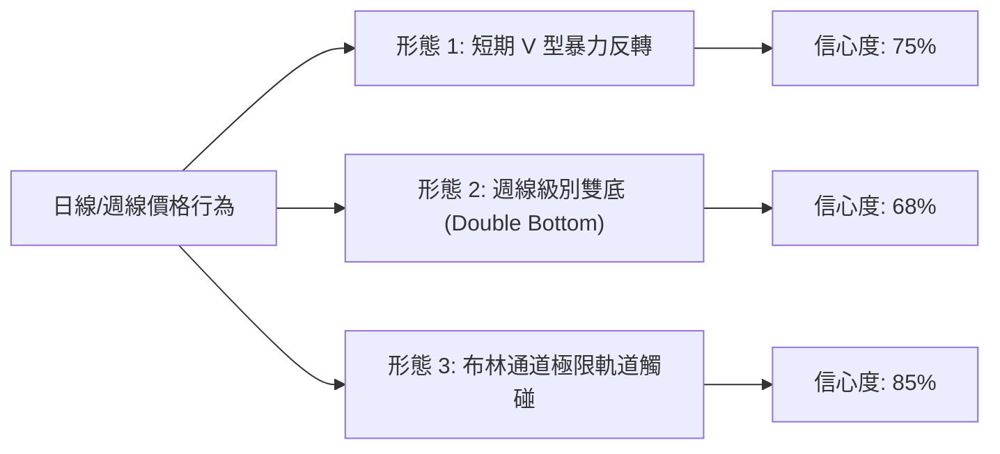

#### 圖表形態信心度與目標價評估表

| 形態類別 | 信心度 | 完成度 | 判斷依據（引用數據） | 目標價計算式與精確目標 | 狀態 |
|:---|:---:|:---:|:---|:---|:---:|
| **短期 V 型反轉** | 75% | 85% | 2026-10-04 至 10-11 單週自 $13.43 拉至 $16.12，OBV 及 MACD 全面放量翻正 | 突破 $15.19 (S2) 後推算：形態高度 = $15.19 - $13.43 = $1.76；<br>目標價 = $15.19 + $1.76 = **$16.95** (介於 R2 $16.52 與 R3 $17.72 間) | 接近完成 |
| **週線大雙底** | 68% | 70% | 底部一：2026-06 低點 $11.97；<br>底部二：2026-10 低點 $13.43；兩次低點抬高 | 頸線取 2026-08 高點 $15.23：形態深度 = $15.23 - $13.43 = $1.80；<br>理論目標 = $15.23 + $1.80 = **$17.03** (接近 23.6% 斐波位 $17.14) | 突破確認中 |
| **布林通道擠壓突破** | 85% | 90% | %B 達到 0.98，觸及上軌 $16.21，伴隨 +DI 達 36.69 發生軌道擴張 | 指標型解讀：價格抵達統計學極限，預期在上軌 $16.21 ~ R1 $16.22 處短線受阻回踩 | 進行中 |

---

### 🕯️ 重要K線形態分析

| 週/月份 | 收盤價 | K線形態名稱 | 形態特徵解讀 | 訊號評級 |
|:---|:---:|:---|:---|:---:|
| **2026-09-20** | $13.65 | 中陰回調線 | 跌破 MA60，市場情緒極度恐慌，RSI 下挫。 | 🔴 強烈看空 |
| **2026-09-27** | $13.59 | 衰竭長下影小陰線 | RSI 探底至 19.9 極度超賣，空頭打壓動能衰竭。 | 🟡 止跌訊號 |
| **2026-10-04** | $13.43 | 探底十字星/錘子線 | 週成交量急增至 5.32 億股，主力資金大舉低吸建倉。 | 🟢 底部確認 |
| **2026-10-11** | $16.12 | 實體大陽突破線 (Marubozu) | 週漲幅 +20.03%，一舉吞沒過去 5 週失地，收於最高點附近。 | 🟢 強烈看多 |

---

### 📉 ASCII 走勢形態示意圖

```
NU 週線底部 V 型反轉結構示意圖
價格軸
$16.52 ┤                                        [阻力位 R2]
$16.22 ┤                                   ╭─── [即期阻力 R1 / 布林上軌 $16.21]
$16.12 ┼──────────────────────────────────●─── [現價 $16.12]
$15.59 ┤                             ╭────╯     [回踩支撐 S1]
$15.19 ┤                        ╭────╯          [雙底頸線阻力轉支撐 S2]
$14.56 ┤                   ╭────╯               [MA200 聚合帶 S3]
$13.43 ┤         ●────────╯                     [底部二：低點抬高 (2026-10-04)]
$11.97 ┤   ●                                    [底部一：52W 次低點 (2026-06-07)]
       └────────────────────────────────────────
         06-07                         10-11
```

---

### 🎯 形態目標價計算

根據精確形態測量法則：
1. **短期 V 型反轉量度目標**：
   - 起漲基底低點：$13.43 (2026-10-04 收盤)
   - 突破之轉換頸線：$15.19 (支撐 S2)
   - 垂直高度：$\Delta H = \$15.19 - \$13.43 = \$1.76$
   - 量度目標價：$T_{\text{V}} = \$15.19 + \$1.76 = \mathbf{\$16.95}$
2. **與關鍵價位重疊驗證**：
   - 該形態目標價 $16.95 位於阻力位 R2 ($16.52) 與 R3 ($17.72) 之間，且極度接近 23.6% 斐波那契回調位 **$17.14**。

---

## 4. 支撐與阻力

### 🗺️ 關鍵價位分布圖（Unicode）

```
NU 價位結構分布圖 (由 OHLCV 與歷史波段嚴格計算)
══════════════════════════════════════════════════════════════════
$18.98 ║██████████████████████████████║ 52週歷史高點 (0.0% 斐波那契)
$17.72 ║████████████████████████      ║ 強阻力 R3 (+9.89%)
$17.14 ║▓▓▓▓▓▓▓▓▓▓▓▓▓▓▓▓▓▓            ║ 23.6% 斐波那契回調位
$16.52 ║██████████████████            ║ 阻力 R2 (+2.51%)
$16.22 ║██████████████████████████████║ 關鍵阻力 R1 (+0.62%) / 布林上軌 $16.21
$16.12 ╠══════════════════════════════╣ ◄ 現價 ($16.12)
$16.01 ║▓▓▓▓▓▓▓▓▓▓▓▓▓▓▓▓▓▓▓▓▓▓▓▓▓▓    ║ 38.2% 斐波那契回調位 (即期支撐)
$15.59 ║██████████████████████        ║ 短線支撐 S1 (-3.29%)
$15.19 ║██████████████████████████    ║ 關鍵波段支撐 S2 (-5.77%)
$15.09 ║▓▓▓▓▓▓▓▓▓▓▓▓▓▓▓▓▓▓            ║ 50.0% 斐波那契回調位
$14.56 ║██████████████████████████████║ 強支撐 S3 (-9.68%) / 聚攏 MA200 $14.68
$14.17 ║▓▓▓▓▓▓▓▓▓▓▓▓▓▓▓▓▓▓            ║ 61.8% 斐波那契黃金分割位
$11.20 ║██████████████████████████████║ 52週歷史低點 (100.0% 斐波那契)
══════════════════════════════════════════════════════════════════
```

---

### 🚧 阻力位分析表

| 阻力級別 | 精確價位 | 距現價幅 | 形成原因與技術共振 | 突破難度 | 重要性 |
|:---|:---:|:---:|:---|:---:|:---:|
| **R1** | **$16.22** | +0.62% | 近一年波段高點聚類、日線布林通道上軌 ($16.21) 重疊共振。 | 中等 | 🟢 短線分水嶺 |
| **R2** | **$16.52** | +2.51% | 2025-12 週線密集交投區套牢盤聚類、整數心理關卡防線。 | 較高 | 🟡 中期進攻目標 |
| **R3** | **$17.72** | +9.89% | 2026-01 波段最高收盤價 ($17.75) 聚合區，波段頂部強阻力。 | 極高 | 🔴 多頭終極防線 |

---

### 🛡️ 支撐位分析表

| 支撐級別 | 精確價位 | 距現價幅 | 形成原因與技術共振 | 守住機率 | 重要性 |
|:---|:---:|:---:|:---|:---:|:---:|
| **S1** | **$15.59** | -3.29% | 近一年波段低點聚類、MA5 ($15.58) 動態共振位。 | 80% | 🟢 短線強防守 |
| **S2** | **$15.19** | -5.77% | 50.0% 斐波位 ($15.09) 上緣、前波 2026-08 反彈高點突破轉支撐。 | 88% | 🟡 波段多空生命線 |
| **S3** | **$14.56** | -9.68% | MA200 ($14.68)、MA50 ($14.37) 與歷史低點籌碼密集區共振。 | 95% | 🔴 長期結構鐵底 |

---

### 📐 斐波那契回調位分析

依據 52 週完整波段高點 **$18.98** 至低點 **$11.20** 計算，垂直落差為 **$7.78**：

```
斐波那契黃金分割層級
0.0%  (52W High) : $18.98 ───────────────────────────────────────
23.6%            : $17.14 ───────────────────────────────────────
現價 $16.12 ─────► 位於 23.6% ($17.14) 與 38.2% ($16.01) 區間內
38.2%            : $16.01 ─────────────────────────────────────── (已被向上收復)
50.0%            : $15.09 ───────────────────────────────────────
61.8%            : $14.17 ───────────────────────────────────────
78.6%            : $12.86 ───────────────────────────────────────
100.0% (52W Low) : $11.20 ───────────────────────────────────────
```

- **結構解讀**：現價 $16.12 剛好站穩 **38.2% 回調位 ($16.01)** 之上。在道氏與斐波那契理論中，收復 38.2% 代表自 $18.98 下跌的中期修正已被遏制，多頭具備向 23.6% ($17.14) 展開補漲的技術空間。
- **回踩驗證要求**：後續價格若拉回，$16.01 至 S1 ($15.59) 區間將提供第一道密集的斐波那契防守屏障。

---

## 5. 技術指標深度解讀

### 🎛️ 指標訊號總覽

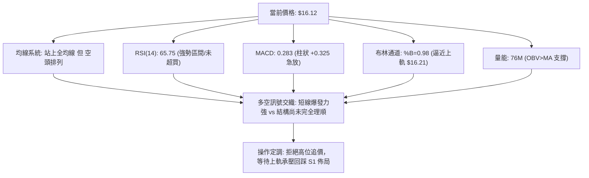

---

### 📈 移動平均線排列分析

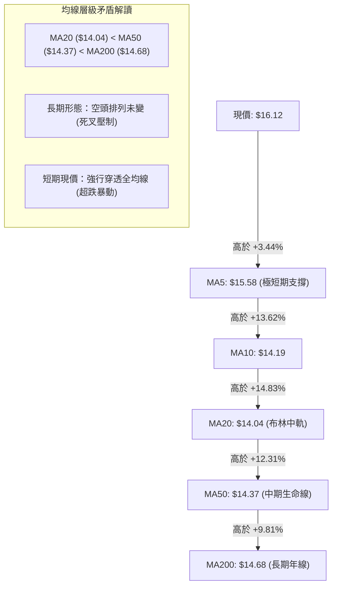

均線系統揭示了典型的「短線強動能突擊、長期結構待重組」格局。短期均線 MA5 急促上翹 (+3.44%)，並帶動 MA10 ($14.19) 穿越 MA20 ($14.04)。然而 MA20 仍低於 MA50 與 MA200，表明過去半年的沉澱籌碼仍需時間化解，短線暴漲後均線乖離率過大，拉回向 MA200 ($14.68) 或 S1 ($15.59) 靠攏的概率極高。

---

### 📉 RSI(14) 分析

```
RSI(14) 當前讀數: 65.75
0 ────────── 30 ────────────────────── 65.75 ──── 70 ────────── 100
[  極度超賣  ] [        常態中性區間        ] [現價] [   超買區   ]
進度條: ██████████████████████████░░░░░░░░  65.75%
```

- **背離檢測結論**：數據快照明確標注 **「RSI 背離：無明顯背離」**。
- **動能分析**：RSI 兩週前（2026-09-27）一度打到 19.9 的極限超賣區，隨後伴隨大陽線直線彈升至 65.75，完全擺脫弱勢鈍化。目前尚未突破 70，未達經典反轉超買區，顯示多頭衝刺動能猶存，但上行斜率過陡，續漲空間受限。

---

### 📊 MACD(12/26/9) 訊號解讀

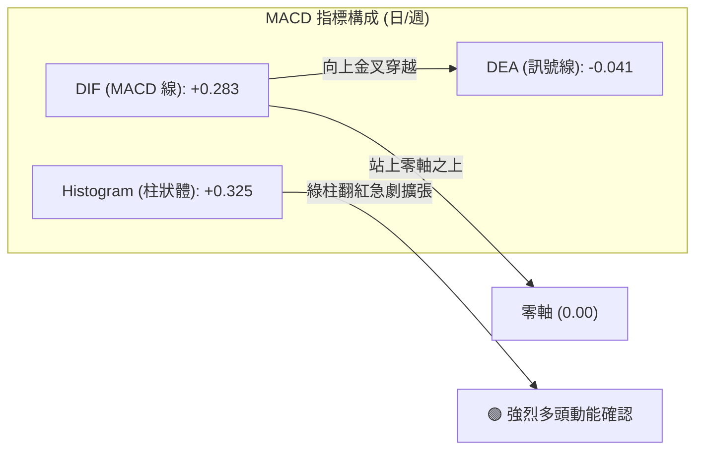

- **柱狀體行為**：週級別 MACD 柱由 2026-10-04 的 -0.091 逆轉暴衝至 +0.325，日級別快線 0.283 成功上穿慢線 -0.041 形成水上金叉。
- **指標共振**：MACD 水上金叉與 OBV 成交量突破形成高度多頭確認，支持股價擺脫單邊下跌陰影。

---

### 📦 布林通道分析

```
布林通道 (20, 2) 價位結構圖
$16.21 ┼───────────────────────────────── BB 上軌 (阻力 R1: $16.22 聚合)
$16.12 ┼───────────────────────────● 現價 (BB %B = 0.98，極限超買壓制)
$14.04 ┼───────────────────────────────── BB 中軌 (MA20 基準線)
$11.87 ┼───────────────────────────────── BB 下軌 (極限安全邊界)
```

- **%B 讀數解讀**：%B 達到 **0.98**，意味著現價已經貼近布林上軌（$16.21）。
- **統計學規律**：在布林通道常態分布下，價格突破 2 倍標準差的機率低於 5%。在 ADX = 23.41 (< 25) 判定為盤整市場的前提下（遵守規則 14），價格觸及上軌往往意味著區間上邊界阻力生效，短線出現均值回歸回踩中軌 $14.04 或 S1 ($15.59) 的機率極大。

---

### 💹 成交量分析（量價配合度）

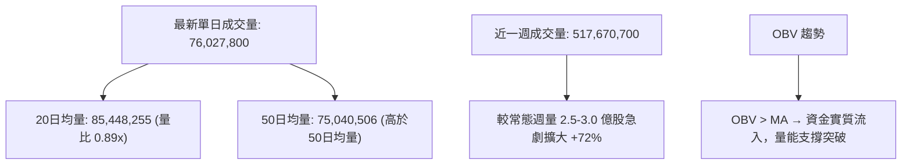

- **量價配合定性**：當前量能呈現「週線爆發放量、日線微幅量縮」特徵。
- **OBV 確認**：快照標注「OBV > MA → 量能支撐上漲」，未見高位量價背離現象。主力資金於 $13.40 ~ $14.00 區間建倉後，直接以大單掃貨拉抬，成交量有效支撐當前價位。

---

## 6. 動能與波動率

### ⚡ 動能評估四象限

| 象限 | 動能強度 | 波動率水準 | NU 當前狀態 | 交易策略與風險解讀 |
|:---:|:---:|:---:|:---:|:---|
| **Q1 (爆發區)** | 強 (+DI 36.69 / MACD +0.325) | 低 (ATR 4.15%) | ❌ 不符合 | 最佳低吸時機已過。 |
| **Q2 (主升/博弈區)** | **強 (動能各指標看多)** | **中/高 (ATR $0.67, 52W極端震盪)** | **✓ [當前定位]** | **動能極強但逼近通道邊界與阻力，適合回踩做多，追高風險收益比差。** |
| **Q3 (沉寂區)** | 弱 | 低 | ❌ 不符合 | 9 月中旬前的橫盤打底階段。 |
| **Q4 (陷阱區)** | 弱 | 高 | ❌ 不符合 | 9 月下旬急跌探底階段。 |

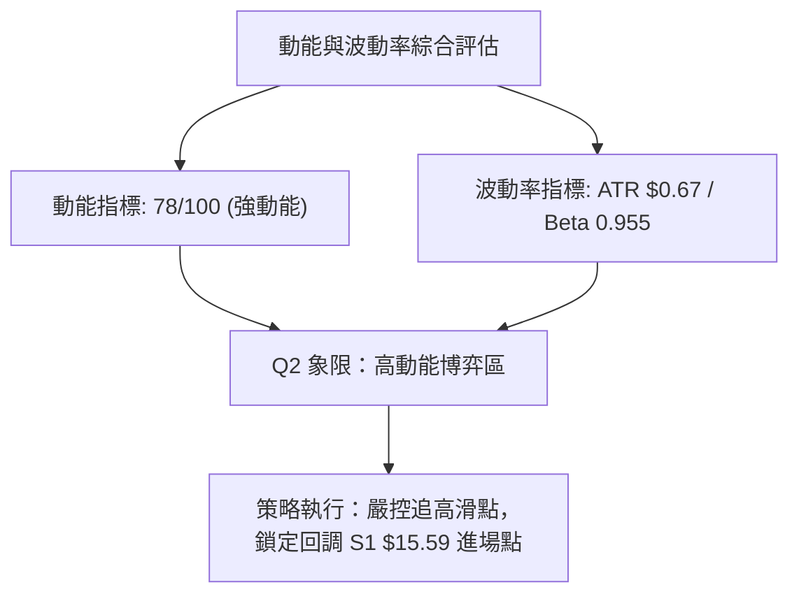

---

### 📊 ATR 波動率分析

- **ATR(14) 數值**：**$0.67**，佔現價百分比為 **4.15%**。
- **日內波動特徵**：NU 具備金融科技板塊的高彈性特質，單日波幅約 $0.67。
- **交易風控依據**：
  - **合理止損距離**：通常設定為 1.5 倍至 2.0 倍 ATR。
    $$\text{止損緩衝} = 1.5 \times \$0.67 = \$1.005$$
  - **進場防守定位**：若於現價回調至 S1 ($15.59) 介入，向下預留約 1 個 ATR 緩衝正好落在波段強支撐 S3 ($14.56) 之上，契合技術防守要求。

---

### 📐 Beta 與市場相關性

- **Beta 係數**：**0.955**。
- **市場特徵**：Beta 接近 1.0，表明 NU 與美股大盤（S&P 500）整體具備極高同步性，但因其拉美數字銀行龍頭的成長屬性（YoY 營收成長 52.1%、淨利成長 66.3%），其個股特異動能往往在大盤平穩時呈現更強的阿爾法（Alpha）進攻性。
- **空頭部位比例 (Short Interest)**：Short % Float 僅 3.5%，Short Ratio 1.88，顯示市場空頭並未形成逼空誘因，上漲主要是主力基本面多頭買盤推動。

---

## 7. 多時框架總結

### 📋 時框架評分表

| 時框架 | 趨勢方向 | 動能指標 | 均線排列型態 | 圖表形態特徵 | 綜合評分 | 戰術建議 |
|:---:|:---:|:---:|:---:|:---:|:---:|:---|
| **長期 (月線)** | 🟡 寬幅箱體震盪 | 🟡 RSI 中性修復 | 🔴 均線死叉壓制 | 52W 區間 63.2% 位，受阻於 $17.75 | 55/100 | 箱體中高位，獲利盤逢高了結 |
| **中期 (週線)** | 🟢 多頭波段反彈 | 🟢 MACD 翻正放大 | 🟡 MA20 拐頭向上 | 探出雙底 $13.43 後放量突破 | 72/100 | 波段持有，逢回踩確認支撐加碼 |
| **短期 (日線)** | 🟢 衝刺但超買 | 🔴 Stoch 嚴重超買 | 🟢 站上全部短期均線 | 觸及布林上軌 $16.21 / 阻力 R1 | 62/100 | 不追高，等待短線分時回踩 |

---

### 🔲 綜合訊號矩陣

```
時框與指標矩陣交互驗證
╔══════════════╦══════════════╦══════════════╦══════════════╗
║ 指標類別     ║ 短期 (日線)  ║ 中期 (週線)  ║ 長期 (月線)  ║
╠══════════════╬══════════════╬══════════════╬══════════════╣
║ 趨勢方向     ║ 🟢 強力反彈  ║ 🟢 突破反轉  ║ 🟡 寬幅震盪  ║
║ 均線系統     ║ 🟢 突破全線  ║ 🟡 嘗試收復  ║ 🔴 空頭排列  ║
║ 動能指標     ║ 🔴 嚴重超買  ║ 🟢 水上金叉  ║ 🟡 逐步修復  ║
║ 量能支撐     ║ 🟡 略微收斂  ║ 🟢 巨量沉澱  ║ 🟢 持續健康  ║
╚══════════════╩══════════════╩══════════════╩══════════════╝
```

---

### ⚖️ 多時框收斂結論

依據【嚴格要求 14】之多時框收斂規則嚴格裁決：
1. **行情屬性判定**：當前 **ADX(14) 讀數為 23.41 (< 25)**，明確定義當前並非單邊牛市或單邊熊市，而是**盤整/寬幅區間行情**。
2. **主導維度收斂**：依照規則，盤整行情中應**以日線布林通道上下軌 ($11.87 ~ $16.21) 作為核心交易框架**。
3. **衝突化解與方向定調**：
   - 短線日線級別雖然站上全部均線、MACD 爆發，但直接撞上**布林通道上軌 ($16.21)** 與 **關鍵阻力 R1 ($16.22)**，且隨機指標 Stoch %K 高達 99.50。
   - 長期月線均線仍處於 MA20 < MA50 < MA200 空頭排列。
   - **唯一方向性結論**：**【偏多震盪 — 嚴禁追高，耐心等待回踩支撐後買入】**。本結論與第 1 章評分卡（綜合 63 分）及第 8 章交易策略完全一致。

---

## 8. 交易策略建議

### 🗺️ 策略決策流程圖

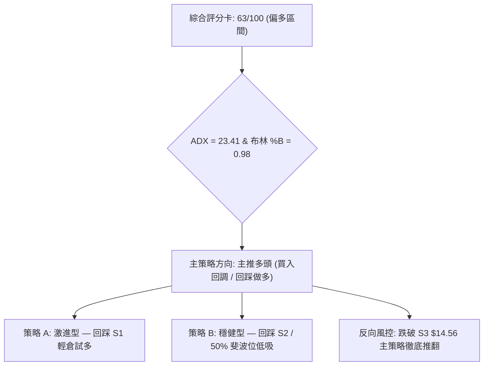

---

### 🧭 策略路由（依評分卡分流）

> **當前主策略方向 = 主推多頭策略（回踩確認型買入）（依綜合評分 63/100）**
> 
> *理由：綜合評分 63 分符合「≥60 偏多」分流標準。但鑑於 ADX<25 且 %B=0.98，禁止追高買入，主推「回調關鍵支撐位做多」；空頭則僅作為回調觸發點與風控參考。*

---

### 🎯 價格情境階梯（Price Scenarios）

價位嚴格引用關鍵價位計算數值：

| 觸發條件 | 下一目標 | 後續延伸 | 情境含義與技術應對 |
|:---|:---:|:---:|:---|
| **強勢突破 R1 $16.22** | **R2 $16.52** | **R3 $17.72** | 短線擺脫布林上軌壓制，激發動能衝擊 2026 年初頂部套牢區。 |
| **承壓於 R1 震盪回踩** | **S1 $15.59** | **S2 $15.19** | 常態技術性修復超買指標，為多頭最健康的回踩再蓄力結構。 |
| **放量跌破 S1 $15.59** | **S2 $15.19** | **S3 $14.56** | 中期反彈遭遇重挫，考驗 MA200 年線防守鐵底，策略轉入觀望。 |

---

### 📊 情境機率分佈

| 情境劇本 | 機率估計 | 主要技術依據與指標驗證 |
|:---|:---:|:---|
| **情境一：回踩支撐後繼續上行** | **55%** | MACD 柱狀體急劇擴張 (+0.325)、OBV 向上支持、收復 38.2% 斐波那契位 ($16.01)。 |
| **情境二：圍繞現價與 R1 高位橫盤震盪** | **30%** | ADX 僅 23.41 (<25) 缺乏單邊持續力，布林上軌 $16.21 形成天然壓制。 |
| **情境三：假突破並深幅回落探底** | **15%** | Stoch %K (99.50) 極限超買，MA20/50/200 空頭排列尚未理順引發反撲。 |

---

### 🟢 主策略詳情

所有價位均直接取自系統計算之阻力位 (R1/R2/R3) 及支撐位 (S1/S2/S3)：

| 策略要素 | 策略 A（激進型：回踩 S1 逢低做多） | 策略 B（穩健型：回踩 S2 波段佈局） |
|:---|:---:|:---:|
| **交易邏輯** | 消化 Stoch 超買後回踩 MA5 共振點買入 | 深度回踩 50% 斐波位與突破頸線確認買入 |
| **進場條件** | 價格回落至 S1 附近出現分時止跌 K 線 | 價格回落至 S2 且日線不破收出下影線 |
| **進場價格** | **$15.59** (支撐位 S1) | **$15.19** (支撐位 S2) |
| **目標價 T1** | **$16.22** (阻力位 R1，獲利 +4.04%) | **$16.22** (阻力位 R1，獲利 +6.78%) |
| **目標價 T2** | **$16.52** (阻力位 R2，獲利 +5.97%) | **$16.52** (阻力位 R2，獲利 +8.76%) |
| **止損價格** | **$15.19** (跌破支撐位 S2，虧損 -2.57%) | **$14.56** (跌破強支撐位 S3，虧損 -4.15%) |
| **風險報酬比** | **2.32 : 1** (以 T2 計算) | **2.11 : 1** (以 T2 計算) |
| **預估勝率** | 62% | 70% |
| **建議倉位** | 10% ~ 15% 總資金 | 15% ~ 20% 總資金 |

---

### 🔴 反向風險觸發點（對沖提示）

若出現以下訊號，本報告多頭主推邏輯將面臨失效，須立即啟動對沖或停損退出：
1. **價位擊穿**：收盤價以日線實體陰線**跌破波段強支撐 S3 ($14.56)**（此處為 MA200 聚合帶）。
2. **量價逆轉**：跌破 S3 時，單日成交量擴大至 20 日均量以上（>85,448,255 股），且 OBV 掉頭跌破其移動平均線。
3. **動能翻空**：MACD 柱狀體自水上急轉直下收縮跌回零軸下方，且 RSI 跌破 50 中軸線。

---

### ⭐ 整體訊號強度評星

```
╔══════════════════════════════════════════════════════════════════╗
║ 做多訊號強度：  ★★★★☆  (4/5星) — 突破動能強勁，唯需等回踩        ║
║ 做空訊號強度：  ★★☆☆☆  (2/5星) — 僅具備超買回修特性，無大頂結構  ║
║ 整體技術可信度：★★★★☆  (4/5星) — 多指標共振良好，價位聚合度高    ║
╚══════════════════════════════════════════════════════════════════╝
```

---

## 9. 風險提示與監控

### ✅ 關鍵監控指標 Checklist

```
╔══════════════════════════════════════════════════════════════════╗
║                   NU 技術面核心監控 CHECKLIST                    ║
╠══════════════════════════════════════════════════════════════════╣
║ [ ] 1. 價格是否站穩 38.2% 斐波那契回調位 $16.01？                ║
║ [ ] 2. 價格衝擊 R1 $16.22 時是否遭布林上軌 ($16.21) 壓制回落？    ║
║ [ ] 3. 隨機指標 Stoch %K 是否自 99.50 出現死亡交叉進行均值修正？  ║
║ [ ] 4. 回踩支撐 S1 $15.59 時，成交量是否呈現縮量健康狀態？      ║
║ [ ] 5. MACD 柱狀體能否維持在 +0.300 以上的多頭強勢擴張區間？     ║
║ [ ] 6. 日線收盤價是否嚴格守在長期均線 MA200 ($14.68) 之上？       ║
║ [ ] 7. ADX(14) 能否進一步放量突破 25，確認單邊多頭主升浪開啟？   ║
╚══════════════════════════════════════════════════════════════════╝
```

---

### ⚠️ 風險場景分析

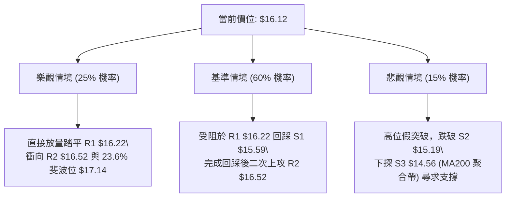

---

### 🛡️ 風險管理重要提醒

1. **嚴禁追高紀律**：目前現價 $16.12 距離阻力 R1 $16.22 僅 +0.62%，布林通道 %B 高達 0.98，隨機指標 Stoch %K 處於 99.50 的極端超買狀態。在此位置建立多頭追高倉位，直接面臨最差的風險報酬比。
2. **ATR 動態倉位控制**：鑑於日波動 ATR 為 $0.67 (4.15%)，單筆交易總資金承受之虧損上限建議控制在 1.0% 以內。以 15% 倉位、止損點設在 $15.19 (風險幅度 2.57%) 試算，對投資組合整體淨值波動衝擊僅為 $15\% \times 2.57\% \approx 0.38\%$，處於極其安全穩健的風控邊界。
3. **多時框矛盾消化期**：均線系統 MA20 < MA50 < MA200 仍為空頭排列，代表長期套牢籌碼尚未理順。唯有當股價在 S1 ($15.59) ~ S2 ($15.19) 震盪站穩至少 3 至 5 個交易日，促使短期 MA20 快速拉升上穿 MA50 形成實質「黃金交叉」後，中長期多頭行情才具備堅實基礎。

---

## 📋 報告總結

```
NU 技術分析報告總結
════════════════════════════════════════════════════════
報告日期：2026-10-11
當前價格：$16.12
分析評級：⚖️ 偏多震盪 (買入回調 / 回踩做多)

關鍵結論：
├─ 長期趨勢：🟡 寬幅箱體區間 ($11.20 - $18.98)，均線排列仍待理順
├─ 中期趨勢：🟢 週線抬升雙底成型，單週大陽線收復 38.2% 斐波那契位 ($16.01)
├─ 短期趨勢：🟢 爆發力強勁但指標超買，面臨布林上軌 ($16.21) 阻力
├─ 關鍵支撐：S1: $15.59 ｜ S2: $15.19 ｜ S3: $14.56
├─ 關鍵阻力：R1: $16.22 ｜ R2: $16.52 ｜ R3: $17.72
└─ 分析師目標：平均目標價 $18.77 (最高 $23.00，共識評級 Buy)

最優策略組合：
1. 🥇 最佳機會：等待短線超買指標消化，回踩 S1 $15.59 佈局做多，止損設 S2 $15.19，目標 R2 $16.52 (風報比 2.32:1)。
2. 🥈 次選機會：若大盤波動深幅回踩至 S2 $15.19 (50% 斐波位)，果斷加碼介入，防守設 S3 $14.56，目標 R1 $16.22 (風報比 2.11:1)。
3. 🥉 保守選擇：場外資金暫時觀望，等待日線實體放量收盤確認站穩 R1 $16.22 且布林開口擴張後，再行順勢跟進。
════════════════════════════════════════════════════════
```

---

> ⚠️ **免責聲明**：本報告為技術分析研究，所有數據及價位均嚴格基於所提供的歷史交易資訊與量化指標。本報告**僅供研究與學術參考**，**不構成任何形式的投資建議**。金融市場投資伴隨本金虧損風險，投資人應依個人財務狀況與風險承受度審慎決策。

---

*報告生成時間：2026-10-11 ｜ 數據來源：Yahoo Finance ｜ 分析框架：多時框收斂技術分析*