# NU 技術分析報告

> **報告日期**：2026-10-12 ｜ **語言**：繁體中文 ｜ **數據來源**：Yahoo Finance ｜ **當前價格**：$16.12

---

## 目錄

| 章節 | 內容 |
|------|------|
| [1. 技術面概覽](#1-技術面概覽) | 訊號儀表板、核心指標、評分卡 |
| [2. 趨勢分析](#2-趨勢分析) | 多時框趨勢、長中短期走勢 |
| [3. 圖表形態分析](#3-圖表形態分析) | 形態識別、K線組合、目標價 |
| [4. 支撐與阻力](#4-支撐與阻力) | 關鍵價位、斐波那契回調 |
| [5. 技術指標深度解讀](#5-技術指標深度解讀) | MA/RSI/MACD/布林/成交量 |
| [6. 動能與波動率](#6-動能與波動率) | 動能評估、ATR、Beta |
| [7. 多時框架總結](#7-多時框架總結) | 時框架評分矩陣 |
| [8. 交易策略建議](#8-交易策略建議) | 多空策略、風險報酬比 |
| [9. 風險提示與監控](#9-風險提示與監控) | 監控指標、風險場景 |

---

## 1. 技術面概覽

### 🎯 技術訊號儀表板

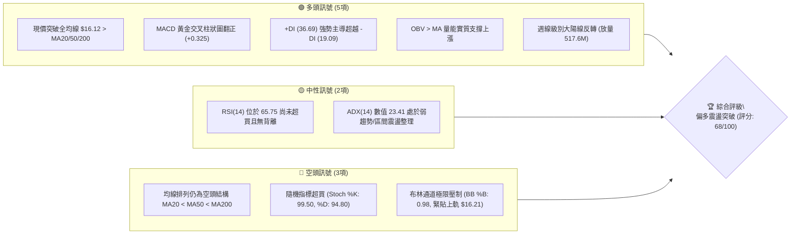

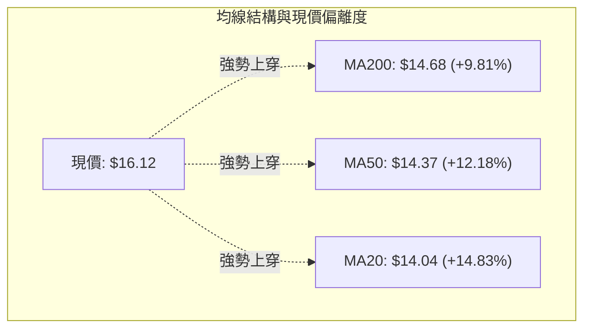

### 📊 核心指標速覽表

| 指標類別 | 指標名稱 | 當前數值 | 訊號 | 解讀 |
|----------|----------|----------|------|------|
| **價格** | 當前價格 | $16.12 | 🟢 | 站上 52 週區間 63.2% 分位，短線動能強勁 |
| **均線** | MA20 | $14.04 | 🟢 | 現價高於 MA20 達 +14.83%，短線向上乖離較大 |
| **均線** | MA50 | $14.37 | 🟢 | 現價高於 MA50 達 +12.18%，中期底部確立 |
| **均線** | MA200 | $14.68 | 🟢 | 突破年線關鍵分水嶺，長期技術面具備修復基礎 |
| **排列** | 均線系統 | MA20<MA50<MA200 | 🔴 | 均線長短期骨架尚未完全金叉扭轉，仍屬右側修復期 |
| **動能** | RSI(14) | 65.75 | 🟡 | 位於健康多頭區間（50–70），無背離，多方動能充足 |
| **動能** | MACD (12,26,9) | 0.283 (柱 +0.325) | 🟢 | MACD 線穿過訊號線（-0.041），動能柱顯著擴張 |
| **動能** | Stoch %K / %D | 99.50 / 94.80 | 🔴 | 隨機震盪指標嚴重超買，短線防範獲利了結賣壓 |
| **趨勢** | ADX(14) | 23.41 | 🟡 | ADX < 25 表明趨勢強度仍在醞釀，屬大級別震盪突破 |
| **通道** | 布林通道 %B | 0.98 ($16.21 上軌) | 🔴 | 觸碰通道上軌邊界，短線面臨均值回歸回調阻力 |
| **波動** | ATR(14) | $0.67 (4.15%) | 🟡 | 波動率處於中等水準，單日價格震盪空間明確 |
| **量能** | OBV 趨勢 | OBV > MA | 🟢 | 資金持續淨流入，量能結構有效支撐此輪反彈 |

### 🏆 技術評分卡

```
╔══════════════════════════════════════════════════════════════════╗
║                   技術評分卡 — NU (2026-10-12)                   ║
╠══════════════════════════════════════════════════════════════════╣
║ 趨勢強度 (ADX/方向)   ████████████░░░░░░░░  60/100  🟡 中性偏多 ║
║ 動能指標 (RSI/MACD)   ████████████████░░░░  80/100  🟢 強勁看多 ║
║ 支撐穩定度 (S1-S3)    ██████████████░░░░░░  70/100  🟢 結構穩固 ║
║ 成交量配合 (OBV/週量) ████████████████░░░░  80/100  🟢 量價齊揚 ║
║ 形態完整度 (V型反轉)  ██████████████░░░░░░  70/100  🟢 反彈成型 ║
║ 均線排列 (空頭排列中) ████████░░░░░░░░░░░░  40/100  🔴 滯後修復 ║
╠══════════════════════════════════════════════════════════════════╣
║ 綜合技術評分          █████████████░░░░░░░  68/100  🟢 偏多進攻 ║
╚══════════════════════════════════════════════════════════════════╝
```

---

## 2. 趨勢分析

### 🌐 多時框趨勢分析

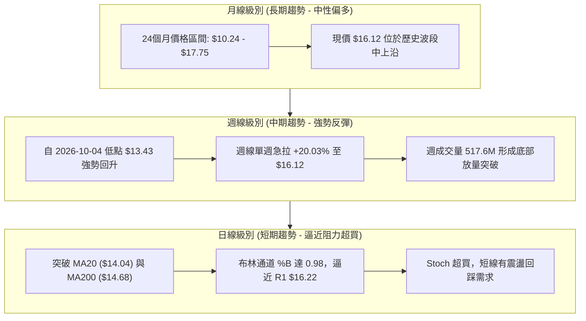

### 📈 長期趨勢 — 12個月走勢圖（Unicode）

NU 過去 12 個月（2025-11 至 2026-10）經歷了自 $17.75 衝頂、深度回調至 $12.66、再到當前單月暴力反彈至 $16.12 的完整波段輪迴：

```
NU 月線走勢圖（過去12個月：2025-11 至 2026-10）
價格軸 ($)
$18.00 ┤              ●($17.75 高點)
$17.00 ┤          ●       ●
$16.00 ┤                                        ●←現價 $16.12
$15.00 ┤                      ●
$14.00 ┤                          ●   ●   ●   ●
$13.00 ┤                                  ●   ●
$12.00 ┤                                          ●($12.66 低點)
       └────────────────────────────────────────────────────────
月份     11   12  01  02  03  04  05  06  07  08  09  10 (2026)
```

**12個月價格走勢特徵表**：

| 時間階段 | 起訖月份 | 起訖價格 | 區間漲跌幅 | 走勢結構與技術特徵 |
|----------|----------|----------|------------|--------------------|
| 衝頂階段 | 2025-11 ~ 2026-01 | $17.39 → $17.75 | +2.07% (高點碰觸) | 衝擊 52 週歷史高點區域，動能逐步衰竭 |
| 中期回撤 | 2026-02 ~ 2026-05 | $14.98 → $13.13 | -12.35% | 連續階梯式下行，失守各級短中期均線 |
| 築底震盪 | 2026-06 ~ 2026-08 | $13.36 → $14.55 | +8.91% | 在 $13.00–$14.50 進行吸籌箱體整理 |
| 假摔洗盤 | 2026-09 | $14.55 → $12.66 | -12.99% | 快速跌破箱體下沿，測試 52 週低點支撐 |
| 暴力反轉 | 2026-10 (當前) | $12.66 → $16.12 | +27.33% | 大陽線實體反包，突破年線與斐波那契 38.2% |

### 📊 中期趨勢（週線分析）

```
NU 中期週線支撐與阻力走勢架構 ($)
$18.98 ┼──────────────────────────────────────── 52W High (極限壓力)
$17.72 ┼──────────────────────────────────────── R3 強阻力位 (波段高點)
$16.52 ┼──────────────────────────────────────── R2 阻力位
$16.22 ┼════════════════════════════════════════ R1 關鍵阻力 (現價 $16.12 附近)
$16.01 ┼- - - - - - - - - - - - - - - - - - - -  斐波那契 38.2% 回調位
$15.59 ┼──────────────────────────────────────── S1 第一支撐 (回踩測試點)
$15.19 ┼──────────────────────────────────────── S2 第二支撐 (斐波 50% 附近)
$14.56 ┼──────────────────────────────────────── S3 強支撐 (MA200 / 波段聚類)
$13.43 ┼──────────────────────────────────────── 本輪起漲波段起點 (2026-10-04)
```

中期週線在 2026-09-27 當週 RSI 觸及 19.9 的極端超賣區域後，隨即在 2026-10-04 於 $13.43 形成堅實底部。本週收盤大漲至 $16.12，週 RSI 飆升至 65.7，MACD 柱狀圖由 -0.091 逆轉為 +0.325，週成交量放大至 517,670,700 股，確認中期趨勢由空頭轉為多頭主導。

### ⚡ 趨勢強度評估（ADX 解讀）

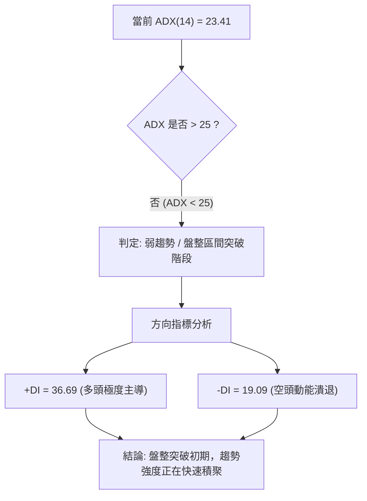

| 指標名稱 | 數值 | 臨界標準 | 狀態評估 | 實質技術含義 |
|----------|------|----------|----------|--------------|
| **ADX(14)** | 23.41 | 25.00 | 🟡 盤整/弱趨勢區間 | 雖然尚未跨越 25 強趨勢門檻，但正在自低位陡峭上升 |
| **+DI(14)** | 36.69 | > 20.00 | 🟢 極強多頭 | 多方買盤推動力強勁，佔據市場絕對主導權 |
| **-DI(14)** | 19.09 | < 20.00 | 🟢 空方衰退 | 空方下殺動能已消耗殆盡，無法形成下行壓制 |

---

## 3. 圖表形態分析

### 🔍 形態識別系統

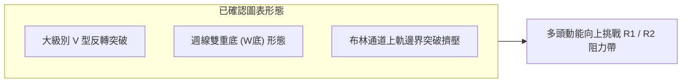

**形態信心度與目標價評估表**：

| 形態名稱 | 信心度 | 判斷依據（引用數據） | 完成度 | 目標價（附計算式） |
|----------|--------|----------------------|--------|--------------------|
| **週線雙重底 (W底)** | 75% | 第一底於 2026-06-07 ($11.97)，第二底於 2026-09 月末至 10 月初 ($13.43-$12.66)，兩次於低位獲撐；頸線位於 2026-09-06 波段高點 $15.37 | 85% (已突破頸線) | 頸線 $15.37 + 形態高度 ($15.37 - $13.43 = $1.94) = **$17.31**（逼近 R3 $17.72） |
| **V型急遽反轉** | 70% | 2026-09 收盤 $12.66，2026-10-04 當週收 $13.43 後，單週拔高至 $16.12，OBV 與週量大幅配合 | 90% (已完成反轉波) | 依起跌點推算：起跌平台 $15.37 突破後延伸等長漲幅至 **$17.31** |
| **均線穿刺形態** | 80% | 單根實體巨陽線一舉收復 MA20 ($14.04)、MA50 ($14.37)、MA200 ($14.68) | 100% (已完成突破) | 指標型突破，上方第一理論空間為前期密集成交區 R2 **$16.52** |

### 🕯️ 重要K線形態分析

| 週期/時間 | 收盤價 | K線形態 | 解讀 | 訊號 |
|-----------|--------|---------|------|------|
| **2026-09-27 週** | $13.59 | 低檔十字星/超賣線 | RSI 跌至 19.9 極度恐慌區，空方力竭訊號顯現 | 🟡 潛在見底 |
| **2026-10-04 週** | $13.43 | 探底回升錘子線 | 成交量 532.7M 巨量換手，下影線確認買盤強烈進駐 | 🟢 底部確認 |
| **2026-10-11 週** | $16.12 | 光頭光腳大陽線 | 週漲幅超 +20%，一舉吞沒過去五週陰線，標準多頭吞噬 | 🟢 強烈買進 |
| **當前日線** | $16.12 | 逼近上軌之滯漲長陽 | 價格貼近 BB 上軌 $16.21 與 R1 $16.22，存在上影線回踩壓力 | 🟡 衝高預警 |

### 📉 ASCII 走勢形態示意圖

```
NU 週線 W 底結構與反轉頸線突破示意圖
價格 ($)
$17.72 ┼                                         [R3 目標位]
$17.31 ┼- - - - - - - - - - - - - - - - - - - - -[W底理論目標 $17.31]
$16.22 ┼──────────────────────────────▲────[R1 阻力位]
$16.12 ┼─────────────────────────────● 現價 (突破後加速)
$15.37 ┼───────────────● (頸線位) ───────/ 
       │              / \             /
$14.00 ┤             /   \           /
$13.43 ┤            /     \         ● 第二底 (2026-10-04)
$12.66 ┤           /       \       /
$11.97 ┼──────────● 第一底   \─────/
       └─────────(06-07)─────────────────────────────────
```

### 🎯 形態目標價計算

1. **W底頸線突破測幅**：
   - 形態底部低點（以近期起漲低點計）：$13.43
   - 形態頸線位置（2026-09-06 波段收盤高點）：$15.37
   - 形態垂直高度 $H = \$15.37 - \$13.43 = \$1.94$
   - 理論最小測幅目標價 $T1 = \$15.37 + \$1.94 = \mathbf{\$17.31}$（此價位直接指向斐波那契 23.6% 回調位 $17.14 與波段高點阻力 R3 $17.72 之間）。
2. **短期均線反彈擴展空間**：
   - 短期突破年線 MA200 ($14.68)，以突破點延伸前波震盪幅度（約 $1.84），理論阻力直接對接近一年波段高點聚類 **R2: $16.52**。

---

## 4. 支撐與阻力

### 🗺️ 關鍵價位分布圖（Unicode）

```
╔══════════════════════════════════════════════════════════════════╗
║                    NU 關鍵價位結構分布圖                         ║
╠══════════════════════════════════════════════════════════════════╣
║ $18.98 ║██████████████████████████████║ 52W High (年度極限壓力) ║
║ $17.72 ║████████████████████████      ║ 強阻力 R3 (波段高點聚類)║
║ $17.14 ║▓▓▓▓▓▓▓▓▓▓▓▓▓▓▓▓▓▓▓▓          ║ 斐波那契 23.6% 回調位   ║
║ $16.52 ║██████████████████            ║ 阻力 R2 (密集成交壓制)  ║
║ $16.22 ║██████████████████████████    ║ 關鍵阻力 R1 (布林上軌帶)║
║ $16.12 ╠══════════════════════════════╣ ◄ 現價 ($16.12)         ║
║ $16.01 ║- - - - - - - - - - - - - - - ║ 斐波那契 38.2% 回調位   ║
║ $15.59 ║▓▓▓▓▓▓▓▓▓▓▓▓▓▓▓▓              ║ 近期支撐 S1 (首道防線)  ║
║ $15.19 ║████████████████████          ║ 關鍵支撐 S2 (波段平台)  ║
║ $15.09 ║- - - - - - - - - - - - - - - ║ 斐波那契 50.0% 回調位   ║
║ $14.56 ║██████████████████████████████║ 強支撐 S3 (年線/波段底) ║
║ $11.20 ║██████████████████████████████║ 52W Low (年度底線)      ║
╚══════════════════════════════════════════════════════════════════╝
```

### 🚧 阻力位分析表

所有數值均嚴格引自數據中近一年波段高點聚類計算值：

| 阻力級別 | 價位 | 形成原因 | 突破難度 | 重要性 |
|----------|------|----------|----------|--------|
| **R1** | $16.22 | 近一年波段高點聚類，與布林上軌 ($16.21) 重疊形成共振阻力 | 🟡 中等 (短線超買壓制) | ★★★★☆ |
| **R2** | $16.52 | 前期頭部平台成交密集區，大量解套賣壓匯集處 | 🔴 較高 (需補量突破) | ★★★☆☆ |
| **R3** | $17.72 | 2026 年初歷史波段大頂聚類，重大中期波段分水嶺 | 🔴 極高 (需強基本面配合) | ★★★★★ |

### 🛡️ 支撐位分析表

所有數值均嚴格引自數據中近一年波段低點聚類計算值：

| 支撐級別 | 價位 | 形成原因 | 守住機率 | 重要性 |
|----------|------|----------|----------|--------|
| **S1** | $15.59 | 突破頸線後的第一回踩確認點，短期 5 日均線 ($15.58) 匯合處 | 🟢 75% (短線多頭防禦) | ★★★★☆ |
| **S2** | $15.19 | 近一年波段低點聚類，與斐波那契 50% 水平 ($15.09) 構成緩衝帶 | 🟢 85% (中期重要防線) | ★★★★☆ |
| **S3** | $14.56 | 波段強支撐，緊鄰 MA200 ($14.68) 及前期突破平臺，多空生命線 | 🟢 95% (牛熊分水嶺) | ★★★★★ |

### 📐 斐波那契回調位分析

依據 52 週完整區間（低點 $11.20 → 高點 $18.98，垂直落差 $7.78）計算之標準回調位：

```
斐波那契回調結構位階圖
0.0%  ($18.98) ────────────────────── 52W High
23.6% ($17.14) ────────────────────── 次級壓力位
38.2% ($16.01) ───────▲────────────── 現價 ($16.12) 剛站上此位
50.0% ($15.09) ────────────────────── 中軸平衡位
61.8% ($14.17) ────────────────────── 黃金分割支撐 (MA20/50 區域)
78.6% ($12.86) ────────────────────── 弱勢防守位
100%  ($11.20) ────────────────────── 52W Low
```

- **當前位置解讀**：現價 $16.12 剛好站上斐波那契 38.2% 回調位（$16.01）。在黃金分割理論中，強勢回調行情若能站穩 38.2% 線上方，代表此前由 $18.98 下跌至 $11.20 的空頭趨勢已被有效遏制，後市具備進一步挑戰 23.6% 回調位（$17.14）的動能。

---

## 5. 技術指標深度解讀

### 🎛️ 指標訊號總覽

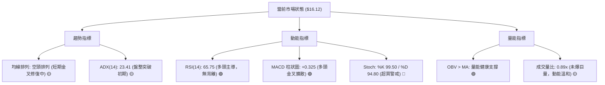

### 📈 移動平均線排列分析

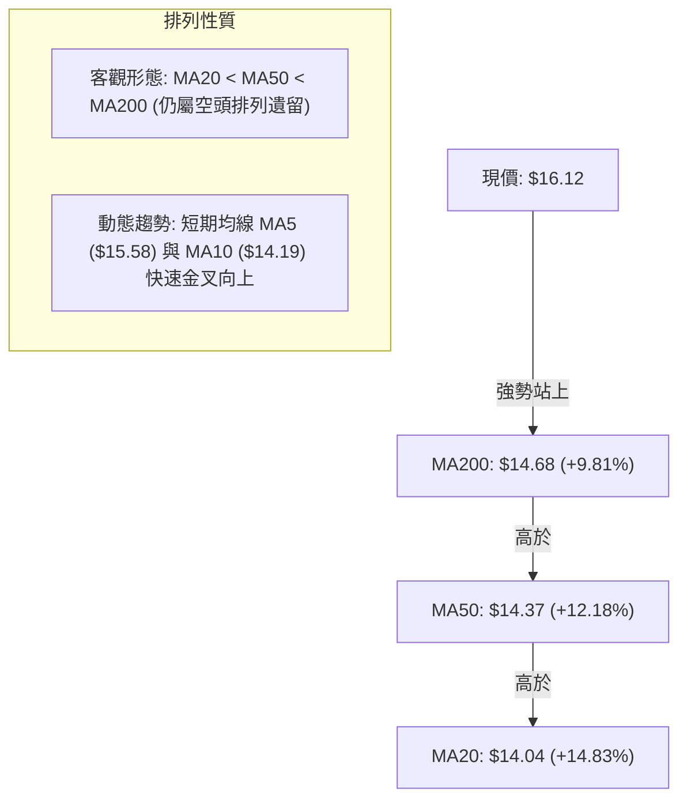

均線系統解讀：
- 雖然目前客觀數值上 MA20 ($14.04) < MA50 ($14.37) < MA200 ($14.68)，名義上屬於「空頭排列」，但這是由於 9 月份急跌造成的滯後現象。
- 現價以 $16.12 同時向上擊穿所有均線，MA5 已經攀升至 $15.58，MA10 來到 $14.19，短期均線正在由下而上強力穿越中長期均線。若能在 S1 ($15.59) 上方維持震盪數日，均線系統將在 1-2 週內完成多頭黃金交叉排列。

### 📉 RSI(14) 分析

```
RSI(14) 當前水平評估：65.75
[0] ─────────────── [30] ──────────────────── [70] ────── [100]
                     超賣區         中性多頭區        超買區
                                         ▲
                                      (65.75)
進度條：████████████████░░░░░░░░  65.75%
```

- **數值狀態**：RSI(14) 數值為 65.75，處於強勢多頭但尚未觸碰 70 的極端超買閾值。
- **背離診斷**：
  - **頂背離**：無。前高波段價格高點與 RSI 節奏同步，未出現價格創新高而 RSI 走低的現象。
  - **底背離**：無。在 2026-09-27 當週 RSI 跌至 19.9 低谷後，本波價格與 RSI 同步陡峭反彈，為健康的指標修復，無底背離形態。

### 📊 MACD(12/26/9) 訊號解讀

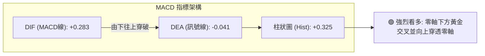

MACD 線當前數值為 +0.283，訊號線為 -0.041，柱狀圖達到 +0.325。這是自 2026-08 月份以來最強烈的看多訊號。柱狀圖自負值區間劇烈拔高，確認了週線與日線級別的底部動能爆發，多頭趨勢已經在動能層面全面確立。

### 📦 布林通道分析

```
NU 布林通道位置示意圖 (BB 20, 2)
$16.21 ┼═══════════════════════════════════ BB 上軌 ($16.21)
$16.12 ┼─────────────────────────● 現價 (BB %B = 0.98，極度貼近上軌)
       │
$14.04 ┼─────────────────────────────────── BB 中軌 / MA20 ($14.04)
       │
$11.87 ┼─────────────────────────────────── BB 下軌 ($11.87)
```

- **通道指標數值**：上軌 $16.21、中軌 $14.04、下軌 $11.87，通道帶寬為 $4.34。
- **%B 指標解讀**：%B 達到 0.98，表示現價幾乎緊貼布林通道上軌運行。在技術分析常規中，%B > 0.95 且未形成通道持續擴口（Walking the band）時，價格極易在短線遭遇上軌壓制而引發回調，需密切防範向下回踩中軌或支撐位 S1 ($15.59)。

### 💹 成交量分析（量價配合度）

- **量比與均量**：最新單日成交量為 76,027,800 股，相較於 20 日均量 85,448,255 股，量比為 0.89x；但高於 50 日均量 75,040,506 股。
- **週線量能爆發**：最近一週成交量達到 517,670,700 股，相較於前波下跌週量（約 2.8 億至 3.6 億股）出現顯著放大，表明大資金在低檔回補並發起攻勢。
- **OBV 能量潮解讀**：數據明確顯示「OBV > MA → 量能支撐上漲」。OBV 線有效突破其移動平均線，確認本輪由 $12.66 發動的反彈具備紮實的成交量積累，非縮量虛漲。

---

## 6. 動能與波動率

### ⚡ 動能評估四象限

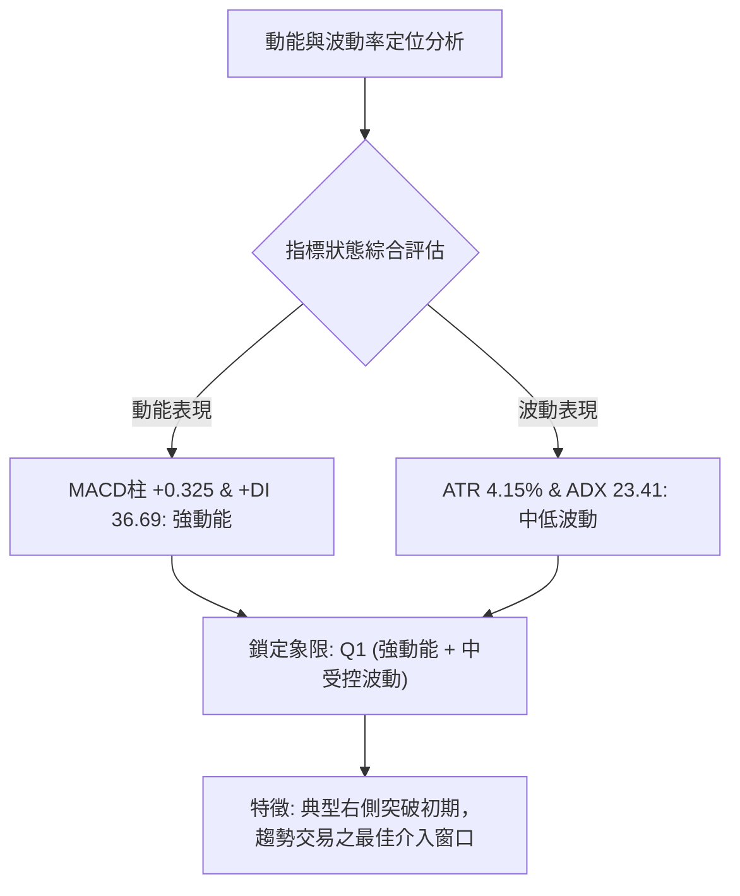

| 象限 | 動能強度 | 波動率水準 | 當前狀態 | 策略意涵 |
|------|----------|------------|----------|----------|
| **Q1** | **強** | **中/低** | **● 當前 NU 所處位置** | **最佳操作機會：趨勢動能爆發而波動尚未失控，持股性價比高** |
| Q2 | 弱 | 低 | - | 盤整觀望：無趨勢方向，資金效率低 |
| Q3 | 強 | 高 | - | 高風險搏殺：極端行情，易引發大幅滑點與止損 |
| Q4 | 弱 | 高 | - | 避免進場：弱勢下殺且震幅劇烈，容易兩頭挨打 |

### 📊 ATR 波動率分析

- **ATR(14) 絕對值**：$0.67。
- **相對價格波動率**：4.15% of price。
- **波動特徵評估**：NU 作為數位金融板塊標的，4.15% 的日均波動率屬於健康正常區間，並未出現極端非理性脈衝。
- **動態止損距離設定**：
  - 保守型交易者止損距離：$1.5 \times \text{ATR} = 1.5 \times \$0.67 = \mathbf{\$1.01}$
  - 積極型交易者止損距離：$2.0 \times \text{ATR} = 2.0 \times \$0.67 = \mathbf{\$1.34}$

### 📐 Beta 與市場相關性

- **Beta 數值**：0.955。
- **市場敏感度解讀**：Beta 極度接近 1.00，表示 NU 與美股大盤（S&P 500）的系統性風險步調高度一致。大盤走勢平穩時，個股將主要由其自身的技術結構與業績動能驅動；若大盤面臨系統性拋售，NU 難以獨善其身。

---

## 7. 多時框架總結

### 📋 時框架評分表

| 時框架 | 趨勢方向 | 動能狀態 | 均線排列 | 圖表形態 | 綜合評分 | 建議 |
|--------|----------|----------|----------|----------|----------|------|
| **月線** | 🟡 寬幅震盪 | 🟡 中性回升 | 🟡 均線收斂中 | 箱體底部反彈 | 65/100 | 長期底倉持有 |
| **週線** | 🟢 強勢多頭 | 🟢 MACD金叉放大 | 🟢 站上關鍵週均線 | W 底形態突破 | 78/100 | 回踩逢低加碼 |
| **日線** | 🟡 衝高震盪 | 🔴 Stoch嚴重超買 | 🟡 短期金叉修復 | 逼近布林上軌 | 60/100 | 不追高，等回踩 |

### 🔲 綜合訊號矩陣

```
╔══════════════════════════════════════════════════════════════════╗
║                     NU 綜合時框訊號矩陣                          ║
╠══════════════════════════════════════════════════════════════════╣
║ 時框層級 │ 趨勢方向 │ 動能指標 │ 量價結構 │ 關鍵阻力/支撐位置   ║
╠══════════╪══════════╪══════════╪══════════╪═════════════════════╣
║ 短期日線 │ 🟢 偏多  │ 🔴 超買  │ 🟡 正常  │ 阻力 R1 ($16.22)    ║
║ 中期週線 │ 🟢 看多  │ 🟢 強勁  │ 🟢 放量  │ 目標 R2 ($16.52)    ║
║ 長期月線 │ 🟡 中性  │ 🟡 修復  │ 🟢 支撐  │ 支撐 S2 ($15.19)    ║
╚══════════════════════════════════════════════════════════════════╝
```

### ⚖️ 多時框收斂結論

依據多時框收斂優先級規則：
1. **行情性質判定**：當前 ADX(14) 數值為 23.41 (< 25)，本質上仍處於「大級別盤整向趨勢轉換」的邊緣階段。
2. **主導時框裁決**：日線隨機指標（Stoch %K 99.50）與布林通道（%B 0.98）已發出強烈短線超買預警，但週線級別以大陽線放量突破（週量 517.6M，MACD 柱翻正至 +0.325），中期多頭反轉訊號極其明確。
3. **收斂裁定**：依規則，盤整突破以中期週線方向為主導，日線訊號則用以精確尋找拉回進場點。
4. **唯一方向性結論**：**【偏多進攻，但嚴禁追高，耐心等待日線級別回踩支撐後介入】**。

---

## 8. 交易策略建議

### 🗺️ 策略決策流程圖

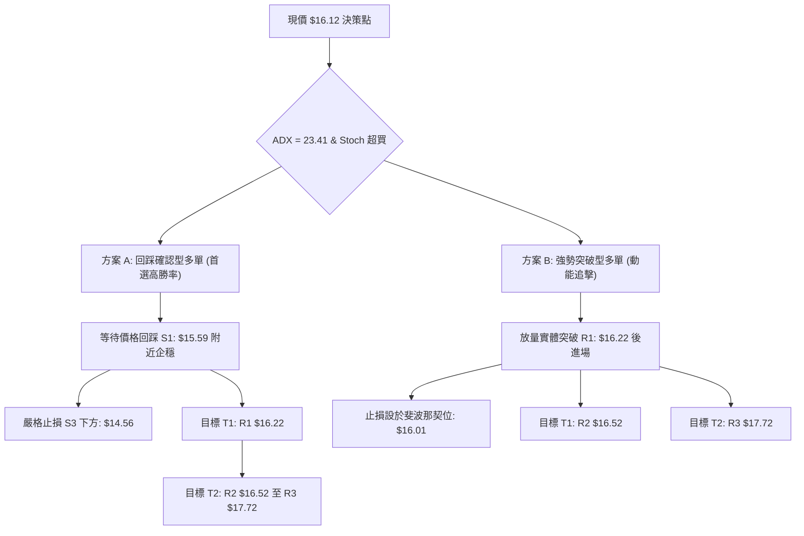

### 🧭 策略路由

**當前主策略方向 = 【主推多頭策略（逢回買進 / 突破加碼）】（依技術評分卡綜合評分 68/100，≥60 進入多頭主導路徑）。** 空頭策略僅作為下行破位時的反轉風險對沖參考。

### 🎯 價格情境階梯（Price Scenarios）

所有價位均嚴格引用第 4 章及關鍵價位計算數值：

| 觸發條件 | 下一目標 | 後續延伸 | 情境含義 |
|----------|----------|----------|----------|
| **強勢突破 R1 $16.22** | R2 $16.52 | R3 $17.72 | 短線超買被強勢消化，發動主升段行情 |
| **在 $15.59 ~ $16.22 區間震盪** | — | — | 消化短線獲利盤，均線由空轉多修復 |
| **有效跌破 S1 $15.59** | S2 $15.19 | S3 $14.56 | 短線反彈遇阻回撤，測試年線支撐防線 |

### 📊 情境機率分佈

| 情境劇本 | 機率 | 主要技術依據 |
|----------|------|--------------|
| **回踩蓄勢後繼續上行** | **60%** | MACD 柱狀圖 (+0.325) 強勁翻正、OBV 指標多頭排列、週量放大確認主力進駐 |
| **在當前位置橫盤區間震盪** | **25%** | ADX 數值 23.41 仍小於 25，布林上軌 ($16.21) 構成顯著技術壓制 |
| **大幅回落再探底部** | **15%** | 均線系統名義上仍為 MA20<MA50<MA200，若大盤重挫可能回測年線 |

### 🟢 主策略詳情

所有價位完全對應數據源之精確數值：

| 策略要素 | 策略 A（穩健型：回踩支撐低吸） | 策略 B（積極型：強勢突破跟進） |
|----------|--------------------------------|--------------------------------|
| **進場條件** | 價格回踩 S1 企穩不破，日線出現止跌K棒 | 日線實體放量收盤突破 R1 阻力位 |
| **進場價格** | **$15.59** (精確對應支撐 S1) | **$16.23** (確認突破 R1 $16.22 後) |
| **目標價 T1** | **$16.52** (阻力 R2，預期獲利 +5.97%) | **$16.52** (阻力 R2，預期獲利 +1.79%) |
| **目標價 T2** | **$17.72** (阻力 R3，預期獲利 +13.66%) | **$17.72** (阻力 R3，預期獲利 +9.18%) |
| **止損價格** | **$15.09** (嚴格設於斐波那契 50% 回調位) | **$15.59** (跌回支撐 S1 下方即止損) |
| **風險報酬比** | **1 : 2.26** (至 T1) / **1 : 4.26** (至 T2) | **1 : 2.33** (至 T2) |
| **預估勝率** | 65% | 55% |
| **建議倉位** | 15% - 20% | 8% - 10% |

### 🔴 反向風險觸發點（對沖提示）

- **觸發條件 1**：日線收盤價跌破支撐 **S2: $15.19**，意味著突破頸線失敗，多頭結構受損，應平倉 50% 多頭部位。
- **觸發條件 2**：日線收盤價跌破強支撐 **S3: $14.56**（失守年線 MA200 $14.68），宣告本輪反彈行情徹底終結，多單必須無條件全數止損離場，並可啟動做空對沖策略。

### ⭐ 整體訊號強度評星

```
做多訊號強度：★★★★☆  (4/5星 - 週線動能與量能爆發，短線需防超買)
做空訊號強度：★☆☆☆☆  (1/5星 - 逆勢做空風險極高，缺乏空頭結構支撐)
整體可信度：  ★★★★☆  (4/5星 - 多時框量價配合良好，技術指標方向一致)
```

---

## 9. 風險提示與監控

### ✅ 關鍵監控指標 Checklist

```
╔══════════════════════════════════════════════════════════════════╗
║                   每日交易風控監控清單 (Checklist)               ║
╠══════════════════════════════════════════════════════════════════╣
║ [ ] 價格是否受阻於 R1 ($16.22) 或布林上軌 ($16.21) 出現長上影線 ║
║ [ ] RSI(14) 是否攀升破 70 進入極端超買區或出現急遽頂背離         ║
║ [ ] 回調時成交量是否萎縮（良性縮量回踩 S1 $15.59）               ║
║ [ ] MACD 柱狀圖是否維持在 +0.200 以上之強勢多頭擴張區間          ║
║ [ ] 跌破 S1 ($15.59) 時，支撐 S2 ($15.19) 能否提供有效承接      ║
║ [ ] 單日虧損是否觸發 ATR 動態止損閾值 ($0.67 ~ $1.01)            ║
╚══════════════════════════════════════════════════════════════════╝
```

### ⚠️ 風險場景分析

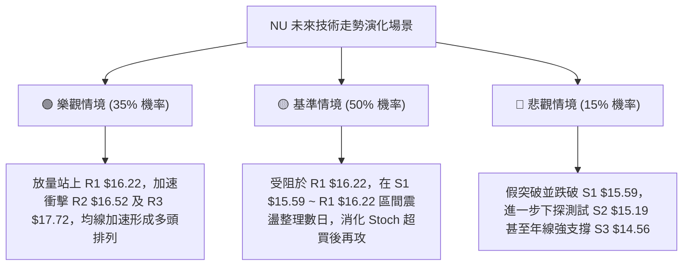

### 🛡️ 風險管理重要提醒

1. **短線超買指標修正風險**：當前 Stoch %K (99.50) 與 %D (94.80) 處於歷史極端超買水平，布林通道 %B 達 0.98。雖然中期趨勢強勁，但在技術指標極度緊繃的情況下直接市價追高，將面臨極高的短線回調風險。**紀律原則：寧可錯過，絕不在布林上軌追多。**
2. **均線結構修復的時間成本**：MA20 ($14.04)、MA50 ($14.37) 與 MA200 ($14.68) 的客觀排列仍處於空頭遺留狀態，均線由空轉多需要時間沉澱，預期後市行情將伴隨頻繁的震盪洗盤。
3. **部位與槓桿控制**：建議單筆交易承擔之風險資本不得超過總資金的 1.5%–2.0%。以當前 ATR $0.67 衡量，止損空間約在 $0.50–$1.00 之間，投資人應依此逆向計算合理的持倉股數，嚴禁過度放大槓桿。

---

## 📋 報告總結

```
╔══════════════════════════════════════════════════════════════════╗
║                   NU 技術分析報告總結                            ║
╠══════════════════════════════════════════════════════════════════╣
║ 報告日期：2026-10-12                                             ║
║ 當前價格：$16.12                                                 ║
║ 分析評級：🟢 偏多震盪突破 (評分: 68/100)                         ║
║                                                                  ║
║ 關鍵結論：                                                       ║
║ ├─ 長期趨勢：🟡 寬幅震盪築底，現價強勢重返年線上方               ║
║ ├─ 中期趨勢：🟢 週線放量吞噬大陽線，W 底頸線突破成型             ║
║ ├─ 短期趨勢：🟡 逼近布林上軌與 R1，動能強勁但指標超買           ║
║ ├─ 關鍵支撐：S1: $15.59 │ S2: $15.19 │ S3: $14.56               ║
║ ├─ 關鍵阻力：R1: $16.22 │ R2: $16.52 │ R3: $17.72               ║
║ └─ 分析師目標：均價 $18.77 (最高 $23.00，共 22 位分析師評級 Buy) ║
║                                                                  ║
║ 最優策略組合：                                                   ║
║ 1. 🥇 最佳機會：等待價格拉回測試 S1 ($15.59) 止跌進場，目標 R2   ║
║ 2. 🥈 次選機會：實體大陽線有效收盤站上 R1 ($16.22) 順勢加碼追擊  ║
║ 3. 🥉 保守選擇：待 MA20 與 MA50 完成黃金交叉後，再行右側配置    ║
╚══════════════════════════════════════════════════════════════════╝
```

---

> ⚠️ **免責聲明**：本報告為技術分析研究，所有數據、圖表及價位推演均基於 Yahoo Finance 歷史交易資訊。本報告**僅供研究與學術參考**，**不構成任何買賣要約或投資建議**。金融市場投資具備固有風險，投資人應獨立評估自身風險承受能力並自負盈虧。

---

*報告生成時間：2026-10-12 ｜ 數據來源：Yahoo Finance ｜ 分析框架：多時框技術分析體系*