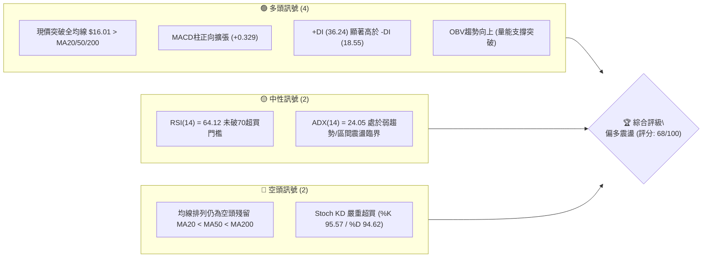
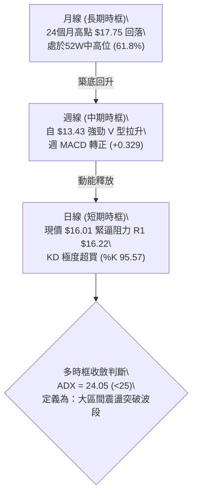
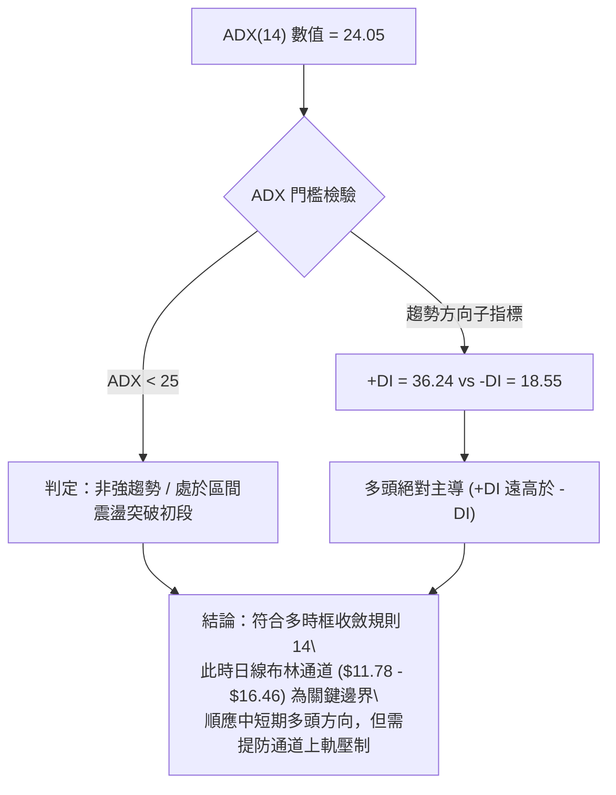
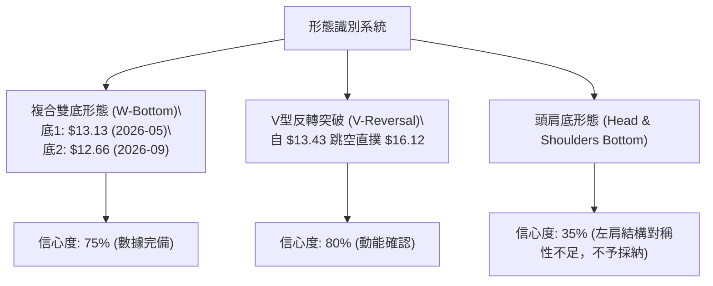
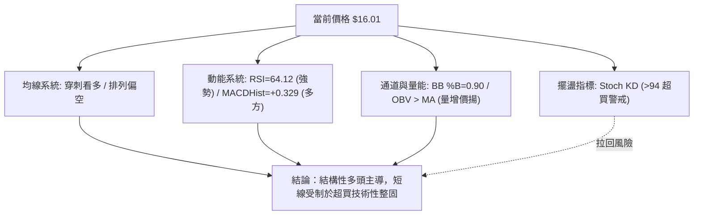
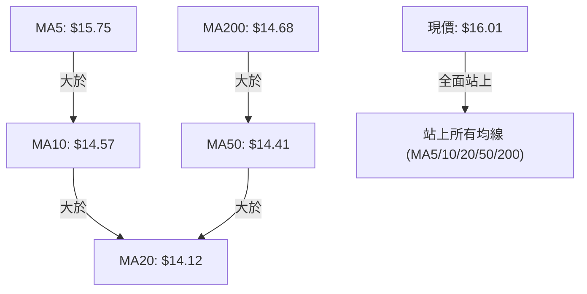
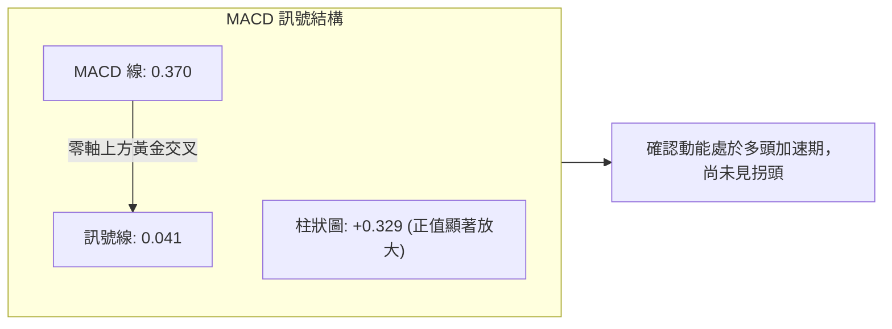
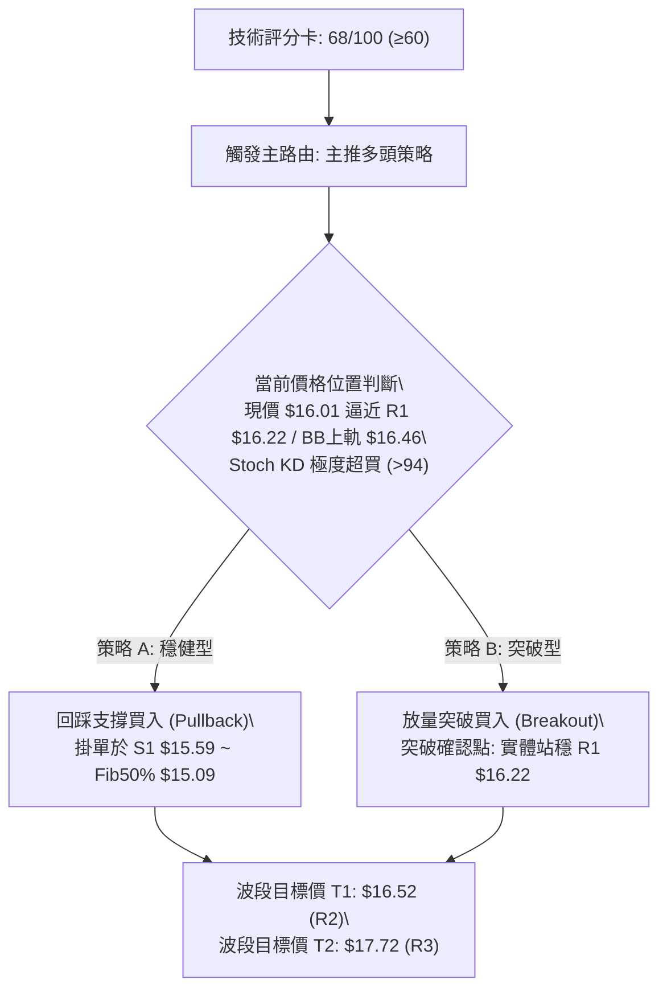
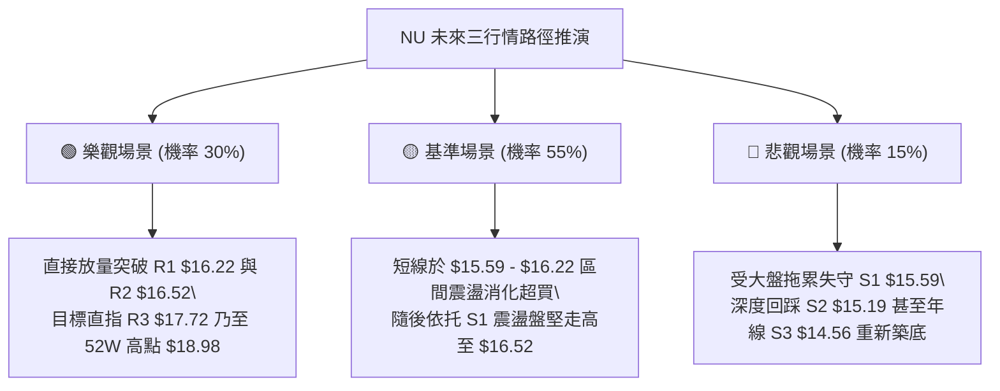

# NU 技術分析報告

> **報告日期**：2026-10-13 ｜ **語言**：繁體中文 ｜ **數據來源**：Yahoo Finance ｜ **當前價格**：$16.01

---

## 目錄

| 章節 | 內容 |
|------|------|
| [1. 技術面概覽](#1-技術面概覽) | 訊號儀表板、核心指標、評分卡 |
| [2. 趨勢分析](#2-趨勢分析) | 多時框趨勢、長中短期走勢、ADX強弱判斷 |
| [3. 圖表形態分析](#3-圖表形態分析) | 形態識別與信心度、K線組合、目標價推算 |
| [4. 支撐與阻力](#4-支撐與阻力) | 關鍵價位結構、斐波那契回調聚類 |
| [5. 技術指標深度解讀](#5-技術指標深度解讀) | 均線排列、RSI/MACD背離檢驗、布林通道與量能 |
| [6. 動能與波動率](#6-動能與波動率) | 動能矩陣、ATR波動區間、Beta特徵 |
| [7. 多時框架總結](#7-多時框架總結) | 時框架評分矩陣、多時框收斂收斂法則 |
| [8. 交易策略建議](#8-交易策略建議) | 策略路由、主策略執行表、情境階梯 |
| [9. 風險提示與監控](#9-風險提示與監控) | 監控清單、極端情境推演、風控紀律 |
| [📋 報告總結](#-報告總結) | 核心結論與最佳執行路徑 |

---

## 1. 技術面概覽

### 🎯 技術訊號儀表板



### 📊 核心指標速覽表

| 指標類別 | 指標名稱 | 當前數值 | 訊號 | 解讀 |
|----------|----------|----------|------|------|
| **價格** | 當前價格 | $16.01 | 🟢 | 突破所有短期與長期移動平均線，展現強勁修復動能 |
| **均線** | MA20 | $14.12 | 🟢 | 價格高於 MA20 達 +13.40%，短線均線急速上彎走平 |
| **均線** | MA50 | $14.41 | 🟢 | 價格高於 MA50 達 +11.10%，扭轉中期下行壓力 |
| **均線** | MA200 | $14.68 | 🟢 | 價格重返牛熊分界線上方 +9.06%，但長線扣抵位置仍使排列倒掛 |
| **均線結構** | 均線排列 | MA20 < MA50 < MA200 | 🔴 | 結構面維持空頭排列，但價格已領先穿刺，形成均線修復初段 |
| **動能** | RSI(14) | 64.12 | 🟡 | 進入強勢買盤區間但未破 70 警戒線，無明顯背離 |
| **動能** | MACD (12/26/9) | 柱狀體 +0.329 | 🟢 | 快慢線黃金交叉，柱狀圖持續擴張，短線動能飽滿 |
| **動能** | Stoch %K / %D | 95.57 / 94.62 | 🔴 | 進入極度超買區間（>80），短線存在技術性拉回壓力 |
| **趨勢** | ADX(14) / DMI | 24.05 (+DI: 36.24) | 🟡 | ADX < 25 表明尚未進入強趨勢，多頭主導但易陷區間擴張 |
| **通道** | 布林通道 (%B) | %B: 0.90 (上軌 $16.46) | 🟡 | 緊貼布林通道上軌運行，面臨軌道邊界之回洗震盪 |
| **成交量** | 量比 / OBV | 0.76x / OBV > MA | 🟢 | 週線量能堆疊顯著（前週破5億股），OBV高於均線確認買盤 |
| **波動** | ATR(14) | $0.65 (4.09%) | 🟡 | 日內波動適中，提供合理的止損緩衝邊際 |

### 🏆 技術評分卡

```
╔══════════════════════════════════════════════════════════════════╗
║              NU 綜合技術評分卡 — (2026-10-13)                  ║
╠══════════════════════════════════════════════════════════════════╣
║ 趨勢強度 (ADX/DMI)  ████████████░░░░░░░░  60/100  🟡 弱趨勢多頭   ║
║ 動能指標 (RSI/MACD) ████████████████░░░░  80/100  🟢 動能充沛     ║
║ 支撐穩定度 (S1-S3)  ██████████████░░░░░░  70/100  🟢 密集築底     ║
║ 成交量配合 (OBV/VOL)██████████████░░░░░░  70/100  🟢 中期量能支撐 ║
║ 形態完整度 (底型)   ██████████████░░░░░░  70/100  🟢 雙底初成     ║
║ 均線排列 (扣抵/位置)████████████░░░░░░░░  60/100  🟡 均線修復中   ║
╠══════════════════════════════════════════════════════════════════╣
║ 綜合技術評分        █████████████░░░░░░░  68/100  🟢 偏多震盪/突破 ║
╚══════════════════════════════════════════════════════════════════╝
```

---

## 2. 趨勢分析

### 🌐 多時框趨勢分析



### 📈 長期趨勢 — 12個月走勢圖（Unicode）

NU 過去 12 個月（2025-11 至 2026-10）經歷了自歷史高位拉回震盪、於低檔二次探底後重新反彈的完整週期：

```
NU 月線收盤走勢圖（過去12個月：2025-11 至 2026-10）
價格軸 ($)
$18.00 ┤              ● (2026-01: $17.75 高點)
$17.50 ┤      ● (2025-11: $17.39)
$17.00 ┤          ● (2025-12: $16.74)
$16.50 ┤
$16.00 ┤                                                    ●← 現價 ($16.01)
$15.50 ┤
$15.00 ┤                  ● (2026-02: $14.98)
$14.50 ┤                      ●       ●               ●
$14.00 ┤                          ● (2026-03: $14.37)     ● (2026-08: $14.55)
$13.50 ┤                                  ● (2026-06: $13.36)
$13.00 ┤                                      ● (2026-05: $13.13)
$12.50 ┤                                                  ● (2026-09: $12.66 低點)
       └──────────────────────────────────────────────────────────────
         11   12   01   02   03   04   05   06   07   08   09   10  (月份)
```

#### 走勢特徵分析表格

| 階段 | 期間 | 價格區間 | 漲跌幅 | 走勢特徵與量價關係 |
|------|------|----------|--------|--------------------|
| **高檔築頂** | 2025-11 ~ 2026-01 | $16.74 - $17.75 | +2.07% | 創下波段頂點 $17.75 後動能衰竭，月K高檔滯漲 |
| **中級下行** | 2026-02 ~ 2026-05 | $17.75 → $13.13 | -26.03% | 連續跌破各級均線，空方主導，5月收 $13.13 初步止跌 |
| **低檔盤整** | 2026-06 ~ 2026-08 | $13.13 - $14.55 | +10.81% | 圍繞 $13-$14 區間進行籌碼沉澱，反彈受阻於 $14.55 |
| **洗盤拉升** | 2026-09 ~ 2026-10 | $12.66 → $16.01 | +26.46% | 9月下殺 $12.66 形成假跌破，10月暴力反包至 $16.01，重返多頭進攻態勢 |

### 📊 中期趨勢（週線分析）

從近 20 週收盤走勢觀察，價格在 2026-09-27 至 2026-10-04 完成了最後一波探底：
- **低檔清洗**：2026-09-27 週收盤 $13.59，週 RSI 跌至 19.9 極度超賣區間；2026-10-04 週收盤 $13.43，伴隨 532,732,100 股的爆量換手。
- **強勢拉抬**：2026-10-11 週收盤飆升至 $16.12（成交量 517,684,300 股），週 RSI 自 39.2 旱地拔蔥至 65.7，MACD 柱由 -0.091 轉正至 +0.325。
- **本週定錨**：2026-10-18（截至 10-13 快照）現價報 $16.01，週 MACD 柱擴大至 +0.329，確認中期底部結構確立。

```
週線支撐與壓力拓撲示意圖
$17.72 ────────────────────────────────────────── 阻力 R3 (前高密集區)
$16.52 ────────────────────────────────────────── 阻力 R2 (布林上軌附近)
$16.22 ────────────────────────────────────────── 阻力 R1 (當前考驗點)
$16.01  ▲ [現價位置: 剛完成大陽線突破後的縮量整理]
$15.59 ────────────────────────────────────────── 支撐 S1 (短線突破防守)
$15.19 ────────────────────────────────────────── 支撐 S2 (50% 斐波那契)
$14.56 ────────────────────────────────────────── 支撐 S3 (MA200/MA50 匯聚)
```

### ⚡ 趨勢強度評估（ADX 解讀）



#### ADX 強度對照與解讀表

| 指標 | 數值 | 狀態評估 | 實戰指引 |
|------|------|----------|----------|
| **ADX(14)** | 24.05 | 弱趨勢臨界 (<25) | 市場剛剛擺脫沉悶盤整，但趨勢連續性尚未被量化定性為單邊狂暴行情 |
| **+DI (14)** | 36.24 | 強勢擴張 | 多方力量佔據主導，買盤推動力強勁 |
| **-DI (14)** | 18.55 | 空方萎縮 | 空頭砸盤意願急劇衰退 |
| **DIFF (+DI - -DI)** | +17.69 | 淨多頭優勢 | 趨勢偏向多方，不可逆勢做空，以「拉回找買點」為核心方針 |

---

## 3. 圖表形態分析

### 🔍 形態識別系統

依嚴格數據紀律，針對過去 6 個月週線與月線 OHLCV 幾何軌跡進行客觀比對，僅標注數據完全支撐的形態：



#### 圖表形態信心度評估表

| 形態 | 信心度 | 判斷依據（引用數據） | 完成度 | 目標價（附計算式） |
|------|--------|----------------------|--------|--------------------|
| **複合雙底 (W-Bottom)** | **75%** | 兩次低點分別落於 2026-05 的 $13.13 與 2026-09 的 $12.66，頸線為 2026-08 的高點波段聚類 $14.55。現價 $16.01 已實體突破頸線。 | 90% (已突破頸線) | 由雙底形態推算：<br>頸線 $14.55 + 形態高度 ($14.55 - $12.66 = $1.89) = **$16.44**（恰好逼近阻力 R2 $16.52） |
| **週線大陽包覆 (Bullish Engulfing)** | **80%** | 2026-10-11 週K以 $16.12 巨幅吞沒前四週陰線，且成交量達 517,684,300 股。 | 100% (形態確認) | 短線量度目標：直接指向近一年波段高點聚類阻力 R3 **$17.72** |
| **頭肩底形態** | **30%** | 左肩 ($13.13)、頭部 ($12.66) 存在，但左側肩部耗時過長，右肩幾乎以 V 型跳過，對稱性嚴重不足。 | 訊號不足 | **數據不足，不予推算目標價**，改以純指標與水平位解讀 |

### 🕯️ 重要K線形態分析

| 週/月份 | 收盤價 | K線形態 | 解讀 | 訊號 |
|---------|--------|---------|------|------|
| **2026-09-27 (週)** | $13.59 | 衰竭長黑棒 | RSI 摜壓至 19.9 極度恐慌，形成最後拋售潮（Selling Climax） | 🔴 極端超賣 |
| **2026-10-04 (週)** | $13.43 | 爆量長下影十字星 | 週量放大至 5.32 億股，主力資金在低檔不計代價承接，空頭力竭 | 🟢 轉折確認 |
| **2026-10-11 (週)** | $16.12 | 光頭大陽線 (Marubozu) | 週漲幅逾 20%，直接衝破 MA20/MA50/MA200，形成多頭發動K線 | 🟢 強烈買訊 |
| **2026-10-18 (本週)** | $16.01 | 高檔孕線/窄幅整固 | 在前週天量大陽線頂部進行良性消化，收盤守住 $16.00 關卡 | 🟡 蓄勢待發 |

### 📉 ASCII 走勢形態示意圖

```
NU 雙底 (W-Bottom) 與突破示意圖
價格
$16.50 ┤                                                 [目標1: $16.44 / R2 $16.52]
$16.01 ┤                                           ● 現價 (突破頸線回測中)
$15.50 ┤                                          /
$15.00 ┤                   頸線 $14.55           /
$14.55 ┤           ▲ ───────────────▲───────────
$14.00 ┤          / \               /
$13.50 ┤         /   \             /
$13.13 ┤  底1: ●      \           /
$12.66 ┤               \   底2: ●
       └────────────────────────────────────────────
          2026-05      2026-07   2026-09   2026-10
```

### 🎯 形態目標價計算

1. **雙底第一目標價（測幅滿足點）**：
   - 形態底點：$12.66（2026-09 收盤）
   - 頸線位置：$14.55（2026-08 收盤高點，亦共振於 S3 支撐 $14.56）
   - 垂直高度：$14.55 - $12.66 = $1.89
   - **量度目標價**：$14.55 + $1.89 = **$16.44**（與布林上軌 $16.46 及阻力 R2 $16.52 高度重疊）
2. **中期趨勢延伸目標價**：
   - 若有效站穩 R2 $16.52，形態將向上尋求 52 週波段下行之 23.6% 斐波那契回調位 **$17.14**，終極波段目標為近一年波段高點聚類 R3 **$17.72**。

---

## 4. 支撐與阻力

### 🗺️ 關鍵價位分布圖（Unicode）

```
NU 價位結構分布圖 (引用官方 OHLCV 計算聚類)
══════════════════════════════════════════════════════════════════
$18.98 ║████████████████████████████████║ 52W 最高點 (0.0% Fib)
$17.72 ║████████████████████████        ║ 強阻力 R3 (近一年波段高點聚類)
$17.14 ║▓▓▓▓▓▓▓▓▓▓▓▓▓▓▓▓▓▓▓▓            ║ 斐波那契 23.6% 回調壓力
$16.52 ║████████████████                ║ 阻力 R2 (布林上軌共振區 $16.46)
$16.22 ║████████████                    ║ 短線關鍵阻力 R1 (當前考驗)
$16.01 ╠════════════════════════════════╣ ◄ 現價 ($16.01，位處 38.2% Fib)
$15.59 ║▓▓▓▓▓▓▓▓▓▓▓▓▓▓▓▓                ║ 短期支撐 S1 (-2.62%)
$15.19 ║████████████████                ║ 中期強支撐 S2 (50.0% Fib: $15.09)
$14.56 ║████████████████████████        ║ 強支撐 S3 (MA200/50 匯聚處)
$14.17 ║▓▓▓▓▓▓▓▓▓▓▓▓▓▓▓▓▓▓▓▓▓▓▓▓        ║ 關鍵防守線 61.8% Fib / MA20 ($14.12)
$11.20 ║████████████████████████████████║ 52W 最低點 (100.0% Fib)
══════════════════════════════════════════════════════════════════
```

### 🚧 阻力位分析表

所有價位均取自數據庫「關鍵價位」與斐波那契精確數值：

| 阻力級別 | 價位 | 形成原因（波段高點聚類與數據依據） | 突破難度 | 重要性 |
|----------|------|-----------------------------------|----------|--------|
| **R1** | **$16.22** | 距離現價僅 +1.31%，為 2026-10-11 週線高點 $16.12 延伸之籌碼反壓線，短線多空必爭之頸口。 | 中等 | ★★★☆☆ |
| **R2** | **$16.52** | 距離現價 +3.22%，高度共振日線布林通道上軌（$16.46）及雙底測幅滿足點（$16.44），獲利盤湧出區。 | 高 | ★★★★☆ |
| **R3** | **$17.72** | 距離現價 +10.65%，為 2026-01 歷史波段頂部（收盤 $17.75）之重度套牢區聚類，為中期牛熊分野點。 | 極高 | ★★★★★ |

### 🛡️ 支撐位分析表

| 支撐級別 | 價位 | 形成原因（波段低點聚類與數據依據） | 守住機率 | 重要性 |
|----------|------|-----------------------------------|----------|--------|
| **S1** | **$15.59** | 距離現價 -2.62%，為突破爆量K線之上方支撐中繼站，守住此位代表短線極端強勢未遭破壞。 | 75% | ★★★☆☆ |
| **S2** | **$15.19** | 距離現價 -5.12%，與斐波那契 50.0% 回調位（$15.09）形成強烈共振保護帶，回調的核心防守線。 | 85% | ★★★★☆ |
| **S3** | **$14.56** | 距離現價 -9.06%，極度關鍵。此處匯聚 MA200（$14.68）、MA50（$14.41）與雙底頸線（$14.55）。 | 95% | ★★★★★ |

### 📐 斐波那契回調位分析（區間 $11.20 → $18.98）

NU 自 52 週最低點 $11.20 漲至 52 週最高點 $18.98，共振計算點如下：
- **0.0% (52W High)**: **$18.98**
- **23.6%**: **$17.14** （上行第一延伸壓力）
- **38.2%**: **$16.01** （**◄ 現價精確停靠於此黃金分割點**）
- **50.0%**: **$15.09** （多空平衡中軸，緊鄰支撐 S2 $15.19）
- **61.8%**: **$14.17** （黃金分割回調防守位，緊鄰 MA20 $14.12）
- **78.6%**: **$12.86**
- **100.0% (52W Low)**: **$11.20**

**技術解讀**：現價 $16.01 剛好收於 38.2% 回調位（$16.01）。在斐波那契理論中，當資產從深幅回調中反彈並一舉收復 38.2% 位階時，代表回調週期已正式被反轉波段取代；若能在 $16.01 上方完成 2-3 天的有效整固，下一站將直接挑戰 23.6%（$17.14）與阻力 R3（$17.72）。

---

## 5. 技術指標深度解讀

### 🎛️ 指標訊號總覽



### 📈 移動平均線排列分析



#### 均線數據深層剖析表

| 均線名稱 | 數值 | 現價差距 | 趨勢軌跡與解讀 | 訊號 |
|----------|------|----------|----------------|------|
| **MA 5** | $15.75 | +1.65% | 連續攀升（██），超短期多頭推升斜率極陡 | 🟢 |
| **MA 10** | $14.57 | +9.91% | 自低檔加速上穿（▅▆），多頭排列初現 | 🟢 |
| **MA 20** | $14.12 | +13.40% | 扣抵低值開始走平微翹，作為中期基準線 | 🟢 |
| **MA 50** | $14.41 | +11.10% | 扣抵 8 月高點逐漸轉平，短期即將迎來 MA20 金叉 | 🟡 |
| **MA 200** | $14.68 | +9.06% | 年線走平，現價放量站上年線，扭轉長線空頭慣性 | 🟢 |
| **均線架構** | **排列** | MA20 < MA50 < MA200 | 過去數月深跌造成長線均線倒掛，屬「價格領先、均線滯後」修復期 | 🟡 |

### 📉 RSI(14) 分析

- **當前數值**：**64.12**
- **強度指示**：`█████████████░░░░░░░` 64.12%（位於 50-70 強勢多頭擴張區間）
- **背離檢驗**：
  - 檢視 2026-07-05 週高點 $13.61（RSI 79.0）至 2026-10-11 週高點 $16.12（RSI 65.7）：
  - **結論**：價格創近幾個月新高，而週 RSI 略低於 7 月極端值，但日線與近期兩週（10-11 收 $16.12 RSI 65.7，10-18 收 $16.01 RSI 64.1）呈現量價與動能齊平狀態。數據明確標注「**RSI 背離：無明顯背離**」。多頭動能處於合理釋放，尚未出現頂背離衰竭訊號。

### 📊 MACD(12/26/9) 訊號解讀

- **MACD 線**：0.370
- **訊號線 (Signal)**：0.041
- **柱狀圖 (Histogram)**：**+0.329**（🟢 看多）



### 📦 布林通道分析

布林帶寬度由前期收窄轉為開口擴張，現價極度貼近上軌：

```
NU 布林通道位置示意圖 (Bollinger Bands: 20, 2)
$16.46 ┬──────────────────────────────────────── 上軌 ($16.46)
$16.01 ┼  ● 現價 ($16.01，%B = 0.90，逼近上軌壓制)
$15.00 ┤
$14.12 ┼──────────────────────────────────────── 中軌 MA20 ($14.12)
$13.00 ┤
$11.78 ┴──────────────────────────────────────── 下軌 ($11.78)
```
- **%B 指標 = 0.90**：數值大於 0.80 進入通道超買區，代表價格貼著上軌強勢推升（Riding the Upper Band）。在 ADX < 25 的環境下，上軌 $16.46 往往構成短期假突破或回壓中樞的阻力。

### 💹 成交量分析（量價配合度）

1. **成交量對比**：最新日成交量為 65,441,800 股，低於 20 日均量 86,292,620 股（量比 0.76x），顯示在 $16.00 關卡出現上攻動能短暫猶豫。
2. **OBV（能量潮）分析**：數據顯示「**OBV > MA → 量能支撐上漲**」。中期 OBV 隨 10 月初兩週逾 10 億股的大換手而拔地而起，證實近期漲幅由實質機構買盤堆疊而成，非無量空頭回補。
3. **隨機指標 (Stochastics)**：%K 95.57、%D 94.62 進入極端鈍化，提示超短期不可盲目市價追高，需防備回踩支撐 S1（$15.59）。

---

## 6. 動能與波動率

### ⚡ 動能評估四象限

評估當前 NU 處於高動能、中波動之轉化區間：

| 象限 | 動能強度 (Momentum) | 波動率水平 (Volatility) | 當前判定 | 戰略含義與操作指引 |
|------|---------------------|-------------------------|:--------:|--------------------|
| **Q1 (最佳擴張)** | **強** (MACD/DI擴張) | **低** (ATR佔比適中) | **✓ 當前狀態** | **趨勢啟動初期，回調即買點，勝率最高** |
| **Q2 (盤整蟄伏)** | 弱 (動能不足) | 低 (通道收縮) | — | 震盪洗盤，觀望或區間高拋低吸 |
| **Q3 (極端狂暴)** | 強 (暴漲暴跌) | 高 (ATR > 6%) | — | 獲利了結或設置緊密追蹤止損 |
| **Q4 (流動性陷阱)** | 弱 (陰跌不止) | 高 (恐慌拋售) | — | 絕對空倉，避免盲目抄底 |

### 📊 ATR 波動率分析

- **當前 ATR(14)**：**$0.65**
- **價格佔比**：4.09%（處於健康成長型金融股正常區間）
- **止損距離建議**：
  - **日內/超短線**：1.0 × ATR = $0.65，現價 $16.01 - $0.65 = **$15.36**
  - **波段操作 (Swing)**：1.5 × ATR = $0.98，現價 $16.01 - $0.98 = **$15.03**（完美契合 50% 斐波那契回調位 $15.09 與 S2 $15.19 的防守緩衝）
  - **趨勢保護**：2.0 × ATR = $1.30，現價 $16.01 - $1.30 = **$14.71**（守在年線 MA200 $14.68 之上）

### 📐 Beta 與市場相關性

- **Beta 數值**：**0.955**
- **相關性解析**：NU 的 Beta 貼近 1.00，顯示其走勢與標普 500 / 美股大盤具有高度同步性，未受到高估值 Fintech 的極端投機擾動；在機構持股比例高達 82.2%、空單佔比僅 3.6%（Short Ratio 1.8）的籌碼結構下，其突破走勢具備扎實的流動性與公信力。

---

## 7. 多時框架總結

### 📋 時框架評分表

| 時框架 | 趨勢方向 | 動能狀態 | 均線排列狀況 | 形態特徵 | 綜合評分 | 操作建議 |
|--------|----------|----------|--------------|----------|:--------:|----------|
| **月線 (長期)** | 🟡 中性築底 | 平穩 (由弱轉強) | 空頭排列 (扣抵壓制) | 大區間箱型震盪 | 60/100 | 長期投資者底倉持有 |
| **週線 (中期)** | 🟢 多頭確立 | 強勁 (MACD轉正) | 價格領先突破全均線 | 複合雙底放量突破 | 75/100 | 波段交易者回踩加碼 |
| **日線 (短期)** | 🟢 多頭進攻 | 超買 (KD>90/RSI 64) | 價格 > 均線，均線即將金叉 | 突破後回測消化 | 70/100 | 短線等待回拉進場 |

### 🔲 綜合訊號矩陣

```
╔══════════════════════════════════════════════════════════════════╗
║              NU 多時框架訊號收斂矩陣                           ║
╠══════════════════════════════════════════════════════════════════╣
║ 時框維度   趨勢方向   均線關係    動能指標    量能結構   總體結論    ║
╠══════════════════════════════════════════════════════════════════╣
║ 短期(日)   🟢 看多   🟢 站上MA20  🔴 KD超買   🟡 量能微縮  整理後上攻 ║
║ 中期(週)   🟢 看多   🟢 站上全均  🟢 MACD翻紅 🟢 天量確認  波段確立   ║
║ 長期(月)   🟡 中性   🟡 站回中軸  🟡 中性回升 🟢 機構控盤  底部翻轉   ║
╚══════════════════════════════════════════════════════════════════╝
```

### ⚖️ 多時框收斂結論

依「嚴格要求 14」執行精確收斂：
1. **行情定性**：當前 ADX(14) 數值為 **24.05 (<25)**，嚴格歸類為 **「盤整行情 / 大區間震盪突破階段」**。
2. **多時框權衡**：在 ADX < 25 的盤整結構中，依照收斂規則，**必須以日線布林通道上下軌（下軌 $11.78、中軌 $14.12、上軌 $16.46）作為核心交易區間邊界**。然而，由於週線層面出現罕見的「巨量 V 型雙底反包」（連續兩週超過 5 億股買盤，週 MACD 轉正至 +0.329），中期上行動能極為霸道。
3. **收斂統一結論**：**偏多操作，但拒絕在布林上軌附近追高**。唯一方向性結論為 **「偏多（Pullback Buy / 回測支撐佈局）」**。本結論直接導向第 8 章之多頭進場路由。

---

## 8. 交易策略建議

### 🗺️ 策略決策流程圖



### 🧭 策略路由

> **當前主策略方向 = 多頭策略（依技術評分卡 68/100，綜合評級 ≥60，確立順勢做多主線）**
> *註：空方觀點僅列為下文之「反向風險觸發點」，絕不兩頭下注。*

### 🎯 價格情境階梯（Price Scenarios）

價位嚴格引用第 4 章波段聚類與斐波那契點位：

| 觸發條件 | 下一目標 | 後續延伸 | 情境含義 |
|----------|----------|----------|----------|
| **強勢突破 R1 ($16.22)** | 阻力 R2 ($16.52) | 阻力 R3 ($17.72) | 短線超買鈍化，多頭進入暴力單邊擴張 |
| **站穩現價區間 ($15.59 - $16.01)** | 考驗 R1 ($16.22) | 區間蓄勢 | 以時間換空間，消化 KD 超買指標 |
| **跌破 S1 ($15.59)** | 支撐 S2 ($15.19) | 支撐 S3 ($14.56) | 短線獲利了結回洗，測試年線均線防守 |

### 📊 情境機率分佈

| 情境 | 機率 | 主要依據 |
|------|:----:|----------|
| **拉回整固後續攻 (Bullish Pullback)** | **60%** | MACD 柱擴大至 +0.329，OBV 明確向上，週線大陽線奠定多頭基調 |
| **高檔強行窄幅震盪 (Consolidation)** | **25%** | ADX = 24.05 (<25)，市場仍受制於大區間特性，布林上軌壓制 |
| **深度回落再測低 (Bearish Reversal)** | **15%** | Stoch KD 極度超買可能誘發短線多殺多，若跌破 S2 則動能暫歇 |

### 🟢 主策略詳情

本策略嚴格引用真實聚類價位：進場點設於支撐 S1 與 R1 突破點，止損依 ATR 與支撐 S2/S3 計算，目標價錨定 R2 與 R3。

| 策略要素 | 策略 A（穩健型：回踩支撐佈局） | 策略 B（積極型：突破確認追擊） |
|----------|--------------------------------|--------------------------------|
| **交易邏輯** | 消化 KD 超買，回測突破頸線確認買點 | 伴隨日成交量破 8,000 萬股強穿阻力 R1 |
| **進場價格** | **$15.59**（支撐位 S1 精確掛單） | **$16.22**（放量突破阻力位 R1 當日進場） |
| **目標價 T1** | **$16.52**（阻力位 R2 / 布林上軌共振區） | **$16.52**（阻力位 R2） |
| **目標價 T2** | **$17.72**（阻力位 R3 / 近一年波段高點） | **$17.72**（阻力位 R3 / 波段頂部） |
| **止損價格** | **$15.09**（斐波那契 50% 回調位 / S2下緣） | **$15.59**（跌回阻力變支撐位 S1 止損） |
| **風險額度 (Risk)** | $15.59 - $15.09 = **$0.50** | $16.22 - $15.59 = **$0.63** |
| **報酬額度 (Reward T2)** | $17.72 - $15.59 = **$2.13** | $17.72 - $16.22 = **$1.50** |
| **風險報酬比 (R:R)** | **1 : 4.26**（極具吸引力） | **1 : 2.38**（符合標準） |
| **成功機率** | **65%** | **55%** |
| **建議倉位** | **15% - 20%** 總投資資金 | **8% - 10%** 總投資資金 |

### 🔴 反向風險觸發點（對沖與撤退提示）

以下條件若被觸發，宣告多頭主策略失效，應無條件執行減倉或觀望：
1. **收盤跌破關鍵支撐 S2 ($15.19)**：跌破此位意味著 10 月以來反彈幅度的 50% 盡失，多頭攻擊波失敗。
2. **終極多空防線失守 S3 ($14.56)**：跌破年線 MA200（$14.68）與 61.8% 斐波那契位（$14.17），宣告重新回歸月線級別空頭熊市，多單必須全數停損離場。

### ⭐ 整體訊號強度評星

```
╔══════════════════════════════════════════════════════════════════╗
║              NU 訊號評星認證                                    ║
╠══════════════════════════════════════════════════════════════════╣
║ 做多訊號強度：★★★★☆  (4/5星 - 週線動能與量能爆發，唯日線短超買)   ║
║ 做空訊號強度：★☆☆☆☆  (1/5星 - 缺乏空頭結構，逆勢做空風險極高)   ║
║ 整體可信度：  ★★★★☆  (4/5星 - 多指標與OBV相互確認，數據扎實)     ║
╚══════════════════════════════════════════════════════════════════╝
```

---

## 9. 風險提示與監控

### ✅ 關鍵監控指標 Checklist

```
╔══════════════════════════════════════════════════════════════════╗
║               交易員日常監控檢查清單 (Daily Checklist)          ║
╠══════════════════════════════════════════════════════════════════╣
║ [ ] 價格是否跌破支撐 S1 ($15.59)？ (若跌破，暫停追高，等 S2)     ║
║ [ ] RSI(14) 是否向下跌破 50 中軸？ (跌破 50 代表多頭動能轉弱)     ║
║ [ ] MACD Histogram 是否由正轉負？ (柱狀圖縮減為短線走弱訊號)    ║
║ [ ] 日成交量是否重回 86,000,000 股之上？ (量能放大方能突破 R1/R2)║
║ [ ] Stoch KD 是否自超買區 (>80) 形成向下死亡交叉？ (獲利回吐)    ║
║ [ ] 美股大盤環境 (Beta 0.955，若大盤重挫需提高現金比率)          ║
╚══════════════════════════════════════════════════════════════════╝
```

### ⚠️ 風險場景分析



### 🛡️ 風險管理重要提醒

1. **拒絕情緒化追高**：當前 Stoch %K 高達 95.57，布林帶 %B 達 0.90，盤面極具誘惑性但短線盈虧比已惡化。嚴格遵守交易紀律，**只在回踩 S1（$15.59）或確認突破 R1（$16.22）後進場**。
2. **嚴格執行波動率止損**：依 ATR $0.65 計算，每筆交易最大承受虧損不得超過總資產的 1.5% - 2.0%。若以策略 A 進場（進場 $15.59，止損 $15.09），每股風險為 $0.50，部位規模應嚴格依風控公式反推，切忌超額槓桿。
3. **長線均線修復的摩擦成本**：雖然價格已站上 MA200（$14.68），但由於長線扣抵位置關係，MA20、MA50、MA200 仍處於倒掛狀態。在均線系統完全理順（形成實質多頭排列）之前，走勢往往呈現「進二退一」的震盪洗盤格局，需保持持股耐心。

---

## 📋 報告總結

```
╔══════════════════════════════════════════════════════════════════╗
║                   NU 技術分析報告總結                          ║
╠══════════════════════════════════════════════════════════════════╣
║ 報告日期：2026-10-13                                             ║
║ 當前價格：$16.01                                                 ║
║ 綜合技術評級：🟢 偏多震盪 / 突破初段 (評分: 68/100)               ║
╠══════════════════════════════════════════════════════════════════╣
║ 關鍵維度結論：                                                  ║
║ ├─ 長期趨勢 (月線)：🟡 大區間震盪探底完成，反彈穿越 38.2% 斐波  ║
║ ├─ 中期趨勢 (週線)：🟢 雙底放量成型，週 MACD 轉正 (+0.329)      ║
║ ├─ 短期趨勢 (日線)：🟢 站上全均線，但 KD 極端超買 (>94) 需消化 ║
║ ├─ 關鍵支撐結構：S1: $15.59 │ S2: $15.19 │ S3: $14.56           ║
║ ├─ 關鍵阻力目標：R1: $16.22 │ R2: $16.52 │ R3: $17.72           ║
║ └─ 華爾街共識目標：$18.77 (22位分析師評級為 Buy)                 ║
╠══════════════════════════════════════════════════════════════════╣
║ 最優策略組合：                                                  ║
║ 1. 🥇 最佳機會 (策略 A)：回踩支撐 S1 ($15.59) 佈局，風報比 1:4.26║
║ 2. 🥈 次選機會 (策略 B)：放量突破 R1 ($16.22) 追擊，目標看 R3    ║
║ 3. 🥉 保守選擇：等待股價於 $15.59-$16.22 橫盤確認消化超買再介入  ║
╚══════════════════════════════════════════════════════════════════╝
```

---

> ⚠️ **免責聲明**：本報告為技術分析專業研究報告，所有技術點位均嚴格基於歷史 OHLCV 幾何算法與量化指標推導。本報告**僅供研究與學術參考**，**不構成任何形式的要約或投資建議**。市場具有不可預測之波動風險，投資人應獨立承擔決策風險並做好資金管理。

---

*報告生成時間：2026-10-13 ｜ 數據來源：Yahoo Finance ｜ 分析框架：多時框技術分析模型*