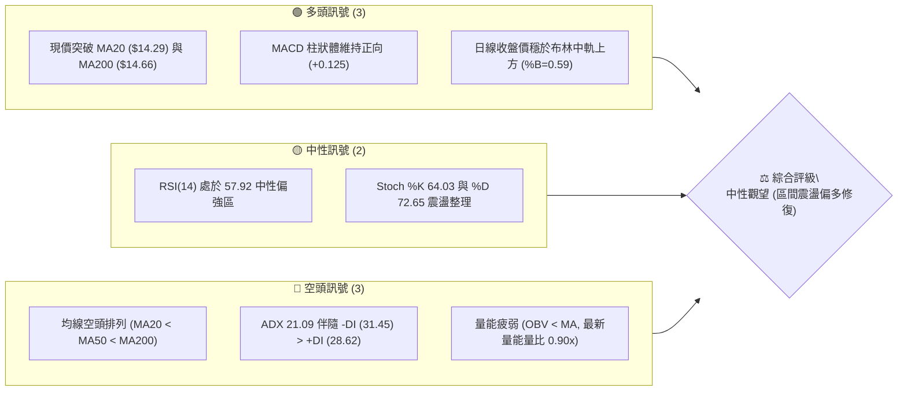
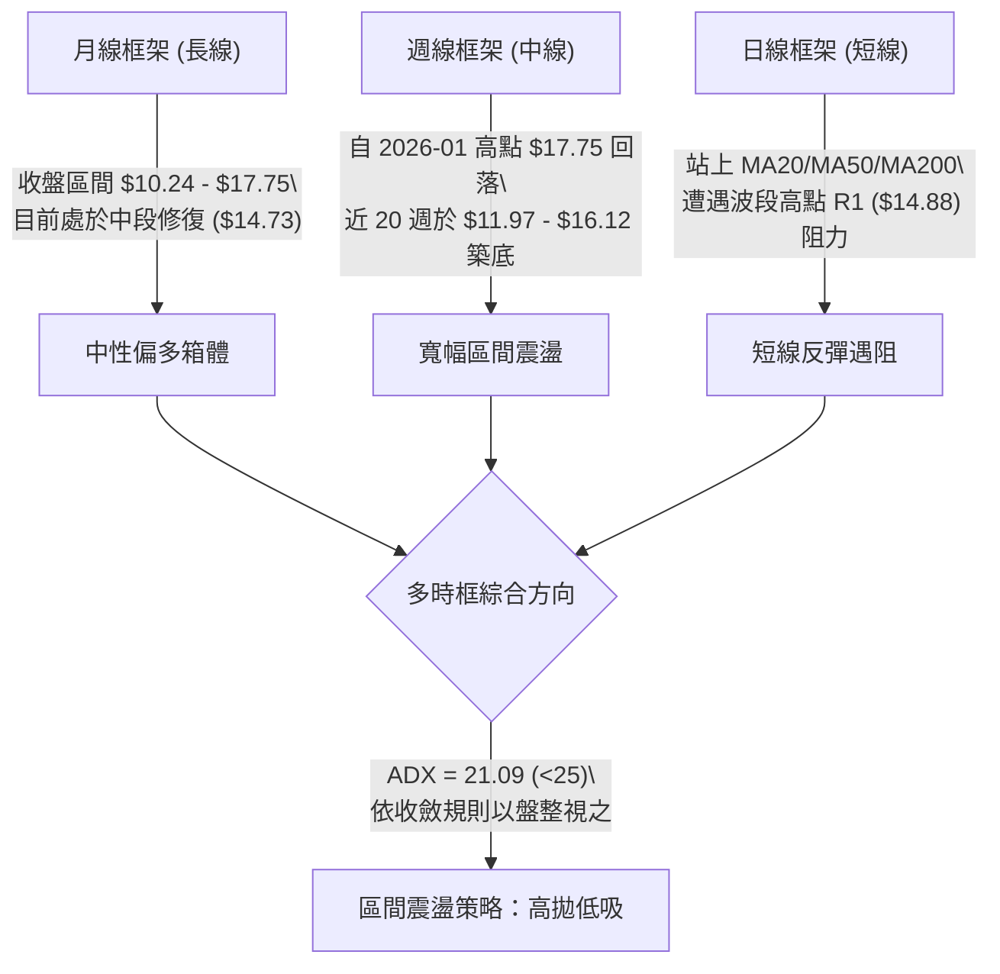
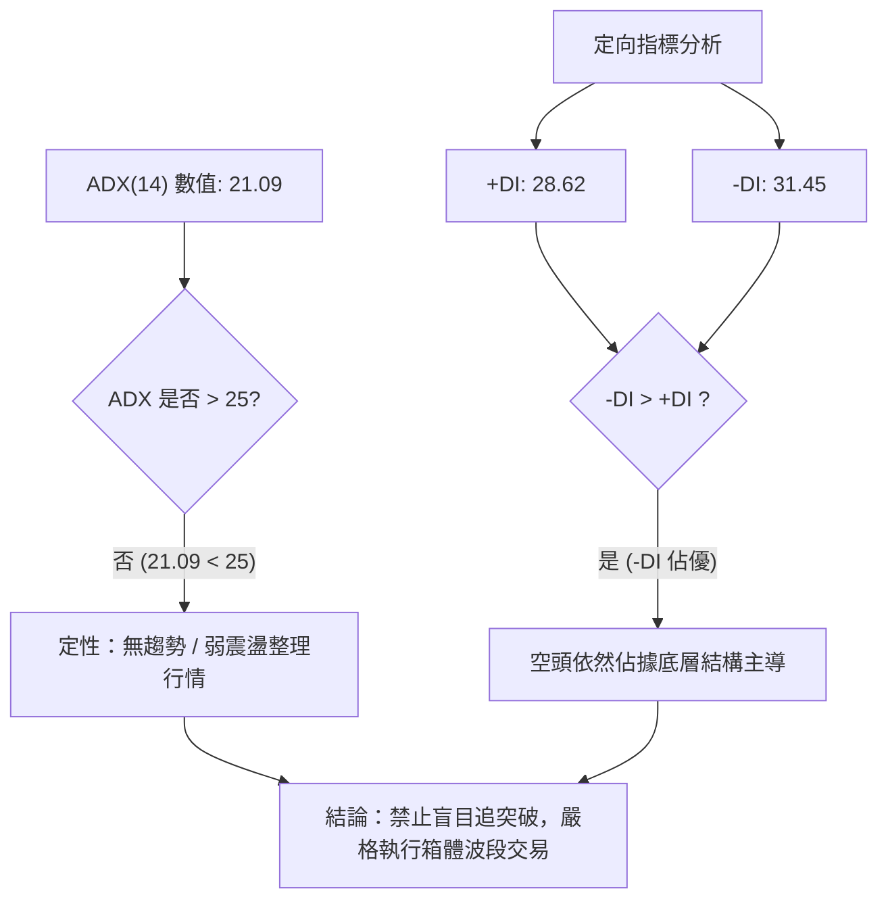
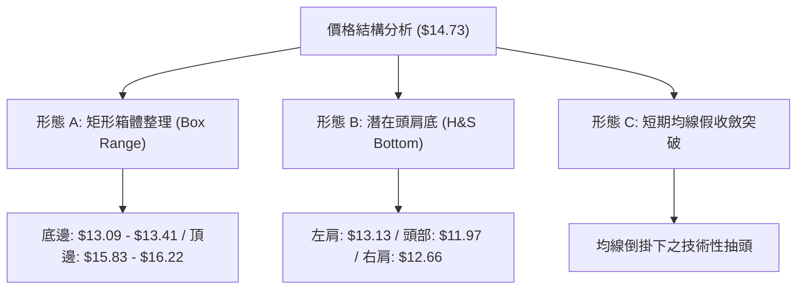
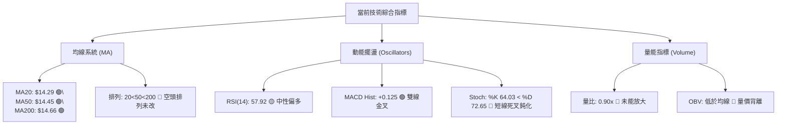
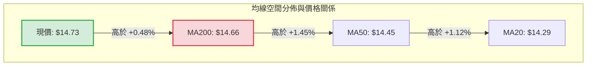
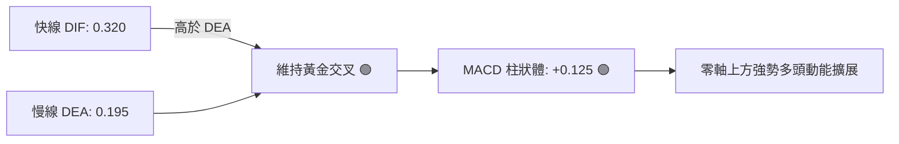
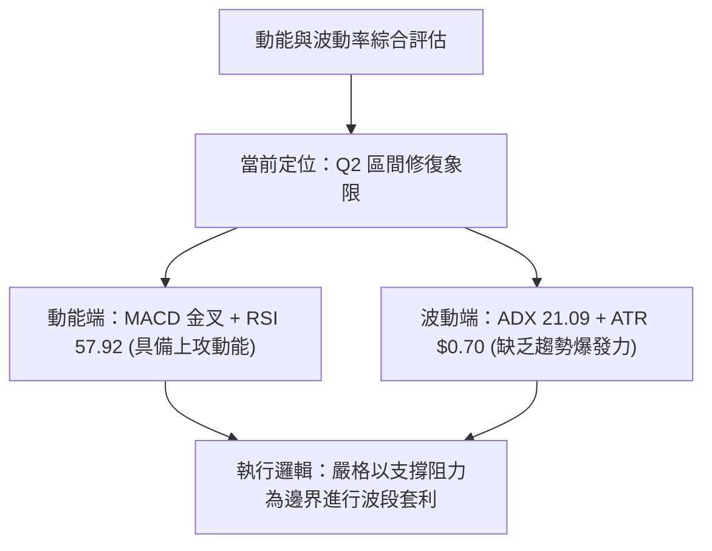
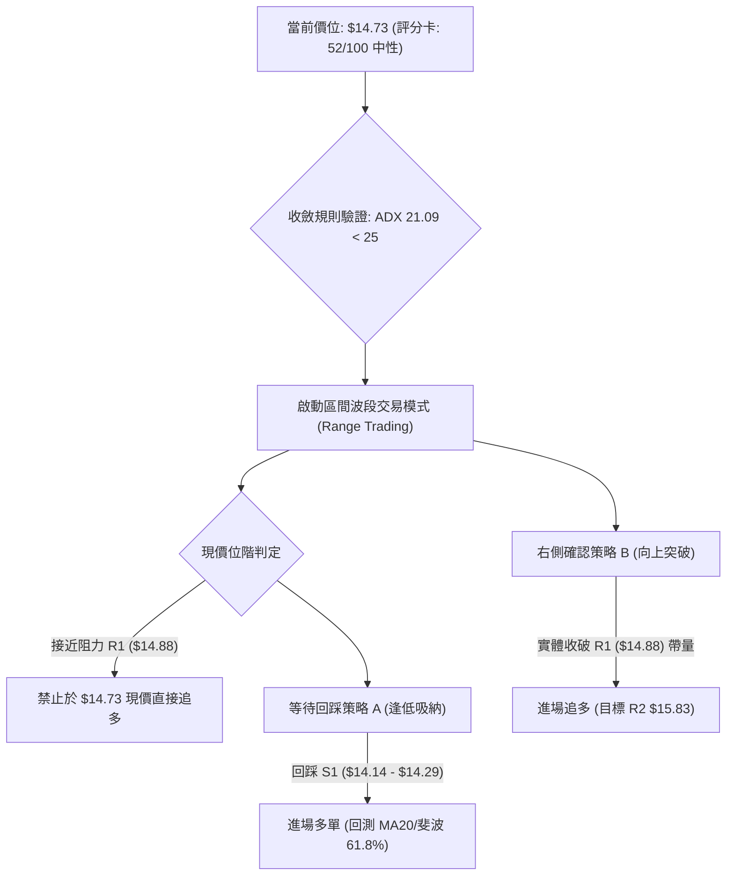
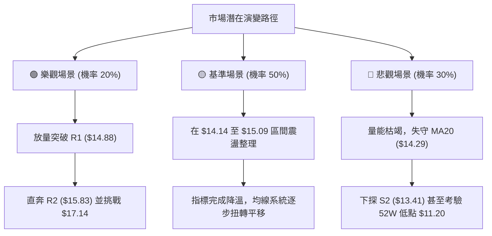

# NU 技術分析報告

> **報告日期**：2026-10-16 ｜ **語言**：繁體中文 ｜ **數據來源**：Yahoo Finance ｜ **當前價格**：$14.73

---

## 目錄

| 章節 | 內容 |
|------|------|
| [1. 技術面概覽](#1-技術面概覽) | 訊號儀表板、核心指標、評分卡 |
| [2. 趨勢分析](#2-趨勢分析) | 多時框趨勢、長中短期走勢、ADX 解讀 |
| [3. 圖表形態分析](#3-圖表形態分析) | 形態識別、信心度評估、目標價測算 |
| [4. 支撐與阻力](#4-支撐與阻力) | 關鍵價位結構、斐波那契回調 |
| [5. 技術指標深度解讀](#5-技術指標深度解讀) | MA/RSI/MACD/布林/量價配合 |
| [6. 動能與波動率](#6-動能與波動率) | 動能四象限、ATR 止損、Beta |
| [7. 多時框架總結](#7-多時框架總結) | 訊號收斂規則、主導時框裁決 |
| [8. 交易策略建議](#8-交易策略建議) | 策略路由、精確進出場、風報比 |
| [9. 風險提示與監控](#9-風險提示與監控) | 監控清單、情境推演、資金管理 |

---

## 1. 技術面概覽

### 🎯 技術訊號儀表板



### 📊 核心指標速覽表

| 指標類別 | 指標名稱 | 當前數值 | 訊號 | 解讀 |
| :--- | :--- | :--- | :---: | :--- |
| **價格** | 當前收盤價 | $14.73 | 🟢 | 收盤價成功站上短中長期均線集合區，短線多頭反彈確立 |
| **均線** | MA20 | $14.29 | 🟢 | 現價高於 MA20（+3.09%），短線轉為動能支撐 |
| **均線** | MA50 | $14.45 | 🟢 | 現價穿越 MA50（+2.06%），中期扣抵壓力逐步化解 |
| **均線** | MA200 | $14.66 | 🟢 | 突破長期牛熊分界線（+0.48%），然均線扣抵結構尚未完全扭轉 |
| **均線** | 排列結構 | MA20<MA50<MA200 | 🔴 | 均線系統本質仍處空頭排列，目前為反彈修復格局非主升段 |
| **動能** | RSI(14) | 57.92 | 🟡 | 位於 50 中軸之上，未達 70 超買區，多頭修復尚有發揮空間 |
| **動能** | MACD | DIF: 0.320 / DEA: 0.195 | 🟢 | 雙線位於零軸之上且黃金交叉，Hist +0.125 顯示短多控盤 |
| **趨勢** | ADX(14) | 21.09 (-DI: 31.45) | 🔴 | ADX < 25 且 -DI 壓制 +DI，市場本質為無趨勢之弱震盪行情 |
| **通道** | 布林通道 (%B) | 0.59 (帶寬 $11.84 - $16.74)| 🟡 | 站上中軌 $14.29 向中高軌推進，尚未觸發帶狀強勢擴張 |
| **量能** | 成交量比 / OBV | 0.90x / OBV < MA | 🔴 | 成交量 7,615 萬股低於 20 日均量，量縮價漲存在假突破隱憂 |
| **波動** | ATR(14) | $0.70 (4.76%) | 🟡 | 單日波動幅度適中，區間交易利潤空間充足 |

### 🏆 技術評分卡

```
╔══════════════════════════════════════════════════════════════════╗
║                   技術評分卡 — NU (2026-10-16)                  ║
╠══════════════════════════════════════════════════════════════════╣
║ 趨勢強度 (ADX/DI)   ██████░░░░░░░░░░░░░░  32/100  🔴 弱勢盤整    ║
║ 動能指標 (RSI/MACD) ██████████████░░░░░░  70/100  🟢 短線偏多    ║
║ 支撐穩定度 (S1-S3)  ████████████░░░░░░░░  62/100  🟢 買盤承接    ║
║ 成交量配合 (OBV/Vol)████████░░░░░░░░░░░░  40/100  🔴 量價背離    ║
║ 形態完整度 (區間)   ████████████░░░░░░░░  58/100  🟡 箱體成形    ║
║ 均線排列 (扣抵位)   ████████░░░░░░░░░░░░  42/100  🔴 均線倒掛    ║
╠══════════════════════════════════════════════════════════════════╣
║ 綜合評分            ███████████░░░░░░░░░  52/100  🟡 中性觀望    ║
╚══════════════════════════════════════════════════════════════════╝
```

---

## 2. 趨勢分析

### 🌐 多時框趨勢分析



### 📈 長期趨勢 — 12個月走勢圖（Unicode）

```
NU 月線走勢圖（2025-11 至 2026-10）
價格軸 ($)
$18.00 ┤                     ●(2026-01: $17.75 頂部)
$17.00 ┤ ●(11月: $17.39) ●
$16.00 ┤          ●(12月: $16.74)
$15.00 ┤                               ●(02月: $14.98)           ●(10月現價: $14.73)
$14.00 ┤                                  ●(03月: $14.37) ●(04月)   ●(07月) ●(08月: $14.55)
$13.00 ┤                                           ●(05月: $13.13) ●(06月)   ●(09月: $12.66)
$12.00 ┤                                                                      
       └─────────────────────────────────────────────────────────────────────────────►
         11月   12月   01月   02月   03月   04月   05月   06月   07月   08月   09月   10月
```

#### 長期走勢特徵分析表

| 階段 | 涵蓋月份 | 區間起訖 | 漲跌幅 | 量價特徵與結構解析 |
| :--- | :---: | :---: | :---: | :--- |
| **歷史衝頂段** | 2025-11 ~ 2026-01 | $16.11 → $17.75 | +10.18% | 觸及 52 週最高價 $18.98 區域後動能竭盡，高檔形成平頭複合頂 |
| **破位下行段** | 2026-02 ~ 2026-05 | $17.75 → $13.13 | -26.03% | 跌破多道短期均線，呈現階梯式下挫，空頭控盤態勢顯著 |
| **低位築底段** | 2026-06 ~ 2026-08 | $13.13 → $14.55 | +10.81% | 於 $11.97 - $12.66 一帶獲得支撐，成交量逐步萎縮沉澱 |
| **二次探底與回升**| 2026-09 ~ 2026-10 | $12.66 → $14.73 | +16.35% | 9月下殺確認支撐有效，10月伴隨週線 MACD 翻紅強勁反彈 |

### 📊 中期趨勢（週線分析）

中期技術架構呈現出明顯的收斂箱體結構。自 2026 年 6 月創下低點 $11.97 以來，NU 連續多次在 $12.00 - $13.00 區間觸發強力機構承接盤，隨後在 10 月初拉出巨量（2026-10-11 週量達 5.17 億股），收盤觸及 $16.12。然而最新一週收盤回落至 $14.73，形成衝高回落長上影線。

```
週線關鍵阻力與支撐分佈示意：
      [阻力層 R2: $15.83 - $16.22] ─── 上週高點與 38.2% 斐波那契回調強阻力
                  ▲
                  │  (當前價位: $14.73 — 處於 50% 與 61.8% 斐波回調中軸)
                  ▼
      [支撐層 S1: $14.14 - $14.17] ─── MA20 ($14.29) 與 61.8% 斐波那契共同防線
                  ▼
      [強支撐 S2: $13.41 - $13.09] ─── 9月築底密集成交帶
```

### ⚡ 趨勢強度評估（ADX 解讀）



#### ADX 強度區間量化對照表

| ADX 數值區間 | 當前數值 | 行情性質定性 | 最佳交易策略 | 系統操作警示 |
| :---: | :---: | :---: | :---: | :--- |
| **0 ~ 20** | — | 完全無方向震盪 | 網格交易 / 離場觀望 | 趨勢指標嚴重鈍化失真 |
| **20 ~ 25** | **21.09** | **弱趨勢 / 箱體過渡期** | **布林通道高拋低吸** | **假突破頻發，嚴禁追價** |
| **25 ~ 40** | — | 明確單邊趨勢形成 | 順勢突破 / 均線跟蹤 | 回調即為上車/加碼點 |
| **40 ~ 100** | — | 超強單邊 / 趨勢極值 | 移動止盈保護利潤 | 警惕動能竭盡反轉 |

---

## 3. 圖表形態分析

### 🔍 形態識別系統



#### 形態識別與信心度評估表

| 形態名稱 | 信心度 | 判斷依據（嚴格引用數據） | 完成度 | 目標價測算式與價位 |
| :--- | :---: | :--- | :---: | :--- |
| **矩形箱體震盪** | **85%** | 近 6 個月收盤價反覆受阻於 R2 ($15.83) 並在 S2 ($13.41) 獲撐 | 90% | 箱體等幅測量：突破 R2 後目標 = $15.83 + ($15.83 - $13.41) = **$18.25** |
| **複合頭肩底** | **60%** | 左肩 2026-05 ($13.13)、頭部 06-07 ($11.97)、右肩 09-27 ($13.59) | 70% | 頸線位 $14.88 (R1) 尚未實體收破；突破後目標 = $14.88 + ($14.88 - $11.97) = **$17.79** |
| **下降通道假突破** | **45%** | 2026-10-11 衝高至 $16.12 後快速滑落至 $14.73，成交量未續增 | 40% | 訊號不足，僅做指標型解讀（布林上軌壓制回調） |

### 🕯️ 重要 K 線形態分析

| 日期 / 週別 | 收盤價 | K 線形態組合 | 結構技術解讀 | 多空隱含訊號 |
| :---: | :---: | :--- | :--- | :---: |
| **2026-09-27** | $13.59 | 探底長下影小陰線 | RSI 跌至極端值 19.9 嚴重超賣，賣壓衰竭，形成波段底部 | 🟢 強烈見底 |
| **2026-10-04** | $13.43 | 低檔放量孕線 (Harami) | 週成交量擴大至 5.32 億股，機構資金逢低承接籌碼轉移 | 🟢 築底完成 |
| **2026-10-11** | $16.12 | 突破性長陽大棒 | 週漲幅 +20%，突破 MA20/50，MACD 柱狀體大幅擴展至 +0.325 | 🟢 多頭爆發 |
| **2026-10-18** | $14.73 | 長上影回吐流星形態 | 受阻於 52W 斐波那契 50% ($15.09) 及 R1 ($14.88)，多頭短線獲利回吐 | 🔴 短線修正 |

### 📉 ASCII 走勢形態示意圖

```
NU 矩形箱體與頸線壓制示意圖 ($)
$16.50 ┤
$16.22 ┤-----------------------[R3: 強阻力位]---------------------------
$15.83 ┤=======================[R2: 箱體頂部阻力]=======================
$15.09 ┤- - - - - - - - - - - -[斐波那契 50.0%] - - - - - - - - - - - - -
$14.88 ┤-----------------------[R1 / 頸線突破位]-----------------------
$14.73 ┤                       ◄◄◄ 【現價收盤位】
$14.29 ┤-----------------------[MA20 / 布林中軌]-----------------------
$14.14 ┤-----------------------[S1: 近期短線支撐]-----------------------
$13.41 ┤=======================[S2: 箱體底部強支撐]=====================
$13.09 ┤-----------------------[S3: 極限防守支撐]-----------------------
$12.50 ┤
```

### 🎯 形態目標價測算

```
【矩形箱體突破目標價推算】
形態高度 H = 箱體頂部 (R2: $15.83) - 箱體底部 (S2: $13.41) = $2.42
1. 向上突破有效確認（日線實體站穩 R2 $15.83）：
   - 第一波目標價 T1 = 頸線 R2 ($15.83) + H ($2.42) = $18.25（接近 52W 高點 $18.98）
2. 向下跌破有效確認（日線實體跌破 S2 $13.41）：
   - 向下回撤目標價 T_down = S2 ($13.41) - H ($2.42) = $10.99（接近 52W 低點 $11.20）
```

---

## 4. 支撐與阻力

### 🗺️ 關鍵價位分布圖（Unicode）

```
╔══════════════════════════════════════════════════════════════════╗
║                   NU 價位結構分佈圖 (OHLCV 計算)                  ║
╠══════════════════════════════════════════════════════════════════╣
║ $16.74 ║░░░░░░░░░░░░░░░░░░░░░░░░░░░░░░║ 布林通道上軌            ║
║ $16.22 ║██████████████████████████████║ 強阻力 R3 (+10.12%)    ║
║ $15.83 ║██████████████████████░░░░░░░░║ 波段高點 R2 (+7.43%)   ║
║ $15.09 ║- - - - - - - - - - - - - - - ║ 斐波那契 50.0% 回調位   ║
║ $14.88 ║██████████████████████████████║ 關鍵阻力 R1 (+1.04%)   ║
╠════════╬══════════════════════════════╬════════════════════════╣
║ $14.73 ╠══════════════════════════════╣ ◄ 現價位置             ║
╠════════╬══════════════════════════════╬════════════════════════╣
║ $14.29 ║▓▓▓▓▓▓▓▓▓▓▓▓▓▓▓▓▓▓▓▓▓▓▓▓▓▓▓▓▓▓║ MA20 / 布林中軌支撐    ║
║ $14.17 ║- - - - - - - - - - - - - - - ║ 斐波那契 61.8% 回調位   ║
║ $14.14 ║▓▓▓▓▓▓▓▓▓▓▓▓▓▓▓▓▓▓▓▓▓▓▓▓░░░░░░║ 近期支撐 S1 (-4.01%)   ║
║ $13.41 ║██████████████████████████████║ 強支撐 S2 (-8.96%)     ║
║ $13.09 ║██████████████████████████████║ 極限防守 S3 (-11.17%)  ║
║ $11.84 ║░░░░░░░░░░░░░░░░░░░░░░░░░░░░░░║ 布林通道下軌            ║
╚══════════════════════════════════════════════════════════════════╝
```

### 🚧 阻力位分析表

| 阻力級別 | 精確價位 | 距現價空間 | 形成技術依據 | 突破難度評級 | 戰略重要性 |
| :---: | :---: | :---: | :--- | :---: | :---: |
| **R1** | **$14.88** | +1.04% | 近一年密集波段高點聚類、MA240 ($14.95) 前哨站 | 🟡 中等 | 短線多空轉折頸線 |
| **R2** | **$15.83** | +7.43% | 2026-08 及 2026-10 月線次高點、波段震盪頂部 | 🔴 極高 | 箱體震盪上邊界 |
| **R3** | **$16.22** | +10.12%| 2025-10 高點重合區、近 1 年超買籌碼套牢區 | 🔴 極高 | 中線反轉確立標誌 |

### 🛡️ 支撐位分析表

| 支撐級別 | 精確價位 | 距現價空間 | 形成技術依據 | 守住機率評級 | 戰略重要性 |
| :---: | :---: | :---: | :--- | :---: | :---: |
| **S1** | **$14.14** | -4.01% | 斐波那契 61.8% ($14.17) 重合區、MA20 ($14.29) 下檔緩衝 | 🟢 75% | 多頭短線進攻防守線 |
| **S2** | **$13.41** | -8.96% | 2026-06 與 2026-09 兩次月線回調低點聚合平台 | 🟢 85% | 中期生命線 / 箱體底部 |
| **S3** | **$13.09** | -11.17%| 2026-05 月線實體低點、破位停損警戒線 | 🟢 90% | 空頭趨勢重啟臨界點 |

### 📐 斐波那契回調位分析

依據 52 週完整波動區間（高點 $18.98 → 低點 $11.20，總垂直落差 $7.78）計算之黃金分割架構：

```
斐波那契回調位階量化梯隊：
0.0%  (52W High) : $18.98 ──── 歷史頂部阻力
23.6%            : $17.14 ──── 空頭防守主線
38.2%            : $16.01 ──── 弱勢反彈極限阻力
50.0%            : $15.09 ──── 關鍵心理多空中軸 ◄──┐ (現價 $14.73 正試圖挑戰該區間)
61.8% (黃金分割) : $14.17 ──── 多頭回調支撐底線 ◄──┘
78.6%            : $12.86 ──── 深幅探底防守區
100.0%(52W Low)  : $11.20 ──── 長期週期底線
```

**斐波那契結構深度解讀**：
當前收盤價 **$14.73** 精準運行於 **61.8% ($14.17)** 與 **50.0% ($15.09)** 的「黃金夾層區間」。在道氏理論與斐波那契回撤體系中，回調至 61.8% 獲得支撐，代表自低點 $11.20 以來的修復行情具備極佳的幾何有效性；但唯有日線級別收盤實體帶量突破 50.0% ($15.09)，方能宣告技術結構由「超跌反彈」正式演變為「中級上升浪」。

---

## 5. 技術指標深度解讀

### 🎛️ 指標訊號總覽



### 📈 移動平均線排列分析



#### 移動平均線數據對比表

| 均線名稱 | 數值 | 距現價幅度 | 近期斜率走向 | 扣抵與多空意涵解讀 |
| :---: | :---: | :---: | :---: | :--- |
| **MA 5** | $15.47 | -4.81% | ▼ 急跌轉折向下 | 短線衝高回落後的下壓扣抵阻力 |
| **MA 10**| $15.26 | -3.47% | ▼ 走平下彎 | 10 日短線防守線遭擊穿，短線動能趨緩 |
| **MA 20**| $14.29 | +3.09% | ▲ 向上反彈扣低 | 短線生命線，已由壓力轉為下檔第一道實質支撐 |
| **MA 50**| $14.45 | +2.06% | ▲ 底部回升 | 季線扣抵逐步邁入低值區，中期助跌力道減弱 |
| **MA 60**| $14.43 | +2.06% | ▲ 緩步墊高 | 中期籌碼均價，現價站穩其上具備洗盤結束特徵 |
| **MA120**| $13.81 | +6.66% | ▲ 強力支撐 | 半年線持續向上推進，提供強大的中期安全墊 |
| **MA200**| $14.66 | +0.48% | ▲ 緩升微調 | 長期年線關卡，現價微幅收其上，仍需 3 日不破確認 |
| **MA240**| $14.95 | -1.46% | ▼ 持續壓制 | 終極多空線，壓制於現價上方，形成短線進攻天花板 |

### 📉 RSI(14) 分析

```
RSI(14) 動能刻度尺規：
0 ────── 超賣 (30) ────────── 現值 (57.92) ────── 超買 (70) ────── 100
[░░░░░░░░░░░░░░░░░░░░░░░░░░░░░██████████████░░░░░░░░░░] 57.92%
```

- **RSI 狀態解讀**：RSI 目前處於 57.92，脫離了 2026-09-27 週線所創下的 19.9 極度超賣區，重回 50 多空分界點上方。這表明市場已完全擺脫先前的恐慌性拋售狀態，目前由多方掌握短線修正節奏。
- **背離檢驗結論**：
  - **頂背離判斷**：日線與週線層級**無頂背離**。上週價格最高觸及 $16.12 時，週 RSI 達到 65.7，並未出現「價格創新高而 RSI 走低」的頂背離形態。
  - **底背離判斷**：2026-09-27 週收盤價 $13.59 對應 RSI 為 19.9，而 2026-10-04 收盤微跌至 $13.43 時，週 RSI 迅速跳升至 39.2，呈現明確的**週線級別普通底背離**。此底背離直接促成了 10 月初的大幅反彈，當前該底背離動能已釋放約 70%，後續轉為常規動能運行。

### 📊 MACD(12/26/9) 訊號解讀



- **MACD 動能評估**：快線 DIF (0.320) 自下方穿越慢線 DEA (0.195) 後，目前雙線皆運行於零軸之上，此為標準的強勢區多頭特徵。
- **柱狀體動能變化**：Hist 數值為 +0.125，相較前一週的 +0.325 出現了明顯的「紅柱收縮」現象。這代表多頭進攻速度放緩，市場短線正經歷技術性沉澱，而非趨勢逆轉。只要 DIF 不下穿 DEA 形成死叉，多方波段操作架構依然完好。

### 📦 布林通道分析

```
NU 布林通道位置示意圖 (標準差 2.0, 週期 20)
$16.74 ┤════════════════════════════════════════════════ 布林上軌 (強壓)
$16.00 ┤
$15.20 ┤
$14.73 ┤----------------------------- ◄◄◄ 【現價位 %B = 0.59】
$14.29 ┤──────────────────────────────────────────────── 布林中軌 (MA20 強支撐)
$13.00 ┤
$11.84 ┤════════════════════════════════════════════════ 布林下軌 (極限支撐)
```

- **帶寬與位置分析**：當前布林帶寬度為 $4.90 ($16.74 - $11.84)，%B 指標為 **0.59**。
- **通道軌道解讀**：
  - 現價位於中軌（$14.29）與上軌（$16.74）之間，確認當前處於「多頭攻擊與修復通道」。
  - 由於 %B 尚未達到 0.8 以上的單邊暴衝狀態，且上軌開口未見極端外擴，顯示行情並非「單邊暴漲」，而是穩健的「中軌支撐反彈」。
  - 中軌 $14.29 構成了未來 3-5 個交易日內多頭不可退守的第一道防線。

### 💹 成交量分析（量價配合度）

- **量比與均量萎縮**：
  - 最新單日成交量為 **76,153,700 股**。
  - 20 日均量為 **84,760,985 股**（最新量比為 **0.90x**）。
  - 50 日均量為 **76,804,154 股**（量比約 **0.99x**）。
- **OBV 能量潮趨勢分析**：
  - 當前數據顯示 **OBV < MA**，確認量能趨勢疲弱。
  - **量價背離隱憂**：NU 自 9 月底 $12.66 低點反彈至當前 $14.73，累計反彈幅度達 +16.35%，然而日成交量卻由爆發期的 5 億股/週急縮至 2.83 億股/週，日成交量跌破 20 日均量線。這種「價漲量縮」且「OBV 未能有效向上突破量能均線」的結構，構成了技術面上的**隱性量價背離**。此信號警示：當前反彈主要源於空頭平倉與籌碼鎖定，尚未吸引大規模場外增量資金追高進場，一旦觸及高位阻力（R1 $14.88 / R2 $15.83），極易遭遇多殺多回踩。

---

## 6. 動能與波動率

### ⚡ 動能評估四象限

| 象限標籤 | 動能維度 (RSI / MACD) | 波動率維度 (ATR / 帶寬) | 當前判定 | 操作意涵與策略部署 |
| :---: | :---: | :---: | :---: | :--- |
| **Q1：突破主升** | 強動能 (RSI > 60, MACD擴張) | 低波動 (帶寬收縮) | — | 趨勢突破初段，全力跟隨加碼 |
| **Q2：區間修復** | **中強動能 (RSI 57.92, MACD金叉)**| **中低波動 (ATR 4.76%, ADX 21)**| **✓ 當前狀態** | **箱體內低吸高拋，鎖定確定性利潤** |
| **Q3：劇烈洗盤** | 強動能 (單邊過度極端) | 高波動 (ATR 擴散, %B>1) | — | 減倉觀望，嚴設跟蹤止盈 |
| **Q4：空頭陰跌** | 弱動能 (RSI < 40, MACD死叉) | 低波動 (量能枯竭) | — | 嚴禁抄底，保持空倉 |



### 📊 ATR 波動率分析

- **ATR(14) 精確數值**：**$0.70**（佔當前股價 $14.73 之比例為 **4.76%**）。
- **ATR 波動特性量化**：
  - 歷史日均波幅約在 $0.70 左右，顯示 NU 具備中等偏高的活躍度，屬於典型的成長型金融科技個股特質。
- **ATR 止損距離量化建議**：
  - **日內超短線交易**：建議止損空間設定為 1.0x ATR = **$0.70**。
  - **波段擺盪交易（Swing Trading）**：建議動態止損設定為 1.5x ATR = **$1.05**。
  - **穩健趨勢持倉**：建議寬幅止損設定為 2.0x ATR = **$1.40**。

### 📐 Beta 與市場相關性

- **Beta 數值**：**0.955**。
- **市場特徵解讀**：
  - NU 的 Beta 係數極度接近於 1.0（0.955），這表明該標的與標普 500 指數及美股大盤整體呈現**高度同頻連動**。
  - 在大盤未出現系統性崩跌風險的前提下，NU 不易走出獨立的單邊暴跌行情；反之，若美股大盤進入震盪整固期，NU 亦難以憑藉自身動能單邊突圍。機構持股比例高達 **82.1%**，更強化了其隨機構大盤資金配置而波動的特徵。

---

## 7. 多時框架總結

### 📋 時框架評分表

| 時框架 | 趨勢方向 | 動能狀態 | 均線系統狀態 | 關鍵技術形態 | 綜合評分 | 操作建議方向 |
| :---: | :---: | :---: | :---: | :---: | :---: | :---: |
| **日線 (短線)** | 🟢 偏多反彈 | RSI 57.92 / MACD金叉 | 站上 MA20/50/200 壓力層 | 衝高回落遭遇 R1 阻力 | **65/100** | 逢低回踩佈局短多 |
| **週線 (中線)** | 🟡 區間震盪 | MACD 柱翻紅 (+0.125) | 均線倒掛 MA20<50<200 | 矩形箱體築底中段 | **50/100** | 箱體區間高拋低吸 |
| **月線 (長線)** | 🟡 大箱體 | RSI 處中軸 / 9月見底 | 處於 24 個月區間中樞位 | 52 週中軸 ($15.09) 爭奪 | **52/100** | 中長線定投底倉持有 |

### 🔲 綜合訊號矩陣

```
╔══════════════════════════════════════════════════════════════════╗
║                   NU 跨週期技術訊號矩陣收斂表                   ║
╠══════════════╦══════════════╦══════════════╦═════════════════════╣
║  技術分析維度 ║  短線 (日線)  ║  中線 (週線)  ║     一致性判定      ║
╠══════════════╬══════════════╬══════════════╬═════════════════════╣
║ 趨勢方向     ║ 🟢 多頭進攻  ║ 🟡 寬幅箱體  ║ 🟡 短多受制於中線箱體║
║ 均線動態     ║ 🟢 突破均線  ║ 🔴 均線倒掛  ║ 🔴 均線尚未完成多頭扭轉║
║ 動能擺盪     ║ 🟢 金叉上行  ║ 🟢 底背離修復║ 🟢 跨週期動能形成共振║
║ 量價配合     ║ 🔴 量縮背離  ║ 🔴 上影放量  ║ 🔴 追高籌碼不足     ║
╚══════════════╩══════════════╩══════════════╩═════════════════════╝
```

### ⚖️ 多時框收斂結論

> **核心裁決遵循規則 14**：
> 當前 ADX(14) 數值為 **21.09**，嚴格滿足 **ADX < 25 之「盤整行情」判定條件**。
> 根據收斂規則：在弱趨勢/盤整行情下，**不得採用趨勢突破邏輯，必須以日線與週線之布林通道及關鍵箱體支撐阻力為核心交易依據**。
>
> **唯一方向性結論：【中性觀望，區間偏多高拋低吸】**
> - **取捨邏輯**：日線雖然短線站上三大均線呈現偏多型態，但週線與長期的均線倒掛及成交量疲弱限制了單邊拉升空間。因此，日線的偏多訊號僅能用於「回調時尋求高風報比進場點」，嚴禁在阻力位附近盲目追漲。

---

## 8. 交易策略建議

### 🗺️ 策略決策流程圖



### 🧭 策略路由（依評分卡分流）

**當前主策略方向 = 【中性區間波段操作，以逢回低吸為主，嚴格區間停利】（依評分 52/100，落於 40–60 中性區間）**

當前綜合評分為 52 分，指標處於多空拉鋸的震盪修復期。策略主軸明確定義為：**「在箱體下軌支撐區逢低做多，在箱體上軌阻力區分批停利」**，不押注單邊大突破。

### 🎯 價格情境階梯（Price Scenarios）

所有價位均嚴格引用第 4 章由 OHLCV 所計算之數值：

| 觸發條件 | 下一目標價 | 後續延伸目標 | 情境技術含義與因應措施 |
| :--- | :---: | :---: | :--- |
| **帶量實體突破 R1 ($14.88)** | **R2 ($15.83)** | **R3 ($16.22)** | 短線反彈轉為波段進攻，突破頸線挑戰箱頂，可加碼 |
| **跌破 MA20 支撐 S1 ($14.14)** | **S2 ($13.41)** | **S3 ($13.09)** | 短多動能竭盡，重新考驗箱體下邊界，應立即停損出局 |
| **在 $14.14 - $14.88 區間震盪** | — | — | 指標消化中，持股觀望，嚴格執行區間高拋低吸 |

### 📊 情境機率分佈

```
情境機率分佈圓餅視圖：
[████████████████████░░░░░░░░░░░░░░░░░░░░] 區間震盪 (50%)
[████████████░░░░░░░░░░░░░░░░░░░░░░░░░░░░] 回踩洗盤 (30%)
[████████░░░░░░░░░░░░░░░░░░░░░░░░░░░░░░░░] 向上突破 (20%)
```

| 未來走勢情境 | 機率估算 | 核心技術判定依據 |
| :--- | :---: | :--- |
| **情境一：區間震盪整理** | **50%** | ADX 僅 21.09 處弱趨勢，布林通道中上軌間距足夠，量能維持 0.90x 平衡 |
| **情境二：回踩下軌探底** | **30%** | OBV 疲弱且量價背離，MA 倒掛結構形成扣抵反壓，需回測 S1/S2 確認承接 |
| **情境三：直接放量突破** | **20%** | 週線 MACD 柱狀體收縮，且遭遇波段阻力聚類區 R1 ($14.88) 壓制 |

### 🟢 主策略詳情（區間波段多頭佈局）

針對中性評分環境，提供兩套嚴謹的右側與左側交易策略：

| 策略要素 | 策略 A（穩健型：回踩支撐低吸） | 策略 B（激進型：突破頸線跟進） |
| :--- | :---: | :---: |
| **策略定位** | 左側逢低接刀，賺取均值回歸波段 | 右側動能突破，賺取阻力破位推升 |
| **進場條件** | 價格回調至 MA20 且守穩 S1 ($14.14) 出現日線止跌K線 | 日線收盤實體帶量突破 R1 ($14.88) 且成交量 > 20日均量 |
| **進場價格** | **$14.20**（位於 S1 $14.14 與 MA20 $14.29 緩衝區） | **$14.95**（突破 R1 $14.88 並站上 MA240） |
| **目標價 T1** | **$14.88**（R1 阻力位，先收回波段利潤） | **$15.83**（R2 箱體頂部） |
| **目標價 T2** | **$15.83**（R2 強阻力位，全數清倉） | **$16.22**（R3 極限阻力位） |
| **止損價格** | **$13.80**（跌破 S1 下方約 1x ATR，跌穿 61.8% 斐波）| **$14.45**（跌回 MA50 之下，確認為假突破） |
| **風險空間** | $0.40（-2.82%） | $0.50（-3.34%） |
| **獲利空間(T2)**| $1.63（+11.48%） | $1.27（+8.49%） |
| **風險報酬比** | **1 : 4.08**（極佳） | **1 : 2.54**（優良） |
| **勝率預估** | **65%** | **55%** |
| **建議倉位** | **總資金之 10% - 15%** | **總資金之 5% - 8%** |

### 🔴 反向風險觸發點（對沖提示）

- **多單全面離場警戒線**：若日線級別收盤實體跌破 **S1 ($14.14)**，表明反彈格局被破壞，所有短多頭寸應無條件止損出局。
- **反手放空觸發條件**：若價格反彈至 **R2 ($15.83)** 附近出現長上影線或 RSI 超買死叉，且無法突破 $16.01 (38.2% 斐波那契)，激進投資人可建立避險空單，止損設於 $16.25，目標回看 $14.29。

### ⭐ 整體訊號強度評星

```
做多訊號強度：★★★☆☆  (3.0 / 5.0 星 — 均線站上但量能不足)
做空訊號強度：★★☆☆☆  (2.0 / 5.0 星 — 短期動能尚未反轉)
整體可信度：  ★★★★☆  (3.8 / 5.0 星 — 價位由 OHLCV 精確鎖定，結構扎實)
```

---

## 9. 風險提示與監控

### ✅ 關鍵監控指標 Checklist

```
╔══════════════════════════════════════════════════════════════════╗
║                    NU 技術面日常風控監控清單                     ║
╠══════════════════════════════════════════════════════════════════╣
║ [ ] 監控 MA20 ($14.29)：多頭短線防禦中樞，連續兩日跌破需警戒    ║
║ [ ] 監控 頸線 R1 ($14.88)：是否具備實體長陽線突破與成交量確認   ║
║ [ ] 監控 成交量門檻：突破 R1 時單日量能是否大於 8,476 萬股 (均量) ║
║ [ ] 監控 MACD 柱狀體：紅柱是否跌破 0 軸轉綠（轉綠需全面防禦）    ║
║ [ ] 監控 RSI(14)：上行是否在 60-65 區間提早受阻鈍化              ║
║ [ ] 監控 斐波那契 61.8% ($14.17)：中期多頭結構不容有失的最後底線 ║
╚══════════════════════════════════════════════════════════════════╝
```

### ⚠️ 風險場景分析



### 🛡️ 風險管理重要提醒

1. **量價背離的潛在殺傷力**：
   當前最顯著的技術隱患在於「股價自低檔反彈 +16%，但日量比僅 0.90x，且 OBV < MA」。這意味著多頭正在消耗存量資金，此時在 $14.73 盲目追高承擔的實質風險遠大於預期利潤。必須等待回踩確認或放量突破才可行動。
2. **均線倒掛的扣抵反壓**：
   雖然現價高於 MA20、MA50、MA200，但整體的均線結構仍為「MA20 < MA50 < MA200」的長期倒掛。MA240 依然在 $14.95 持續下行壓制，均線完全扭轉成多頭排列至少需要 3-4 週的築底時間，不可將短線反彈誤判為超級大牛市主升浪。
3. **倉位管理剛性鐵律**：
   在 ADX < 25 的盤整震盪期中，單一標的持倉總暴露不得超過投資組合總資金的 **15%**。每筆交易的最大可承受虧損額度必須嚴格限制於總資金的 **1% - 1.5%** 以內。嚴禁在跌破 S1 ($14.14) 時進行任何逆勢攤平成本操作。

---

## 📋 報告總結

```
╔══════════════════════════════════════════════════════════════════╗
║                     NU 技術分析報告總結                          ║
╠══════════════════════════════════════════════════════════════════╣
║ 報告日期：2026-10-16                                             ║
║ 當前價格：$14.73                                                 ║
║ 綜合技術評級：⚖️ 中性觀望 (評分: 52 / 100，區間震盪偏多修復)    ║
╠══════════════════════════════════════════════════════════════════╣
║ 關鍵維度技術結論：                                               ║
║ ├─ 長期趨勢 (月線)：🟡 大箱體寬幅震盪 ($11.20 - $18.98)          ║
║ ├─ 中期趨勢 (週線)：🟡 構築底部結構中，面臨均線倒掛扣抵反壓      ║
║ ├─ 短期趨勢 (日線)：🟢 站上三大均線，短多控盤但遭遇 R1 首波阻力  ║
║ ├─ 關鍵阻力價位：  R1: $14.88  /  R2: $15.83  /  R3: $16.22      ║
║ ├─ 關鍵支撐價位：  S1: $14.14  /  S2: $13.41  /  S3: $13.09      ║
║ └─ 外資分析師共識：目標均價 $18.77 (Buy，共22位分析師覆蓋)       ║
╠══════════════════════════════════════════════════════════════════╣
║ 最優交易策略組合：                                               ║
║ 1. 🥇 最佳機會 (策略 A)：耐心等待回踩 $14.20 附近低吸，止損      ║
║    設於 $13.80，目標上看 $14.88 及 $15.83 (風報比 1:4.08)。     ║
║ 2. 🥈 次選機會 (策略 B)：若日線放量實體突破 $14.88 則順勢右側    ║
║    跟進，止損 $14.45，博弈箱頂 $15.83 (風報比 1:2.54)。          ║
║ 3. 🥉 保守選擇：完全空倉觀望，直至日線 ADX 向上突破 25 確認單邊 ║
║    趨勢啟動後再行介入。                                          ║
╚══════════════════════════════════════════════════════════════════╝
```

---

> ⚠️ **免責聲明**：本報告為依據量化技術指標與圖表形態所產出之技術分析研究，所有數據、支撐阻力點位及估算均嚴格基於所提供之歷史價格與成交量資訊。本報告**僅供學術研究與投資分析參考**，**不構成任何要約、招攬或具體投資建議**。金融市場存在高度波動與本金損失風險，投資人應自行審慎評估風險承受能力並自負盈虧。

---

*報告生成時間：2026-10-16 ｜ 數據來源：Yahoo Finance ｜ 分析框架：多時框技術分析體系*