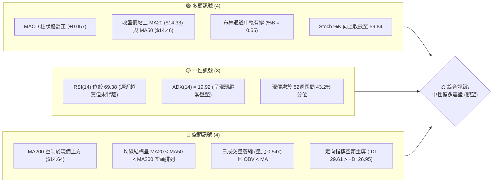
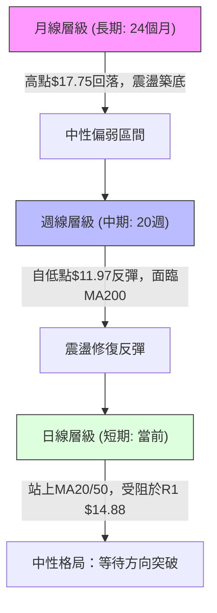
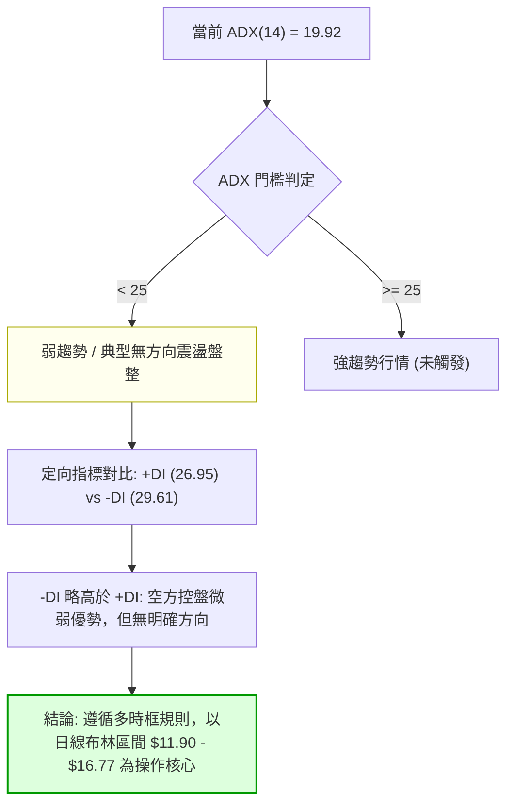
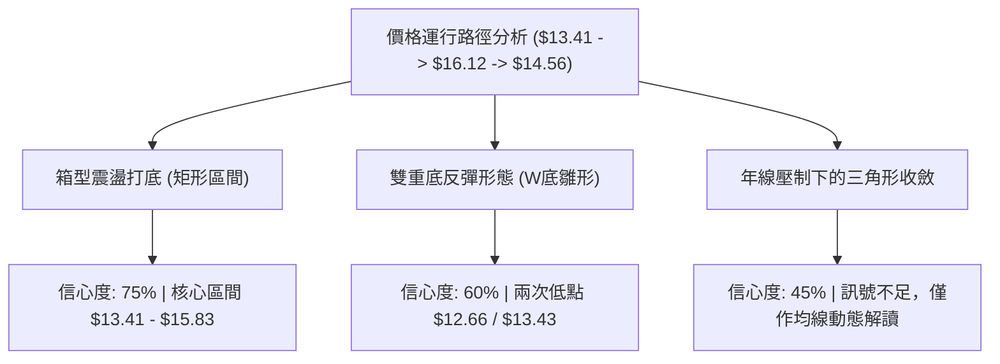
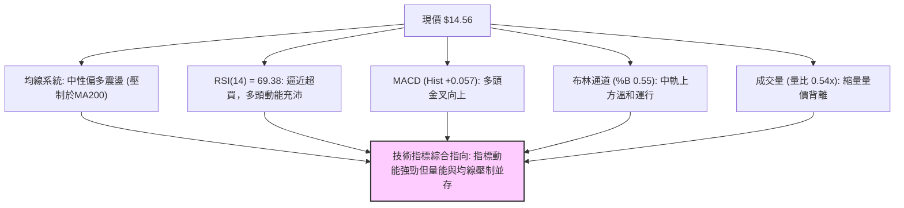
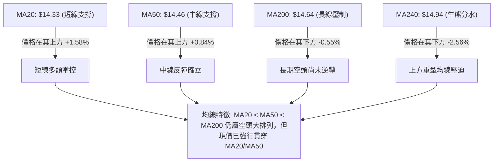
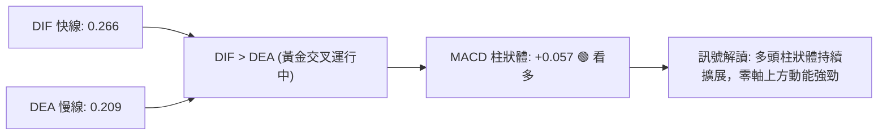
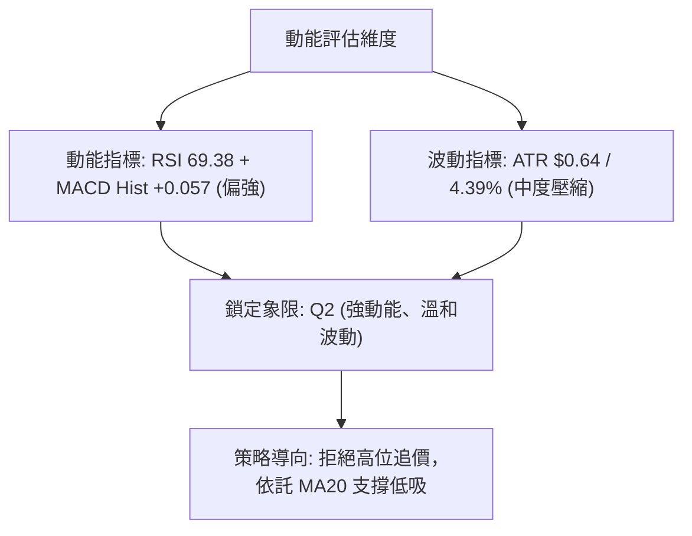
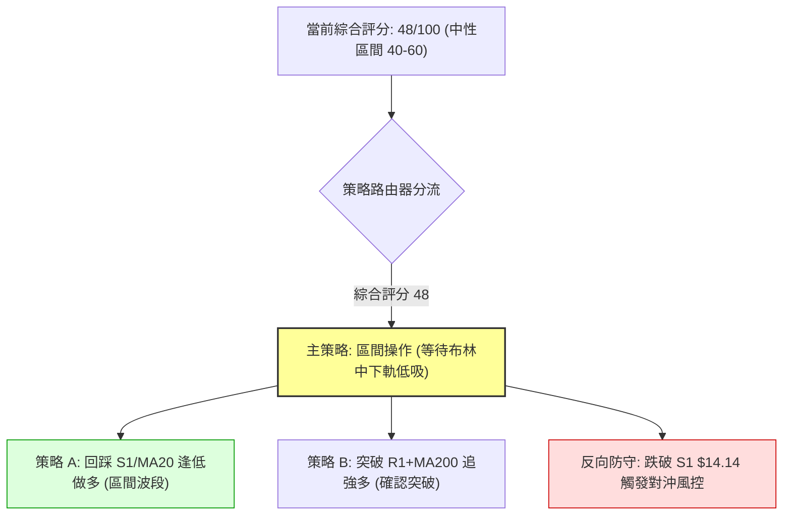
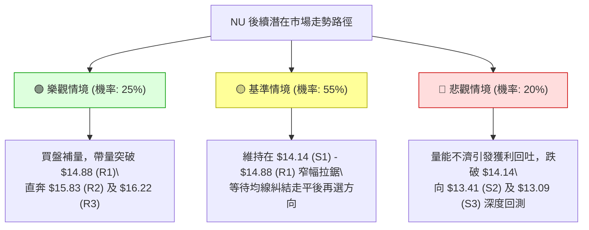

# NU 技術分析報告

> **報告日期**：2026-10-17 ｜ **語言**：繁體中文 ｜ **數據來源**：Yahoo Finance ｜ **當前價格**：$14.56

---

## 目錄

| 章節 | 內容 |
|------|------|
| [1. 技術面概覽](#1-技術面概覽) | 訊號儀表板、核心指標、評分卡 |
| [2. 趨勢分析](#2-趨勢分析) | 多時框趨勢、長中短期走勢 |
| [3. 圖表形態分析](#3-圖表形態分析) | 形態識別、K線組合、目標價 |
| [4. 支撐與阻力](#4-支撐與阻力) | 關鍵價位、斐波那契回調 |
| [5. 技術指標深度解讀](#5-技術指標深度解讀) | MA/RSI/MACD/布林/成交量 |
| [6. 動能與波動率](#6-動能與波動率) | 動能評估、ATR、Beta |
| [7. 多時框架總結](#7-多時框架總結) | 時框架評分矩陣 |
| [8. 交易策略建議](#8-交易策略建議) | 多空策略、風險報酬比 |
| [9. 風險提示與監控](#9-風險提示與監控) | 監控指標、風險場景 |

---

## 1. 技術面概覽

### 🎯 技術訊號儀表板



### 📊 核心指標速覽表

| 指標類別 | 指標名稱 | 當前數值 | 訊號 | 解讀 |
|----------|----------|----------|------|------|
| **價格** | 當前價格 | $14.56 | 🟡 | 位於52週區間中下段($11.20 - $18.98之43.2%)，多空拉鋸 |
| **均線** | MA20 | $14.33 | 🟢 | 現價高於 MA20 約 +1.58%，短線站穩月線轉強 |
| **均線** | MA50 | $14.46 | 🟢 | 現價突破季線 +0.84%，短中期底部動能浮現 |
| **均線** | MA200 | $14.64 | 🔴 | 現價壓制於長期年線下方 -0.55%，牛熊分水嶺未收復 |
| **動能** | RSI(14) | 69.38 | 🟡 | 逼近 70 超買警戒區，多頭動能強勁但面臨阻力消化 |
| **動能** | MACD (12,26,9) | 0.266 / 0.209 | 🟢 | DIF 高於 DEA，Hist 翻正至 +0.057，柱狀體維持看多 |
| **動能** | DMI (ADX/DI) | 19.92 / -DI:29.61 | 🔴 | ADX < 25 屬無趨勢盤整；-DI > +DI 表空方仍具防守優勢 |
| **通道** | Bollinger Bands | $11.90 - $16.77 | 🟢 | 現價位處中軌($14.33)上方，%B為0.55，偏向上軌運行 |
| **波動** | ATR(14) | $0.64 (4.39%) | 🟡 | 每日波動幅度適中，盤整壓縮特徵顯著 |
| **量能** | Volume / OBV | 45.17M (0.54x) | 🔴 | 突破缺乏放量，OBV 處於均線下方，量價配合欠佳 |

### 🏆 技術評分卡

```
╔══════════════════════════════════════════════════════════════════╗
║              技術評分卡 — NU (Nu Holdings Ltd.) — 2026-10-17      ║
╠══════════════════════════════════════════════════════════════════╣
║ 趨勢強度 (Trend)     ████████░░░░░░░░░░░░  40/100  🔴 弱趨勢盤整 ║
║ 動能指標 (Momentum)  ██████████████░░░░░░  70/100  🟢 短多佔優   ║
║ 支撐穩定度 (Support) ████████████░░░░░░░░  60/100  🟡 S1支撐有效 ║
║ 成交量配合 (Volume)  ██████░░░░░░░░░░░░░░  30/100  🔴 量能萎縮背離║
║ 形態完整度 (Pattern) ██████████░░░░░░░░░░  50/100  🟡 區間箱型結構║
║ 均線排列 (MAs)       ████████░░░░░░░░░░░░  40/100  🔴 長期空頭壓制║
╠══════════════════════════════════════════════════════════════════╣
║ 綜合評分             ██████████░░░░░░░░░░  48/100  🟡 中性區間震盪║
╚══════════════════════════════════════════════════════════════════╝
```

---

## 2. 趨勢分析

### 🌐 多時框趨勢分析



NU 在不同時框上展現出顯著的週期衝突。中長期來看，股票在 2026 年初觸及 $17.75 後一路走低至 $12.66，月線均線發散偏空；短期日線級別在經歷了 $13.43-$13.59 的密集換手後強勁反彈至 $16.12，隨後回踩 $14.56，目前正處於均線糾結與突破後的整理確認期。

### 📈 長期趨勢 — 12個月走勢圖（Unicode）

```
NU 月線收盤走勢圖（2025-11 至 2026-10）
價格軸 ($)
$18.00 ┤              ● 17.75 (2026-01 高點)
$17.50 ┤        ● 17.39
$17.00 ┤              ● 16.74
$16.50 ┤
$16.00 ┤
$15.50 ┤
$15.00 ┤                    ● 14.98
$14.50 ┤                          ● 14.37  ● 14.48              ● 14.55        ● 14.56 (現價)
$14.00 ┤                                                  ● 14.33
$13.50 ┤                                            ● 13.36
$13.00 ┤                                      ● 13.13
$12.50 ┤                                                              ● 12.66
       └────────────────────────────────────────────────────────────────────────
        11    12    01    02    03    04    05    06    07    08    09    10 (月份)
        2025        2026
```

#### 長期走勢階段特徵分析

| 階段區間 | 月份跨度 | 價格區間 ($) | 區間漲跌幅 | 走勢結構與特徵解讀 |
|----------|----------|--------------|------------|--------------------|
| 衝頂期 | 2025-11 ~ 2026-01 | $16.74 - $17.75 | +6.03% | 創下波段歷史新高 $17.75，但隨後成交量放大滞漲，構成高位頂部形態。 |
| 估值修正期 | 2026-02 ~ 2026-05 | $14.98 - $13.13 | -12.35% | 跌破所有短期均線，呈現階梯式下挫，於 $13.13 尋得初步止跌盤整支撐。 |
| 箱型震盪期 | 2026-06 ~ 2026-08 | $13.36 - $14.55 | +8.91% | 在 $13.30 至 $14.60 區間建立橫向打底箱型，法人持股穩定換手。 |
| 洗盤回升期 | 2026-09 ~ 2026-10 | $12.66 - $14.56 | +15.01% | 9月下殺探底至 $12.66 完成終極洗盤，10月迅速拉回 $14.56，確認底部承接力道。 |

### 📊 中期趨勢（週線分析）

從近20週數據觀察，NU 經歷了兩個主要波段：
1. **打底回升段（06-07 至 08-16）**：股價從 $11.97 穩健推升至 $15.23，週成交量溫和放大，RSI 自 47.2 攀升至 58.0。
2. **二次探底與V轉段（08-23 至 10-18）**：在 9 月底一度回落至 $13.43-$13.59 區間，RSI(週) 出現 19.9 的極度超賣。10-11 當週爆出 5.17 億股巨量，收盤急拉至 $16.12，MACD 柱狀體跳升至 +0.325。本週回調至 $14.56，成交量回落至 3.28 億股，屬於典型的巨量長陽後的縮量強勢回踩中軌測試。

### ⚡ 趨勢強度評估（ADX 解讀）



#### ADX 趨勢強度對照表

| 指標名稱 | 當前數值 | 閾值標準 | 市場狀態判定 | 交易指引 |
|----------|----------|----------|--------------|----------|
| **ADX(14)** | 19.92 | < 20 (極弱), 20-25 (盤整), >25 (趨勢) | 弱勢無趨勢盤整 | 避免單邊追突破，主採區間低吸高拋策略 |
| **+DI (14)** | 26.95 | 相對強弱比較 | 多方回補動能充沛 | 具備防守支撐反彈實力，但尚不足以發動單邊牛市 |
| **-DI (14)** | 29.61 | 相對強弱比較 | 空方拋壓略佔上風 | 長期均線壓制仍存，上方高點賣壓未完全消化 |

---

## 3. 圖表形態分析

### 🔍 形態識別系統



#### 圖表形態信心度評估表

| 形態名稱 | 信心度 | 判斷依據（引用數據） | 完成度 | 目標價（附計算式） |
|----------|--------|----------------------|--------|--------------------|
| **箱型區間整理** | **75%** | 近期收盤高點聚集於 R2 ($15.83)，低點獲 S2 ($13.41) 密集支撐，價格多月於此震盪 | 85% | 突破箱頂 R2: $15.83 + 形態高度 ($15.83 - $13.41 = $2.42) = **$18.25** |
| **潛在雙重底 (W底)**| **60%** | 第一低點為 2026-09 收盤 $12.66，第二低點為 2026-10-04 當週收盤 $13.43，隨後暴力拉升 | 65% | 頸線為 10-11 收盤 $16.12，高低差 $16.12 - $12.66 = $3.46；突破頸線目標 = **$19.58** |
| **旗形整理** | **35%** | 訊號不足，僅做指標型解讀 | 20% | 數據中未偵測到標準旗形旗面，暫不推算 |

### 🕯️ 重要K線形態分析

| 週期/月份 | 收盤價 ($) | K線組合形態 | 技術面解讀 | 訊號強度 |
|-----------|------------|-------------|------------|----------|
| **2026-09** | 12.66 | 長黑破底倒拔楊柳 | 月線急跌測試 52週低點 $11.20 支撐帶，形成極端超賣誘空洗盤 | 🔴 強空洗盤 |
| **2026-10-04** | 13.43 | 帶下影線錘子線 | 週成交量放大至 5.32 億股，低位買盤大舉介入，空方動能耗盡 | 🟢 築底翻多 |
| **2026-10-11** | 16.12 | 爆量長紅突破K線 | 週成交量 5.17 億股，單週暴力推升 +20.0%，突破季線與多道阻力 | 🟢 強勢攻擊 |
| **2026-10-18** | 14.56 | 縮量中陰回洗K線 | 週量縮減至 3.28 億股，回踩 MA20/MA50 尋求支撐，未跌破多頭防守點 | 🟡 縮量回踩 |

### 📉 ASCII 走勢形態示意圖

```
NU 日/週線層級箱型與雙底構造示意圖
價格 ($)
$16.22 ┤-------------------------------------- (阻力 R3)
$16.12 ┤                     ● (10-11 高點/雙底頸線)
$15.83 ┤---------------------│---------------- (箱頂阻力 R2)
$14.88 ┤-----------●---------│---------------- (阻力 R1 / MA200: $14.64)
$14.56 ┤           │         ●◄──── 當前現價 (回踩確認中)
$14.14 ┤-----●-----│---------│---------------- (支撐 S1 / 斐波 61.8%: $14.17)
$13.41 ┤     │     ● (10-04) │---------------- (箱底支撐 S2 / 第二底)
$13.09 ┤     │               │---------------- (強支撐 S3)
$12.66 ┤     ● (09月第一底)  │
       └─────┴───────────────┴────────────────
            2026-09        2026-10
```

### 🎯 形態目標價計算

1. **區間箱型突破測量（基準情境）**：
   - 箱體上限（阻力 R2）：`$15.83`
   - 箱體下限（支撐 S2）：`$13.41`
   - 形態箱體垂直高度：`H = $15.83 - $13.41 = $2.42`
   - 往上等幅測量目標價：`R2 ($15.83) + H ($2.42) = $18.25`

2. **W底中期頸線突破測量（樂觀情境）**：
   - 形態頸線位置（2026-10-11 高點）：`$16.12`
   - 形態最低底點（2026-09 收盤）：`$12.66`
   - 形態振幅高度：`H_W = $16.12 - $12.66 = $3.46`
   - 突破頸線後之完全等幅目標價：`$16.12 + $3.46 = $19.58`

---

## 4. 支撐與阻力

### 🗺️ 關鍵價位分布圖（Unicode）

```
NU 價位結構分布圖（OHLCV 精確計算）
══════════════════════════════════════════════════════════════════
$18.98 ║████████████████████████████████║ 52週歷史高點 (0.0% 回調位)
$17.14 ║████████████████████            ║ 斐波那契 23.6% 回調壓力
$16.22 ║████████████████████████        ║ 強阻力 R3 (+11.40%)
$16.01 ║████████████████                ║ 斐波那契 38.2% 回調位
$15.83 ║████████████████████            ║ 波段阻力 R2 (+8.69%)
$15.09 ║████████████                    ║ 斐波那契 50.0% 中軸強弱分界線
$14.88 ║████████████████████████        ║ 關鍵近期阻力 R1 (+2.21%)
$14.64 ║▓▓▓▓▓▓▓▓▓▓▓▓▓▓▓▓                ║ 長期均線 MA200 壓制線
$14.56 ╠════════════════════════════════╣ ◄ 當前市價 ($14.56)
$14.33 ║▓▓▓▓▓▓▓▓▓▓▓▓▓▓▓▓▓▓▓▓            ║ 短期均線 MA20 / 布林中軌
$14.17 ║████████████████                ║ 斐波那契 61.8% 黃金回調支撐
$14.14 ║████████████████████            ║ 近期波段支撐 S1 (-2.88%)
$13.41 ║████████████████████████        ║ 核心波段強支撐 S2 (-7.90%)
$13.09 ║████████████████████████████    ║ 極強支撐 S3 (-10.13%)
$11.20 ║████████████████████████████████║ 52週低點 (100.0% 回調位)
══════════════════════════════════════════════════════════════════
```

### 🚧 阻力位分析表

| 阻力級別 | 精確價位 | 距現價幅動 | 形成原因與籌碼解讀 | 突破難度 | 重要性 |
|----------|----------|------------|--------------------|----------|--------|
| **R1** | **$14.88** | +2.21% | 近一年密集波段高點聚類，且與長期 MA240 ($14.94) 及 MA200 ($14.64) 形成重疊共振壓力帶。 | 中等 | ★★★★☆ |
| **R2** | **$15.83** | +8.69% | 近一年中期頂部密集成交平台，2026-09-06 波段反彈高點聚類 ($15.37-$15.83 區間套牢峰)。 | 高 | ★★★★☆ |
| **R3** | **$16.22** | +11.40% | 10-11 爆量巨陽收盤 ($16.12) 與波段高點聚類，大量獲利盤與解套盤堆積。 | 極高 | ★★★★★ |

### 🛡️ 支撐位分析表

| 支撐級別 | 精確價位 | 距現價幅動 | 形成原因與籌碼解讀 | 守住機率 | 重要性 |
|----------|----------|------------|--------------------|----------|--------|
| **S1** | **$14.14** | -2.88% | 近一年波段低點聚類，與斐波那契 61.8% ($14.17) 及 MA20 ($14.33) 形成多頭防線。 | 75% | ★★★★☆ |
| **S2** | **$13.41** | -7.90% | 近一年中期強支撐聚類，2026-10-04 週線打底低點 ($13.43) 與多月份密集成交底。 | 85% | ★★★★★ |
| **S3** | **$13.09** | -10.13% | 2026-05 月線波段低點 ($13.13) 聚類，機構建倉防線，跌破將引發深幅技術下瀉。 | 95% | ★★★★★ |

### 📐 斐波那契回調位分析

依據 52週極端高低點（高點 `$18.98` 至 低點 `$11.20`，垂直落差 `$7.78`）之回調位分析：

- **0.0% (52W High)**: `$18.98`
- **23.6%**: `$17.14`
- **38.2%**: `$16.01`（接近阻力 R2/R3）
- **50.0%**: `$15.09`（關鍵多空心理分水嶺）
- **61.8%**: `$14.17`（黃金分割關鍵防守位，緊鄰支撐 S1 `$14.14`）
- **78.6%**: `$12.86`
- **100.0% (52W Low)**: `$11.20`

**當前位置解讀**：現價 `$14.56` 精準夾在 **50.0% ($15.09)** 與 **61.8% ($14.17)** 之間。在技術面回調結構中，股價從低點回升能守穩 61.8%（$14.17），代表此波自 $11.20/$12.66 發動的反彈結構並未被破壞；若進一步突破 50.0% ($15.09)，則技術結構將由「超跌反彈」正式轉化為「多頭推升趨勢」。

---

## 5. 技術指標深度解讀

### 🎛️ 指標訊號總覽



### 📈 移動平均線排列分析



#### 均線數據明細矩陣

| 均線名稱 | 當前數值 | 與現價偏離度 | 歷史走勢微型圖表 | 狀態評判 |
|----------|----------|--------------|------------------|----------|
| **MA 5** | $15.16 | -3.97% | `▇▇▇▇▇▆▆▅▄▄▄▄▃▃▃▂▁▁▁▁▂▄▅▇█████▇` | 🔴 短線下彎回落 |
| **MA 10** | $15.37 | -5.29% | `▇▇▇▇▇▇▇▇▆▅▅▄▄▃▃▂▁▁▁▁▁▂▂▃▄▅▇███` | 🔴 短期乖離修正 |
| **MA 20** | $14.33 | +1.58% | `▆▇██████▇▇▇▇▆▅▅▄▃▂▂▁▁▁▁▁▂▂▃▃▄▄` | 🟢 翻揚形成支撐 |
| **MA 50** | $14.46 | +0.84% | `▁▁▂▃▃▄▄▄▅▅▅▆▆▆▆▆▅▅▅▅▅▆▆▇▇█████` | 🟢 築底緩步推升 |
| **MA 120**| $13.81 | +5.44% | `▆▇▇██████████▇▇▆▄▃▂▁▁▁▁▁▁▂▃▃▃▃` | 🟢 中長線支撐墊高 |
| **MA 200**| $14.64 | -0.55% | - | 🔴 核心分水嶺壓制 |
| **MA 240**| $14.94 | -2.56% | `█████▇▇▆▆▆▅▅▅▄▄▃▃▂▂▁▁▁▂▁▂▂▁▁▁▁` | 🔴 長期下行壓力 |

### 📉 RSI(14) 分析

- **當前讀數**：`69.38` 
- **強度指示**：██████████████░░░░░░ 69.4% (位於強勢區間 60–70 臨界點)
- **超買超賣判定**：數值尚未突破 70.0，技術上尚未觸發嚴格「超買」，但已接近過熱閾值。相較於 2026-09-27 週線 RSI 極端值 19.9，動能修復極為迅猛。
- **背離分析判定**：
  - **價格走勢**：現價 $14.56 低於前期 10-11 高點 $16.12。
  - **RSI 軌跡**：週線 RSI 自 10-11 的 65.7 上升至 69.4。
  - **結論**：指標在回踩過程中並未出現價格創新高而 RSI 走低的典型「頂背離」，亦無「底背離」跡象；數據顯示當前呈現「**無明顯背離**」的健康強勢震盪特徵。

### 📊 MACD(12/26/9) 訊號解讀



週線層級 MACD 柱狀體亦在經歷了 9 月底的 -0.192 谷底後，於 10-11 當週急遽飆升至 +0.325，本週收於 +0.057。柱狀體穩居零軸上方，確認了中期動能自空方全面倒戈轉向多方。

### 📦 布林通道分析

```
NU 日線布林通道結構示意圖 (Bandwidth = $4.87)
價格軸 ($)
$16.77 ┤═════════════════════════════════════ BB 上軌 (極度超買壓力)
$16.00 ┤
$15.00 ┤
$14.56 ┤                 ●◄──────────────── 現價 ($14.56, %B = 0.55)
$14.33 ┤───────────────────────────────────── BB 中軌 (MA20 核心動態支撐)
$13.00 ┤
$12.00 ┤
$11.90 ┤═════════════════════════════════════ BB 下軌 (極度超賣支撐)
```

- **布林上軌**：`$16.77`
- **布林中軌 (MA20)**：`$14.33`
- **布林下軌**：`$11.90`
- **帶寬與位置解讀**：當前 `%B = 0.55`，代表價格已自下軌完全脫離，平穩運行在中軌（$14.33）上方。通道帶寬寬度為 `$16.77 - $11.90 = $4.87`，未見極度收口或喇叭口狂飆擴張，反映市場正處於「帶內震盪整理」節奏。

### 💹 成交量分析（量價配合度）

1. **量能萎縮**：最新單日成交量為 `45,167,100` 股，相較於 20日均量 `83,479,875` 股，**量比僅為 0.54x**；相較於 50日均量 `76,593,308` 股亦處於大幅萎縮狀態。
2. **OBV 趨勢解讀**：數據明確提示「**OBV < MA → 量能疲弱**」。這表明在股價自低檔急拉至年線附近後，場外增量追價資金意願減退，多由存量資金搏弈。
3. **量價背離判定**：股價短線反彈站上均線，但成交量未能同步放大（反而腰斬至均量一半以下），構成典型的「**價漲量縮 / 量價背離**」。此現象警示投資人：若後續無法帶量突破 R1 ($14.88) 與 MA200 ($14.64)，短線動能將面臨衰竭回吐風險。

---

## 6. 動能與波動率

### ⚡ 動能評估四象限

| 象限 | 動能強度 | 波動率水準 | 當前歸屬 | 象限市場特徵與策略評估 |
|------|----------|------------|----------|------------------------|
| **Q1 (爆發區)** | 強動能 (RSI>60, MACD>0) | 高波動 (ATR% > 5%) | ❌ | 突破主升段，適合順勢重倉追擊 |
| **Q2 (整理區)** | **強動能 (RSI: 69.4, MACD: +0.057)** | **低/中波動 (ATR%: 4.39%)** | **✓ (NU 目前位置)** | **強動能低波動蓄勢；逢回測支撐布局，勝率較高** |
| **Q3 (衰退區)** | 弱動能 (RSI<40, MACD<0) | 高波動 (ATR% > 5%) | ❌ | 恐慌崩跌段，流動性擠兌，嚴格禁止做多 |
| **Q4 (沉寂區)** | 弱動能 (RSI<40, MACD<0) | 低/中波動 (ATR% < 5%) | ❌ | 陰跌盤整，資金沉澱無效率，適宜空倉觀望 |



### 📊 ATR 波動率分析

- **ATR(14) 絕對值**：`$0.64`
- **ATR 相對百分比**：`4.39%` (相對於現價 $14.56)
- **止損距離建議**：
  - **激進日內/短線交易（1.0 × ATR）**：止損幅度設為 `$0.64`，若以現價進場，對應止損位約為 `$13.92`。
  - **波段擺盪交易（1.5 × ATR）**：止損幅度設為 `1.5 × $0.64 = $0.96`，對應安全止損位為 `$13.60`。
  - **中長線防守交易（2.0 × ATR）**：止損幅度設為 `2.0 × $0.64 = $1.28`，對應底線止損位為 `$13.28`（緊鄰 S2 支撐 `$13.41`）。

### 📐 Beta 與市場相關性

- **Beta 係數**：`0.955`
- **市場特徵解讀**：Beta 極度接近 1.00，表明 NU 的走勢與美股整體大盤（標普500指數）保持高度同步與中度敏感性。並未展現出脫離大盤的特立獨行妖股特徵，系統性風險適中。在美股宏觀環境穩定時，可依循純技術面指標進行推演。
- **融券放空數據**：空頭佔浮點比（Short % Float）為 `3.6%`，Short Ratio 僅為 `1.8`。軋空（Short Squeeze）爆發的技術面機率偏低，推動股價上漲主要依賴現貨多頭的實質資金承接。

---

## 7. 多時框架總結

### 📋 時框架評分表

| 時框架 | 趨勢方向 | 動能狀態 | 均線排列 | 圖表形態 | 綜合評分 | 交易建議 |
|--------|----------|----------|----------|----------|----------|----------|
| **月線 (長期)** | 🔴 空頭偏弱 | 🟡 中性 (修復中) | 空頭排列 (承壓) | 高位回落築底 | **42/100** | 不宜進行被動長線死守 |
| **週線 (中期)** | 🟡 震盪築底 | 🟢 看多 (MACD金叉)| MA20糾結 | 箱型區間打底 | **58/100** | 區間震盪策略，高拋低吸 |
| **日線 (短期)** | 🟢 短多反彈 | 🟢 強勢 (RSI:69.4)| 突破MA20/50 | 回踩測試中軌 | **55/100** | 逢低回調介入，嚴控追高 |

### 🔲 綜合訊號矩陣

```
時框與指標訊號共振校驗：
  均線訊號  ：[日線: 🟢]  [週線: 🟡]  [月線: 🔴]  ==> 均線層次尚未形成全面多頭多時框共振
  動能訊號  ：[日線: 🟢]  [週線: 🟢]  [月線: 🟡]  ==> 短中期動能維持強烈多方優勢
  量能訊號  ：[日線: 🔴]  [週線: 🟡]  [月線: 🔴]  ==> 全時框成交量均顯示縮量與背離隱憂
  形態訊號  ：[日線: 🟡]  [週線: 🟢]  [月線: 🟡]  ==> 箱型底構築完成，但面臨年線大考
```

### ⚖️ 多時框收斂結論

> **依「多時框收斂規則 14」進行唯一性結論判定：**
> 1. **趨勢強度定性**：當前日線與週線的 **ADX(14) 均為 19.92 (< 25)**，明確宣告目前市場處於典型的「**弱趨勢 / 盤整行情**」，絕非單邊大牛市或持續暴跌。
> 2. **主導時框收斂**：在無趨勢的盤整行情下，交易邏輯**不得依賴順勢突破**，必須以**日線布林通道區間（$11.90 - $16.77）與密集支撐阻力位為主要交易框架**。
> 3. **方向性結論**：**【中性區間震盪觀望（偏多防守）】**。雖然短線站上 MA20/MA50，但面對長期 MA200 ($14.64) 與 R1 ($14.88) 形成的重壓區，加上日成交量嚴重萎縮（量比 0.54x），股價不具備立即單邊向上突破的能量。預計價格將在 **$14.14 (S1) 至 $14.88 (R1)** 之間進行窄幅壓縮整理，隨後在 **$13.41 (S2) 至 $15.83 (R2)** 的大箱體內尋求方向。

---

## 8. 交易策略建議

### 🗺️ 策略決策流程圖



### 🧭 策略路由（依評分卡分流）

**當前主策略方向 = 【中性區間震盪操作：逢回踩支撐低吸】（依綜合評分 48/100）**
依據第 1 章技術評分卡 48/100 分之判定，NU 處於「中性區間（40–60）」。操作紀律嚴禁在此位置追高，應以布林通道中軌及關鍵支撐位為基準進行區間操作，嚴密等待放量突破或回踩確認。

### 🎯 價格情境階梯（Price Scenarios）

| 觸發條件 | 下一目標 | 後續延伸 | 情境含義與操作指引 |
|----------|----------|----------|--------------------|
| **帶量突破 R1 ($14.88)** | **R2 ($15.83)** | **R3 ($16.22)** | 短線全面轉強，收復 MA200/MA240，空頭結構瓦解，進階挑戰箱頂 |
| **守穩 S1 ($14.14) - 現價 ($14.56)** | **R1 ($14.88)** | — | 正常技術性回踩，多頭動能消化超買，維持布林通道中軌上方震盪 |
| **跌破 S1 ($14.14)** | **S2 ($13.41)** | **S3 ($13.09)** | 中期再度轉弱，跌破 61.8% 斐波那契回調位，下探前波雙底防線 |

### 📊 情境機率分佈

| 價格運行情境 | 發生機率 | 主要技術與量化依據 |
|--------------|----------|--------------------|
| **區間震盪整理** | **55%** | **ADX = 19.92 (<25)** 顯示無單邊趨勢；布林中軌支撐有效但量比僅 0.54x，制約突破。 |
| **延續反彈/向上突破** | **25%** | **MACD 柱狀體翻正 (+0.057)**，RSI(14)=69.38 具備強多頭慣性，機構持股達 82.4%。 |
| **再次回落探底** | **20%** | **OBV < MA** 量能疲弱，上方 MA200 ($14.64) 壓頂，-DI (29.61) 仍高於 +DI (26.95)。 |

### 🟢 主策略詳情（方向依上方路由）

#### 策略方案詳情表

| 策略要素 | 策略 A（右側回踩低吸 — 推薦首選） | 策略 B（放量突破追強 — 次選） |
|----------|-----------------------------------|-------------------------------|
| **適用情境** | 股價縮量回踩 MA20 與 S1 關鍵共振區 | 盤中帶巨量長陽放量貫穿 MA200 與 R1 |
| **進場條件** | 回踩觸及 S1 ($14.14) 且日K收下影線企穩 | 日K收盤價實質突破 R1 ($14.88) 且成交量 > 80M |
| **進場價格** | **$14.17**（斐波 61.8% 支撐帶） | **$14.90**（突破確認點） |
| **目標價 T1** | **$14.88**（阻力 R1 附近，第一道獲利了結點） | **$15.83**（阻力 R2，中期波段高點） |
| **目標價 T2** | **$15.83**（阻力 R2，箱頂完全兌現） | **$16.22**（阻力 R3，爆量長陽高點） |
| **止損價格** | **$13.41**（跌破 S2 強支撐，離場避險） | **$14.33**（假突破跌回 MA20 中軌下方止損） |
| **風險報酬比** | **1 : 2.18**（風險 $0.76，獲利至T2 $1.66） | **1 : 1.63**（風險 $0.57，獲利至T1 $0.93） |
| **成功機率** | **65%**（符合盤整市低吸高拋本質） | **50%**（受制於無量環境，假突破風險較高） |
| **建議倉位** | **15% - 20%**（核心波段倉） | **10%**（短線衛星部位） |

### 🔴 反向風險觸發點（對沖與風控提示）

以下任一條件觸發，即代表多頭結構遭實質破壞，主策略必須立即中止或進行空頭避險：
1. **關鍵價位跌破**：若日K收盤價**跌破 S1 ($14.14)**，宣告 61.8% 斐波那契失守，短多必須減倉 50%；若進一步**跌破 S2 ($13.41)**，必須無條件清倉止損出局。
2. **指標轉空確認**：日線 MACD 柱狀體再度跌破零軸轉負，或 RSI(14) 快速跌穿 50 中軸線。
3. **空頭避險操作點**：跌破 $14.14 後，可利用反彈測試 $14.30 之際，建立適度融券空單或避險 Put，下看目標 $13.41 與 $13.09。

### ⭐ 整體訊號強度評星

```
做多訊號強度：★★★☆☆  (3.0/5星 — 動能有餘但量能與均線受阻)
做空訊號強度：★★☆☆☆  (2.0/5星 — 空方佔優但面臨強烈底部支撐)
整體可信度：  ★★★☆☆  (3.5/5星 — ADX<25 盤整環境限制趨勢訊號信度)
```

---

## 9. 風險提示與監控

### ✅ 關鍵監控指標 Checklist

```
╔══════════════════════════════════════════════════════════════════╗
║               NU 關鍵交易監控清單 (Checklist)                    ║
╠══════════════════════════════════════════════════════════════════╣
║ [ ] 價位監控：日線是否有效收復 MA200 ($14.64) 與 R1 ($14.88)   ║
║ [ ] 防守監控：收盤價是否嚴格防守 S1 ($14.14) 與 MA20 ($14.33)   ║
║ [ ] 量能監控：單日成交量能否放大跨越 7,660 萬股 (50日均量門檻)   ║
║ [ ] 動能監控：RSI(14) 是否在 70.0 前受阻回落，或強勢鈍化破頂   ║
║ [ ] 趨勢監控：ADX(14) 是否向上突破 25，正式終結無趨勢盤整期   ║
║ [ ] 指標共振：MACD 柱狀體是否持續放大擴展，維持在正值區間       ║
╚══════════════════════════════════════════════════════════════════╝
```

### ⚠️ 風險場景分析



### 🛡️ 風險管理重要提醒

1. **量價背離的潛在殺傷力**：當前最嚴峻的技術隱患在於「**量縮反彈**」（量比僅 0.54x，OBV 疲軟）。在無量推升的背景下，股價極易受到大盤波動干擾而出現瞬間的「假突破真反殺」。嚴禁在 $14.60 - $14.88 阻力區盲目重倉追高。
2. **均線壓制的結構性風險**：儘管短線連續收紅，但長期 MA200 ($14.64) 與 MA240 ($14.94) 仍呈下行壓制之勢。歷史統計顯示，首次挑戰下行中的 MA200，折返整理機率高達 65% 以上。
3. **倉位與風控鐵律**：
   - 總部位嚴格控制在 **20% 以內**，維持高機動性現金比例。
   - 單筆交易的最大虧損承受額，嚴格限制在**總投資資金的 1.0% - 1.5%** 之內。
   - 嚴格執行止損點（策略A之 $13.41），若技術位被跌破，切勿抱持僥倖心理轉為長期被動套牢。

---

## 📋 報告總結

```
╔══════════════════════════════════════════════════════════════════╗
║                     NU 技術分析報告總結                          ║
╠══════════════════════════════════════════════════════════════════╣
║ 報告日期：2026-10-17                                             ║
║ 當前價格：$14.56                                                 ║
║ 分析評級：⚖️ 中性偏多區間震盪 (Neutral / Accumulate on Dips)     ║
║                                                                  ║
║ 關鍵結構解讀：                                                   ║
║ ├─ 長期趨勢：🔴 弱勢整理 (承壓於 MA200 $14.64 及月線高點向下)    ║
║ ├─ 中期趨勢：🟡 築底盤整 (ADX 19.92 確立盤整，布林帶寬震盪)      ║
║ ├─ 短期趨勢：🟢 震盪偏多 (RSI 69.38 強勁，MACD 柱狀體翻正)        ║
║ ├─ 核心阻力：R1: $14.88  /  R2: $15.83  /  R3: $16.22           ║
║ ├─ 核心支撐：S1: $14.14  /  S2: $13.41  /  S3: $13.09           ║
║ └─ 52W 區間：$11.20 - $18.98 (現處 43.2% 分位)                   ║
║                                                                  ║
║ 最優策略指引：                                                   ║
║ 1. 🥇 最佳機會 (策略 A)：回踩 S1 ($14.14) - 斐波 61.8% ($14.17)   ║
║    掛單低吸，防守 S2 ($13.41)，目標依序上看 $14.88 與 $15.83。   ║
║ 2. 🥈 次選機會 (策略 B)：若帶量突破 R1 ($14.88)，以短線突破戰術  ║
║    小倉追進，停損設於中軌 $14.33，博弈短線加速。                 ║
║ 3. 🥉 保守選擇：在 ADX < 25 且量比不足 1.0x 前空倉觀望，等待突破 ║
║    MA200 確認後再行介入。                                        ║
╚══════════════════════════════════════════════════════════════════╝
```

---

> ⚠️ **免責聲明**：本報告為依據特定歷史與即時量化技術數據所產出之專業技術研究分析，所有支撐、阻力與目標價位均基於統計形態與數學模型計算。本報告**僅供學術研究與投資決策參考**，**不構成任何要約、推薦或實質投資建議**。金融市場瞬息萬變，投資人應獨立評估市場風險並自負盈虧。

---

*報告生成時間：2026-10-17 ｜ 數據來源：Yahoo Finance ｜ 分析框架：多時框技術分析體系 (CFA Level III Standards)*