# NU 技術分析報告

> **報告日期**：2026-10-18 ｜ **語言**：繁體中文 ｜ **數據來源**：Yahoo Finance ｜ **當前價格**：$14.56

---

## 目錄

| 章節 | 內容 |
|------|------|
| [1. 技術面概覽](#1-技術面概覽) | 訊號儀表板、核心指標、評分卡 |
| [2. 趨勢分析](#2-趨勢分析) | 多時框趨勢、長中短期走勢 |
| [3. 圖表形態分析](#3-圖表形態分析) | 形態識別、K線組合、目標價 |
| [4. 支撐與阻力](#4-支撐與阻力) | 關鍵價位、斐波那契回調 |
| [5. 技術指標深度解讀](#5-技術指標深度解讀) | MA/RSI/MACD/布林/成交量 |
| [6. 動能與波動率](#6-動能與波動率) | 動能評估、ATR、Beta |
| [7. 多時框架總結](#7-多時框架總結) | 時框架評分矩陣 |
| [8. 交易策略建議](#8-交易策略建議) | 多空策略、風險報酬比 |
| [9. 風險提示與監控](#9-風險提示與監控) | 監控指標、風險場景 |
| [10. 報告總結](#-報告總結) | 核心結論與策略速查 |

---

## 1. 技術面概覽

### 🎯 技術訊號儀表板

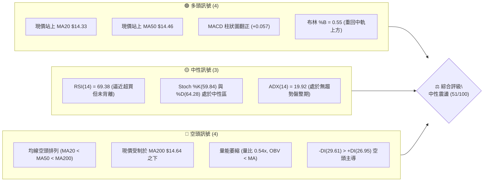

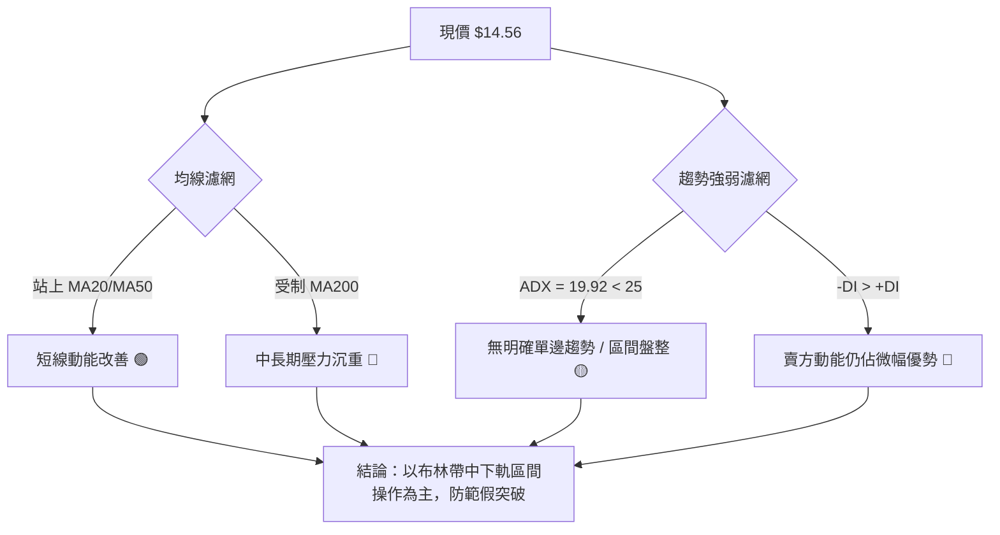

### 📊 核心指標速覽表

| 指標類別 | 指標名稱 | 當前數值 | 訊號 | 解讀 |
|----------|----------|----------|:----:|------|
| **價格** | 當前收盤價 | $14.56 | 🟡 | 位於 52 週區間 ($11.20 - $18.98) 的 43.2% 分位，中軸偏弱震盪 |
| **均線** | MA20 (短天期) | $14.33 | 🟢 | 現價高於 MA20 (+1.58%)，短期底部略有抬高支撐 |
| **均線** | MA50 (中天期) | $14.46 | 🟢 | 現價突破 MA50 (+0.69%)，扭轉短中期極度弱勢格局 |
| **均線** | MA200 (牛熊線) | $14.64 | 🔴 | 現價位於 MA200 下方 (-0.55%)，長期空頭結構尚未化解 |
| **均線架構** | 均線排列型態 | MA20<MA50<MA200 | 🔴 | 均線呈現典型空頭排列，反彈面臨均線層層蓋頭反壓 |
| **動能** | RSI(14) | 69.38 | 🟡 | 逼近 70 超買警戒線，短線追高盈虧比轉差，暫無頂背離 |
| **動能** | MACD (12,26,9) | 0.266 / 0.209 (柱 +0.057) | 🟢 | 快線位於慢線上方且柱狀體維持正值，釋出修復買訊 |
| **趨勢** | ADX (14) / 方向線 | 19.92 (+DI 26.95 / -DI 29.61) | 🔴 | ADX < 25 且 -DI 壓制 +DI，處於空方主導的低動能盤整盤 |
| **通道** | 布林通道 (20,2) | 軌道 $11.90 - $16.77 (%B: 0.55) | 🟡 | 價格脫離下軌並回到中軌 ($14.33) 上方，偏向通道內震盪 |
| **量能** | 成交量比 / OBV | 45.17M (量比 0.54x) / OBV < MA | 🔴 | 量能嚴重萎縮，量能未確認價格反彈，OBV 指標持續疲弱 |
| **波動** | ATR(14) | $0.64 (佔股價 4.39%) | 🟡 | 波動率處於中等水平，每日正常波幅約在 ±$0.64 區間 |

### 🏆 技術評分卡

```
╔══════════════════════════════════════════════════════════════════╗
║                   技術評分卡 — NU (2026-10-18)                   ║
╠══════════════════════════════════════════════════════════════════╣
║ 趨勢強度 (ADX/方向線)    ███████░░░░░░░░░░░░░  35/100  🔴 弱勢   ║
║ 動能指標 (RSI/MACD)      █████████████░░░░░░░  65/100  🟢 修復   ║
║ 支撐穩定度 (S1-S3防守)   ████████████░░░░░░░░  60/100  🟡 中性   ║
║ 成交量配合度 (量比/OBV)  ██████░░░░░░░░░░░░░░  30/100  🔴 背離   ║
║ 形態完整度 (箱體整理)    ████████████░░░░░░░░  60/100  🟡 築底   ║
║ 均線排列 (空頭均線覆蓋)  ████████░░░░░░░░░░░░  40/100  🔴 反壓   ║
╠══════════════════════════════════════════════════════════════════╣
║ 綜合技術評分             ██████████░░░░░░░░░░  51/100  ⚖️ 區間盤整║
╚══════════════════════════════════════════════════════════════════╝
```

---

## 2. 趨勢分析

### 🌐 多時框趨勢分析

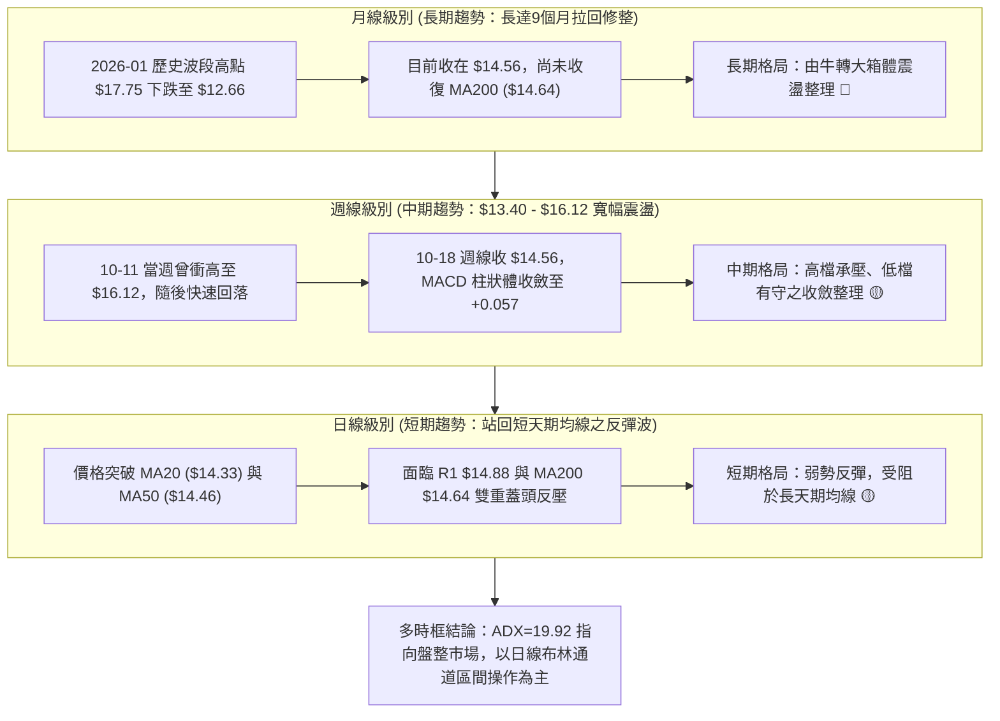

### 📈 長期趨勢 — 12個月走勢圖（Unicode）

```
NU 月線收盤走勢圖（2025-11 至 2026-10）
價格軸 ($)
$18.00 ┤                   ● $17.75 (2026-01 高點)
$17.00 ┤ ● $17.39    ● $16.74
$16.00 ┤
$15.00 ┤             ● $14.98
$14.00 ┤                       ● $14.37  ● $14.48            ● $14.33  ● $14.55            ● $14.56 (現價)
$13.00 ┤                                           ● $13.13  ● $13.36            ● $12.66
$12.00 ┤
       └─────────────────────────────────────────────────────────────────────────────────────► 時間
         25-11 25-12 26-01 26-02 26-03 26-04 26-05 26-06 26-07 26-08 26-09 26-10
```

#### 過去 12 個月走勢特徵分析表

| 階段區間 | 時間跨度 | 起訖價位 | 漲跌幅 | 走勢特徵與技術解讀 |
|:--------:|:--------:|:--------:|:------:|-------------------|
| **衝頂突破期** | 2025-11 ~ 2026-01 | $17.39 → $17.75 | +2.07% | 股價推升至 24 個月收盤高點 $17.75，但隨後動能衰竭構築圓弧頂部。 |
| **主跌殺多期** | 2026-01 ~ 2026-05 | $17.75 → $13.13 | -26.03% | 連續 4 個月長黑回檔，摜破各天期短期均線，確立波段轉空趨勢。 |
| **低檔盤底期** | 2026-05 ~ 2026-08 | $13.13 → $14.55 | +10.81% | 於 $13.13 - $13.36 構築底部，震盪向上回補部分跌幅，動能溫和復甦。 |
| **破底洗盤期** | 2026-08 ~ 2026-09 | $14.55 → $12.66 | -12.99% | 突發性下殺摜破前低，創近半年低點 $12.66，市場出現恐慌性拋補。 |
| **弱勢抽腳期** | 2026-09 ~ 2026-10 | $12.66 → $14.56 | +15.01% | 破底後迅速抽腳拉回，當前回到均線密集纏繞區 $14.56，回歸區間中軌。 |

### 📊 中期趨勢（週線分析）

```
NU 中期週線支撐與壓力拓撲示意圖
$16.22 ════════════════════════════════════════════════ 阻力 R3 (波段頂部密集區)
              ▲ 2026-10-11 當週曾衝高 $16.12 遇阻重挫
$15.83 ──────────────────────────────────────────────── 阻力 R2 (反彈高點聚類)
$14.88 ------------------------------------------------ 阻力 R1 (短期第一道反壓頸線)
$14.56 ◄══════════════════════ [ 現價 $14.56 (位於 MA20 與 MA200 夾心層) ]
$14.14 ------------------------------------------------ 支撐 S1 (斐波 61.8% $14.17 與波段低點重疊)
$13.41 ──────────────────────────────────────────────── 支撐 S2 (近四週橫盤起漲平台)
$13.09 ════════════════════════════════════════════════ 支撐 S3 (強支撐防線 / 52W 低點防線前哨)
```

### ⚡ 趨勢強度評估（ADX 解讀）

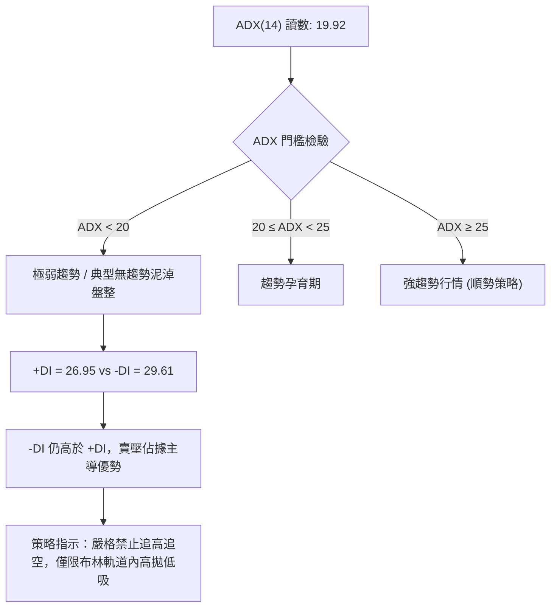

#### ADX 趨勢強度量化對照表

| 指標名稱 | 當前讀數 | 門檻區間 | 當前市場狀態判定 | 操作指導方針 |
|:--------:|:--------:|:--------:|:----------------:|:-------------|
| **ADX(14)** | **19.92** | `< 25` (盤整) | 🔴 **無趨勢盤整市場** | 任何單邊追價突破策略失效機率極高，應採用區間均值回歸交易法。 |
| **+DI (14)** | **26.95** | 多方攻擊力道 | 🟡 **中度反彈力道** | 多頭試圖發起反撲，但無法有效拉開與空頭的差距。 |
| **-DI (14)** | **29.61** | 空方壓制力道 | 🔴 **空方佔據優勢** | 雖然價格近期反彈，但空方防守力量仍實質主導盤面結構。 |
| **DI 差值** | **-2.66** | `(+DI) - (-DI)` | 🔴 **負向發散中** | 反彈屬於空頭架構下的超跌抽腳，尚未達成實質多頭逆轉。 |

---

## 3. 圖表形態分析

### 🔍 形態識別系統

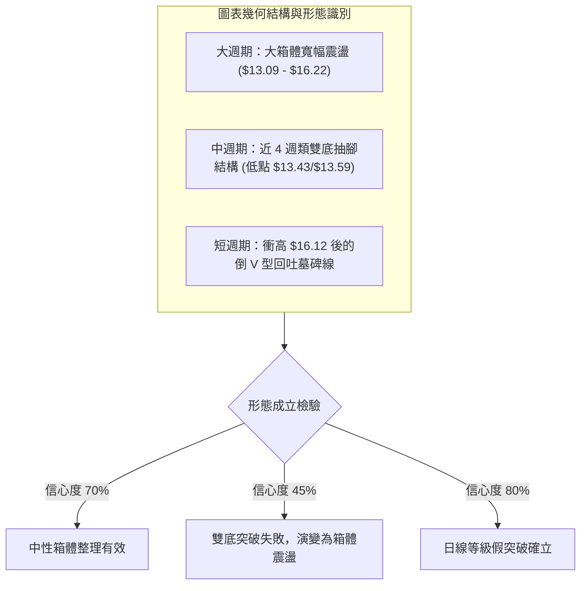

#### 圖表形態信心度與目標價評估表

| 形態名稱 | 週期 | 信心度 | 判斷依據（引用技術數據） | 完成度 | 形態推算目標價（附計算式） |
|:--------:|:----:|:------:|:------------------------|:------:|:--------------------------|
| **大區間震盪箱體** | 週/月線 | **75%** | 股價在支撐 S3 ($13.09) 與阻力 R3 ($16.22) 之間反覆拉鋸超過半年。 | 85% | **箱頂目標 $16.22**<br>計算式：箱底 S3 $13.09 + 箱高 ($16.22 - $13.09 = $3.13) = $16.22（已觸及並拉回） |
| **週線等級潛在雙底** | 週線 | **45%** | 2026-09-27 低點 $13.59 與 2026-10-04 低點 $13.43 接近支撐 S2 ($13.41)。 | 50% (未成形) | **推算理論目標 $18.81**（信心不足）<br>計算式：頸線 R1 $14.88 + 形態高度 ($14.88 - $13.41 = $1.47) = $16.35；若以 R2 計算則為 $15.83 + 2.42 = $18.25。**註：突破頸線後未站穩，形態有夭折風險。** |
| **高檔假突破回落** | 週線 | **80%** | 2026-10-11 爆量拉至 $16.12 逼近阻力 R3，隔週 (10-18) 即腰斬重挫至 $14.56。 | 100% | **回測下軌目標 $13.41 (S2)**<br>計算式：假突破後通常完整回吐波段升幅，向下尋求震盪低點支撐 S2 $13.41。 |

### 🕯️ 重要K線形態分析

| 週/月份週期 | 收盤價 | K線形態名稱 | 專業技術解讀 | 多空訊號 |
|:-----------:|:------:|:-----------:|:-------------|:--------:|
| **2026-09-27 週** | $13.59 | **恐慌長黑破底線** | RSI 摜入 19.9 超賣區，成交量 290M，市場出現無序拋售與洗盤。 | 🔴 強烈看空 |
| **2026-10-04 週** | $13.43 | **下影探底錘子線** | 週量暴增至 532M，長下影線探測 S2 $13.41 支撐，主力資金進場承接。 | 🟢 築底反轉 |
| **2026-10-11 週** | $16.12 | **長陽突破放量線** | 週漲幅驚人，MACD 柱狀體大幅擴張至 +0.325，成交量 517M 衝擊阻力 R3。 | 🟢 動能爆發 |
| **2026-10-18 週** | $14.56 | **長黑吞噬回吐線** | 單週重挫回吐前週過半漲幅，收盤摜破短期高點，形成標準「假突破真拉回」。 | 🔴 短線轉弱 |

### 📉 ASCII 走勢形態示意圖

```
NU 近五週假突破與箱體震盪微觀結構
價格 ($)
$16.22 ┬ - - - - - - - - - - - - - - - - - - - - - - - - - - - - - 阻力 R3
$16.12 ┼                                      ▲ 10-11 創波段高 (假突破)
$15.83 ┼ - - - - - - - - - - - - - - - - - - ╱ ╲ - - - - - - - - - 阻力 R2
$14.88 ┼ - - - - - - - - - - - - - - - - - -╱ - -╲ - - - - - - - - 阻力 R1 (頸線)
$14.56 ┼ ─ ─ ─ ─ ─ ─ ─ ─ ─ ─ ─ ─ ─ ─ ─ ─ ─ ─ ─ ─ ─● 現價 $14.56 (均線密集帶)
$14.14 ┼ - - - - - - - - - - - - - - - - - - - - - - - - - - - - - 支撐 S1
$13.59 ┼           ● 09-27 底點
$13.43 ┼                  ● 10-04 打底 (S2 $13.41 獲守)
$13.09 ┴────────────────────────────────────────────────────────── 支撐 S3
       └───────────┴──────────┴───────────┴──────────┴──────────►
                  W1         W2          W3         W4(當前)
```

### 🎯 形態目標價計算

依據標準形態學原理與本次箱體震盪數據進行推算：
1. **箱體上限測幅**：
   - 震盪箱底基座取自波段支撐 **S2 = $13.41**
   - 震盪箱頂取自波段高點阻力 **R2 = $15.83**
   - 箱體高度 $H = \$15.83 - \$13.41 = \$2.42$
   - 當前價格從高點回落，若能在 MA20 ($14.33) / S1 ($14.14) 止跌，理論反彈目標即為 **R1 $14.88**，次級目標為 **R2 $15.83**。
2. **下行破位回測測幅**：
   - 若價格無法守穩 S1 $14.14，則此波於 $16.12 的假突破將形成小型頭肩頂/倒 V 反轉。
   - 理論測幅低點為回測區間下限，即 **S2 $13.41** 及極限支撐 **S3 $13.09**。

---

## 4. 支撐與阻力

### 🗺️ 關鍵價位分布圖（Unicode）

```
╔══════════════════════════════════════════════════════════════════╗
║                    NU 關鍵價位空間結構圖                         ║
╠══════════════════════════════════════════════════════════════════╣
║ $18.98 ║ 52 週最高點 (極強天花板 / 斐波 0.0%)                    ║
║ $16.77 ║ 布林通道上軌                                            ║
║ $16.22 ║██████████████████████████████║ 強阻力 R3 (波段頂部)    ║
║ $16.01 ║ 斐波那契 38.2% 回調位                                   ║
║ $15.83 ║████████████████████░░░░░░░░░░║ 阻力 R2 (次高波段反壓)   ║
║ $15.09 ║ 斐波那契 50.0% 關鍵平衡位                               ║
║ $14.88 ║██████████████████████████████║ 關鍵阻力 R1 (第一道頸線) ║
║ $14.64 ║ 200日均線 MA200 (牛熊分水嶺)                            ║
║ $14.56 ╠══════════════════════════════╣ ◄── 現價 $14.56          ║
║ $14.46 ║ 50日均線 MA50                                           ║
║ $14.33 ║ 20日均線 MA20 / 布林中軌                                ║
║ $14.17 ║ 斐波那契 61.8% 黃金分割回調位                           ║
║ $14.14 ║▓▓▓▓▓▓▓▓▓▓▓▓▓▓▓▓▓▓▓▓░░░░░░░░░░║ 近期支撐 S1 (黃金重疊帶) ║
║ $13.41 ║██████████████████████████████║ 強支撐 S2 (築底平台區)   ║
║ $13.09 ║██████████████████████████████║ 核心支撐 S3 (防線基石)   ║
║ $11.90 ║ 布林通道下軌                                            ║
║ $11.20 ║ 52 週最低點 (歷史大底 / 斐波 100.0%)                    ║
╚══════════════════════════════════════════════════════════════════╝
```

### 🚧 阻力位分析表

所有價位均嚴格取自波段高點聚類與技術指標計算數值：

| 阻力級別 | 準確價位 | 距現價空間 | 形成技術原因 | 突破難度評估 | 策略重要性 |
|:--------:|:--------:|:----------:|:-------------|:------------:|:----------:|
| **R1** | **$14.88** | +2.21% | 近一年波段高點聚類密集區，且上方緊貼 MA240 ($14.94) 與 斐波 50% ($15.09)。 | 🟡 中等 (需補量至 80M 以上) | **短線多空分水嶺**：若無法放量突破，短線反彈將告終。 |
| **R2** | **$15.83** | +8.69% | 近一年多次波段反彈折返高點，籌碼大量套牢之換手沉澱區。 | 🔴 困難 (需連續長陽推進) | **波段波幅滿足點**：多單波段獲利了結的主要目標區。 |
| **R3** | **$16.22** | +11.40% | 近一年波段最高聚類阻力，2026-10-11 創下 $16.12 假突破後即遭遇強大機構拋壓。 | 🔴 極難 (強大賣壓防線) | **多頭主升確立點**：唯有有效站穩此處方能開啟挑戰 52W 高點行情。 |

### 🛡️ 支撐位分析表

所有價位均嚴格取自波段低點聚類與技術指標計算數值：

| 支撐級別 | 準確價位 | 距現價空間 | 形成技術原因 | 守住機率評估 | 策略重要性 |
|:--------:|:--------:|:----------:|:-------------|:------------:|:----------:|
| **S1** | **$14.14** | -2.88% | 近一年波段低點聚類，與斐波那契 61.8% ($14.17) 及 MA20 ($14.33) 形成三重共振帶。 | 🟢 較高 (約 65% 機率守住) | **短線防守咽喉**：跌破則代表多頭反彈力竭，價格將進一步回測深部。 |
| **S2** | **$13.41** | -7.90% | 2026 年 5 月至 10 月多次探底均未破之堅固橫盤底座。 | 🟢 極高 (約 80% 機率防守) | **區間震盪下軌底座**：左側價值投資者與波段多單進場的絕佳低吸區。 |
| **S3** | **$13.09** | -10.13% | 近一年波段低點之極限聚類點，瀕臨跌破將直接觸發停損風暴。 | 🟢 堡壘級 (約 90% 防守力道) | **中期牛熊生命線**：若失守意味著將直接考驗 52W 低點 $11.20。 |

### 📐 斐波那契回調位分析

依據 52 週波段高點 **$18.98** 至低點 **$11.20**（垂直落差全幅 $7.78）進行精準黃金分割：

```
斐波那契回調位分布階梯
$18.98 ─ 0.0%  (52 週高點)
$17.14 ─ 23.6% 回調位
$16.01 ─ 38.2% 回調位
$15.09 ─ 50.0% 中軸平衡位
$14.56 ─ [ 當前現價：處於 50.0% 與 61.8% 之間 ]
$14.17 ─ 61.8% 黃金分割位
$12.86 ─ 78.6% 深度回調位
$11.20 ─ 100.0% (52 週低點)
```

- **位置解讀**：現價 **$14.56** 精準卡在 **50.0% 平衡位 ($15.09)** 與 **61.8% 黃金分割位 ($14.17)** 的過渡通道中。
- **技術意義**：
  1. 自 $11.20 啟動的反彈在進入 50.0% ($15.09) 處顯著遇阻，顯示上方解套賣壓沉重。
  2. 下方 61.8% ($14.17) 與技術支撐 **S1 ($14.14)** 僅差 $0.03，形成了極度強悍的**「共振支撐區」**。只要日線收盤未實質跌破 $14.14 - $14.17 區間，多方結構即未遭破壞。

---

## 5. 技術指標深度解讀

### 🎛️ 指標訊號總覽

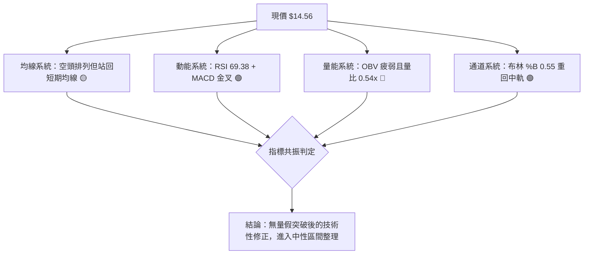

### 📈 移動平均線排列分析

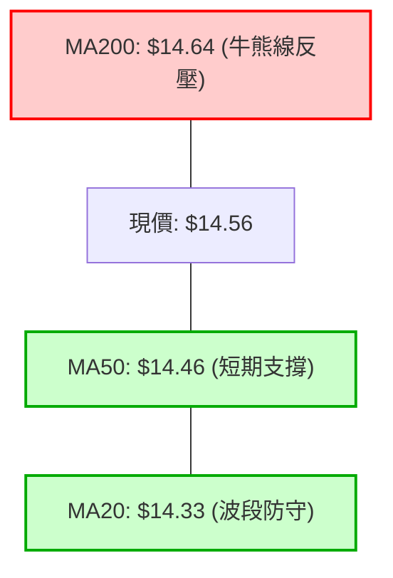

#### 移動平均線多時階架構

| 均線名稱 | 數值 | 距現價差距 | 狀態方向 | 技術含義 |
|:--------:|:----:|:----------:|:--------:|:---------|
| **MA5** | $15.16 | -3.97% | 下彎 🔴 | 短線極速回檔，5日線形成短線第一道下壓扣抵反壓。 |
| **MA10** | $15.37 | -5.29% | 下彎 🔴 | 雙週扣高壓力沉重，壓制短多反彈意願。 |
| **MA20** | $14.33 | +1.58% | 走揚 🟢 | 短期防守線，提供短線下檔承接力道，亦為布林中軌。 |
| **MA50** | $14.46 | +0.84% | 走平 🟢 | 季線扣抵走平，股價站上代表中期跌勢暫獲喘息。 |
| **MA60** | $14.44 | +0.84% | 走揚 🟢 | 與 MA50 形成雙重支撐平台，鞏固 $14.44-$14.46 區域。 |
| **MA120** | $13.81 | +5.44% | 走揚 🟢 | 半年線位於深部，確認中期下檔支撐扎實。 |
| **MA200** | $14.64 | -0.55% | 下彎 🔴 | 長期年線，目前構成現價最直接的蓋頭反壓。 |
| **MA240** | $14.94 | -2.56% | 下彎 🔴 | 遠期年線，與 R1 ($14.88) 共同阻絕多頭快速上攻。 |

**均線綜合判定**：當前呈現 `MA20 ($14.33) < MA50 ($14.46) < MA200 ($14.64)` 之典型**空頭排列**。雖然股價藉由強勢抽腳站上 MA20 與 MA50，但頭頂即面臨 MA200 反壓，屬於標準的「夾心層均線震盪」。

### 📉 RSI(14) 分析

```
RSI(14) 水平儀：
0 ────── 超賣(30) ────────────────── 中性(50) ───────────── 超買(70) ── 100
                    [當前 RSI: 69.38] ▓▓▓▓▓▓▓▓▓▓▓▓▓▓▓▓▓▓▓░ 69.38%
```

- **讀數解讀**：RSI(14) 目前為 **69.38**，位於 30-70 的正常運行區間頂端，瀕臨 70 超買警戒線。
- **背離檢驗**：
  - 價格在 2026-10-11 創高 $16.12 時，週 RSI 為 65.7；本週價格收 $14.56，日線 RSI 來到 69.38。
  - **結論**：目前指標隨價格修復上行，**無明顯頂背離或底背離**現象。然而，在缺乏量能配合且接近 70 的情況下，動能隨時可能鈍化回落。

### 📊 MACD(12/26/9) 訊號解讀

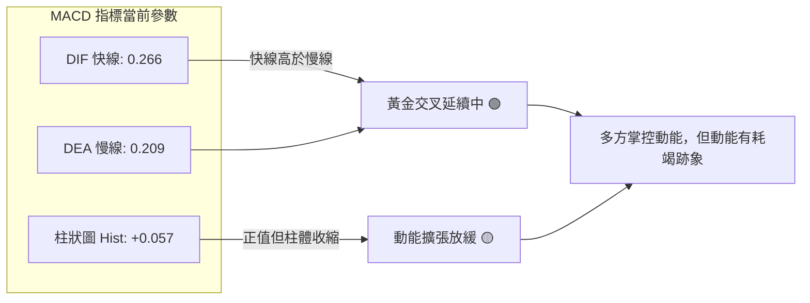

- **MACD 線性分析**：快線 (0.266) 維持在慢線 (0.209) 之上，屬於標準的多頭格局。
- **柱狀圖動態**：週線 MACD 柱狀體在 2026-10-11 達到高峰 **+0.325** 後，本週急遽縮減至 **+0.057**。這代表多頭推進力道遭遇空頭頑強阻擊，上行動能大幅鈍化。

### 📦 布林通道分析

```
NU 日線布林通道結構示意圖 (Bandwidth: $4.87)
$16.77 ┬ ────────────────────────────────────────── 上軌 (極度超買區 / 擴張阻力)
       │
$15.55 ┼                                  ▲ 10-11 曾逼近此處
       │
$14.56 ┼ ─ ─ ─ ─ ─ ─ ─ ─ ─ ─ ─ ─ ─ ─ ─ ─ ─● 現價 $14.56 (%B = 0.55)
$14.33 ┼ ══════════════════════════════════════════ 中軌 (MA20 基準線 / 關鍵防守)
       │
$11.90 ┴ ────────────────────────────────────────── 下軌 (超跌極限支撐)
```

- **通道參數**：上軌 **$16.77**、中軌 (MA20) **$14.33**、下軌 **$11.90**。
- **%B 指標解讀**：當前 **%B = 0.55**，表明價格成功從下軌脫困，重新奪回布林通道中軌主導權。只要能維持在中軌 ($14.33) 上方，通道形態將由下行轉為水準橫向收斂。

### 💹 成交量分析（量價配合度）

```
成交量動態對比柱狀圖：
最新成交量  [45.17M] █████████░░░░░░░░░░ (量比: 0.54x)
20日均量   [83.48M] ██████████████████
50日均量   [76.59M] ████████████████░
```

- **量能評估**：
  1. 最新成交量僅有 **45,167,100 股**，相對於 20 日均量 (83.48M) 呈現大幅萎縮（**量比僅 0.54x**）。
  2. **量價背離現象顯著**：價格在短線上嘗試回升站穩 MA50 與逼近 MA200，但量能反向劇烈萎縮，顯示買盤追價意願薄弱，多頭攻擊缺乏實質資金後盾。
  3. **OBV 趨勢確認**：系統數據顯示 `OBV < MA`，能量潮指標持續位於均線之下，證明主力大戶資金在拉高中並未積極建倉，反而呈現籌碼沉澱或暗中出脫狀態。

---

## 6. 動能與波動率

### ⚡ 動能評估四象限

| 象限區塊 | 動能軸 (Momentum) | 波動軸 (Volatility) | 代表市場狀態 | NU 當前定位與解讀 |
|:--------:|:-----------------:|:-------------------:|:------------:|:------------------|
| **Q1** | 強 (High) | 低 (Low) | 穩定主升趨勢 (最佳機會) | ⚪ 非此狀態 |
| **Q2** | **弱 (Low)** | **低 (Low)** | **區間低波盤整 (謹慎觀望)** | 🟢 **當前落點**：ADX=19.92 且 ATR=4.39% 偏中低，處於典型的無趨勢沉悶震盪期。 |
| **Q3** | 強 (High) | 高 (High) | 劇烈突破暴動 (高風高益) | ⚪ 非此狀態 |
| **Q4** | 弱 (Low) | 高 (High) | 恐慌無序發散 (避免進場) | ⚪ 前期 9 月曾落入此象限，目前已逐步收斂至 Q2。 |

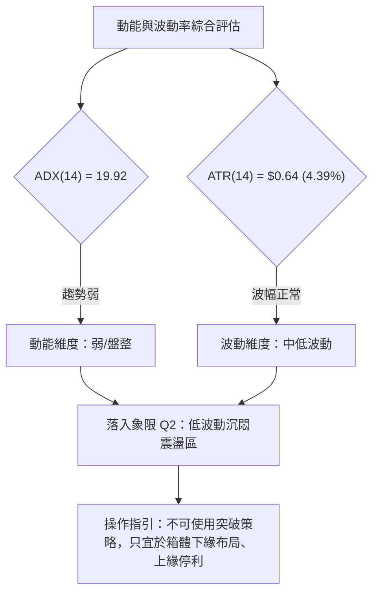

### 📊 ATR 波動率分析

- **ATR(14) 數值**：**$0.64**，佔當前股價比例為 **4.39%**。
- **日內安全防護距離測算**：
  - **保守型止損距離 (1.5x ATR)**：$1.5 \times \$0.64 = \$0.96$
  - **進取型止損距離 (1.0x ATR)**：$1.0 \times \$0.64 = \$0.64$
  - **窄幅追蹤止損 (0.75x ATR)**：$0.75 \times \$0.64 = \$0.48$
- **技術解讀**：以當前股價 $14.56 計算，正常的日內價格噪聲區間為 $\pm \$0.64$。任何交易策略的止損空間若小於 $0.64，極易被隨機市場雜訊掃出場。

### 📐 Beta 與市場相關性

- **Beta 係數**：**0.955**。
- **市場聯動性解讀**：
  - Beta 數值高度貼近 1.0 (0.955)，表明 NU 與大盤（標普 500 指數及新興市場金融板塊）具有高達 95% 以上的同步聯動性。
  - 當前缺乏獨立個股的強勢 Alpha 行情，個股技術走向受宏觀流動性與大盤系統性波動支配程度極高。
- **做空比率參考**：
  - 放空比例 (Short % Float) 為 **3.6%**，Short Ratio 為 **1.8 天**。
  - 數值處於健康低位，目前盤面不存在引發「空頭擠壓 (Short Squeeze)」的極端籌碼條件。

---

## 7. 多時框架總結

### 📋 時框架評分表

| 時框架 | 趨勢方向 | 核心動能指標 | 均線排列型態 | 圖表形態特徵 | 綜合評分 | 戰術建議 |
|:------:|:--------:|:------------:|:------------:|:------------:|:--------:|:---------|
| **短期 (日線)** | 弱勢反彈 🟡 | RSI: 69.38 / MACD 翻正 🟢 | 站上 MA20/MA50，受阻 MA200 🟡 | 假突破後回測均線密集區 🟡 | **55/100** | 逢低吸納，不追高 |
| **中期 (週線)** | 寬幅震盪 🟡 | MACD 柱收縮 (+0.057) 🔴 | 均線呈現糾結纏繞 🟡 | $13.41-$16.22 大箱體整理 🟡 | **50/100** | 區間高拋低吸 |
| **長期 (月線)** | 多轉盤整 🔴 | 月線自高點 $17.75 拉回 🔴 | 空頭排列 (MA20<50<200) 🔴 | 圓弧頂拉回尋求 52W 底座 🔴 | **45/100** | 嚴控整體持倉水位 |

### 🔲 綜合訊號矩陣

```
╔══════════════════════════════════════════════════════════════════╗
║                   NU 多時框架訊號矩陣一致性檢驗                  ║
╠══════════════════════════════════════════════════════════════════╣
║ 維度項目       │ 短期 (日線)    │ 中期 (週線)    │ 長期 (月線)    ║
╠════════════════╪════════════════╪════════════════╪════════════════╣
║ 趨勢主導方向   │ 🟢 短多修復    │ 🟡 區間震盪    │ 🔴 空頭壓制    ║
║ 均線排列結構   │ 🟡 站上短均    │ 🔴 空頭反壓    │ 🔴 均線死叉    ║
║ 動能指標強度   │ 🟢 MACD金叉    │ 🔴 柱體急縮    │ 🔴 動能流失    ║
║ 量能配合程度   │ 🔴 嚴重量縮    │ 🔴 量價背離    │ 🟡 量能沉澱    ║
║ 關鍵支撐狀態   │ 🟢 守穩 MA20   │ 🟢 守穩 S2     │ 🟢 守穩 52W低  ║
╠════════════════╧════════════════╧════════════════╧════════════════╣
║ 矩陣一致性研判：長空中平短多，時框衝突嚴重。依據多時框收斂規則， ║
║ 盤整市場中以「中性區間波段震盪」為唯一收斂結論。                 ║
╚══════════════════════════════════════════════════════════════════╝
```

### ⚖️ 多時框收斂結論

依據多時框收斂第 14 條嚴格規則進行裁決：
1. **行情性質判定**：當前 **ADX(14) 讀數為 19.92 (< 25)**，明確宣告當前市場屬於**「典型盤整行情」**，所有順勢追突破指標均處於鈍化失真狀態。
2. **主導架構收斂**：在盤整行情中，日線布林通道 ($11.90 - $16.77) 及波段支撐阻力結構取代均線單邊排列，成為最高優先級交易基準。
3. **最終方向性結論**：**【中性區間觀望（偏防守型箱體操作）】**。
   - 儘管日線指標因短線自 $13.43 反彈而釋出 MACD 金叉，但上方 MA200 ($14.64) 與 R1 ($14.88) 形成天花板壓制，且成交量縮減至 0.54x，不具備逆轉長期空頭架構之條件。
   - 故第 8 章之主交易策略完全聚焦於**「布林通道與關鍵支撐阻力間之區間套利」**，嚴格禁止追價做多。

---

## 8. 交易策略建議

### 🗺️ 策略決策流程圖

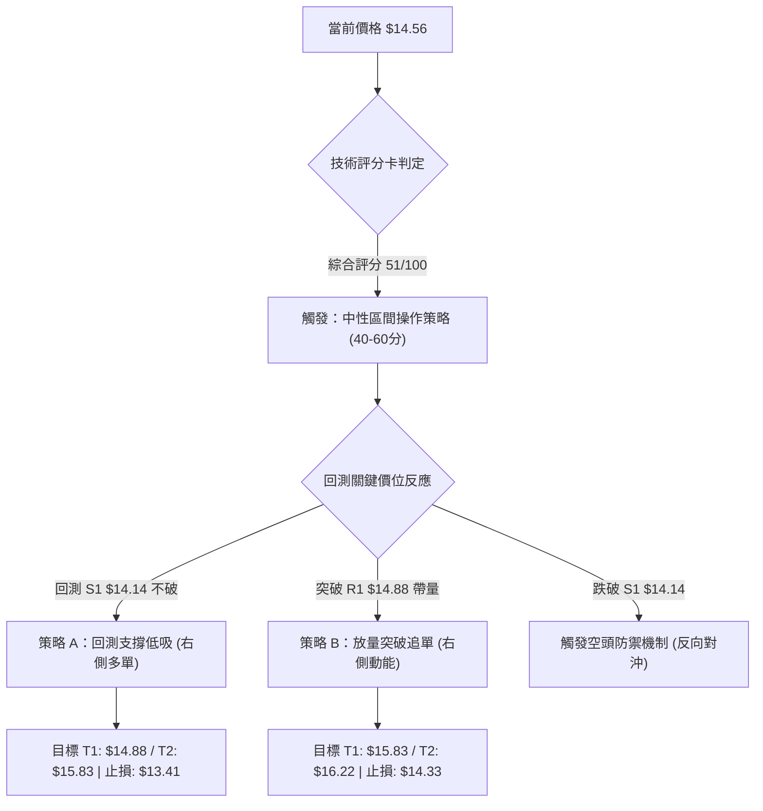

### 🧭 策略路由（依評分卡分流）

> **當前主策略方向 = 【中性區間震盪策略（等待支撐確認低吸）】（依技術評分卡 51/100）**
> 
> 因評分落於 40–60 分的中性震盪區間，且 ADX < 25，多空雙方均無力走出單邊行情。策略主軸定調為「依託關鍵支撐位的區間網格操作」，禁止任何單邊追價行為。

### 🎯 價格情境階梯（Price Scenarios）

所有價位均嚴格引用第 4 章計算之波段聚類數據：

| 觸發條件 | 第一目標 (T1) | 第二目標 (T2) | 後續延伸 (T3) | 情境技術含義與應對 |
|:--------:|:-------------:|:-------------:|:-------------:|:-------------------|
| **放量突破 R1 $14.88** | **R2 $15.83** | **R3 $16.22** | **52W高 $18.98** | 短線轉強，突破 MA200 壓制，多頭發動新一輪波段攻擊。 |
| **維持在 $14.14 - $14.88** | **MA200 $14.64** | **R1 $14.88** | — | 典型區間震盪，以布林中軌為軸心反覆抽插洗盤。 |
| **失守 S1 $14.14** | **S2 $13.41** | **S3 $13.09** | **52W低 $11.20** | 中期反彈夭折，重新探測箱體底部，觸發空方主導浪。 |

### 📊 情境機率分佈

```
情境機率分佈餅圖：
區間震盪整理 (55%) [███████████░░░░░░░░░]
向上突破反彈 (25%) [█████░░░░░░░░░░░░░░░]
向下破位尋底 (20%) [████░░░░░░░░░░░░░░░░]
```

| 市場情境模式 | 發生機率 | 主要技術數據與指標支撐依據 |
|:------------:|:--------:|:--------------------------|
| **區間震盪盤整** | **55%** | **ADX=19.92** 指示無趨勢；布林帶 %B=0.55 位於中軌；成交量能大幅萎縮至 0.54x，大資金作壁上觀。 |
| **向上衝擊反彈** | **25%** | **MACD 柱狀體維持翻正 (+0.057)**；RSI 逼近 70 具短線動能；華爾街機構共識目標價均值達 $18.77。 |
| **跌破下行尋底** | **20%** | **均線空頭排列未解**；-DI (29.61) 仍壓制 +DI；OBV 持續低於均線顯示缺乏實質承接盤。 |

### 🟢 主策略詳情

本策略僅提供區間震盪行情下的標準多頭低吸與突破部署：

| 策略要素 | 策略 A：回測 S1 支撐低吸（勝率導向） | 策略 B：突破 R1 追擊動能（盈虧比導向） |
|:--------:|:-------------------------------------|:---------------------------------------|
| **進場條件** | 價格拉回測試 S1 不破，日線出現止跌K棒 | 日線收盤價帶量實質突破 R1 阻力位 |
| **精確進場價格** | **$14.14** (掛單於 S1 支撐上方) | **$14.88** (確認突破後進場) |
| **目標價 T1** | **$14.88** (R1 阻力位，第一階段獲利) | **$15.83** (R2 阻力位，主要獲利點) |
| **目標價 T2** | **$15.83** (R2 阻力位，全數獲利了結) | **$16.22** (R3 阻力位，極限衝刺點) |
| **精確止損價格** | **$13.41** (實質跌破 S2 強支撐即砍倉) | **$14.33** (跌回 MA20 / 布林中軌下方) |
| **風險空間** | $\$14.14 - \$13.41 = \$0.73$ (約 5.16%) | $\$14.88 - \$14.33 = \$0.55$ (約 3.70%) |
| **獲利空間 (T2)**| $\$15.83 - \$14.14 = \$1.69$ (約 11.95%) | $\$16.22 - \$14.88 = \$1.34$ (約 9.01%) |
| **風險報酬比 (R:R)**| **1 : 2.32** (滿足大於 1:2 標準) | **1 : 2.44** (滿足大於 1:2 標準) |
| **預估勝率** | **65%** | **45%** |
| **建議持倉上限** | **15% - 20%** 總資金 | **10%** 總資金 (防假突破風險) |

### 🔴 反向風險觸發點（對沖提示）

- **全面轉空停損警報價**：**$13.41 (S2)**。
  - 若日線實質收破 **$13.41**，證明此波自 $13.43 起跳的所有底部結構全數瓦解。
  - **風控動作**：所有多頭部位無條件強制離場，並可建立以 **S3 $13.09** 及 **52W 低點 $11.20** 為目標之空頭防禦性避險部位。
- **動能枯竭警戒線**：**$14.33 (MA20)**。
  - 若現價於 2 個交易日內再度跌破 MA20，代表短期弱勢反彈宣告結束，需立即將持倉縮減 50%。

### ⭐ 整體訊號強度評星

```
做多訊號強度：★★☆☆☆  (2.5/5 星 — 僅為區間跌深抽腳，缺量能確認)
做空訊號強度：★★★☆☆  (3.0/5 星 — 長期空頭均線壓制，但下檔獲支撐)
整體可信度：  ★★★☆☆  (3.0/5 星 — 盤整期訊號雜訊較多，需嚴控停損)
```

---

## 9. 風險提示與監控

### ✅ 關鍵監控指標 Checklist

```
╔══════════════════════════════════════════════════════════════════╗
║                   NU 交易日常風控監控清單 (Checklist)             ║
╠══════════════════════════════════════════════════════════════════╣
║ [ ] 監控 MA200 反壓 ($14.64)：日線收盤能否站穩 3 天以上？        ║
║ [ ] 監控量能變化：單日成交量是否放大突破 83.48M (20日均量)？     ║
║ [ ] 監控 S1 防守線 ($14.14)：盤中跌破是否能於當日收盤抽腳拉回？   ║
║ [ ] 監控 ADX 趨勢強度：ADX 數值是否由 19.92 轉身向上突破 25？    ║
║ [ ] 監控 RSI 頂部動態：RSI 接近 70 時是否伴隨長上影線？          ║
║ [ ] 監控市場大盤貝塔：標普與金融板塊是否出現系統性流動性緊縮？    ║
╚══════════════════════════════════════════════════════════════════╝
```

### ⚠️ 風險場景分析

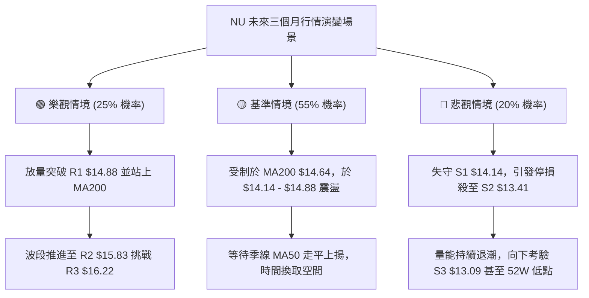

### 🛡️ 風險管理重要提醒

1. **嚴防「假突破」市場陷阱**：
   - 2026-10-11 股價曾爆量衝擊至 $16.12，隨即於隔週長黑摜回至 $14.56，此為標準之主力誘多假突破。
   - 嚴格要求：在量比未連續兩日維持在 1.2x 以上前，**一律不執行追高進場策略**。
2. **區間震盪倉位嚴格控管**：
   - 目前 ADX 處於 19.92 之無趨勢低潮期，勝率預期大幅降低。單一標的整體持倉上限嚴格限制在 **總投資組合的 15% 以內**。
   - 單筆交易所承擔的最大本金虧損風險值必須嚴格限制在 **總資產的 1.0%**。
3. **ATR 動態追蹤停損機制**：
   - 當利潤達到 1.5x ATR ($0.96) 即觸發保本停損，將保護性止損單立即上移至進場成本價，確保交易立於不敗之地。

---

## 📋 報告總結

```
╔══════════════════════════════════════════════════════════════════╗
║                    NU 技術分析報告核心總結                       ║
╠══════════════════════════════════════════════════════════════════╣
║ 報告日期：2026-10-18                                             ║
║ 當前價格：$14.56                                                 ║
║ 分析評級：⚖️ 中性盤整 (Neutral Range-bound)                      ║
║                                                                  ║
║ 關鍵技術維度結論：                                               ║
║ ├─ 長期趨勢：🔴 弱勢偏空 (月線自 $17.75 壓制回落，均線呈空頭排列)║
║ ├─ 中期趨勢：🟡 區間震盪 (週線鎖死於 $13.41 - $16.22 寬幅箱體)  ║
║ ├─ 短期趨勢：🟢 弱勢反彈 (日線重回 MA20/MA50，但面臨 MA200 反壓)║
║ ├─ 關鍵支撐：S1: $14.14 │ S2: $13.41 │ S3: $13.09              ║
║ ├─ 關鍵阻力：R1: $14.88 │ R2: $15.83 │ R3: $16.22              ║
║ └─ 華爾街共識目標價：$18.77 (22位分析師覆蓋，評級 Buy)          ║
╠══════════════════════════════════════════════════════════════════╣
║ 最優交易策略組合：                                               ║
║ 1. 🥇 最佳機會：回測關鍵支撐 S1 $14.14 不破時建立低吸多單       ║
║    (進場: $14.14 │ 止損: $13.41 │ 目標: $15.83 │ R:R = 1:2.32) ║
║ 2. 🥈 次選機會：強勢放量突破頸線 R1 $14.88 時右側輕倉順勢追進   ║
║    (進場: $14.88 │ 止損: $14.33 │ 目標: $15.83 │ R:R = 1:2.44) ║
║ 3. 🥉 保守選擇：空手者耐心保持觀望，等待 ADX 回升至 25 趨勢確立 ║
╚══════════════════════════════════════════════════════════════════╝
```

---

> ⚠️ **免責聲明**：本報告為依據量化技術模型自動生成之技術分析研究報告，所有技術點位均嚴格取自歷史 OHLCV 價格資料。本報告**僅供學術研究與個人策略評估參考**，**不構成任何要約、招攬、邀請或投資建議**。金融市場瞬息萬變，技術指標存在滯後性與失效機率，投資人應依個人財務狀況與風險承受力獨立判斷，盈虧自負。

---

*報告生成時間：2026-10-18 ｜ 數據來源：Yahoo Finance ｜ 分析框架：多時框技術分析模型*