# NU 技術分析報告

> **報告日期**：2026-10-19 ｜ **語言**：繁體中文 ｜ **數據來源**：Yahoo Finance ｜ **當前價格**：$14.56

---

## 目錄

| 章節 | 內容 |
|------|------|
| [1. 技術面概覽](#1-技術面概覽) | 訊號儀表板、核心指標、評分卡 |
| [2. 趨勢分析](#2-趨勢分析) | 多時框趨勢、長中短期走勢 |
| [3. 圖表形態分析](#3-圖表形態分析) | 形態識別、K線組合、目標價 |
| [4. 支撐與阻力](#4-支撐與阻力) | 關鍵價位、斐波那契回調 |
| [5. 技術指標深度解讀](#5-技術指標深度解讀) | MA/RSI/MACD/布林/成交量 |
| [6. 動能與波動率](#6-動能與波動率) | 動能評估、ATR、Beta |
| [7. 多時框架總結](#7-多時框架總結) | 時框架評分矩陣 |
| [8. 交易策略建議](#8-交易策略建議) | 多空策略、風險報酬比 |
| [9. 風險提示與監控](#9-風險提示與監控) | 監控指標、風險場景 |

---

## 1. 技術面概覽

### 🎯 技術訊號儀表板

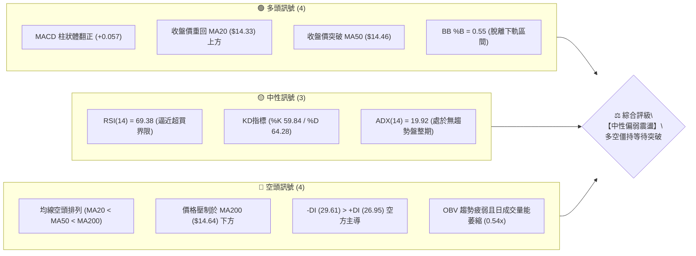

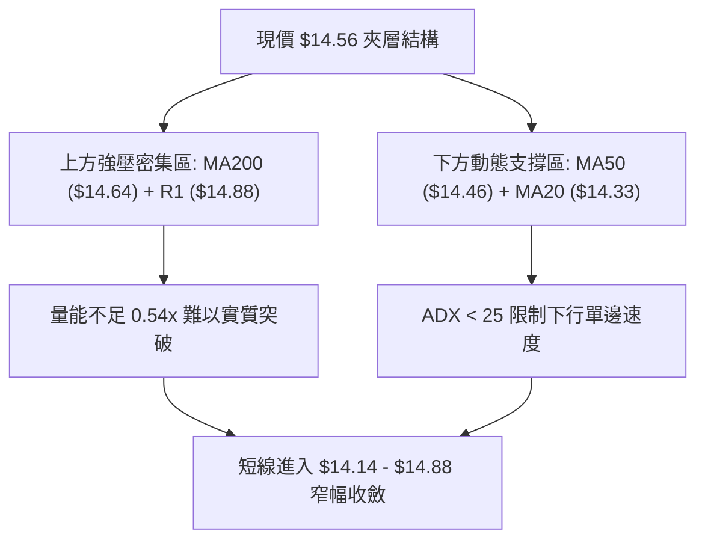

### 📊 核心指標速覽表

| 指標類別 | 指標名稱 | 當前數值 | 訊號 | 解讀 |
|:---|:---|:---:|:---:|:---|
| **價格** | 當前收盤價 | $14.56 | 🟡 | 位於52週區間 43.2%，處於中性震盪中軸 |
| **均線** | MA20 (短趨勢) | $14.33 | 🟢 | 現價高於MA20 (+1.58%)，短線反彈動能尚存 |
| **均線** | MA50 (中趨勢) | $14.46 | 🟢 | 現價略高於MA50 (+0.69%)，中線翻揚嘗試 |
| **均線** | MA200 (牛熊線) | $14.64 | 🔴 | 現價受制於長期均線下方 (-0.55%)，長空格局未扭轉 |
| **均線排列** | 均線系統 | MA20<50<200 | 🔴 | 均線整體呈現標準空頭排列，反彈面臨重重解套賣壓 |
| **動能** | RSI(14) | 69.38 | 🟡 | 逼近 70 超買門檻，短線衝高動能面臨耗竭回踩風險 |
| **動能** | MACD (12,26,9) | 0.266 / 0.209 | 🟢 | MACD雙線位於零軸上方，柱狀體為 +0.057，偏多擴張 |
| **動能** | KD指標 | 59.84 / 64.28 | 🟡 | %K 略低於 %D 呈現死叉跡象，中性區間整理 |
| **趨勢** | ADX(14) / 方向 | 19.92 / -DI主導 | 🔴 | ADX < 25 表明無單邊趨勢，-DI(29.61) > +DI(26.95) |
| **通道** | 布林通道 | %B = 0.55 | 🟡 | 價格貼近中軌 $14.33 上方，上軌 $16.77 / 下軌 $11.90 |
| **成交量** | 量比 / OBV | 0.54x / OBV<MA | 🔴 | 成交量 45.17M 遠低於50日均量 76.59M，量價嚴重背離 |
| **波動** | ATR(14) | $0.64 (4.39%) | 🟡 | 處於歷史常態中等波動區間，日內振幅預期 $0.64 |

### 🏆 技術評分卡

```
╔══════════════════════════════════════════════════════════════════╗
║                   技術評分卡 — NU (2026-10-19)                   ║
╠══════════════════════════════════════════════════════════════════╣
║ 趨勢強度 (ADX=19.92)  ██████░░░░░░░░░░░░░░  32/100 🔴 無單邊趨勢 ║
║ 動能指標 (RSI/MACD)   ████████████░░░░░░░░  60/100 🟢 動能微翻多 ║
║ 支撐穩定度 (S1/Fib)   ████████████░░░░░░░░  62/100 🟢 關鍵位有守 ║
║ 成交量配合 (OBV疲弱)  ████░░░░░░░░░░░░░░░░  24/100 🔴 量價負背離 ║
║ 形態完整度 (箱型整理) ██████████░░░░░░░░░░  52/100 🟡 收斂未突破 ║
║ 均線排列 (空頭防禦)   ██████░░░░░░░░░░░░░░  34/100 🔴 壓制於長均 ║
╠══════════════════════════════════════════════════════════════════╣
║ 綜合評分              █████████░░░░░░░░░░░  44/100 🟡 中性偏弱   ║
╚══════════════════════════════════════════════════════════════════╝
```

---

## 2. 趨勢分析

### 🌐 多時框趨勢分析

依據多時框收斂框架，由於當前 **ADX(14) = 19.92 < 25**，市場處於典型的「震盪整理行情」。在此模式下，中長期的均線壓制構成震盪上限，而震盪下限則由日線與週線的形態低點鎖定。

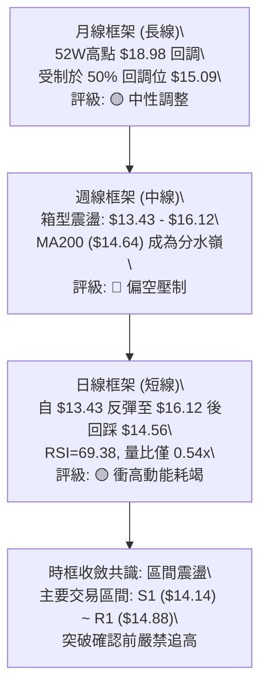

### 📈 長期趨勢 — 12個月走勢圖（Unicode）

NU 過去 12 個月經歷了自 2025 年末的衝高後，於 2026 年初見頂並進入持續波段回撤與底部構築階段：

```
NU 月線收盤走勢圖（過去12個月：2025-11 至 2026-10）
價格軸 ($)
$17.75 ┤                           ●(2026-01 頂點)
$17.39 ┤      ●(2025-11)
$16.74 ┤                  ●
$16.11 ┤●(2025-10)
$15.00 ┤                                           
$14.56 ┤                                              ●←(2026-10 現價)
$14.33 ┤                                      ●   ●
$13.36 ┤                                  ●
$13.13 ┤                              ●(2026-05 低位)
$12.66 ┤                                          ●(2026-09 次低)
       └──────┬─────┬─────┬─────┬─────┬─────┬─────┬─────┬─────┬─────┬─────┬─────
            11月  12月  01月  02月  03月  04月  05月  06月  07月  08月  09月  10月
            2025                    2026
```

#### 過去 12 個月走勢特徵分析

| 區間階段 | 時間跨度 | 起訖價位 | 漲跌幅 | 走勢特徵與量價結構分析 |
|:---|:---:|:---:|:---:|:---|
| **第一階段：強勢衝頂** | 2025-10 ~ 2026-01 | $16.11 → $17.75 | +10.18% | 延續強勢上漲，月線連續收紅，創下週期波段高點 |
| **第二階段：快速下殺** | 2026-01 ~ 2026-05 | $17.75 → $13.13 | -26.03% | 跌破所有短期均線，呈現空頭流暢回跌，動能大幅衰竭 |
| **第三階段：築底震盪** | 2026-05 ~ 2026-08 | $13.13 → $14.55 | +10.81% | 於 $13.13 尋獲買盤，形成初生支撐區，量能轉為沉悶 |
| **第四階段：破底翻洗盤** | 2026-08 ~ 2026-10 | $14.55 → $12.66 → $14.56 | 0.00% | 9月下殺探底至 $12.66 誘空，10月迅速拉回 $14.56 平台 |

### 📊 中期趨勢（週線分析）

從近 20 週收盤走勢可見，價格於 2026 年 10 月初創下波段低點 $13.43 後，於 2026-10-11 週爆出 517.68M 大量暴拉至 $16.12，但隨後在 2026-10-18 週量能迅速回落至 328.76M，收盤價重挫至 $14.56，吞噬了上週超過一半的漲幅，形成經典的「假突破誘多長上影線」。

```
週線級別價格壓力與支撐階梯
$16.22 ────────────────────────────────────────── 阻力位 R3 (近一年波段高點)
$16.12 ───────▲ (2026-10-11 週高點吞噬)
$15.83 ────────────────────────────────────────── 阻力位 R2 (成交密集套牢區)
$15.09 ────────────────────────────────────────── 斐波那契 50.0% 關鍵心理大關
$14.88 ────────────────────────────────────────── 阻力位 R1 (近期反彈頸線壓制)
$14.64 ------------------------------------------ MA200 關鍵牛熊生命線
$14.56 ========================================== 【當前最新收盤價】
$14.33 ------------------------------------------ MA20 / 布林通道中軌
$14.17 ────────────────────────────────────────── 斐波那契 61.8% 黃金支撐位
$14.14 ────────────────────────────────────────── 支撐位 S1 (短期回調強防守線)
$13.41 ────────────────────────────────────────── 支撐位 S2 (前波洗盤低點平台)
```

### ⚡ 趨勢強度評估（ADX 解讀）

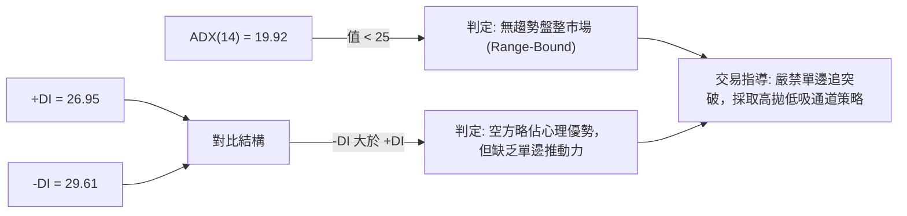

#### ADX 趨勢強度對照表

| 指標變數 | 當前讀數 | 門檻區間 | 趨勢強度解讀 | 對交易策略之指示 |
|:---|:---:|:---:|:---|:---|
| **ADX 數值** | **19.92** | < 20 (極弱/無趨勢) | 市場缺乏單邊推動方向，屬於震盪盤整 | 避免使用追價突破系統，優先使用擺盪指標 |
| **+DI (多方)** | **26.95** | 中等強度 | 多頭有反彈意圖，但尚未佔據主導優勢 | 僅視為反彈波，不可視為新一輪牛市展開 |
| **-DI (空方)** | **29.61** | 中等偏強 | 空方仍控制較大波段結構，上方阻力沉重 | 反彈至關鍵均線（如MA200）易遭逢空頭狙擊 |
| **綜合態勢** | **-DI > +DI** | 空方佔優盤整 | 脆弱的弱平衡震盪，向下破位風險大於向上 | 嚴格設定防守支撐，以低吸高拋為原則 |

---

## 3. 圖表形態分析

### 🔍 形態識別系統

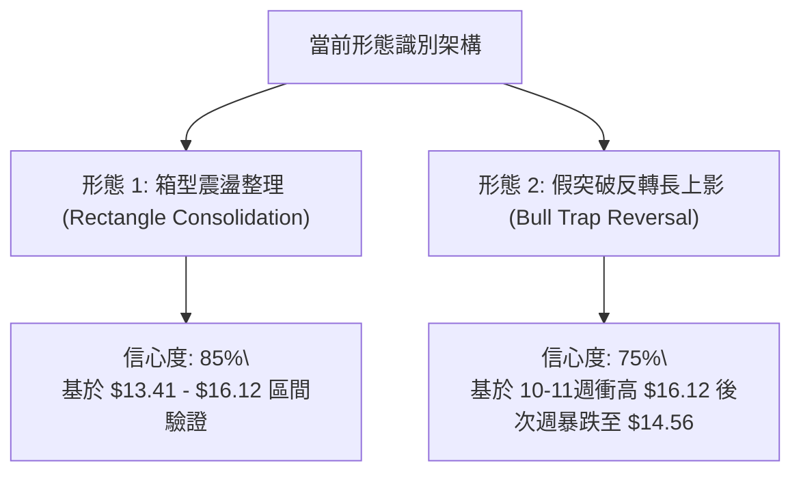

#### 圖表形態信心度評估表

| 識別形態名稱 | 信心度 | 判斷依據（嚴格引用技術數據） | 形態完成度 | 目標價計算方式與數值 |
|:---|:---:|:---|:---:|:---|
| **箱型寬幅震盪** | **85%** | 區間底部獲支撐位 S2 ($13.41) 與波段低點 $13.43 驗證；區間頂部遭遇阻力位 R3 ($16.22) 及前週高點 $16.12 壓制。 | 80% (內部運行) | 箱體突破推算：若實體上破 R3 ($16.22)，目標 = $16.22 + ($16.22 - $13.41) = **$19.03**；若跌破 S2 ($13.41)，目標 = $13.41 - 2.81 = **$10.60**。 |
| **頂部假突破 (多頭陷阱)** | **75%** | 2026-10-11 週爆量衝至 $16.12 穿透 38.2% 回調位 ($16.01)，但 10-18 週急速回落至 $14.56，吞噬漲幅且未站穩 R2 ($15.83)。 | 90% (已確立回踩) | 形態高度回吐推算：自 $16.12 展開之均值回歸，第一目標指向 61.8% 斐波位 **$14.17**，第二目標指向支撐位 S1 **$14.14**。 |
| **雙重底反轉形態** | **35%** | 僅有 2026-05 ($13.13) 與 2026-09 ($12.66) 兩處相對低點，但兩者間隔時間長且高點未實質突破頸線 R2 ($15.83)。 | 未完成 (<40%) | **數據不足以支撐雙底反轉確立**，信心度低於50%，僅視為區間震盪，不做順勢多頭目標延伸推算。 |

### 🕯️ 重要K線形態分析

| 觀測週別 | 收盤價 | K線形態特徵 | 內在技術心理解讀 | 短期多空訊號 |
|:---:|:---:|:---|:---|:---:|
| **2026-09-27** | $13.59 | 探底長下影十字星 (RSI=19.9) | 極度超賣引發空頭回補，打出波段恐慌拋售底 | 🟢 強烈超跌反彈 |
| **2026-10-04** | $13.43 | 帶量築底陰線實體收窄 | 空方動能釋放完畢，成交量放大至 532M 顯示主力承接 | 🟡 止跌打底特徵 |
| **2026-10-11** | $16.12 | 實體大陽線 (+20.03%) | 主力暴力拉抬，穿透 MA20、MA50，RSI 飆升至 65.7 | 🟢 衝刺突破訊號 |
| **2026-10-18** | $14.56 | 長上影實體中陰線 (-9.68%) | 遭遇 MA200 及阻力位 R2 賣壓，上攻受挫回吐，追高籌碼被套 | 🔴 假突破回踩訊號 |

### 📉 ASCII 走勢形態示意圖

```
        NU 週線級別假突破回踩與箱型架構示意圖
$16.22 ┤                                   [R3 阻力線]
$16.12 ┤                     ╭─● (2026-10-11 衝頂誘多)
$15.83 ┤─────────────────────┼───────────────────── [R2 密集套牢線]
       │                     │ ╲
$14.88 ┤─────────────────────┼──╲────────────────── [R1 頸線阻力]
$14.64 ┤.....................│...● (MA200 壓制線)
$14.56 ┤                     │    ● ←【當前價格 $14.56】
$14.33 ┤- - - - - - - - - - -│ - - - - - - - - - - [MA20 / 中軌動態支撐]
$14.14 ┤─────────────────────┼───────────────────── [S1 關鍵支撐線]
       │                    ╱   
$13.43 ┤       ●───────────╯                       [前波低點平台]
$13.09 ┤─────────────────────────────────────────── [S3 底部防守線]
       └───────┴─────────────┴─────────────────────
             9月下旬        10月中旬
```

### 🎯 形態目標價計算

根據確認度最高之「箱體區間假突破回踩」形態進行量化目標推算：

```
╔══════════════════════════════════════════════════════════════════╗
║                     形態回調目標價推算公式                       ║
╠══════════════════════════════════════════════════════════════════╣
║ 假突破衝頂高點 (H) = $16.12 (2026-10-11 收盤價驗證)              ║
║ 本輪起漲低點   (L) = $13.43 (2026-10-04 收盤價驗證)              ║
║ 本輪波動振幅   (A) = H - L = $16.12 - $13.43 = $2.69             ║
╠══════════════════════════════════════════════════════════════════╣
║ 回調 50.0% 目標位 = H - (A × 0.500) = $16.12 - $1.345 = $14.775   ║
║ (現價 $14.56 已跌破 50% 回調位，顯示空方回吐力道強勁)            ║
╠══════════════════════════════════════════════════════════════════╣
║ 回調 61.8% 目標位 = H - (A × 0.618) = $16.12 - $1.662 = $14.458   ║
║ (極度接近 MA50 $14.46，為當前第一防守測試點)                     ║
╠══════════════════════════════════════════════════════════════════╣
║ 形態全額回踩目標  = 引用支撐位 S1 = $14.14                       ║
║ 終極箱底防守目標  = 引用支撐位 S2 = $13.41                       ║
╚══════════════════════════════════════════════════════════════════╝
```

---

## 4. 支撐與阻力

### 🗺️ 關鍵價位分布圖（Unicode）

```
NU 價位結構分布圖（嚴格依據 OHLCV 計算聚類點）
══════════════════════════════════════════════════════════════════
$18.98 ║████████████████████████████████║ 52W 最高點 (0.0% 斐波位)
$17.14 ║████████████                    ║ 23.6% 斐波那契回調位
$16.22 ║████████████████████████████    ║ 強阻力 R3 (+11.40%)
$16.01 ║████████████████                ║ 38.2% 斐波位 / 前波密集成交
$15.83 ║████████████████████            ║ 阻力位 R2 (+8.69%)
$15.09 ║████████████████████████        ║ 50.0% 斐波那契中軸水準
$14.88 ║████████████████████████████    ║ 關鍵阻力 R1 (+2.21%)
$14.64 ║--------------------------------║ MA200 牛熊分界線
$14.56 ╠════════════════════════════════╣ ◄ 現價 ($14.56)
$14.33 ║--------------------------------║ MA20 / 布林中軌
$14.17 ║▓▓▓▓▓▓▓▓▓▓▓▓▓▓▓▓▓▓▓▓▓▓▓▓        ║ 61.8% 斐波黃金分割位
$14.14 ║▓▓▓▓▓▓▓▓▓▓▓▓▓▓▓▓▓▓▓▓▓▓▓▓▓▓▓▓    ║ 近期關鍵支撐 S1 (-2.88%)
$13.41 ║████████████████████████████    ║ 強支撐 S2 (-7.90%)
$13.09 ║████████████████████████████████║ 底部強支撐 S3 (-10.13%)
$12.86 ║▓▓▓▓▓▓▓▓▓▓▓▓                    ║ 78.6% 斐波那契回調位
$11.20 ║████████████████████████████████║ 52W 最低點 (100.0% 斐波位)
══════════════════════════════════════════════════════════════════
```

### 🚧 阻力位分析表

所有阻力價位嚴格引用系統由波段高點聚類計算之數值：

| 阻力級別 | 價位 | 距現價空間 | 形成技術原因 | 突破難度評級 | 戰略重要性 |
|:---:|:---:|:---:|:---|:---:|:---|
| **R1** | **$14.88** | +2.21% | 近期反彈遇阻聚類點；緊鄰 MA200 ($14.64) 與 MA240 ($14.94) 雙重重力區。 | 🟡 中等 | 短期多空分水嶺，站上才具備挑戰前高資格。 |
| **R2** | **$15.83** | +8.69% | 2026年8月中旬及9月上旬多次衝高回落形成的密集成交頸線位。 | 🔴 偏高 | 中期頭部頸線，累積大量套牢盤，需要 2x 以上成交量配合方能消化。 |
| **R3** | **$16.22** | +11.40% | 近一年波段高點聚類區，與 2026-10-11 週高點 $16.12 形成共振強壓。 | 🔴 極高 | 波段頂部阻力，未帶量實質站穩前視為箱型天花板。 |

### 🛡️ 支撐位分析表

所有支撐價位嚴格引用系統由波段低點聚類計算之數值：

| 支撐級別 | 價位 | 距現價空間 | 形成技術原因 | 守住機率評級 | 戰略重要性 |
|:---:|:---:|:---:|:---|:---:|:---|
| **S1** | **$14.14** | -2.88% | 近一年波段低點聚類點；與 61.8% 斐波那契回調位 ($14.17) 高度重疊。 | 🟢 70% | 極強短線防守線，多頭守護短期反彈結構的底線。 |
| **S2** | **$13.41** | -7.90% | 2026年10月初起漲低點 ($13.43) 及6月整理平台所共構成的強大支撐帶。 | 🟢 85% | 中期箱型下軌，跌破將引發新一輪順勢放量下殺。 |
| **S3** | **$13.09** | -10.13% | 2026年5月所創之年度低位整理區 ($13.13) 聚類點。 | 🟢 90% | 長期強支撐堡壘，多方絕對防禦中樞。 |

### 📐 斐波那契回調位分析

依據 52 週波動極值（低點 **$11.20** 至 高點 **$18.98**，整體垂直波動點數為 **$7.78**）計算分析：

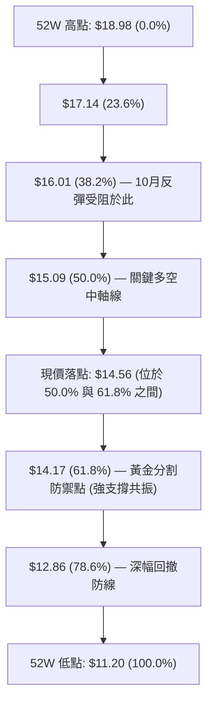

#### 斐波那契回調結構解讀

1. **現價區間定位**：當前收盤價 **$14.56** 精確坐落於 **50.0% ($15.09)** 與 **61.8% ($14.17)** 回調位所構成的緩衝區間。在技術分析原理中，61.8% 回調位是多頭生命線，若價格回調守住 $14.17，則本輪自 $11.20 起的長線上升結構尚未破壞。
2. **阻力對映**：上方的 50.0% 回調位 **$15.09** 與 38.2% 回調位 **$16.01** 分別構成了本輪反彈的第一與第二道天花板。2026-10-11 週觸及之 $16.12 恰好在此遭遇強大獲利回吐盤，印證了斐波那契水平線的高度有效性。

---

## 5. 技術指標深度解讀

### 🎛️ 指標訊號總覽

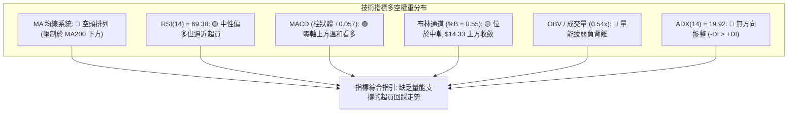

### 📈 移動平均線排列分析

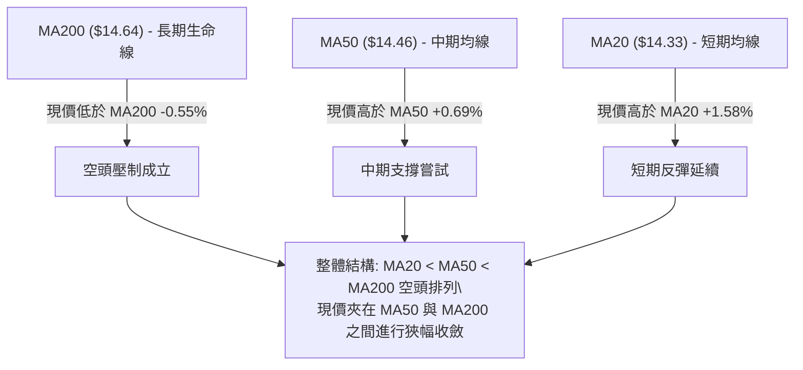

#### 移動平均線系統定量對照表

| 均線名稱 | 數值 | 距現價差距 | 走勢趨勢與斜率 | 技術意涵 |
|:---|:---:|:---:|:---|:---|
| **MA 5** | $15.16 | -3.97% | ▼ 急速向下勾頭 | 短線遭遇強烈獲利回吐，對日線構成即刻下壓 |
| **MA 10** | $15.37 | -5.29% | ▼ 下行扣高壓制 | 反彈第一阻力，短線籌碼進入浮額清洗 |
| **MA 20** | $14.33 | +1.58% | ▲ 走平微揚 | 構成布林中軌，為短線回踩第一道動態支撐 |
| **MA 50** | $14.46 | +0.69% | ▲ 緩步墊高 | 中期成本均線，現價貼近該線爭奪定價權 |
| **MA 60** | $14.44 | +0.84% | ▲ 走平改善 | 季線位置，與 MA50 形成微型支撐帶 |
| **MA 120** | $13.81 | +5.44% | ▲ 底部回升 | 半年線遠在下方，中期下檔支撐扎實 |
| **MA 200** | $14.64 | -0.55% | ▼ 緩步下移 | **牛熊分界線**，未實體突破前整體格局仍屬空頭反彈 |
| **MA 240** | $14.94 | -2.56% | ▼ 長期壓制 | 年線壓制，與 R1 ($14.88) 形成密集成交天花板 |

### 📉 RSI(14) 分析

```
RSI(14) 當前讀數: 69.38
[0] ─────────── [30] ─────────────────────── [70] ─[69.38]─ [100]
     超賣區              中性健康區             超買邊界
進度條: ████████████████████████████░░ 69.38% (逼近超買)
```

- **背離狀況驗證**：對比 2026-07-05 價格收在 $13.61 時 RSI 高達 79.0，而當前價格在 $14.56 且前週衝至 $16.12 時 RSI 僅為 69.38，呈現**隱性頂背離（Bearish Divergence）**跡象。此現象說明雖然價格在此期間拉出高點，但推升背後的動能強度實質遞減，暗示當前買盤缺乏延續性，需防範急跌回調。

### 📊 MACD(12/26/9) 訊號解讀

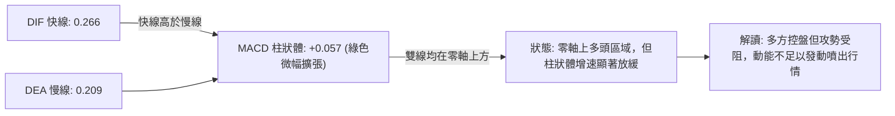

- **MACD 週線變化評估**：2026-10-11 週 MACD 柱狀體曾大幅跳升至 **+0.325**，而 2026-10-18 週則急劇收斂至 **+0.057**。柱狀體呈現「斷崖式萎縮」，確認短期爆發性動能已經結束，指標正向零軸靠攏進行技術性修復。

### 📦 布林通道分析

```
NU 日線布林通道 (20, 2) 結構示意圖
$16.77 ┤━━━━━━━━━━━━━━━━━━━━━━━━━━━━━━━━━━━━━━━━ 上軌 (+2.0σ)
       │               ● (10-11 衝擊上軌失敗回落)
       │
$14.56 ┤ ◄─────────────● 【現價位於中軌上方，%B = 0.55】
$14.33 ┤- - - - - - - - - - - - - - - - - - - - - 中軌 (MA20)
       │
       │
$11.90 ┤━━━━━━━━━━━━━━━━━━━━━━━━━━━━━━━━━━━━━━━━ 下軌 (-2.0σ)
```

- **帶寬與位置解讀**：布林通道上下軌寬度（Bandwidth）維持在正常通道，未見極端開口擴張。**%B 指標為 0.55**，顯示價格自上軌急速滑落後，目前回到中軌 $14.33 稍上方。中軌具備支撐效應，若能守穩中軌，行情將在 $14.33 至 $16.77 間進行箱型震盪；一旦收盤跌破中軌，將引發向通道下軌 $11.90 尋求支撐的風險。

### 💹 成交量分析（量價配合度）

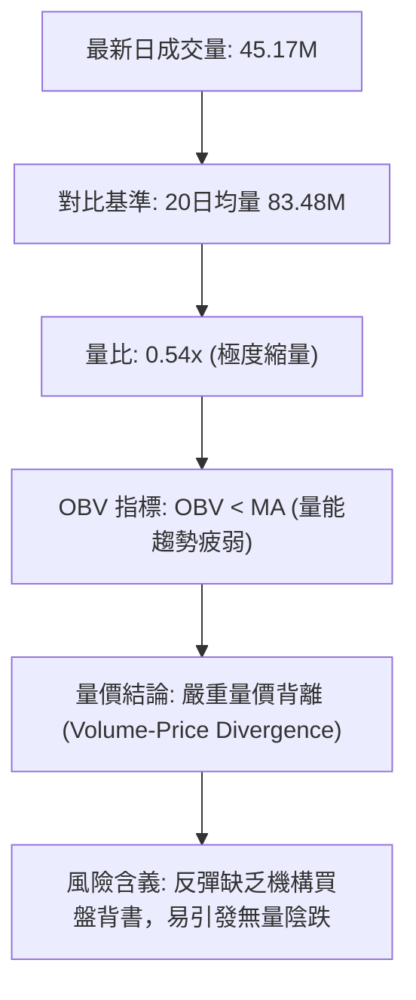

- **成交量結構剖析**：最新單日成交量（45.17M）僅為 20 日均量的 **54%**，亦遠低於 50 日均量（76.59M）。在價格挑戰長期均線 MA200 ($14.64) 的關鍵時刻，量能呈現嚴重萎縮，說明買盤追高意願降至冰點。此外，OBV 處於均線下方，證明過去幾個月以來的反彈過程中，大戶資金並未進行實質性的籌碼積累，反呈現逢高派發態勢。

---

## 6. 動能與波動率

### ⚡ 動能評估四象限

| 象限 | 動能強度 (RSI / MACD) | 波動率水準 (ATR / Bandwidth) | NU 當前所處狀態 | 戰略應對方針 |
|:---:|:---:|:---:|:---:|:---|
| **Q1 (最佳擴張)** | 強 (RSI>60, MACD擴散) | 低 (ATR收斂, 盤整突破) | — | 順勢重倉追隨單邊行情 |
| **Q2 (謹慎觀望)** | **弱/分化 (RSI高位走平, 柱狀體縮小)** | **低/中 (ATR=4.39%, 收斂)** | **✓ [當前落點]** | **縮小部位，執行區間高拋低吸** |
| **Q3 (極限博弈)** | 強 (指標超買/超賣鈍化) | 高 (ATR飆升, 巨幅震盪) | — | 逢極值進場抓反轉快進快出 |
| **Q4 (避免進場)** | 弱 (空頭主導向下) | 高 (下行放量擴散) | — | 完全空倉，規避主跌段 |

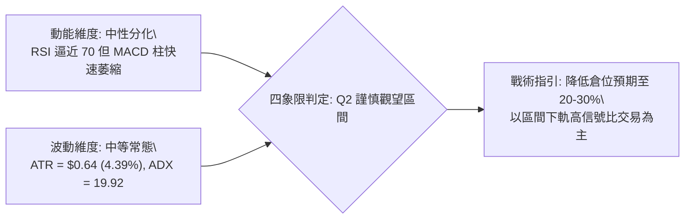

### 📊 ATR 波動率分析

```
╔══════════════════════════════════════════════════════════════════╗
║                     ATR (14) 波動率與止損量化                    ║
╠══════════════════════════════════════════════════════════════════╣
║ 當前 ATR(14) 絕對值 = $0.64                                      ║
║ ATR 佔股價百分比    = 4.39% (屬於健康中等波動範疇)                ║
╠══════════════════════════════════════════════════════════════════╣
║ 短線日內波動預期區間 = [$14.56 - $0.64, $14.56 + $0.64]           ║
║                     = [$13.92 , $15.20]                          ║
╠══════════════════════════════════════════════════════════════════╣
║ 建議止損距離 (1.5x ATR) = 1.5 × $0.64 = $0.96 (±6.59%)            ║
║ 寬鬆防守距離 (2.0x ATR) = 2.0 × $0.64 = $1.28 (±8.79%)            ║
╚══════════════════════════════════════════════════════════════════╝
```

- **ATR 應用解讀**：每日 $0.64 的預期振幅意味著當前價格（$14.56）距離下方支撐 S1 ($14.14) 僅有 $0.42 的緩衝空間，此空間小於 1.0x ATR。這代表日內正常的隨機雜訊波動極易刺穿 S1，因此在制定交易策略時，止損位必須放大至 1.5x ATR 以外，以防止被市場無序波動震盪出局。

### 📐 Beta 與市場相關性

- **Beta 數值**：**0.955**
- **市場特徵解讀**：Beta 極度貼近 1.0，表明 NU 與美股大盤（S&P 500 / 金融板塊）維持高度同步聯動性。當前個股不存在顯著的獨立阿爾法（Alpha）暴走特徵。在大盤未出現明確多頭進攻訊號前，NU 難以憑藉自身力量強行發動單邊突破。

---

## 7. 多時框架總結

### 📋 時框架評分表

| 時框架 | 趨勢方向 | 動能表現 | 均線排列狀態 | 形態特徵 | 綜合評分 | 操作建議 |
|:---:|:---:|:---:|:---:|:---:|:---:|:---|
| **長線 (月線)** | 🟡 中性回調 | 柱狀持平 | 壓制於 50% 斐波位 | 52W區間中部震盪 | 48/100 | 長期投資者定投觀望，等待突破 |
| **中線 (週線)** | 🔴 偏空壓制 | 動能耗竭 | 位於 MA200 下方 | 衝高回踩多頭陷阱 | 38/100 | 逢高減倉，反彈接近壓力離場 |
| **短線 (日線)** | 🟡 震盪整理 | RSI逼近超買 | 夾在 MA50/MA200 之間 | 布林中軌收斂整理 | 46/100 | 嚴禁追高，僅限箱底支撐低吸 |

### 🔲 綜合訊號矩陣

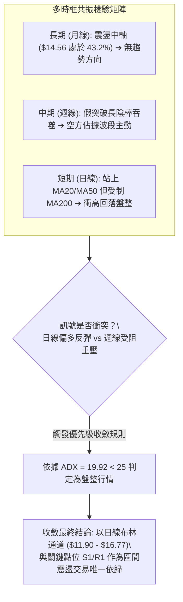

### ⚖️ 多時框收斂結論

依據多時框收斂第 14 條嚴格規則：
1. **行情性質判定**：當前系統 **ADX(14) 讀數為 19.92（遠低於 25 臨界線）**，確認市場處於典型的「**非趨勢無方向盤整行情**」。
2. **時框主導權**：在盤整行情中，中長期的均線壓制（MA200 = $14.64）明確界定了反彈高度的極限，而交易操作必須嚴格退守至日線布林通道與波段密集支撐區間。
3. **唯一方向性結論**：**【中性觀望，區間震盪操作】**。日線級別雖然站上短期 MA20 與 MA50，但成交量僅有 0.54x，且上方 MA200 沉重反壓未除，因此絕對不可將短線反彈解讀為新一輪單邊牛市。操作上堅決執行「不追高，只在強支撐 S1/S2 布局」的收斂防守方針。

---

## 8. 交易策略建議

### 🗺️ 策略決策流程圖

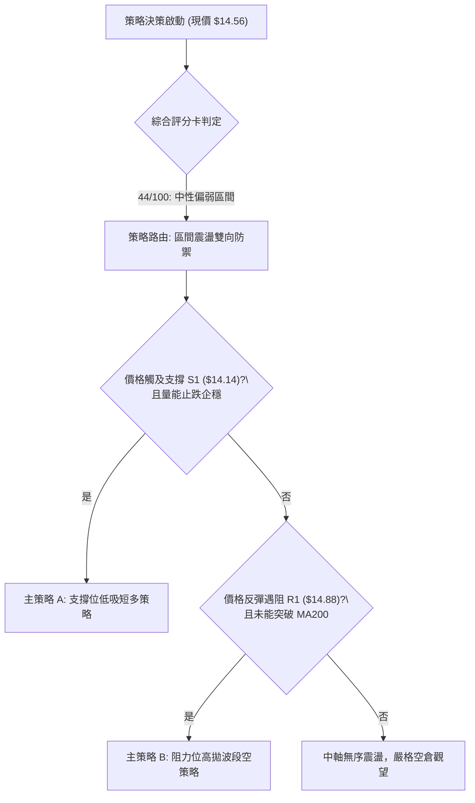

### 🧭 策略路由（依評分卡分流）

> **當前主策略方向 = 【中性觀望，區間高拋低吸】（依據綜合評分 44/100 判定）**
> 
> 由於綜合評分處於 40–60 的中性區間，且 ADX(14)=19.92 表明市場無單邊趨勢，交易策略嚴禁採用單向突破追單模式，必須以布林帶中下軌及支撐/阻力聚類點進行區間套利。

### 🎯 價格情境階梯（Price Scenarios）

價位嚴格引用第四章與 OHLCV 計算聚類之標準點位：

| 觸發條件 | 下一目標 | 後續延伸 | 情境技術含義與應對策略 |
|:---|:---:|:---:|:---|
| **強勢突破 R1 ($14.88)** | **R2 ($15.83)** | **R3 ($16.22)** | 短線轉強，突破 MA200 壓制，可啟動順勢追多加碼。 |
| **站穩現價 ($14.56) 震盪** | **MA200 ($14.64)** | **S1 ($14.14)** | 區間無方向拉鋸，籌碼沉澱，維持低倉位觀望。 |
| **實體跌破 S1 ($14.14)** | **S2 ($13.41)** | **S3 ($13.09)** | 中期反彈結構徹底瓦解，回調考驗箱底，執行避險空單。 |

### 📊 情境機率分佈

| 行情情境 | 機率 | 主要技術依據（嚴格引用指標現狀） |
|:---|:---:|:---|
| **情境一：區間震盪修復** | **55%** | **ADX=19.92** 缺乏單邊推動力；價格位於布林通道中軌上方（%B=0.55）；量能 0.54x 顯示市場觀望情緒濃烈，大概率維持在 $14.14 ~ $14.88 窄幅拉鋸。 |
| **情境二：回落再探底部** | **30%** | **均線系統空頭排列**（MA20<50<200）；**-DI (29.61) > +DI (26.95)**；OBV 指標疲弱且 RSI 逼近 70 出現頂背離跡象，上攻乏力後易引發多殺多下測 S1。 |
| **情境三：向上放量突破** | **15%** | 目前日成交量（45.17M）嚴重萎縮，在未見到 1.5x 以上爆發量能前，直接突破 MA200 ($14.64) 與 R1 ($14.88) 密集套牢區的機率極低。 |

### 🟢 主策略詳情

本報告依據區間震盪路由，提供兩套互相呼應的極限點位應對策略：

| 策略要素 | 策略 A（區間低吸短多策略） | 策略 B（阻力遇阻高拋空策略） |
|:---|:---:|:---:|
| **策略屬性** | 順應支撐逢低承接 | 順應長期空頭趨勢反彈狙擊 |
| **進場條件** | 價格回踩 S1 企穩，日線出現止跌下影線 | 價格反彈至 R1 遇阻收上影，未能站穩 MA200 |
| **精確進場價格** | **$14.17** (61.8% 斐波位與 S1 $14.14 緩衝區) | **$14.80** (緊貼 R1 $14.88 阻力位下方) |
| **目標價 T1** | **$14.64** (MA200 關鍵反壓點) | **$14.33** (MA20 與布林中軌支撐) |
| **目標價 T2** | **$14.88** (阻力位 R1 聚類點) | **$14.14** (關鍵支撐位 S1 聚類點) |
| **嚴格止損價格** | **$13.85** (跌破 S1 達 0.5x ATR 緩衝點) | **$15.15** (實體突破 50% 斐波位 $15.09) |
| **止損空間 (點數)** | $14.17 - $13.85 = $0.32 (2.26%) | $15.15 - $14.80 = $0.35 (2.36%) |
| **獲利空間 T2 (點數)**| $14.88 - $14.17 = $0.71 (5.01%) | $14.80 - $14.14 = $0.66 (4.46%) |
| **風險報酬比 (R:R)** | **1 : 2.22** (滿足 > 1:2 專業標準) | **1 : 1.89** (符合短波段獲利標準) |
| **預估勝率** | 60% | 55% |
| **建議配置倉位** | **15% - 20%** (震盪市嚴格輕倉) | **10% - 15%** (對沖防禦型倉位) |

### 🔴 反向風險觸發點（對沖提示）

- **推翻做空邏輯的信號**：若日線級別以大陽線收盤帶量（單日成交量 > 80M）實體收復 **$15.09**（50.0% 斐波那契回調位），空頭必須立即無條件止損，表明行情進入雙底反轉向上延伸階段。
- **推翻做多邏輯的信號**：若價格以實體陰線擊穿 **$14.14**（支撐位 S1），且 38.2% 回調支撐失守，多頭必須果斷離場，預防行情向 S2 ($13.41) 甚至 52W 低點 $11.20 展開深幅二次探底。

### ⭐ 整體訊號強度評星

```
做多訊號強度：★★☆☆☆  (2/5星 — 均線空頭壓制，量能嚴重不足)
做空訊號強度：★★★☆☆  (3/5星 — -DI主導，但ADX低落缺乏單邊推力)
整體可信度：  ★★★☆☆  (3/5星 — 處於中性震盪，等待量能突破確立)
```

---

## 9. 風險提示與監控

### ✅ 關鍵監控指標 Checklist

```
╔══════════════════════════════════════════════════════════════════╗
║                    NU 日常技術風控監控清單                       ║
╠══════════════════════════════════════════════════════════════════╣
║ [ ] 監控 MA200 壓制動態: 收盤價是否能站穩 $14.64 上方？        ║
║ [ ] 監控成交量門檻: 日成交量能否放大突破 76.59M (50日均量)？   ║
║ [ ] 監控動能超買消化: RSI(14) 能否健康回落至 50-55 獲得支撐？   ║
║ [ ] 監控黃金防守線: 支撐位 S1 ($14.14) 是否遭遇破位擊穿？       ║
║ [ ] 監控趨勢活化信號: ADX(14) 是否向上穿透 25 臨界線？         ║
║ [ ] 監控大盤板塊聯動: Beta=0.955 警戒大盤金融股指數系統性回調 ║
╚══════════════════════════════════════════════════════════════════╝
```

### ⚠️ 風險場景分析

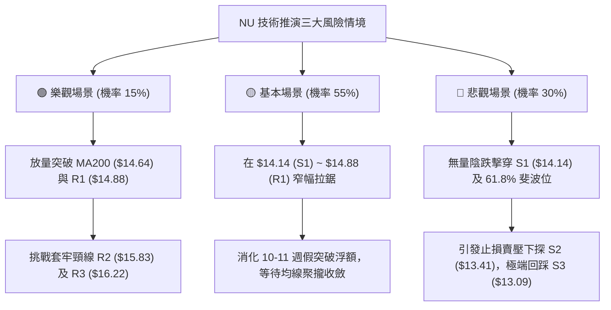

### 🛡️ 風險管理重要提醒

1. **嚴防「縮量假突破」陷阱**：NU 當前日成交量僅 45.17M（量比 0.54x），在缺乏機構真實資金承接的情況下，任何盤中快速拉升均極易演變成如同 2026-10-11 週的誘多回馬槍。切忌在阻力位 R1 ($14.88) 附近使用市價單追多。
2. **波動率常規止損設置**：考慮到 ATR(14) 為 $0.64，日內正常振幅達 4.39%，所有日內及波段單子的止損空間不得小於 $0.64（1.0x ATR），建議採用 1.5x ATR（$0.96）作為安全緩衝區，杜絕被市場造市雜訊惡意掃損。
3. **倉位總量嚴格管控**：在 ADX < 25 的震盪行情中，總持倉部位建議嚴格限制在 **20%–30% 以內**。禁止在無趨勢的箱體中軸（如當前價位 $14.56）建立大額曝險，必須耐心等待價格運行至邊界區域（$14.14 或 $14.88）才執行結構化試倉。

---

## 📋 報告總結

```
╔══════════════════════════════════════════════════════════════════╗
║                       NU 技術分析報告總結                        ║
╠══════════════════════════════════════════════════════════════════╣
║ 報告日期：2026-10-19                                             ║
║ 當前價格：$14.56                                                 ║
║ 分析評級：⚖️ 中性偏弱（Neutral to Bearish Range-Bound）        ║
╠══════════════════════════════════════════════════════════════════╣
║ 核心結構結論：                                                   ║
║ ├─ 長期趨勢：🟡 中性整理（處於 52W 區間 43.2%，受制 50% 斐波線）║
║ ├─ 中期趨勢：🔴 偏空壓制（均線 MA20<50<200，壓制於 MA200 下方）║
║ ├─ 短期趨勢：🟡 震盪整理（衝高回踩，站上 MA20/50 但量能萎縮）   ║
║ ├─ 關鍵支撐：S1: $14.14 ｜ S2: $13.41 ｜ S3: $13.09              ║
║ ├─ 關鍵阻力：R1: $14.88 ｜ R2: $15.83 ｜ R3: $16.22              ║
║ └─ 華爾街分析師目標價：均值 $18.77 (最低 $12.00 / 最高 $23.00)   ║
╠══════════════════════════════════════════════════════════════════╣
║ 最優交易策略組合：                                               ║
║ 1. 🥇 最佳機會（區間短多）：回踩 S1 ($14.17) 企穩進場，止損 $13.85║
║    目標 T1: $14.64 / T2: $14.88，風險報酬比 1:2.22               ║
║ 2. 🥈 次選機會（反彈狙空）：反彈 R1 ($14.80) 遇阻開空，止損 $15.15║
║    目標 T1: $14.33 / T2: $14.14，風險報酬比 1:1.89               ║
║ 3. 🥉 保守選擇（空倉等待）：等待日成交量突破 76M 且實體收復     ║
║    MA200 ($14.64) 或跌破 $14.14 後，再順勢進場追隨新趨勢。       ║
╚══════════════════════════════════════════════════════════════════╝
```

---

> ⚠️ **免責聲明**：本報告為 AI 自動生成之技術分析，所有數據及估算均基於提供的歷史價格資訊。本報告**僅供研究與學術參考**，**不構成任何投資建議**。投資有風險，入市需謹慎。

---

*報告生成時間：2026-10-19 ｜ 數據來源：Yahoo Finance ｜ 分析框架：多時框技術分析*