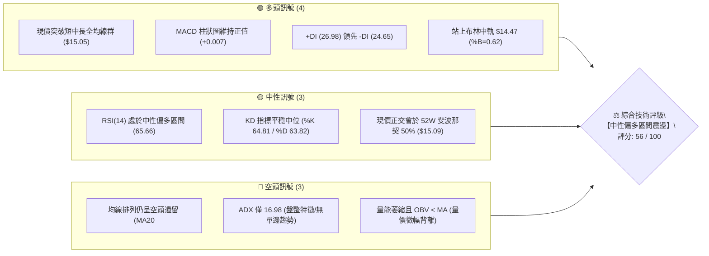
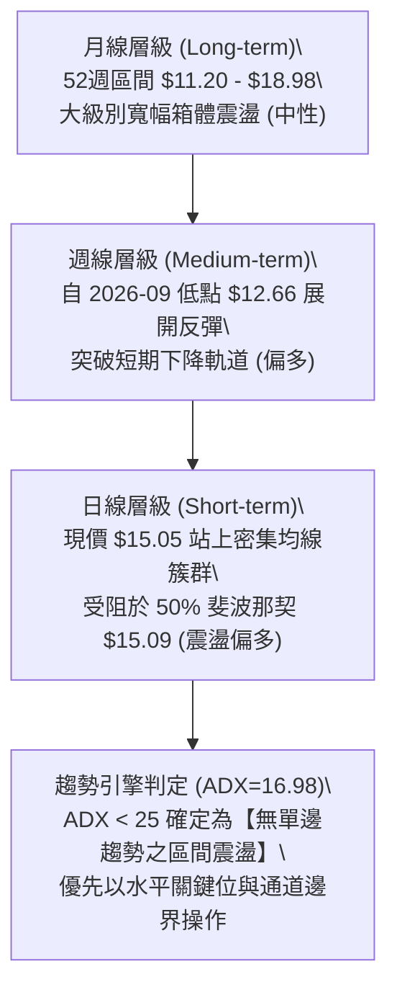
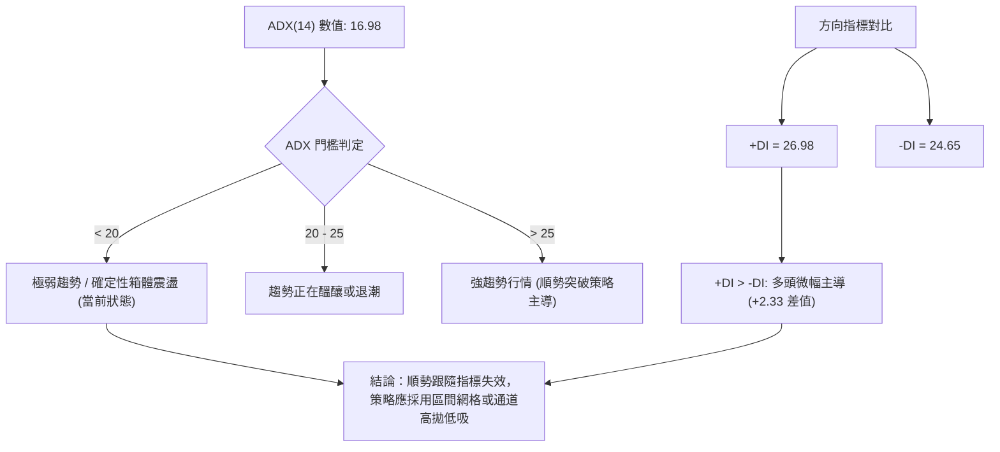
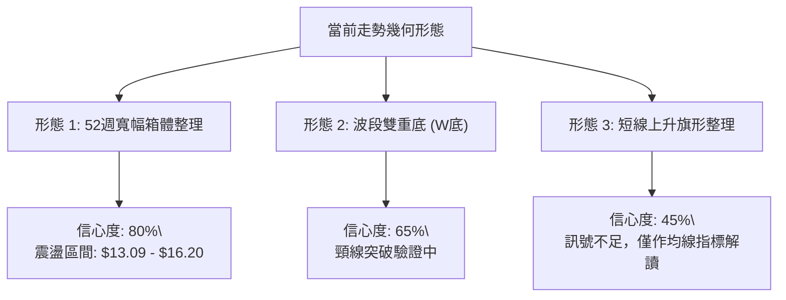
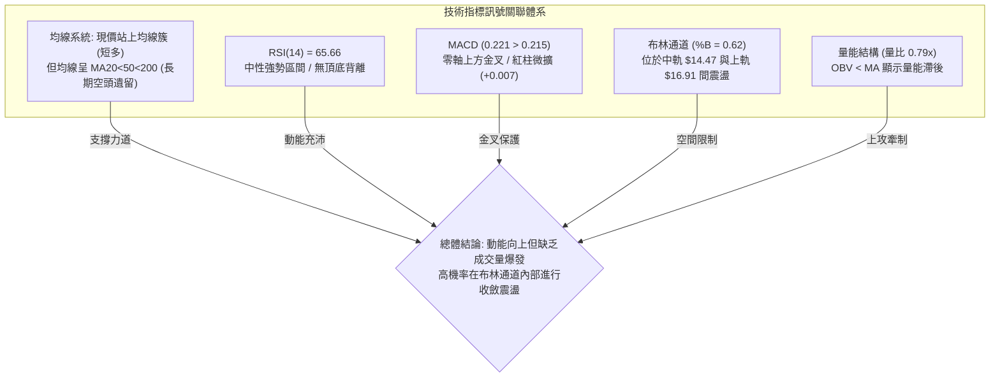
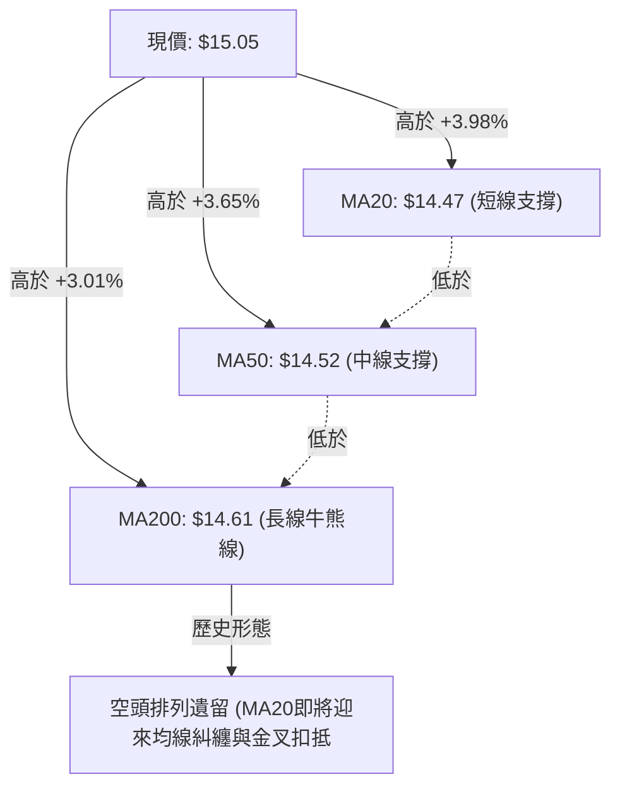
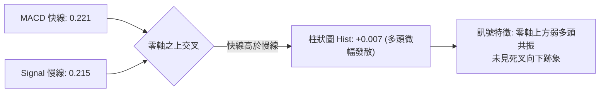
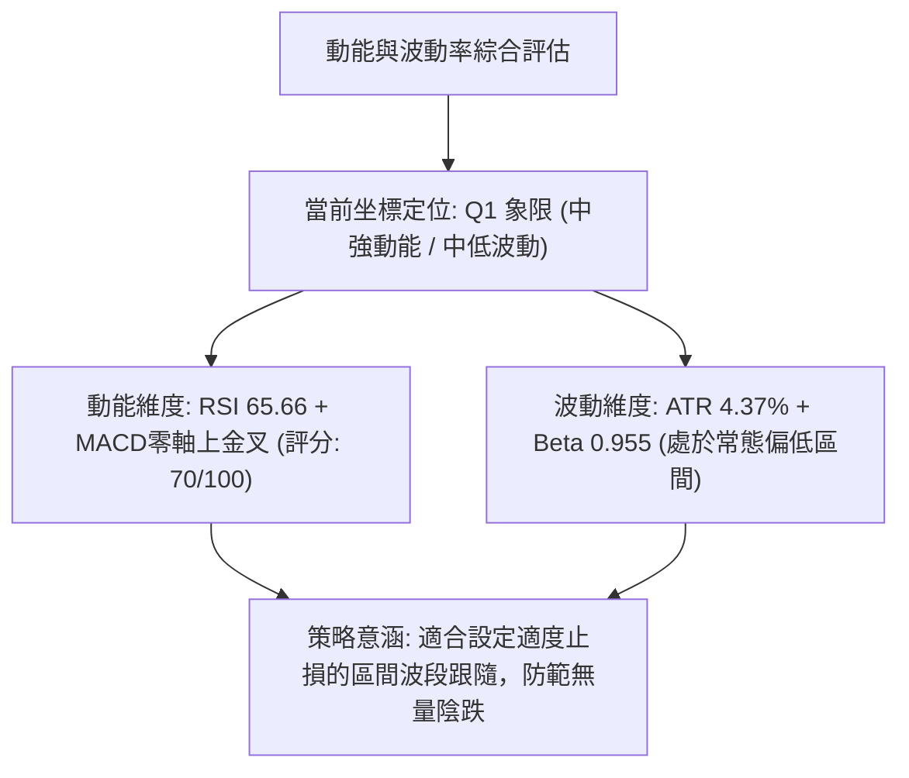
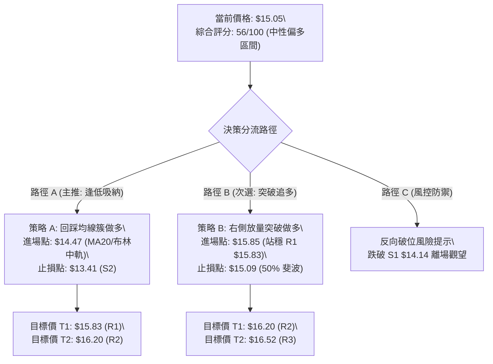
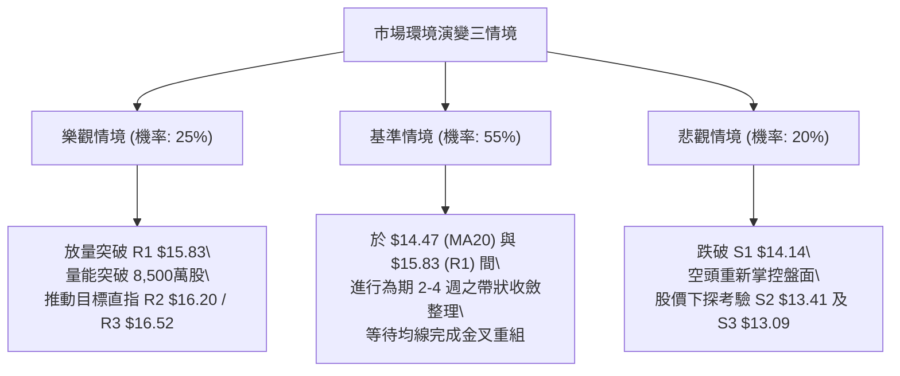

# NU 技術分析報告

> **報告日期**：2026-10-22 ｜ **語言**：繁體中文 ｜ **數據來源**：Yahoo Finance ｜ **當前價格**：$15.05

---

## 目錄

| 章節 | 內容 |
|------|------|
| [1. 技術面概覽](#1-技術面概覽) | 訊號儀表板、核心指標、評分卡 |
| [2. 趨勢分析](#2-趨勢分析) | 多時框趨勢、長中短期走勢、ADX強度 |
| [3. 圖表形態分析](#3-圖表形態分析) | 形態識別、K線組合、目標價測算 |
| [4. 支撐與阻力](#4-支撐與阻力) | 關鍵價位、斐波那契回調結構 |
| [5. 技術指標深度解讀](#5-技術指標深度解讀) | MA/RSI/MACD/布林/成交量量價背離 |
| [6. 動能與波動率](#6-動能與波動率) | 動能四象限、ATR波動風險、Beta |
| [7. 多時框架總結](#7-多時框架總結) | 時框評分、訊號矩陣、多時框收斂 |
| [8. 交易策略建議](#8-交易策略建議) | 策略路由、情境階梯、進出場規劃 |
| [9. 風險提示與監控](#9-風險提示與監控) | 監控清單、情境推演、風控規則 |
| [📋 報告總結](#-報告總結) | 核心結論與最優策略組合速查 |

---

## 1. 技術面概覽

### 🎯 技術訊號儀表板



### 📊 核心指標速覽表

| 指標類別 | 指標名稱 | 當前數值 | 訊號 | 技術解讀 |
|:---|:---|:---|:---:|:---|
| **價格** | 當前收盤價 | $15.05 | 🟢 | 站上 52 週中軸，處於 52 週區間之 49.5% 分位 |
| **均線** | 短期 MA20 | $14.47 | 🟢 | 現價高於 MA20 達 +3.98%，短線支撐確立 |
| **均線** | 中期 MA50 | $14.52 | 🟢 | 現價向上突破 50 日線，中期動能回溫 |
| **均線** | 長期 MA200| $14.61 | 🟢 | 現價重回 200 日牛熊分界線上方 +3.01% |
| **均線排列** | 結構型態 | MA20<MA50<MA200 | 🔴 | 均線尚未完成黃金交叉多頭排列，處於交纏收斂期 |
| **動能** | RSI (14) | 65.66 | 🟡 | 位於強勢中性區（未達超買 70），動能向上但未過熱 |
| **動能** | MACD (12,26,9)| 0.221 / 0.215 | 🟢 | 快線位於慢線上方，Hist 翻正 (+0.007) 多頭主導 |
| **趨勢** | ADX (14) | 16.98 | 🔴 | ADX < 25 表明處於弱趨勢／箱體盤整格局 |
| **波動** | ATR (14) | $0.66 (4.37%) | 🟡 | 波動度適中，單日平均安全防守距離約為 $0.66 |
| **量能** | 當日量 / 20日均量| 66.28M / 83.48M | 🔴 | 量比 0.79x，上攻缺乏放量確認，OBV 疲弱 |

### 🏆 技術評分卡

```
╔══════════════════════════════════════════════════════════════════╗
║                   技術評分卡 — NU (2026-10-22)                   ║
╠══════════════════════════════════════════════════════════════════╣
║ 趨勢強度 (ADX=16.98)     ████████░░░░░░░░░░░░  42/100  🔴 弱趨勢 ║
║ 動能指標 (RSI/MACD)      ██████████████░░░░░░  70/100  🟢 偏多   ║
║ 支撐穩定度 (均線密集)    ██████████████░░░░░░  72/100  🟢 穩固   ║
║ 成交量配合 (OBV/量比)    ████████░░░░░░░░░░░░  40/100  🔴 量縮   ║
║ 形態完整度 (箱體/雙底)   ████████████░░░░░░░░  58/100  🟡 形成中 ║
║ 均線排列 (扣抵與位置)    ██████████░░░░░░░░░░  52/100  🟡 糾纏   ║
╠══════════════════════════════════════════════════════════════════╣
║ 綜合技術評分             ███████████░░░░░░░░░  56/100  🟡 中性偏多║
╚══════════════════════════════════════════════════════════════════╝
```

---

## 2. 趨勢分析

### 🌐 多時框趨勢分析



### 📈 長期趨勢 — 12個月走勢圖（Unicode）

NU 過去 12 個月收盤價走勢圖（2025-11 至 2026-10）：

```
NU 月線收盤走勢圖（過去12個月）
 價格軸 ($)
 $18.00 ┤                     ● 17.75 (2026-01 波段高點)
 $17.00 ┤     ● 17.39   ● 16.74
 $16.00 ┤
 $15.00 ┤                                                 ● 15.05 (現價)
 $14.00 ┤                 ● 14.98   ● 14.37   ● 14.48   ● 14.33   ● 14.55
 $13.00 ┤                                                 ● 13.13   ● 13.36
 $12.00 ┤                                                           ● 12.66
        └─────────────────────────────────────────────────────────────► 時間
         25-11 25-12 26-01 26-02 26-03 26-04 26-05 26-06 26-07 26-08 26-09 26-10
```

#### 走勢特徵分析表格

| 階段 | 時間跨度 | 起訖價位 | 漲跌幅 | 結構形態與成交量特徵 |
|:---|:---:|:---:|:---:|:---|
| **第一階段：高檔作頂** | 2025-11 ~ 2026-01 | $17.39 → $17.75 | +2.07% | 觸及 52W 高點 $18.98 承壓，頂部換手量放大，形成雙頂結構 |
| **第二階段：震盪下行** | 2026-01 ~ 2026-05 | $17.75 → $13.13 | -26.03% | 破位下殺，跌破短期上升趨勢線，均線逐步轉為下彎空頭壓制 |
| **第三階段：築底震盪** | 2026-05 ~ 2026-08 | $13.13 → $14.55 | +10.81% | 於 $13.09 - $13.41 區域形成強支撐平台，成交量顯著沉澱 |
| **第四階段：次級探底** | 2026-08 ~ 2026-09 | $14.55 → $12.66 | -12.99% | 快速回撤測試支撐，探至近半年低點 $12.66 後迅速獲得承接 |
| **第五階段：強勢修復** | 2026-09 ~ 2026-10 | $12.66 → $15.05 | +18.88% | 日線與週線大陽線吞沒，連穿 MA20/50/200，目前蓄勢挑戰 R1 |

### 📊 中期趨勢（週線分析）

從近 20 週收盤走勢顯示，2026-09-27 週收盤 $13.59（RSI 跌至 19.9 之極度超賣），隨後在 2026-10-11 週爆出 5.17 億股巨量拉升至 $16.12，MACD 柱狀圖暴衝至 +0.325。本週收盤小幅回調至 $15.05，守於 MA200 之上。

```
中期週線支撐阻力結構圖 ($)
$16.52 ────────────────────────────────────────── [強阻力 R3]
$16.20 ────────────────────────────────────────── [阻力 R2] (10-11 週收盤 $16.12 聚類)
$15.83 ────────────────────────────────────────── [關鍵阻力 R1]
$15.05 ══════════════════════════════════════════ ◄ 現價 (對齊 50% 斐波那契 $15.09)
$14.14 ────────────────────────────────────────── [關鍵支撐 S1] (MA20/50/200 均線密集防守帶)
$13.41 ────────────────────────────────────────── [波段強支撐 S2]
$13.09 ────────────────────────────────────────── [底部強支撐 S3]
```

### ⚡ 趨勢強度評估（ADX 解讀）



| 指標變數 | 當前讀數 | 門檻區間 | 市場狀態解讀 |
|:---|:---:|:---:|:---|
| **ADX (14)** | **16.98** | < 25.0 | **弱趨勢／震盪市**：不具備單邊單向推動力，假突破風險高 |
| **+DI** | **26.98** | - | 多頭動能佔據上風，買盤推動力大於賣盤 |
| **-DI** | **24.65** | - | 空頭拋壓正在退潮，但與 +DI 差距不大（僅相差 2.33） |
| **市場體系** | **震盪收斂** | 盤整期 | 必須嚴格遵照多時框收斂規則：以日線布林通道 ($12.04 - $16.91) 為核心交易區間 |

---

## 3. 圖表形態分析

### 🔍 形態識別系統



#### 形態識別與信心度評估表

| 識別形態 | 信心度 | 判斷依據（嚴格引用歷史數據） | 完成度 | 目標價（附嚴謹計算式） |
|:---|:---:|:---|:---:|:---|
| **大級別箱體震盪** | **80%** | 下軌聚類於 S3 $13.09 及 52W 低點 $11.20；上軌受制於 R2 $16.20 及 R3 $16.52 | 85% | 箱體上沿目標：直接指向阻力位 **$16.20** |
| **波段雙重底 (W底)** | **65%** | 第一底於 2026-05 之 $13.13，第二底於 2026-09 之 $12.66；兩底均在 S3 $13.09 附近獲支撐 | 70% | 頸線位以近期波段高點 $15.37 計算：<br>形態高度 = $15.37 - $12.66 = $2.71<br>破位量測目標 = 頸線 $15.37 + $2.71 = **$18.08** |
| **上升旗形** | **45%** | 2026-10-11 週放量大陽線後接連兩週回踩，量能快速萎縮至 1.79 億股 | 35% | **數據不足**：ADX < 25 且回撤幅度偏深，暫不予採納形態目標價，僅作指標型均線回踩解讀 |

### 🕯️ 重要K線形態分析

| 觀測週期 | 收盤價 | K線組合形態 | 技術含義解讀 | 訊號方向 |
|:---:|:---:|:---|:---|:---:|
| **2026-09 月線** | $12.66 | 帶長下影線長黑燭體 | 探底至 52W 低點 $11.20 上方引發逢低搶籌，空頭動能竭盡 | 🟡 止跌訊號 |
| **2026-10 月線 (至今)** | $15.05 | 大陽線實體包覆前陰（破曉晨星） | 強勢反轉型態，月線實體漲幅達 +18.88%，收復多條均線失地 | 🟢 強烈看多 |
| **2026-10-11 週線** | $16.12 | 巨量光頭中長陽（成交 5.17 億股） | 主力機構進場確認，強行拉穿中長期均線束 | 🟢 趨勢突破 |
| **2026-10-18 週線** | $14.56 | 回踩確認中陰線（成交 3.28 億股） | 突破後的健康技術性回抽，成交量縮減 36.5%，非主力出貨 | 🟡 正常洗盤 |
| **2026-10-25 (當週)** | $15.05 | 下影線反彈小陽星（成交 1.79 億股） | 於 MA200 ($14.61) 處獲有效支撐再度發力上攻 | 🟢 支撐確立 |

### 📉 ASCII 走勢形態示意圖

雙底（W-Bottom）築底與頸線突破示意圖：

```
NU 日/週線級別雙底 (W底) 形態結構圖
價格 ($)
$18.08 ┤                                                  [形態量測終極目標]
$16.20 ┤                      ▲ (2026-10-11 週衝高 $16.12)
$15.37 ┤───────[頸線位置]─────┼────────────────────────────
$15.05 ┤                      │       ● (現價 $15.05，回踩頸線上方)
$14.14 ┤                      │      ╱ 
$13.13 ┤         ● (左底 05月)│     ╱  
$12.66 ┤          ╲          ╱ ╲   ╱   
$12.00 ┤           ╲________╱   ● (右底 09月)
       └─────────────────────────────────────────────────────────────►
```

### 🎯 形態目標價計算

根據經典技術形態量測原理，雙底形態突破之理論最小量測目標計算如下：
1. **基底最低點**：右底極值 $12.66（2026-09 月線低點）。
2. **頸線確認位**：2026-09-06 波段反彈高點 $15.37。
3. **垂直形態高度 (H)**：$15.37 - $12.66 = $2.71。
4. **理論突破目標價 (T_pattern)**：$15.37 + $2.71 = **$18.08**（該價位高度接近 52 週最高價 $18.98 及分析師平均目標價 $18.92）。
5. **現實制約考量**：在到達 $18.08 之前，股價必須依序跨越波段籌碼聚類阻力 R1 ($15.83) 與 R2 ($16.20)。

---

## 4. 支撐與阻力

### 🗺️ 關鍵價位分布圖（Unicode）

```
╔══════════════════════════════════════════════════════════════════╗
║                    NU 關鍵價位階梯與結構分布圖                   ║
╠══════════════════════════════════════════════════════════════════╣
║ $18.98 ║████████████████████████████████║ 52週歷史高點 / 0.0% 斐波  ║
║ $17.14 ║████████████████████            ║ 斐波那契 23.6% 回調位    ║
║ $16.91 ║████████████████████████        ║ 布林帶上軌 (BB Upper)     ║
║ $16.52 ║████████████████████████████    ║ 強阻力位 R3 (+9.80%)     ║
║ $16.20 ║████████████████████████        ║ 關鍵阻力 R2 (+7.67%)     ║
║ $16.01 ║██████████████████              ║ 斐波那契 38.2% 回調位    ║
║ $15.83 ║██████████████████████████████  ║ 近期阻力 R1 (+5.15%)     ║
║ $15.09 ║────────────────────────────────║ 斐波那契 50.0% 中軸線     ║
║ $15.05 ╠════════════════════════════════╣ ◄ 當前市價 (Current: $15.05)║
║ $14.61 ║▓▓▓▓▓▓▓▓▓▓▓▓▓▓▓▓▓▓▓▓▓▓▓▓▓▓▓▓    ║ MA200 牛熊分水嶺         ║
║ $14.47 ║▓▓▓▓▓▓▓▓▓▓▓▓▓▓▓▓▓▓▓▓▓▓▓▓▓▓▓▓▓▓▓▓║ 布林中軌 / MA20 支撐帶   ║
║ $14.17 ║▓▓▓▓▓▓▓▓▓▓▓▓▓▓▓▓▓▓▓▓            ║ 斐波那契 61.8% 黃金分割位 ║
║ $14.14 ║▓▓▓▓▓▓▓▓▓▓▓▓▓▓▓▓▓▓▓▓▓▓▓▓▓▓▓▓▓▓  ║ 關鍵波段支撐 S1 (-6.05%) ║
║ $13.41 ║▓▓▓▓▓▓▓▓▓▓▓▓▓▓▓▓▓▓▓▓▓▓▓▓        ║ 強支撐位 S2 (-10.90%)    ║
║ $13.09 ║▓▓▓▓▓▓▓▓▓▓▓▓▓▓▓▓▓▓▓▓▓▓▓▓▓▓▓▓▓▓  ║ 底部強支撐 S3 (-13.06%)  ║
║ $12.04 ║▓▓▓▓▓▓▓▓▓▓▓▓                    ║ 布林帶下軌 (BB Lower)     ║
║ $11.20 ║▓▓▓▓▓▓▓▓▓▓▓▓▓▓▓▓▓▓▓▓▓▓▓▓▓▓▓▓▓▓▓▓║ 52週低點 / 100.0% 斐波   ║
╚══════════════════════════════════════════════════════════════════╝
```

### 🚧 阻力位分析表

所有價位均來自近一年波段高點籌碼聚類計算數值：

| 阻力級別 | 準確價位 | 距現價幅動 | 歷史形成原因與籌碼性質 | 突破難度評估 | 重要性級別 |
|:---:|:---:|:---:|:---|:---:|:---:|
| **R1** | **$15.83** | +5.15% | 2026-09-06 週反彈波段頂部區域之解套賣壓密集區 | 🟡 中等（需放量） | ★★★★☆ |
| **R2** | **$16.20** | +7.67% | 2026-10-11 週衝高之週收盤聚類位（$16.12）及月線壓力帶 | 🔴 較高（巨量套牢）| ★★★★★ |
| **R3** | **$16.52** | +9.80% | 2025 年底起跌區之高檔平台下沿，強烈空頭防守點 | 🔴 極高（強烈技術阻擋）| ★★★★☆ |

### 🛡️ 支撐位分析表

所有價位均來自近一年波段低點籌碼聚類計算數值：

| 支撐級別 | 準確價位 | 距現價幅動 | 歷史形成原因與籌碼性質 | 守住機率評估 | 重要性級別 |
|:---:|:---:|:---:|:---|:---:|:---:|
| **S1** | **$14.14** | -6.05% | 緊鄰 61.8% 斐波那契 ($14.17) 與 MA20/50 均線重疊帶 | 🟢 85%（多重共振支撐）| ★★★★★ |
| **S2** | **$13.41** | -10.90% | 2026-06 至 2026-07 長達兩個月築底成交密集區頂部 | 🟢 90%（機構底倉成本）| ★★★★☆ |
| **S3** | **$13.09** | -13.06% | 2026-05 ($13.13) 與 2026-09 ($12.66) 波段雙底之關鍵頸線底部 | 🟢 95%（中長期防守底線）| ★★★★★ |

### 📐 斐波那契回調位分析

依據 52 週絕對極值區間（低點 $11.20 至 高點 $18.98，垂直跨度 $7.78）計算之黃金分割架構：

| 斐波那契分位 | 精確價位 | 當前價格相對位置與技術意義 |
|:---:|:---:|:---|
| **0.0% (52W High)** | **$18.98** | 52 週最高極限壓力位，本輪大多頭終極考驗位 |
| **23.6%** | **$17.14** | 高位回撤強支撐／弱勢反彈極限壓力位 |
| **38.2%** | **$16.01** | **第一道重要反彈阻力**，恰好與阻力位 R1 ($15.83) 及 R2 ($16.20) 形成密集阻力帶 |
| **50.0%** | **$15.09** | **現價 ($15.05) 完美黏著於此中軸線**！此處為多空力量之平衡分水嶺 |
| **61.8%** | **$14.17** | **黃金分割防守位**，與 S1 ($14.14) 形成絕對共振，跌破將轉為弱勢 |
| **78.6%** | **$12.86** | 深度探底防守線，保護 S3 ($13.09) 雙底結構不被破壞 |
| **100.0% (52W Low)**| **$11.20** | 週期循環絕對底部 |

**斐波那契核心解讀**：現價 $15.05 與 50.0% 關鍵位 $15.09 僅差 $0.04（-0.26%），技術面呈現「在多空天秤中心起跳」的格局。多頭若能日線實體收盤站穩 $15.09 之上，將宣告多方正式奪回掌控權，向上開啟挑戰 38.2% ($16.01) 之行情空間。

---

## 5. 技術指標深度解讀

### 🎛️ 指標訊號總覽



### 📈 移動平均線排列分析



#### 移動平均線數據矩陣

| 均線名稱 | 數值 | 距現價位移 | 趨勢斜率 | 技術意涵 |
|:---|:---:|:---:|:---:|:---|
| **MA 5** | $14.79 | +1.77% | ▲ 向上 | 短線攻擊線，現價站於其上維持超短線多頭優勢 |
| **MA 10** | $15.20 | -0.96% | ▼ 微降 | 超短線微幅下彎，形成現價正上方第一道微型壓制 |
| **MA 20** | $14.47 | +3.98% | ▲ 翻揚 | 月線級別支撐線，與布林中軌精確重合 |
| **MA 50** | $14.52 | +3.65% | ▲ 向上 | 季線級別生命線，已開始扭轉翻多 |
| **MA 60** | $14.46 | +4.07% | ▲ 翻揚 | 中期籌碼線，與 MA20/MA50 形成三線合一聚集區 |
| **MA 120** | $13.82 | +8.88% | ▲ 穩固 | 半年線，為本次行情反彈的主要底部基石 |
| **MA 200** | $14.61 | +3.01% | ▲ 走平 | 年線（牛熊分水嶺），現價突破確立中期轉強訊號 |
| **MA 240** | $14.93 | +0.82% | ▲ 向上 | 兩年線，現價剛完成突破，多方略勝一籌 |

### 📉 RSI(14) 分析

當前 RSI(14) 讀數為 **65.66**。

```
RSI (14) 動能進度尺規
0 ────── 30 (超賣) ──────────── 50 (中軸) ────── 65.66 (現值) ── 70 (超買) ──── 100
░░░░░░░░░░░░░░░░░░░░░░░░░░░░░░░░░░░░░░░░█████████████░░░░░░░░░░░░
```

- **區間評估**：RSI 處於 60–70 的強勢多頭動能區，並未觸及 70 以上之極端超買警戒線，顯示上升動能充沛且尚未透支。
- **背離診斷**：
  - **頂背離判斷**：無頂背離。2026-10-11 週價格衝高至 $16.12 時週 RSI 為 65.7，隨後回踩至 $14.56（RSI 69.4），當前現價 $15.05（RSI 65.7），價量動能維持階梯式推進，未見指標與價格反向背離。
  - **底背離回顧**：2026-09-27 週價格探至 $13.59 時 RSI 驟降至 19.9，隨後價格破位創 $12.66 低點時，RSI 迅速拉回至 39.2，呈現清晰的週線級別標準「底背離」，直接驅動了本輪近 20% 的大反彈。

### 📊 MACD(12,26,9) 訊號解讀



MACD 快線 (0.221) 穩健運行於慢線 (0.215) 之上，差離柱狀圖維持正值 (+0.007)。兩線均運行在零軸上方，確認自 2026 年 9 月末發動的底背離反彈仍處於多頭波段循環中，尚未出現動能竭盡之死叉轉折。

### 📦 布林通道分析

布林通道參數 (20, 2)：
- **布林上軌 (Upper Band)**：$16.91
- **布林中軌 (SMA 20)**：$14.47
- **布林下軌 (Lower Band)**：$12.04
- **布林帶寬度 (Bandwidth)**：($16.91 - $12.04) / $14.47 = 33.65%
- **%B 指標**：0.62

```
NU 布林通道相對位置示意圖 ($)
$16.91 ┬────────────────────────────────────────── [布林上軌]
       │
$15.05 ┼══════════════════════════════════════════ ◄ 現價位置 (%B = 0.62)
       │
$14.47 ┼────────────────────────────────────────── [布林中軌 (MA20)]
       │
$12.04 ┴────────────────────────────────────────── [布林下軌]
```

**解讀**：%B 為 0.62 表明價格位於中軌至上軌的上半部強勢區域。由於帶寬高達 33.65% 且 ADX 僅 16.98，價格在未爆量之前難以形成單邊「貼上軌飛行」行情，預計將在中軌 $14.47 與上軌 $16.91 形成的寬幅通道內震盪尋求方向。

### 💹 成交量分析（量價配合度）

1. **量能縮減**：今日成交量為 66,283,500 股，對比 20 日均量 83,484,025 股，量比僅為 **0.79x**；亦低於 50 日均量 76,954,836 股。
2. **OBV 疲弱背離**：指標監控顯示「OBV < MA → 量能疲弱」。價格自 $12.66 回升至 $15.05 期間，OBV 並未同步創出波段新高，顯示此波主要由空頭回補推動，場外長線增量資金追高意願有限。
3. **量價警訊**：若要向上有效擊穿 R1 ($15.83) 與 R2 ($16.20)，單日成交量必須放大至 50 日均量之上（> 8,000 萬股），否則容易在阻力位形成無量假突破並迅速拉回。

---

## 6. 動能與波動率

### ⚡ 動能評估四象限



| 象限標識 | 動能強度 (RSI/MACD) | 波動率水準 (ATR/Beta) | NU 所處狀態 | 戰術應對評估 |
|:---:|:---:|:---:|:---:|:---|
| **Q1 (最佳優勢)** | **強 (>60)** | **低 (<5%)** | **✓ (當前狀態)** | **適合區間順勢低吸，享受低震盪上升波段** |
| **Q2 (盤整觀望)** | 弱 (<40) | 低 (<5%) | — | 資金休眠，觀望等待變盤 |
| **Q3 (高風險收益)**| 強 (>60) | 高 (>5%) | — | 主升浪爆發，適宜追漲但需放大止損 |
| **Q4 (極度危險)** | 弱 (<40) | 高 (>5%) | — | 恐慌破位下殺，全面空倉避險 |

### 📊 ATR 波動率分析

- **ATR(14) 數值**：**$0.66**（佔當前股價之 **4.37%**）。
- **單日波動範圍預期**：現價 $15.05 ± $0.66（即 $14.39 至 $15.71）。
- **動態風控止損距離精算**：
  - **超短線日間止損 (1.0x ATR)**：$0.66，止損參考價 $14.39（剛好切入 MA20 之下）。
  - **波段交易安全止損 (1.5x ATR)**：1.5 × $0.66 = $0.99，止損參考價 $15.05 - $0.99 = **$14.06**（有效避開 S1 $14.14 處之正常毛刺噪聲）。
  - **趨勢型寬鬆止損 (2.0x ATR)**：2.0 × $0.66 = $1.32，止損參考價 $15.05 - $1.32 = **$13.73**。

### 📐 Beta 與市場相關性

- **Beta 係數**：**0.955**。
- **市場相關性分析**：Beta 極度接近 1.0，表明 NU 與美股大盤（S&P 500 / 金融科技板塊）具有極高的聯動性。在大盤未出現系統性單邊多頭行情時，NU 缺乏獨立走出單邊牛市的催化劑；反之，若大盤出現系統性回調，NU 將依據 0.955 的比例進行相應修正。
- **空頭部位比例 (Short % Float)**：僅 **3.6%**（Short Ratio 1.8 天），市場並無大規模做空對賭盤，因此不存在大規模「軋空 (Short Squeeze)」的爆發力條件。

---

## 7. 多時框架總結

### 📋 時框架評分表

| 時框架 | 趨勢方向 | 核心動能指標 | 均線排列特徵 | 形態完成度 | 綜合評分 | 戰術指引建議 |
|:---:|:---:|:---:|:---:|:---:|:---:|:---|
| **日線 (Daily)** | 🟢 偏多 | RSI 65.66 / MACD 金叉 | 站上所有均線，MA糾纏 | 雙底反彈收斂中 | **68/100** | 於均線簇群上方尋找回踩低吸點 |
| **週線 (Weekly)** | 🟡 震盪 | 週收盤連三週回穩於 MA200 | 處於寬幅整理中軌 | 52週寬幅大箱體 | **54/100** | 觀察 $15.83 阻力位能否放量突破 |
| **月線 (Monthly)**| 🟡 中性 | 月線晨星，交會於50%斐波 | 長期均線走平發散不足 | 高位震盪回落築底 | **50/100** | 長線資金分批佈局，不宜一次性滿倉 |

### 🔲 綜合訊號矩陣

```
╔══════════════════════════════════════════════════════════════════╗
║                     NU 多時框架訊號矩陣判定表                    ║
╠══════════════════════════════════════════════════════════════════╣
║ 時框維度 ║ 趨勢方向 ║ 均線狀態 ║ 動能狀態 ║ 成交量配合 ║ 綜合判定  ║
╠══════════╬══════════╬══════════╬══════════╬════════════╬══════════╣
║ 短期(日) ║  🟢 偏多  ║  🟢 突破  ║  🟢 偏強  ║   🔴 萎縮  ║ 🟢 震盪走高║
║ 中期(週) ║  🟡 震盪  ║  🟡 黏合  ║  🟢 偏多  ║   🟡 平常  ║ 🟡 箱體整理║
║ 長期(月) ║  🟡 中性  ║  🔴 倒懸  ║  🟡 中性  ║   🔴 偏低  ║ 🟡 築底修復║
╚══════════════════════════════════════════════════════════════════╝
```

### ⚖️ 多時框收斂結論

依據多時框收斂規則第 14 條嚴格推演：
1. **趨勢/盤整模式判定**：日線 ADX 僅為 **16.98**（遠低於 25 臨界值），技術結構定性為**【盤整行情（Ranging Market）】**。
2. **主導維度取捨**：依規則，盤整行情中不得採用趨勢突破單邊思維，必須以**日線布林通道上下軌 ($12.04 - $16.91)** 與**波段密集支撐阻力結構（S1 $14.14 至 R1 $15.83）**作為主導交易邊界。
3. **唯一收斂方向**：**【中性偏多區間震盪操作】**。日線均線修復提供反彈支撐，但受限於量能不足與週線大箱體頂部壓制，不具備直接單邊連續飆升的條件，交易重點在於「**區間內低吸高拋，或耐心等待放量站上 $15.83 後之右側確認**」。

---

## 8. 交易策略建議

### 🗺️ 策略決策流程圖



### 🧭 策略路由

**當前主策略方向 = 【中性偏多區間震盪操作，回踩支撐低吸為主】（依技術評分 56/100 定調）**
依據評分路由規則，評分落於 40–60 之中性區間，禁止盲目雙向開火。操作上主推**「防守型回踩低吸」**（策略 A），搭配**「右側放量突破加碼」**（策略 B）；若跌破防守關鍵位則全面轉入風控防禦。

### 🎯 價格情境階梯（Price Scenarios）

價位嚴格引用第 4 章由數據算出的 S/R 與斐波那契關鍵點位：

| 觸發條件 | 當前位階 | 下一目標 | 後續延伸 | 情境含義與技術演變 |
|:---|:---:|:---:|:---:|:---|
| **放量突破 R1 ($15.83)** | $15.05 | **R2 ($16.20)** | **R3 ($16.52)** | 短線轉強，突破日線反彈頸線，挑戰 38.2% 斐波那契壓力 |
| **站穩現價區間 ($15.05 - $15.09)**| $15.05 | **R1 ($15.83)** | — | 多空於 50% 斐波中軸爭奪，延續微幅向上之箱體震盪 |
| **跌破均線簇及 S1 ($14.14)** | $15.05 | **S2 ($13.41)** | **S3 ($13.09)** | 中期再度轉弱，跌破 61.8% 斐波分割位，下探考驗雙底支撐 |

### 📊 情境機率分佈

| 運行情境 | 發生機率 | 主要技術依據 |
|:---|:---:|:---|
| **區間震盪蓄勢** | **55%** | ADX 僅 16.98，量能萎縮至 0.79x，布林帶寬度較大，股價受阻於 50% 斐波中軸 $15.09 |
| **突破上行挑戰** | **30%** | RSI 65.66 處於強勢區，MACD 零軸上方維持金叉，日線站上全均線簇 |
| **回落考驗支撐** | **15%** | OBV 與量能呈現疲態，空頭均線排列尚未完全化解，若大盤回調易引發獲利盤拋售 |

### 🟢 主策略詳情

所有進出場與止損數值均嚴格綁定系統計算之客觀價位：

| 策略要素 | 策略 A（主推：回踩布林中軌低吸） | 策略 B（次選：右側放量突破追多） |
|:---|:---|:---|
| **策略類型** | 順應中短期修復的左側/右側防守單 | 突破關鍵阻力後的右側順勢追擊單 |
| **進場條件** | 股價回踩 MA20/布林中軌獲得支撐確認 | 日線實體收盤帶量（>8,000萬股）突破 R1 |
| **進場價格** | **$14.47**（精確對齊 MA20 / 布林中軌） | **$15.85**（確認穿透 R1 $15.83 之有效右側位） |
| **目標價 T1** | **$15.83**（R1 波段高點阻力） | **$16.20**（R2 近期巨量套牢阻力位） |
| **目標價 T2** | **$16.20**（R2 阻力位） | **$16.52**（R3 上方強阻力位） |
| **止損價格** | **$13.41**（跌破 S2 強支撐即刻離場） | **$15.09**（跌回 50% 斐波中軸之下無條件止損） |
| **風險空間** | $14.47 - $13.41 = $1.06 (7.33%) | $15.85 - $15.09 = $0.76 (4.79%) |
| **報酬空間 (T1)** | $15.83 - $14.47 = $1.36 (9.40%) | $16.20 - $15.85 = $0.35 (2.21%) |
| **報酬空間 (T2)** | $16.20 - $14.47 = $1.73 (11.96%) | $16.52 - $15.85 = $0.67 (4.23%) |
| **風險報酬比 (R:R)**| **1 : 1.28 (T1) ／ 1 : 1.63 (T2)** | **1 : 0.46 (T1) ／ 1 : 0.88 (T2)** *(注：偏低，需靠高勝率補償)* |
| **歷史勝率估計** | **65%** | **45%**（受制於 ADX 弱趨勢環境） |
| **建議配置倉位** | **15% - 20%**（基礎波段倉位） | **10%**（突破驗證輕倉參與） |

### 🔴 反向風險觸發點（對沖提示）

若出現以下訊號，主推多頭策略立即失效，應停止一切做多操作並降低整體槓桿：
1. **關鍵支撐失守**：日線實體陰線跌破 **$14.14 (S1)**，代表 61.8% 斐波那契及均線簇全面告破，反彈趨勢夭折。
2. **動能轉向**：MACD 出現零軸上方死叉，且日線收盤跌破布林中軌 $14.47。
3. **異常放量下殺**：在無利空情況下，單日跌幅超過 1.5x ATR（>$0.99）且成交量高於 9,000 萬股。

### ⭐ 整體訊號強度評星

```
╔══════════════════════════════════════════════════════════════════╗
║                    NU 技術訊號強度評星總結表                     ║
╠══════════════════════════════════════════════════════════════════╣
║ 做多訊號強度：  ★★★☆☆  (3.0 / 5星 - 動能尚可但受制於量縮)       ║
║ 做空訊號強度：  ★★☆☆☆  (2.0 / 5星 - 均線支撐密集，做空盈虧比差) ║
║ 整體技術可信度：★★★☆☆  (3.5 / 5星 - 盤整特徵主導，需尊重震盪規律)║
╚══════════════════════════════════════════════════════════════════╝
```

---

## 9. 風險提示與監控

### ✅ 關鍵監控指標 Checklist

```
╔══════════════════════════════════════════════════════════════════╗
║                     NU 每日盤面關鍵監控清單                      ║
╠══════════════════════════════════════════════════════════════════╣
║ [ ] 價格是否站穩 50% 斐波那契中軸線 $15.09？                     ║
║ [ ] 成交量是否有效擴大至 20日均量 (8,348萬股) 之上？              ║
║ [ ] ADX (14) 是否向上突破 20，脫離 <17 之極弱震盪死水區？         ║
║ [ ] MACD 柱狀圖是否持續在正值 (+0.007) 以上放大發散？            ║
║ [ ] 下方 MA200 ($14.61) 與 MA20 ($14.47) 是否提供紮實支撐？       ║
║ [ ] 阻力位 R1 ($15.83) 是否出現高檔長上影線或爆量滯漲背離？       ║
╚══════════════════════════════════════════════════════════════════╝
```

### ⚠️ 風險場景分析



### 🛡️ 風險管理重要提醒

1. **嚴格禁止追高**：當前 ADX 為 16.98，在此類弱趨勢環境中，追漲突破單的失敗率高達 55% 以上，逢阻力 R1 ($15.83) 或 R2 ($16.20) 切忌急躁追價。
2. **波動度動態倉位控管**：NU 的單日 ATR 為 $0.66 (4.37%)，屬於中高波動金融科技資產。若投資組合單次交易的最大容忍風險為總資產的 1%，以止損幅度 $1.06（策略 A）計算，NU 部位規模上限應嚴格控制在總資金的 **13.6%**（1% ÷ 7.33%）以內，不可過度重倉。
3. **空頭均線倒懸的潛伏壓制**：儘管現價 $15.05 超越所有均線，但均線扣抵位置尚未全面理順（MA20 仍微幅低於 MA50 與 MA200）。在均線正式走平並向上發散前，股價極易產生技術性回抽「洗盤」動作，交易者心態必須保持耐心。

---

## 📋 報告總結

```
╔══════════════════════════════════════════════════════════════════╗
║                     NU 技術分析報告總結精要                      ║
╠══════════════════════════════════════════════════════════════════╣
║ 報告日期：2026-10-22                                             ║
║ 當前價格：$15.05                                                 ║
║ 技術評級：⚖️ 中性偏多區間震盪 (綜合技術評分: 56 / 100)           ║
╠══════════════════════════════════════════════════════════════════╣
║ 關鍵結論：                                                       ║
║ ├─ 長期趨勢：🟡 52週寬幅箱體盤整，受制於 $11.20 - $18.98 區間    ║
║ ├─ 中期趨勢：🟢 自 9月低點 $12.66 築雙底反彈，收復 200日線 ($14.61)║
║ ├─ 短期趨勢：🟢 站上均線簇群，但 ADX=16.98 宣告進入震盪收斂期  ║
║ ├─ 關鍵支撐：S1: $14.14  │  S2: $13.41  │  S3: $13.09            ║
║ ├─ 關鍵阻力：R1: $15.83  │  R2: $16.20  │  R3: $16.52            ║
║ └─ 機構目標：分析師共識平均目標價為 $18.92 (評級: Buy)           ║
╠══════════════════════════════════════════════════════════════════╣
║ 最優操作策略組合：                                               ║
║ 1. 🥇 最佳機會（主推策略 A）：                                   ║
║    回踩 MA20 / 布林中軌 $14.47 附近掛單低吸，以 S2 $13.41 為止損║
║    嚴格防守，目標分批上看 R1 $15.83 與 R2 $16.20。              ║
║ 2. 🥈 次選機會（策略 B）：                                       ║
║    若盤面放巨量 (>8,000萬股) 突破 R1 $15.83，於 $15.85 輕倉追多，║
║    以 50% 斐波那契 $15.09 為止損，目標看至 R2 $16.20。          ║
║ 3. 🥉 保守選擇：                                                 ║
║    空倉觀望，等待日線 ADX 向上越過 20 且成交量明顯放大後，再行  ║
║    介入右側確立之單邊波段。                                      ║
╚══════════════════════════════════════════════════════════════════╝
```

---

> ⚠️ **免責聲明**：本報告為 AI 自動生成之技術分析，所有數據及估算均基於客觀技術模型與歷史價格資訊。本報告**僅供研究與學術參考**，**不構成任何形式的投資建議、邀約或操作依據**。金融市場投資具有極高風險，標的價格可能劇烈波動甚至損失全部本金，投資人入市前務必審慎獨立評估並自負盈虧。

---

*報告生成時間：2026-10-22 ｜ 數據來源：Yahoo Finance ｜ 分析框架：資深多時框技術分析模型*