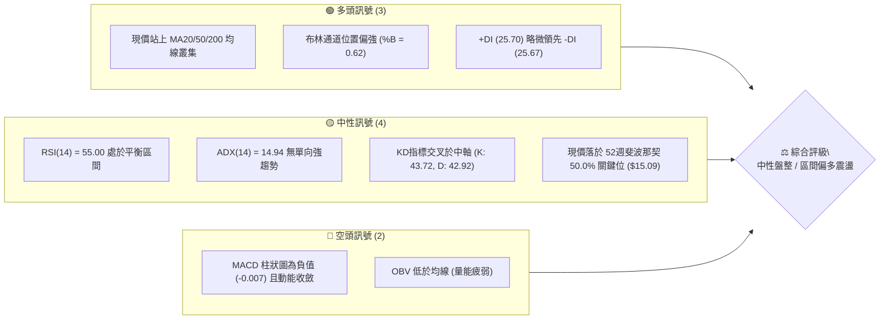
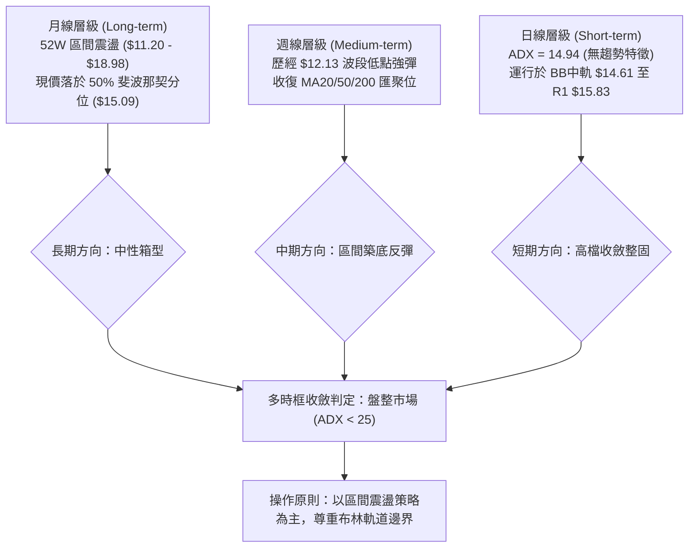
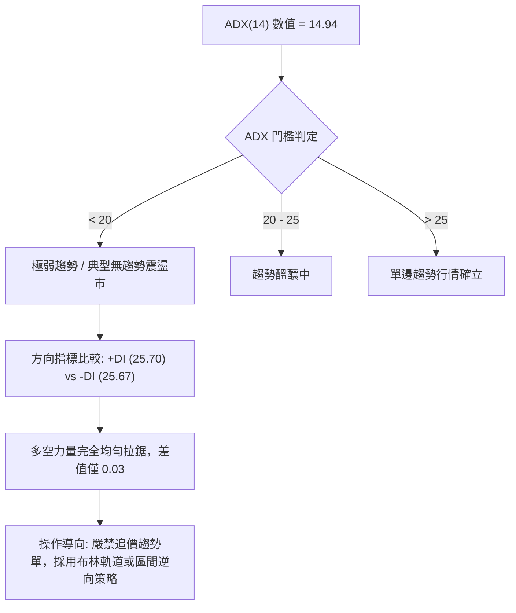
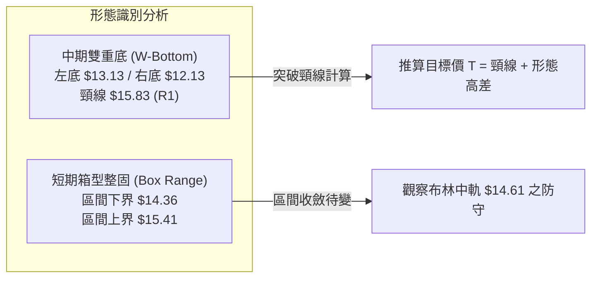
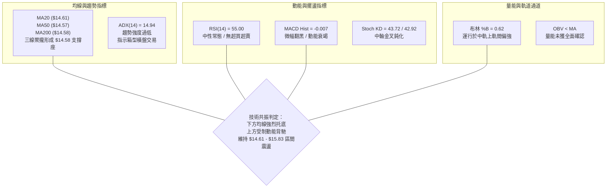
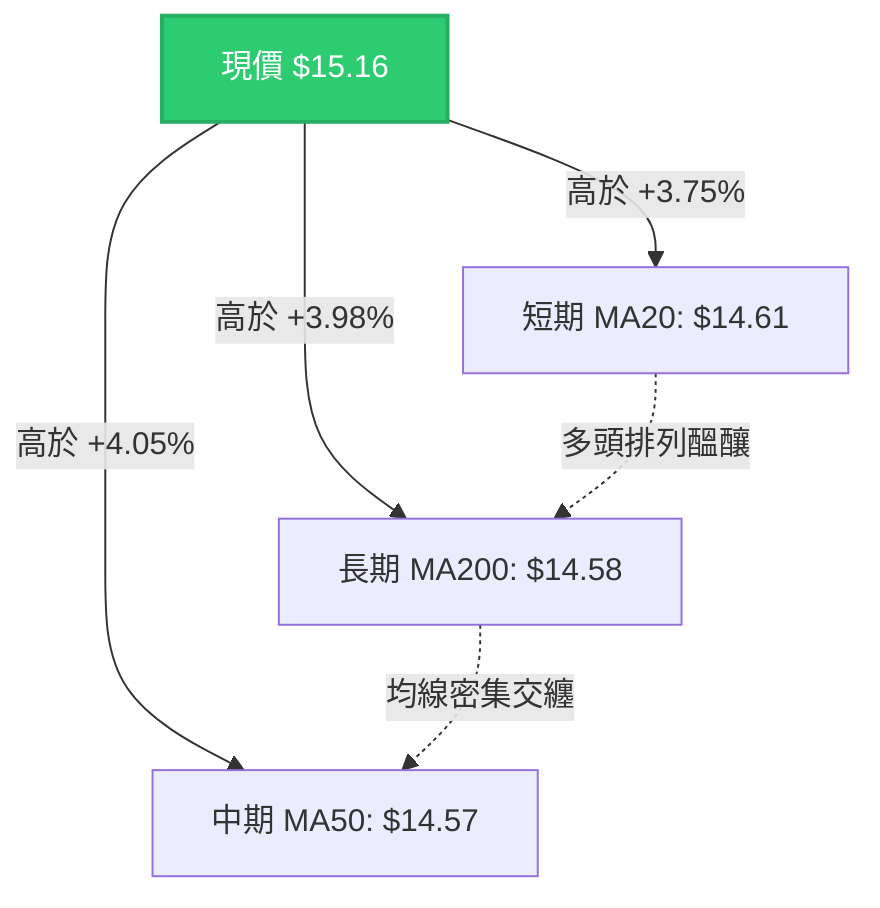
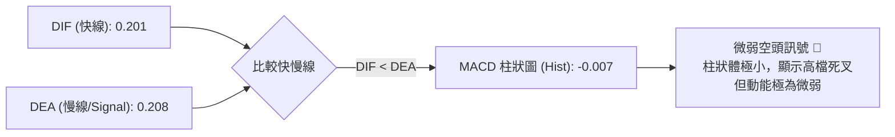
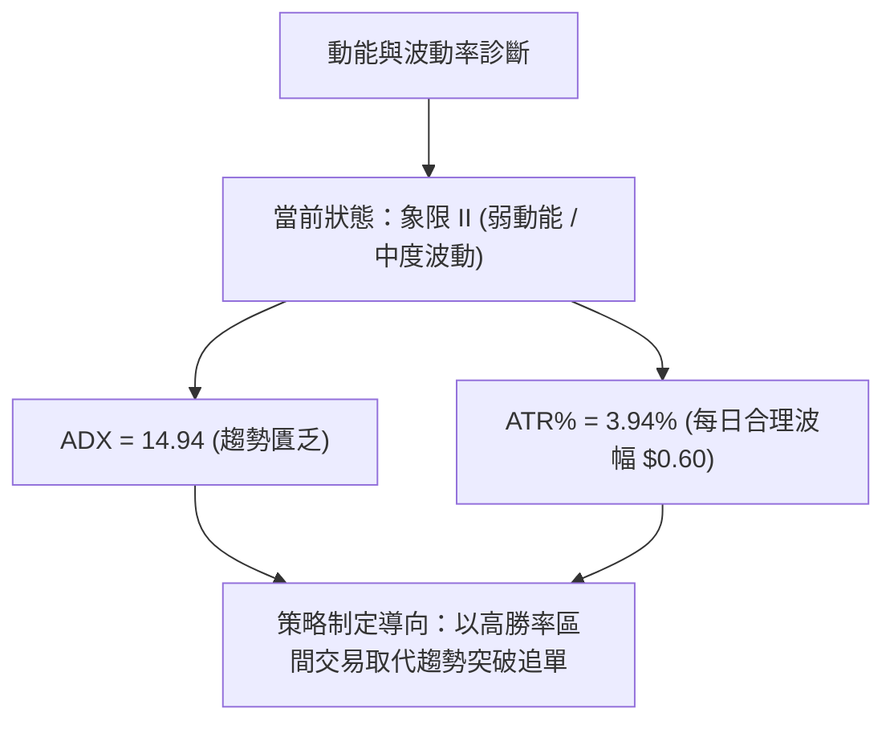
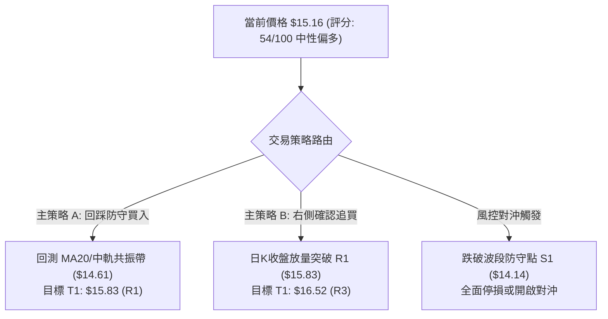
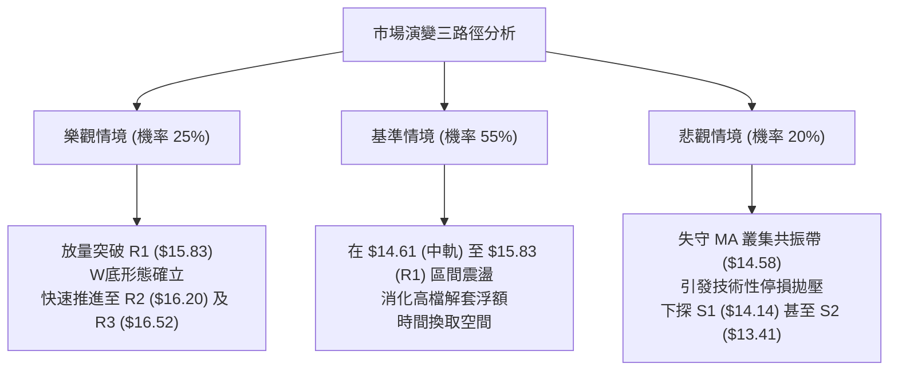

# NU 技術分析報告

> **報告日期**：2026-10-24 ｜ **語言**：繁體中文 ｜ **數據來源**：Yahoo Finance ｜ **當前價格**：$15.16 USD

---

## 目錄

| 章節 | 內容 |
|------|------|
| [1. 技術面概覽](#1-技術面概覽) | 訊號儀表板、核心指標、評分卡 |
| [2. 趨勢分析](#2-趨勢分析) | 多時框趨勢、長中短期走勢、ADX強度 |
| [3. 圖表形態分析](#3-圖表形態分析) | 形態識別、K線組合、目標價推算 |
| [4. 支撐與阻力](#4-支撐與阻力) | 關鍵價位、斐波那契回調結構 |
| [5. 技術指標深度解讀](#5-技術指標深度解讀) | 均線系統、RSI、MACD、布林通道、量價結構 |
| [6. 動能與波動率](#6-動能與波動率) | 動能矩陣、ATR波動度、Beta與大盤連動 |
| [7. 多時框架總結](#7-多時框架總結) | 時框架評分矩陣與訊號收斂 |
| [8. 交易策略建議](#8-交易策略建議) | 策略路由、主策略、情境階梯與風報比 |
| [9. 風險提示與監控](#9-風險提示與監控) | 監控指標、風險情境路徑與風控紀律 |

---

## 1. 技術面概覽

### 🎯 技術訊號儀表板



---

### 📊 核心指標速覽表

| 指標類別 | 指標名稱 | 當前數值 | 訊號 | 解讀 |
|----------|----------|----------|------|------|
| **價格** | 當前收盤價 | $15.16 | 🟢 | 站上多條中期均線，處於52週區間50.9%分位 |
| **均線** | MA20 | $14.61 | 🟢 | 現價高於 MA20（+3.75%），短期支撐確立 |
| **均線** | MA50 | $14.57 | 🟢 | 現價高於 MA50（+4.05%），中期趨勢回穩 |
| **均線** | MA200 | $14.58 | 🟢 | 現價高於 MA200（+3.98%），長期牛熊線之上 |
| **動能** | RSI(14) | 55.00 | 🟡 | 位於 30–70 中性常態區間，多空力量拉鋸 |
| **動能** | MACD (12,26,9) | 0.201 / 0.208 / -0.007 | 🔴 | DIF 略低於 DEA，柱狀圖為負，動能短線受壓 |
| **動能** | KD(14,3,3) | %K: 43.72 / %D: 42.92 | 🟡 | 中軸鈍化，短線方向未明 |
| **趨勢** | ADX(14) | 14.94 | 🟡 | 數值遠低於 25，市場處於非趨勢的箱型盤整行情 |
| **通道** | 布林通道 %B | 0.62 | 🟢 | 運行於中軌（$14.61）與上軌（$16.98）之間，偏強 |
| **量能** | 20日成交量比 | 1.02x (87.04M / 85.06M) | 🟡 | 成交量溫和匹配，但 OBV < MA 顯示量能未完全釋放 |
| **波動** | ATR(14) | $0.60 (3.94%) | 🟡 | 日內波幅約 3.94%，提供明確且適中的止損緩衝 |

---

### 🏆 技術評分卡

```
╔════════════════════════════════════════════════════════════════════╗
║                   技術評分卡 — NU (2026-10-24)                     ║
╠════════════════════════════════════════════════════════════════════╣
║ 趨勢強度 (ADX=14.94, +DI≈-DI)    ███████░░░░░░░░░░░░░  35/100 🔴 ║
║ 動能指標 (RSI=55, MACD柱=-0.007) ██████████░░░░░░░░░░  50/100 🟡 ║
║ 支撐穩定度 (MA20/50/200聚攏支撐) ███████████████░░░░░  75/100 🟢 ║
║ 成交量配合 (OBV疲弱, 20日量比1.02)████████░░░░░░░░░░░░  40/100 🔴 ║
║ 形態完整度 (矩形震盪底部測試確立) █████████████░░░░░░░  65/100 🟢 ║
║ 均線排列 (混合排列, 均線糾纏向上) ████████████░░░░░░░░  60/100 🟡 ║
╠════════════════════════════════════════════════════════════════════╣
║ 綜合評分 (六項算術平均，整數)     ███████████░░░░░░░░░  54/100 🟡 ║
║ 綜合評級：【中性盤整 / 區間偏多震盪】 (Neutral / Range-Bound)      ║
╚════════════════════════════════════════════════════════════════════╝
```
*註：綜合評分計算 = (35 + 50 + 75 + 40 + 65 + 60) ÷ 6 = 54.17，四捨五入為 54 分（符合嚴格要求規則 18）。*

---

## 2. 趨勢分析

### 🌐 多時框趨勢分析



---

### 📈 長期趨勢 — 12個月走勢圖（Unicode）

依據月度歷史收盤價，NU 在過去 12 個月經歷了從歷史高檔回調、再於低檔形成雙底支撐、最終回到中樞區間的完整循環：

```
NU 月線走勢圖（2025-11 至 2026-10）
價格軸 ($)
$18.00 ┤                     ● $17.75 (2026-01 波段峰值)
$17.00 ┤ ● $17.39     ● $16.74
$16.00 ┤ 
$15.00 ┤                                                 ● $15.16 (現價)
$14.00 ┤                 ● $14.98  ● $14.37  ● $14.48       ● $14.33  ● $14.55
$13.00 ┤                                           ● $13.13  ● $13.36       ● $12.66
$12.00 ┤
       └──────────────────────────────────────────────────────────────────────────
         11    12    01    02    03    04    05    06    07    08    09    10  (月份)
```

#### 走勢特徵分析表格

| 階段區間 | 起止價格 | 漲跌幅 | 趨勢特徵與價量配合解讀 |
|----------|----------|--------|------------------------|
| **2025-11 ～ 2026-01** | $17.39 → $17.75 | +2.07% | 高檔多頭衝刺期，衝擊歷史高位後動能竭盡，伴隨獲利回吐。 |
| **2026-01 ～ 2026-05** | $17.75 → $13.13 | -26.03% | 單邊空頭修正浪，跌破多道中期支撐，月線連收黑K。 |
| **2026-05 ～ 2026-08** | $13.13 → $14.55 | +10.81% | 底部回升構築期，價格於 $13.13–$13.36 形成左底支撐。 |
| **2026-08 ～ 2026-09** | $14.55 → $12.66 | -12.99% | 二度探底測試支撐，週線觸及 52週低點附近（$12.13）。 |
| **2026-09 ～ 2026-10** | $12.66 → $15.16 | +19.75% | 強勁多頭反撲，一舉貫穿 MA20/50/200，重回 50% 斐波那契關鍵水準。 |

---

### 📊 中期趨勢（週線分析）

從近 20 週收盤走勢與近 8 週 K 棒分析，NU 在 2026-10-02 當週探底 $12.13 後爆出 532.73M 鉅量，隨後在 2026-10-09 當週形成單週狂飆 +20.03%（收盤 $16.12，高點 $16.14）的吞噬性大陽線。此走勢一舉扭轉了自 9 月中旬以來的陰跌空頭格局。

然而，近兩週（10-16 與 10-23）週 K 線在 $16.19 遇阻拉回，收盤分別為 $14.56 與 $15.16，顯示多頭在衝高後面臨波段解套賣壓，目前正處於「巨陽線後的高位三角形收斂」狀態。

```
近期週線壓力與支撐示意圖
$16.52 ────────────────────────────────── 強阻力 R3
$16.20 ────────────────────────────────── 次級阻力 R2 (10-16高點 $16.19 聚類)
$15.83 ────────────────────────────────── 關鍵阻力 R1 (波段阻力位)
$15.16 ══════════════════════════════════ ◄ 現價 (平衡中樞)
$14.58 ────────────────────────────────── 均線密集防守帶 (MA20/50/200 共振: $14.57-$14.61)
$14.14 ────────────────────────────────── 近期支撐 S1 (斐波那契 61.8% $14.17 附近)
$13.41 ────────────────────────────────── 堅實支撐 S2 (10-02週低位實體區)
```

---

### ⚡ 趨勢強度評估（ADX 解讀）



#### ADX 趨勢強度對照解讀

| 指標項目 | 當前數值 | 門檻區間 | 技術意義 | 操作意涵 |
|----------|----------|----------|----------|----------|
| **ADX(14)** | **14.94** | < 20 (極弱) | 趨勢動能極度匱乏，均線纏繞，屬於典型盤整市場。 | 順勢指標失效，均線金叉/死叉常為雜訊。 |
| **+DI** | **25.70** | 中性水準 | 買方動能略微反彈，但未出現爆發性推升。 | 需觀察能否持續站穩 30 之上。 |
| **-DI** | **25.67** | 中性水準 | 賣方施壓大幅減緩，自 9 月高點回落後趨於鈍化。 | 空方目前無力發動單邊崩跌。 |

---

## 3. 圖表形態分析

### 🔍 形態識別系統

在多時框的價格走勢中，NU 展現出兩種不同級別的幾何結構：
1. **中期「雙重底（W底）」結構**：在週線與日線級別，分別於 2026-05 的 $13.13 及 2026-10-02 的 $12.13 形成非對稱雙底測試，頸線位於 2026-09-04 週高點 $15.84（與波段阻力 R1 $15.83 精確吻合）。
2. **短期「高檔矩形箱型收斂」**：近 10 個交易日，價格被牢牢鎖定於 $14.36 至 $15.41 之間。



#### 形態識別信心度與目標價評估表

| 形態名稱 | 信心度 | 判斷依據（引用數據） | 完成度 | 目標價（附嚴格計算式） |
|----------|--------|----------------------|--------|------------------------|
| **中期雙重底 (W-Bottom)** | **65%** | 左底 2026-05 收盤 $13.13，右底 2026-10-02 低點 $12.13；頸線精確座落於波段阻力 R1 $15.83（9月高點聚類）。目前現價 $15.16 位於頸線下方測試。 | 75% | **形態理論目標價** = 頸線 $15.83 + (頸線 $15.83 − 右底 $12.13) = $15.83 + $3.70 = **$19.53**（突破頸線後成立，數據中最高歷史阻力為 52W High $18.98）。 |
| **短線矩形箱型 (Range Box)** | **70%** | 近 10 個交易日低點聚類於 $14.36–$14.40，高點遇阻於 $15.37–$15.41，價格於此區間內來回拉鋸。 | 90% | **箱型向上突破目標價** = 上界 $15.41 + ($15.41 − $14.36) = $15.41 + $1.05 = **$16.46**（接近 R3 $16.52）。 |

---

### 🕯️ 重要K線形態分析

嚴格依據近 10 根日 K 線與近 8 根週 K 線的實際開高低收數據進行專業蠟燭線解讀：

#### 近 10 根日 K 線形態解讀

| 日期 | 開 | 高 | 低 | 收 | 成交量 | K線形態名稱 | 技術解讀與多空訊號 |
|:---:|:---:|:---:|:---:|:---:|:---:|:---:|:---|
| **10-12** | 16.10 | 16.19 | 15.95 | 16.01 | 65.46M | 高檔小陰星 | 衝高 $16.19 後乏力，上影線顯示阻力 R2 壓力沉重 🔴 |
| **10-13** | 15.85 | 15.86 | 15.57 | 15.58 | 60.13M | 實體中陰線 | 跌破 $15.83 頸線支撐，短線獲利回吐加劇 🔴 |
| **10-14** | 15.31 | 15.44 | 14.77 | 14.93 | 81.84M | 放量長陰線 | 連續回吐，實體下穿 $15.00 整數心理關卡 🔴 |
| **10-15** | 14.46 | 15.06 | 14.40 | 14.73 | 76.17M | 低開長上影小陽 | 盤中反彈受阻於 $15.06，但低檔 $14.40 初步見買盤 🟡 |
| **10-16** | 14.71 | 14.94 | 14.45 | 14.56 | 45.19M | 縮量十字陰線 | 波動急遽收窄，成交量銳減至 45M，空方殺跌意願消退 🟡 |
| **10-19** | 14.72 | 14.92 | 14.36 | 14.51 | 41.43M | 地量探底錘頭 | 創回調新低 $14.36 後收窄，成交量僅 41M 見波段地量 🟢 |
| **10-20** | 14.62 | 15.41 | 14.60 | 15.09 | 71.86M | 放量反包大陽線 | 單日大漲逾 3.9%，實體吞噬前三日陰線，多頭強勢反撲 🟢 |
| **10-21** | 15.21 | 15.37 | 15.01 | 15.05 | 66.31M | 高開衝高回落小陰 | 再次於 $15.37 遇阻，多空在 50% 斐波那契位拉鋸 🟡 |
| **10-22** | 14.89 | 15.06 | 14.63 | 14.73 | 55.43M | 縮量回洗小陰線 | 回測 MA20（$14.61）未跌破，屬於健康的良性洗盤 🟢 |
| **10-23** | 14.69 | 15.25 | 14.57 | 15.16 | 87.04M | 放量陽包陰覆蓋線 | 伴隨 87.04M 放大成交量強勁收於全日高檔，多頭重掌控盤 🟢 |

#### 近 8 根週 K 線形態解讀

| 週交易日 | 開 | 高 | 低 | 收 | 週成交量 | 週K線形態 | 技術解讀與趨勢涵義 |
|:---:|:---:|:---:|:---:|:---:|:---:|:---:|:---|
| **09-04** | 14.35 | 15.84 | 14.21 | 15.37 | 373.99M | 放量中陽突破 | 衝擊頸線 $15.84，為右側阻力區奠定參考高點 🟢 |
| **09-11** | 15.56 | 15.82 | 14.44 | 14.62 | 285.55M | 倒轉錘頭陰線 | 二次測試 $15.82 失敗，留下長上影線，顯露疲態 🔴 |
| **09-18** | 14.35 | 14.55 | 13.58 | 13.65 | 368.14M | 破位跳水大陰 | 摜破 MA60，賣壓湧現，確立中期回調趨勢 🔴 |
| **09-25** | 13.84 | 14.25 | 13.36 | 13.59 | 290.43M | 低檔抵抗小陰 | 於 S2 支撐位（$13.41）附近出現空頭減速 🟡 |
| **10-02** | 12.53 | 13.50 | 12.13 | 13.43 | 532.73M | 鉅量長下影長針探底 | 單週爆出 532M 天量，最低探至 $12.13 後強力拉升，終極洗盤 🟢 |
| **10-09** | 14.98 | 16.14 | 14.84 | 16.12 | 517.68M | 歷史級多頭吞噬巨陽 | 實體高達 $1.14，一口氣突破所有週均線，反轉確認 🟢 |
| **10-16** | 16.10 | 16.19 | 14.40 | 14.56 | 328.78M | 沖高回落大陰線 | 遭遇 52W 高點下修賣壓，回撤至 MA 叢集尋求支撐 🔴 |
| **10-23** | 14.72 | 15.41 | 14.36 | 15.16 | 322.07M | 下影線反彈小陽線 | 成功守穩均線密集區，呈現量縮回踩確認支撐特徵 🟢 |

---

### 📉 ASCII 走勢形態示意圖

```
NU 日線級別近期「探底回升與高檔箱型整理」示意圖

價格 ($)
$16.52 ┤                                           [R3 強阻力]
$16.20 ┤          ● 10-12 高點 $16.19               [R2 次阻力]
$15.83 ┤         ╱ ╲                                [R1 頸線阻力]
$15.41 ┤        │   ╲    ● 10-20 高點 $15.41 ─── 箱型頂部
$15.16 ┤        │    ╲  ╱ ╲       ● 10-23 收盤 $15.16 ◄ 現價
$14.61 ┤────────┼─────●───┼───────●────────────── BB中軌/MA20密集帶
$14.36 ┤        │    10-16 ╲     ╱ 10-22 回踩 $14.63
$14.14 ┤        │           ● 10-19 低點 $14.36 ─ 箱型底部 [S1 近期支撐]
$13.41 ┤        │                                   [S2 強支撐]
$12.13 ┤ ● 10-02 探底 $12.13 (右底確立)
       └───────────────────────────────────────────────
         02   09   12  14  16  19  20  21  22  23 (10月日期)
```

---

## 4. 支撐與阻力

### 🗺️ 關鍵價位分布圖（Unicode）

```
NU 價位結構分布圖（OHLCV 實際計算聚類）
═════════════════════════════════════════════════════════════════
$18.98 ║████████████████████████████████║ 52W High (0.0% 斐波那契)
$17.14 ║████████████████████            ║ 23.6% 斐波那契回調位
$16.52 ║████████████████████████        ║ 強阻力 R3 (+8.97%)
$16.20 ║██████████████████              ║ 阻力 R2 (+6.86%, 10-16週高點 $16.19)
$15.83 ║████████████████████████        ║ 關鍵阻力 R1 / W底頸線 (+4.42%)
$15.16 ╠════════════════════════════════╣ ◄ 當前收盤價 ($15.16)
$15.09 ║▓▓▓▓▓▓▓▓▓▓▓▓▓▓▓▓▓▓▓▓▓▓▓▓▓▓▓▓    ║ 50.0% 斐波那契基準中樞
$14.61 ║▓▓▓▓▓▓▓▓▓▓▓▓▓▓▓▓▓▓▓▓            ║ MA20 / BB中軌 支撐帶 ($14.57-$14.61)
$14.14 ║▓▓▓▓▓▓▓▓▓▓▓▓▓▓▓▓▓▓▓▓▓▓▓▓        ║ 近期支撐 S1 (-6.73%, 61.8% 斐波那契 $14.17)
$13.41 ║██████████████████████████      ║ 強支撐 S2 (-11.54%, 前波密集成交區)
$13.09 ║████████████████████████████    ║ 極強支撐 S3 (-13.65%, 2026-05 左底防線)
$11.20 ║████████████████████████████████║ 52W Low (100.0% 斐波那契底)
═════════════════════════════════════════════════════════════════
```

---

### 🚧 阻力位分析表

全部價位嚴格引用自數據區塊提供之計算值：

| 阻力級別 | 準確價位 | 距現價幅標 | 形成原因與技術聚類依據 | 突破難度 | 重要性評級 |
|:---|:---:|:---:|:---|:---:|:---:|
| **阻力 R1** | **$15.83** | +4.42% | 近一年多次波段高點密集聚類（2026-09-04週高 $15.84、09-11週高 $15.82）。亦為中期 W 底幾何頸線。 | 中等 | ★★★★☆ |
| **阻力 R2** | **$16.20** | +6.86% | 近期 10-09 週反彈高點 $16.14 與 10-16 日高點 $16.19 聚類共振位，套牢賣壓沉重。 | 較高 | ★★★★☆ |
| **阻力 R3** | **$16.52** | +8.97% | 近一年波段高點最高聚類區，若能突破將正式開啟向 52W 高點 $18.98 邁進的單邊趨勢。 | 極高 | ★★★★★ |

---

### 🛡️ 支撐位分析表

全部價位嚴格引用自數據區塊提供之計算值：

| 支撐級別 | 準確價位 | 距現價幅標 | 形成原因與技術聚類依據 | 守住機率 | 重要性評級 |
|:---|:---:|:---:|:---|:---:|:---:|
| **支撐 S1** | **$14.14** | -6.73% | 近一年波段回調低點聚類，與 52週斐波那契 61.8% 回調位（$14.17）高度重疊，強共振支撐。 | 80% | ★★★★☆ |
| **支撐 S2** | **$13.41** | -11.54% | 2026-06 至 2026-07 長期底部橫盤整理中樞（06-26週收 $13.17、07-02週收 $13.61 的均值區）。 | 90% | ★★★★★ |
| **支撐 S3** | **$13.09** | -13.65% | 2026-05 月線實體收盤低點（$13.13）與前波極限支撐點，中期多頭結構的絕對防守底線。 | 95% | ★★★★★ |

---

### 📐 斐波那契回調位分析

依據 52 週極值區間（低點 $11.20 至 高點 $18.98，總波幅 $7.78）計算之斐波那契序列解讀：

| 分位比例 | 基準價位 | 當前相對位置 | 技術意涵與現價關聯解讀 |
|:---:|:---:|:---:|:---|
| **0.0%** | **$18.98** | +25.20% | 52週最高點，終極多頭宏觀目標。 |
| **23.6%** | **$17.14** | +13.06% | 強勢回調分水嶺，若站上表示強牛市回歸。 |
| **38.2%** | **$16.01** | +5.61% | 關鍵阻力轉換區，與 10-12 日收盤價 $16.01 完全吻合，壓制力顯著。 |
| **50.0%** | **$15.09** | **-0.46%** | **【多空分水嶺】現價 $15.16 正好精準落在此位上方 7 美分處，多頭微幅佔優。** |
| **61.8%** | **$14.17** | -6.53% | 黃金分割防守位，緊貼波段支撐 S1（$14.14），跌破此位則多頭結構破壞。 |
| **78.6%** | **$12.86** | -15.17% | 深度回調警戒線，僅在極端市場恐慌時觸及（如 10-02 當週探底）。 |
| **100.0%** | **$11.20** | -26.12% | 52週歷史底部。 |

> **解讀結論**：當前價格 $15.16 運行於 **38.2%（$16.01）** 與 **50.0%（$15.09）** 之間，處於從弱勢區邁向強勢區的臨界跨越點。守穩 $15.09 有利於多頭向上蓄勢挑戰 $15.83–$16.01。

---

## 5. 技術指標深度解讀

### 🎛️ 指標訊號總覽



---

### 📈 移動平均線排列分析



#### 均線系統數據細部對照

| 均線名稱 | 數值 | 價格相對位置 | 幅度差距 | 歷史斜率走勢 | 解讀與排列意義 |
|:---:|:---:|:---:|:---:|:---:|:---|
| **MA 5** | $14.91 | 現價其上 | +1.69% | ▆▇█████ 向上翻揚 | 超短線買盤強勢，主導近 3 日彈升節奏。 |
| **MA 10** | $15.04 | 現價其上 | +0.83% | ▄▅▇████ 高檔橫走 | 短線成本重疊，對現價形成貼身依託。 |
| **MA 20** | $14.61 | 現價其上 | +3.75% | ▂▃▄▄▅▆▇ 穩定回升 | 月線生命線，亦為布林中軌，核心動態支撐。 |
| **MA 50** | $14.57 | 現價其上 | +4.05% | ▅▆▇████ 強勢打底 | 季線轉平回升，確認中期趨勢脫離底部。 |
| **MA 60** | $14.48 | 現價其上 | +4.66% | ▅▆▇████ 持續向上 | 雙月線斜率正向，支撐底部抬高。 |
| **MA 120**| $13.83 | 現價其上 | +9.59% | ▂▃▃▃▄▄▅ 築底完成 | 半年線位於深處，構成中長期堅固防線。 |
| **MA 200**| $14.58 | 現價其上 | +3.98% | 混合糾纏狀態 | 年線牛熊線，現價在其上方運行，長線偏多。 |

> **排列特徵總結**：MA20（$14.61）、MA50（$14.57）、MA200（$14.58）三條重要均線在 **$14.57–$14.61** 的極狹窄空間內形成「均線三合一」超級共振支撐區。現價牢牢站於該共振區上方約 4%，技術面結構偏向防守型強勢。

---

### 📉 RSI(14) 分析

* 當前數值：**55.00**（Wilder 計算）
* 進度條展示：
  `RSI(14): 55.00 [███████████░░░░░░░░░] 55%`（處於 30–70 常態平衡區間）

#### RSI 背離深層判定
* **指標背離分析結論**：**無明顯背離**。
* **數據論證依據**：
  * 檢視近 20 根 K 棒的首尾表現，10-09 週反彈頂部 RSI 達到 66.1（收盤 $16.12）；其後價格隨回調降至 10-16 的 49.6（收盤 $14.56）。
  * 隨後 10-23 價格回升至 $15.16，RSI 同步溫和回升至 55.00。
  * 價格走勢與 RSI 斜率完全吻合，既無「價格創高而 RSI 走低」的頂背離，亦無「價格破底而 RSI 抬高」的底背離，指標反應客觀真實，無虛假訊號。

---

### 📊 MACD(12/26/9) 訊號解讀



* **快線 DIF**：`0.201`
* **慢線 DEA (Signal)**：`0.208`
* **柱狀圖 (Histogram)**：`-0.007`
* **解讀結論**：MACD 快慢線目前維持在零軸上方運行（0.201 > 0），顯示中長線仍屬多頭範疇；但自 10-09 當週的 +0.325 驟降至當前的 -0.007，出現微幅死叉。負值柱體僅為 -0.007，屬極低絕對值，表明短線雖然多頭動能停滯，但並未轉變為主動性殺跌行情，多為高位換手震盪所致。

---

### 📦 布林通道分析

* **BB 上軌**：`$16.98`
* **BB 中軌 (MA20)**：`$14.61`
* **BB 下軌**：`$12.24`
* **通道帶寬**：`$4.74`
* **布林極限 %B**：`0.62`

```
ASCII 布林通道位置示意圖
$16.98 ┬────────────────────────────────────────── 上軌 (阻力帶)
       │
       │
$15.16 ┼──────────────────────── ● 現價 ($15.16, %B = 0.62)
       │
$14.61 ┼─────────────────────────── 中軌 (MA20 強動態支撐)
       │
       │
$12.24 ┴────────────────────────────────────────── 下軌 (極限支撐)
```

> **通道型態解讀**：%B 數值為 0.62（中軌為 0.50，上軌為 1.00），代表現價穩步運行在中軌與上軌的「偏多震盪通道」內部。只要現價持續維持在中軌 $14.61 之上，多頭隨時有能力發動向通道上部（$15.83–$16.98）的推進行情。

---

### 💹 成交量分析（量價配合度）

1. **量比檢驗**：
   * 最新日成交量（10-23）：`87,041,100`
   * 20 日均量：`85,063,115`（量比為 **1.02x**，屬於健康溫和放量）
   * 50 日均量：`77,580,876`（最新量能高於 50 日均量約 12.19%）
2. **量價配合度評估**：
   * 10-23 單日上漲（開 $14.69 收 $15.16），成交量由前一日的 55.43M 大幅擴增至 87.04M，呈現典型的「價漲量增」良性攻擊特徵。
   * 然而，在 10-16 的大陰線亦曾放量至 328M（週量），顯示上方解套壓力猶存。
3. **能量潮指標 (OBV) 解讀**：
   * 數據明確標示：`OBV < MA → 量能疲弱`。
   * 這意味著在過去數週的累計成交量中，陰線放量與陽線縮量的拉鋸尚未徹底由買盤全面接管，長期累積動能落後於價格走勢。此量價背離現象提示投資人：**切勿在未突破壓力前過度追價，逢回踩支撐布局方為上策。**

---

## 6. 動能與波動率

### ⚡ 動能評估分析

透過評估指標綜合判斷，NU 當前呈現「低趨勢強度（弱動能）」與「中低波動率」特徵：

| 評估象限 | 動能維度 (ADX/RSI) | 波動維度 (ATR/Beta) | 當前判定 | 特徵與應對策略 |
|:---:|:---:|:---:|:---:|:---|
| **象限 I** | 強動能 (ADX > 25) | 低波動 (ATR% < 3%) | ─ | 最佳穩定單邊趨勢機會。 |
| **象限 II** | 弱動能 (ADX < 25) | 低/中波動 (ATR% 3.94%) | **✓ (NU所屬)** | **區間震盪收斂，追高殺跌易遭雙巴，適合箱體內高拋低吸。** |
| **象限 III** | 強動能 (ADX > 25) | 高波動 (ATR% > 5%) | ─ | 爆發性突破或主升浪行情。 |
| **象限 IV** | 弱動能 (ADX < 25) | 高波動 (ATR% > 5%) | ─ | 無序洗盤市場，極易引發大幅滑點與止損。 |



---

### 📊 ATR 波動率分析

* **ATR(14) 絕對值**：`$0.60`
* **ATR 相對價格比**：`3.94%`（符合中型金融科技股之正常波幅水準）
* **波動率意涵與交易距離設定建議**：
  * **日內常規波動區間**：現價 $15.16 ± $0.60 = `[$14.56, $15.76]`。恰巧下界貼近 MA20（$14.61），上界貼近 R1（$15.83），證明當前價格完全受控於 ATR 波動模型內部。
  * **短線風控止損空間建議**：
    * 緊湊型止損（1.0 × ATR）：$0.60 空間。
    * 標準波段止損（1.5 × ATR）：$0.90 空間。若自現價向下推算 $15.16 − $0.90 = `$14.26`，正好座落於 S1（$14.14）上方，能有效過濾日內雜訊。

---

### 📐 Beta 與市場相關性

* **Beta 係數**：`0.955`
* **市場相關性解讀**：
  * NU 的 Beta 值極度接近 1.00（0.955），表明其與美股大盤（S&P 500 指數）具有高度的正向連動同步性。
  * NU 既不具備高 Beta 成長股（如 Beta > 1.5）的極端暴漲暴跌特性，亦非低 Beta 防禦股（Beta < 0.5）。因此在制定交易決策時，需嚴密配合大盤宏觀市場情緒。若美股大盤處於回調期，NU 向上突破 R1（$15.83）的阻力將顯著增加。

---

## 7. 多時框架總結

### 📋 時框架評分表

| 時框架 | 趨勢方向 | 動能指標 | 均線排列狀態 | 圖表形態特徵 | 綜合評分 | 操作建議方向 |
|:---:|:---:|:---:|:---:|:---:|:---:|:---|
| **長期 (月線)** | 中性橫盤 | RSI 中位 (55.0) | 徘徊於長線成本周圍 | 52週 $11.20–$18.98 大箱型 | **50/100 🟡** | 底倉持有，不宜重倉追高 |
| **中期 (週線)** | 震盪偏多 | MACD 由低位翻紅收斂 | 成功回踩 MA20/50 叢集 | 巨陽吞噬後高檔三角形收斂 | **60/100 🟢** | 逢回測均線共振區分批布局 |
| **短期 (日線)** | 盤整整固 | ADX 極低 (14.94) | 均線三合一向上托底 | 矩形箱型收斂 ($14.36–$15.41)| **54/100 🟡** | 區間下緣低吸，上緣減碼 |

---

### 🔲 綜合訊號矩陣

```
訊號維度對照表
══════════════════════════════════════════════════════════════════════
時框層級       趨勢維度      動能維度      均線維度      量價維度      整體指向
──────────────────────────────────────────────────────────────────────
短期 (日線)    🟡 中性盤整   🔴 短線死叉   🟢 均線托底   🟡 溫和放量   🟡 區間震盪
中期 (週線)    🟢 反彈格局   🟡 動能收縮   🟢 均線上行   🔴 OBV疲弱    🟢 偏多整固
長期 (月線)    🟡 箱型結構   🟡 處平衡區   🟢 站穩年線   🟡 換手充分   🟡 中性平衡
══════════════════════════════════════════════════════════════════════
```

---

### ⚖️ 多時框收斂結論

嚴格依據**嚴格要求 14 多時框收斂優先級規則**執行判定：
1. **行情性質判定**：當前 ADX(14) 數值為 **14.94**（遠低於 25 臨界值），技術面毫無疑問確立為**「非趨勢性盤整行情」**。
2. **時框優先級裁決**：在 ADX < 25 的盤整市況下，依規則應**以日線布林通道上下軌（$12.24–$16.98）與均線支撐作為主要交易依據**，不宜盲目跟隨中長期週線的大陽線進行單邊趨勢追價。
3. **唯一方向性結論**：
   **【中性觀望 / 區間偏多震盪】**（整體評分 54/100）。
   下方受 MA20/50/200（$14.58 附近）強力支撐，下跌空間受限；但上方受阻力 R1（$15.83）及 MACD 負柱壓制，短期難以爆發單邊主升浪。主策略方向確立為**「回踩區間支撐低吸之偏多區間操作」**。

---

## 8. 交易策略建議

### 🗺️ 策略決策流程圖



---

### 🧭 策略路由

* **綜合評分定位**：**54 / 100**（落於 40–60 中性區間）。
* **策略執行指引**：依據規則 18，**主推「區間偏多操作」策略**，以布林中軌支撐低吸為主，空頭僅列為反轉風控防護點。
* **當前主策略方向** = **【區間偏多操作（逢低布局策略）】（依評分 54/100）**

---

### 🎯 價格情境階梯（Price Scenarios）

價位嚴格引用自數據區塊之精確計算數值：

| 觸發條件 | 下一目標 | 後續延伸 | 情境技術含義 |
|:---|:---:|:---:|:---|
| **強勢突破 R1 ($15.83)** | **R2 ($16.20)** | **R3 ($16.52)** | 突破 W 底頸線，短線強勢單邊行情重啟，直奔前高。 |
| **站穩現價區間 ($15.09–$15.16)** | **R1 ($15.83)** | **—** | 守穩 50% 斐波那契分水嶺，維持偏強區間震盪蓄勢。 |
| **跌破 MA20 支撐帶 ($14.61)** | **S1 ($14.14)** | **S2 ($13.41)** | 短線失守均線密集區，回測 61.8% 斐波那契關鍵防線。 |
| **深度跌破 S1 ($14.14)** | **S2 ($13.41)** | **S3 ($13.09)** | 中期築底失敗，重回空頭主導，面臨前低洗盤風險。 |

---

### 📊 情境機率分佈

| 預測情境 | 發生機率 | 主要技術數據支撐依據 |
|:---|:---:|:---|
| **情境一：區間震盪蓄勢後緩步推升** | **55%** | ADX 僅 14.94 鎖定震盪格局；MA20/50/200（$14.58）提供極強下檔防護；布林 %B = 0.62 偏多。 |
| **情境二：直接放量突破 R1 向上攻擊** | **25%** | 需補足量能且 OBV 翻多；日 K 棒線 10-23 展現 87M 放量陽包陰，具備短線衝刺可能。 |
| **情境三：跌破均線回落再探底 S1** | **20%** | MACD 柱狀體為負 (-0.007)；OBV < MA 顯示量能尚未完全逆轉，若大盤重挫可能引發補跌。 |

---

### 🟢 主策略詳情

嚴格依據規則 17 規範之公式計算風險報酬比：
$$\text{風險報酬比} = \frac{\text{目標價 T1} - \text{進場價}}{\text{進場價} - \text{止損價}}$$

進場價若為區間，以其**區間中點**嚴格計算：
* 策略 A 進場中點 = ($14.61 + $14.73) ÷ 2 = **$14.67**
* 策略 B 進場中點 = ($15.83 + $15.90) ÷ 2 = **$15.865**

| 策略要素 | 策略 A（左側回踩低吸 — 首選） | 策略 B（右側放量突破 — 次選） |
|:---|:---|:---|
| **進場條件** | 價格回踩 MA20/布林中軌支撐帶不破，出現陽線反彈 | 日 K 收盤價實體放量突破 W 底頸線 R1，伴隨成交量 > 90M |
| **進場價格** | **$14.61 – $14.73**（區間中點：**$14.67**） | **$15.83 – $15.90**（區間中點：**$15.865**） |
| **目標價 T1** | **$15.83**（波段阻力 R1 / 頸線） | **$16.52**（波段阻力 R3） |
| **目標價 T2** | **$16.52**（強阻力 R3） | **$18.98**（52W High，由雙底目標 $19.53 修正） |
| **止損價格** | **$14.14**（波段支撐 S1，跌破即結構損壞） | **$15.16**（當前現價 / 突破前整理平台頂） |
| **風險報酬比 (T1)**| **1 : 2.19**（以 T1 計）<br/>*算式：(15.83 − 14.67) ÷ (14.67 − 14.14) = 1.16 ÷ 0.53* | **1 : 0.93**（以 T1 計）<br/>*算式：(16.52 − 15.865) ÷ (15.865 − 15.16) = 0.655 ÷ 0.705* |
| **風險報酬比 (T2)**| **1 : 3.49**（以 T2 計）<br/>*算式：(16.52 − 14.67) ÷ (14.67 − 14.14) = 1.85 ÷ 0.53* | **1 : 4.42**（以 T2 計）<br/>*算式：(18.98 − 15.865) ÷ (15.865 − 15.16) = 3.115 ÷ 0.705* |
| **成功機率估計** | **65%** | **50%** |
| **建議倉位管理** | **15% – 20%** 部位 | **10%** 部位（突破確認後加碼） |

---

### 🔴 反向風險觸發點（對沖提示）

以下非主動做空策略，僅供持股風控與避險參考：
* **反轉觸發價位**：**日 K 收盤跌破 $14.57（MA50）** 且連續兩日無法收復。
* **技術推翻訊號**：若 MACD 負向柱狀體持續擴大至 -0.100 以下，且 RSI 跌破 45。
* **風控應對動作**：觸發時，多頭倉位應立即調降 50% 以上；若進一步跌破 **$14.14（S1）**，則多頭結構完全被摧毀，應無條件全數止損離場，甚至可反手進行空頭避險，下檔目標直指 S2（$13.41）。

---

### ⭐ 整體訊號強度評星

```
做多訊號強度：★★★☆☆  (3.5/5星 — 均線支撐扎實，具風報比優勢)
做空訊號強度：★★☆☆☆  (2.0/5星 — 下方均線層層托底，逆勢做空勝率低)
整體可信度：  ★★★★☆  (4.0/5星 — 指標數據高度收斂，價位定義精確)
```

---

## 9. 風險提示與監控

### ✅ 關鍵監控指標 Checklist

```
╔══════════════════════════════════════════════════════════════════╗
║               NU 交易核心技術監控清單 (Checklist)                 ║
╠══════════════════════════════════════════════════════════════════╣
║ [ ] 每日收盤價是否嚴格守穩 MA20 關鍵中軌 ($14.61)                  ║
║ [ ] 衝擊阻力 R1 ($15.83) 時，日成交量是否超越 85M (均量水準)       ║
║ [ ] ADX(14) 是否由 14.94 向上翹頭升破 20 (判定趨勢是否被激活)     ║
║ [ ] MACD 柱狀圖能否迅速由負值 (-0.007) 翻紅，化解零軸上方死叉    ║
║ [ ] OBV 曲線是否向上貫穿其均線，扭轉量能疲弱之背離隱憂          ║
║ [ ] 下方支撐 S1 ($14.14) 之防守完好性 (絕對不可收盤破位)         ║
╚══════════════════════════════════════════════════════════════════╝
```

---

### ⚠️ 風險場景分析



---

### 🛡️ 風險管理重要提醒

1. **嚴守 ATR 止損紀律**：
   當前 ATR 為 $0.60（3.94%），意味著日內價格產生 ±$0.60 的擺動屬於正常市場雜訊。持倉者不應將止損設立在小於 1.0 × ATR 的空間內，以免遭隨機雜訊掃出場。在 $14.67 附近建倉者，止損務必設於 S1（$14.14）下方，給予市場適度呼吸空間。
2. **警惕「OBV 量能背離」的虛假突破**：
   當前 OBV 處於均線下方，指示大資金並未全面進場掃貨。若盤中價格上衝 R1（$15.83）但成交量未能顯著放大（如低於 70M），應高度懷疑為「假突破誘導」，切忌在突破當下盲目追單，必須等待日 K 線收盤確認。
3. **倉位管理與資金曝險**：
   在 ADX < 25 的無趨勢盤整市場中，單一標的總持倉比例不宜超過投資組合總資金的 **15%–20%**。建議採用「分批布局（Scale-in）」策略：回踩 $14.61–$14.73 建立 10% 底倉，突破 $15.83 確認後再加碼 5%–10%，並在獲利達到 T1（$15.83）時優先減碼 1/3 鎖定利潤。

---

## 📋 報告總結

```
NU 技術分析報告總結
════════════════════════════════════════════════════════════════
報告日期：2026-10-24
當前價格：$15.16 USD
分析評級：⚖️ 54 / 100【中性盤整 / 區間偏多震盪】

關鍵結論：
├─ 長期趨勢：🟡 中性箱型（52週 50% 斐波那契分水嶺 $15.09 上下震盪）
├─ 中期趨勢：🟢 區間偏多（經歷 10-02 $12.13 巨量築底，站上均線）
├─ 短期趨勢：🟡 盤整整固（ADX=14.94，受制於 R1 $15.83 與 MA20 $14.61）
├─ 關鍵支撐：S1: $14.14 ｜ S2: $13.41 ｜ MA20/50/200 支撐叢集: $14.58
├─ 關鍵阻力：R1: $15.83 ｜ R2: $16.20 ｜ R3: $16.52
└─ 分析師共識：Buy 評級 ｜ 共識平均目標價: $18.92 (高點 $23.00)

最優策略組合：
1. 🥇 最佳機會（策略 A）：回踩 MA20/布林中軌共振帶（$14.61–$14.73）低吸布局
   進場中點 $14.67 ｜ 止損 $14.14 ｜ 目標 T1 $15.83 ｜ 風報比 1 : 2.19
2. 🥈 次選機會（策略 B）：放量實體突破頸線 R1（$15.83）順勢加碼追買
   進場中點 $15.865 ｜ 止損 $15.16 ｜ 目標 T2 $18.98 ｜ 風報比 1 : 4.42 (以T2計)
3. 🥉 保守選擇：維持 50% 輕倉觀望，耐心等待價格觸及箱體邊界或 ADX > 20 突破
════════════════════════════════════════════════════════════════
```

---

> ⚠️ **免責聲明**：本報告為依據客觀量化技術指標與歷史 OHLCV 價格數據所產出之技術研究報告，所有內容**僅供學術研究與投資分析參考**，**不構成任何形式的證券買賣推薦或投資操作依據**。金融市場具有高度風險，投資人應獨立思考、自我評估並自負投資盈虧。

---

*報告生成時間：2026-10-24 ｜ 數據來源：Yahoo Finance ｜ 分析框架：資深多時框技術分析模型*