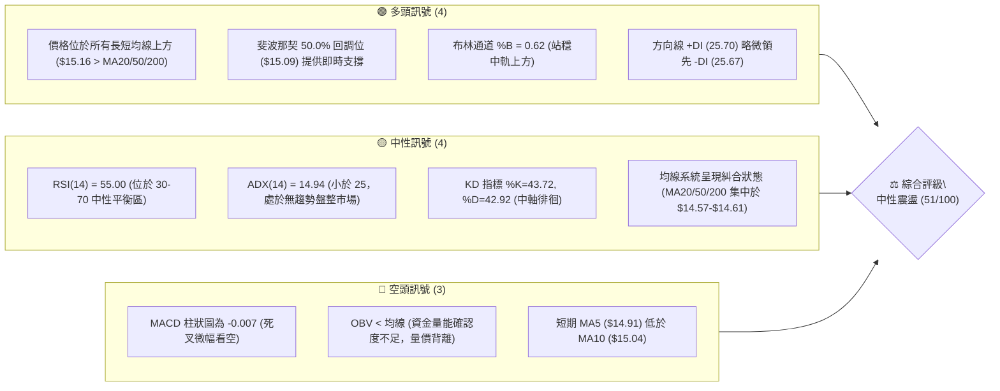
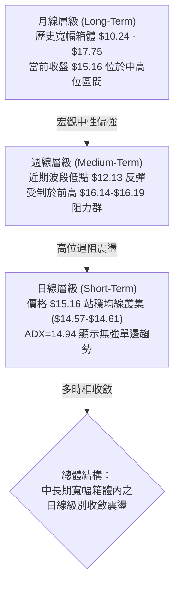
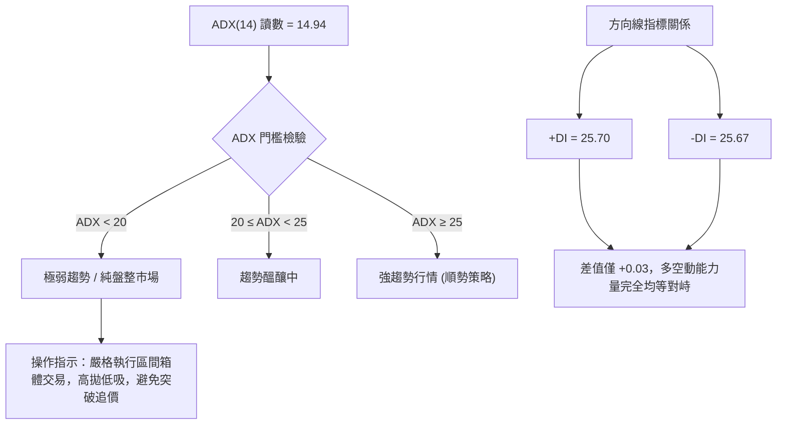
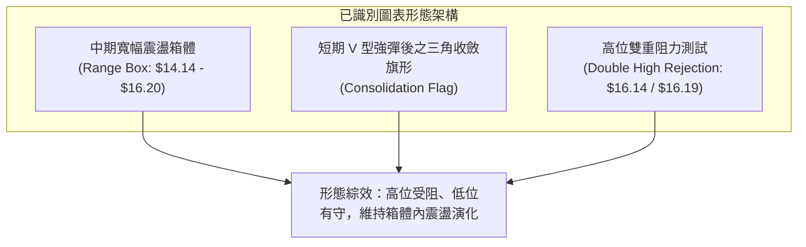
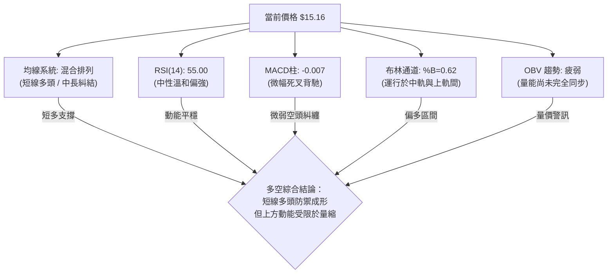
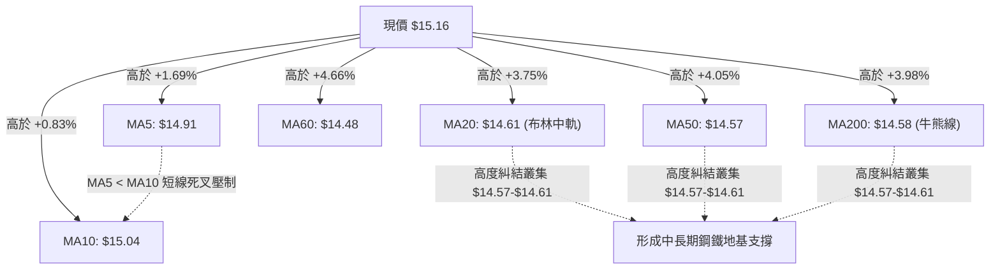
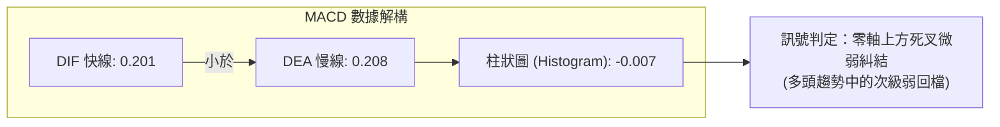
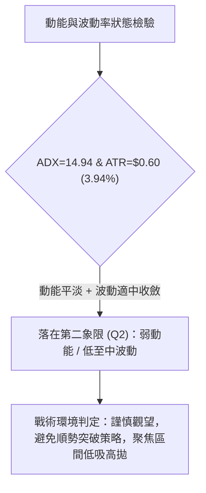
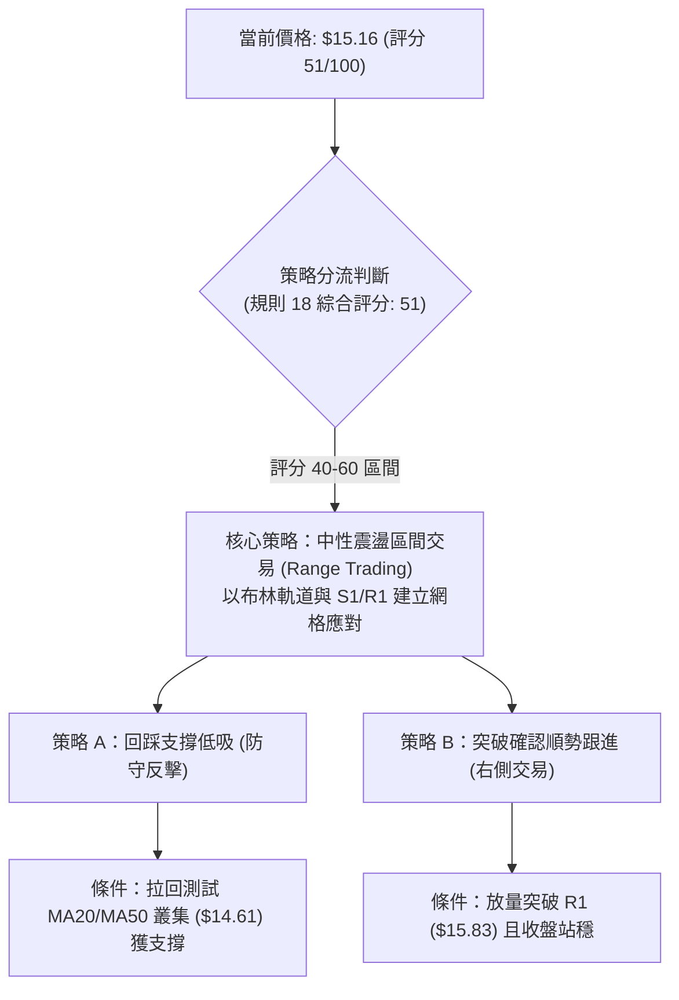
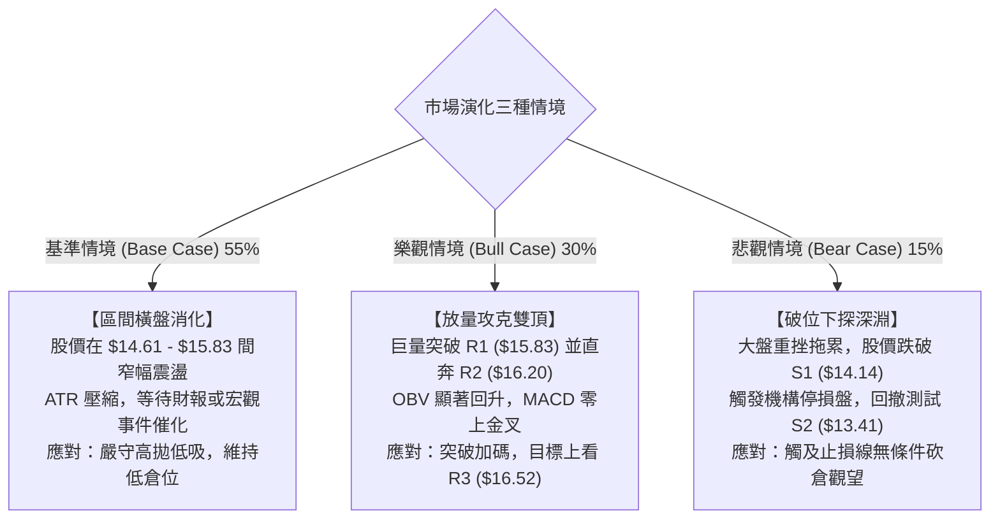

# NU 技術分析報告

> **報告日期**：2026-10-25 ｜ **語言**：繁體中文 ｜ **數據來源**：Yahoo Finance ｜ **當前價格**：$15.16

---

## 目錄

| 章節 | 內容 |
|------|------|
| [1. 技術面概覽](#1-技術面概覽) | 訊號儀表板、核心指標、評分卡 |
| [2. 趨勢分析](#2-趨勢分析) | 多時框趨勢、長中短期走勢 |
| [3. 圖表形態分析](#3-圖表形態分析) | 形態識別、K線組合、目標價 |
| [4. 支撐與阻力](#4-支撐與阻力) | 關鍵價位、斐波那契回調 |
| [5. 技術指標深度解讀](#5-技術指標深度解讀) | MA/RSI/MACD/布林/成交量 |
| [6. 動能與波動率](#6-動能與波動率) | 動能評估、ATR、Beta |
| [7. 多時框架總結](#7-多時框架總結) | 時框架評分矩陣 |
| [8. 交易策略建議](#8-交易策略建議) | 多空策略、風險報酬比 |
| [9. 風險提示與監控](#9-風險提示與監控) | 監控指標、風險場景 |

---

## 1. 技術面概覽

### 🎯 技術訊號儀表板



### 📊 核心指標速覽表

| 指標類別 | 指標名稱 | 當前數值 | 訊號 | 解讀 |
|:---|:---|:---|:---:|:---|
| **價格** | 當前價格 | $15.16 | 🟢 | 站上 52 週中軸區間 (50.9%)，短期反彈至均線群上方 |
| **均線** | MA20 | $14.61 | 🟢 | 價格高於 MA20 (+3.75%)，短期波段偏多保護 |
| **均線** | MA50 | $14.57 | 🟢 | 價格高於 MA50 (+4.05%)，中期基底穩固 |
| **均線** | MA200 | $14.58 | 🟢 | 價格高於 MA200 (+3.98%)，長期牛熊分界線未失守 |
| **動能** | RSI(14) | 55.00 | 🟡 | 位於中性區域，動能平穩無極端超買或超賣 |
| **動能** | MACD (12,26,9) | 0.201 / Sig 0.208 | 🔴 | MACD 線微幅下穿訊號線，柱狀圖 -0.007 呈微弱偏空修正 |
| **波動** | ATR(14) | $0.60 | 🟡 | 佔股價 3.94%，波動幅度適中，盤整壓縮特徵顯著 |
| **趨勢** | ADX(14) | 14.94 | 🟡 | 低於 25 臨界值，確認市場處於無方向箱體震盪 |
| **通道** | 布林通道 | 上 $16.98 / 下 $12.24 | 🟢 | %B 為 0.62，股價運行於中軌 ($14.61) 與上軌之間 |
| **量能** | 20日均量比 | 1.02x | 🟡 | 最新量 87.04M 微幅超越均量 85.06M，但 OBV 偏弱 |

### 🏆 技術評分卡

```
╔══════════════════════════════════════════════════════════════╗
║                 技術評分卡 — NU (2026-10-25)                 ║
╠══════════════════════════════════════════════════════════════╣
║ 趨勢強度 (Trend)     ████████░░░░░░░░░░░░  42/100  🟡 中性弱勢 ║
║ 動能指標 (Momentum)  ██████████░░░░░░░░░░  48/100  🟡 中性偏空 ║
║ 支撐穩定度 (Support) █████████████░░░░░░░  65/100  🟢 結構堅實 ║
║ 成交量配合 (Volume)  █████████░░░░░░░░░░░  45/100  🟡 量能鈍化 ║
║ 形態完整度 (Pattern) ██████████░░░░░░░░░░  52/100  🟡 箱體成形 ║
║ 均線排列 (MAs)       ███████████░░░░░░░░░  54/100  🟡 糾結偏多 ║
╠══════════════════════════════════════════════════════════════╣
║ 綜合評分 (Overall)   ██████████░░░░░░░░░░  51/100  ⚖️ 區間震盪 ║
╚══════════════════════════════════════════════════════════════╝
※ 註：綜合評分為六項評分之算術平均值：(42 + 48 + 65 + 45 + 52 + 54) / 6 = 51.0，四捨五入取整為 51/100。
```

---

## 2. 趨勢分析

### 🌐 多時框趨勢分析



### 📈 長期趨勢 — 12個月走勢圖（Unicode）

NU 在過去 12 個月經歷了由強轉弱再築底修復的寬幅箱體循環。2025 年末至 2026 年初，股價一度上衝至 $17.75 的波段極值，隨後遭遇獲利回吐，於 2026 年 5 月至 9 月在 $12.66 - $14.55 區間反覆整固，近期再度回升至 $15.16。

```
NU 月線收盤走勢圖（2025-11 至 2026-10）
價格軸 ($)
$18.00 ┤              ●($17.75 高點)
$17.00 ┤        ●     │     ●($16.74)
$16.00 ┤        │     │     │
$15.00 ┤        │     │     │     ●($14.98)               ●←現價 $15.16
$14.00 ┤        │     │     │     │     ●($14.37)   ●($14.33)  ●($14.55)
$13.00 ┤        │     │     │     │     │     ●($13.13) │     │
$12.00 ┤        │     │     │     │     │     │     │   │     ●($12.66 低點)
       └────────┴─────┴─────┴─────┴─────┴─────┴─────┴───┴─────┴─────
月份     11    12    01    02    03    04    05    06    07    08    09    10
年份    '25   '25   '26   '26   '26   '26   '26   '26   '26   '26   '26   '26
```

#### 走勢特徵分析表格

| 階段區間 | 時間區間 | 起止價格 | 漲跌幅 | 結構特徵與成交動能 |
|:---|:---|:---:|:---:|:---|
| **牛市衝頂期** | 2025-11 ~ 2026-01 | $17.39 → $17.75 | +2.07% | 刷新波段歷史高點，隨後動能衰竭留下高位停滯陰影 |
| **波段修正期** | 2026-01 ~ 2026-05 | $17.75 → $13.13 | -26.03% | 單邊快速下行，跌破短期均線支撐，波動率擴大 |
| **底部築底期** | 2026-05 ~ 2026-08 | $13.13 → $14.55 | +10.81% | 於 $13.13 - $14.55 形成密集換手底層平台 |
| **洗盤再探底** | 2026-08 ~ 2026-09 | $14.55 → $12.66 | -12.99% | 9月下殺打出近期次低點，迅速引發機構買盤承接 |
| **修復反彈期** | 2026-09 ~ 2026-10 | $12.66 → $15.16 | +19.75% | 10月強勁長陽反彈，一舉收復 MA20/50/200 均線聚集區 |

### 📊 中期趨勢（週線分析）

中期走勢呈現「V型急彈後的高位平台盤整」。從 2026-10-02 當週低點 $12.13 發動強烈反彈，該週成交量放大至 532.73M 股，次週（10-09）大漲至收盤 $16.12，隨後兩週（10-16 與 10-23）價格在 $14.36 至 $16.19 之間呈現縮量拉回整固（週量由 517.68M 萎縮至 322.07M），顯示空方摜壓力道減弱，多方在 $14.36-$14.56 一線構築防線。

```
近期週線級別阻力與支撐分佈示意圖
$16.52 ────────────────────────────────── [R3 近一年高點強阻力]
$16.19 ───┬─────────────────────────────── [10-16 週K高點 / R2 聚類]
$16.01 ───┼─────────────────────────────── [斐波那契 38.2% 回調位]
$15.83 ───┴─────────────────────────────── [R1 近一年波段阻力]
$15.16 ══════════════════════════════════ ◄ 現價位置
$15.09 ────────────────────────────────── [斐波那契 50.0% 關鍵平衡位]
$14.57 ───┬─────────────────────────────── [MA50: $14.57 / MA200: $14.58]
$14.36 ───┴─────────────────────────────── [10-23 當週測試低點]
$14.14 ────────────────────────────────── [S1 近一年波段低點支撐]
```

### ⚡ 趨勢強度評估（ADX 解讀）



#### ADX 指標狀態矩陣

| 指標變數 | 當前讀數 | 基準閾值 | 狀態判定 | 戰略含義 |
|:---|:---:|:---:|:---:|:---|
| **ADX (14)** | 14.94 | 25.00 | 弱勢無趨勢 | 市場動能缺乏單邊推動力，順勢跟隨模型失真，必須採用震盪指標模型 |
| **+DI (14)** | 25.70 | 20.00 | 多方活躍 | 多頭試圖掌控盤面，但未達強勢發散標準（>30） |
| **-DI (14)** | 25.67 | 20.00 | 空方抗衡 | 空方殺跌意願亦鈍化，與多方陷入微幅貼合纏繞 |
| **趨勢形態** | 盤整 | 趨勢/盤整 | 橫盤箱體 | 適合依據支撐阻力位進行網格或高拋低吸交易 |

---

## 3. 圖表形態分析

### 🔍 形態識別系統



#### 形態識別信心度評估表（依規則 15）

| 形態名稱 | 信心度 | 判斷依據（嚴格引用數據） | 完成度 | 目標價（附嚴格計算式） |
|:---|:---:|:---|:---:|:---|
| **矩形震盪箱體 (Box Range)** | 75% | 下軌受波段低點 S1 ($14.14) 與均線群支撐；上軌於 10-09 週高 $16.14 及 10-16 週高 $16.19（逼近 R2 $16.20）兩次受阻。 | 70% | 區間震盪無定向目標；若向上突破 R2 $16.20，形態高度 = $16.20 - $14.14 = $2.06，推算理論量度目標 = $16.20 + $2.06 = **$18.26**。 |
| **雙重高點回撤 (Double Top at Resistance)** | 60% | 10-09 當週高點 $16.14 與 10-16 當週高點 $16.19 構成微型雙頂壓制，阻力精確坐落於 R2 ($16.20) 區域。 | 85% | 頸線位置為 10-15 日低 $14.40；跌破頸線之量度跌幅 = $14.40 - ($16.20 - $14.40) = **$12.60**（接近 9 月低點 $12.66）。 |
| **頭肩底形態** | 30% | 數據不足。左肩、頭部、右肩幾何對稱性不足，信心度低於 50%。 | 0% | **訊號不足，僅做指標型解讀**（不強行預測目標價）。 |

### 🕯️ 重要K線形態分析

根據嚴格數據紀律（規則 19），僅依據提供的「近10根日K」與「近8根週K」實體數據進行專業解讀：

#### 近 10 根日 K 線形態解讀表

| 日期 | 開盤價 | 最高價 | 最低價 | 收盤價 | K線形態特徵 | 專業解讀 | 訊號方向 |
|:---:|:---:|:---:|:---:|:---:|:---|:---|:---:|
| **2026-10-12** | 16.10 | 16.19 | 15.95 | 16.01 | 小陰十字星 | 開盤衝擊 R2 高位未果，收盤貼近開盤，多頭滯漲 | 🟡 中性偏空 |
| **2026-10-13** | 15.85 | 15.86 | 15.57 | 15.58 | 光頭實體中陰線 | 開盤即最高，空方全日壓制，跌破 R1 ($15.83) | 🔴 短線轉弱 |
| **2026-10-14** | 15.31 | 15.44 | 14.77 | 14.93 | 長下影中陰線 | 盤中殺跌觸及 $14.77，引發均線叢集買盤回擊拉抬 | 🟡 探底承接 |
| **2026-10-15** | 14.46 | 15.06 | 14.40 | 14.73 | 低開震盪小陽星 | 測出近期日線低點 $14.40，多頭進場護盤守住整數關卡 | 🟢 止跌信號 |
| **2026-10-16** | 14.71 | 14.94 | 14.45 | 14.56 | 縮量窄幅孕線 | 實體受困於前日區間，成交量急縮至 45.18M，觀望濃 | 🟡 震盪整固 |
| **2026-10-19** | 14.72 | 14.92 | 14.36 | 14.51 | 下影小陰線 | 最低見 $14.36（創反彈以來回踩新低），隨後獲承接 | 🟡 測試支撐 |
| **2026-10-20** | 14.62 | 15.41 | 14.60 | 15.09 | 長陽反包實體 | 帶量突破前三日高點，重返 $15.00，多頭反攻要角 | 🟢 強勢看多 |
| **2026-10-21** | 15.21 | 15.37 | 15.01 | 15.05 | 假陰十字星 | 跳空高開回吐，但守住 $15.00 整數及 Fib 50% 水平 | 🟡 高位消化 |
| **2026-10-22** | 14.89 | 15.06 | 14.63 | 14.73 | 回踩小陰線 | 量縮至 55.42M 回踩 MA20 支撐，屬於健康量縮回洗 | 🟡 良性拉回 |
| **2026-10-23** | 14.69 | 15.25 | 14.57 | 15.16 | 放量長實體陽線 | 成交量擴大至 87.04M，低開高走收復全週失地，收在最高檔 | 🟢 短線多頭確認 |

#### 近 8 根週 K 線形態解讀表

| 週末日期 | 開盤價 | 最高價 | 最低價 | 收盤價 | 週K形態特徵 | 結構解讀 | 訊號方向 |
|:---:|:---:|:---:|:---:|:---:|:---|:---|:---:|
| **2026-09-04** | 14.35 | 15.84 | 14.21 | 15.37 | 長上影大陽線 | 向上試探 R1 ($15.83) 阻力，遇阻後大幅回落 | 🟡 上檔有壓 |
| **2026-09-11** | 15.56 | 15.82 | 14.44 | 14.62 | 長陰吞噬反轉 | 破壞前週多頭果實，跌破開盤點，空方主導修正 | 🔴 週線轉弱 |
| **2026-09-18** | 14.35 | 14.55 | 13.58 | 13.65 | 破位中陰線 | 跌破 $14.00 關卡，空方加速殺跌逼近 S2 ($13.41) | 🔴 空方延續 |
| **2026-09-25** | 13.84 | 14.25 | 13.36 | 13.59 | 低位窄幅紡錘線 | 於 S2 支撐上方獲得減速，成交量萎縮，空方動能減弱 | 🟡 跌勢鈍化 |
| **2026-10-02** | 12.53 | 13.50 | 12.13 | 13.43 | 爆量長下影錘頭 | 最低見 $12.13，量暴增至 532.73M，典型主力破底翻 | 🟢 強烈見底 |
| **2026-10-09** | 14.98 | 16.14 | 14.84 | 16.12 | 放量大陽推進線 | 週漲幅驚人，一舉收復所有跌幅並直撲 R2 ($16.20) | 🟢 多頭爆發 |
| **2026-10-16** | 16.10 | 16.19 | 14.40 | 14.56 | 長陰回洗長下影 | 衝高 $16.19 受阻回落，但量能急縮，屬於強拉後的洗盤 | 🟡 洗盤整固 |
| **2026-10-23** | 14.72 | 15.41 | 14.36 | 15.16 | 下影中陽反攻線 | 回測 MA20/50 均線叢集後回升，週線收陽站上 $15.00 | 🟢 承接有力 |

### 📉 ASCII 走勢形態示意圖

```
NU 近期箱體與微型雙頂受阻示意圖
  $16.20 ───────┬─────────────────────────────── [高點一: 10-09 週高 $16.14]
                │           ┌─────────────────── [高點二: 10-16 日高 $16.19]
  $16.00 ───────┼─────▲─────┼─────▲───────────── 
                │    ╱ ╲    │    ╱ ╲             (R1: $15.83 / R2: $16.20 壓力區)
  $15.50 ───────┼───╱───╲──┼───╱───╲──────────
                │  ╱     ╲  │  ╱     ╲    ▲     ◄ 當前價格 $15.16 反彈中
  $15.00 ───────┼─╱───────╲─┼─╱───────╲──╱────── (Fib 50%: $15.09)
  $14.50 ───────┼───────────▼───────────▼─────── (頸線/回踩低點: $14.36 - $14.40)
                │                                (MA20/50/200: $14.57 - $14.61)
  $14.14 ───────┴─────────────────────────────── (箱體下軌支撐 S1: $14.14)
```

---

## 4. 支撐與阻力

### 🗺️ 關鍵價位分布圖（Unicode）

```
NU 價位結構分佈圖
══════════════════════════════════════════════════════════════════
$18.98 ║██████████████████████████████║ 52週歷史極值阻力 (52W High)
$17.14 ║██████████████████████        ║ 斐波那契 23.6% 回調位
$16.52 ║██████████████████████████████║ 強阻力 R3 (+9.00%) — 近一年密集頂部
$16.20 ║████████████████████          ║ 關鍵阻力 R2 (+6.89%) — 近期週線高點聚類
$15.83 ║████████████████              ║ 近期阻力 R1 (+4.39%) — 波段突破瓶頸
$15.16 ╠══════════════════════════════╣ ◄ 現價位置 ($15.16)
$15.09 ║▓▓▓▓▓▓▓▓▓▓▓▓▓▓▓▓▓▓▓▓▓▓▓▓▓▓▓▓▓▓║ 斐波那契 50.0% 平衡中軸線
$14.61 ║▓▓▓▓▓▓▓▓▓▓▓▓▓▓▓▓▓▓▓▓          ║ 動態均線防線 (MA20 $14.61 / MA200 $14.58)
$14.17 ║▓▓▓▓▓▓▓▓▓▓▓▓▓▓▓▓▓▓▓▓▓▓▓▓      ║ 斐波那契 61.8% 黃金分割強支撐
$14.14 ║▓▓▓▓▓▓▓▓▓▓▓▓▓▓▓▓▓▓▓▓▓▓▓▓▓▓▓▓▓▓║ 關鍵支撐 S1 (-6.73%) — 近一年波段低點聚類
$13.41 ║██████████████████████████████║ 核心支撐 S2 (-11.54%) — 多頭防禦縱深
$13.09 ║██████████████████████████████║ 終極支撐 S3 (-13.69%) — 強力護盤底線
$11.20 ║██████████████████████████████║ 52週歷史低點 (52W Low)
══════════════════════════════════════════════════════════════════
```

### 🚧 阻力位分析表

依據數據紀律，阻力位數值完全採自數據中之波段高點聚類與斐波那契計算值：

| 阻力級別 | 價位 | 與現價差距 | 形成技術依據 | 突破難度評估 | 戰略重要性 |
|:---:|:---:|:---:|:---|:---:|:---:|
| **R1** | **$15.83** | +4.39% | 近一年波段高點聚類；09-04 週高 ($15.84) 與 09-11 週高 ($15.82) 之雙重壓制線 | 🟡 中等 (需日成交量 >85M 放量配合) | ★★☆☆☆ 短線反彈第一道試金石 |
| **R2** | **$16.20** | +6.89% | 10-09 週K高點 ($16.14) 與 10-12 日K高點 ($16.19) 形成的密集換手高壓區 | 🔴 較高 (空頭二次逢高對沖重鎮) | ★★★★☆ 箱體突破關鍵頸線 |
| **R3** | **$16.52** | +9.00% | 近一年重大波段高點聚類；邁向 52 週高點前之最後籌碼阻絕區 | 🔴 極高 (需連續性機構增量資金推動) | ★★★★★ 多頭波段反轉確認點 |

### 🛡️ 支撐位分析表

依據數據紀律，支撐位數值完全採自數據中之波段低點聚類與均線動態支撐：

| 支撐級別 | 價位 | 與現價差距 | 形成技術依據 | 守住機率評估 | 戰略重要性 |
|:---:|:---:|:---:|:---|:---:|:---:|
| **S1** | **$14.14** | -6.73% | 近一年波段低點聚類；上方緊貼 61.8% 斐波那契回調位 ($14.17)，結構堅實 | 🟢 80% (具備多重技術共振) | ★★★★☆ 多方多頭結構防線 |
| **S2** | **$13.41** | -11.54% | 近一年重要波段低點；接近 09-25 週K收盤價 ($13.59) 及 10-02 週K開盤價 ($12.53) 上方承接帶 | 🟢 88% (機構左側吸籌核心區) | ★★★★★ 中期牛熊多空生命線 |
| **S3** | **$13.09** | -13.69% | 近一年極端波段低點聚類；跌破將宣告中期築底形態失敗 | 🟢 95% (歷史強買盤密集介入位) | ★★★★★ 戰略性終極停損底線 |

### 📐 斐波那契回調位分析

依據 52 週極端區間（低點 $11.20 至 高點 $18.98，全振幅 $7.78）之黃金分割比率計算：

| 分割比例 | 價位 | 當前相對位置 | 技術意義與多空心理詮釋 |
|:---:|:---:|:---:|:---|
| **0.0% (52W High)** | $18.98 | +25.20% | 歷史牛市頂部，長期估值極限區 |
| **23.6%** | $17.14 | +13.06% | 強勢回檔保護位，站上此位確立主升浪延續 |
| **38.2%** | $16.01 | +5.61% | 弱勢反彈警戒線；與 R2 ($16.20) 形成密集阻力帶 |
| **50.0%** | **$15.09** | **-0.46%** | **◄ 現價 ($15.16) 恰好在此位上方運行！多空籌碼平均成本平衡點，具備強大價格吸附力** |
| **61.8%** | $14.17 | -6.53% | 黃金分割強支撐；與 S1 ($14.14) 形成共振護城河，多頭最後底線 |
| **78.6%** | $12.86 | -15.17% | 深度回撤修正位；9月收盤價 $12.66 曾短暫下探此區引發主力誘空反抽 |
| **100.0% (52W Low)** | $11.20 | -26.12% | 52 週絕對底部，長期價值投資錨定價 |

> **回調位深度解讀**：現價 $15.16 精確落於 **50.0% ($15.09)** 與 **38.2% ($16.01)** 之間。50% 回調位歷來為多空雙方的心理分水嶺，當前股價能重回 $15.09 之上，意味著自 $18.98 跌至 $11.20 的跌幅已有過半被多方收復，技術形態已脫離極端弱勢區，轉入中性均衡修復格局。

---

## 5. 技術指標深度解讀

### 🎛️ 指標訊號總覽



### 📈 移動平均線排列分析



#### 均線矩陣詳細參數表

| 均線名稱 | 數值 | 與現價差幅 | 排列方向 | 走勢特徵 | 訊號解讀 |
|:---|:---:|:---:|:---:|:---|:---:|
| **MA 5** | $14.91 | +1.69% | ▲ 向上 | 近5日快速回彈，但短期尚未金叉 MA10 | 🟢 短線反彈 |
| **MA 10** | $15.04 | +0.83% | ▲ 向上 | 走平微揚，形成短線第一道下檔支撐 | 🟡 短線鈍化 |
| **MA 20** | $14.61 | +3.75% | ▲ 向上 | 觸底回升，作為布林中軌具備波段多頭支撐 | 🟢 中短強固 |
| **MA 50** | $14.57 | +4.05% | ▲ 向上 | 橫向走平，與 MA200 緊密貼合黏滯 | 🟡 中期橫盤 |
| **MA 60** | $14.48 | +4.66% | ▲ 向上 | 斜率轉正，築底形態確認 | 🟢 緩步抬升 |
| **MA 120**| $13.83 | +9.59% | ▲ 向上 | 位於深層下方，提供中期回撤極限防護 | 🟢 遠端支撐 |
| **MA 200**| $14.58 | +3.98% | ▲ 向上 | 年線走平，現價重回年線上方，避免轉入長期熊市 | 🟢 牛熊分界確認 |
| **MA 240**| $14.92 | +1.61% | ▲ 向上 | 穿越中，顯示長期均線系統正在進行籌碼消化 | 🟡 消化解套盤 |

> **均線系統診斷**：目前處於典型的「**均線糾結後的向上發散初期**」。MA20 ($14.61)、MA50 ($14.57)、MA200 ($14.58) 三線在 $14.57-$14.61 區間高度匯聚（價差僅 $0.04），此種極致收斂通常預示著隨後將有大級別趨勢誕生。現價 $15.16 位於此密集區上方約 4%，多方暫時取得出線主動權。

### 📉 RSI(14) 分析

```
RSI(14) 讀數：55.00
[0] ────────── [30] ──────────────────── [55.00] ────────────── [70] ────────── [100]
      超賣區              弱勢區            ▲ 中性偏強區          超買區
進度條：██████████████░░░░░░░░░░░░  55.0%
```

#### 背離檢驗與解讀
- **數值狀態**：RSI(14) 報 55.00，位於 50-70 的良性多頭擴張區間，既無鈍化超買風險（>70），亦遠離弱勢悲觀區（<30）。
- **背離判斷**：
  - *頂背離檢驗*：對比 10-09 日K高點 $16.14（當時週 RSI 達 66.1）與現價 $15.16（RSI 55.0），價格拉回、指標同步回落，並無「價創高而指標不創高」之頂背離。
  - *底背離檢驗*：對比 10-15 日低 $14.40 與 10-19 日低 $14.36，價格微幅破底，但日線 RSI 守在 48 以上未創新低，**呈現輕微日線級底背離雛形**，隨後引發了 10-20 與 10-23 的實體陽線拉抬。
- **結論**：動能健康，無系統性背離風險，支持價格繼續在通道內整固。

### 📊 MACD(12,26,9) 訊號解讀



- **絕對數值分析**：DIF (0.201) 與 DEA (0.208) 皆位於零軸上方，確認中長期多頭格局並未被空方瓦解。
- **交叉狀態與柱狀圖**：DIF 略微下穿 DEA 形成死叉，柱狀圖報 -0.007。然而，負值絕對值極其微小（僅 7 個點位），顯示空方摜壓動能極其匱乏，更偏向為雙線貼合的橫向鈍化，而非猛烈的主跌段。
- **操作指引**：若柱狀圖在未來數個交易日內由負翻正（收復 0 軸），將觸發 MACD 「零軸上二次金叉」之強烈買進訊號。

### 📦 布林通道分析

```
布林通道結構 (20日, 2.0σ)
$16.98 ────────────────────────────────── 上軌 (Upper Band)
                                          │ 
$15.16 ══════════════════════════════════ ◄ 現價位置 (%B = 0.62)
                                          │ 
$14.61 ────────────────────────────────── 中軌 (Middle Band = MA20)
                                          │ 
$12.24 ────────────────────────────────── 下軌 (Lower Band)
```

- **通道寬度 (Bandwidth)**：(16.98 - 12.24) / 14.61 = **32.44%**。通道此前經歷過大幅張口後，目前呈現平行收口狀態。
- **當前位置 (%B 分析)**：%B 為 **0.62**，精確反映股價處於中軌 ($14.61) 之上、佔據通道的上半部強勢側（0.5 為中軌，1.0 為上軌）。
- **戰術含義**：股價未觸碰上軌壓力，亦遠離下軌超賣，配合中軌穩健上移，預示只要守住中軌 $14.61，整體走勢將保持沿中軌震盪推升的節奏。

### 💹 成交量分析（量價配合度）

```
成交量動能比對 (Volume vs MAs)
最新量 (10-23):  87.04M  ██████████████████████ (量比 1.02x)
20日均量:        85.06M  ████████████████████
50日均量:        77.58M  ██████████████████
OBV 狀態:        疲弱 (OBV < MA_OBV) 🔴 量價背離警訊
```

- **即時量能解讀**：2026-10-23 收盤成交量為 87,041,100 股，相較於 20 日均量 (85.06M) 擴大 1.02 倍，相較於 50 日均量 (77.58M) 擴大 1.12 倍。此放量陽線確認了 $14.57 均線叢集的承接買盤具有實質籌碼支持。
- **OBV 能量潮深度解析**：數據顯示「OBV < MA」，這表明在 9 月下半旬的殺跌過程中，散戶與部分主動型資金離場，累積能量潮尚未完全恢復至多頭主升軌道。
- **量價背離結論**：價格已反彈至 50% 斐波那契回調位，但 OBV 滯後於價格修復速度，屬於典型的「**量能輕度底背離與推升動能不足**」。後續若要攻克 R1 ($15.83) 與 R2 ($16.20)，單日成交量必須穩定放大至 1 億股（100M）以上，否則上漲容易演化為假突破。

---

## 6. 動能與波動率

### ⚡ 動能評估四象限



#### 動能與波動率象限分析表

| 象限 | 動能維度 | 波動維度 | 當前狀態吻合度 | 操作評估與戰略應對 |
|:---:|:---:|:---:|:---:|:---|
| **Q1 (最佳機會)** | 強動能 (ADX>25) | 低波動 (ATR<3%) | ❌ 不吻合 | 處於強趨勢發動前夕的完美縮量主升段 |
| **Q2 (謹慎觀望)** | **弱動能 (ADX<25)** | **中低波動 (ATR≈3.9%)** | **✓ 完全吻合** | **市場進入均值回歸盤整期，以時間換空間消化均線阻力，嚴禁追漲** |
| **Q3 (高風險利潤)** | 強動能 (ADX>25) | 高波動 (ATR>5%) | ❌ 不吻合 | 單邊單日大暴抽或恐慌殺跌行情 |
| **Q4 (避免進場)** | 弱動能 (ADX<25) | 高波動 (ATR>5%) | ❌ 不吻合 | 混亂且毫無規律的無序洗盤 |

### 📊 ATR 波動率分析

- **ATR(14) 絕對數值**：**$0.60**（佔股價比例 **3.94%**，採用 Wilder 平滑演算法）。
- **日內預期波動區間**：以現價 $15.16 計算，單日正常波動極限約為 **$14.56 至 $15.76**。值得注意的是，日內波動下限 $14.56 恰好完全重合 MA50 ($14.57) 與 MA200 ($14.58)，進一步印證了該均線群的技術保護強度。
- **動態止損距離建議**：
  - *激進型交易者（1.0 × ATR）*：設定 $0.60 保護帶（止損位約 $14.56）。
  - *穩健型交易者（1.5 × ATR）*：設定 **$0.90** 保護帶（止損位約 **$14.26**）。
  - *波段防禦型（2.0 × ATR）*：設定 $1.20 保護帶（止損位約 $13.96，置於 S1 $14.14 之下）。

### 📐 Beta 與市場相關性

- **Beta 係數**：**0.955**。
- **大盤敏感度解讀**：Beta 極度接近 1.0（微幅低於 S&P 500 指數基準 4.5%）。這意味著 NU 雖然屬於新興市場數位金融金融科技（Fintech）板塊，但其系統性市場風險已被機構高度持股（機構持股比例達 82.5%）有效平抑。
- **聯動效應**：NU 股價較不易受極端投機性散戶熱錢操縱，其技術走勢對美股大盤宏觀流動性（如利率決議、美元指數）具備高度同步性，交易時需密切關注標普 500 指數與金融板塊 ETF (XLF) 之整體動向。

---

## 7. 多時框架總結

### 📋 時框架評分表

| 時框架 | 趨勢方向 | 動能狀態 | 均線系統排列 | 圖表形態特徵 | 綜合評分 | 操作戰略建議 |
|:---:|:---:|:---:|:---:|:---:|:---:|:---|
| **長期 (月線)** | 🟡 寬幅箱體 | 中性 (RSI 55) | 均線長週期走平黏合 | $10.24-$17.75 大矩形整固 | **55/100** | 核心資產底倉持有，非極端低位不盲目加槓桿 |
| **中期 (週線)** | 🟢 震盪修復 | 中性轉強 (MACD零軸震盪) | 站上多數週均線 | 爆量長下影錘頭後的雙頂阻力消化 | **58/100** | 依據週線波段低點防守，高位阻力區減碼 |
| **短期 (日線)** | 🟡 區間整固 | 弱動能 (ADX 14.94) | MA20/50/200 糾結偏多 | 箱體收斂，突破前反覆洗盤 | **51/100** | 嚴格區間操作，背靠均線低吸，逼近 R1/R2 止盈 |

### 🔲 綜合訊號矩陣

```
時框訊號一致性交叉檢驗
────────────────────────────────────────────────────────────────
維度        日線 (Short)       週線 (Medium)      月線 (Long)
────────────────────────────────────────────────────────────────
方向趨勢    🟡 橫盤震盪        🟢 震盪偏多        🟡 寬幅箱體
動能指標    🔴 MACD微死叉      🟡 中性整理        🟢 溫和擴張
支撐保護    🟢 均線密集托底    🟢 S1/S2強支撐     🟢 歷史多重底
成交量能    🔴 OBV偏弱背馳     🟡 縮量整固        🟢 機構高持股
形態架構    🟡 矩形收斂        🟡 雙頂受阻        🟡 巨型矩形
────────────────────────────────────────────────────────────────
矩陣收斂結論：全時框缺乏單邊強趨勢共振，但在下檔 $14.14-$14.61 區間具備極高支撐共識。
```

### ⚖️ 多時框收斂結論（依規則 14）

根據報告嚴格要求之多時框收斂優先級規則：
1. **趨勢/盤整優先級判定**：當前 ADX(14) 讀數為 **14.94**，明確遠低於 25 的趨勢門檻，因此**不可套用順勢突破模型**，市場被嚴格界定為「**盤整行情（ADX < 25）**」。
2. **主導維度確立**：在盤整行情中，日線級別的**布林通道軌道與關鍵支撐阻力位（S1: $14.14 / R1: $15.83 / R2: $16.20）為核心交易邊界**，週線與月線僅作為宏觀背景約束。
3. **唯一收斂方向**：**【中性觀望，區間震盪操作】**。日線雖收復均線叢集，但由於量能未同步爆發且 MACD 處於死叉微幅調整，股價不具備直接單邊攻克 R2 ($16.20) 的能量。交易核心思想為「**不追高、守支撐、區間做差價**」。

---

## 8. 交易策略建議

### 🗺️ 策略決策流程圖



### 🧭 策略路由（依評分卡分流）

> **當前主策略方向 = 【中性震盪區間操作】（依技術評分卡綜合評分 51/100 定錨）**
> 
> 因綜合評分落於 40–60 分之中性區間，且 ADX(14) = 14.94 確認盤整，本報告**嚴格拒絕單邊盲目看多或激進放空**，主推以「下軌支撐吸納」與「高位阻力止盈」為核心的雙向階梯式區間策略。

### 🎯 價格情境階梯（Price Scenarios）

價位完全嚴格引用數據中 OHLCV 計算之支撐阻力與斐波那契點位：

| 觸發條件 | 下一目標 | 後續延伸 | 情境技術含義與市場行為詮釋 |
|:---|:---:|:---:|:---|
| **放量突破 R1 ($15.83)** | R2 ($16.20) | R3 ($16.52) | 短線強勢轉強，軋空動能啟動，打開朝向 38.2% 回調位 ($16.01) 及前高之通道 |
| **站穩現價區間 ($14.61-$15.16)** | R1 ($15.83) | — | 均線纏繞震盪，以時間換取空間，消化 10 月中旬套牢浮額 |
| **跌破 S1 ($14.14)** | S2 ($13.41) | S3 ($13.09) | 中期結構正式轉弱，失守 61.8% 黃金分割位 ($14.17)，多頭停損賣壓湧現 |

### 📊 情境機率分佈

| 情境劇本 | 預估機率 | 主要技術指標依據（嚴格對應） |
|:---|:---:|:---|
| **區間震盪 (箱體整固)** | **55%** | ADX = 14.94 極弱趨勢、布林帶寬收斂、均線叢集黏滯於 $14.57-$14.61 |
| **向上突破 (多頭反攻)** | **30%** | 價格站上所有均線、週線出現破底翻、分析師共識目標均價達 $18.92 |
| **跌破下行 (再探底部)** | **15%** | OBV < 均線量能偏弱、MACD 柱狀圖 -0.007 呈現空頭背馳、近期雙頂壓制 |

### 🟢 主策略詳情

依據規則 17，風險報酬比嚴格定義為：**風險報酬比 = (目標價 T1 − 進場價) ÷ (進場價 − 止損價)**，並精確計算至小數點後兩位。

| 策略要素 | 策略 A（回踩支撐低吸 — 左側防守型） | 策略 B（現價分批建倉 — 溫和進取型） |
|:---|:---|:---|
| **交易邏輯** | 利用股價在區間內回洗的機會，於 MA20 支撐及整數關卡掛單吸納 | 認可現價站穩 50% 斐波那契位 ($15.09)，以均線群為底線直接介入 |
| **進場價格** | **$14.61**（精確對齊 MA20 支撐 / 布林中軌） | **$15.16**（嚴格採用當前收盤價） |
| **止損價格** | **$14.05**（有效跌破 S1 $14.14 及 Fib 61.8% $14.17 設防） | **$14.50**（跌破均線叢集最低位 MA60 $14.48 設防） |
| **目標價 T1** | **$15.83**（關鍵阻力位 R1） | **$15.83**（關鍵阻力位 R1） |
| **目標價 T2** | **$16.20**（波段阻力位 R2） | **$16.20**（波段阻力位 R2） |
| **風險報酬比** | **1 : 2.18（以 T1 計）**<br/>*(計算式: (15.83 - 14.61) ÷ (14.61 - 14.05) = 1.22 ÷ 0.56 = 2.178)*<br/>*另：以 T2 計為 1 : 2.84* | **1 : 1.02（以 T1 計）**<br/>*(計算式: (15.83 - 15.16) ÷ (15.16 - 14.50) = 0.67 ÷ 0.66 = 1.015)*<br/>*另：以 T2 計為 1 : 1.58* |
| **成功機率** | **65%**（背靠強支撐，勝率較高） | **50%**（受制於短期微弱 MACD 死叉） |
| **建議倉位** | **15%**（標準波段底倉） | **10%**（輕倉試探，待放量再加碼） |

### 🔴 反向風險觸發點（對沖提示）

- **全面翻空停損觸發點**：若日K線收盤價**實體跌破 S1 ($14.14)**，意味著 MA20/50/200 均線保護網全數崩潰，形態上確認雙頂跌破頸線。此時主策略全面失效，多頭部位應無條件全數離場觀望，激進者可反手建立空頭對沖倉位，下看 S2 ($13.41)。
- **動能衰竭假突破警訊**：若盤中衝高突破 R1 ($15.83) 但日成交量**低於 75M 股**，且留下長上影線（類似 09-04 週K走勢），需提防誘多反殺，應立即將保護性止盈點上移至進場成本價。

### ⭐ 整體訊號強度評星

```
做多訊號強度：★★★☆☆  (3.0/5星 — 均線糾結偏多，但受制於量能不足)
做空訊號強度：★★☆☆☆  (2.0/5星 — 下檔均線叢集支撐堅實，殺跌動能弱)
整體可信度：  ★★★★☆  (4.0/5星 — 多時框價位完全收斂於客觀 OHLCV 聚類)
```

---

## 9. 風險提示與監控

### ✅ 關鍵監控指標 Checklist

```
╔══════════════════════════════════════════════════════════════╗
║              NU 每日交易關鍵監控清單 (Checklist)              ║
╠══════════════════════════════════════════════════════════════╣
║ [ ] 價格是否維持在 MA20 ($14.61) 與 MA200 ($14.58) 上方？    ║
║ [ ] 日成交量是否能擴大至 20日均量 (85.06M) 以上？             ║
║ [ ] MACD 柱狀圖是否由負 (-0.007) 翻正，化解微弱死叉危機？     ║
║ [ ] RSI(14) 能否穩守 50 中軸，並向 60-65 強勢區挺進？        ║
║ [ ] ADX(14) 讀數是否由 14.94 開始攀升向 20 突破，預示趨勢？  ║
║ [ ] 盤中是否出現跌破 S1 ($14.14) 之異常放量拋售？             ║
╚══════════════════════════════════════════════════════════════╝
```

### ⚠️ 風險場景分析



### 🛡️ 風險管理重要提醒

1. **財務數據缺漏與特殊性提示**：NU 財務數據中顯示營業現金流 (OCF TTM) 為 -$1.38B，自由現金流 (FCF TTM) 為 -$1.67B，且毛利率 (Gross Margin) 標示為 0.0%（金融數位銀行業務之會計統計特性），流動比率與速動比率為 N/A（數據未提供）。儘管機構給予 22 位分析師「買入」共識且營收年增 52.1%，但現金流處於消耗狀態，一旦總體經濟信用風險上升，技術面可能遭遇估值修正衝擊。
2. **波動率與部位控管法則**：單筆交易虧損額度必須嚴格鎖定於總資金的 **1.0% - 1.5%** 範圍內。以策略 A 為例，停損距離為 $0.56，若總帳戶為 $100,000 美元，單次最大允許虧損為 $1,000 美元，則最大部位上限為：$1,000 ÷ $0.56 ≈ 1,780 股（折合市值約 $26,000 美元，即總倉位 26% 以內）。
3. **重大日程與隔夜風險**：關注即將公布的最新季度信用資產品質報告（違約率指標）與聯準會利率路徑。任何跳空破位皆應以觸發價無條件平倉，切忌向下凹單攤平。

---

## 📋 報告總結

```
╔══════════════════════════════════════════════════════════════╗
║                    NU 技術分析報告總結                       ║
╠══════════════════════════════════════════════════════════════╣
║ 報告日期：2026-10-25                                         ║
║ 當前價格：$15.16                                             ║
║ 技術評級：⚖️ 中性震盪 / 區間操作 (技術評分: 51/100)          ║
║                                                              ║
║ 關鍵結論：                                                   ║
║ ├─ 長期趨勢：🟡 寬幅箱體整固 ($10.24 - $17.75)               ║
║ ├─ 中期趨勢：🟢 探底後強勁修復，受制於雙頂阻力 ($16.19)      ║
║ ├─ 短期趨勢：🟡 均線叢集上方震盪，動能指標微幅糾結          ║
║ ├─ 關鍵支撐：S1: $14.14 ｜ S2: $13.41 ｜ S3: $13.09          ║
║ ├─ 關鍵阻力：R1: $15.83 ｜ R2: $16.20 ｜ R3: $16.52          ║
║ └─ 華爾街目標價：均價 $18.92 (最高 $23.00 / 最低 $12.00)     ║
║                                                              ║
║ 最優策略組合：                                               ║
║ 1. 🥇 最佳機會：策略 A (回踩 MA20 $14.61 逢低吸納，R:R 1:2.18)║
║ 2. 🥈 次選機會：突破追價 (放量站穩 R1 $15.83 後順勢介入)     ║
║ 3. 🥉 保守選擇：空手觀望，靜待 ADX 升破 20 確認趨勢方向再行進場║
╚══════════════════════════════════════════════════════════════╝
```

---

> ⚠️ **免責聲明**：本報告為依據客觀市場數據產出之技術分析研究成果，報告內所有價位、圖表與策略推演僅供學術研究與投資架構參考，**絕不構成任何形式的要約、招攬或個人化投資建議**。金融市場瞬息萬變，技術指標具備滯後性與失效風險，投資人應依據自身財務實力、風險承受偏好與獨立判斷審慎決策，並自負盈虧責任。

---
*報告完成時間：2026-10-25 ｜ 數據來源：Yahoo Finance ｜ 分析框架：多時框技術分析模型*