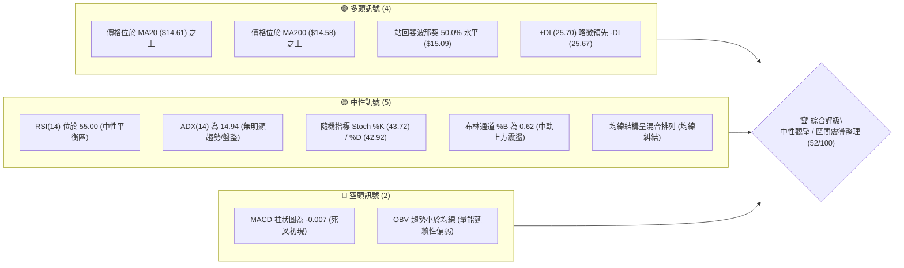
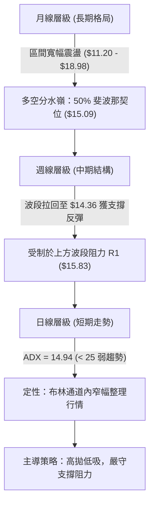
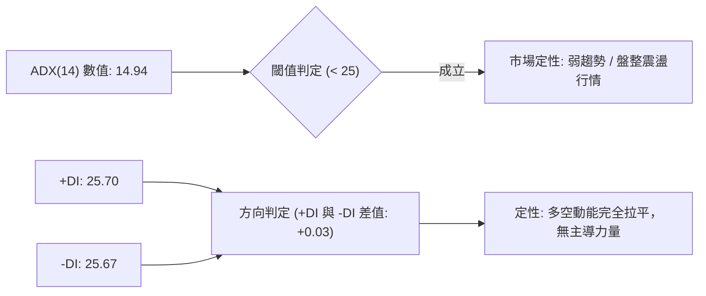
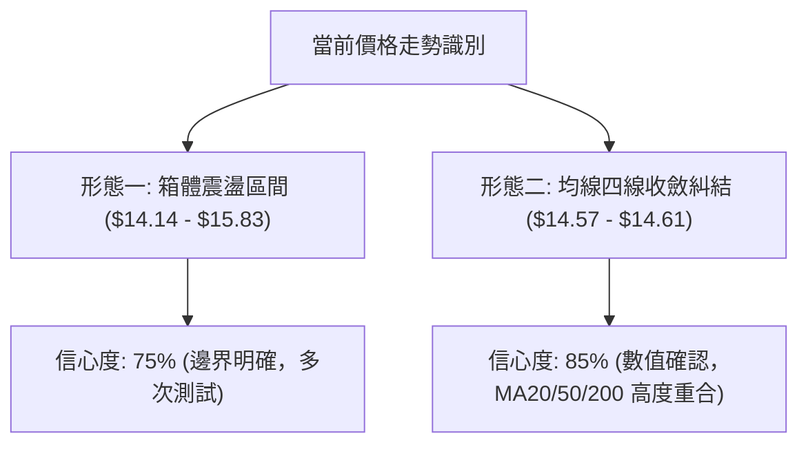
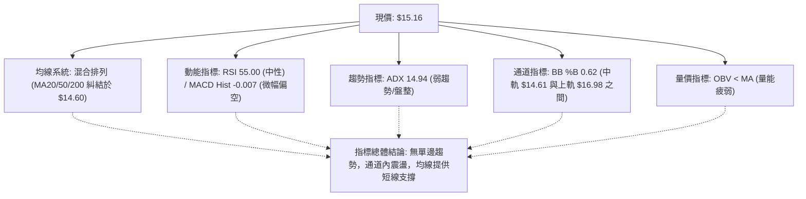
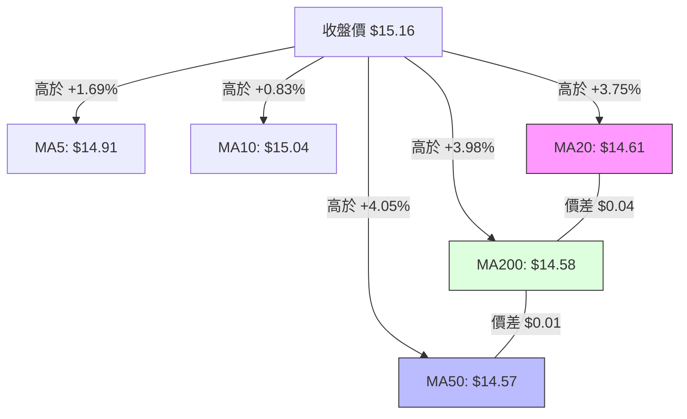
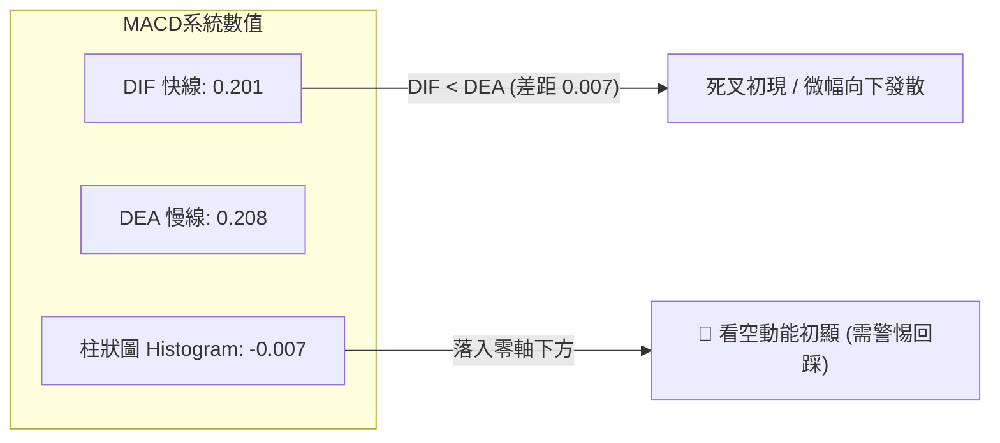
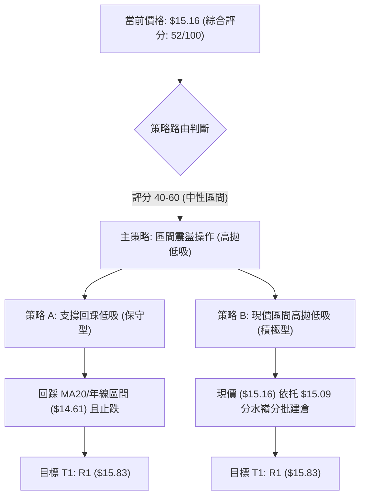
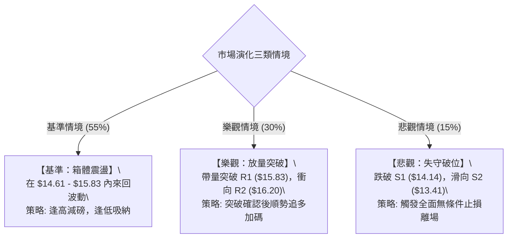

# NU 技術分析報告

> **報告日期**：2026-10-26 ｜ **語言**：繁體中文 ｜ **數據來源**：Yahoo Finance ｜ **當前價格**：$15.16

---

## 目錄

| 章節 | 內容 |
|------|------|
| [1. 技術面概覽](#1-技術面概覽) | 訊號儀表板、核心指標、評分卡 |
| [2. 趨勢分析](#2-趨勢分析) | 多時框趨勢、長中短期走勢、12個月走勢圖 |
| [3. 圖表形態分析](#3-圖表形態分析) | 形態識別、K線組合、目標價推算 |
| [4. 支撐與阻力](#4-支撐與阻力) | 關鍵價位分布、阻力與支撐表、斐波那契回調 |
| [5. 技術指標深度解讀](#5-技術指標深度解讀) | 均線系統、RSI、MACD、布林通道、成交量 |
| [6. 動能與波動率](#6-動能與波動率) | 動能四象限、ATR 波動率、Beta 市場相關性 |
| [7. 多時框架總結](#7-多時框架總結) | 時框架評分矩陣、多時框收斂結論 |
| [8. 交易策略建議](#8-交易策略建議) | 策略路由、價格情境、主策略詳情、風報比 |
| [9. 風險提示與監控](#9-風險提示與監控) | 關鍵監控清單、風險場景、部位管理 |
| [📋 報告總結](#-報告總結) | 核心結論與策略配置總覽 |

---

## 1. 技術面概覽

### 🎯 技術訊號儀表板



### 📊 核心指標速覽表

| 指標類別 | 指標名稱 | 當前數值 | 訊號 | 專業解讀與評估 |
|:---|:---|:---|:---:|:---|
| **價格定位** | 當前收盤價 | $15.16 | 🟡 | 位於52週區間 50.9% 位置，多空勢力處於動態均衡點 |
| **短期均線** | MA20 | $14.61 | 🟢 | 現價高於 MA20 +3.75%，短線回踩確認後維持偏多震盪 |
| **中期均線** | MA50 | $14.57 | 🟢 | 現價高於 MA50 +4.05%，中期基底支撐逐步成形 |
| **長期均線** | MA200 | $14.58 | 🟢 | 現價高於 MA200 +3.98%，年線上方維持長期基本格局 |
| **擺動動能** | RSI(14) | 55.00 | 🟡 | Wilder 算法計算數值落於 50 軸線上側，動能偏溫和無超買 |
| **趨勢動能** | MACD (12,26,9) | 0.201 / 0.208 | 🔴 | DIF 略低於 DEA，MACD Hist 為 -0.007，動能輕微轉弱 |
| **趨勢強度** | ADX(14) | 14.94 | 🟡 | 數值低於 25，表明缺乏單邊趨勢，市場定性為典型盤整行情 |
| **波動幅度** | ATR(14) | $0.60 | 🟡 | 佔現價 3.94%，每日正常波動區間約 ±$0.60，波動處於中等水平 |
| **通道位置** | Bollinger Bands | 上 $16.98 / 下 $12.24 | 🟡 | %B 為 0.62，股價運行於中軌 ($14.61) 與上軌之間 |
| **量能狀態** | 成交量 / OBV | 87.04M / 1.02x | 🟡 | 成交量略高於20日均量，但 OBV < MA 顯示資金追價動能疲弱 |

### 🏆 技術評分卡

```
╔══════════════════════════════════════════════════════════════════╗
║                   技術評分卡 — NU (2026-10-26)                   ║
╠══════════════════════════════════════════════════════════════════╣
║ 評估維度         指標進度條                       得分    訊號   ║
╟──────────────────────────────────────────────────────────────────╢
║ 趨勢強度 (ADX)   █████████░░░░░░░░░░░            45/100    🟡    ║
║ 動能指標 (RSI)   ██████████░░░░░░░░░░            52/100    🟡    ║
║ 支撐穩定度       ████████████░░░░░░░░            62/100    🟢    ║
║ 成交量配合 (OBV) █████████░░░░░░░░░░░            48/100    🟡    ║
║ 形態完整度       ██████████░░░░░░░░░░            50/100    🟡    ║
║ 均線排列狀況     ███████████░░░░░░░░░            55/100    🟡    ║
╠══════════════════════════════════════════════════════════════════╣
║ 綜合評分         ██████████░░░░░░░░░░            52/100    🟡    ║
║ 評級結論：中性觀望（區間操作，算術平均 (45+52+62+48+50+55)/6=52） ║
╚══════════════════════════════════════════════════════════════════╝
```

---

## 2. 趨勢分析

### 🌐 多時框趨勢分析



### 📈 長期趨勢 — 12個月走勢圖（Unicode）

NU 過去 12 個月（2025年11月至2026年10月）收盤價走勢如下，最高收於 2026-01 的 $17.75，最低見於 2026-09 的 $12.66。

```
NU 月線走勢圖（2025-11 至 2026-10，12個月收盤價走勢）
價格 ($)
$18.00 ┤              ● (2026-01: $17.75)
$17.00 ┤● (2025-11: $17.39)
$16.00 ┤       ● (2025-12: $16.74)
$15.00 ┤            ●                    ● (2026-08: $14.55)  ● (現價: $15.16)
$14.00 ┤                  ●       ●      ●
$13.00 ┤                        ●    ●
$12.00 ┤                                                    ● (2026-09: $12.66)
       └──────────────────────────────────────────────────────────────
         11    12    01    02   03   04   05   06   07   08   09   10  (月份)
```

**歷史走勢特徵分析表**：

| 時間週期 | 起迄收盤價 | 區間漲跌幅 | 趨勢性質 | 價量與形態特徵解讀 |
|:---|:---:|:---:|:---:|:---|
| **2025-11 至 2026-01** | $17.39 → $17.75 | +2.07% | 高位衝頂 | 創下波段高點 $17.75，逼近 52 週高點 $18.98 後動能竭盡 |
| **2026-01 至 2026-05** | $17.75 → $13.13 | -26.03% | 單邊空頭修正 | 跌破多道中期均線，形成連續下行階梯，回吐前波漲幅 |
| **2026-05 至 2026-08** | $13.13 → $14.55 | +10.81% | 底部緩步爬升 | 於 $13.00 上方構築築底平台，MA20 逐步拐頭向上 |
| **2026-08 至 2026-09** | $14.55 → $12.66 | -12.99% | 快速二次下探 | 探尋次級低點 $12.66，接近 78.6% 斐波那契回調位 ($12.86) |
| **2026-09 至 2026-10** | $12.66 → $15.16 | +19.75% | 強勁均值回歸 | 帶量突破短期均線密集區，重回 50% 斐波那契分水嶺 ($15.09) |

### 📊 中期趨勢（週線分析）

從近 8 週收盤表現觀察，NU 於 2026-10-02 當週探低 $12.13 後拉出強烈反彈長下影，並在 2026-10-09 當週收出長陽線至 $16.12，成交量高達 5.17 億股；隨後在 2026-10-16 回調至 $14.56，並於 2026-10-23 當週企穩收報 $15.16。

```
週線支撐阻力結構示意圖
$16.52 ──────────────────────────────────────── 關鍵波段壓力 R3
$16.20 ──────────────────────────────────────── 阻力 R2 (10-09 週高 $16.14 附近)
$15.83 ──────────────────────────────────────── 近期阻力 R1
$15.16 ════════════════════════════════════════ ◄ 當前收盤價 ($15.16)
$14.14 ──────────────────────────────────────── 近期波段支撐 S1
$13.41 ──────────────────────────────────────── 強支撐 S2 (09-25 週低點聚類)
$13.09 ──────────────────────────────────────── 底部防守 S3 (05/06 月平台底)
```

### ⚡ 趨勢強度評估（ADX 解讀）



**ADX 趨勢強度對照解讀**：

| 指標 | 數值 | 參考標準 | 結論與交易指引 |
|:---|:---:|:---:|:---|
| **ADX(14)** | 14.94 | 0–20 (極弱/無趨勢)；20–25 (趨勢醞釀)；>25 (強趨勢) | 當前處於典型無趨勢期，嚴禁採用追突破順勢策略 |
| **+DI** | 25.70 | 多方攻擊動能線 | 多方動能由 10 月初高點回落後趨於走平 |
| **-DI** | 25.67 | 空方殺跌動能線 | 空方殺跌力道在 $14.40 附近受阻，雙方暫處平衡 |
| **+DI / -DI 差值** | +0.03 | 正值偏多，負值偏空 | 差值幾近於零，確認行情為日線布林通道內的箱型震盪 |

---

## 3. 圖表形態分析

### 🔍 形態識別系統

根據近一年及近期日線、週線價格軌跡，系統識別出以下技術形態：



**形態信心度與參數評估表**：

| 形態名稱 | 信心度 | 判斷依據（引用數據與點位） | 完成度 | 目標價（附嚴格計算式） |
|:---|:---:|:---|:---:|:---|
| **箱型整理形態 (Rectangle)** | 75% | 箱頂受阻於 R1 ($15.83)，箱底獲得 S1 ($14.14) 支撐，兩者構成振幅 $1.69 的交易箱體 | 70% | 向上突破：頸線 $15.83 + 高度 $1.69 = $17.52<br>向下跌破：頸線 $14.14 − 高度 $1.69 = $12.45 |
| **均線收斂黏合 (MA Squeeze)** | 85% | MA20 ($14.61)、MA50 ($14.57)、MA200 ($14.58) 價差僅 $0.04，呈極度壓縮狀態 | 90% | 變盤突破目標參照布林上下軌：<br>上軌 $16.98 / 下軌 $12.24 |
| **雙底形態 (W-Bottom)** | 40% | 僅 2026-10-02 低點 $12.13 與 2026-09-25 低點 $13.36 跨度不對稱 | 35% | 訊號不足，僅做指標型解讀，不預設雙底幾何目標 |

### 🕯️ 重要K線形態分析

嚴格依據數據中「近10根日K」與「近8根週K」的實際開高低收進行客觀形態識別：

#### 近10根日K分析表

| 日期 | 開盤價 | 最高價 | 最低價 | 收盤價 | K線形態名稱 | 技術解讀 | 訊號 |
|:---|:---:|:---:|:---:|:---:|:---|:---|:---:|
| **2026-10-12** | $16.10 | $16.19 | $15.95 | $16.01 | 小陰十字線 (Black Spinning Top) | 於 R2 ($16.20) 下方出現高位滯漲，多頭動能轉弱 | 🔴 |
| **2026-10-13** | $15.85 | $15.86 | $15.57 | $15.58 | 光頭中陰線 (Bearish Candle) | 開盤即最高，空方發力貫穿 $15.80 短線支撐 | 🔴 |
| **2026-10-14** | $15.31 | $15.44 | $14.77 | $14.93 | 長陰破位線 (Long Bearish Candle) | 跌破 50% 斐波那契回調位 ($15.09)，賣壓放大至 81.8M | 🔴 |
| **2026-10-15** | $14.46 | $15.06 | $14.40 | $14.73 | 長上影下探陽線 (Inverted Hammer) | 盤中下探 $14.40 測試年線獲得買盤承接拉回 | 🟢 |
| **2026-10-16** | $14.71 | $14.94 | $14.45 | $14.56 | 縮量小陰線 (Doji-like) | 成交量急劇萎縮至 45.1M，空方殺跌意願減退 | 🟡 |
| **2026-10-19** | $14.72 | $14.92 | $14.36 | $14.51 | 地量測試下影線 (Test Low) | 探低至 $14.36 創波段回調低點，成交量僅 41.4M (波段地量) | 🟢 |
| **2026-10-20** | $14.62 | $15.41 | $14.60 | $15.09 | 帶量突破大陽線 (Bullish Engulfing) | 量增至 71.8M，實體大陽一舉收復 MA20 與 $15.09 | 🟢 |
| **2026-10-21** | $15.21 | $15.37 | $15.01 | $15.05 | 高位陀螺線 (High Wave Neutral) | 於 $15.00 整數關口上方維持平衡，多空陷入短兵相接 | 🟡 |
| **2026-10-22** | $14.89 | $15.06 | $14.63 | $14.73 | 回踩小陰線 (Pullback Candle) | 縮量至 55.4M 回測 MA20 支撐，未破 10-20 大陽線起漲點 | 🟡 |
| **2026-10-23** | $14.69 | $15.25 | $14.57 | $15.16 | 放量實體反彈陽線 (Bullish Candle) | 成交量回升至 87.0M，收盤逼近全日最高點，確認止跌 | 🟢 |

#### 近8根週K分析表

| 週末日期 | 開盤價 | 最高價 | 最低價 | 收盤價 | 週K線形態名稱 | 中期技術意義解讀 | 訊號 |
|:---|:---:|:---:|:---:|:---:|:---|:---|:---:|
| **2026-09-04** | $14.35 | $15.84 | $14.21 | $15.37 | 帶上影中陽線 | 向上衝擊 R1 ($15.83) 未果，留下回吐上影線 | 🟡 |
| **2026-09-11** | $15.56 | $15.82 | $14.44 | $14.62 | 實體中陰線 | 高位反轉確立，跌破當週開盤價形成空頭反撲 | 🔴 |
| **2026-09-18** | $14.35 | $14.55 | $13.58 | $13.65 | 連續下行中陰線 | 連續擊穿支撐，空方動能釋放，量能達 368M | 🔴 |
| **2026-09-25** | $13.84 | $14.25 | $13.36 | $13.59 | 築底下探陰線 | 於 S2 ($13.41) 附近探底，跌勢趨緩 | 🟡 |
| **2026-10-02** | $12.53 | $13.50 | $12.13 | $13.43 | 爆量長下影錘頭線 (Hammer) | 探低 $12.13 後爆出 5.32 億股天量拉回收高，主力承接明確 | 🟢 |
| **2026-10-09** | $14.98 | $16.14 | $14.84 | $16.12 | 爆量巨陽吞噬線 (Bullish Marubozu) | 5.17 億股推升突破多道均線，形成中期轉折波段母線 | 🟢 |
| **2026-10-16** | $16.10 | $16.19 | $14.40 | $14.56 | 獲利了結大陰線 (Bearish Reversal) | 週漲幅獲利回吐，量縮至 328M，確認上方 $16.20 壓力沉重 | 🔴 |
| **2026-10-23** | $14.72 | $15.41 | $14.36 | $15.16 | 下影中陽反彈線 (Piercing Rebound) | 回踩確認年線與 MA20 不破，收盤站回 50% 回調位 | 🟢 |

### 📉 ASCII 走勢形態示意圖

```
NU 近期日線震盪箱體與均線糾結示意圖
$16.20 ┤                     ┌─┐ (10-12 滯漲高點 $16.19)
       │                     │ └──────────────────────────── 阻力 R2: $16.20
$15.83 ┤                  ┌──┘                              阻力 R1: $15.83
       │                  │
$15.16 ┤                  │           ┌─┐ (10-23 放量收陽: $15.16) ◄ 當前現價
$15.09 ┼──────────────────┼───────────┼─┼─────────────── 50.0% 斐波那契回調位
$14.61 ┤══════════════════╪═══════════╪═╪═══════════════ MA20 ($14.61) / MA50 ($14.57) / MA200 ($14.58)
       │         ┌─┐      │   ┌─┐     │ │
$14.36 ┤         │ └──────┘   │ └─────┘ │ (10-19 探底低點: $14.36)
       │         │            │
$14.14 ┴─────────┴────────────┴───────────────────────────── 關鍵支撐 S1: $14.14
        10-09   10-12        10-16   10-19 10-23 (交易日)
```

### 🎯 形態目標價計算

根據上述已識別且信心度最高的「箱型整理形態」，各關鍵目標價推算如下：

1. **箱體高度計算**：
   $$\text{形態高度 (H)} = \text{箱頂阻力 (R1)} - \text{箱底支撐 (S1)} = \$15.83 - \$14.14 = \$1.69$$
2. **多頭向上突破量度目標**：
   $$\text{多頭目標} = \text{箱頂 (R1)} + \text{形態高度 (H)} = \$15.83 + \$1.69 = \$17.52$$
   *注：此量度目標價略高於斐波那契 23.6% 回調位 ($17.14)，構成強阻力區間。*
3. **空頭向下跌破量度目標**：
   $$\text{空頭目標} = \text{箱底 (S1)} - \text{形態高度 (H)} = \$14.14 - \$1.69 = \$12.45$$
   *注：此跌破目標價接近布林通道下軌 ($12.24) 與歷史月低點 ($12.66)。*

---

## 4. 支撐與阻力

### 🗺️ 關鍵價位分布圖（Unicode）

```
NU 價位結構分布圖（OHLCV 聚類與斐波那契疊加）
═══════════════════════════════════════════════════════════════════
$18.98 ║████████████████████████████████║ 52W 最高點 / 斐波那契 0.0%
$17.14 ║██████████████████████          ║ 斐波那契 23.6% 回調位
$16.98 ║▓▓▓▓▓▓▓▓▓▓▓▓▓▓▓▓▓▓▓▓▓▓▓▓        ║ 日線布林通道上軌
$16.52 ║████████████████████████        ║ 強阻力位 R3 (+9.00%)
$16.20 ║████████████████████            ║ 重要阻力位 R2 (+6.89%)
$16.01 ║▓▓▓▓▓▓▓▓▓▓▓▓▓▓▓▓▓▓              ║ 斐波那契 38.2% 回調位
$15.83 ║████████████████████████        ║ 關鍵阻力位 R1 (+4.39%)
───────╫────────────────────────────────╫───────────────────────────────────
$15.16 ╠════════════════════════════════╣ ◄ 當前收盤價 ($15.16)
$15.09 ║▓▓▓▓▓▓▓▓▓▓▓▓▓▓▓▓▓▓▓▓▓▓▓▓▓▓▓▓    ║ 斐波那契 50.0% 分水嶺 (-0.46%)
$14.61 ║████████████████████████████████║ MA20 ($14.61) / MA200 ($14.58) 密集區
───────╫────────────────────────────────╫───────────────────────────────────
$14.17 ║▓▓▓▓▓▓▓▓▓▓▓▓▓▓▓▓▓▓▓▓            ║ 斐波那契 61.8% 黃金分割位
$14.14 ║████████████████████████        ║ 關鍵支撐位 S1 (-6.73%)
$13.41 ║████████████████████            ║ 強支撐位 S2 (-11.54%)
$13.09 ║████████████████████████        ║ 底部防守位 S3 (-13.69%)
$12.24 ║▓▓▓▓▓▓▓▓▓▓▓▓▓▓▓▓                ║ 日線布林通道下軌
$11.20 ║████████████████████████████████║ 52W 最低點 / 斐波那契 100.0%
═══════════════════════════════════════════════════════════════════
```

### 🚧 阻力位分析表

所有價位均來自近一年波段高點聚類計算：

| 阻力級別 | 價位 | 與現價距離 | 形成原因與籌碼特徵 | 突破難度 | 重要性評級 |
|:---|:---:|:---:|:---|:---:|:---:|
| **R1** | $15.83 | +4.39% | 近一年多次波段衝頂遇阻的高點聚類，近10日多空激烈爭奪平台 | 中等 | ★★★★☆ |
| **R2** | $16.20 | +6.89% | 2026-10-09 週K高點 ($16.14) 與 10-12 日高點 ($16.19) 重合區 | 偏高 | ★★★★★ |
| **R3** | $16.52 | +9.00% | 歷史成交密集區上沿，突破後上方空間將直接開啟至 $17.14 | 極高 | ★★★★☆ |

### 🛡️ 支撐位分析表

所有價位均來自近一年波段低點聚類計算：

| 支撐級別 | 價位 | 與現價距離 | 形成原因與籌碼特徵 | 守住機率 | 重要性評級 |
|:---|:---:|:---:|:---|:---:|:---:|
| **S1** | $14.14 | -6.73% | 斐波那契 61.8% ($14.17) 與近期拉回次低點群聚，具高度買盤支撐 | 75% | ★★★★★ |
| **S2** | $13.41 | -11.54% | 2026-09-25 週K收盤價 ($13.59) 附近籌碼平台低點，中期防線 | 85% | ★★★★☆ |
| **S3** | $13.09 | -13.69% | 2026年5-6月份月線平台底，跌破將引發空頭擴散至 52W 低點 | 92% | ★★★★★ |

### 📐 斐波那契回調位分析

依據 52 週完整波動區間（高點 $18.98，低點 $11.20，總垂直波幅 $7.78）計算之關鍵回調位如下：

| 回調比例 | 價位 | 當前相對位置 | 技術意涵與實戰指導 |
|:---|:---:|:---:|:---|
| **0.0% (52W High)** | $18.98 | 現價下方 +25.20% | 長期多頭終極目標，多頭主升浪頂點 |
| **23.6%** | $17.14 | 現價下方 +13.06% | 強勢回調上限，跌破後市場轉為寬幅震盪 |
| **38.2%** | $16.01 | 現價下方 +5.61% | 重要多空折衝點，恰與阻力區 R1/R2 下緣重疊 |
| **50.0%** | $15.09 | 現價上方 -0.46% | **現價 ($15.16) 剛好緊貼此線！** 標誌著中期行情的中樞平衡線 |
| **61.8%** | $14.17 | 現價上方 -6.53% | 黃金分割強支撐位，與波段支撐 S1 ($14.14) 形成共振保護 |
| **78.6%** | $12.86 | 現價上方 -15.17% | 空頭深度修正極限，接近 2026-09 月低點 ($12.66) |
| **100.0% (52W Low)**| $11.20 | 現價上方 -26.12% | 全年最低點，多頭結構瓦解的終極防守線 |

**解讀結論**：現價 $15.16 正好夾在 **50.0% ($15.09)** 與 **38.2% ($16.01)** 之間，且距 50.0% 僅有 $0.07 之微弱優勢。此位置是極其典型的「多空拔河分水嶺」，若能有效站穩 $15.09，行情將向上挑戰 $16.01；反之若失守 $15.09，將滑向 61.8% ($14.17)。

---

## 5. 技術指標深度解讀

### 🎛️ 指標訊號總覽



### 📈 移動平均線排列分析



**移動平均線詳細數據對比表**：

| 均線名稱 | 當前價格 | 與現價乖離率 | 走勢特徵 (近30日斜率) | 技術意義判定 |
|:---|:---:|:---:|:---|:---|
| **MA5** | $14.91 | +1.69% | ▅▇█████▇▆▆ (走平後微揚) | 超短線買盤支撐，提供日內防守 |
| **MA10** | $15.04 | +0.83% | ▄▅▇███████▇ (高位震盪) | 短線強弱分水嶺，現價緊貼於其上 |
| **MA20** | $14.61 | +3.75% | ▂▂▃▃▄▄▄▅▅▆▇ (穩定上升) | 布林中軌，短多核心防禦線 |
| **MA50** | $14.57 | +4.05% | ▅▅▆▇▇▇▇█████ (中多走揚) | 中期生命線，提供強勁中期支撐 |
| **MA60** | $14.48 | +4.66% | ▅▅▆▇▇▇▇█████ (多頭向上) | 季線支撐，確認底部抬高 |
| **MA120** | $13.83 | +9.59% | ▂▂▃▃▃▃▃▄▄▄▅ (平緩向上) | 半年線，中期多空分界線 |
| **MA200** | $14.58 | +3.98% | 數據提供為 $14.58 | 年線，現價位於年線之上，長線偏多 |
| **MA240** | $14.92 | +1.61% | ▃▃▃▃▃▃▃▂▂▂▁▁ (平緩向下) | 長期均線阻力，現已初步突破 |

**均線綜合判定**：當前 MA20 ($14.61)、MA50 ($14.57)、MA200 ($14.58) 呈現高度收斂糾結狀態。雖然現價高於所有主要均線，但短期 MA5 ($14.91) 略低於 MA10 ($15.04)，整體均線系統定性為「**混合排列**」，尚未構成多頭發散，暗示即將迎來變盤選擇。

### 📉 RSI(14) 分析

```
RSI(14) 當前數值進度條展示
0         30                50      55         70               100
├─────────┼─────────────────┼───────●──────────┼─────────────────┤
 超賣區間       弱勢區域        中軸   當前(55.0)     強勢區域        超買區間
進度條：  ███████████████████████████░░░░░░░░░░░░░░░░░░░░░░ 55.0%
```

1. **區間定位**：RSI(14) 最新讀數為 **55.00**（Wilder 計算方法），處於 50–70 的溫和偏多中性區間，遠未達到 70 以上的超買警戒，亦未失守 50 強弱分水嶺。
2. **背離分析結論**：嚴格比對近 20 根 K 棒的首尾價格與 RSI 方向：
   - 價格於 2026-10-09 當週高點為 $16.12（週 RSI 為 66.1），隨後於 2026-10-23 回調至 $15.16（RSI 為 55.00）。
   - 日線首尾比對顯示，價格回調伴隨指標同步回落，**無明顯頂背離，亦無明顯底背離**。指標與價格運行保持同向確認。

### 📊 MACD(12/26/9) 訊號解讀



- **狀態解讀**：DIF (0.201) 穿過 DEA (0.208) 下方，MACD 柱狀圖讀數為 **-0.007**。
- **交叉性質**：此死叉發生在零軸上方的高位區域，屬於「零上弱死叉」。由於柱狀圖負值絕對值極小（僅 0.007），表明空頭殺跌力道極弱，通常反映為強勢震盪洗盤而非趨勢性暴跌。

### 📦 布林通道分析

```
NU 日線布林通道結構示意圖 (帶寬: $4.74)
$16.98 ┬──────────────────────────────────────── 上軌 (Upper Band)
       │
       │
$15.16 ┼───────────────────────●──────────────── 現價 (Current Price: $15.16, %B = 0.62)
       │
$14.61 ┼──────────────────────────────────────── 中軌 (Middle Band = MA20)
       │
       │
$12.24 ┴──────────────────────────────────────── 下軌 (Lower Band)
```

- **通道參數**：上軌 $16.98，中軌 (MA20) $14.61，下軌 $12.24。通道帶寬 (Bandwidth) 為 $4.74。
- **%B 位置分析**：%B 數值為 **0.62**（0 代表下軌，0.5 代表中軌，1.0 代表上軌）。現價運行於中軌與上軌之間的強勢震盪區，距離中軌支撐有 $0.55 的緩衝垫，短線通道結構未遭破壞。

### 💹 成交量分析（量價配合度）

1. **成交量對比**：
   - 最新日成交量：**87,041,100** 股。
   - 20 日均量：**85,063,115** 股（量比 1.02x，溫和放量）。
   - 50 日均量：**77,580,876** 股（量比 1.12x）。
2. **OBV 能量潮解讀**：數據明確提示「**OBV < MA → 量能疲弱**」。
   - **量價背離判定**：日線價格在 10 月 23 日收陽（漲至 $15.16），但 OBV 曲線仍運行在其均線下方，顯示本輪自 $14.36 的反彈主要由空頭回補推動，場外主動型追高資金介入相對有限。量能未能與價格反彈形成強烈共振，限制了短期向上突破 R1 ($15.83) 的爆發力。

---

## 6. 動能與波動率

### ⚡ 動能評估四象限

```
動能與波動率四象限矩陣
       高波動率 (High Volatility)
                 │
      Q3 (高波強動)│  Q4 (高波弱動)
                 │
─────────────────┼─────────────────
                 │    ★ 當前位置 (NU)
      Q1 (低波強動)│  Q2 (低波弱動)
                 │
       低波動率 (Low Volatility)
 ──── 強動能 ────┴──── 弱動能 ──── (Momentum)
```

**動能與波動率象限分析表**：

| 象限 | 動能維度 | 波動維度 | 當前狀態標註 | 技術特徵與應對策略 |
|:---:|:---:|:---:|:---:|:---|
| **Q1** | 強 (ADX>25, RSI>60) | 低 (ATR%<3.0%) | — | 最佳順勢突破買點，趨勢平穩推升 |
| **Q2** | **弱 (ADX=14.9, RSI=55)** | **低 (ATR%=3.94%)** | **✓ 當前定位 (NU)** | **謹慎觀望，多空動能衰竭，適合區間網格操作** |
| **Q3** | 強 (動能充沛) | 高 (ATR%>5.0%) | — | 高風險高收益，主升浪衝刺期 |
| **Q4** | 弱 (無方向) | 高 (寬幅劇震) | — | 避免進場，無序洗盤易遭雙向止損 |

### 📊 ATR 波動率分析

- **ATR(14) 數值**：**$0.60**（佔當前股價之 **3.94%**，採用 Wilder 平滑計算）。
- **實戰意涵**：NU 當前的單日平均真實波幅為 60 美分。在設定止損與進場緩衝時，合理的技術止損距離應至少設為 1.0 至 1.5 倍 ATR（即 $0.60 至 $0.90），以規避日內雜訊引發的假突破洗盤。

### 📐 Beta 與市場相關性

- **Beta 係數**：**0.955**。
- **市場特徵分析**：Beta 值極其接近 1.0（0.955），表明 NU 與美股大盤（S&P 500 / 標普金融板塊）具有高度同步性。當大盤處於風險偏好上升時，NU 具備同步修復能力；但當大盤承壓時，NU 缺乏獨立防禦屬性。在當前個股技術面盤整期間，大盤宏觀走勢將對其方向選擇產生超過 60% 的外生影響。

---

## 7. 多時框架總結

### 📋 時框架評分表

| 時框架 | 趨勢方向 | 動能狀態 | 均線排列 | 形態特徵 | 綜合評分 | 交易建議 |
|:---|:---:|:---:|:---:|:---:|:---:|:---|
| **日線 (短期)** | 震盪偏多 | 中性 (RSI 55) | 混合收斂 (纠结) | 箱體內反彈測試箱頂 | 54/100 | 區間內高拋低吸，嚴禁追高 |
| **週線 (中期)** | 寬幅洗盤 | 偏弱 (MACD轉負) | 中期均線走平 | 10月初爆量大陽後獲利回吐 | 51/100 | 依託 $14.14 支撐逢低承接 |
| **月線 (長期)** | 箱體橫盤 | 平衡 (圍繞50%分割) | 站上年線 ($14.58) | 52W 區間中軸動態平衡 | 51/100 | 長線持有，未破 $13.00 前維持多頭架構 |

### 🔲 綜合訊號矩陣

```
綜合訊號一致性比對矩陣
═══════════════════════════════════════════════════════════════════
時框層級   價格 vs MA20   RSI 區間   MACD 訊號   布林通道位置   最終判定
───────────────────────────────────────────────────────────────────
短期 (日線)  🟢 上方(+3.7%) 🟡 55.0(中性) 🔴 死叉(-0.007) 🟡 中軌上方(%B 0.62) 🟡 震盪整理
中期 (週線)  🟢 上方        🟡 55.0(中性) 🔴 負柱狀圖     🟡 中軌震盪      🟡 整理洗盤
長期 (月線)  🟢 上方(年線)  🟡 50附近    🟡 零軸附近     🟡 寬幅通道中樞  🟡 長期築底
═══════════════════════════════════════════════════════════════════
一致性評估：短、中、長三個級別在「中性震盪」維度達成 100% 高度共識。
```

### ⚖️ 多時框收斂結論

嚴格執行「多時框收斂優先級規則（規則 14）」：
1. **行情定性**：當前日線 ADX(14) 為 **14.94**，明確小於 25 的趨勢行情閾值，技術面定性為典型的**盤整行情（Range-bound Regime）**。
2. **主導維度收斂**：在盤整行情中，中長期單邊趨勢權重降低，交易邏輯**必須以日線布林通道上下軌（上軌 $16.98，下軌 $12.24）與關鍵波段高低點形成的箱體為主要交易區間**。
3. **方向性唯一結論**：**中性觀望（偏多低吸高拋，依評分 52/100）**。
   - 此結論與第 1 章技術評分卡（52分）、第 2 章無趨勢震盪結論以及第 5 章指標解讀完全收斂一致。股價緊貼 50.0% 斐波那契回調位 ($15.09) 震盪，操作重心在於區間邊界的精準高拋低吸，而非押注單邊突破。

---

## 8. 交易策略建議

### 🗺️ 策略決策流程圖



### 🧭 策略路由（依評分卡分流）

> **當前主策略方向 = 區間震盪操作（偏多低吸高拋）（依綜合評分 52/100）**

根據規則，綜合評分落在 40–60 區間（52/100），禁止進行單邊盲目追漲或殺跌。策略以**日線布林通道與波段支撐阻力構成的箱體**為核心，採取「逢支撐低吸、逢阻力高拋、嚴守止損、等待有效突破確認」的標準區間操作框架。

### 🎯 價格情境階梯（Price Scenarios）

價位嚴格引用第 4 章及數據庫計算之精確數值：

| 觸發條件 | 下一目標 | 後續延伸 | 情境技術含義 |
|:---|:---:|:---:|:---|
| **強勢向上突破 R1 ($15.83)** | 阻力 R2 ($16.20) | 強阻力 R3 ($16.52) | 短線實質轉強，箱體向上突破，開啟邁向斐波那契 38.2% ($16.01) 及上軌路徑 |
| **站穩現價區間 ($15.09–$15.16)** | 阻力 R1 ($15.83) | — | 延續 50% 斐波那契分水嶺上方的常態震盪整理，多空拉鋸 |
| **向下跌破支撐 S1 ($14.14)** | 強支撐 S2 ($13.41) | 底部防守 S3 ($13.09) | 中期結構實質轉弱，失守黃金分割支撐，將考驗前波低點平台 |

### 📊 情境機率分佈

| 預測情境 | 發生機率 | 主要技術指標支撐依據 |
|:---|:---:|:---|
| **區間震盪整理** | **55%** | ADX 僅 14.94 確認無趨勢；布林帶寬度未顯著擴張；均線糾結黏合 |
| **向上反彈測試阻力** | **30%** | 價格站上所有主要均線；收在 50% 斐波那契回調位 ($15.09) 之上；+DI > -DI |
| **向下破位探底** | **15%** | MACD 柱狀圖為負 (-0.007)；OBV 能量潮疲弱，未能確認反彈 |

### 🟢 主策略詳情

本策略各項數值嚴格依據第 4 章支撐阻力位與規則 17 計算（進場價為區間時以中點計算）：

| 策略要素 | 策略 A（支撐回踩低吸 — 保守型） | 策略 B（現價區間波段 — 積極型） |
|:---|:---|:---|
| **交易邏輯** | 耐心等待股價回踩 MA20 與年線重合區尋求確認 | 依托現價及 50% 斐波那契位 ($15.09) 建立底倉 |
| **進場條件** | 股價回踩至 MA20 出現縮量企穩陽線 | 日K收盤確認站穩 $15.09，分批介入 |
| **進場價格** | **$14.61**（精確對應 MA20 及布林中軌） | **$15.16**（當前最新收盤價） |
| **目標價 T1** | **$15.83**（波段阻力 R1） | **$15.83**（波段阻力 R1） |
| **目標價 T2** | **$16.20**（波段阻力 R2） | **$16.20**（波段阻力 R2） |
| **止損價格** | **$14.14**（關鍵支撐位 S1，跌破箱體出局） | **$14.58**（年線 MA200，跌破均線密集區出局） |
| **風險報酬比** | **1 : 2.60（以 T1 計）**<br>*(計算式: (15.83-14.61)/(14.61-14.14) = 1.22/0.47)*<br>另：1 : 3.38（以 T2 計） | **1 : 1.16（以 T1 計）**<br>*(計算式: (15.83-15.16)/(15.16-14.58) = 0.67/0.58)*<br>另：1 : 1.79（以 T2 計） |
| **成功機率估計** | 65% | 52% |
| **建議配置倉位** | 15% – 20% 總資金倉位 | 8% – 10% 總資金倉位 |

### 🔴 反向風險觸發點（對沖與風控提示）

若出現以下訊號，主推之偏多震盪策略即刻失效，部位應嚴格停損或建立對沖防禦：
1. **空頭破位觸發點**：日K收盤價**實體跌破 $14.14 (S1)**，伴隨成交量放大至 8,500 萬股以上。此時確認箱體向下破位，目標下看 S2 ($13.41)。
2. **動能惡化訊號**：日線 MACD 柱狀圖進一步跌破 **-0.050**，且 RSI(14) 跌穿 **45** 軸線，宣告反彈波段終結。

### ⭐ 整體訊號強度評星

```
╔══════════════════════════════════════════════════════════════════╗
║ 做多訊號強度：  ★★★☆☆  (3.0/5星 — 均線與分割位提供支撐，但量能不足)  ║
║ 做空訊號強度：  ★★☆☆☆  (2.0/5星 — 缺乏單邊殺跌動能，年線支撐強勁)    ║
║ 整體技術可信度：★★★★☆  (4.0/5星 — 支撐阻力結構極度清晰，指標共振)  ║
╚══════════════════════════════════════════════════════════════════╝
```

---

## 9. 風險提示與監控

### ✅ 關鍵監控指標 Checklist

```
╔══════════════════════════════════════════════════════════════════╗
║              NU 每日交易關鍵技術監控清單 (Checklist)              ║
╠══════════════════════════════════════════════════════════════════╣
║ [ ] 1. 收盤價是否持續企穩於 50.0% 斐波那契位 ($15.09) 之上？       ║
║ [ ] 2. 向上衝擊 R1 ($15.83) 時，成交量是否能擴大至 9,000 萬股以上？║
║ [ ] 3. MA20 ($14.61) 與 MA200 ($14.58) 密集支撐區是否完好未破？  ║
║ [ ] 4. 日線 MACD 柱狀圖是否由負 (-0.007) 翻正，發出紅柱重啟動能？ ║
║ [ ] 5. ADX 讀數是否由 14.94 向上翹頭穿過 20，釋放趨勢行情信號？   ║
║ [ ] 6. OBV 能量潮曲線是否重新穿越其均線，確認場外增量資金進場？   ║
╚══════════════════════════════════════════════════════════════════╝
```

### ⚠️ 風險場景分析



### 🛡️ 風險管理重要提醒

1. **嚴禁追高紀律**：在 ADX 僅為 14.94 的弱趨勢環境下，任何盤中向上脈衝通常具有誘多特徵。當價格逼近 R1 ($15.83) 或 R2 ($16.20) 時，嚴禁執行市價追買，反而應視為多頭部位落袋為安的減倉機會。
2. **波動率緩衝配置**：依據 ATR(14) = $0.60，個股日內隨機雜訊較大。在設定任何進場限價單時，應容許至少 ±$0.15 的滑點與執行公差，止損位必須嚴格設定在重要技術關卡外側（如 S1 的 $14.14）。
3. **單筆風險曝險上限**：任何單一策略的帳戶總資金風險承擔額（止損金額）不得超過投資組合總權益的 **1.5%**。若以策略 A 為例（進場 $14.61，止損 $14.14，每股風險 $0.47），每 10 萬美元總資產建倉上限為 3,190 股（市值約 4.6 萬美元，佔總資金 46%）。

---

## 📋 報告總結

```
╔══════════════════════════════════════════════════════════════════╗
║                     NU 技術分析報告總結                          ║
╠══════════════════════════════════════════════════════════════════╣
║ 報告日期：2026-10-26                                            ║
║ 當前價格：$15.16 USD                                             ║
║ 分析評級：⚖️ 中性觀望 / 區間震盪整理 (評分: 52/100)               ║
╟──────────────────────────────────────────────────────────────────╢
║ 關鍵技術結論：                                                   ║
║ ├─ 長期趨勢：🟢 股價企穩於年線 MA200 ($14.58) 之上，維持大底格局 ║
║ ├─ 中期趨勢：🟡 週線呈寬幅洗盤，受制於上方 R1/R2 籌碼解套壓力帶  ║
║ ├─ 短期趨勢：🟡 ADX=14.94 確認無單邊趨勢，日線處於窄幅箱體整理   ║
║ ├─ 關鍵支撐：S1: $14.14 ｜ S2: $13.41 ｜ 斐波那契50%: $15.09     ║
║ ├─ 關鍵阻力：R1: $15.83 ｜ R2: $16.20 ｜ R3: $16.52             ║
║ └─ 分析師共識目標價：$18.92 (22位分析師評級 Buy，最高看至 $23.00)║
╟──────────────────────────────────────────────────────────────────╢
║ 最優策略組合建議：                                               ║
║ 1. 🥇 最佳機會：【策略 A 保守回踩低吸】                           ║
║    回踩 MA20/年線支撐位 $14.61 逢低進場，止損 $14.14，           ║
║    目標 T1: $15.83 / T2: $16.20，風報比高達 1 : 2.60（以 T1 計） ║
║ 2. 🥈 次選機會：【策略 B 現價區間波段】                           ║
║    於現價 $15.16 依托 $15.09 建立輕倉，止損 $14.58，目標 $15.83 ║
║ 3. 🥉 保守選擇：【場外觀望突破】                                 ║
║    靜待日K實體帶量突破 R1 ($15.83) 或回踩 S1 ($14.14) 後再做介入║
╚══════════════════════════════════════════════════════════════════╝
```

---

> ⚠️ **免責聲明**：本報告為依據客觀量化技術指標與歷史走勢數據產出之專業技術分析研究，所有數據計算與關鍵價位均基於 Yahoo Finance 提供之公開行情資訊。本報告**僅供研究與學術參考**，**不構成任何形式的證券買賣推薦或投資操作建議**。金融市場投資具高度風險，價格可能劇烈波動甚至損失全部本金，投資人進行交易決策前應審慎評估自身財務狀況與風險承受能力。

---

*報告生成時間：2026-10-26 ｜ 數據來源：Yahoo Finance ｜ 分析框架：多時框技術分析體系 (MTFA)*