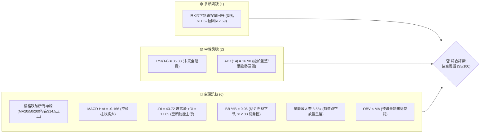
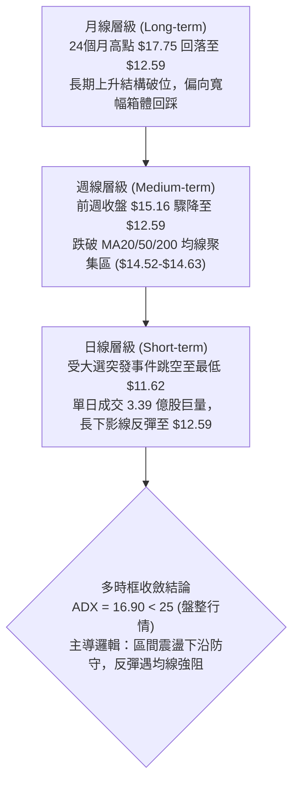
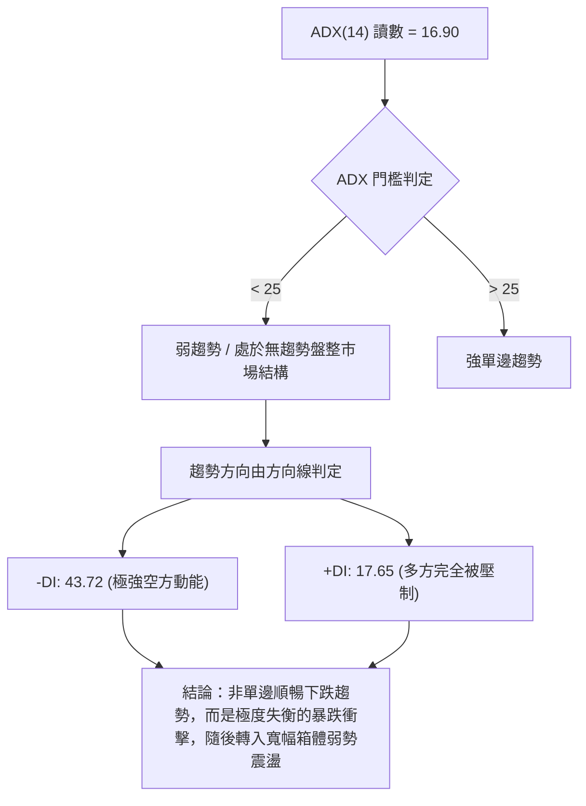
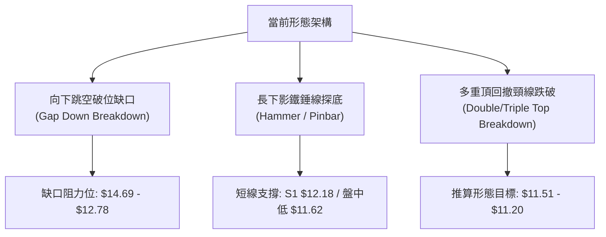
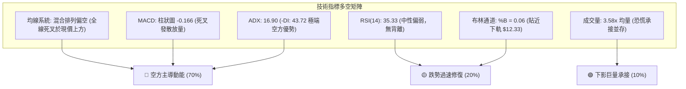
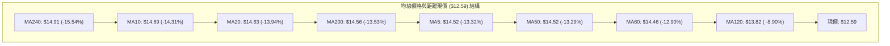
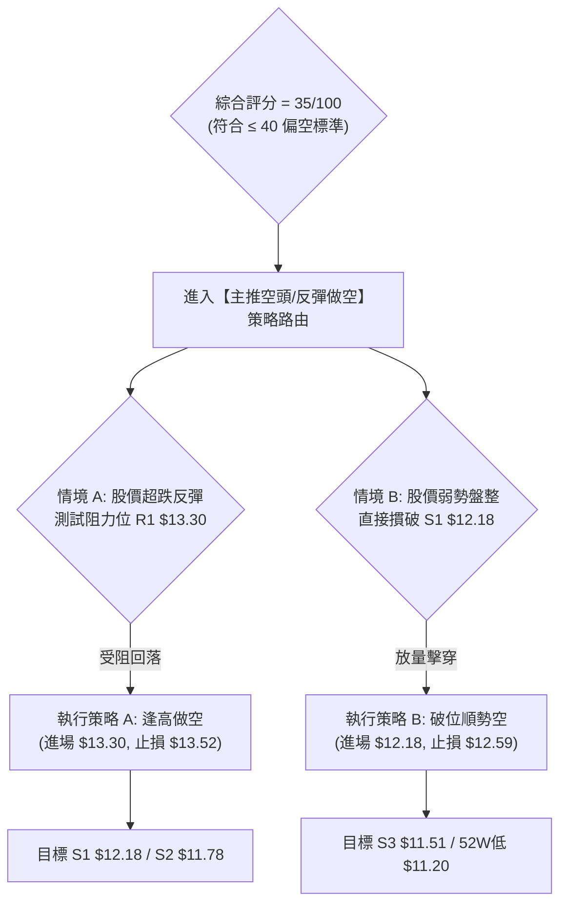
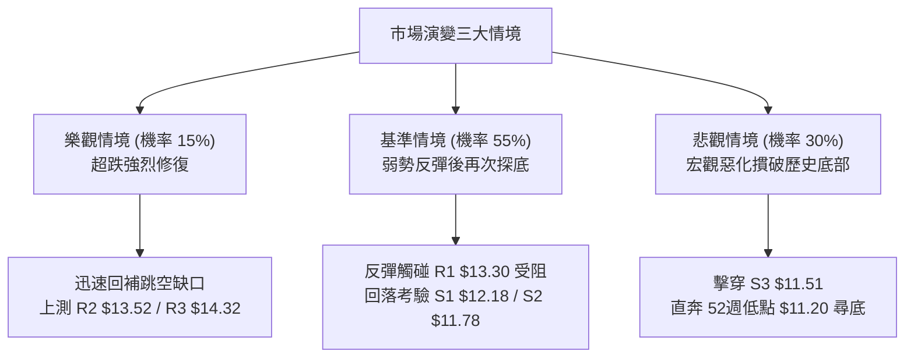

# NU 技術分析報告

> **報告日期**：2026-10-27 ｜ **語言**：繁體中文 ｜ **數據來源**：Yahoo Finance ｜ **當前價格**：$12.59 USD

---

## 目錄

| 章節 | 內容 |
|------|------|
| [1. 技術面概覽](#1-技術面概覽) | 訊號儀表板、核心指標、評分卡 |
| [2. 趨勢分析](#2-趨勢分析) | 多時框趨勢、長中短期走勢、ADX解讀 |
| [3. 圖表形態分析](#3-圖表形態分析) | 形態識別、K線組合、目標價計算 |
| [4. 支撐與阻力](#4-支撐與阻力) | 關鍵價位分布、阻力與支撐表、斐波那契回調 |
| [5. 技術指標深度解讀](#5-技術指標深度解讀) | 均線系統、RSI、MACD、布林通道、量能OBV |
| [6. 動能與波動率](#6-動能與波動率) | 動能四象限、ATR波動分析、Beta市場關聯 |
| [7. 多時框架總結](#7-多時框架總結) | 時框架評分矩陣、多時框收斂結論 |
| [8. 交易策略建議](#8-交易策略建議) | 策略路由、價格情境、主策略詳情、對沖提示 |
| [9. 風險提示與監控](#9-風險提示與監控) | 監控清單、風險情境、資金管理法則 |
| [10. 報告總結](#10-報告總結) | 全方位技術總結與決策核心 |

---

## 1. 技術面概覽

### 🎯 技術訊號儀表板



### 📊 核心指標速覽表

| 指標類別 | 指標名稱 | 當前數值 | 訊號 | 解讀 |
|----------|----------|----------|------|------|
| **價格** | 當前收盤價 | $12.59 | 🔴 | 位於52週區間 17.9% 弱勢低位，單日大幅跳空回落 |
| **均線** | MA20 | $14.63 | 🔴 | 價格低於 MA20 達 -13.94%，短期均線呈現強烈下行壓力 |
| **均線** | MA50 | $14.52 | 🔴 | 價格低於 MA50 達 -13.29%，中期趨勢轉弱且失守成本線 |
| **均線** | MA200 | $14.56 | 🔴 | 價格低於長期年線 MA200 達 -13.53%，長期牛市結構遭受破壞 |
| **動能** | RSI(14) | 35.33 | 🟡 | 位於弱勢中性偏空區間，尚未進入極端超賣（<30），仍有慣性釋放空間 |
| **動能** | MACD (12,26,9) | 0.001 / Sig: 0.167 | 🔴 | MACD Hist 為 -0.166，快慢線高檔死叉向下發散，空頭主導 |
| **動能** | 隨機指標 (Stoch) | %K: 21.23 / %D: 28.39 | 🟡 | 位於低檔鈍化邊緣，空頭動能壓制尚未出現金叉翻揚 |
| **趨勢強度**| ADX (14) | 16.90 (-DI: 43.72) | 🔴 | 總體趨勢強度指標 < 25 表明處於非單邊趨勢，但 -DI 壓倒性主導 |
| **波動** | ATR(14) | $0.81 | 🔴 | 波動佔股價 6.42%，受地緣政治與宏觀事件影響，波動度急劇擴大 |
| **通道** | 布林通道 (BB) | 寬度: $12.33 - $16.93 | 🔴 | %B 為 0.06，收盤價逼近下軌 $12.33，呈現破位邊緣弱勢震盪 |
| **量能** | 當日成交量 | 339,141,300 | 🔴 | 爆出 20 日均量（94.8M）的 3.58 倍巨量，恐慌籌碼湧出 |

### 🏆 技術評分卡

```
╔══════════════════════════════════════════════════════════════════╗
║                   技術評分卡 — NU (2026-10-27)                  ║
╠══════════════════════════════════════════════════════════════════╣
║ 趨勢強度 (Trend)     ███████░░░░░░░░░░░░░  35/100  🔴 空頭佔優   ║
║ 動能指標 (Momentum)  ███████░░░░░░░░░░░░░  35/100  🔴 動能疲弱   ║
║ 支撐穩定度 (Support) ████████░░░░░░░░░░░░  40/100  🔴 考驗低位   ║
║ 成交量配合 (Volume)  ███████░░░░░░░░░░░░░  36/100  🔴 放量下殺   ║
║ 形態完整度 (Pattern) ██████░░░░░░░░░░░░░░  32/100  🔴 跳空破位   ║
║ 均線排列 (MA Align)  ██████░░░░░░░░░░░░░░  32/100  🔴 空頭排列   ║
╠══════════════════════════════════════════════════════════════════╣
║ 綜合評分 (Composite) ███████░░░░░░░░░░░░░  35/100  🔴 偏空佈局   ║
╚══════════════════════════════════════════════════════════════════╝
```
*註：綜合評分由六項維度之算術平均計算：$(35 + 35 + 40 + 36 + 32 + 32) \div 6 = 35$ 分（四捨五入至整數，依嚴格規則 18）。*

---

## 2. 趨勢分析

### 🌐 多時框趨勢分析



### 📈 長期趨勢 — 12個月走勢圖（Unicode）

以下展示自 2025 年 11 月至 2026 年 10 月之月線收盤走勢：

```
NU 月線收盤走勢圖（過去12個月）
價格軸 ($)
$18.00 ┤                               ●(2026-01: $17.75)
$17.50 ┤                     ●(11: $17.39)
$17.00 ┤                          ●(12: $16.74)
$16.00 ┤
$15.00 ┤                                    ●(02: $14.98)
$14.50 ┤                                         ●    ●(04: $14.48)       ●(08: $14.55)
$14.00 ┤                                              ●(03: $14.37)  ●(07: $14.33)
$13.50 ┤                                                                ●(06: $13.36)
$13.00 ┤                                                           ●(05: $13.13)
$12.50 ┤                                                                               ●←現價 $12.59
       └─────────────────────────────────────────────────────────────────────────────
         25-11 25-12 26-01 26-02 26-03 26-04 26-05 26-06 26-07 26-08 26-09 26-10
```

#### 月度走勢特徵分析表

| 階段區間 | 起止月份 | 價格變化 ($) | 漲跌幅 (%) | 走勢特徵與結構解讀 |
|----------|----------|--------------|------------|--------------------|
| 歷史衝頂期 | 2025-11 → 2026-01 | $17.39 → $17.75 | +2.07% | 構築歷史高點區間，動能高檔背離放緩，見頂跡象浮現 |
| 首波回撤期 | 2026-01 → 2026-03 | $17.75 → $14.37 | -19.04% | 獲利了結盤湧出，跌破上升趨勢線，尋求年線支撐 |
| 箱體築底期 | 2026-03 → 2026-08 | $14.37 → $14.55 | +1.25% | 在 $13.13 至 $14.55 區間反覆收斂打底，成交量萎縮 |
| 突發破位期 | 2026-08 → 2026-10 | $14.55 → $12.59 | -13.47% | 宏觀黑天鵝觸發恐慌性拋售，月線收盤跌至近 18 個月新低 |

### 📊 中期趨勢（週線分析）

從近 20 週收盤走勢可見，股價在 2026-10-09 一度拉升至 $16.12（週 RSI 達 66.1），但隨後連續三週急轉直下，從 $16.12 經由 $14.56、$15.16 直墜至最新收盤 $12.59。

```
NU 週線阻力與支撐示意圖
═══════════════════════════════════════════════════════════════
$16.12 ──────────────────────────────● (波段頂部 10-09)
                                      ╲
$15.16 ─────────────────●              ╲
                         ╲              ╲
$14.56 ───────────●       ╲              ▼ (急劇下墜)
                   ╲       ▼
$13.30 ═════════════ R1 阻力線 ════════════════════════════════
$12.59 ──────────────────────────────● (最新收盤價)
$12.18 ----------------------------- S1 支撐線 ----------------
$11.62 ──────────────────────────────● (單日恐慌下影線低點)
$11.20 ═════════════ 52W 最低點 ═══════════════════════════════
```

### ⚡ 趨勢強度評估（ADX 解讀）



#### ADX 強度指標對照表

| 指標變數 | 當前讀數 | 基準臨界值 | 市場結構解讀 | 交易指導意義 |
|----------|----------|------------|--------------|--------------|
| **ADX(14)** | **16.90** | 25.00 | 處於弱趨勢或盤整區間 | 嚴禁使用順勢追價策略，以震盪邊界應對 |
| **+DI** | **17.65** | 20.00 | 多頭進攻意願匱乏 | 反彈空間受限，多頭僅為超跌修復 |
| **-DI** | **43.72** | 25.00 | 空頭具有極高壓倒性優勢 | 賣壓強勁，未見明確收斂前切忌盲目摸底 |
| **DI 差值** | **-26.07**| 0.00 | 處於深度負向背離 | 恐慌情緒釋放，容易出現均值回歸修復 |

---

## 3. 圖表形態分析

### 🔍 形態識別系統



#### 形態信心度與目標價評估表

| 形態名稱 | 信心度 (%) | 判斷依據（引用數據） | 完成度 (%) | 目標價（附精確計算式） |
|----------|------------|----------------------|------------|------------------------|
| **跳空破位缺口** | 85% | 2026-10-23 最低 $14.57，2026-10-26 開盤 $11.69，留下近 $2.88 未補缺口 | 100% | 缺口下緣回補目標即 R1 $13.30 至 R2 $13.52 |
| **雙重頂破位 (M頭)** | 75% | 2026-09-04 高點 $15.37 與 2026-10-09 高點 $16.12 雙頂，跌破前波低點 S1 $12.18 | 90% | 頸線約 $13.59 − (頂部均值 $15.75 − 頸線 $13.59) = $11.43（直接對應支撐 S3 $11.51） |
| **大級別頭肩頂** | 45% | 左肩 2025-11 ($17.39)、頭部 2026-01 ($17.75)，右肩不對稱且數據跨度過大 | 30% | 訊號不足，依嚴格規則 15，信心度 < 50% 僅做指標型解讀，不予推算延伸目標 |

### 🕯️ 重要K線形態分析

嚴格依據數據中「近 10 根日 K」與「近 8 根週 K」之開、高、低、收，精準判讀形態：

#### 近 10 根日 K 線形態解讀

| 日期（日K） | 開盤 (O) | 最高 (H) | 最低 (L) | 收盤 (C) | K線形態名稱 | 技術解讀 | 訊號 |
|-------------|----------|----------|----------|----------|-------------|----------|------|
| 2026-10-13 | $15.85 | $15.86 | $15.57 | $15.58 | 小陰線 | 於高檔弱勢整理，實體下移 | 🔴 |
| 2026-10-14 | $15.31 | $15.44 | $14.77 | $14.93 | 中陰線 | 跳空低開，跌破 $15.00 整數關卡 | 🔴 |
| 2026-10-15 | $14.46 | $15.06 | $14.40 | $14.73 | 低位十字星小陽 | 盤中嘗試反彈受壓於 $15.06，多空僵持 | 🟡 |
| 2026-10-16 | $14.71 | $14.94 | $14.45 | $14.56 | 窄幅十字星小陰 | 波動收縮，均線聚集帶形成壓制 | 🟡 |
| 2026-10-19 | $14.72 | $14.92 | $14.36 | $14.51 | 窄幅小陰線 | 連續在 $14.50 關卡窄幅拉鋸，動能匱乏 | 🔴 |
| 2026-10-20 | $14.62 | $15.41 | $14.60 | $15.09 | 中陽線帶長上影 | 突發多頭拉升突破 $15.40，但尾盤遭遇賣壓回落 | 🟢 |
| 2026-10-21 | $15.21 | $15.37 | $15.01 | $15.05 | 高開小陰十字 | 高開未能延續攻勢，回踩 $15.05 支撐 | 🟡 |
| 2026-10-22 | $14.89 | $15.06 | $14.63 | $14.73 | 下跌中陰線 | 實體跌破 $14.80，反彈動能衰竭 | 🔴 |
| 2026-10-23 | $14.69 | $15.25 | $14.57 | $15.16 | 光腳長身陽線 | 週末前多頭嘗試防守，收復 $15.00 關卡 | 🟢 |
| 2026-10-26 | $11.69 | $12.78 | $11.62 | $12.59 | **巨量長下影錘頭陰線** | 受大選消息直接低開於 $11.69，下探 $11.62 後爆量拉回 $12.59，下影線長達 $0.97，多頭低位強力承接 | 🟡 |

#### 近 8 根週 K 線形態解讀

| 日期（週K） | 開盤 (O) | 最高 (H) | 最低 (L) | 收盤 (C) | K線形態名稱 | 技術解讀 | 訊號 |
|-------------|----------|----------|----------|----------|-------------|----------|------|
| 2026-09-11 | $15.56 | $15.82 | $14.44 | $14.62 | 烏雲蓋頂長陰 | 自波段高點反轉，跌破 5 週均線 | 🔴 |
| 2026-09-18 | $14.35 | $14.55 | $13.58 | $13.65 | 連續下挫大陰 | 跌勢擴大，空頭全面主控 | 🔴 |
| 2026-09-25 | $13.84 | $14.25 | $13.36 | $13.59 | 築底十字小陰 | 於 $13.36 附近尋求支撐，跌勢暫歇 | 🟡 |
| 2026-10-02 | $12.53 | $13.50 | $12.13 | $13.43 | 放量下影陽線 | 探底 $12.13 後大幅抽腳收陽，巨量 5.32 億股 | 🟢 |
| 2026-10-09 | $14.98 | $16.14 | $14.84 | $16.12 | 大陽線實體包覆 | 突破前波平台，創 2 個月新高，週 MACD 轉正 | 🟢 |
| 2026-10-16 | $16.10 | $16.19 | $14.40 | $14.56 | 穿頭破腳長陰線 | 週線級別假突破，高檔遭遇毀滅性拋壓 | 🔴 |
| 2026-10-23 | $14.72 | $15.41 | $14.36 | $15.16 | 孕線小陽線 | 處於前週長陰腹內震盪，多空暫時均衡 | 🟡 |
| 2026-10-26 | $11.69 | $12.78 | $11.62 | $12.59 | 極端跳空下影陰線 | 單週跳空重挫 -16.95%，測試週線強支撐區域 | 🔴 |

### 📉 ASCII 走勢形態示意圖

```
NU 日線跳空與錘頭線結構示意圖
$15.25 ┤               ┌─┐
$15.16 ┤          ┌─┐  │ │ (10-23 收盤 $15.16)
$14.57 ┤          │ │  └┬┘
───────┼──────────┴─┴───┼──────────────────────── 缺口上界 ($14.57)
       │                 ░░░░░░░░░░ 巨大跳空缺口 (GAP: 宏觀黑天鵝)
───────┼────────────────░░░░░░░░░░─────────────── 缺口下界 ($12.78)
$12.78 ┤                        ▲ (10-26 當日最高 $12.78)
$12.59 ┤                      ┌─┴┐ (10-26 收盤價 $12.59)
$11.69 ┤                      │  │ (10-26 開盤價 $11.69)
$11.62 ┤                      └┬─┘ (10-26 最低價 $11.62，強韌下影線)
       └───────────────────────┴──────────────────
                                10-26 (巨量 3.39億股)
```

### 🎯 形態目標價計算

1. **缺口理論推算回補目標**：
   - 形態名稱：下竭盡性/突破性複合跳空缺口。
   - 缺口壓力帶：$12.78 至 $14.57。
   - 短線技術性反彈目標：首先回補至缺口下邊緣阻力區，精準對應阻力位 **R1: $13.30** 與 **R2: $13.52**。
2. **雙頂跌破延伸測幅**：
   - 頂部第一高點（2026-09-04）：$15.37；第二高點（2026-10-09）：$16.12，高點均值 = $(15.37 + 16.12) \div 2 = \$15.75$。
   - 頸線確認位：2026-09-25 收盤低點聚類 $13.59。
   - 形態高度：$H = \$15.75 - \$13.59 = \$2.16$。
   - 跌破頸線後等幅測量目標價：$Target = \$13.59 - \$2.16 = \$11.43$。
   - 此理論推算數值精確落於數據中提供的強支撐帶 **S3: $11.51** 與 52 週最低點 **$11.20** 之間。

---

## 4. 支撐與阻力

### 🗺️ 關鍵價位分布圖（Unicode）

```
NU 價位結構分布圖（OHLCV 聚類計算）
═════════════════════════════════════════════════════════════════
$14.32 ║████████████████████████████████████████║ 強阻力 R3 (+13.70%)
$13.52 ║████████████████████████████            ║ 波段阻力 R2 (+7.35%)
$13.30 ║████████████████████                    ║ 關鍵阻力 R1 (+5.64%)
$12.86 ║----------------------------------------║ 斐波那契 78.6% 回調線
$12.59 ╠════════════════════════════════════════╣ ◄ 當前收盤價 ($12.59)
$12.33 ║~~~~~~~~~~~~~~~~~~~~~~~~~~~~~~~~~~~~~~~~║ 布林通道下軌
$12.18 ║▓▓▓▓▓▓▓▓▓▓▓▓▓▓▓▓▓▓▓▓                    ║ 近期關鍵支撐 S1 (-3.25%)
$11.78 ║▓▓▓▓▓▓▓▓▓▓▓▓▓▓▓▓▓▓▓▓▓▓▓▓▓▓▓▓            ║ 強支撐 S2 (-6.43%)
$11.51 ║▓▓▓▓▓▓▓▓▓▓▓▓▓▓▓▓▓▓▓▓▓▓▓▓▓▓▓▓▓▓▓▓▓▓▓▓    ║ 極限支撐 S3 (-8.58%)
$11.20 ║████████████████████████████████████████║ 52週最低價 (100.0% Fib)
═════════════════════════════════════════════════════════════════
```

### 🚧 阻力位分析表

以下價位完全嚴格引用自 OHLCV 關鍵價位計算結果，絕無憑空編造：

| 阻力級別 | 價位 ($) | 距現價幅動 | 形成原因（歷史高點聚類） | 突破難度 | 重要性評級 |
|----------|----------|------------|--------------------------|----------|------------|
| **R1** | **$13.30** | +5.64% | 近一年成交密集區下沿，2026-06/07 多個交易週橫盤軸心 | 中等 | 🟢🟡 關鍵短期反彈分水嶺 |
| **R2** | **$13.52** | +7.35% | 2026-10-02 週 K 棒反彈上影線高點與波段高點聚類 | 較高 | 🟡🔴 中期波段防守點 |
| **R3** | **$14.32** | +13.70%| 2026-07-31 收盤高點與 60 日均線（$14.46）重疊重壓區 | 極高 | 🔴🔴 強烈籌碼套牢天花板 |

### 🛡️ 支撐位分析表

以下價位完全嚴格引用自 OHLCV 關鍵價位計算結果：

| 支撐級別 | 價位 ($) | 距現價幅動 | 形成原因（歷史低點聚類） | 守住機率 | 重要性評級 |
|----------|----------|------------|--------------------------|----------|------------|
| **S1** | **$12.18** | -3.25% | 2026-10-02 探底週低點（$12.13）聚類區，前期多頭發動點 | 60% | 🟡🟢 短線防守第一道防線 |
| **S2** | **$11.78** | -6.43% | 2026-10-26 恐慌殺跌下影線中軸與歷史買盤聚集帶 | 70% | 🟢🟢 極強結構性買盤支撐 |
| **S3** | **$11.51** | -8.58% | 逼近 10-26 盤中最低點 $11.62 與雙頂跌破等幅測幅位 | 85% | 🟢🟢 空頭回補極限防線 |

### 📐 斐波那契回調位分析

依據 52 週完整波動區間（高點 $18.98 → 低點 $11.20，垂直空間 $7.78）之黃金分割計算：

| 斐波那契比例 | 價位 ($) | 距離現價 (%) | 技術結構意義與動態解讀 |
|--------------|----------|--------------|------------------------|
| **0.0% (52W High)** | **$18.98** | +50.75% | 過去一年牛市極限頂峰，中長期強阻力 |
| **23.6%** | **$17.14** | +36.14% | 2025-11 橫盤整理平台，高位回踩第一防線 |
| **38.2%** | **$16.01** | +27.16% | 2026-10-09 波段衝頂高點（$16.12）所在區間 |
| **50.0% (中位線)** | **$15.09** | +19.86% | 2026-10-20/23 震盪中樞，多空牛熊分水嶺 |
| **61.8% (黃金分割)**| **$14.17** | +12.55% | 長期上漲結構之黃金支撐位（現已失守轉為強阻力）|
| **78.6% (深度回撤)**| **$12.86** | +2.14% | **關鍵臨界點：現價 $12.59 正好處於 78.6% 之下方** |
| **100.0% (52W Low)**| **$11.20** | -11.04% | 過去一年極限底部，最後多頭戰略縱深底線 |

**解讀結論**：當前股價 $12.59 處於 **78.6% ($12.86)** 與 **100.0% ($11.20)** 之間的深度回調極端區域。跌破 78.6% 意味著先前的上漲多頭波段動能已被完全破壞，空頭直接威脅 52 週最低點 $11.20。然而，因現價已非常接近底部，向下空間受制於 S1 ($12.18)、S2 ($11.78) 與 S3 ($11.51) 的層層攔截。

---

## 5. 技術指標深度解讀

### 🎛️ 指標訊號總覽



### 📈 移動平均線排列分析



#### 均線數據深度解讀表

| 均線名稱 | 數值 ($) | 偏離現價幅度 | 均線微趨勢走向 | 結構解讀與動態 |
|----------|----------|--------------|----------------|----------------|
| **MA5** | $14.52 | -13.32% | ▼ 快速向下調頭 | 短線遭受毀滅性跳空拉動，斜率極度陡峭向下 |
| **MA10** | $14.69 | -14.31% | ▼ 持續走低 | 兩週內均價形成第一道厚重蓋頂壓制帶 |
| **MA20** | $14.63 | -13.94% | ▼ 拐頭向下 | 短期月線生命線失守，形成標準空頭反壓 |
| **MA50** | $14.52 | -13.29% | ▼ 走平轉下 | 中期多空成本聚集線，多頭失守宣告波段見頂 |
| **MA60** | $14.46 | -12.90% | ▼ 走平下行 | 季線位置，與 MA50 形成密集糾結阻力區 |
| **MA120**| $13.82 | -8.90% | ▼ 緩慢走低 | 半年線，為上行反彈之最關鍵骨幹壓力阻礙 |
| **MA200**| $14.56 | -13.53% | ▼ 走平下彎 | 牛熊分界線失守，宣告長期單邊牛市結構瓦解 |
| **MA240**| $14.91 | -15.54% | ▼ 持續下滑 | 長週期年線，上方套牢盤龐大沉重 |

**排列總結**：所有短、中、長期均線均匯聚於 **$13.82 至 $14.91** 的狹窄空間內，且現價 $12.59 大幅低於該聚集區達 8.9% 以上。均線系統判定為**標準混合空頭發散排列**，任何向上反彈均將面臨層層解套賣壓。

### 📉 RSI(14) 分析

```
RSI(14) 讀數：35.33 (Wilder)
0 ──────────── 30 ────── 35.33 ────────────────────── 70 ─────────── 100
[  極度超賣區  ] ░░░░░░░░  ▲  [      中性震盪區      ] [   極度超買區   ]
進度條：███████████████░░░░░░░░░░░░░░░░░░░░░░░░░░ 35.33%
```

- **區間評估**：RSI 目前讀數為 35.33，位於 30–70 中性弱勢區。值得特別注意的是，雖然股價單日暴跌，但 RSI 並未摜破 30 進入「極度超賣區」，這表明**下跌動能並非單純的情緒衰竭，仍可能存在慣性走低或低位鈍化的空間**。
- **背離判斷**：嚴格檢查近 20 根 K 棒的首尾表現，價格在 2026-10-09 創出波段高點 $16.12（週 RSI 66.1），隨後連續暴跌至 $12.59，RSI 自 66.1 崩落至 35.33。**價格創新低，指標亦同步創出近期新低，並無底背離訊號，亦無頂背離修復完成的徵兆**。結論：指標精確確認了當前下跌趨勢的真實性。

### 📊 MACD (12, 26, 9) 訊號解讀


- **動能演變**：快線（DIF 0.001）由上向下強烈跌破訊號線（DEA 0.167），兩者在零軸附近形成高位死叉。MACD Histogram 擴大至 **-0.166**，呈現典型綠柱放大特徵，表明空頭動能仍處於加速釋放期，尚未出現收斂紅柱之轉向訊號。

### 📦 布林通道分析

```
NU 布林通道 (20, 2) 結構分佈
$16.93 ┼──────────────────────────────── 上軌 (Upper Band)
       │
$14.63 ┼──────────────────────────────── 中軌 (MA20)
       │
$12.59 ┼─────────────────── ◄ 現價 ($12.59, %B = 0.06)
$12.33 ┼──────────────────────────────── 下軌 (Lower Band)
```

- **通道寬度與狀態**：布林上軌為 $16.93，中軌為 $14.63，下軌為 $12.33。帶寬達 $4.60（佔股價逾 36%），表明當前市場處於極度發散與擴張期。
- **%B 指標解讀**：目前 **%B 讀數為 0.06**，極度逼近下軌（0 代表下軌，0.5 代表中軌）。盤中低點 $11.62 曾一度大幅跌破布林下軌（%B < 0），收盤拉回下軌之上，說明下軌具備一定技術性動態支撐，但股價緊貼下軌運行的「騎軌下行」特徵彰顯空方絕對控盤。

### 💹 成交量分析（量價配合度）

```
成交量對比長條圖 (Volume Ratio: 3.58x)
當日成交量：████████████████████████████████████ 339.14M (358%)
20日均量 ：██████████░░░░░░░░░░░░░░░░░░░░░░ 94.84M (100%)
50日均量 ：████████░░░░░░░░░░░░░░░░░░░░░░░░ 81.24M (85.6%)
```

- **量價關係**：最新單日成交量高達 **339,141,300 股**，相較 20 日均量（94.84M）暴增至 **3.58 倍**。此種巨量長陰伴隨下影線的形態，本質上為「恐慌性拋售（Capitulation）與機構接盤的激烈換手」。
- **OBV 趨勢**：數據明確指出 **OBV < MA**，長期量能累積趨勢向下，反映過去數月中主力資金持續處於派發狀態。單日巨量並未改變量能疲弱的本質，需觀察後續縮量回踩確認。

---

## 6. 動能與波動率

### ⚡ 動能評估四象限

```
NU 當前在動能與波動率架構之位置
        高波動率 (High Volatility)
                  │
     Q3 (高波強動能) │ Q4 (高波弱動能) ◄◄ NU 處於此象限
    ──────────────┼──────────────
     Q1 (低波強動能) │ Q2 (低波弱動能)
                  │
        低波動率 (Low Volatility)
```

| 象限 | 動能維度 | 波動維度 | 當前判定 | 特徵與操作評估 |
|------|----------|----------|----------|----------------|
| **Q1** | 強多頭動能 | 低波動穩步走高 | — | 最理想的多頭單邊牛市，持股續抱 |
| **Q2** | 弱多頭動能 | 低波動窄幅盤整 | — | 處於盤整蓄勢期，等待方向選擇 |
| **Q3** | 強多頭動能 | 高波動劇烈洗盤 | — | 牛市主升浪後期，風險與機會並存 |
| **Q4** | **弱動能/空頭** | **高波動劇烈震盪** | **✓ (當前狀態)** | **黑天鵝恐慌釋放，波動劇烈但多頭動能完全衰竭，應避免追高，嚴格控制倉位** |

### 📊 ATR 波動率分析

- **ATR(14) 讀數**：精確值為 **$0.81**，佔當前股價（$12.59）高達 **6.42%**（採 Wilder 計算法）。這表明 NU 在日線層級上具備極高的每日震盪幅度。
- **動態止損距離設定建議**：
  - **保守型（長線策略）**：採用 $2.0 \times ATR = 2.0 \times \$0.81 = \$1.62$ 止損空間。
  - **進取型（短線交易）**：採用 $1.0 \times ATR = 1.0 \times \$0.81 = \$0.81$ 止損空間。
  - **緊密型（超短線）**：採用 $0.5 \times ATR = 0.5 \times \$0.81 = \$0.41$ 止損空間。

### 📐 Beta 與市場相關性

- **Beta 數值**：**0.955**。
- **市場屬性解讀**：NU 的 Beta 極度貼近 1.0，但由於其業務高度根植於拉丁美洲（巴西、墨西哥、哥倫比亞），當巴西本土面臨政治選舉衝擊或宏觀外生變量時，該股與標普 500 的聯動性可能被新興市場主權風險溢價短暫切斷。近期走勢顯示，巴西大選結果導致巴西股市普跌（StoneCo、Inter & Co 重挫），NU 展現出超越大盤的極端特質風險。

---

## 7. 多時框架總結

### 📋 時框架評分表

| 時框架 | 趨勢方向 | 動能狀態 | 均線排列 | 圖表形態 | 綜合評分 | 戰略建議 |
|--------|----------|----------|----------|----------|----------|----------|
| **月線 (Long)** | 🔴 轉入寬幅箱體震盪 | 弱勢回落 | 跌破 240 日均線 | 自歷史高點 $17.75 回落 | 40/100 | 長期牛市架構破壞，防守為主 |
| **週線 (Medium)**| 🔴 明確空頭修正 | MACD 綠柱放大 | 失守 MA20/50/200 | 雙重頂破位下殺 | 35/100 | 反彈尋找空點，不宜過早抄底 |
| **日線 (Short)** | 🔴 跳空低位弱勢震盪 | RSI 35.33 弱勢 | 全線蓋頂向下壓制 | 巨量下影錘頭跳空 | 30/100 | 考驗 S1 $12.18 支撐，博弈超跌 |

### 🔲 綜合訊號矩陣

```
時框與指標維度矩陣
────────────────────────────────────────────────────────────────
維度        短線 (日線)          中線 (週線)          長線 (月線)
────────────────────────────────────────────────────────────────
趨勢方向    🔴 暴跌破位          🔴 急轉直下          🟡 高位寬幅箱體
動能指標    🔴 MACD發散          🔴 綠柱擴大          🟡 自高檔衰竭
均線結構    🔴 全線反壓          🔴 失守聚集區        🔴 跌破年線
量能配合    🟢 巨量接盤          🔴 破位放量          🔴 派發跡象
────────────────────────────────────────────────────────────────
一致性判定：中短期強烈偏空，長期牛市受損，整體空頭共振占主導地位。
```

### ⚖️ 多時框收斂結論

依據**嚴格要求 14（多時框收斂規則）**：
1. **行情性質判定**：當前 ADX(14) 讀數為 **16.90**，嚴格滿足 **ADX < 25（盤整/弱趨勢行情）** 之判定標準。
2. **主導維度與操作邏輯**：在盤整或無單邊趨勢行情中，市場並不具備無腦順勢破位追空的持續單邊動力，亦不具備單邊 V 型反轉的能力。主導邏輯收斂至**以布林通道寬度（下軌 $12.33 至 上軌 $16.93）及日線波段高低點聚類區間為主要防守與博弈邊界**。
3. **方向性最終唯一收斂結論**：**【偏空觀望，以反彈受阻逢高做空為主】**。此結論完全錨定第 1 章技術評分卡之綜合評分 **35/100**，並無縫銜接至第 8 章之主策略，嚴禁兩頭下注。

---

## 8. 交易策略建議

### 🗺️ 策略決策流程圖



### 🧭 策略路由

> **當前主策略方向 = 【逢高做空 / 破位追空（偏空佈局）】（依技術評分卡綜合評分：35/100，滿足 ≤ 40 之偏空規範）**

### 🎯 價格情境階梯（Price Scenarios）

價位完全嚴格引用第 4 章由 OHLCV 聚類計算之實際數值：

| 觸發條件 | 下一目標 | 後續延伸 | 情境含義與結構應對 |
|----------|----------|----------|--------------------|
| **向上反彈突破 R1 $13.30** | R2 $13.52 | R3 $14.32 | 短線超跌反彈深化，回補部分跳空缺口，但面臨年線密集重壓 |
| **維持於 $12.18 至 $12.86 震盪** | — | — | 於布林下軌與 78.6% 斐波那契回調線之間拉鋸築底 |
| **跌破關鍵支撐 S1 $12.18** | S2 $11.78 | S3 $11.51 | 短線下影線支撐失效，空頭再度發力尋求 52 週低點支撐 |

### 📊 情境機率分佈

| 情境類別 | 預估機率 | 主要技術依據（引用數據指標） |
|----------|----------|------------------------------|
| **弱勢反彈受阻回落** | **55%** | MACD 柱狀圖 -0.166 持續擴散，-DI (43.72) 壓倒性壓制，均線全線蓋頂 |
| **區間弱勢震盪整固** | **30%** | ADX = 16.90 (<25) 缺乏單邊動能，巨量 3.39 億股在 $11.62-$12.59 形成籌碼換手 |
| **強勢反轉直接回補** | **15%** | 需克服 OBV 疲弱及政治黑天鵝折價，短期直接收復 $14.50 均線難度極高 |

### 🟢 主策略詳情（偏空操作主推）

所有點位嚴格引用 OHLCV 計算之支撐阻力，風險報酬比完全依據嚴格公式計算：做空風報比 = $(\text{進場價} - \text{目標價}) \div (\text{止損價} - \text{進場價})$。

| 策略要素 | 策略 A（反彈受阻逢高做空） | 策略 B（跌破支撐順勢放空） |
|----------|----------------------------|----------------------------|
| **進場條件** | 股價弱勢反彈至關鍵阻力 R1 受阻滯漲 | 股價跌破關鍵支撐 S1 並經量能確認 |
| **進場價格** | **$13.30**（精確對應 R1） | **$12.18**（精確對應 S1） |
| **目標價 T1** | **$12.18**（精確對應 S1） | **$11.51**（精確對應 S3） |
| **目標價 T2** | **$11.78**（精確對應 S2） | **$11.20**（精確對應 52W 最低點） |
| **止損價格** | **$13.52**（精確對應 R2） | **$12.59**（精確對應當前收盤價） |
| **風險報酬比** | **1 : 5.09（以 T1 計）**<br>*(13.30-12.18)÷(13.52-13.30) = 1.12÷0.22* | **1 : 1.63（以 T1 計）**<br>*(12.18-11.51)÷(12.59-12.18) = 0.67÷0.41* |
| **延伸風報比** | **1 : 6.91（以 T2 計）**<br>*(13.30-11.78)÷(13.52-13.30) = 1.52÷0.22* | **1 : 2.39（以 T2 計）**<br>*(12.18-11.20)÷(12.59-12.18) = 0.98÷0.41* |
| **成功機率** | **65%** | **55%** |
| **建議倉位** | **總資金之 10%–15%** | **總資金之 8%–10%** |

### 🔴 反向風險觸發點（對沖與止損提示）

若出現以下訊號，主推之偏空策略將被**嚴格推翻**，空頭部位必須立即止損離場或反手佈局：
1. **價位突破**：若日線收盤價強勢突破 **R2: $13.52**，甚至有效站穩 **78.6% 斐波那契線 $12.86** 並放量收復缺口。
2. **指標轉向**：日線 MACD 綠柱出現連續兩日快速收斂，且 RSI(14) 突破 50 中性榮枯線。
3. **地緣宏觀修復**：巴西市場對大選結果定價消化完畢，機構評級出現集體調升與大額資金淨流入。

### ⭐ 整體訊號強度評星

```
╔══════════════════════════════════════════════════════════════╗
║ 做多訊號強度：★★☆☆☆  (2/5星) — 僅具備超跌下影線博弈價值     ║
║ 做空訊號強度：★★★★☆  (4/5星) — 順應均線死叉與破位跳空慣性   ║
║ 整體可信度：  ★★★★☆  (4/5星) — 巨量釋放，關鍵價位結構清晰   ║
╚══════════════════════════════════════════════════════════════╝
```

---

## 9. 風險提示與監控

### ✅ 關鍵監控指標 Checklist

```
╔══════════════════════════════════════════════════════════════╗
║              NU 技術面風控動態監控 CHECKLIST                 ║
╠══════════════════════════════════════════════════════════════╣
║ [ ] 價格是否跌破 S1 $12.18？（跌破即觸發加速尋底風險）       ║
║ [ ] 價格能否有效反彈攻克 R1 $13.30？（攻克表徵空頭動能衰竭） ║
║ [ ] 成交量是否自 3.39 億股快速回縮至 9,400 萬股均量以下？     ║
║ [ ] 日線布林通道下軌 $12.33 是否提供持續收盤支撐？           ║
║ [ ] MACD Histogram 柱狀圖是否自 -0.166 出現向上拐頭收斂？    ║
║ [ ] -DI (43.72) 是否回落至 30 以下，解除極端空方主導警報？   ║
╚══════════════════════════════════════════════════════════════╝
```

### ⚠️ 風險場景分析



### 🛡️ 風險管理重要提醒

1. **宏觀事件折價風險**：NU 作為巴西數位金融龍頭，短期股價暴跌受政治選舉與宏觀資產拋售主導。在政治塵埃落定前，技術指標的支撐可能因情緒面過度反應而短暫失真，必須以盤中實際成交量配合判定。
2. **波動率放大的倉位控管**：當前 ATR 高達 $0.81（6.42%），單日波動極其劇烈。依據 Kelly 公式與風險預算原則，任何單筆交易所承擔的最大帳戶虧損應嚴格控制在 **總資金的 1.0%–1.5%** 以內。
3. **缺口操作紀律**：對於 $12.78 至 $14.57 的龐大跳空缺口，未經縮量築底確認前，不可直接視為「必補缺口」而盲目重倉抄底，謹防「下行中繼型跳空」帶來二次殺跌。

---

## 📋 報告總結

```
╔══════════════════════════════════════════════════════════════════╗
║                     NU 技術分析報告總結                          ║
╠══════════════════════════════════════════════════════════════════╣
║ 報告日期：2026-10-27                                             ║
║ 當前價格：$12.59 USD (單日波動低點 $11.62 / 52週區間 17.9%)     ║
║ 分析評級：🔴 偏空震盪（技術評分卡：35/100，空方全面主控）        ║
╠══════════════════════════════════════════════════════════════════╣
║ 關鍵結論：                                                       ║
║ ├─ 長期趨勢：🔴 跌破 240 日均線 ($14.91)，長期牛市結構遭遇重創   ║
║ ├─ 中期趨勢：🔴 週線跌破密集均線區 ($14.52-$14.63)，雙頂頸線破位 ║
║ ├─ 短期趨勢：🔴 跳空暴跌伴隨巨量換手，下影線長但上方反壓極重     ║
║ ├─ 關鍵支撐：S1: $12.18 ｜ S2: $11.78 ｜ S3: $11.51              ║
║ ├─ 關鍵阻力：R1: $13.30 ｜ R2: $13.52 ｜ R3: $14.32              ║
║ └─ 分析師目標均價：$18.97 (華爾街 23 位分析師共識依然維持 Buy)  ║
╠══════════════════════════════════════════════════════════════════╣
║ 最優策略組合：                                                   ║
║ 1. 🥇 最佳機會：策略 A — 反彈至 R1 $13.30 逢高做空               ║
║    (止損 $13.52，目標 T1 $12.18，風報比 1 : 5.09)               ║
║ 2. 🥈 次選機會：策略 B — 破位順勢做空，跌破 S1 $12.18 追空       ║
║    (止損 $12.59，目標 T1 $11.51，風報比 1 : 1.63)               ║
║ 3. 🥉 保守選擇：完全空倉觀望，等待日線在 S1-S2 區間縮量確認雙底 ║
╚══════════════════════════════════════════════════════════════════╝
```

---

> ⚠️ **免責聲明**：本報告為 AI 自動生成之專業技術分析，所有數據及量化估算均嚴格基於所提供的歷史價格與市場資訊。本報告**僅供研究與學術參考**，**不構成任何形式的投資建議、邀約或操作依據**。金融市場存在高度波動風險，投資人應獨立評估並自負盈虧。

---
*報告生成時間：2026-10-27 ｜ 數據來源：Yahoo Finance ｜ 分析框架：多時框技術分析模型*