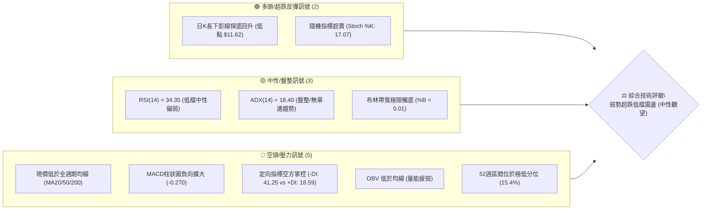
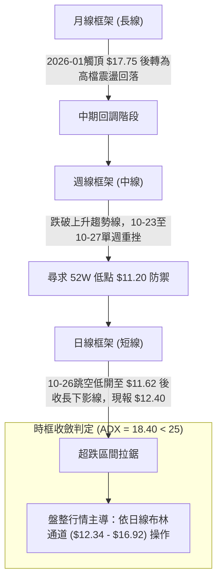
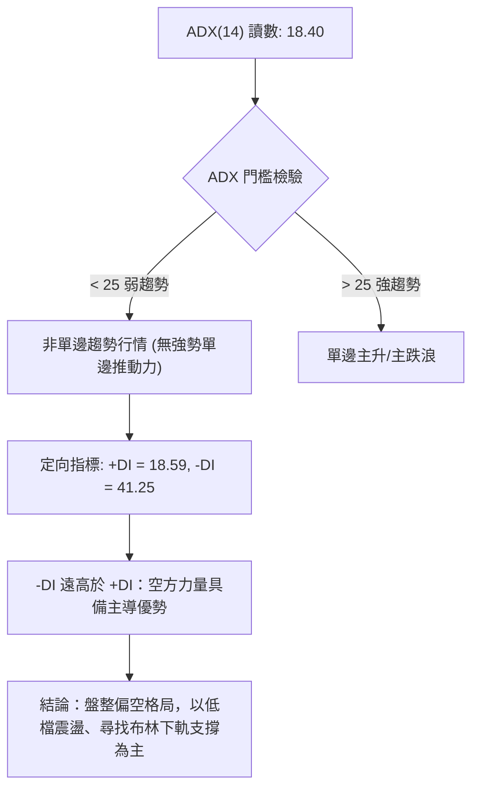
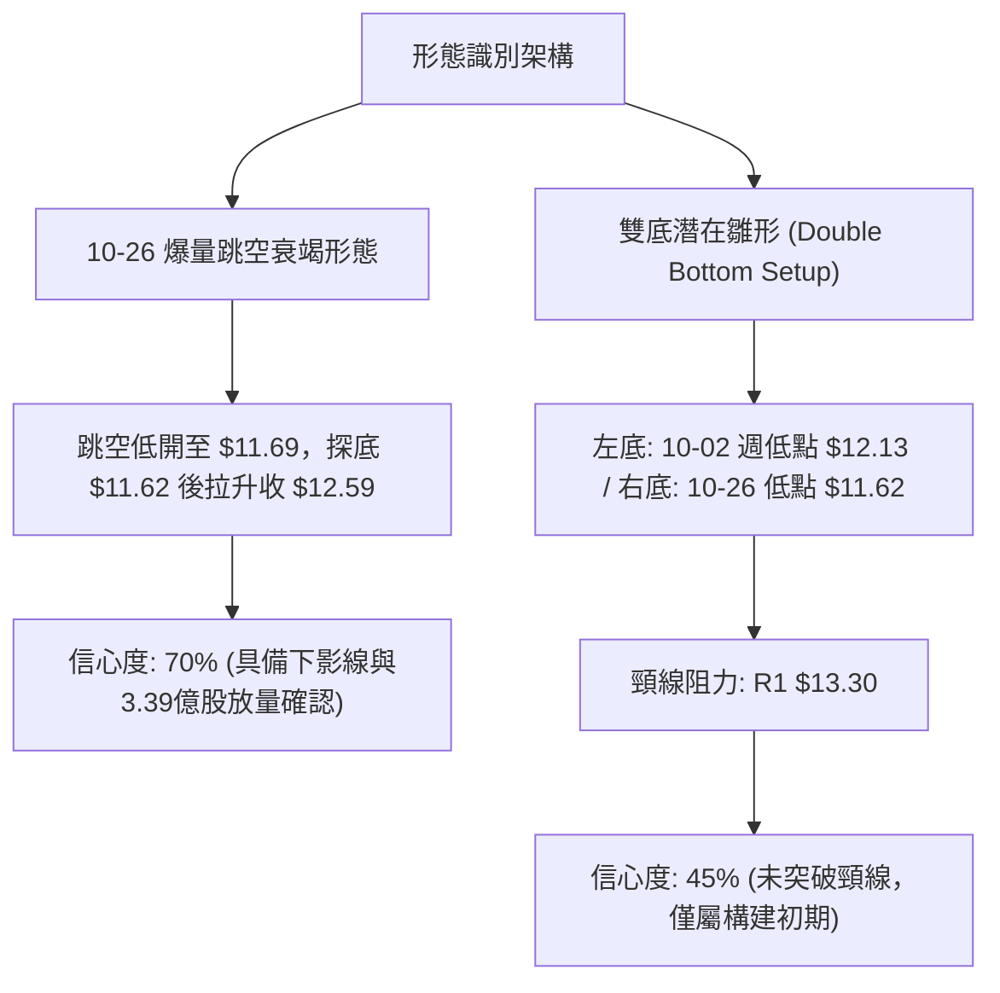
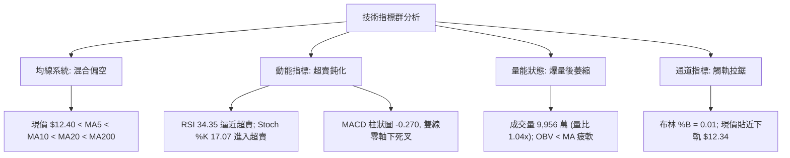
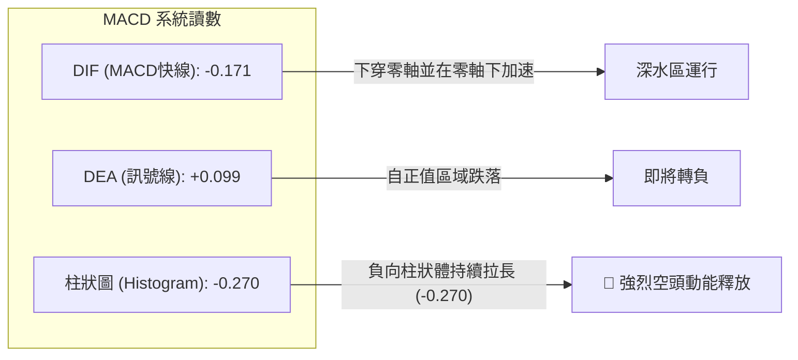
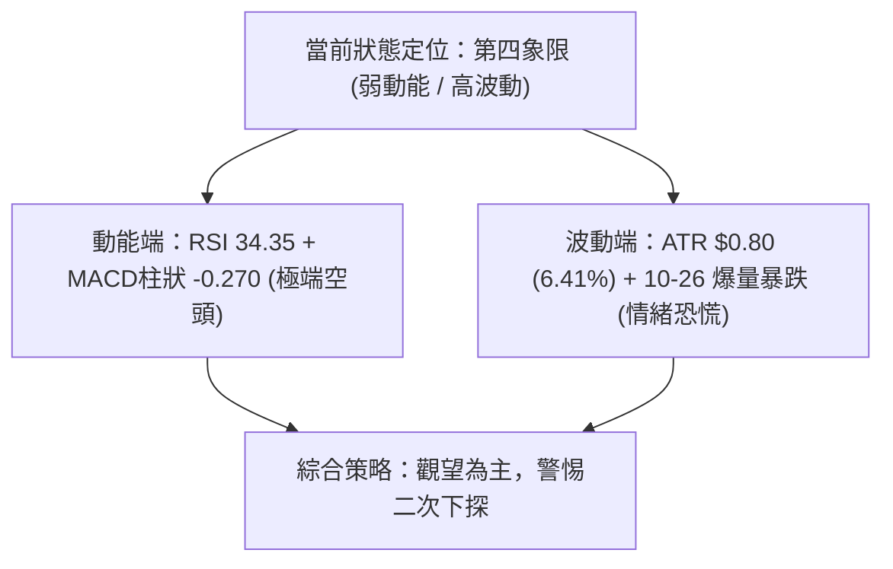
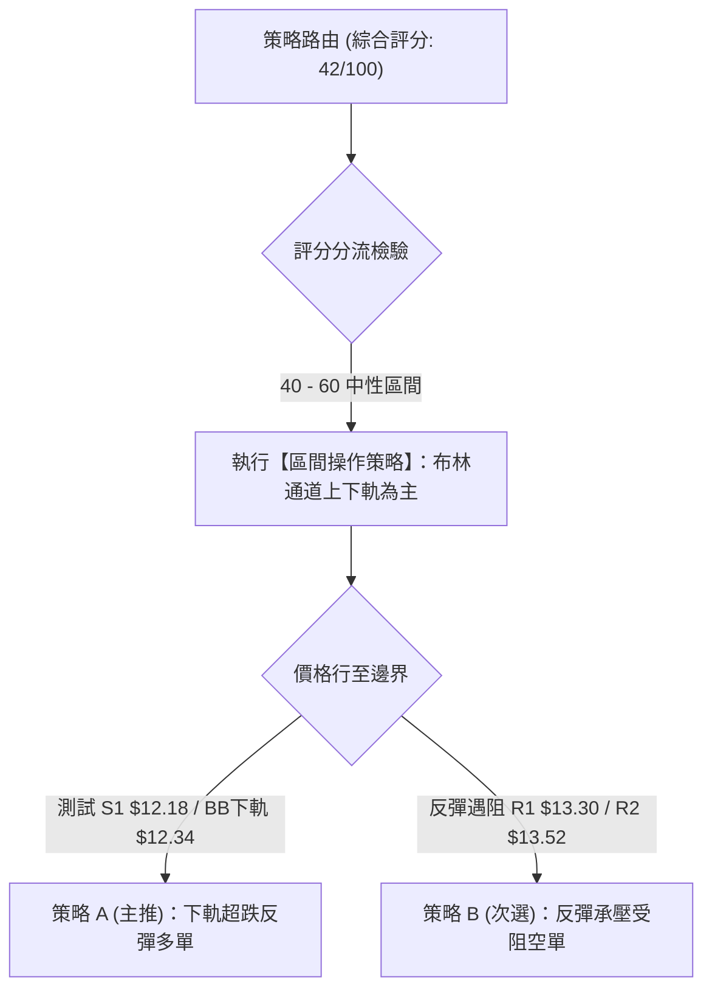
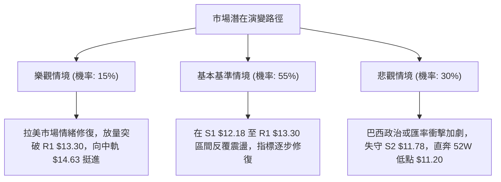

# NU 技術分析報告

> **報告日期**：2026-10-28 ｜ **語言**：繁體中文 ｜ **數據來源**：Yahoo Finance ｜ **當前價格**：$12.40 USD

---

## 目錄

| 章節 | 內容 |
|------|------|
| [1. 技術面概覽](#1-技術面概覽) | 訊號儀表板、核心指標、評分卡 |
| [2. 趨勢分析](#2-趨勢分析) | 多時框趨勢、長中短期走勢 |
| [3. 圖表形態分析](#3-圖表形態分析) | 形態識別、K線組合、目標價 |
| [4. 支撐與阻力](#4-支撐與阻力) | 關鍵價位、斐波那契回調 |
| [5. 技術指標深度解讀](#5-技術指標深度解讀) | MA/RSI/MACD/布林/成交量 |
| [6. 動能與波動率](#6-動能與波動率) | 動能評估、ATR、Beta |
| [7. 多時框架總結](#7-多時框架總結) | 時框架評分矩陣 |
| [8. 交易策略建議](#8-交易策略建議) | 多空策略、風險報酬比 |
| [9. 風險提示與監控](#9-風險提示與監控) | 監控指標、風險場景 |

---

## 1. 技術面概覽

### 🎯 技術訊號儀表板



### 📊 核心指標速覽表

| 指標類別 | 指標名稱 | 當前數值 | 訊號 | 解讀 |
|:---|:---|:---|:---:|:---|
| **價格** | 當前收盤價 | $12.40 | 🔴 | 位於52週區間15.4%分位，短期跌勢劇烈 |
| **均線** | MA20 (短均) | $14.63 | 🔴 | 現價低於MA20達 -15.25%，短線嚴重負乖離 |
| **均線** | MA50 (中均) | $14.47 | 🔴 | 現價低於MA50，中期上升波段遭跌破破壞 |
| **均線** | MA200 (長均) | $14.53 | 🔴 | 現價低於年線，中長期均線呈現死叉糾纏反壓 |
| **動能** | RSI(14) | 34.35 | 🟡 | 逼近30超賣區，未見明顯背離，空頭動能減速 |
| **動能** | MACD(12,26,9) | -0.171 / 0.099 | 🔴 | 柱狀圖為 -0.270，雙線於零軸下方死亡交叉 |
| **動能** | Stoch %K / %D | 17.07 / 27.34 | 🟢 | 進入20以下嚴重超賣區，具備短線反彈動能 |
| **趨勢** | ADX(14) | 18.40 | 🟡 | ADX < 25 代表無明確趨勢，進入弱勢震盪行情 |
| **通道** | 布林通道下軌 | $12.34 (%B: 0.01) | 🟢 | 貼緊下軌運行，極度壓縮，隨時誘發均值回歸 |
| **量能** | 20日成交量比 | 1.04x (9,956萬) | 🟡 | 量能持平均量，10-26曾爆出3.39億巨量換手 |
| **波動** | ATR(14) | $0.80 (6.41%) | 🔴 | 日內波動率高達6.41%，市場情緒受消息面衝擊 |

### 🏆 技術評分卡

```
╔══════════════════════════════════════════════════════════════╗
║              技術評分卡 — NU (2026-10-28)                    ║
╠══════════════════════════════════════════════════════════════╣
║ 趨勢強度 (Trend)     ██████░░░░░░░░░░░░░░  32/100  🔴 弱勢空方║
║ 動能指標 (Momentum)  █████████░░░░░░░░░░░  44/100  🟡 超賣醞釀║
║ 支撐穩定度 (Support) ███████████░░░░░░░░░  56/100  🟡 探底回升║
║ 成交量配合 (Volume)  ████████░░░░░░░░░░░░  42/100  🟡 爆量分歧║
║ 形態完整度 (Pattern) ████████░░░░░░░░░░░░  42/100  🟡 缺口測底║
║ 均線排列 (MAs)       ███████░░░░░░░░░░░░░  36/100  🔴 全線反壓║
╠══════════════════════════════════════════════════════════════╣
║ 綜合評分 (Overall)   ████████░░░░░░░░░░░░  42/100  🟡 中性偏弱║
║                      (依規則18算術平均：252 ÷ 6 = 42/100)    ║
╚══════════════════════════════════════════════════════════════╝
```

---

## 2. 趨勢分析

### 🌐 多時框趨勢分析



### 📈 長期趨勢 — 12個月走勢圖（Unicode）

NU 於過去一年經歷了強烈的波段推升後迅速回吐利潤。從 2025 年末的拉升至 2026 年初見頂 $17.75，隨後進入寬幅箱體，並在 2026 年 10 月受到總體政經消息（巴西大選與拉美資產重挫）衝擊，價格自 $16.12 斷崖式下殺至當前 $12.40。

```
NU 月線收盤走勢圖（過去12個月：2025-11 至 2026-10）
價格軸 ($)
$18.00 ┤              ● (2026-01: $17.75 週期高點)
$17.00 ┤● (11: $17.39) 
$16.00 ┤      ● (12: $16.74)
$15.00 ┤                    ● (02: $14.98)                  ● (08: $14.55)
$14.00 ┤                          ● (03: $14.37)  ● (07: $14.33)
$13.00 ┤                                ● (05: $13.13)            ● (09: $12.66)
$12.00 ┤                                                          ●←當前 ($12.40)
       └─────────────────────────────────────────────────────────────
        11    12    01    02    03    04    05    06    07    08    09    10  (月份)
```

#### 長期走勢特徵分析

| 階段週期 | 時間區間 | 價格區間 | 區間漲跌幅 | 形態與量能特徵 |
|:---|:---:|:---:|:---:|:---|
| **第一階段：高檔衝頂** | 2025-11 ~ 2026-01 | $16.74 → $17.75 | +6.03% | 創下歷史波段高位 $18.98，隨後多頭力竭形成圓弧頂 |
| **第二階段：震盪盤跌** | 2026-02 ~ 2026-05 | $17.75 → $13.13 | -26.03% | 連續4個月陰跌，失守月線 MA20，外資避險情緒升溫 |
| **第三階段：箱型築底** | 2026-06 ~ 2026-08 | $13.13 → $14.55 | +10.81% | 圍繞 $14.00 展開防守反擊，量能溫和萎縮，籌碼沉澱 |
| **第四階段：破位暴跌** | 2026-09 ~ 2026-10 | $14.55 → $12.40 | -14.78% | 10月中旬放量重挫，跳空下殺跌破所有短期平台 |

### 📊 中期趨勢（週線分析）

從近 20 週收盤走勢可見，NU 在 2026-10-09 當週曾放量（5.17億股）拉升至收盤 $16.12，MACD 柱狀圖一度衝高至 +0.325。然而隨後三週風雲變色，價格連續下挫至 2026-10-27 的 $12.40，單週成交量高達 4.39 億股，週線 RSI 自 66.1 崩跌至 34.3。

```
週線級別價格壓力與支撐示意圖：
$16.14 ───────────────────────────── [10-09 週波段頂部阻力]
          ╲
           ╲  急跌波段 (連續三週陰線)
            ╲
$14.32 ──────╲────────────────────── [R3 關鍵反彈分水嶺]
              ╲
$13.30 ────────╲──────────────────── [R1 週線頸線位阻力]
                ▼
$12.40 ───●現價 ($12.40)
$12.18 ───────────────────────────── [S1 近一年波段低點聚類支撐]
$11.62 ───────────────────────────── [10-26 單日極端下影線低點]
$11.20 ───────────────────────────── [52週歷史低點強支撐]
```

### ⚡ 趨勢強度評估（ADX 解讀）



#### ADX 趨勢強度參照

| 指標名稱 | 實際讀數 | 門檻區間 | 狀態評估 | 實戰交易含義 |
|:---|:---:|:---:|:---:|:---|
| **ADX(14)** | **18.40** | < 25 | 弱趨勢 / 盤整 | 順勢突破策略易遭遇假突破，應採取區間邊界逆勢或逢高空思維 |
| **+DI (多方)** | **18.59** | 基準線 20 | 多頭衰竭 | 買盤缺乏追價意願，僅具備超跌後的被動承接盤 |
| **-DI (空方)** | **41.25** | 警戒線 40 | 空頭極度強勢 | 短線空方動能宣洩至極致，數值高於40常伴隨動能衰竭與技術修正 |

---

## 3. 圖表形態分析

### 🔍 形態識別系統



#### 圖表形態信心度評估表

| 形態名稱 | 信心度 | 判斷依據（引用數據） | 完成度 | 目標價（附計算式） |
|:---|:---:|:---|:---:|:---|
| **下檔竭盡缺口與長下影線** | **70%** | 2026-10-26 跳空開盤 $11.69，創低 $11.62 後收於 $12.59，單日成交量高達 3.39 億股（為日均量3.5倍），顯著放量吸收籌碼。 | 85% | 目標價為缺口上緣阻力 **$13.30**（即 R1） |
| **潛在雙重底 (W底)** | **45%** | 訊號不足，僅做指標型解讀。兩次波段低點分別為 2026-10-02 週低點 $12.13 與 2026-10-26 低點 $11.62，頸線位於 R1 $13.30。目前價格 $12.40 仍在頸線下方，尚未形成確認突破。 | 35% | 若突破頸線 $13.30，理論量度目標價：頸線 $13.30 + 形態高度 ($13.30 - $11.62 = $1.68) = **$14.98**（貼近 2026-02 收盤高點） |
| **布林通道極限超跌反彈** | **75%** | 布林 %B 值跌至 0.01，收盤價 $12.40 緊貼布林下軌 $12.34，隨機指標 %K 跌至 17.07 進入超賣，指標型均值回歸觸發機率高。 | 90% | 回歸布林中軌（MA20）目標價：**$14.63**，第一中繼阻力看 R1 **$13.30** |

### 🕯️ 重要K線形態分析

嚴格依據提供的「近10根日K」與「近8根週K」進行實證形態解讀：

#### 近10根日K線形態分析

| 日期 | 開 | 高 | 低 | 收 | 成交量 | K線形態 | 解讀與訊號 |
|:---:|:---:|:---:|:---:|:---:|:---:|:---|:---:|
| **10-14** | 15.31 | 15.44 | 14.77 | 14.93 | 81,835,800 | 實體中陰線 | 跌破 $15.00 整數關口，高點受制於 $15.44，🔴 空方發力 |
| **10-15** | 14.46 | 15.06 | 14.40 | 14.73 | 76,170,200 | 低開小陽十字星 | 多空在 $14.50 附近產生分歧，下影線微幅抗跌，🟡 中性 |
| **10-16** | 14.71 | 14.94 | 14.45 | 14.56 | 45,187,000 | 縮量小陰線 | 縮量盤跌，買盤觀望氣氛濃厚，🔴 空方微幅佔優 |
| **10-19** | 14.72 | 14.92 | 14.36 | 14.51 | 41,434,800 | 窄幅整理小陰線 | 波動幅度極低（振幅 0.56），成交量降至4,100萬股，🟡 觀望 |
| **10-20** | 14.62 | 15.41 | 14.60 | 15.09 | 71,858,000 | 溫和放量光腳大陽線 | 重新站上 $15.00，實體包覆前三日K棒，🟢 短多反彈 |
| **10-21** | 15.21 | 15.37 | 15.01 | 15.05 | 66,306,900 | 衝高回落小陰十字 | 高開低走，受阻於阻力區間，多頭攻擊受挫，🟡 滯漲轉弱 |
| **10-22** | 14.89 | 15.06 | 14.63 | 14.73 | 55,429,600 | 破位中陰線 | 再次失守 $15.00，均線集體轉折向下，🔴 空方重掌主導 |
| **10-23** | 14.69 | 15.25 | 14.57 | 15.16 | 87,080,800 | 帶長上影線陽線 | 尾盤雖拉升至 $15.16，但未能越過 10-20 高點，🟡 假突破誘多 |
| **10-26** | 11.69 | 12.78 | 11.62 | 12.59 | 339,677,800 | **爆量長下影錘頭陰線** | 跳空暴跌3.47元開盤，探底至 $11.62 後湧入天量換手（3.39億股），回升至 $12.59，🟢 極度恐慌後的潛在竭盡信號 |
| **10-27** | 12.74 | 13.00 | 12.37 | 12.40 | 99,565,700 | 帶上影線中陰線 | 嘗試反彈摸高 $13.00 整數關口無功而返，收跌回落至 $12.40 測試支撐，🔴 短線反彈動能衰竭 |

#### 近8根週K線形態分析

| 週末交易日 | 開 | 高 | 低 | 收 | 週成交量 | K線形態 | 解讀與訊號 |
|:---:|:---:|:---:|:---:|:---:|:---:|:---|:---:|
| **09-11** | 15.56 | 15.82 | 14.44 | 14.62 | 285,554,300 | 帶長上影線陰線 | 自高位回吐，波段衝頂未果，🔴 空頭壓制 |
| **09-18** | 14.35 | 14.55 | 13.58 | 13.65 | 368,136,800 | 實體大陰線 | 放量跌破 $14.00 關卡，下探 S2 區域，🔴 趨勢走壞 |
| **09-25** | 13.84 | 14.25 | 13.36 | 13.59 | 290,425,500 | 帶長下影小陰線 | 於 $13.36 獲得低檔支撐，形成弱勢整理，🟡 暫時企穩 |
| **10-02** | 12.53 | 13.50 | 12.13 | 13.43 | 532,732,100 | **巨量長下影下探陽線** | 測試 S1/S2 邊界（$12.13）引發5.32億巨量買盤抄底，收復失地，🟢 多頭防線構築 |
| **10-09** | 14.98 | 16.14 | 14.84 | 16.12 | 517,684,300 | 實體長陽突破線 | 延續反彈，週漲幅巨大，強勢突破所有短期均線，🟢 強烈多頭反轉訊號 |
| **10-16** | 16.10 | 16.19 | 14.40 | 14.56 | 328,775,500 | **高檔烏雲蓋頂/吞噬長陰** | 高開無力上攻，直接跌破前週實體大半，形成多頭陷阱，🔴 極度凶險看跌反轉 |
| **10-23** | 14.72 | 15.41 | 14.36 | 15.16 | 322,110,100 | 震盪反彈小陽線 | 試圖修復破位形態，但高點 $15.41 未能觸及前週高位，🟡 弱勢反抽 |
| **10-27** | 11.69 | 13.00 | 11.62 | 12.40 | 439,243,500 | **跳空暴跌帶下影大陰線** | 受消息面衝擊開盤跌破前低，單週急跌放量4.39億股，低檔留有下影線，🔴 趨勢破位/低檔換手 |

### 📉 ASCII 走勢形態示意圖

```
NU 近期價格走勢結構與缺口形態：
價格 ($)
$16.19 ──┬─────────────────● (10-16 高點)
         │                 │
$15.41 ──┼───────────●─────┼─────● (10-23 反彈高點)
         │           │     │     │
$14.56 ──┼─────●─────┼─────┼─────┼───────────────────── [MA200 反壓線: $14.53]
         │     │     │     │     │
$13.30 ──┼─────┼─────┼─────┼─────┼───────● (10-27 反彈阻力 R1: $13.30)
         │     │     │     │     │       │
         │  ░░░░░░░░░░░░░░░░░░░░░░░░░░░░░░░░░  [10-26 巨大跳空暴跌缺口]
         │     │     │     │     │       │
$12.40 ──┼─────┼─────┼─────┼─────┼───────●←【現價收盤 $12.40】
         │     │     │     │     │       │
$11.62 ──┴─────┴─────┴─────┴─────┴───────● (10-26 爆量針底 $11.62)
         ──────────────────────────────────
          10-16 10-19 10-20 10-22 10-23 10-26 10-27
```

---

## 4. 支撐與阻力

### 🗺️ 關鍵價位分布圖（Unicode）

```
NU 價位結構分布圖（嚴格依據 OHLCV 聚類與斐波那契計算）
═══════════════════════════════════════════════════════════════
$14.32 ║██████████████████████████████║ 強阻力 R3 (近一年波段高點聚類)
$13.52 ║████████████████████          ║ 阻力 R2 (反彈中繼反壓位)
$13.30 ║████████████████████████████  ║ 關鍵阻力 R1 (缺口下緣與波段高點聚類)
       ║                              ║
$12.40 ╠══════════════════════════════╣ ◄ 現價收盤 ($12.40)
       ║                              ║
$12.18 ║▓▓▓▓▓▓▓▓▓▓▓▓▓▓▓▓▓▓▓▓          ║ 近期關鍵支撐 S1 (近一年波段低點聚類)
$11.78 ║████████████████████████      ║ 強支撐 S2 (10-26下影線防禦區)
$11.51 ║██████████████████████████████║ 極限強支撐 S3 (52W歷史低點前哨陣地)
═══════════════════════════════════════════════════════════════
```

### 🚧 阻力位分析表

所有價位均直接取自系統計算的波段聚類點位，不添加主觀捏造數值：

| 阻力級別 | 價位 | 形成原因 | 突破難度 | 重要性評估 |
|:---|:---:|:---|:---:|:---|
| **第一阻力 (R1)** | **$13.30** | 近一年波段高點聚類位，且為 10-27 反彈高點（$13.00）上方的第一道實質解套賣壓層，距現價 +7.26%。 | 🟡 中等 | 🟢 短線多空強弱分界嶺，突破方能封閉 10-26 缺口下緣。 |
| **第二阻力 (R2)** | **$13.52** | 波段密集套牢換手高點聚類位，距現價 +8.99%，為 10 月初震盪平台核心。 | 🔴 較高 | 🟡 中期空方陣地，若觸及預計將引發解套賣壓與空頭回補博弈。 |
| **第三阻力 (R3)** | **$14.32** | 近一年波段高點聚類強阻力，距現價 +15.44%，重合 MA50（$14.47）與斐波那契 61.8%（$14.17）阻力帶。 | 🔴 極高 | 🔴 中期多頭反轉的牛熊分水嶺，非巨量利好難以逾越。 |

### 🛡️ 支撐位分析表

| 支撐級別 | 價位 | 形成原因 | 守住機率 | 重要性評估 |
|:---|:---:|:---|:---:|:---|
| **第一支撐 (S1)** | **$12.18** | 近一年波段低點聚類位，距現價僅 -1.77%，貼近布林下軌（$12.34）與 10-02 週線低點（$12.13）。 | 65% | 🟢 多頭第一道生命線，跌破則預示短線反彈失敗。 |
| **第二支撐 (S2)** | **$11.78** | 近一年波段低點聚類位，距現價 -5.00%，覆蓋 10-26 爆量巨幅長下影線的承接平台（$11.62 - $11.69）。 | 75% | 🟡 強力防線，機構大資金在 10-26 於此大量換手，具高安全邊際。 |
| **第三支撐 (S3)** | **$11.51** | 近一年波段低點聚類極限支撐，距現價 -7.18%，下臨 52 週絕對低點 $11.20。 | 85% | 🔴 戰略級防禦點，一旦有效跌破將引發流動性踩踏與無底洞陰跌。 |

### 📐 斐波那契回調位分析

依據 52 週完整波動區間（低點 $11.20 → 高點 $18.98，垂直落差 $7.78）計算之標準斐波那契回調水準：

```
斐波那契回調位分布結構：
0.0%  (52W High) ────────────────────────── $18.98
23.6%            ────────────────────────── $17.14
38.2%            ────────────────────────── $16.01 (10-09 波段高點受阻於此)
50.0%            ────────────────────────── $15.09 (整數心理大關)
61.8%            ────────────────────────── $14.17 (黃金分割關鍵位，與 MA60 $14.42 呼應)
78.6%            ────────────────────────── $12.86 (極深回撤位，現價上方第一道黃金分界)
[現價 $12.40]    ▲ 落在 78.6% ($12.86) 與 100.0% ($11.20) 弱勢極限區間
100.0% (52W Low) ────────────────────────── $11.20 (全週期底線)
```

#### 斐波那契結構深度解讀
1. **現價位置意義**：現價 $12.40 跌破了 78.6% 回調位（$12.86），表明 2025 年以來的多頭波段遭到極深度破壞。78.6% 回調位通常被視為多頭「最後防禦陣地」，一旦跌破，價格有極大慣性向下尋求 100.0% 終極支撐位（$11.20）。
2. **反彈阻力共振**：若後續發生均值回歸修復，斐波那契 78.6%（$12.86）將轉化為短線動態阻力，與波段阻力 R1（$13.30）共同構成壓制帶。

---

## 5. 技術指標深度解讀

### 🎛️ 指標訊號總覽



### 📈 移動平均線排列分析

#### 各週期移動平均線狀態表

| 均線名稱 | 數值 | 價格相對於均線之偏離度 | 狀態評估 | 均線走勢軌跡（數據快照） |
|:---|:---:|:---:|:---:|:---|
| **MA 5** | $13.99 | -11.34% (-$1.59) | 🔴 急速向下貫穿 | ▅▄▄▄▄▃▃▃▂▁▁▁▁▂▄▅▇█████▇▆▆▆▆▆▅▄ |
| **MA 10** | $14.38 | -13.74% (-$1.98) | 🔴 下行斜率陡峭 | ▇▆▅▅▄▄▃▃▂▁▁▁▁▁▂▂▃▄▅▇███████▇▆▅ |
| **MA 20** | $14.63 | -15.25% (-$2.23) | 🔴 跌破布林中軌 | ████▇▇▆▅▄▃▃▂▁▁▁▁▁▂▂▃▄▄▄▅▅▆▆▇▇▇ |
| **MA 50** | $14.47 | -14.02% (-$2.07) | 🔴 中期均線死叉 | N/A（中期趨勢走壞） |
| **MA 60** | $14.42 | -14.02% (-$2.02) | 🔴 季線反轉下行 | ▁▁▂▂▃▃▃▃▂▂▁▁▁▂▃▃▄▅▆▇▇▇▇▇█████▇ |
| **MA 120** | $13.80 | -10.16% (-$1.40) | 🔴 半年線全面失守 | ██████▇▇▆▄▃▂▁▁▁▁▁▂▂▃▃▃▃▃▄▄▄▅▄▃ |
| **MA 200** | $14.53 | -14.66% (-$2.13) | 🔴 年線長空壓制 | N/A（跌破牛熊線） |
| **MA 240** | $14.89 | -16.72% (-$2.49) | 🔴 長期均線阻力 | ████▇▇▇▆▆▅▅▄▄▄▄▄▄▄▄▄▄▄▃▃▃▂▂▂▁▁ |

#### 均線架構綜合解讀
當前均線系統呈現典型的「混合偏空」排列。長期均線 MA200（$14.53）與 MA50（$14.47）、MA20（$14.63）在 $14.50 附近高度密集糾纏，構成強固的「均線反壓蓋頂」。價格對短期 MA5 負乖離達到 -11.34%，對 MA20 負乖離達到 -15.25%，表明市場短期處於嚴重超跌狀態，隨時存在技術性反抽以修復乖離率的內在需求。

### 📉 RSI(14) 分析

```
RSI(14) 儀表尺：
0 ─────── 20 ──────── 34.35 ──────── 50 ──────── 70 ─────── 100
[  極度超賣  ]   ▲現價位置 (34.35)    [   平衡軸   ]    [  超買區  ]
進度條展示：
███████░░░░░░░░░░░░░  34.35 / 100 (低檔中性偏弱)
```

- **超買超賣判定**：Wilder RSI(14) 當前數值為 34.35，位於 30-70 的中性區間下緣，逼近 30 絕對超賣界限。
- **背離分析判斷**：依據近 20 根 K 棒的首尾對比，價格由 10-09 的 $16.12 跌至 10-27 的 $12.40（波段創新低），RSI 亦自 66.1 崩落至 34.35。**明確結論：RSI 無明顯底背離，亦無頂背離**。這說明當前下跌屬於動能直接驅動的順勢殺跌，尚未見到指標底背離帶來的強烈反轉信號。

### 📊 MACD(12/26/9) 訊號解讀



- **訊號解析**：DIF 已經跌破零軸來到 -0.171，而 Signal 線尚在 +0.099，兩者差距擴大導致 MACD 柱狀圖暴跌至 -0.270，呈現「零軸下死叉加速」格局，驗證了近期空方殺盤動能的強烈性。

### 📦 布林通道分析

```
NU 日線布林通道 (20, 2) 結構示意圖：
價格軸 ($)
$16.92 ──────────────────────────── 上軌 (Upper Band)
       │
$14.63 ──────────────────────────── 中軌 (Middle Band / MA20)
       │
$12.40 ───●現價 ($12.40)
$12.34 ──────────────────────────── 下軌 (Lower Band)
```

- **通道指標解析**：
  - **上軌**：$16.92 ｜ **中軌 (MA20)**：$14.63 ｜ **下軌**：$12.34
  - **布林 %B**：**0.01**（0 代表下軌，0.5 代表中軌，1 代表上軌）
  - **解讀**：%B 讀數為 0.01，意味著收盤價 $12.40 幾乎直接釘在布林下軌（$12.34）之上，在統計概率上已處於 2 個標準差之外的極端邊緣。此種「穿軌拉鋸」狀態通常意味著空方推動力短線面臨極限阻抗，將促發向中軌 $14.63 的均值回歸。

### 💹 成交量分析（量價配合度）

1. **成交量對比**：
   - 最新交易日成交量：99,565,700 股
   - 20 日均量：95,928,595 股（量比 1.04x）
   - 50 日均量：81,724,522 股
2. **OBV 能量潮判斷**：
   - 數據明確顯示：**OBV < MA → 量能疲弱**。
   - 儘管 10-26 出現了單日 3.39 億股的恐慌承接天量，但整體累積能量潮（OBV）仍運行於其移動平均線下方，顯示籌碼外流總量依然壓制資金流入，多頭買力尚未構成持續性的累積堆疊。

---

## 6. 動能與波動率

### ⚡ 動能評估四象限

| 象限分區 | 動能強度 (Momentum) | 波動率 (Volatility) | 當前標的狀態 | 交易策略啟示 |
|:---|:---:|:---:|:---:|:---|
| **第一象限 (Q1)** | 強動能 (Bullish) | 低波動 (Low Vol) | 否 | 最佳主升段機會，抱牢持股 |
| **第二象限 (Q2)** | 弱動能 (Bearish) | 低波動 (Low Vol) | 否 | 陰跌築底期，謹慎觀望 |
| **第三象限 (Q3)** | 強動能 (Expansion) | 高波動 (High Vol) | 否 | 暴力多頭或主跌浪，高風險高收益 |
| **第四象限 (Q4)** | **弱動能 (Bearish)** | **高波動 (High Vol)** | **✓ (NU 當前所屬象限)** | **情緒受挫恐慌拋售期，禁止追漲，只宜小倉位博取下軌超跌反彈** |



### 📊 ATR 波動率分析

- **ATR(14) 讀數**：**$0.80**（Wilder 計算）
- **佔股價百分比**：**6.41%**（屬於極高波動率狀態）
- **止損距離設計建議**：
  - **日內/超短線止損**：1.0 × ATR = **$0.80**。以現價 $12.40 計算，止損點設為 $11.60（緊貼 10-26 針底低點 $11.62）。
  - **波段交易防守止損**：1.5 × ATR = **$1.20**。以入場點計算防守空間，但考量數據紀律，應嚴格锚定支撐點位 S2（$11.78）作為硬止損。

### 📐 Beta 與市場相關性

- **Beta 係數**：**0.955**
- **市場特徵解讀**：Beta 為 0.955，與美股標普 500 指數具備高度系統性同步特徵（接近 1.0）。然而近期 NU 股價獨立於美股大盤重挫，主要導因於其底層業務深度依賴巴西與拉美新興市場（巴西營收佔比極重），受到外圍匯率波動與政經局勢（新聞顯示巴西股市重挫）的非系統性風險衝擊。

---

## 7. 多時框架總結

### 📋 時框架評分表

| 時框架 | 趨勢方向 | 動能指標 | 均線排列 | 圖表形態 | 綜合評分 | 戰術建議 |
|:---|:---:|:---:|:---:|:---:|:---:|:---|
| **短期 (日線)** | 🔴 破位重挫 | 🟡 接近超賣 (RSI 34.35) | 🔴 均線死叉向下 | 🟡 爆量長下影錘頭 | **40/100** | 考驗 S1 $12.18 支撐，嚴禁追空，等待企穩 |
| **中期 (週線)** | 🔴 箱體破位 | 🔴 MACD柱轉負 (-0.270) | 🔴 跌破 MA20/50 | 🔴 高檔烏雲蓋頂後下殺 | **38/100** | 週線級別尋求 52W 低點 $11.20 防禦 |
| **長期 (月線)** | 🟡 寬幅震盪 | 🟡 漲勢回吐中繼 | 🟡 處於歷史中位區間 | 🟡 圓弧雙頂回調 | **48/100** | 觀察 $12.00 整數防線是否構成長期底部 |

### 🔲 綜合訊號矩陣

```
時框訊號一致性評估：
短期 (日線)：  🔴 空頭壓制  ──┐
中期 (週線)：  🔴 空頭主導  ────┼──► 權衡結論：空方佔有絕對技術優勢，但短線超跌嚴重
長期 (月線)：  🟡 中性震盪  ──┘
```

### ⚖️ 多時框收斂結論

嚴格遵循多時框收斂規則（規則 14）：
1. **行情性質判斷**：ADX(14) 讀數為 **18.40**，小於門檻值 25，明確判定當前市場處於**「盤整行情（非單邊趨勢）」**。
2. **主導時框與交易邊界**：盤整行情依規則以**「日線布林通道上下軌（$12.34 至 $16.92）」**為主要交易區間與防禦邊界。
3. **唯一方向性結論**：**【中性偏弱區間震盪（等待下軌支撐確認）】**。雖然各時框均線空頭排列，但在布林下軌 $12.34、S1 $12.18 與隨機指標超賣（%K: 17.07）三重約束下，下行空間受到限制。因此，交易策略嚴禁盲目追空，應聚焦於**布林下軌區域的高拋低吸區間交易**，此結論與第 8 章策略完全一致。

---

## 8. 交易策略建議

### 🗺️ 策略決策流程圖



### 🧭 策略路由（依評分卡分流）

> **當前主策略方向 = 區間震盪操作（依綜合評分 42/100，落於 40–60 中性區間）**  
> 市場缺乏單邊趨勢推動力（ADX 18.40），操作應恪守「下軌支撐低吸、上檔阻力高拋」之區間邊界思維，同時以精確支撐位設置嚴格止損。

### 🎯 價格情境階梯（Price Scenarios）

所有觸發價位與目標階梯完全引用第 4 章「關鍵價位」區塊之客觀數據：

| 觸發條件 | 下一目標 | 後續延伸 | 情境技術含義 |
|:---|:---:|:---:|:---|
| **向上突破 R1 $13.30** | R2 $13.52 | R3 $14.32 | 短線轉強，封閉 10-26 跳空缺口，展開向 MA20 中軌的修復波段 |
| **站穩現價區間 ($12.18 - $12.40)** | R1 $13.30 | — | 於布林下軌企穩構築微型雙底，維持低檔震盪築底格局 |
| **向下破位 S1 $12.18** | S2 $11.78 | S3 $11.51 | 中期轉弱，再次下探 10-26 爆量針底，考驗 52W 終極低點 $11.20 |

### 📊 情境機率分佈

| 預期情境 | 發生機率 | 主要技術依據 |
|:---|:---:|:---|
| **情境一：區間震盪 / 築底拉鋸** | **55%** | ADX 18.40 顯示無單邊趨勢，布林下軌（$12.34）提供即時承接，10-26爆量長下影線吸收大量浮額。 |
| **情境二：弱勢回落 / 再探支撐** | **30%** | MACD 柱狀圖（-0.270）處於強空頭狀態，-DI（41.25）主導市場，OBV 疲軟，消息面仍具高度不確定性。 |
| **情境三：強力反彈 / 補缺修復** | **15%** | 隨機指標超賣（%K 17.07），價格嚴重偏離 MA20（-15.25%），具備強烈的均值回歸修復動力。 |

### 🟢 主策略詳情（區間高拋低吸策略）

嚴格依據規則 17 計算風險報酬比：  
- 多頭：$\text{風險報酬比} = \frac{\text{目標價 T1} - \text{進場價}}{\text{進場價} - \text{止損價}}$  
- 空頭：$\text{風險報酬比} = \frac{\text{進場價} - \text{目標價 T1}}{\text{止損價} - \text{進場價}}$

| 策略要素 | 策略 A（主推：下軌超跌博反彈多單） | 策略 B（次選：反彈遇阻承壓做空） |
|:---|:---|:---|
| **進場條件** | 價格回踩 S1 $12.18 不破，或現價 $12.40 出現 15分/60分 K 止跌陽線 | 價格反彈至 R1 $13.30 遇阻出現滯漲長上影 K 線 |
| **進場價格** | **$12.40**（當前現價進場） | **$13.30**（反彈至阻力位 R1） |
| **目標價 T1** | **$13.30**（阻力位 R1，獲利空間 $0.90） | **$12.18**（支撐位 S1，獲利空間 $1.12） |
| **目標價 T2** | **$13.52**（阻力位 R2，獲利空間 $1.12） | **$11.78**（強支撐 S2，獲利空間 $1.52） |
| **止損價格** | **$11.78**（跌破強支撐 S2，風險空間 $0.62） | **$13.52**（突破阻力位 R2，風險空間 $0.22） |
| **風險報酬比** | **1 : 1.45（以 T1 計）**<br>*(13.30 - 12.40) ÷ (12.40 - 11.78) = 0.90 ÷ 0.62*<br>*(以 T2 計為 1 : 1.81)* | **1 : 5.09（以 T1 計）**<br>*(13.30 - 12.18) ÷ (13.52 - 13.30) = 1.12 ÷ 0.22*<br>*(以 T2 計為 1 : 6.91)* |
| **成功機率** | **55%** | **45%** |
| **建議倉位** | **10% - 15%**（輕倉防禦型參與） | **5% - 10%**（逆短線超跌反抽，嚴格快進快出） |

### 🔴 反向風險觸發點（風控與對沖提示）

若主推策略 A 進場後發生以下訊號，必須無條件執行停損離場或反手對沖：
1. **收盤跌破 S1 $12.18 並摜破 $11.78**：代表 10-26 爆量長下影線的承接防線失守，形成「破位加速下殺」，下方直指 52W 歷史低點 $11.20。
2. **MACD 柱狀圖低於 -0.300 且 ADX 突破 25**：代表盤整被打破，轉化為「單邊主跌浪」，區間操作邏輯徹底失效。

### ⭐ 整體訊號強度評星

```
╔══════════════════════════════════════════════════════════════╗
║ 做多訊號強度：★★☆☆☆  (2/5星 — 僅屬超跌反彈，非主升趨勢)     ║
║ 做空訊號強度：★★★☆☆  (3/5星 — 順均線壓制，但短線超跌受阻)   ║
║ 整體可信度：  ★★★☆☆  (3/5星 — 盤整震盪期，指標信號多有鈍化) ║
╚══════════════════════════════════════════════════════════════╝
```

---

## 9. 風險提示與監控

### ✅ 關鍵監控指標 Checklist

```
╔══════════════════════════════════════════════════════════════╗
║               每日盤後交易監控清單 (Checklist)               ║
╠══════════════════════════════════════════════════════════════╣
║ [ ] 價格收盤是否跌破支撐 S1 ($12.18)？                       ║
║     └─ 是：立即終止多頭策略；否：維持區間低吸佈局。          ║
║ [ ] RSI(14) 是否跌破 30 進入深度超賣？                       ║
║     └─ 是：警惕鈍化風險，禁止加碼；否：關注反彈契機。        ║
║ [ ] 日成交量是否萎縮至 50日均量 ($8,172萬股) 以下？          ║
║     └─ 是：表明浮額清洗乾淨，築底成功率提升。                ║
║ [ ] 價格是否成功向上回補 10-26 缺口至 R1 ($13.30)？          ║
║     └─ 是：短線轉強，多單分批獲利了結或上移保護性止損。      ║
║ [ ] ADX(14) 是否攀升突破 25 大關？                           ║
║     └─ 是：標誌單邊趨勢啟動，必須依方向調整為單邊跟隨策略。  ║
╚══════════════════════════════════════════════════════════════╝
```

### ⚠️ 風險場景分析



### 🛡️ 風險管理重要提醒

1. **宏觀與地緣政治風險**：近期新聞明確指出「巴西股市大跌」及「巴西大選不確定性」，NU 雖為優秀數字銀行，但其底層資產高度曝險於巴西雷亞爾匯率及拉美宏觀信貸週期。基本面評級雖維持 Buy，但技術面往往領先反映外資去槓桿壓力，不可單純依賴基本面本益比低而忽視技術破位風險。
2. **嚴格限制單筆交易虧損**：當前 ATR 高達 $0.80（6.41%），單日震幅極大。建議單筆交易虧損額度不得超過總投資組合淨值的 **1.0%**。以操作策略 A 為例（止損幅度約 5%），單一倉位上限應嚴格控制在 **10% - 15%** 以內。

---

## 📋 報告總結

```
╔══════════════════════════════════════════════════════════════════╗
║                   NU 技術分析報告總結                          ║
╠══════════════════════════════════════════════════════════════════╣
║ 報告日期：2026-10-28                                             ║
║ 當前價格：$12.40 USD                                             ║
║ 分析評級：⚖️ 綜合評分 42/100 —【中性偏弱／低檔震盪觀望】         ║
║                                                                  ║
║ 關鍵結論：                                                       ║
║ ├─ 長期趨勢：🟡 月線圓弧頂後深度回調，逼近52週低點防禦區間       ║
║ ├─ 中期趨勢：🔴 週線跌破多重平台，全週期均線糾纏反壓於 $14.50    ║
║ ├─ 短期趨勢：🟢 10-26 爆量長下影，布林 %B=0.01 觸發極度超賣拉鋸  ║
║ ├─ 關鍵支撐：S1 $12.18 ｜ 強支撐 S2 $11.78 ｜ 極限防線 S3 $11.51  ║
║ ├─ 關鍵阻力：R1 $13.30 ｜ 次級阻力 R2 $13.52 ｜ 核心牛熊線 R3 $14.32║
║ └─ 分析師目標：共識買入 (23位)，均價 $18.97 (現價具極大基本面折扣)║
║                                                                  ║
║ 最優策略組合：                                                   ║
║ 1. 🥇 最佳機會：策略 A (超跌博反彈) — 在 $12.40 附近輕倉參與，   ║
║                止損設 S2 $11.78，目標看 R1 $13.30 (風報比 1:1.45)║
║ 2. 🥈 次選機會：策略 B (高拋逆勢空) — 若反彈觸及 R1 $13.30 遇阻， ║
║                止損設 R2 $13.52，目標下看 S1 $12.18 (風報比 1:5.09)║
║ 3. 🥉 保守選擇：空倉觀望 — 等待價格站穩 R1 $13.30 或 ADX > 25 趨勢║
║                明確後，再行順勢介入。                            ║
╚══════════════════════════════════════════════════════════════════╝
```

---

> ⚠️ **免責聲明**：本報告為 AI 自動生成之技術分析，所有數據及估算均基於提供的歷史價格資訊。本報告**僅供研究與學術參考**，**不構成任何投資建議**。投資有風險，入市需謹慎。

---

*報告生成時間：2026-10-28 ｜ 數據來源：Yahoo Finance ｜ 分析框架：多時框技術分析*