# NU 技術分析報告

> **報告日期**：2026-10-29 ｜ **語言**：繁體中文 ｜ **數據來源**：Yahoo Finance ｜ **當前價格**：$11.97

---

## 目錄

| 章節 | 內容 |
|------|------|
| [1. 技術面概覽](#1-技術面概覽) | 訊號儀表板、核心指標、評分卡 |
| [2. 趨勢分析](#2-趨勢分析) | 多時框趨勢、長中短期走勢 |
| [3. 圖表形態分析](#3-圖表形態分析) | 形態識別、K線組合、目標價 |
| [4. 支撐與阻力](#4-支撐與阻力) | 關鍵價位、斐波那契回調 |
| [5. 技術指標深度解讀](#5-技術指標深度解讀) | MA/RSI/MACD/布林/成交量 |
| [6. 動能與波動率](#6-動能與波動率) | 動能評估、ATR、Beta |
| [7. 多時框架總結](#7-多時框架總結) | 時框架評分矩陣 |
| [8. 交易策略建議](#8-交易策略建議) | 多空策略、風險報酬比 |
| [9. 風險提示與監控](#9-風險提示與監控) | 監控指標、風險場景 |

---

## 1. 技術面概覽

### 🎯 技術訊號儀表板

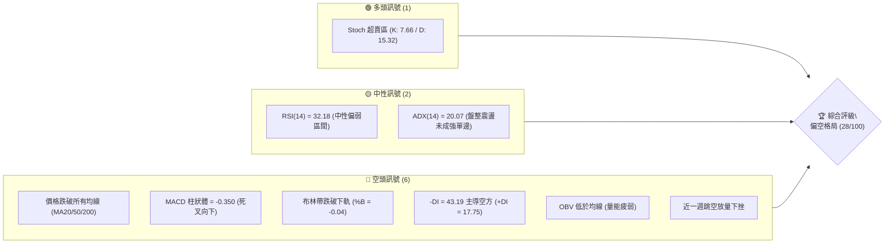

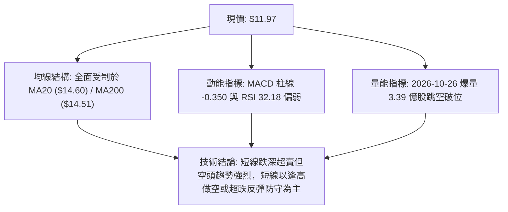

### 📊 核心指標速覽表

| 指標類別 | 指標名稱 | 當前數值 | 訊號 | 解讀 |
|----------|----------|----------|------|------|
| **價格** | 當前價格 | $11.97 | 🔴 | 位於52週區間 9.9% 之極低位，逼近歷史波段低點 |
| **均線** | MA20 | $14.60 | 🔴 | 價格低於 MA20 達 -18.00%，短期空頭下壓強勁 |
| **均線** | MA50 | $14.42 | 🔴 | 價格低於 MA50 達 -16.99%，中期趨勢轉向空方 |
| **均線** | MA200 | $14.51 | 🔴 | 價格跌破年線長期支撐，長期多頭結構遭遇實質破壞 |
| **動能** | RSI(14) | 32.18 | 🟡 | 進入超賣臨界邊緣（30-70中性偏空），未現底背離 |
| **動能** | MACD | -0.338 | 🔴 | 快慢線死叉且在零軸下方運行，柱線擴大至 -0.350 |
| **動能** | Stoch %K/%D| 7.66 / 15.32 | 🟢 | 進入極度超賣區間，隨時具備技術性跌深反彈動能 |
| **趨勢** | ADX(14) | 20.07 | 🟡 | ADX < 25 處於弱趨勢/震盪，但 -DI(43.19) 遠大於 +DI(17.75) |
| **通道** | 布林通道 | %B = -0.04 | 🔴 | 跌破下軌 ($12.17)，呈現極端超賣且下軌開口放大 |
| **波動** | ATR(14) | $0.77 | 🔴 | 佔股價比達 6.46%，高波動環境，止損區間需拓寬 |
| **量能** | OBV | OBV < MA | 🔴 | 資金持續呈現淨流出，量能未能確認價格反轉 |

### 🏆 技術評分卡

```
╔══════════════════════════════════════════════════════════════════════╗
║                    技術評分卡 — NU (2026-10-29)                     ║
╠══════════════════════════════════════════════════════════════════════╣
║ 趨勢強度      ██████░░░░░░░░░░░░░░  30/100  🔴 空頭壓制              ║
║ 動能指標      ██████░░░░░░░░░░░░░░  30/100  🔴 動能疲弱              ║
║ 支撐穩定度    ████████░░░░░░░░░░░░  40/100  🟡 臨近S1/S2             ║
║ 成交量配合    ████░░░░░░░░░░░░░░░░  20/100  🔴 爆量下殺              ║
║ 形態完整度    ████░░░░░░░░░░░░░░░░  20/100  🔴 跳空破位              ║
║ 均線排列      ██████░░░░░░░░░░░░░░  30/100  🔴 價格全線失守          ║
╠══════════════════════════════════════════════════════════════════════╣
║ 綜合評分      ██████░░░░░░░░░░░░░░  28/100  🔴 偏空格局              ║
╚══════════════════════════════════════════════════════════════════════╝
```
*(註：綜合評分由六項子評分 [30 + 30 + 40 + 20 + 20 + 30] / 6 = 28.33，四捨五入為 28/100)*

---

## 2. 趨勢分析

### 🌐 多時框趨勢分析

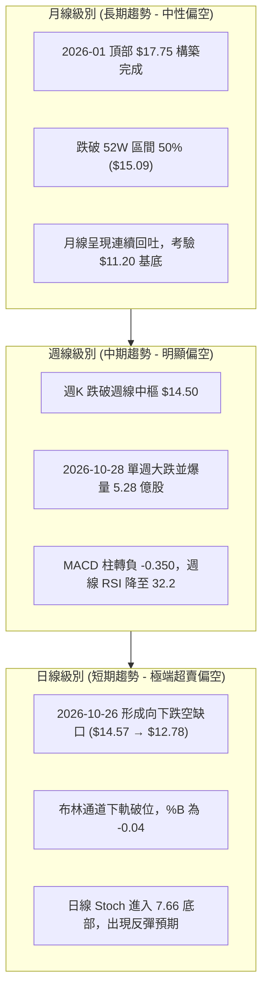

### 📈 長期趨勢 — 12個月走勢圖（Unicode）

```
NU 月線走勢圖（過去12個月：2025-11 至 2026-10）
價格軸 ($)
$18.00 ┤              ● (2026-01: $17.75 高點)
$17.00 ┤        ●     │     
$16.00 ┤  ●     │     │     
$15.00 ┤  │     │     │  ● (2026-02: $14.98)
$14.00 ┤  │     │     │  │  ●──●        ●──● (2026-07/08: $14.33-$14.55)
$13.00 ┤  │     │     │  │  │  │  ●──●  │  │  
$12.00 ┤  │     │     │  │  │  │  │  │  │  │  ● (2026-09: $12.66)
$11.00 ┤  │     │     │  │  │  │  │  │  │  │  │  ●← 現價 $11.97 (2026-10)
       └────────────────────────────────────────────────────────────
        11M   12M    1M 2M 3M 4M 5M 6M 7M 8M 9M 10M
       (2025)       (2026)
```

#### 過去12個月走勢特徵分析表

| 階段 | 涵蓋月份 | 價格區間 | 累積漲跌幅 | 核心特徵與量價結構 |
|------|----------|----------|------------|--------------------|
| 頂部衝刺期 | 2025-11 ~ 2026-01 | $16.74 → $17.75 | +6.03% | 創下 52 週次高點 $17.75，高位動能衰竭構築圓弧頂部 |
| 首波回撤期 | 2026-02 ~ 2026-05 | $17.75 → $13.13 | -26.03% | 快速回吐前期漲幅，自高位失守 $15.00 整數關卡 |
| 中期反彈期 | 2026-06 ~ 2026-08 | $13.13 → $14.55 | +10.81% | 於 $13.36 構築防守平台，反彈測試 MA200 壓力無力突破 |
| 空頭破位期 | 2026-09 ~ 2026-10 | $14.55 → $11.97 | -17.73% | 跌破反彈頸線，10月下旬跳空重挫逼近 52 週低點 $11.20 |

### 📊 中期趨勢（週線分析）

中期走勢圖展示了近期壓力線與支撐帶的演變：

```
中期週線價格結構示意圖
$16.50 ┬─────────────────────── [高點壓力: 2026-10-09 週高 $16.14]
       │       /\
$15.00 ┼──────/──\─────/\───── [中期樞紐帶: MA20 / MA50 聚類約 $14.50]
       │     /    \   /  \
$13.50 ┼────/──────\_/────\─── [破位頸線: R1 $13.30 / 週收盤密集區]
       │   /                \
$12.00 ┼──/──────────────────\─ [當前破位區間: $11.97]
       │                      ▼
$11.20 ┴─────────────────────── [強支撐底線: 52W Low S3 $11.20]
```

中期結構上，NU 在 2026-10-09 當週曾衝高至 $16.12，但隨後三週連續下挫，且在 2026-10-28 當週以大陰線跌至 $11.97，單週成交量放大至 528,494,300 股，週線 RSI 降至 32.2，週 MACD 柱線由正轉負擴大至 -0.350，顯示中期趨勢完全轉入空方控盤。

### ⚡ 趨勢強度評估（ADX 解讀）

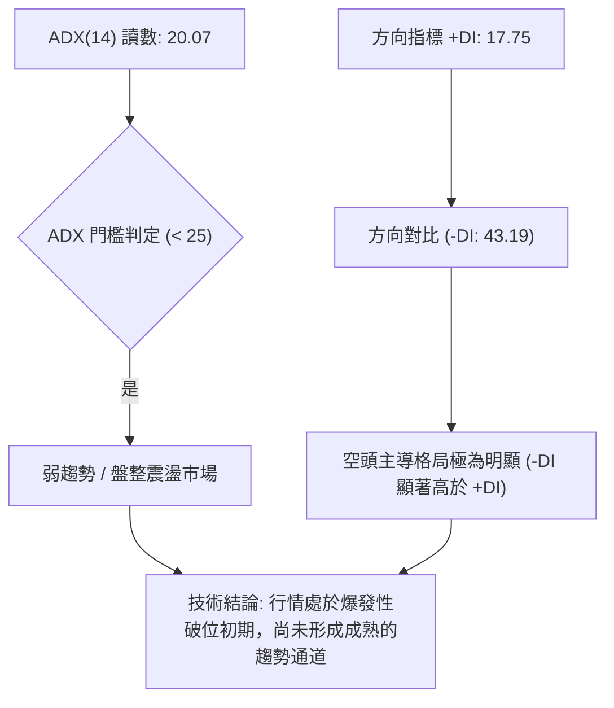

#### ADX 與方向指標強度對照表

| 指標名稱 | 數值 | 參考閾值 | 市場狀態解讀 |
|----------|------|----------|--------------|
| **ADX(14)** | 20.07 | < 25 (弱趨勢/震盪) | 處於無序震盪或新趨勢發動醞釀期，尚未確認成熟單邊 |
| **+DI** | 17.75 | < 20 (多頭動能微弱) | 多方買盤力量極弱，無力組織有效反攻 |
| **-DI** | 43.19 | > 40 (空方極度強勢) | 空方完全掌控盤面，下殺拋壓沉重 |
| **方向差距 (\|+DI - -DI\|)**| 25.44 | > 20 (失衡狀態) | 多空力量高度失衡，短期下行慣性依然顯著 |

---

## 3. 圖表形態分析

### 🔍 形態識別系統

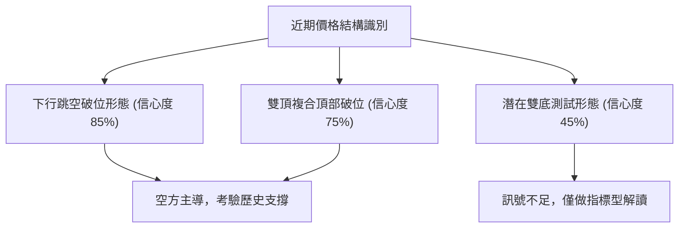

#### 圖表形態信心度評估表

| 形態 | 信心度 | 判斷依據（引用數據） | 完成度 | 目標價（附計算式） |
|------|--------|----------------------|--------|--------------------|
| **下行跳空破位** | 85% | 2026-10-23 低點 $14.57 跳空至 2026-10-26 高點 $12.78，未補缺口 | 100% | 由跳空高度 ($14.57-$12.78=$1.79) 測量：$12.59 - $1.79 = $10.80（下方數據未列此價位，以 S3 $11.20 為極限） |
| **雙頂破位** | 75% | 2025-11 高點與 2026-01 高點 ($17.75) 構築頂部，頸線落於 R1 $13.30 | 100% | 跌破頸線 $13.30，下探 52W 低點 S3 $11.20 |
| **雙底測試形態** | 45% | 訊號不足，僅做指標型解讀（現價 $11.97 逼近前期波段低點 S3 $11.20） | 20% | 尚未確立右底與反彈，無法計算目標價 |

### 🕯️ 重要K線形態分析

嚴格依據近10根日K與近8根週K之歷史數據進行判定：

#### 近10根日K形態解析

| 日期（日K） | 開 | 高 | 低 | 收 | K線形態 | 解讀 | 訊號 |
|-------------|----|----|----|----|---------|------|------|
| 2026-10-15 | 14.46 | 15.06 | 14.40 | 14.73 | 實體陽線 | 多方反彈，收於高位阻力附近 | 🟢 |
| 2026-10-16 | 14.71 | 14.94 | 14.45 | 14.56 | 小陰十字星 | 上攻遇阻，動能暫緩 | 🟡 |
| 2026-10-19 | 14.72 | 14.92 | 14.36 | 14.51 | 小實體陰線 | 震盪偏弱，盤整待變 | 🟡 |
| 2026-10-20 | 14.62 | 15.41 | 14.60 | 15.09 | 帶長上影中陽 | 盤中拉升至 $15.41 遭空頭壓制 | 🟡 |
| 2026-10-21 | 15.21 | 15.37 | 15.01 | 15.05 | 高開低走假陰線 | 高位拋壓增強，多頭承接無力 | 🔴 |
| 2026-10-22 | 14.89 | 15.06 | 14.63 | 14.73 | 破位小陰線 | 失守 $15.00 關卡 | 🔴 |
| 2026-10-23 | 14.69 | 15.25 | 14.57 | 15.16 | 帶長下影陽線 | 試圖反抽，為跳空前最後多頭抵抗 | 🟡 |
| 2026-10-26 | 11.69 | 12.78 | 11.62 | 12.59 | 巨量向下跳空長陽 | 開盤 $11.69 暴跌，爆量 3.39 億股低位換手 | 🔴 |
| 2026-10-27 | 12.74 | 13.00 | 12.37 | 12.40 | 衝高回落倒錘頭 | 反彈測試 $13.00 失敗，空方再度接管 | 🔴 |
| 2026-10-28 | 12.36 | 12.44 | 11.96 | 11.97 | 光腳收低大陰線 | 收於全日最低點附近 ($11.97)，跌勢未止 | 🔴 |

#### 近8根週K形態解析

| 日期（週K） | 開 | 高 | 低 | 收 | K線形態 | 解讀 | 訊號 |
|-------------|----|----|----|----|---------|------|------|
| 2026-09-11 | 15.56 | 15.82 | 14.44 | 14.62 | 長陰破位線 | 跌破短期均線支持 | 🔴 |
| 2026-09-18 | 14.35 | 14.55 | 13.58 | 13.65 | 連續下殺中陰 | 加速探底 | 🔴 |
| 2026-09-25 | 13.84 | 14.25 | 13.36 | 13.59 | 低位十字孕線 | 跌勢暫緩，多空拉鋸 | 🟡 |
| 2026-10-02 | 12.53 | 13.50 | 12.13 | 13.43 | 長下影錘頭陰線 | 測試 $12.13 支撐後引發巨量換手 | 🟢 |
| 2026-10-09 | 14.98 | 16.14 | 14.84 | 16.12 | 巨量吞噬大陽線 | 強勢反彈突破多條短均線 | 🟢 |
| 2026-10-16 | 16.10 | 16.19 | 14.40 | 14.56 | 烏雲蓋頂長陰線 | 完全吞噬前週實體，空方反撲 | 🔴 |
| 2026-10-23 | 14.72 | 15.41 | 14.36 | 15.16 | 縮量修復小陽線 | 弱勢反彈受制於高空阻力 | 🟡 |
| 2026-10-28 | 11.69 | 13.00 | 11.62 | 11.97 | 巨量向下破位陰線 | 跳空破位，創波段收盤新低 | 🔴 |

### 📉 ASCII 走勢形態示意圖

```
日線跳空破位與弱勢震盪形態示意圖
$15.50 ┬       ● 2026-10-20 ($15.09)
       │      / \
$15.00 ┼─────/───● 2026-10-23 ($15.16)
       │    /     
$14.50 ┼───● (缺口上沿: $14.57)
       │   ░░░░░░░░░░░░░░░░░░░░░░░░░░░░░░░░░░░░░░░░░░░░░░░ [未補跳空缺口]
$13.00 ┼───┬───────────────────● 2026-10-27 高點 ($13.00)
       │   │ (缺口下沿: $12.78)  \
$12.50 ┼───┼────────────────────● 2026-10-26 收盤 ($12.59)
       │   │                     \
$12.00 ┼───● 2026-10-26 開盤 ($11.69)──●← 現價 ($11.97 收於低位)
       │   
$11.20 ┴────────────────────────────────────── [52W 低點 S3 $11.20]
```

### 🎯 形態目標價計算

根據雙頂破位與跳空缺口測算：
1. **雙頂頸線破位計算**：
   - 頂部水平：$17.75
   - 頸線水平：$13.30（引用自阻力聚類 R1）
   - 形態垂直高度 = $17.75 - $13.30 = $4.45
   - 理論下跌目標 = 頸線 $13.30 - 形態高度 $4.45 = $8.85（此價位遠低於歷史數據，數據中未偵測到此層級支撐，依紀律下看數據已有之極限支撐 S3 $11.20）。
2. **跳空缺口延伸測量**：
   - 缺口形成於 $14.57 至 $12.78，高度為 $1.79。
   - 破位後短線反彈高點受制於 $13.00，進一步下探目標直接錨定波段支撐 S1 $11.78 及 S3 $11.20。

---

## 4. 支撐與阻力

### 🗺️ 關鍵價位分布圖（Unicode）

```
NU 價位結構分布圖
═══════════════════════════════════════════════════
$14.32 ║████████████████████████║ 強阻力 R3 (近 MA200/MA50 聚類)
$13.52 ║████████████████████    ║ 阻力 R2 (近一年波段高點)
$13.30 ║████████████████████████║ 關鍵阻力 R1 (缺口下緣與原支撐轉換)
$11.97 ╠════════════════════════╣ ◄ 現價 ($11.97)
$11.78 ║▓▓▓▓▓▓▓▓▓▓▓▓▓▓▓▓        ║ 近期支撐 S1 (近一年波段低點聚類)
$11.51 ║████████████████        ║ 次級支撐 S2 (波段緩衝低點)
$11.20 ║████████████████████████║ 極限強支撐 S3 (52週最低價 / 斐波 100%)
═══════════════════════════════════════════════════
```

### 🚧 阻力位分析表

阻力價位嚴格引用自數據之「關鍵價位」與均線系統：

| 阻力級別 | 價位 | 形成原因 | 突破難度 | 重要性 |
|----------|------|----------|----------|--------|
| **R1** | $13.30 | 近一年波段高點聚類、前期支撐轉換位 | 偏高 | 🟢 極高（短線多空分水嶺） |
| **R2** | $13.52 | 近一年密集震盪平台頂部 | 高 | 🟡 中等（波段回抽反壓） |
| **R3** | $14.32 | 近一年重大波段高點聚類、貼近 MA50 ($14.42) 及 MA200 ($14.51) | 極高 | 🔴 極高（中期趨勢轉折關鍵位） |

### 🛡️ 支撐位分析表

支撐價位嚴格引用自數據之「關鍵價位」與斐波那契回調：

| 支撐級別 | 價位 | 形成原因 | 守住機率 | 重要性 |
|----------|------|----------|----------|--------|
| **S1** | $11.78 | 近一年波段低點聚類、距離現價 -1.59% | 55% | 🟡 中等（超短線防守第一道關卡） |
| **S2** | $11.51 | 近一年波段低點聚類、距離現價 -3.84% | 65% | 🟡 中等（多頭最後防震帶） |
| **S3** | $11.20 | 52週絕對低點、斐波那契 100.0% 關鍵基底 | 80% | 🟢 極高（年內生命線，失守將開啟深淵） |

### 📐 斐波那契回調位分析

依據 52 週區間高點 $18.98 至低點 $11.20 數據直接引用分析：

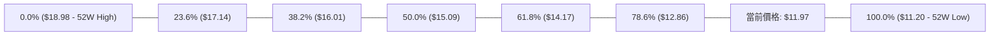

#### 斐波那契層級解析表

| 回調比率 | 價位 | 當前相對位置 | 技術涵義與市場行為解讀 |
|----------|------|--------------|------------------------|
| **0.0%** | $18.98 | 現價上方 +58.56% | 52 週最高點，長期多頭目標 |
| **23.6%** | $17.14 | 現價上方 +43.19% | 頂部震盪區間下沿 |
| **38.2%** | $16.01 | 現價上方 +33.75% | 2026-10-09 週線衝高反彈極限位 |
| **50.0%** | $15.09 | 現價上方 +26.07% | 多空強弱分水嶺，失守後中長期徹底轉弱 |
| **61.8%** | $14.17 | 現價上方 +18.38% | 黃金分割防守位，現已轉化為強大反壓區 |
| **78.6%** | $12.86 | 現價上方 +7.44% | 破位過渡層，現價正處於 $12.86 與 $11.20 之間 |
| **100.0%**| $11.20 | 現價下方 -6.43% | 52 週最低點，全週期最後核心防線 |

**解讀**：現價 $11.97 處於 78.6% ($12.86) 與 100.0% ($11.20) 之極弱勢回調區間，顯示過去一年的所有漲幅已被回吐超過八成，市場正全面測試 100% 斐波那契極限支撐點。

---

## 5. 技術指標深度解讀

### 🎛️ 指標訊號總覽

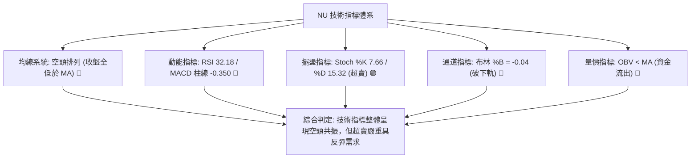

### 📈 移動平均線排列分析

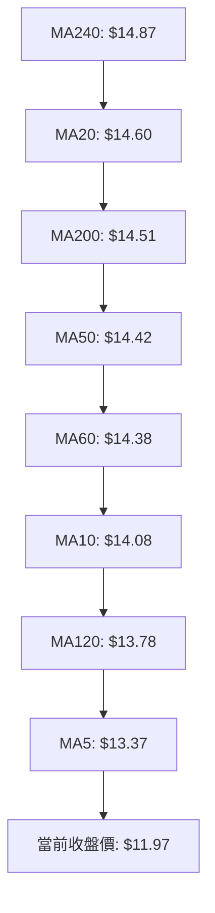

#### 均線偏離度與狀態表

| 均線名稱 | 數值 | 價格與均線差距 | 偏離幅度 | 趨勢方向 |
|----------|------|----------------|----------|----------|
| **MA5** | $13.37 | 價格在下方 | -10.47% | ▼ 急速下墜 |
| **MA10** | $14.08 | 價格在下方 | -14.98% | ▼ 陡峭下行 |
| **MA20** | $14.60 | 價格在下方 | -18.00% | ▼ 空頭下壓 |
| **MA50** | $14.42 | 價格在下方 | -16.99% | ▼ 轉頭向下 |
| **MA60** | $14.38 | 價格在下方 | -16.77% | ▼ 走弱下行 |
| **MA120** | $13.78 | 價格在下方 | -13.16% | ▼ 震盪下行 |
| **MA200** | $14.51 | 價格在下方 | -17.51% | ▼ 長期破位 |
| **MA240** | $14.87 | 價格在下方 | -19.51% | ▼ 長期走平轉跌 |

**均線綜合結論**：當前所有短期、中期與長期移動平均線全數位於價格上方，形成重度空頭反壓。短期負乖離率（MA20 負乖離達 -18.00%）已進入歷史極值區間，短線存在向均線修復靠攏的技術性反抽動能。

### 📉 RSI(14) 分析

- **RSI(14) 當前數值**：32.18
```
RSI(14) 強度進度條:
0 ──────────── 30 ────── 50 ─────────── 70 ─────────── 100
[█████████████░░░░░░░░░░░░░░░░░░░░░░░░░░░] 32.18% (臨界超賣)
```
- **超買超賣判定**：數值 32.18，處於 30-70 的偏空邊緣，極度逼近 30 超賣線。
- **背離分析**：依據近 20 根 K 棒比對，價格自 $15.16 斷崖跌至 $11.97，RSI 同步由 55.0 下滑至 32.18，價格創新低而 RSI 亦創短期新低，**明確判定：無明顯底背離亦無頂背離**，下行趨勢屬於指標確認的實質破位。

### 📊 MACD(12/26/9) 訊號解讀

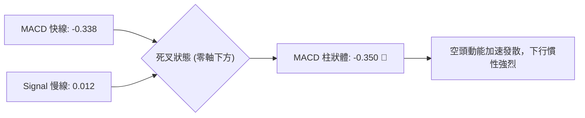

MACD 快線 (-0.338) 於零軸下方加速下行並下穿信號線 (0.012)，柱狀圖讀數為 -0.350，負向動能顯著擴大，尚未出現任何紅柱縮小或鈍化拐點，確認當前仍處於空方動能主導之主跌段中。

### 📦 布林通道分析

```
布林通道結構示意圖 (寬度擴張破位)
$17.03 ┬────────────────────── 上軌 Upper Band
       │
$15.80 ┼
       │
$14.60 ┼────────────────────── 中軌 Middle Band (MA20)
       │
$13.40 ┼
       │
$12.17 ┼────────────────────── 下軌 Lower Band
       │ ░░░░░░░░░░░░░░░░░░░░░░ [通道外超賣破位區]
$11.97 ┴─● 現價 ($11.97, %B = -0.04)
```

- **上軌**：$17.03
- **中軌 (MA20)**：$14.60
- **下軌**：$12.17
- **%B 指標**：-0.04（小於 0 顯示收盤價已摜破布林下軌）
- **解讀**：價格跌出下軌，布林通道帶寬驟增，標準的「開口向下發散」破位走勢。短線價格受下軌吸引有回抽通道內部需求，但中軌 $14.60 構成強大中期反壓。

### 💹 成交量分析（量價配合度）

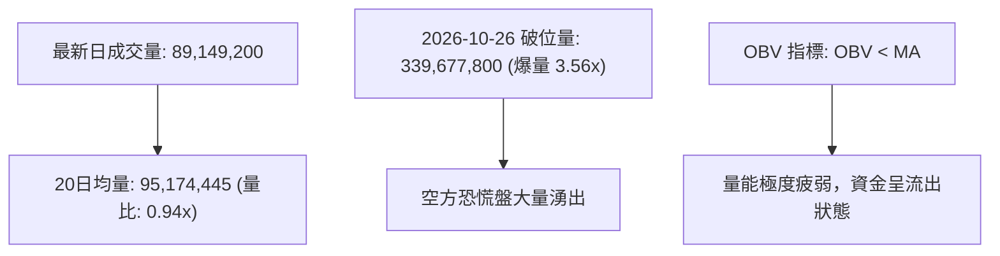

- **量價特徵**：2026-10-26 出現高達 3.39 億股之異常放量大陰線（跳空暴跌），顯示機構或主力資金出現大規模停損或減倉。隨後兩日（10-27、10-28）成交量回落至 9,966 萬股與 8,914 萬股（量比 0.94x），縮量陰跌收於全日低點，反映市場承接意願薄弱，屬於典型的「破位放量、反彈縮量、再跌無量」空頭控盤特徵。

---

## 6. 動能與波動率

### ⚡ 動能評估四象限

| 象限 | 動能狀態 | 波動率狀態 | NU 當前特徵定位 | 操作評估與策略指引 |
|------|----------|------------|-----------------|--------------------|
| **Q1** | 強動能 (多方) | 低波動 | 否 | 穩定上行趨勢（非當前狀態） |
| **Q2** | 弱動能 (無序) | 低波動 | 否 | 窄幅盤整觀望（非當前狀態） |
| **Q3** | 強動能 (空方) | 高波動 | ✓ **NU 處於此象限** | **空頭下殺加速段，高波動高風險，操作須嚴格設損** |
| **Q4** | 弱動能 (衰竭) | 高波動 | 否 | 頂底劇烈洗盤（非當前狀態） |

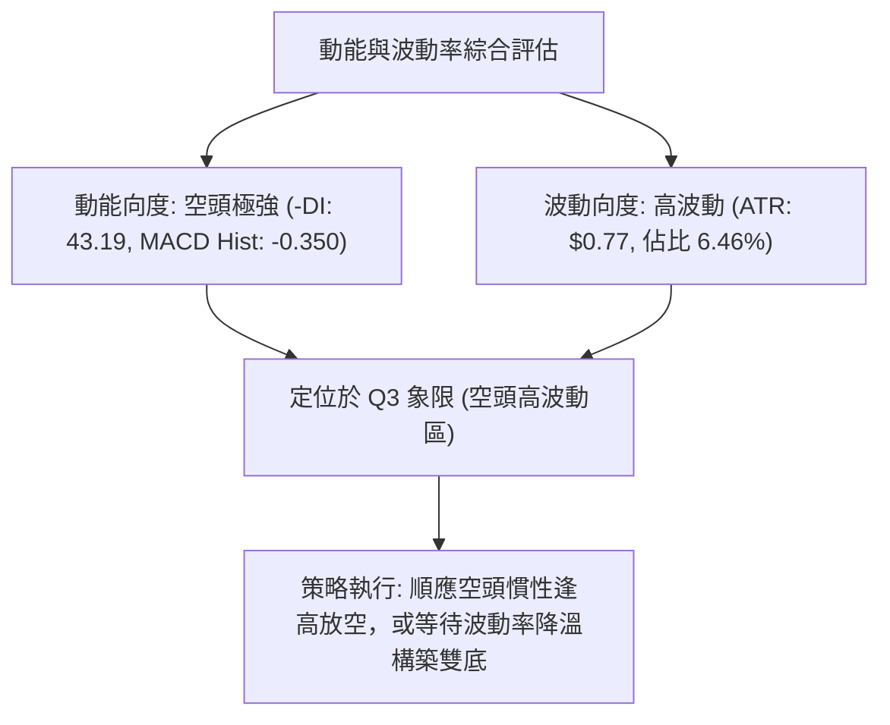

### 📊 ATR 波動率分析

```
ATR 波動率與止損空間解讀
ATR(14) 絕對值: $0.77
股價佔比: 6.46% (高波動環境)
─────────────────────────────────────────────
1.0x ATR = $0.77  ─── 超短線日內噪聲緩衝
1.5x ATR = $1.16  ─── 波段交易建議止損距離
2.0x ATR = $1.54  ─── 逆勢摸底策略安全邊際
```

- **ATR 數值解讀**：目前 ATR(14) 為 $0.77，佔當前股價 $11.97 的比例高達 6.46%，表明個股日均震盪劇烈。任何短線多空部位若止損設置小於 $0.77，極易被隨機噪聲掃出場。建議波段交易採用 1.5x ATR（約 $1.16）作為風控基礎。

### 📐 Beta 與市場相關性

- **Beta 數值**：0.955
- **解讀**：Beta 值接近 1.0（0.955），說明 NU 與整體美股市場（S&P 500）具備中度至高度的系統性聯動性。然而近期個股走勢明顯落後於大盤（新聞顯示 "NU Stock Dips While Market Gains"），顯示當前下挫主要由個股基本面事件或巴西區域銀行板塊系統性調整（如 Itau BBA 下調評級、Bradesco 下挫）所引發的非系統性風險主導。

---

## 7. 多時框架總結

### 📋 時框架評分表

| 時框架 | 趨勢方向 | 動能狀態 | 均線排列 | 圖表形態 | 綜合評分 | 建議操作維度 |
|--------|----------|----------|----------|----------|----------|--------------|
| **月線 (長期)** | 偏空 🔴 | 減速偏弱 🟡 | 跌破多數均線 🔴 | 圓弧頂破位 🔴 | 35/100 | 長期投資者暫停加碼，等待 $11.20 企穩 |
| **週線 (中期)** | 明顯偏空 🔴 | 負向擴大 🔴 | 跌破 MA200 🔴 | 巨量大陰線 🔴 | 25/100 | 中期波段逢高做空，關注 R1 $13.30 反壓 |
| **日線 (短期)** | 空頭超賣 🔴 | 超賣反彈預期 🟢 | 全面空頭排列 🔴 | 破位跳空缺口 🔴 | 28/100 | 嚴禁盲目追空，等待反彈受阻建立空單 |

### 🔲 綜合訊號矩陣

```
╔══════════════════════════════════════════════════════════════════════╗
║                       多時框架訊號矩陣矩陣                           ║
╠══════════════╦══════════════╦══════════════╦═════════════════════════╣
║ 維度         ║ 短期 (日線)  ║ 中期 (週線)  ║ 長期 (月線)             ║
╠══════════════╬══════════════╬══════════════╬═════════════════════════╣
║ 趨勢方向     ║ 🔴 空頭破位  ║ 🔴 空頭放量  ║ 🔴 頂部回吐             ║
║ 均線壓制     ║ 🔴 遠低均線  ║ 🔴 破年線    ║ 🟡 測試基底             ║
║ 擺盪指標     ║ 🟢 極度超賣  ║ 🔴 MACD死叉  ║ 🟡 進入中低位           ║
║ 量價結構     ║ 🔴 爆量跳空  ║ 🔴 單週巨量  ║ 🟡 長期放緩             ║
╠══════════════╩══════════════╩══════════════╩═════════════════════════╣
║ 一致性判定：多時框全面偏向空方，唯短期因深度超賣存在均線回抽需求     ║
╚══════════════════════════════════════════════════════════════════════╝
```

### ⚖️ 多時框收斂結論

依據多時框收斂規則：
1. **行情性質判定**：當前 ADX(14) 為 20.07，數值小於 25，屬於**盤整/震盪行情**（但伴隨 -DI = 43.19 之極端空頭主導）；日線布林通道下軌出現破位（%B = -0.04），顯示價格超出通道常規範圍。
2. **主導時框收斂**：在 ADX < 25 的盤整震盪收斂框架下，以日線布林通道上下軌 ($12.17 - $17.03) 及日線超賣狀態尋找短期邊界；但由於中長期週線、月線全面失守 MA200 ($14.51)，中長期空頭趨勢壓制日線的多頭反撲空間。
3. **唯一方向性結論**：**偏空（主策略以反彈逢高做空為主）**。技術評分卡綜合評分為 **28/100**，全面觸發「綜合評分偏空（≤40）路由」，多頭僅作為超賣短線反抽之風控防守考量，不作為主要波段推薦。

---

## 8. 交易策略建議

### 🗺️ 策略決策流程圖

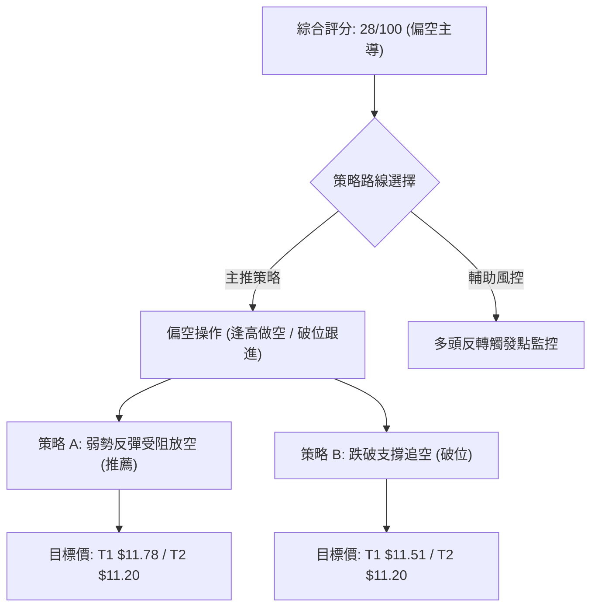

### 🧭 策略路由（依評分卡分流）

**當前主策略方向 = 偏空操作（依評分 28/100，低於40分門檻，主推空頭策略）**

### 🎯 價格情境階梯（Price Scenarios）

價位嚴格引用自數據之關鍵價位與均線：

| 觸發條件 | 下一目標 | 後續延伸 | 情境含義 |
|----------|----------|----------|----------|
| **向上反彈突破 R1 $13.30** | R2 $13.52 | R3 $14.32 | 短線超跌反彈強烈，進入缺口回補與均線修復測試 |
| **承壓於現價至 R1 區間** | S1 $11.78 | S2 $11.51 | 空頭中繼弱勢震盪，反彈無力，空方逐步蠶食支撐 |
| **直接摜破 S1 $11.78** | S2 $11.51 | S3 $11.20 | 空頭加速探底，下探 52 週最低點尋求歷史性支撐 |

### 📊 情境機率分佈

| 情境 | 機率 | 主要依據 |
|------|------|----------|
| **弱勢震盪 / 破位探底 (情境一)** | **60%** | MACD 柱線擴大至 -0.350，-DI 達 43.19，OBV 疲弱顯示主力資金持續流出 |
| **超跌技術性反抽 (情境二)** | **30%** | Stoch %K 跌至 7.66 極端超賣，布林通道 %B 破下軌 (-0.04)，具均線回抽需求 |
| **強勢 V 型反轉 (情境三)** | **10%** | 上方存在 $14.57 斷崖缺口與多條均線重壓，無基本面重大催化極難實現 |

### 🟢 主策略詳情（偏空操作）

#### 空頭主策略規格表

| 策略要素 | 策略 A（反彈高空 — 優先推薦） | 策略 B（破位跟進 — 突破順勢） |
|----------|--------------------------------|--------------------------------|
| **進場條件** | 股價反彈至阻力區受阻回落，出現上影線 | 價格實體跌破近期波段低點 S1 支撐 |
| **進場價格** | $12.78（引用缺口下緣與 2026-10-26 高點） | $11.78（引用支撐位 S1 破位點） |
| **目標價 T1** | $11.78（引用支撐位 S1） | $11.51（引用支撐位 S2） |
| **目標價 T2** | $11.20（引用支撐位 S3 / 52W Low） | $11.20（引用支撐位 S3 / 52W Low） |
| **止損價格** | $13.30（引用關鍵阻力位 R1） | $12.00（整數心理關卡，上浮 1.8%） |
| **風險報酬比** | **1 : 1.92**（以 T1 計）<br>*(計算式: [12.78 - 11.78] / [13.30 - 12.78] = 1.00 / 0.52 = 1.923)*<br>*(以 T2 計為 1 : 3.04)* | **1 : 1.23**（以 T1 計）<br>*(計算式: [11.78 - 11.51] / [12.00 - 11.78] = 0.27 / 0.22 = 1.227)*<br>*(以 T2 計為 1 : 2.64)* |
| **成功機率** | 65% | 55% |
| **建議倉位** | 10% - 15% 總資金 | 5% - 8% 總資金 |

### 🔴 反向風險觸發點（對沖提示）

若出現以下訊號，空頭主策略宣告失效，應立即全面平倉空單並啟動風控：
1. **價位突破**：日線收盤價強勢站上 **R1 $13.30**，代表多頭已成功封閉破位缺口下緣，空頭趨勢結構被破壞。
2. **指標共振**：日線 MACD 出現零軸下金叉，且 RSI(14) 突破 50 中性分界線。
3. **量能異動**：單日成交量再度放大至 2 億股以上並伴隨長實體陽線站上 MA10 ($14.08)。

### ⭐ 整體訊號強度評星

```
做多訊號強度：★☆☆☆☆  (1/5星 - 僅存超賣指標支撐)
做空訊號強度：★★★★☆  (4/5星 - 均線、動能、量價全面偏空)
整體可信度：  ★★★★☆  (4/5星 - 數據完整確認實質破位)
```

---

## 9. 風險提示與監控

### ✅ 關鍵監控指標 Checklist

```
╔══════════════════════════════════════════════════════════════════════╗
║                    每日盤面關鍵監控清單 (Checklist)                  ║
╠══════════════════════════════════════════════════════════════════════╣
║ [ ] 價格是否觸及歷史強支撐 S3 $11.20 並出現長下影線？                ║
║ [ ] RSI(14) 是否跌破 30 形成鈍化，或回升至 40 以上展開反彈？        ║
║ [ ] 成交量是否萎縮至 50日均量 ($8,175 萬股) 以下，顯示殺跌動能耗盡？║
║ [ ] 日線是否有效填補 2026-10-26 缺口下緣 $12.78？                   ║
║ [ ] MACD 柱狀體負值是否開始收斂（數值由 -0.350 向上縮小）？          ║
║ [ ] 巴西金融板塊是否有進一步評級下調或宏觀利率風險外溢？            ║
╚══════════════════════════════════════════════════════════════════════╝
```

### ⚠️ 風險場景分析

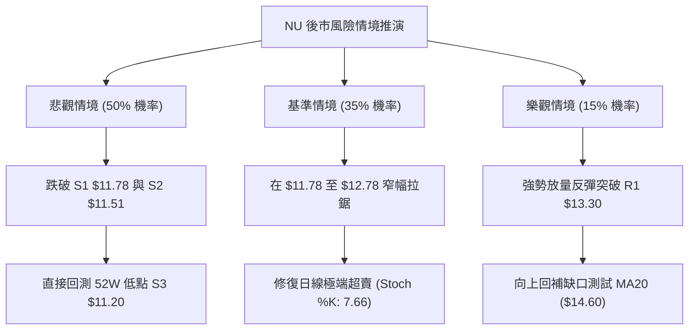

### 🛡️ 風險管理重要提醒

1. **極度波動防範**：目前 ATR 高達 $0.77（6.46%），日內波動極度劇烈，做空嚴禁在 $12.00 整數下方追單，應嚴格執行「反彈至阻力位進場」原則。
2. **52週低點防禦**：$11.20 為全市場多頭心理最後底線，歷史上多次在此價位引發技術性買盤，空頭部位一旦觸及 $11.20 應至少獲利了結 70% 倉位。
3. **隔夜跳空風險**：近期 NU 頻繁出現大幅跳空走勢（如 10-26 開盤大跌），持有過夜部位須控制單一標的曝險不超過總投資組合之 10%。

---

## 📋 報告總結

```
╔══════════════════════════════════════════════════════════════════════╗
║                       NU 技術分析報告總結                            ║
╠══════════════════════════════════════════════════════════════════════╣
║ 報告日期：2026-10-29                                                 ║
║ 當前價格：$11.97 USD                                                 ║
║ 分析評級：🔴 偏空格局 (技術評分 28/100，空頭全面主導)                ║
╠══════════════════════════════════════════════════════════════════════╣
║ 關鍵結論：                                                           ║
║ ├─ 長期趨勢：🔴 偏空回吐，失守 MA200 年線 ($14.51)                   ║
║ ├─ 中期趨勢：🔴 單週爆量 5.28 億股下殺，MACD 死叉擴大                ║
║ ├─ 短期趨勢：🔴 跌破布林下軌 (%B -0.04)，具極端超賣反抽需求         ║
║ ├─ 關鍵支撐：S1 $11.78 / S2 $11.51 / S3 $11.20 (52W Low)             ║
║ ├─ 關鍵阻力：R1 $13.30 / R2 $13.52 / R3 $14.32                       ║
║ └─ 分析師目標：均價 $18.97 (低標 $12.00 / 高標 $23.00)               ║
╠══════════════════════════════════════════════════════════════════════╣
║ 最優策略組合：                                                       ║
║ 1. 🥇 最佳機會：等待反彈至 $12.78 阻力位受阻放空，目標 S1 $11.78 /   ║
║                 S3 $11.20，止損設於 R1 $13.30 (風報比 1 : 1.92)      ║
║ 2. 🥈 次選機會：跌破 S1 $11.78 輕倉順勢追空，目標 S3 $11.20，止損    ║
║                 $12.00 (風報比 1 : 1.23)                             ║
║ 3. 🥉 保守選擇：完全空倉觀望，等待價格在 S3 $11.20 構築明確底部形態   ║
╚══════════════════════════════════════════════════════════════════════╝
```

---

> ⚠️ **免責聲明**：本報告為 AI 自動生成之技術分析，所有數據及估算均基於提供的歷史價格資訊。本報告**僅供研究與學術參考**，**不構成任何投資建議**。投資有風險，入市需謹慎。

---

*報告生成時間：2026-10-29 ｜ 數據來源：Yahoo Finance ｜ 分析框架：多時框技術分析*