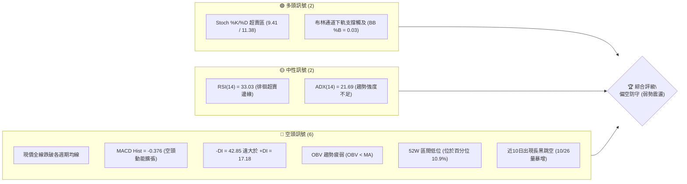
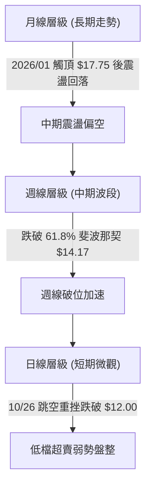
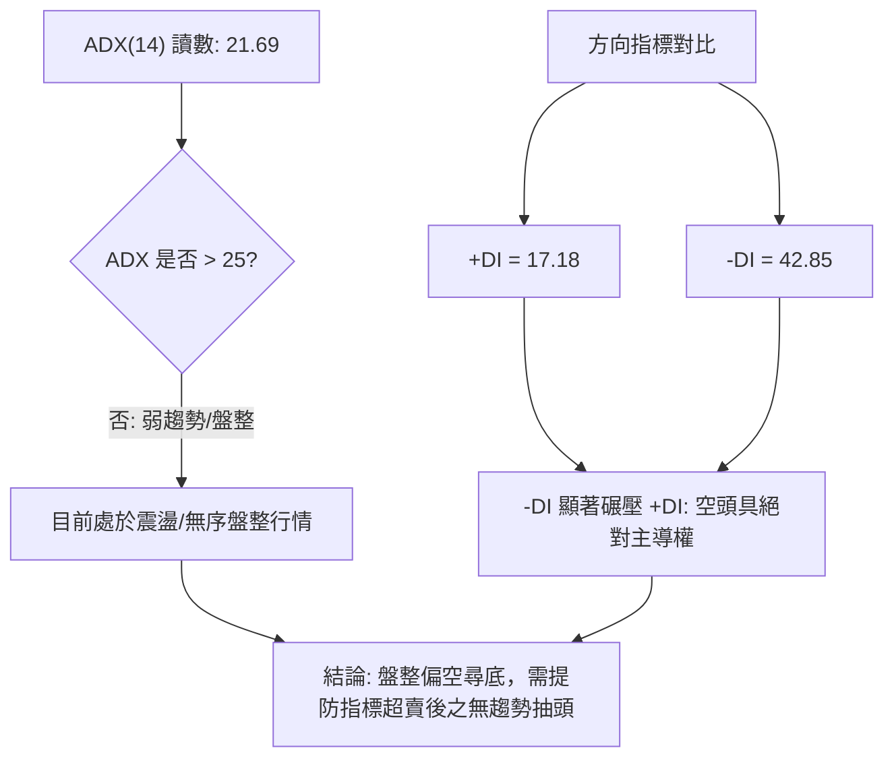
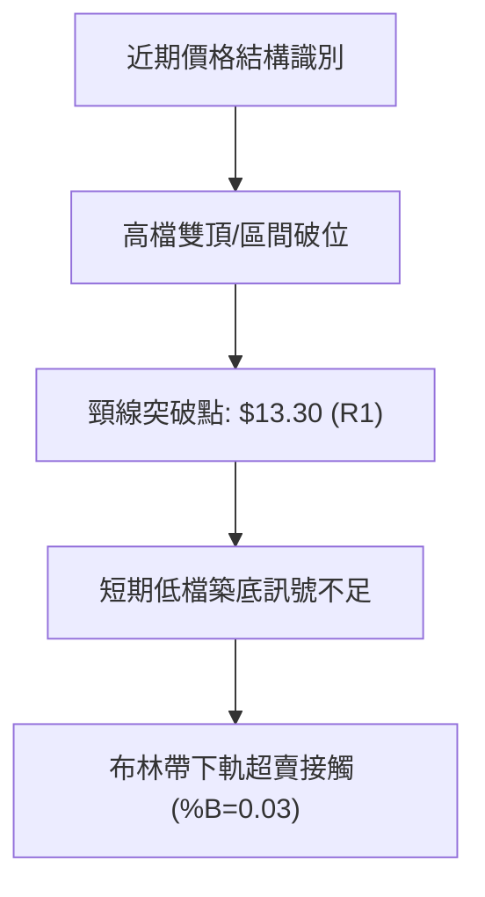
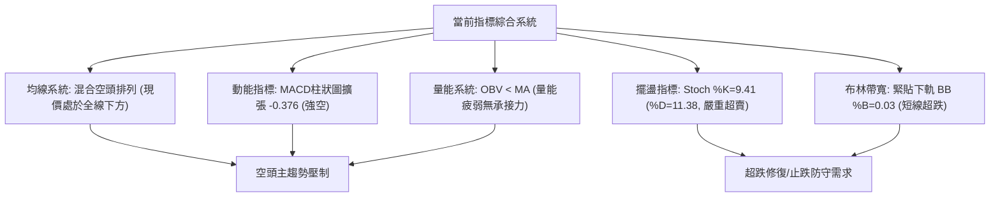
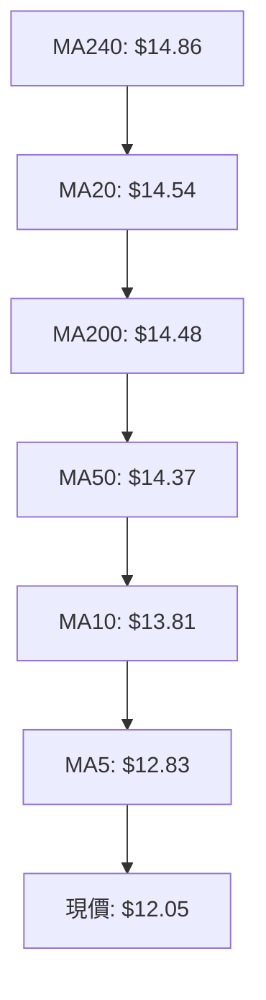
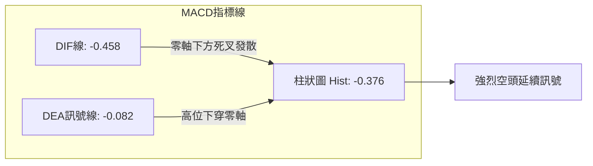
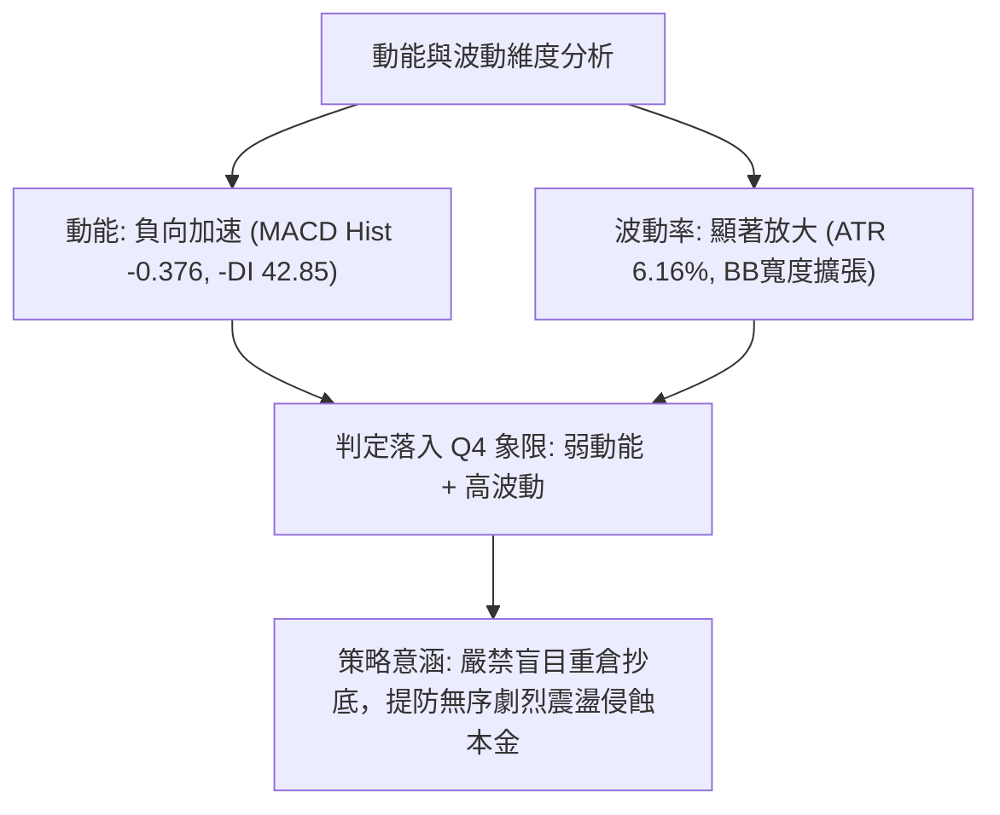
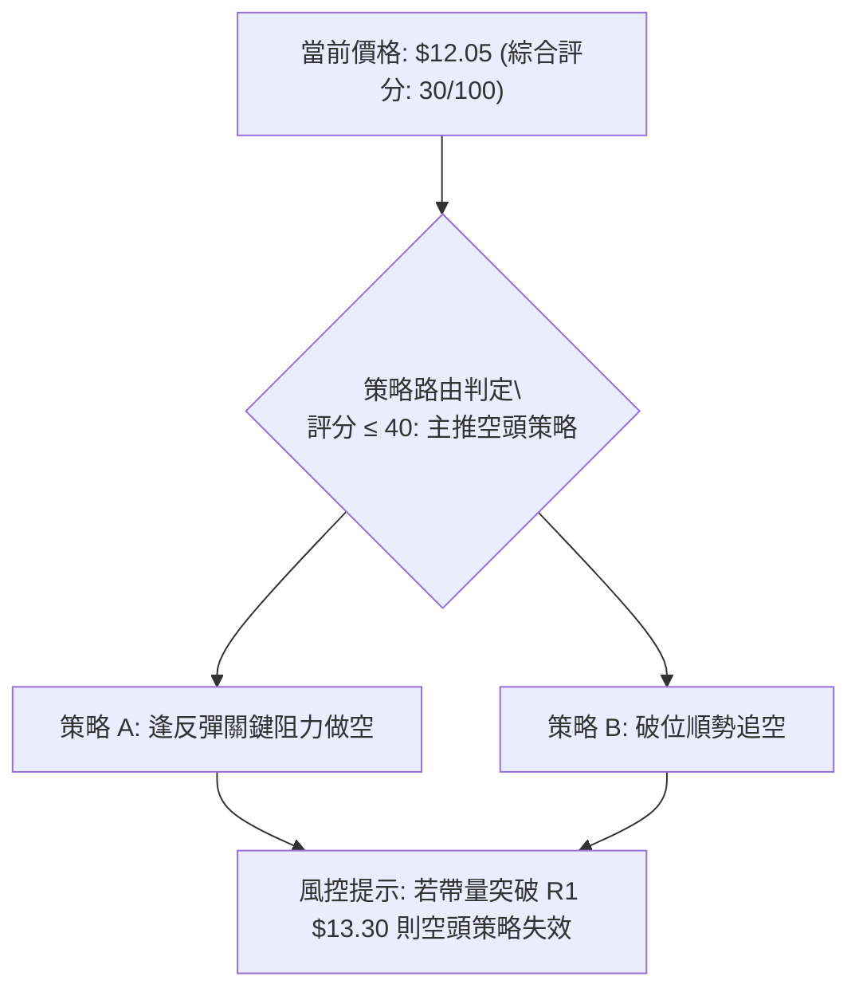
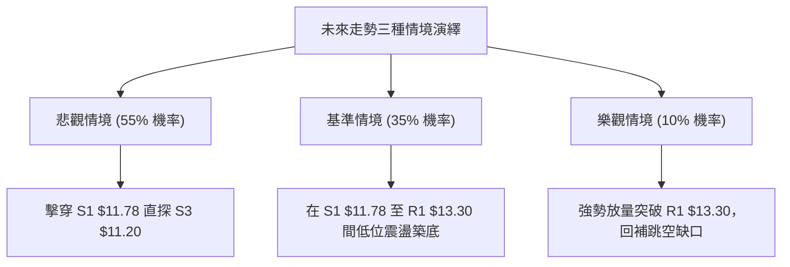

# NU 技術分析報告

> **報告日期**：2026-10-30 ｜ **語言**：繁體中文 ｜ **數據來源**：Yahoo Finance ｜ **當前價格**：$12.05

---

## 目錄

| 章節 | 內容 |
|------|------|
| [1. 技術面概覽](#1-技術面概覽) | 訊號儀表板、核心指標、評分卡 |
| [2. 趨勢分析](#2-趨勢分析) | 多時框趨勢、長中短期走勢 |
| [3. 圖表形態分析](#3-圖表形態分析) | 形態識別、K線組合、目標價 |
| [4. 支撐與阻力](#4-支撐與阻力) | 關鍵價位、斐波那契回調 |
| [5. 技術指標深度解讀](#5-技術指標深度解讀) | MA/RSI/MACD/布林/成交量 |
| [6. 動能與波動率](#6-動能與波動率) | 動能評估、ATR、Beta |
| [7. 多時框架總結](#7-多時框架總結) | 時框架評分矩陣 |
| [8. 交易策略建議](#8-交易策略建議) | 多空策略、風險報酬比 |
| [9. 風險提示與監控](#9-風險提示與監控) | 監控指標、風險場景 |

---

## 1. 技術面概覽

### 🎯 技術訊號儀表板



### 📊 核心指標速覽表

| 指標類別 | 指標名稱 | 當前數值 | 訊號 | 解讀 |
|----------|----------|----------|------|------|
| **價格** | 當前價格 | $12.05 | 🔴 | 位於52週區間下緣 10.9%，距離年內高點拉回幅度劇烈 |
| **均線** | MA20 | $14.54 | 🔴 | 現價 $12.05 處於 MA20 之下 -17.10%，短期乖離率偏大 |
| **均線** | MA50 | $14.37 | 🔴 | 現價大幅跌破中期均線，MA50 轉為中期沉重反壓 |
| **均線** | MA200 | $14.48 | 🔴 | 現價跌破長期牛熊分界線，長期架構轉入空方防守 |
| **動能** | RSI(14) | 33.03 | 🟡 | 位於弱勢區但尚未正式進入嚴格超賣區（<30），下行動能稍緩 |
| **動能** | MACD | -0.458 | 🔴 | DIF 線小於 Signal 線 (-0.082)，柱狀圖擴張至 -0.376，空頭主導 |
| **波動** | ATR(14) | $0.74 | 🔴 | 佔價格比例達 6.16%，日均振幅擴大，波動風險高 |

### 🏆 技術評分卡

```
╔══════════════════════════════════════════════════════════════╗
║                技術評分卡 — NU (2026-10-30)                  ║
╠══════════════════════════════════════════════════════════════╣
║ 趨勢強度      █████░░░░░░░░░░░░░░░  25/100  🔴 空頭主導 (-DI高)║
║ 動能指標      ██████░░░░░░░░░░░░░░  30/100  🔴 MACD負值擴張 ║
║ 支撐穩定度    ████████░░░░░░░░░░░░  40/100  🟡 臨近S1/S2支撐 ║
║ 成交量配合    ██████░░░░░░░░░░░░░░  30/100  🔴 殺跌放量反彈縮量║
║ 形態完整度    ███████░░░░░░░░░░░░░  35/100  🔴 破位向下尋底  ║
║ 均線排列      ████░░░░░░░░░░░░░░░░  20/100  🔴 全線均線反壓  ║
╠══════════════════════════════════════════════════════════════╣
║ 綜合評分      ██████░░░░░░░░░░░░░░  30/100  🔴 偏空防守      ║
║               (= 上列六項算術平均：(25+30+40+30+35+20)/6)    ║
╚══════════════════════════════════════════════════════════════╝
```

---

## 2. 趨勢分析

### 🌐 多時框趨勢分析



### 📈 長期趨勢 — 12個月走勢圖（Unicode）

```
NU 月線走勢圖（過去12個月：2025-11 至 2026-10）
價格軸 ($)
$18.00 ┤              ● 17.75 (2026-01)
$17.00 ┤        ● 17.39     ● 16.74
$16.00 ┤
$15.00 ┤                          ● 14.98           ● 14.55
$14.00 ┤                                ● 14.37 ● 14.48   ● 14.33
$13.00 ┤                                      ● 13.13 ● 13.36   ● 12.66
$12.00 ┤● 12.05 (2026-10 當前收盤) ━━━━━━━━━━━━━━━━━━━━━━━━━━━━━━━━━●
       └─────────────────────────────────────────────────────────────
         25-11  25-12  26-01  26-02  26-03  26-04  26-05  26-06  26-07  26-08  26-09  26-10
```

#### 長期走勢特徵分析表格

| 階段區間 | 起始價 → 結束價 | 漲跌幅 | 結構特徵與量價解讀 |
|----------|-----------------|--------|--------------------|
| 2025/11 - 2026/01 | $16.11 → $17.75 | +10.18% | 攀升至歷史高位區間，多頭達到頂峰，買盤逐步耗竭 |
| 2026/02 - 2026/05 | $17.75 → $13.13 | -26.03% | 快速回檔並跌破 $14.00，均線架構開始轉向糾結 |
| 2026/06 - 2026/08 | $13.13 → $14.55 | +10.81% | 中期反彈築平臺，多次受阻於 $14.50 附近阻力 |
| 2026/09 - 2026/10 | $14.55 → $12.05 | -17.18% | 破位下殺，創下近一年收盤新低，直逼 52 週低點 $11.20 |

### 📊 中期趨勢（週線分析）

```
週線關鍵阻力與支撐區間
$14.50 ── 強壓線 (MA20/50/200 聚集處，前密集套牢區間)
   │
$13.30 ── R1 頸線阻力 (10/26 裂口頂部附近)
   │
$12.05 ── 當前收盤價 (空頭暫緩，探尋支撐)
   │
$11.78 ── S1 近期支撐
   │
$11.20 ── 52週低點 S3 (終極防守線)
```

從週線觀察，近20週數據顯示，NU 在 2026 年 10 月初曾短暫反彈至 $16.12（週成交量 5.17億股），隨後急速下墜。2026-10-29 週成交量暴增至 608,756,600 股，收盤急跌至 $12.05，伴隨週線 MACD 柱狀圖由正轉為大負值（-0.376），顯示中期籌碼鬆動，空方掌控全局。

### ⚡ 趨勢強度評估（ADX 解讀）



| 指標名稱 | 當前讀數 | 強度區間劃分 | 市場狀態定性 |
|----------|----------|--------------|--------------|
| **ADX(14)** | 21.69 | < 25 (弱趨勢/無方向) | 行情整體未形成健康趨勢單邊帶，呈現劇烈脈衝後的盤整整理 |
| **+DI** | 17.18 | 多頭力量微弱 | 多方完全喪失定價權 |
| **-DI** | 42.85 | > 40 (極度強烈) | 賣方主動下砸，但受限於 ADX 數值不高，空頭單邊主升段可能放緩 |

---

## 3. 圖表形態分析

### 🔍 形態識別系統



#### 圖表形態信心度表格

| 形態 | 信心度 | 判斷依據（引用數據） | 完成度 | 目標價（附計算式） |
|------|--------|----------------------|--------|--------------------|
| 跌破區間箱體下軌 | 85% | 10/26 帶量跌破前期平臺 $13.30-$13.50，當日最低觸及 $11.62 | 90% | 依箱體高度推算：頸線 $13.30 − (前高 $15.41 − 頸線 $13.30) = $13.30 − $2.11 = $11.19（約吻合S3支撐位 $11.20） |
| 低檔雙底（潛在） | 35% | 訊號不足，僅有 10/26 低點 $11.62 與 10/29 低點 $11.85，未突破頸線 | 20% | 訊號不足，僅做指標型超賣解讀，暫無有效多頭幾何目標價 |

### 🕯️ 重要K線形態分析

根據提供之「近10根日K」與「近8根週K」實體數據進行專業分析：

| 日期（日K/週K） | 開 | 高 | 低 | 收 | K線形態 | 解讀 | 訊號 |
|---|---|---|---|---|---|---|---|
| 日K 2026-10-23 | 14.69 | 15.25 | 14.57 | 15.16 | 中陽線 | 試圖向上衝擊阻力，但量能未達攻擊量（8,708萬股） | 🟡 |
| 日K 2026-10-26 | 11.69 | 12.78 | 11.62 | 12.59 | 巨量向下跳空長黑 | 伴隨3.39億股巨量下殺，直接摜破所有短期支撐，結構極度惡化 | 🔴 |
| 日K 2026-10-27 | 12.74 | 13.00 | 12.37 | 12.40 | 衝高回落黑K | 試圖回補跳空缺口受阻於 $13.00，收盤跌破開盤，反彈無力 | 🔴 |
| 日K 2026-10-28 | 12.36 | 12.44 | 11.96 | 11.97 | 陰線收低 | 連續回吐，收盤跌破 $12.00 整數心理關口 | 🔴 |
| 日K 2026-10-29 | 11.98 | 12.19 | 11.85 | 12.05 | 小紅十字星/孕線 | 低檔縮量（8,009萬股）整理，下影線微幅回升，有止跌抵抗跡象 | 🟡 |
| 週K 2026-10-16 | 16.10 | 16.19 | 14.40 | 14.56 | 週長黑實體 | 吞噬前週實體，確認 $16.00 上方做頭失敗 | 🔴 |
| 週K 2026-10-23 | 14.72 | 15.41 | 14.36 | 15.16 | 反彈小陽線 | 弱勢縮量反抽，無法突破前一週高點 $16.19 | 🟡 |
| 週K 2026-10-29 | 11.69 | 13.00 | 11.62 | 12.05 | 巨量向下破位黑K | 成交量擴大至 6.08億股，週線實體破位，確立弱勢格局 | 🔴 |

### 📉 ASCII 走勢形態示意圖

```
NU 日線跳空破位形態示意圖 (2026-10-20 至 2026-10-29)
$15.40 ── 10/20 高點 $15.41
          ┌─┐
$15.00 ── │ │  ┌─┐  ┌─┐ (10/21-10/23 震盪高檔)
          └─┘  │ │  │ │
$14.50 ─────── └─┘  └─┘
               ═════════ 巨額跳空缺口 ($14.57 → $12.78)
$13.00 ───────────────── 10/27 反彈高點 $13.00 (受阻)
                    ┌─┐
$12.50 ──────────── │ │  ┌─┐
                    │ │  │ │  ┌─┐
$12.00 ──────────── └─┘  │ │  │ │ (10/29 現價 $12.05)
                         └─┘  └─┘
$11.60 ── 10/26 低點 $11.62
```

### 🎯 形態目標價計算

- **箱體破位空頭目標**：
  - 突破頸線點位：$13.30 (R1)
  - 破位前震盪區高點：$15.41 (2026-10-20日高)
  - 垂直形態高度 $H = $15.41 − $13.30 = $2.11
  - 下行量度目標價 = 頸線 $13.30 − $2.11 = $11.19（高度吻合 52 週低點聚類支撐 S3 之 $11.20）
- **多頭反抽理論目標**：
  - 若能守住 S1 支撐 $11.78 並展開技術性修復，首要阻力目標回測下跳空缺口下緣與 R1 聚類阻力位 $13.30。

---

## 4. 支撐與阻力

### 🗺️ 關鍵價位分布圖（Unicode）

```
NU 價位結構分布圖
═════════════════════════════════════════════════════════════
$14.32 ║██████████████████████████████║ 強阻力 R3 (密集均線防線)
$13.52 ║████████████████████          ║ 阻力 R2 (反彈延伸壓力)
$13.30 ║████████████████████████      ║ 關鍵阻力 R1 (跳空回補壓力)
$12.05 ╠══════════════════════════════╣ ◄ 當前收盤價
$11.78 ║▓▓▓▓▓▓▓▓▓▓▓▓▓▓▓▓              ║ 近期支撐 S1 (短線防守線)
$11.51 ║██████████████                ║ 次級支撐 S2 (波段緩衝)
$11.20 ║██████████████████████████████║ 強支撐 S3 (52W歷史低點)
═════════════════════════════════════════════════════════════
```

### 🚧 阻力位分析表

價位嚴格引用自數據中由 OHLCV 計算之阻力聚類：

| 阻力級別 | 價位 | 形成原因 | 突破難度 | 重要性 |
|----------|------|----------|----------|--------|
| **R1** | $13.30 | 近一年波段高點聚類點、跳空裂口下緣密集區 | 🔴 極高（量套籌碼重） | ★★★★★ |
| **R2** | $13.52 | 前期平臺換手下緣聚類點 | 🔴 高 | ★★★☆☆ |
| **R3** | $14.32 | MA50 ($14.37) 與 MA200 ($14.48) 糾結反壓區 | 🔴 極難突破 | ★★★★☆ |

### 🛡️ 支撐位分析表

價位嚴格引用自數據中由 OHLCV 計算之支撐聚類：

| 支撐級別 | 價位 | 形成原因 | 守住機率 | 重要性 |
|----------|------|----------|----------|--------|
| **S1** | $11.78 | 近一年波段低點聚類點，距離現價僅 -2.24% | 🟡 50%（處於防守第一線） | ★★★★☆ |
| **S2** | $11.51 | 下跌波段低點聚類支撐，緩衝區間 | 🟡 60% | ★★★☆☆ |
| **S3** | $11.20 | 52週歷史最低點 (100.0% 斐波那契全回調位) | 🟢 75%（機構終極買盤） | ★★★★★ |

### 📐 斐波那契回調位分析

依據 52 週波段區間（$11.20 → $18.98）計算之標準斐波那契點位：

```
0.0%  (52W High) ────────────────────── $18.98
23.6%            ────────────────────── $17.14
38.2%            ────────────────────── $16.01
50.0%            ────────────────────── $15.09
61.8% (黃金分割) ────────────────────── $14.17
78.6% (深次回調) ────────────────────── $12.86
─────────────────────────────────────── 現價 $12.05 (落於 78.6% ~ 100.0% 弱勢區)
100.0%(52W Low)  ────────────────────── $11.20
```

- **位置解讀**：現價 $12.05 已全數失守 23.6%、38.2%、50.0%、61.8% 及 78.6%（$12.86）所有關鍵支撐位，處於 78.6% ($12.86) 與 100.0% ($11.20) 之間的深水沉淪區間。
- **技術意義**：跌破 61.8% 意味著整輪 52 週多頭推進宣告終結，趨勢已轉變為對前期漲幅的全面清算。$11.20 不僅是 100.0% 回調位，也是空頭目標與多頭底線重合的絕對生死關口。

---

## 5. 技術指標深度解讀

### 🎛️ 指標訊號總覽



### 📈 移動平均線排列分析



| 均線名稱 | 當前價格 | 與現價乖離 | 短期趨勢斜率 | 技術意涵 |
|----------|----------|------------|--------------|----------|
| **MA5**  | $12.83 | -6.11% | ▼ 急速下傾 | 極度陡峭的短線反壓線 |
| **MA10** | $13.81 | -12.75% | ▼ 急速下傾 | 快速反彈首道重壓 |
| **MA20** | $14.54 | -17.10% | ▼ 下行開口 | 短期生命線跌破，負乖離率處於偏高水平 |
| **MA50** | $14.37 | -15.98% | ▼ 走平轉下 | 中期多空均衡徹底被打破 |
| **MA200**| $14.48 | -16.78% | ▼ 開始走弱 | 長期均線失守，牛熊轉向 |

當前均線系統呈現全線在上的壓制局面，短期均線（MA5、MA10）呈現斷崖式墜落，空頭排列優勢明顯。

### 📉 RSI(14) 分析

- **RSI(14) 當前值**：`33.03`
  ```
  [0] ────────── [30] ────── [33.03] ───────────── [70] ────────── [100]
  超賣區          臨界點       當前位置               超買區
  進度: ▓▓▓▓▓▓▓░░░░░░░░░░░░░ 33.03%
  ```
- **區間評估**：RSI 位於 33.03，剛好懸浮在超賣閾值（30）上方，表明賣盤動能釋放已極為充分，但尚未出現極端賣無可賣（<20）的極限狀態。
- **背離判斷**：根據近 20 根 K 棒的首尾對比，價格由 $14.56（10/16）跌至 $12.05（10/29），RSI 由 49.6 下挫至 33.03，指標方向與價格方向完全同向向下，**無明顯頂背離或底背離**。結論：當前為真實破位下殺，非技術性指標鈍化虛假誘空。

### 📊 MACD(12/26/9) 訊號解讀



- **MACD DIF (-0.458)** 快速向下拉開與 **Signal (-0.082)** 的距離，兩者均沉於零軸以下。
- **MACD Histogram (-0.376)** 呈現深幅負值並持續擴大，表明中短期市場拋售動能仍在加速傾瀉，尚未出現收斂紅柱或黃金交叉初態。

### 📦 布林通道分析

```
NU 布林通道相對位置示意圖 (日線)
$17.16 ── 布林上軌 (帶寬發散中)
   │
   │
$14.54 ── 中軌 (MA20，重要多空分水嶺)
   │
   │
$12.05 ── 現價 ($12.05) ◄ 緊咬下軌，超賣壓制
$11.91 ── 布林下軌 (極限支撐)
```

- **BB %B = 0.03**：現價 $12.05 極為接近下軌 $11.91（%B 為 0 代表正處於下軌，0.03 代表僅高於下軌 3% 區間），屬於典型沿著布林通道下軌「貼軌重挫」型態。
- **通道開口狀態**：由於近期跳空下砸，布林通道帶寬驟然擴張，顯示波動率劇烈釋放。現價貼軌運行通常暗示短期有超跌均值回歸的技術性反抽需求，但難以立即扭轉趨勢。

### 💹 成交量分析（量價配合度）

```
成交量結構分析
最新成交量: 80,091,100  (量比: 0.86x vs 20日均量 92,767,820)
突破下殺日量: 339,677,800 (10/26 跳空暴跌，達到平時 4 倍量)
週成交量: 608,756,600 (創近期巨量週陰線)
```

- **量價配合定性**：呈現嚴重的「下跌放量、反彈縮量」特徵。10/26 殺跌當日換手達 3.39 億股，說明機構或主力持倉在該位置爆發恐慌性出逃；而隨後三日（10/27-10/29）成交量遞減至 8,000 萬股水平，反彈力量極為虛弱，呈現量價負背離。
- **OBV 趨勢**：數據顯示 `OBV < MA`，資金流向線持續下行，量能嚴重疲弱，未見大資金主力進場抄底掃貨跡象。

---

## 6. 動能與波動率

### ⚡ 動能評估四象限

| 象限 | 動能維度 | 波動維度 | 典型市場特徵 | 當前狀態判定 |
|------|----------|----------|--------------|--------------|
| **Q1** | 強動能 (多頭) | 低波動 | 穩健主升浪通道 | 否 |
| **Q2** | 弱動能 (中性) | 低波動 | 橫盤震盪、沉悶整理 | 否 |
| **Q3** | 強動能 (多頭) | 高波動 | 暴漲拉升、狂熱頂部 | 否 |
| **Q4** | 弱動能 (負向) | 高波動 | 恐慌拋售、破位放量尋底 | **✓ 符合當前走勢 (Q4)** |



### 📊 ATR 波動率分析

- **ATR(14) 數值**：`$0.74`
- **佔股價百分比**：`6.16%`（屬於高日均波動資產，波動極度活躍）
- **止損距離建議**：
  - 短線交易保護止損建議設定為 `1.5 × ATR = 1.5 × $0.74 = $1.11`。
  - 波段防守止損建議設定為 `2.0 × ATR = 2.0 × $0.74 = $1.48`。
  - 當前價格 $12.05 下方對應的第 1 個關鍵支撐 S1 為 $11.78，兩者間距僅 $0.27（約 0.36 倍 ATR），此支撐極易在單日內被常態波動穿透，投資者不可將止損設定過於緊密，需依據 S3 ($11.20) 與 ATR 疊加設防。

### 📐 Beta 與市場相關性

- **Beta 數值**：`0.955`
- **特性分析**：Beta 值非常接近 1.0，表明 NU 與美股大盤整體的系統性風險走勢具有高度同步性。然而近期股價在兩個交易週內自 $16.12 崩跌至 $12.05，跌幅高達 -25.2%，顯著脫離整體大盤指數走勢，表明此輪急跌是由公司個體（如拉丁美洲銀行業評級下調、外圍財報連鎖反應、機構調倉等）基本面或非系統性風險引發的個股特定殺估值行為。

---

## 7. 多時框架總結

### 📋 時框架評分表

| 時框架 | 趨勢方向 | 動能 | 均線排列 | 形態 | 綜合評分 | 建議 |
|--------|----------|------|----------|------|----------|------|
| **月線** | 偏空回調 | 下行發散 | 跌破短期均線 | 高檔回落 | 40/100 | 長期籌碼鬆動，觀望 |
| **週線** | 強烈看空 | MACD轉負 | MA20破位 | 巨量大陰破平臺 | 25/100 | 嚴格防守，禁止摸底 |
| **日線** | 弱勢超賣 | 底部鈍化 | 空頭壓制 | 跳空下行貼軌 | 25/100 | 僅供超短線小倉博弈 |

### 🔲 綜合訊號矩陣

| 維度 | 短期 (日線) | 中期 (週線) | 長期 (月線) | 矩陣一致性結論 |
|------|-------------|-------------|-------------|----------------|
| **趨勢方向** | 🔴 空頭下殺 | 🔴 破位向下 | 🟡 震盪深幅回撤 | 全時框共振偏空 |
| **動能指標** | 🟡 超賣鈍化 | 🔴 加速放負 | 🔴 頂部衰竭 | 賣方全面佔據優勢 |
| **量價配合** | 🔴 殺跌放量 | 🔴 放量大陰 | 🔴 資金出逃 | 量能不支持立即反轉 |
| **均線架構** | 🔴 均在現價之上 | 🔴 均線反壓 | 🟡 尚守長期低位 | 空間阻力層層重疊 |

### ⚖️ 多時框收斂結論

- **市場狀態判斷（依規則 14）**：當前日線 ADX(14) 讀數為 **21.69 (<25)**，嚴格判定為**弱趨勢/低動能盤整行情**。在此類行情中，市場缺乏長期單邊推動力，波動主要受限於短線超跌引發的技術性區間拉鋸。
- **時框優先級權衡**：中長期均線（週線 MA20 $14.54、MA50 $14.37、MA200 $14.48）全數處於現價上方且大幅下扣，但因當前日線跌至布林通道下軌（%B = 0.03），Stoch 指標呈現嚴重超賣（%K = 9.41）。
- **唯一收斂方向**：**偏空防守，以低位震盪修復看待**。主導方向為逢高做空或持幣觀望，日線低位僅供極短線依託 S1/S3 支撐做技術性超賣修復。本結論與第 1 章技術評分卡（30/100）及第 8 章之空頭策略完全閉環一致。

---

## 8. 交易策略建議

### 🗺️ 策略決策流程圖



### 🧭 策略路由

- **當前主策略方向 = 主推空頭策略（依綜合評分 30/100）**
  - 因綜合技術評分僅 30 分（≤40），順應多時框偏空共振趨勢，交易主線為**逢反彈阻力做空**或**關鍵支撐破位追空**。
  - 多頭操作僅列為對沖提示與超賣反抽風險防範，嚴禁逆勢重倉做多。

### 🎯 價格情境階梯（Price Scenarios）

價位嚴格引用自數據中 OHLCV 之計算數值：

| 觸發條件 | 下一目標 | 後續延伸 | 情境含義 |
|----------|----------|----------|----------|
| **突破 R1 $13.30** | R2 $13.52 | R3 $14.32 | 短線超跌反抽回補缺口，空方暫緩 |
| **站穩現價區間 ($12.05)** | R1 $13.30 | S1 $11.78 | 底部縮量弱勢拉鋸整理 |
| **跌破 S1 $11.78** | S2 $11.51 | S3 $11.20 | 空頭波段下殺延續，加速探測歷史低點 |

### 📊 情境機率分佈

| 情境 | 機率 | 主要依據 |
|------|------|----------|
| **回落 / 再探底 (跌破S1尋求S3)** | 55% | -DI 高達 42.85，MACD 負向柱擴張 (-0.376)，OBV 指標持續疲弱破位 |
| **區間震盪 (於 S1 與 R1 間拉鋸)** | 35% | ADX=21.69 處於無趨勢區，Stoch %K=9.41 進入嚴重超賣，存在技術性休整 |
| **繼續上行 / 強勢反轉突破 R1** | 10% | 所有短中長期均線呈全面壓制，反彈量能急劇縮減，暫無機構反轉依據 |

### 🔴 主策略詳情（空頭主推）

所有支撐/阻力、進場與目標價完全鎖定引用「關鍵價位」數據，風險報酬比嚴格按公式計算：
`做空風險報酬比 = (進場價 − 目標價 T1) ÷ (止損價 − 進場價)`

| 策略要素 | 策略 A（反彈高空 — 逢阻力建倉） | 策略 B（破位追空 — 順勢突破） |
|----------|----------------------------------|--------------------------------|
| **策略類型** | 弱勢反抽受阻作空 | 跌破關鍵低點順勢加空 |
| **進場條件** | 股價反彈至 R1 阻力位遇阻滯漲確認時進場 | 實體日K跌破 S1 關鍵低點聚類時順勢進場 |
| **進場價格** | **$13.30** (引用阻力位 R1) | **$11.78** (引用支撐位 S1) |
| **目標價 T1** | **$11.78** (引用支撐位 S1) | **$11.20** (引用支撐位 S3 / 52W低點) |
| **目標價 T2** | **$11.20** (引用支撐位 S3 / 52W低點) | **N/A（數據未提供更低支撐）** |
| **止損價格** | **$13.91** (設定於 R1 + 1.5×ATR = 13.30+0.61 = $13.91) | **$12.05** (設定於當前收盤價平臺) |
| **風險報酬比** | **1 : 2.49（以 T1 計）**<br>計算式: (13.30−11.78)÷(13.91−13.30) = 1.52÷0.61 = 2.49 | **1 : 2.15（以 T1 計）**<br>計算式: (11.78−11.20)÷(12.05−11.78) = 0.58÷0.27 = 2.15 |
| **成功機率** | 65% | 60% |
| **建議倉位** | 10% - 15% | 5% - 10% |

### 🟢 反向風險觸發點（多頭對沖提示）

若市場出現以下情況，主空頭策略必須立即無條件止損出局：
- **關鍵反轉點位**：日線收盤價強勢突破 **R1 $13.30**，並完全回補 10/26 跳空裂口。
- **指標反轉確認**：MACD Histogram 出現底背離且向上收斂翻紅，伴隨日成交量超越 20 日均量（> 9,276 萬股）。
- **對沖應對措施**：空單全數平倉，保留現金觀望，不可直接反手重倉追多，直至股價有效站穩 MA50 ($14.37)。

### ⭐ 整體訊號強度評星

```
╔══════════════════════════════════════════════════╗
║ 做多訊號強度：★☆☆☆☆  (1/5星 - 僅有極短線超賣) ║
║ 做空訊號強度：★★★★☆  (4/5星 - 均線量價空頭共振)║
║ 整體可信度：  ★★★★☆  (4/5星 - 破位明確無背離) ║
╚══════════════════════════════════════════════════╝
```

---

## 9. 風險提示與監控

### ✅ 關鍵監控指標 Checklist

```
╔══════════════════════════════════════════════════════════════╗
║                   每日交易監控 Checklist                     ║
╠══════════════════════════════════════════════════════════════╣
║ [ ] 價格是否跌破 S1 $11.78 關鍵支撐？ (是: 觸發策略 B 追空)   ║
║ [ ] RSI(14) 是否跌破 30 進入深度超賣？ (是: 留意空頭獲利盤平倉)║
║ [ ] 單日成交量是否突破 9,276 萬股(均量)？ (是: 警惕異動放量)   ║
║ [ ] 布林帶下軌 $11.91 是否被強行撐開向下？ (是: 弱勢加速)     ║
║ [ ] 價格是否強勢收復 $12.83 (MA5)？ (是: 短線反彈拉開序幕)     ║
║ [ ] 跌破 S3 $11.20 終極防線？ (是: 結構徹底崩解，進入無錨狀態) ║
╚══════════════════════════════════════════════════════════════╝
```

### ⚠️ 風險場景分析



### 🛡️ 風險管理重要提醒

1. **波動率放大的資金管理**：當前 ATR 為 $0.74，單日波動幅度超過 6%，任何單筆交易的風險暴露額度不得超過總投資組合淨資產的 1.0%。
2. **缺口引力與阻力效應**：10/26 形成的向下巨大裂口（$12.78 - $14.57）積累了約 3.4 億股的沉重套牢盤，任何缺乏 1.5 億股以上巨量支撐的急促反彈，均屬於誘多或技術性抽頭，切忌追漲。
3. **終極支撐防禦**：$11.20 是過去 52 週的最低價格錨點，若該點位遭遇有效跌破，意味著過去一年中所有買入 NU 的市場參與者全線虧損，恐慌盤出逃將導致短期內價格難以尋找市場底，屆時應全面清空多頭頭寸。

---

## 📋 報告總結

```
╔════════════════════════════════════════════════════════════════╗
║                   NU 技術分析報告總結                          ║
╠════════════════════════════════════════════════════════════════╣
║ 報告日期：2026-10-30                                          ║
║ 當前價格：$12.05                                              ║
║ 分析評級：🔴 偏空防守 (技術評分: 30/100，弱勢破位格局)         ║
║                                                                ║
║ 關鍵結論：                                                     ║
║ ├─ 長期趨勢：🔴 自歷史頂部 $17.75 走弱，跌破 61.8% 斐波那契回調║
║ ├─ 中期趨勢：🔴 巨量跌穿盤整箱體，均線全數轉為空頭反壓         ║
║ ├─ 短期趨勢：🟡 跌至布林下軌(%B=0.03)，動能弱但存在超賣修復需求║
║ ├─ 關鍵支撐：S1 $11.78 / S2 $11.51 / S3 $11.20 (52W最低價)     ║
║ ├─ 關鍵阻力：R1 $13.30 / R2 $13.52 / R3 $14.32 (MA50聚集處)    ║
║ └─ 分析師目標：華爾街平均目標價 $18.93 (基本面看好但技術面背離) ║
║                                                                ║
║ 最優策略組合：                                                 ║
║ 1. 🥇 最佳機會：策略 A (反彈至 R1 $13.30 遇阻做空，風報比 1:2.49)║
║ 2. 🥈 次選機會：策略 B (跌破 S1 $11.78 順勢追空至 S3，風報比 1:2.15)║
║ 3. 🥉 保守選擇：空倉觀望，等待日線有效站穩 R1 或於 S3 出現底背離║
╚════════════════════════════════════════════════════════════════╝
```

---

> ⚠️ **免責聲明**：本報告為 AI 自動生成之技術分析，所有數據及估算均基於提供的歷史價格資訊。本報告**僅供研究與學術參考**，**不構成任何投資建議**。投資有風險，入市需謹慎。

---

*報告生成時間：2026-10-30 ｜ 數據來源：Yahoo Finance ｜ 分析框架：多時框技術分析*