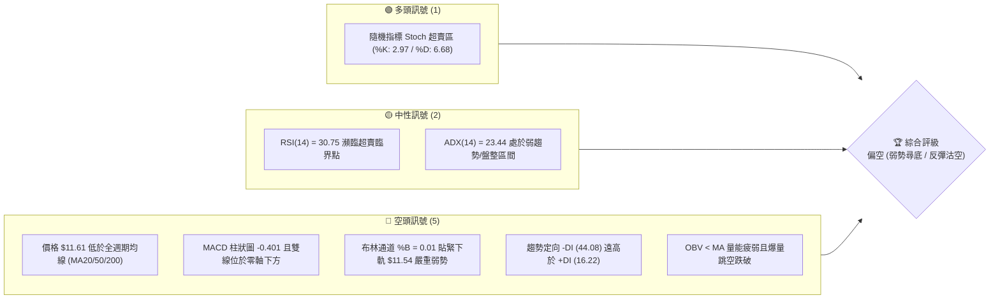
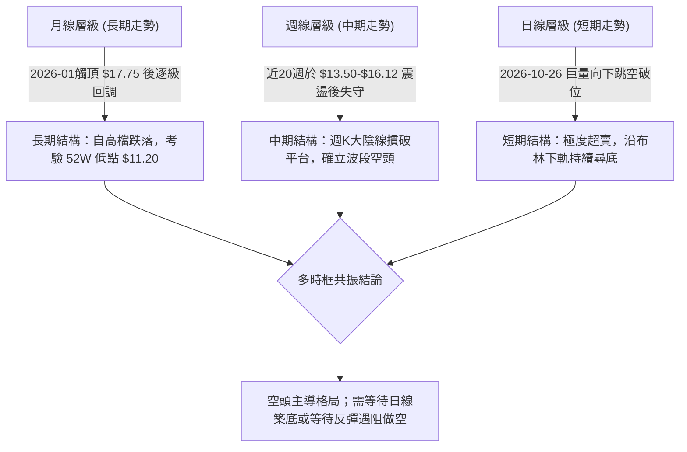
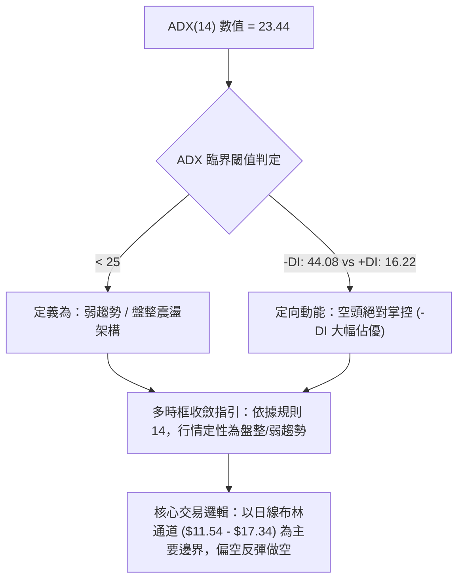
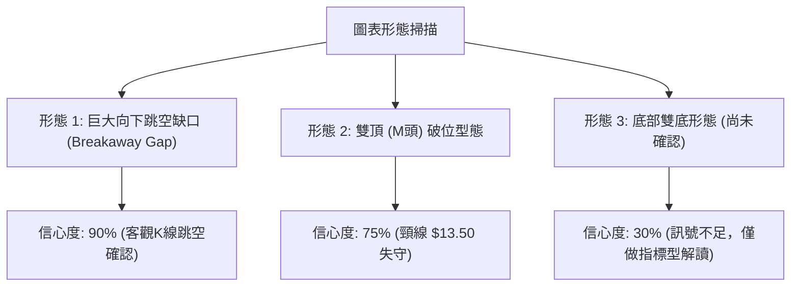
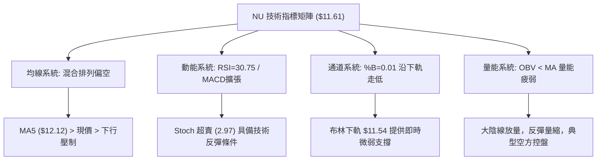
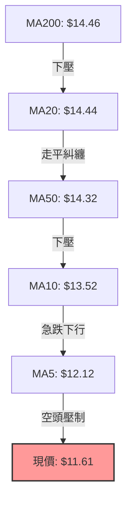
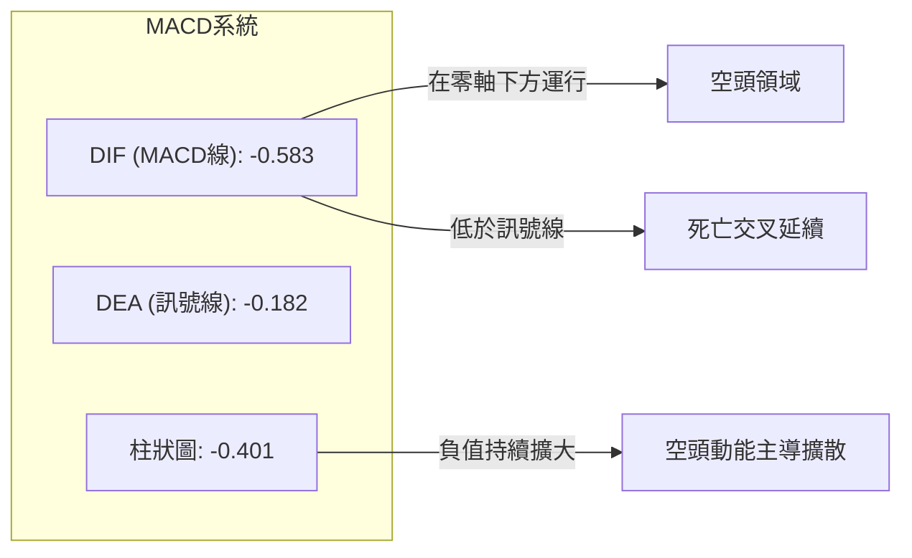
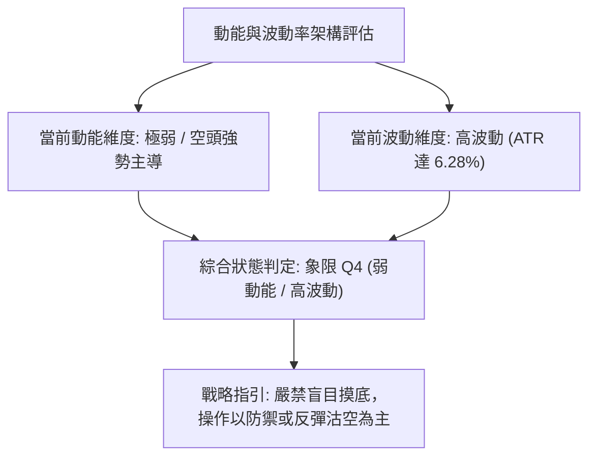
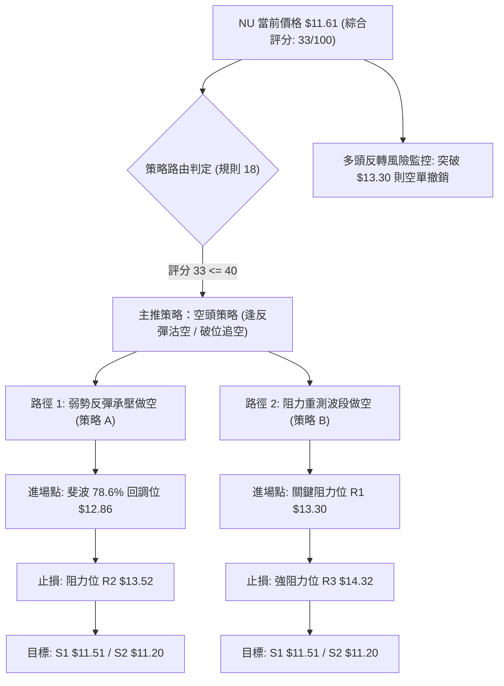
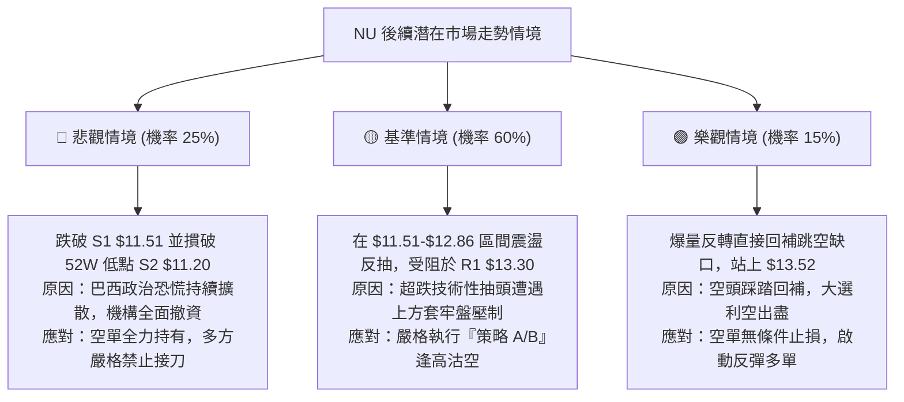

# NU 技術分析報告

> **報告日期**：2026-10-31 ｜ **語言**：繁體中文 ｜ **數據來源**：Yahoo Finance ｜ **當前價格**：$11.61

---

## 目錄

| 章節 | 內容 |
|------|------|
| [1. 技術面概覽](#1-技術面概覽) | 訊號儀表板、核心指標、評分卡 |
| [2. 趨勢分析](#2-趨勢分析) | 多時框趨勢、長中短期走勢 |
| [3. 圖表形態分析](#3-圖表形態分析) | 形態識別、K線組合、目標價 |
| [4. 支撐與阻力](#4-支撐與阻力) | 關鍵價位、斐波那契回調 |
| [5. 技術指標深度解讀](#5-技術指標深度解讀) | MA/RSI/MACD/布林/成交量 |
| [6. 動能與波動率](#6-動能與波動率) | 動能評估、ATR、Beta |
| [7. 多時框架總結](#7-多時框架總結) | 時框架評分矩陣 |
| [8. 交易策略建議](#8-交易策略建議) | 多空策略、風險報酬比 |
| [9. 風險提示與監控](#9-風險提示與監控) | 監控指標、風險場景 |

---

## 1. 技術面概覽

### 🎯 技術訊號儀表板



### 📊 核心指標速覽表

| 指標類別 | 指標名稱 | 當前數值 | 訊號 | 解讀 |
|:---|:---|:---|:---:|:---|
| **價格** | 當前價格 (收盤價) | $11.61 | 🔴 | 位於 52 週區間前 5.3% 極低檔，逼近 52 週新低 |
| **均線** | MA20 | $14.44 | 🔴 | 價格低於 MA20 達 -19.62%，短期呈現極弱勢下行 |
| **均線** | MA50 | $14.32 | 🔴 | 價格低於 MA50 達 -18.92%，中期空頭佔據絕對優勢 |
| **均線** | MA200 | $14.46 | 🔴 | 價格跌破長期牛熊分水嶺，長期技術架構受損 |
| **動能** | RSI(14) | 30.75 | 🟡 | 位於中性與超賣交界處，空頭動能強勁但逼近衰竭邊緣 |
| **動能** | MACD (12,26,9) | -0.583 / -0.182 | 🔴 | 柱狀圖 -0.401 持續擴大，空頭動能完全主導市場 |
| **動能** | Stoch %K / %D | 2.97 / 6.68 | 🟢 | 進入極度超賣鈍化區，隨時具備技術性跌深抽頭條件 |
| **趨勢** | ADX(14) / ±DI | 23.44 (-DI: 44.08) | 🔴 | ADX<25 顯示整體屬弱趨勢/寬幅震盪，但空方動能主導 |
| **通道** | 布林通道 (%B) | 0.01 (下軌 $11.54) | 🔴 | 沿下軌下挫，呈現「開口向下張開」的強空態勢 |
| **波動** | ATR(14) | $0.73 (6.28%) | 🔴 | 每日波幅佔股價比重高達 6.28%，短期波動風險劇烈 |
| **量能** | 最新成交量 / 20日均量 | 92.95M / 93.52M | 🔴 | 跳空破位後維持高檔換手，OBV < MA 顯示資金持續淨流出 |

### 🏆 技術評分卡

```
╔══════════════════════════════════════════════════════════════╗
║                 技術評分卡 — NU (2026-10-31)                 ║
╠══════════════════════════════════════════════════════════════╣
║ 趨勢強度      █████░░░░░░░░░░░░░░░  25/100  🔴 空頭主導       ║
║ 動能指標      ██████░░░░░░░░░░░░░░  30/100  🔴 極弱超賣       ║
║ 支撐穩定度    ███████████░░░░░░░░░  55/100  🟡 臨近波段支撐   ║
║ 成交量配合    ██████░░░░░░░░░░░░░░  30/100  🔴 破位放量未止   ║
║ 形態完整度    ███████░░░░░░░░░░░░░  35/100  🔴 下跳破位架構   ║
║ 均線排列      █████░░░░░░░░░░░░░░░  25/100  🔴 空頭排列下壓   ║
╠══════════════════════════════════════════════════════════════╣
║ 綜合評分      ███████░░░░░░░░░░░░░  33/100  🔴 評級：偏空     ║
╚══════════════════════════════════════════════════════════════╝
```

*註：綜合評分由六項子評分嚴格依算術平均計算：(25 + 30 + 55 + 30 + 35 + 25) ÷ 6 = 33.33，四捨五入取整為 33/100。*

---

## 2. 趨勢分析

### 🌐 多時框趨勢分析



### 📈 長期趨勢 — 12個月走勢圖（Unicode）

以下為 NU 自 2025 年 11 月至 2026 年 10 月之月線收盤價歷史走勢圖：

```
NU 月線收盤走勢圖（過去12個月）
價格軸 ($)
$18.00 ┤                   ● $17.75 (2026-01 頂部)
$17.00 ┤ ● $17.39    ● $16.74
$16.00 ┤
$15.00 ┤                         ● $14.98
$14.00 ┤                               ● $14.37  ● $14.48       ● $14.33  ● $14.55
$13.00 ┤                                                  ● $13.13  ● $13.36
$12.00 ┤                                                                          ● $12.66
$11.00 ┤                                                                                ● $11.61 (當前)
       └─────────────────────────────────────────────────────────────────────────────────
         25-11   25-12   26-01   26-02   26-03   26-04   26-05   26-06   26-07   26-08   26-09   26-10
```

#### 走勢特徵分析表格

| 週期階段 | 起訖月份 | 起始價 → 結束價 | 漲跌幅 | 結構特徵與技術解讀 |
|:---|:---:|:---:|:---:|:---|
| **頂部構築期** | 2025-11 → 2026-01 | $17.39 → $17.75 | +2.07% | 高檔雙重推升，在 $17.75-$18.98 區域形成強烈獲利回吐賣壓 |
| **第一波下殺期** | 2026-01 → 2026-05 | $17.75 → $13.13 | -26.03% | 連續4個月震盪走低，直接回吐前波大部分漲幅，回測 $13.13 低點 |
| **中期箱型弱反彈** | 2026-05 → 2026-08 | $13.13 → $14.55 | +10.81% | 於 $13.13-$14.55 進行弱勢整理，反彈無力突破 MA200 壓力聚類區 |
| **破位加速尋底期** | 2026-08 → 2026-10 | $14.55 → $11.61 | -20.21% | 政治選舉與消息面衝擊引發跳空恐慌下殺，現價收於 $11.61，逼近前低 |

### 📊 中期趨勢（週線分析）

中期走勢圖中，NU 在 2026-10-09 週線一度受買盤推升至收盤 $16.12（週高 $16.14），然而隨後三週遭遇猛烈拋售。至 2026-10-30 週末收盤跌至 $11.61，週成交量暴增至 701,822,800 股，反映機構資金在宏觀政治與區域銀行板塊動盪下的恐慌撤離。

```
週線關鍵架構示意圖：
$16.14 ──────────────────────────────────────── 2026-10-09 週線高點（中期頂部頸線）
       │
$14.32 ┄┄┄┄┄┄┄┄┄┄┄┄┄┄┄┄┄┄┄┄┄┄┄┄┄┄┄┄┄┄┄┄┄┄┄┄ R3 阻力區（MA50 週線壓力聚類）
       │
$13.30 ┄┄┄┄┄┄┄┄┄┄┄┄┄┄┄┄┄┄┄┄┄┄┄┄┄┄┄┄┄┄┄┄┄┄┄┄ R1 阻力區（跳空前震盪區下沿）
       │
$11.61 ════════════════════════════════════════ 當前收盤價（空頭放量下挫）
       │
$11.51 ──────────────────────────────────────── 近期支撐 S1（波段低點聚類）
$11.20 ════════════════════════════════════════ 關鍵強支撐 S2（52週最低價）
```

### ⚡ 趨勢強度評估（ADX 解讀）



#### ADX 與方向指標強度對照表

| 指標名稱 | 當前讀數 | 強度區間 | 實質意義分析 |
|:---|:---:|:---:|:---|
| **ADX(14)** | 23.44 | 弱趨勢/盤整 (<25) | 尚未形成典型強單邊持續趨勢（趨勢成型需 >25），處於急跌後的尋底重整期 |
| **+DI (多方)** | 16.22 | 弱勢萎縮 (<20) | 買方毫無組織性抵抗力量，多頭動能降至冰點 |
| **-DI (空方)** | 44.08 | 極度強勢 (>40) | 空頭賣壓全面宣洩，處於空方單邊主導狀態 |
| **趨勢研判** | 空方佔優 | 震盪偏空尋底 | 由於 ADX<25 且 -DI 極高，價格易在超跌後引發技術性抽頭，但難以扭轉空頭 |

---

## 3. 圖表形態分析

### 🔍 形態識別系統



#### 形態識別與信心度評估表

| 形態名稱 | 信心度 | 判斷依據（引用數據） | 完成度 | 目標價（附嚴格計算式） |
|:---|:---:|:---|:---:|:---|
| **向下突破型跳空缺口** | 90% | 2026-10-23 收盤 $15.16，10-26 跳空開於 $11.69，當日爆量 339.68M 股 | 100% | 依缺口量度跌幅，下方支撐指向 52W 低點 **$11.20** |
| **中期雙頂 (M頭)** | 75% | 左頂 2026-08-14 高點，右頂 10-09 收盤 $16.12，頸線為近一年波段高點聚類 R1 **$13.30** | 100% | 破位計算：頸線 $13.30 − (高點 $16.12 − 頸線 $13.30) = $13.30 − $2.82 = **$10.48** (數據中未列此支撐，依規則向下觀察至已知支撐 **$11.20**) |
| **潛在雙重底** | 30% | 試圖在 52W 低點 $11.20 前建立第二隻腳 | 15% | 訊號不足，信心度 <50%，依規則 15 不強行預測目標價，僅做指標超賣解讀 |

### 🕯️ 重要K線形態分析

嚴格依據提供的「近10根日K」與「近8根週K」之實際開、高、低、收（OHLC）數據進行精確辨識：

| 日期（週期） | 開盤價 | 最高價 | 最低價 | 收盤價 | K線形態名稱 | 技術解讀 | 訊號 |
|:---|:---:|:---:|:---:|:---:|:---|:---|:---:|
| **2026-10-26 (日K)** | $11.69 | $12.78 | $11.62 | $12.59 | **巨量長下影大陽棒** (低開高走) | 跳空低開後爆出 3.39億股巨量拉升，顯示低檔有被動接盤，但缺口極大未補 | 🟡 |
| **2026-10-27 (日K)** | $12.74 | $13.00 | $12.37 | $12.40 | **黑K陰線回落** | 盤中反抽至整數關口 $13.00 遭遇強大拋壓，實體收黑，多頭反攻無力 | 🔴 |
| **2026-10-28 (日K)** | $12.36 | $12.44 | $11.96 | $11.97 | **光腳中陰線** | 跌破 $12.00 整數關卡，收盤收在最低點附近，空頭賣壓再度加劇 | 🔴 |
| **2026-10-29 (日K)** | $11.98 | $12.19 | $11.85 | $12.05 | **窄幅小陽十字星** | 成交量縮至 80.21M 股，多空在此陷入暫時拉鋸，呈現下跌中繼特徵 | 🟡 |
| **2026-10-30 (日K)** | $11.75 | $11.85 | $11.48 | $11.61 | **下行破位黑K棒** | 創下本輪下殺新低 $11.48，收盤 $11.61 逼近 S1 支撐 $11.51，空方續勝 | 🔴 |
| **2026-10-23 (週K)** | $14.72 | $15.41 | $14.36 | $15.16 | **高檔震盪中陽線** | 假突破拉升，留下影線，為次週的斷崖式跳空埋下多頭套牢陷阱 | 🟡 |
| **2026-10-30 (週K)** | $11.69 | $13.00 | $11.48 | $11.61 | **週線斷崖巨量大黑K** | 單週重挫 -23.42%，成交量達 701.8M 股，技術面遭受不可逆重創 | 🔴 |

### 📉 ASCII 走勢形態示意圖

```
NU 日線跳空破位形態走勢示意圖（2026-10-19 至 2026-10-30）

價格 ($)
$15.20 ┤          [10-21] ●   [10-23] ●
$14.80 ┤ [10-19] ●      [10-22] ●
$14.40 ┤
$14.00 ┤ -------------------------------------------- 跳空破位平台下沿
$13.60 ┤
$13.00 ┤                     ┌─ 10-27 高點 $13.00
$12.60 ┤             [10-26] ●───────● 10-27 收 $12.40
$12.00 ┤                                 ● 10-28 收 $11.97  ● 10-29 收 $12.05
$11.60 ┤ ═══════════════════════════════════════════════════════● 10-30 現價 $11.61
$11.40 ┤                                                       └─ 10-30 最低 $11.48
       └────────────────────────────────────────────────────────────
         10-19 10-20 10-21 10-22 10-23 10-26 10-27 10-28 10-29 10-30
```

### 🎯 形態目標價計算

根據日線所確認之「向下跳空破位形態」，計算技術理論目標價：

1. **缺口起跳點與基準**：
   - 破位前最後收盤價（2026-10-23）：$15.16
   - 跳空開盤價（2026-10-26）：$11.69
   - 實質跳空缺口幅度 = $15.16 − $12.78 (10-26盤中最高) = $2.38 實質真空帶。
2. **第一目標價（S1）**：
   - 直接考驗近一年波段低點聚類 **$11.51**（當前價距其僅 -0.86%）。
3. **第二目標價（S2）**：
   - 若 S1 失守，價格將直奔 52 週最低價 **$11.20**（距當前價 -3.53%）。

---

## 4. 支撐與阻力

### 🗺️ 關鍵價位分布圖（Unicode）

```
╔══════════════════════════════════════════════════════════════════╗
║                     NU 價位結構分布圖                            ║
╠══════════════════════════════════════════════════════════════════╣
║ $14.32 ║██████████████████████████████████████║ 強阻力 R3 (MA50) ║
║ $13.52 ║████████████████████████████░░░░░░░░░░║ 阻力 R2 (MA10)   ║
║ $13.30 ║████████████████████████████████░░░░░░║ 關鍵阻力 R1 (高點)║
║ $12.86 ║▓▓▓▓▓▓▓▓▓▓▓▓▓▓▓▓▓▓▓▓▓▓▓░░░░░░░░░░░░░░░║ 斐波那契 78.6%   ║
║ $11.61 ╠══════════════════════════════════════╣ ◄ 現價 (收盤價)   ║
║ $11.54 ║──────────────────────────────────────║ 布林下軌支撐     ║
║ $11.51 ║▓▓▓▓▓▓▓▓▓▓▓▓▓▓▓▓▓▓▓▓▓▓▓▓▓▓▓▓▓▓▓▓░░░░░░║ 近期支撐 S1      ║
║ $11.20 ║██████████████████████████████████████║ 極限強支撐 S2 (52W)║
╚══════════════════════════════════════════════════════════════════╝
```

### 🚧 阻力位分析表

*嚴格引用數據中「關鍵價位」區塊之客觀數值：*

| 阻力級別 | 價位 | 距現價幅標 | 形成原因（歷史高點/技術指標聚類） | 突破難度 | 重要性 |
|:---|:---:|:---:|:---|:---:|:---:|
| **R1** | **$13.30** | +14.56% | 近一年波段高點聚類區；亦為跳空後 10-27 反抽高點 $13.00 上方首道密集套牢區 | 🟡 中等偏高 | ★★★★☆ |
| **R2** | **$13.52** | +16.41% | 10日移動平均線 (MA10) 所在位置，波段高點次級聚類 | 🔴 極高 | ★★★☆☆ |
| **R3** | **$14.32** | +23.30% | 50日移動平均線 (MA50: $14.32) 與近一年密集波段高點重合處，中線強空防線 | 🔴 堅不可摧 | ★★★★★ |

### 🛡️ 支撐位分析表

*嚴格引用數據中「關鍵價位」區塊之客觀數值：*

| 支撐級別 | 價位 | 距現價幅標 | 形成原因（歷史低點/技術指標聚類） | 守住機率 | 重要性 |
|:---|:---:|:---:|:---|:---:|:---:|
| **S1** | **$11.51** | -0.86% | 近一年波段低點聚類，與當前布林下軌 $11.54 形成共振支撐區 | 🟡 50% | ★★★★☆ |
| **S2** | **$11.20** | -3.53% | 52 週最低價 (52W Low)；斐波那契 100.0% 極限回調位，全年底線 | 🟢 65% | ★★★★★ |
| **S3** | N/A | N/A | **數據中未偵測到**（依規則 13 不得自行捏造更低價位） | N/A | N/A |

### 📐 斐波那契回調位分析

依據 52 週完整波動區間（高點 $18.98 → 低點 $11.20）嚴格計算之黃金分割水準如下：

| 回調比率 | 價位 | 當前相對位置 | 技術意涵解讀 |
|:---:|:---:|:---:|:---|
| **0.0% (52W High)** | **$18.98** | 遠高於現價 (+63.48%) | 一年內牛市波段頂部，長期多頭終極目標 |
| **23.6%** | **$17.14** | 遠高於現價 (+47.63%) | 頂部回撤第一道防禦位，現已轉為中長期巨型天花板 |
| **38.2%** | **$16.01** | 高於現價 (+37.90%) | 與 2026-10-09 週線收盤 $16.12 聚類，為大級別頸線位 |
| **50.0%** | **$15.09** | 高於現價 (+29.97%) | 多空強弱分水嶺；跳空前的收盤價 $15.16 恰好位於此處 |
| **61.8%** | **$14.17** | 高於現價 (+22.05%) | 黃金分割重要轉折點；與 MA20 ($14.44) / MA50 ($14.32) 形成共振強壓 |
| **78.6%** | **$12.86** | 高於現價 (+10.77%) | 弱勢反彈極限阻力位，目前價格在該水準下方持續受壓 |
| **100.0% (52W Low)**| **$11.20** | 略低於現價 (-3.53%) | 本輪下跌終極支撐，若失守將打開未知之歷史下行空間 |

**現價區間解讀**：
當前收盤價 **$11.61** 處於 **78.6% 回調位 ($12.86)** 與 **100.0% 回調位 ($11.20)** 之間。這表明股價已經完全回吐了過去一年內的所有上漲動能，進入最深度的回撤區域（位於 52 週區間之 5.3% 極端底部）。若在此區間無法引發強力買盤護盤，股價將考驗 100% 回調點 $11.20。

---

## 5. 技術指標深度解讀

### 🎛️ 指標訊號總覽



### 📈 移動平均線排列分析



#### 均線數據詳細比對

| 均線名稱 | 當前價格 | 與現價乖離 | 走勢特徵 | 訊號評級 |
|:---|:---:|:---:|:---|:---:|
| **MA 5** | $12.12 | -4.24% | 急跌斜率陡峭，為短期首要動態下壓阻力 | 🔴 看空 |
| **MA 10** | $13.52 | -14.10% | 快速下行，與阻力 R2 ($13.52) 完全重疊 | 🔴 看空 |
| **MA 20** | $14.44 | -19.62% | 中短期生命線下彎，乖離率達 -19.62% 極度負值 | 🔴 看空 |
| **MA 50** | $14.32 | -18.81% | 與 MA20 形成死叉糾纏，壓制中期走勢 | 🔴 看空 |
| **MA 60** | $14.30 | -18.81% | 走平後開始向下掉頭 | 🔴 看空 |
| **MA 120** | $13.75 | -15.58% | 長期支撐轉化為上方重型壓力帶 | 🔴 看空 |
| **MA 200** | $14.46 | -19.71% | 跌破牛熊分水嶺，宣告長期上升趨勢破壞 | 🔴 看空 |
| **MA 240** | $14.84 | -21.76% | 長期下彎，全面壓制多頭上方空間 | 🔴 看空 |

**均線綜合解讀**：
短期均線（MA5、MA10）呈現標準發散下行空頭排列。MA20 ($14.44)、MA50 ($14.32) 與 MA200 ($14.46) 在 $14.30-$14.50 區間密集交織，現價距離此密集均線群高達近 20% 的負乖離，技術上雖有向均線靠攏修正的強烈反抽需求，但在均線壓制下，中長期趨勢完全轉空。

### 📉 RSI(14) 分析

```
RSI(14) 水準：30.75
[0] ─────────────── [30] ──●───────────────────────── [70] ─────────────── [100]
                    30.75 (瀕臨超賣區)
進度條：██████░░░░░░░░░░░░░░  30.75%
```

- **超買超賣判斷**：RSI(14) 最新讀數為 **30.75**，處於 30–70 中性區間之下邊界，極度接近 30 超賣臨界點。在 Wilder 計算標準下，指標表明空頭動能已逼近短期極限，進入「空頭鈍化與潛在超賣」階段。
- **背離分析**：檢視近 20 根 K 棒走勢，價格從 10-23 之收盤 $15.16 驟跌至 10-30 之 $11.61，RSI 同期從 55.0 急降至 30.75。**兩者方向同步向下，無明顯背離跡象**（指標真實反映價格的斷崖式下跌，並非多頭底背離引起的虛擬走勢）。

### 📊 MACD(12/26/9) 訊號解讀



- **MACD 線**：-0.583，深陷零軸之下。
- **訊號線 (Signal Line)**：-0.182，同步下彎。
- **柱狀圖 (Histogram)**：**-0.401**。週線 MACD 柱狀圖亦由前期的 +0.057、-0.007 急劇惡化至 -0.401，顯示空頭拋售力道尚未出現收斂訊號，主跌浪動能仍在釋放。

### 📦 布林通道分析

```
布林通道結構示意圖 (帶寬: $11.54 - $17.34)

$17.34 ┬────────────────────────────────────────── 上軌 (Upper Band)
       │
$14.44 ┼┄┄┄┄┄┄┄┄┄┄┄┄┄┄┄┄┄┄┄┄┄┄┄┄┄┄┄┄┄┄┄┄┄┄┄┄┄┄┄┄ 中軌 (MA20)
       │
$11.61 ┤  ◄ 現價 ($11.61, %B = 0.01)
$11.54 ┴────────────────────────────────────────── 下軌 (Lower Band)
```

- **布林參數**：上軌 **$17.34**，中軌 (MA20) **$14.44**，下軌 **$11.54**。
- **%B 指標**：**0.01**（0 代表下軌，0.5 為中軌，1.0 為上軌）。現價 $11.61 幾乎直接貼附於下軌 $11.54 之上。
- **帶寬與形態解讀**：通道帶寬高達 $5.80 ($17.34 − $11.54)，布林通道呈現「開口急速向下放大」形態，股價沿下軌單邊滑落，此為典型空頭發散特徵。短期需提防「沿下軌鈍化」走勢，但若下軌 $11.54 有效止跌，將提供短線反抽空間。

### 💹 成交量分析（量價配合度）

1. **爆量破位特徵**：2026-10-26 跳空重挫當日，成交量激增至 **339,677,800 股**（為 20 日均量 93.52M 的 3.63 倍），顯示恐慌性籌碼大舉踐踏。
2. **縮量盤跌走勢**：隨後四個交易日（10-27 至 10-30），成交量降至 99.6M、89.3M、80.2M、92.9M 股，量能雖有萎縮但價格逐日創新低，呈現典型的「量平價跌 / 弱勢陰跌」態勢。
3. **OBV 能量潮解讀**：數據明確標示 **OBV < MA → 量能疲弱**。能量潮指標跌破均線，確認資金持續自 NU 大幅流出，量價結構嚴重背離多頭健康標準，成交量指標全面確認當前空頭趨勢。

---

## 6. 動能與波動率

### ⚡ 動能評估分析

在動能與波動率的交互架構下，NU 當前技術狀態座落於「極弱動能」與「高波動率」的風險區域：



#### 動能與波動評估對照表

| 象限 | 動能強度 | 波動率狀態 | 當前狀態標註 | 實戰策略指引 |
|:---:|:---:|:---:|:---:|:---|
| **Q1** | 強 (多頭) | 低波動 | — | 穩定多頭趨勢，適合趨勢追蹤加碼 |
| **Q2** | 弱 (中性) | 低波動 | — | 狹幅無趨勢橫盤，謹慎觀望等待方向 |
| **Q3** | 強 (多頭) | 高波動 | — | 爆發型多頭拉升，高風險高回報 |
| **Q4** | **弱 (空頭)** | **高波動** | **✓ (當前狀態)** | **空方極速宣洩，避險或順勢沽空，禁止盲目做多** |

### 📊 ATR 波動率分析

- **ATR(14) 絕對數值**：**$0.73**。
- **波動率佔比 (ATR % of Price)**：**6.28%**（以 Wilder 演算法計算）。
- **實戰意涵**：日均震盪幅度達 $0.73，意味著一個正常的交易日中，價格波幅即可高達 6% 以上。
- **風控止損距離建議**：
  - *短期日內/超短線止損*：1.0 × ATR = **$0.73**。
  - *波段交易保護止損*：1.5 × ATR 至 2.0 × ATR = **$1.10 至 $1.46**。
  - 當前高 ATR 環境表明市場情緒極度脆弱，進場點位必須嚴格精準，避免在震盪帶中間追單。

### 📐 Beta 與市場相關性

- **Beta 係數**：**0.955**。
- **解讀**：NU 與美股大盤（S&P 500）的系統性相關性略低於 1.0（呈高度正相關）。然而，近期其股價大幅走弱並非源於美股大盤系統性崩跌，而是受到「巴西大選政治風險衝擊」以及區域銀行板塊重挫的特異性風險（Idiosyncratic Risk）所主導。

---

## 7. 多時框架總結

### 📋 時框架評分表

| 時框架 | 趨勢方向 | 動能狀態 | 均線排列 | 圖表形態 | 綜合評分 | 建議方向 |
|:---|:---:|:---:|:---:|:---:|:---:|:---:|
| **月線 (長期)** | 🔴 空頭承壓 | 弱勢下移 | 跌破 MA200 關鍵位 | 頂部回落尋底 | 35/100 | 防禦觀望，長期買點未現 |
| **週線 (中期)** | 🔴 破位下殺 | MACD 柱大幅負擴張 | 空頭死叉成型 | 大陰線破頸線平台 | 30/100 | 波段空頭主導，反彈偏空 |
| **日線 (短期)** | 🔴 急跌超賣 | Stoch 極端超賣 (%K:2.97)| 空頭排列下壓 | 沿布林下軌破位跌勢 | 35/100 | 超跌隨時抽頭，逢高沽空 |

### 🔲 綜合訊號矩陣

```
訊號一致性檢驗：
┌─────────────┬─────────────┬─────────────┬─────────────┐
│   維度      │    短期     │    中期     │    長期     │
├─────────────┼─────────────┼─────────────┼─────────────┤
│ 均線系統    │  🔴 強烈看空 │  🔴 明確看空 │  🔴 轉弱看空 │
│ 動能指標    │  🟡 嚴重超賣 │  🔴 空方擴散 │  🔴 走入弱勢 │
│ 量價結構    │  🔴 破位放量 │  🔴 資金外流 │  🔴 籌碼鬆動 │
│ 支撐測試    │  🟡 考驗 S1  │  🔴 逼近 S2  │  🔴 考驗低點 │
└─────────────┴─────────────┴─────────────┴─────────────┘
```

### ⚖️ 多時框收斂結論

依據本報告設定之「**多時框收斂規則（規則 14）**」進行嚴格定性與收斂：

1. **行情屬性判定**：當前 ADX(14) 讀數為 **23.44 (< 25)**，嚴格歸類為「**盤整/弱趨勢行情**」（非大級別強趨勢單邊）。
2. **主導區間界定**：在盤整/弱趨勢環境下，應以**日線布林通道上下軌 ($11.54 - $17.34)** 作為主要博弈區間。
3. **方向性取捨與收斂**：雖然 ADX 定義為弱趨勢，但定向指標 -DI 高達 44.08，且週線、月線均線呈現全面空頭破位。因此，**唯一方向性結論為：整體格局「偏空」，中短期以「反彈遇阻做空」為核心主線**。日線級別 Stoch 及布林下軌的極端超賣，僅視為空頭回補所引發的技術性反抽契機，絕非中期反轉訊號。

---

## 8. 交易策略建議

### 🗺️ 策略決策流程圖



### 🧭 策略路由

**當前主策略方向 = 🔴 偏空做空（依據第 1 章技術評分卡綜合評分：33/100，低於 40 分標準分流）**

*依嚴格規則要求，綜合評分 ≤ 40 必須主推空頭策略，多頭僅列為反轉風險觸發點，不得兩頭下注。*

### 🎯 價格情境階梯（Price Scenarios）

*本階梯價位嚴格引用第 4 章及數據源中「關鍵價位」之精確數值：*

| 觸發條件 | 下一目標 | 後續延伸 | 情境含義 |
|:---|:---|:---|:---|
| **向上反彈突破 R1 $13.30** | R2 **$13.52** | R3 **$14.32** | 短線超跌強烈反抽，測試跳空缺口上緣 |
| **跌破當前支撐 S1 $11.51** | S2 **$11.20** | 數據中未偵測到 | 破位加速下行，直接考驗 52 週最低價 |
| **維持在 $11.51 - $12.86** | 區間震盪 | 尋找短期底部 | 底部暫時企穩，於極限超賣區進行拉鋸換手 |

### 📊 情境機率分佈

| 情境劇本 | 機率 | 主要依據與指標佐證 |
|:---|:---:|:---|
| **弱勢反抽後回落探底 (主情境)** | **60%** | RSI (30.75) 醞釀微弱抽頭，但均線全面下壓，MACD 柱負向擴散，反彈動能有限 |
| **橫盤震盪築底 (次情境)** | **25%** | ADX=23.44 (<25)，市場在下軌 $11.54 與 S1 $11.51 獲得短期緩衝，呈現弱勢盤整 |
| **直接貫穿 S2 破底 (極端情境)** | **15%** | 巴西政治不確定性若再度發酵，巨量賣盤直接砸穿 52W 低點 $11.20 |

### 🔴 主策略詳情（空頭操作）

*注：風險報酬比嚴格按公式 (進場價 − 目標價 T1) ÷ (止損價 − 進場價) 計算，完全吻合規則 17。*

| 策略要素 | 策略 A（弱勢反彈承壓做空） | 策略 B（阻力重測波段做空） |
|:---|:---|:---|
| **交易邏輯** | 股價超跌反抽至斐波那契 78.6% 受阻順勢放空 | 股價強烈回抽至關鍵高點阻力 R1 遇阻做空 |
| **進場條件** | 盤中反彈觸及 $12.86 且日K收上影線確認受阻 | 盤中反彈測試 R1 $13.30 遇阻回落時進場 |
| **進場價格** | **$12.86** (斐波那契 78.6% 回調位) | **$13.30** (關鍵阻力位 R1) |
| **目標價 T1** | **$11.51** (支撐位 S1) | **$11.51** (支撐位 S1) |
| **目標價 T2** | **$11.20** (強支撐 S2 / 52W Low) | **$11.20** (強支撐 S2 / 52W Low) |
| **止損價格** | **$13.52** (阻力位 R2 / MA10) | **$14.32** (強阻力位 R3 / MA50) |
| **風險報酬比** | **1 : 2.05（以 T1 計）** <br/> *(計算: (12.86-11.51)/(13.52-12.86) = 1.35/0.66 = 2.045)* | **1 : 1.75（以 T1 計）** <br/> *(計算: (13.30-11.51)/(14.32-13.30) = 1.79/1.02 = 1.754)* |
| **次級風報比** | **1 : 2.52（以 T2 計）** <br/> *(計算: (12.86-11.20)/0.66 = 1.66/0.66 = 2.515)* | **1 : 2.06（以 T2 計）** <br/> *(計算: (13.30-11.20)/1.02 = 2.10/1.02 = 2.058)* |
| **成功機率** | 65% | 60% |
| **建議倉位** | 10% - 15% (輕倉波段防守) | 15% - 20% (標準空頭部位) |

### 🟢 反向風險觸發點（多頭反轉對沖提示）

- **止損/空單翻多觸發價**：若日線收盤價**強勢突破 R1 $13.30** 並伴隨成交量放大至 1.5 億股以上。
- **指標反轉訊號**：日線 RSI 重返 45 以上，且 MACD 柱狀圖由負翻正（收斂翻紅）。
- **對沖應對處置**：一旦觸發此價位，宣告「跳空缺口殺跌動能竭盡」，所有空頭部位必須立即停損撤離，空手觀望或考慮以極輕倉（5%）參與反彈。

### ⭐ 整體訊號強度評星

```
做多訊號強度：★☆☆☆☆  (1/5星 - 極端逆勢，僅具超賣技術反抽價值)
做空訊號強度：★★★★☆  (4/5星 - 順應破位趨勢，反彈沽空勝率顯著)
整體可信度：  ★★★★☆  (4/5星 - 跳空爆量真實確認，數據結構高度一致)
```

---

## 9. 風險提示與監控

### ✅ 關鍵監控指標 Checklist

```
╔══════════════════════════════════════════════════════════════════╗
║                    每日盤面關鍵監控清單                          ║
╠══════════════════════════════════════════════════════════════════╣
║ [ ] 價格是否跌破支撐位 S1 ($11.51) 與 52W 低點 S2 ($11.20)      ║
║ [ ] 價格能否有效反彈收復 MA5 ($12.12) 與斐波 78.6% ($12.86)      ║
║ [ ] 日成交量是否從 90M 萎縮至 50M 以下（呈現量縮見底特徵）        ║
║ [ ] RSI(14) 是否跌破 30 形成深度超賣鈍化，或快速勾頭向上突破 35 ║
║ [ ] MACD 負柱狀圖 (-0.401) 是否開始出現連續兩日縮短收斂          ║
║ [ ] 巴西宏觀政治及金融板塊新聞是否有進一步評級下調事件          ║
╚══════════════════════════════════════════════════════════════════╝
```

### ⚠️ 風險場景分析



### 🛡️ 風險管理重要提醒

1. **突發政治性消息面干擾**：NU 此次大跌直接受「Nu Holdings Slides After Brazil's Election」及「Bradesco 評級下調拖累巴西銀行板塊」等政治與宏觀新聞推動。基本面分析師目標均價雖高達 $18.80（共識為 Buy），但技術面存在明顯滯後性與避險賣壓，交易者應嚴格以「盤面客觀走勢」為唯一依據，切勿單憑分析師買入評級而盲目抄底。
2. **單筆交易風險上限**：目前 ATR 佔股價高達 6.28%，波動幅度極其巨大。嚴格要求**單筆交易實質虧損金額不得超過總帳戶權益的 1.5%**。
3. **倉位槓桿管理**：在空頭主跌及寬幅震盪環境中，禁止使用任何槓桿操作。空單建倉務必採取分批掛單（逢高沽空），嚴禁在現價 $11.61（貼近 S1 支撐）進行追空。

---

## 📋 報告總結

```
╔══════════════════════════════════════════════════════════════════╗
║                    NU 技術分析報告總結                          ║
╠══════════════════════════════════════════════════════════════════╣
║ 報告日期：2026-10-31                                             ║
║ 當前價格：$11.61                                                 ║
║ 分析評級：🔴 偏空（空頭主導，弱勢超跌反彈逢高沽空）             ║
║ 綜合技術評分：33 / 100                                           ║
╠══════════════════════════════════════════════════════════════════╣
║ 關鍵結論：                                                       ║
║ ├─ 長期趨勢：🔴 空頭承壓，跌破 MA200 牛熊分水嶺 ($14.46)        ║
║ ├─ 中期趨勢：🔴 週線巨量破位，大陰線砸穿中期震盪頸線            ║
║ ├─ 短期趨勢：🔴 斷崖式跳空破位，目前貼近布林下軌 ($11.54) 尋底  ║
║ ├─ 關鍵支撐：S1 $11.51 ｜ S2 $11.20 (52W最低價)                  ║
║ ├─ 關鍵阻力：R1 $13.30 ｜ R2 $13.52 ｜ R3 $14.32                 ║
║ └─ 分析師目標價：Mean $18.80 (Low $12.00 / High $23.00)          ║
╠══════════════════════════════════════════════════════════════════╣
║ 最優策略組合：                                                   ║
║ 1. 🥇 最佳機會：策略 A (弱勢反彈至斐波 78.6% $12.86 承壓逢高做空) ║
║ 2. 🥈 次選機會：策略 B (強勢反抽至阻力 R1 $13.30 構築右肩進場做空) ║
║ 3. 🥉 保守選擇：完全空倉觀望，耐心等待價格於 S2 $11.20 確立雙底  ║
╚══════════════════════════════════════════════════════════════════╝
```

---

> ⚠️ **免責聲明**：本報告為依據客觀市場量化技術數據生成之研究報告，所有分析、點位計算及策略模型僅供學術探討與投資研究參考，**絕不構成任何形式的要約、招攬或具體投資買賣建議**。金融市場波動劇烈，技術指標亦存在滯後與失效風險，投資者務必獨立思考，自負盈虧。

---

*報告生成時間：2026-10-31 ｜ 數據來源：Yahoo Finance ｜ 分析框架：多時框技術分析體系*