# NU 技術分析報告

> **報告日期**：2026-11-01 ｜ **語言**：繁體中文 ｜ **數據來源**：Yahoo Finance ｜ **當前價格**：$11.61 USD

---

## 目錄

| 章節 | 內容 |
|------|------|
| [1. 技術面概覽](#1-技術面概覽) | 訊號儀表板、核心指標、評分卡 |
| [2. 趨勢分析](#2-趨勢分析) | 多時框趨勢、長中短期走勢、12個月歷史圖 |
| [3. 圖表形態分析](#3-圖表形態分析) | 形態識別、K線組合、形態目標價 |
| [4. 支撐與阻力](#4-支撐與阻力) | 關鍵價位、斐波那契回調結構 |
| [5. 技術指標深度解讀](#5-技術指標深度解讀) | 均線系統、RSI、MACD、布林通道、量能 |
| [6. 動能與波動率](#6-動能與波動率) | 動能矩陣、ATR波動分析、Beta相關性 |
| [7. 多時框架總結](#7-多時框架總結) | 時框架矩陣、多時框收斂與方向定調 |
| [8. 交易策略建議](#8-交易策略建議) | 策略路由、情境階梯、主策略詳情、風報比 |
| [9. 風險提示與監控](#9-風險提示與監控) | 關鍵監控清單、情境推演、風控指引 |

---

## 1. 技術面概覽

### 🎯 技術訊號儀表板

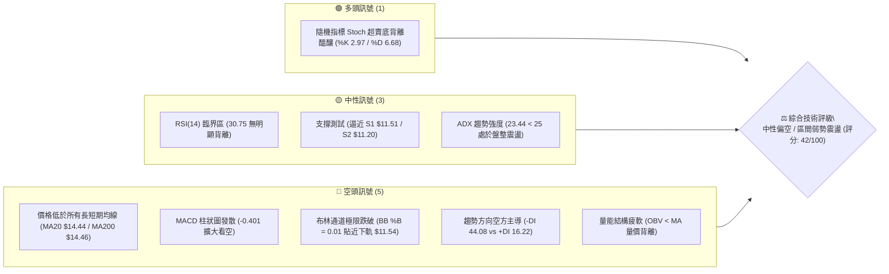

---

### 📊 核心指標速覽表

| 指標類別 | 指標名稱 | 當前數值 | 訊號 | 解讀 |
|----------|----------|----------|:----:|------|
| **價格** | 當前收盤價 | $11.61 | 🔴 | 位於52週區間5.3%極低位，逼近歷史支撐區 |
| **均線** | MA20 (月線) | $14.44 | 🔴 | 價格低於MA20達 -19.62%，短期嚴重負乖離 |
| **均線** | MA50 (季線) | $14.32 | 🔴 | 價格低於MA50達 -18.92%，中期空頭壓制 |
| **均線** | MA200 (年線) | $14.46 | 🔴 | 價格低於MA200達 -19.71%，長線多空分水嶺失守 |
| **動能** | RSI(14) | 30.75 | 🟡 | 位於超賣邊緣（30-70中性偏低），動能鈍化中 |
| **動能** | MACD (12,26,9) | -0.583 / -0.182 | 🔴 | MACD Hist為 -0.401，空頭動能柱持續擴大 |
| **震盪** | Stoch %K / %D | 2.97 / 6.68 | 🟢 | 極度超賣區間，隨時具備技術性跌深反彈契機 |
| **通道** | 布林通道下軌 | $11.54 | 🟡 | %B僅 0.01，價格緊貼下軌，波段下行空間受壓制 |
| **趨勢** | ADX(14) | 23.44 | 🟡 | ADX < 25 表示行情無強單邊趨勢，屬盤整弱勢震盪 |
| **方向** | +DI / -DI | 16.22 / 44.08 | 🔴 | -DI顯著高於+DI，空方完全控制當前微觀格局 |
| **波動** | ATR(14) | $0.73 | 🔴 | 佔股價比達 6.28%，短期日震幅擴大，操作需設寬止損 |
| **量能** | 當日量 / 20日均量 | 92.95M / 93.52M | 🟡 | 量比0.99x，經歷破位跳空巨量後成交量回歸均值 |

---

### 🏆 技術評分卡

```
╔══════════════════════════════════════════════════════════════════╗
║                   技術評分卡 — NU (2026-11-01)                  ║
╠══════════════════════════════════════════════════════════════════╣
║ 趨勢強度 (Trend)      ███████░░░░░░░░░░░░░  35/100  🔴 空頭佔優  ║
║ 動能指標 (Momentum)   ████████░░░░░░░░░░░░  40/100  🟡 極度超賣  ║
║ 支撐穩定度 (Support)  ████████████░░░░░░░░  58/100  🟡 考驗低點  ║
║ 成交量配合 (Volume)   ███████░░░░░░░░░░░░░  36/100  🔴 量能疲弱  ║
║ 形態完整度 (Pattern)  █████████░░░░░░░░░░░  45/100  🟡 破位待定  ║
║ 均線排列 (MA Setup)   ████████░░░░░░░░░░░░  38/100  🔴 混合空頭  ║
╠══════════════════════════════════════════════════════════════════╣
║ 綜合評分 (Overall)    ████████░░░░░░░░░░░░  42/100  ⚖️ 區間震盪  ║
║ 評分定義：六項算術平均 (35+40+58+36+45+38)/6 = 42/100 (規則18)    ║
╚══════════════════════════════════════════════════════════════════╝
```

---

## 2. 趨勢分析

### 🌐 多時框趨勢分析

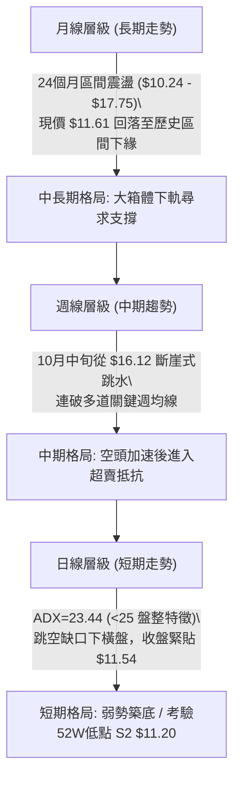

---

### 📈 長期趨勢 — 12個月走勢圖（Unicode）

依據過去 12 個月（2025-11 至 2026-10）收盤價繪製走勢軌跡，標注關鍵頂部與當前下探：

```
NU 月線走勢圖（過去12個月：2025-11 至 2026-10）
價格軸 ($)
$18.00 ┤              ● $17.75 (高點 2026-01)
$17.00 ┤  ● $17.39  ● $16.74
$16.00 ┤
$15.00 ┤                    ● $14.98
$14.00 ┤                          ● $14.37  ● $14.48        ● $14.33  ● $14.55
$13.00 ┤                                      ● $13.13  ● $13.36
$12.00 ┤                                                              ● $12.66
$11.00 ┤                                                                    ● $11.61 (現價)
       └─────────────────────────────────────────────────────────────────────────────
        11    12    01    02    03    04    05    06    07    08    09    10 (月份)
        (2025)     (------------------------- 2026 -------------------------)
```

#### 走勢特徵分析表格

| 階段區間 | 時間跨度 | 起訖收盤價 | 漲跌幅 | 核心技術特徵 |
|----------|----------|------------|:------:|--------------|
| **衝頂回落期** | 2025-11 → 2026-01 | $17.39 → $17.75 | +2.07% | 觸及 52 週高點 $18.98 附近遇阻，形成長週期雙頂結構 |
| **震盪走弱期** | 2026-02 → 2026-05 | $14.98 → $13.13 | -12.35% | 跌破多條短期均線，空方逐步蠶食多頭防線 |
| **中樞築底期** | 2026-06 → 2026-08 | $13.36 → $14.55 | +8.91% | 在 $13.30–$14.50 構築盤整箱體，成交量顯著萎縮 |
| **跳空破位期** | 2026-09 → 2026-10 | $12.66 → $11.61 | -8.30% | 宏觀利空突襲，單日巨量跳空摜破季線與年線，探尋 52 週低位 |

---

### 📊 中期趨勢（週線分析）

中期技術面目前由空頭完全掌控。近 8 週走勢中，NU 於 2026-10-09 當週拉出最高 $16.14 的假突破，隨後三週遭遇猛烈拋壓，2026-10-30 當週更以 701,822,800 股的爆量長黑摜破所有防線，週收盤價報 $11.61。

```
週線級別價格壓力與支撐階梯示意：
$16.14 ── 10/09 波段假突破頂部 (空頭陷阱)
         │
$14.32 ── R3 強阻力 / 週線級別多道均線糾結處
         │
$13.52 ── R2 阻力 / 近期週K反彈頸線
         │
$13.30 ── R1 關鍵跳空缺口下沿
         │
$11.61 ── 當前週線收盤價 (緊逼 S1)
         │
$11.51 ── S1 近期週線低點支撐
         │
$11.20 ── S2 52週歷史低點 (全週期最後防線)
```

---

### ⚡ 趨勢強度評估（ADX 解讀）

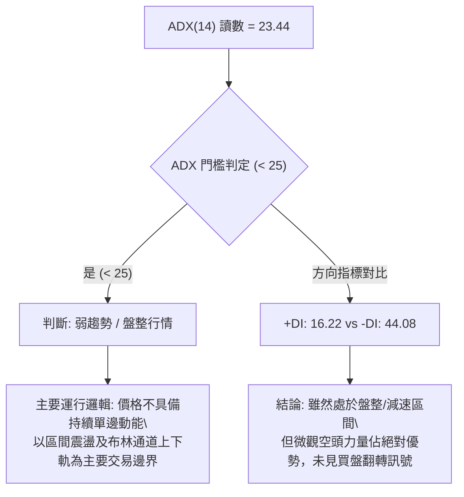

#### ADX 趨勢強度對照表

| 指標名稱 | 當前數值 | 參考標準區間 | 狀態評估 | 實戰交易指引 |
|----------|:--------:|:------------:|:--------:|--------------|
| **ADX(14)** | **23.44** | < 25 (弱趨勢/震盪) | 🟡 弱趨勢 | 嚴禁盲目追空；以箱體與通道邊界低吸高拋為主 |
| **+DI** | **16.22** | 0 – 100 | 🔴 極度低迷 | 多頭買力匱乏，尚未形成反攻攻擊波 |
| **-DI** | **44.08** | 0 – 100 | 🔴 空方主導 | 空頭情緒宣洩完畢後隨時面臨乖離修正 |
| **方向差距** | **-27.86** | 差值擴大 | 🔴 嚴重失衡 | 短期下行斜率過陡，易引發超跌空頭回補 |

---

## 3. 圖表形態分析

### 🔍 形態識別系統

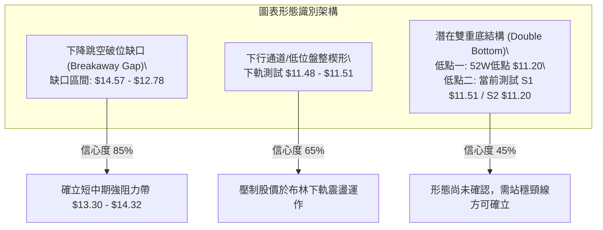

#### 形態識別與信心度評估表

| 形態名稱 | 信心度 | 判斷依據（引用數據） | 完成度 | 目標價（附計算式） |
|----------|:------:|----------------------|:------:|--------------------|
| **向下突破跳空** | **85%** | 2026-10-23 低點 $14.57 跳空至 10-26 開盤 $11.69，當日爆量 339.68M | 100% | 阻力目標 R1: $13.30，強阻力 R2: $13.52 |
| **布林下軌貼軌** | **70%** | BB %B 僅 0.01，價格緊貼下軌 $11.54，Stoch %K 達 2.97 | 90% | 均值回歸中軌 BB Mid: $14.44（形態推算） |
| **潛在雙重底** | **45%** | 當前低點 $11.48 逼近 52W 低點 $11.20（兩次低點聚類於 S1/S2） | 35% | 頸線 $13.30 + 高度($13.30 − $11.20 = $2.10) = $15.40（未確認前僅作參考） |

*註：依規則 15，潛在雙重底結構完成度僅 35%，信心度低於 50%，屬於「未完成形態」，當前僅作指標型解讀與邊界防守參考，不可作為進場唯一依據。*

---

### 🕯️ 重要K線形態分析

嚴格依據數據中「近 10 根日 K」與「近 8 根週 K」之開高低收真實數值進行解讀：

#### 近 10 根日 K 棒分析

| 日期 | 開盤價 | 最高價 | 最低價 | 收盤價 | 成交量 | K線形態 | 解讀與多空訊號 |
|:----:|:------:|:------:|:------:|:------:|:------:|:-------:|:---------------|
| 2026-10-19 | $14.72 | $14.92 | $14.36 | $14.51 | 41,434,800 | 實體陰線 | 🟡 均線反壓，高檔買盤觀望 |
| 2026-10-20 | $14.62 | $15.41 | $14.60 | $15.09 | 71,858,000 | 中陽線 | 🟢 帶量反彈，測試 $15.00 關卡 |
| 2026-10-21 | $15.21 | $15.37 | $15.01 | $15.05 | 66,306,900 | 吊頸陰十字 | 🔴 高檔受阻，多頭動能停滯 |
| 2026-10-22 | $14.89 | $15.06 | $14.63 | $14.73 | 55,429,600 | 溫和陰線 | 🔴 跌破開盤價，賣壓逐步湧現 |
| 2026-10-23 | $14.69 | $15.25 | $14.57 | $15.16 | 87,080,800 | 假突破陽線 | 🟡 衝高未破前高，尾盤反抽誘多 |
| 2026-10-26 | $11.69 | $12.78 | $11.62 | $12.59 | 339,677,800 | 巨量長陽下影 | 🔴 巨幅跳空低開，長下影帶出停損爆量 |
| 2026-10-27 | $12.74 | $13.00 | $12.37 | $12.40 | 99,667,300 | 衝高回落倒錘 | 🔴 測試 $13.00 缺口壓力失敗，量能驟降 |
| 2026-10-28 | $12.36 | $12.44 | $11.96 | $11.97 | 89,320,400 | 光腳中陰線 | 🔴 跌破 $12.00 整數關卡，弱勢延續 |
| 2026-10-29 | $11.98 | $12.19 | $11.85 | $12.05 | 80,210,200 | 低位微幅小陽 | 🟡 縮量企穩，呈現短線抵抗 |
| 2026-10-30 | $11.75 | $11.85 | $11.48 | $11.61 | 92,947,100 | 下探破位陰線 | 🔴 創本波新低 $11.48，收盤逼近 S1 $11.51 |

#### 近 8 根週 K 棒分析

| 日期 | 開盤價 | 最高價 | 最低價 | 收盤價 | 成交量 | K線形態 | 解讀與多空訊號 |
|:----:|:------:|:------:|:------:|:------:|:------:|:-------:|:---------------|
| 2026-09-11 | $15.56 | $15.82 | $14.44 | $14.62 | 285,554,300 | 長上影中陰 | 🔴 高檔阻力沉重，多頭受挫 |
| 2026-09-18 | $14.35 | $14.55 | $13.58 | $13.65 | 368,136,800 | 實體大陰線 | 🔴 連續跌破 MA20 與 MA50 支撐 |
| 2026-09-25 | $13.84 | $14.25 | $13.36 | $13.59 | 290,425,500 | 縮量十字陰 | 🟡 空方動能暫歇，尋求支撐 |
| 2026-10-02 | $12.53 | $13.50 | $12.13 | $13.43 | 532,732,100 | 巨量長下影 | 🟢 於 $12.13 爆出買盤支撐強勁回抽 |
| 2026-10-09 | $14.98 | $16.14 | $14.84 | $16.12 | 517,684,300 | 突破大陽線 | 🟢 帶量反轉，週線 MACD 翻紅 |
| 2026-10-16 | $16.10 | $16.19 | $14.40 | $14.56 | 328,775,500 | 吞噬大長黑 | 🔴 空頭反撲，回吐前週全部漲幅 |
| 2026-10-23 | $14.72 | $15.41 | $14.36 | $15.16 | 322,110,100 | 縮量小陽線 | 🟡 弱勢反彈，受制於 $15.41 壓力 |
| 2026-10-30 | $11.69 | $13.00 | $11.48 | $11.61 | 701,822,800 | 天量跳空破位黑 | 🔴 爆出 7 億股天量，單週重挫 -23.42% |

---

### 📉 ASCII 走勢形態示意圖

```
                    跳空破位與底部測試形態示意圖
價位 ($)
$15.16 ──────┐ (10/23 收盤)
             │
             │ [巨幅跳空缺口帶：$12.78 - $14.57 形成極強阻力區]
             │
$12.78 ──────┼──────────────┐ (10/26 盤中反彈高點)
$12.59 ──────┼───────┐      │
             │       │      │      ┌─ $12.44 (10/28 高)
             │       │      └─┐    │    ┌─ $12.19 (10/29 高)
$12.00 ──────┼───────┼────────┼────┼────┼──────────
             │       │ (10/27)│    │    │    ┌─ $11.85 (10/30 高)
$11.61 ──────┼───────┼────────┼────┼────┼────┼─── ● 當前收盤 $11.61
$11.51 ──────┼───────┴────────┴────┴────┴────┴─── S1 近期波段支撐
$11.20 ──────┴─────────────────────────────────── S2 52週歷史低點 (防守底線)
```

---

### 🎯 形態目標價計算

根據形態學計算邏輯，當前主要形態為「跳空破位下行整理」：
1. **反彈第一阻力目標**：由跳空後反彈波段高點計算，即阻力位 **R1: $13.30**。
2. **反彈第二阻力目標**：由缺口下緣與 MA10 糾結區推算，即阻力位 **R2: $13.52**。
3. **極限反彈阻力目標**：由 MA50 季線位置推算，即阻力位 **R3: $14.32**。
4. **潛在雙重底推算目標**（若 S2 $11.20 不破且確認突破頸線 $13.30）：
   $$\text{形態高度} = \text{頸線 } \$13.30 - \text{低點 } \$11.20 = \$2.10$$
   $$\text{向上量度目標價} = \$13.30 + \$2.10 = \$15.40$$

---

## 4. 支撐與阻力

### 🗺️ 關鍵價位分布圖（Unicode）

```
╔══════════════════════════════════════════════════════════════════╗
║                     NU 價位結構分布圖                            ║
╠══════════════════════════════════════════════════════════════════╣
║ $18.98 ║████████████████████████║ 52W 歷史最高點 (Fib 0.0%)     ║
║ $17.14 ║████████████████████    ║ 長期反壓區 (Fib 23.6%)        ║
║ $16.01 ║██████████████████████  ║ 中期重要轉折 (Fib 38.2%)      ║
║ $15.09 ║████████████████████████║ 心理整數關卡 (Fib 50.0%)      ║
║ $14.32 ║████████████████████████║ 強阻力 R3 (MA50/MA200 聚類)   ║
║ $13.52 ║████████████████████    ║ 阻力 R2 (MA10 壓制位)         ║
║ $13.30 ║████████████████████████║ 關鍵阻力 R1 (跳空缺口反彈高點)║
║ $11.61 ╠════════════════════════╣ ◄ 當前收盤價 ($11.61)          ║
║ $11.51 ║▓▓▓▓▓▓▓▓▓▓▓▓▓▓▓▓        ║ 近期支撐 S1 (近一年波段低點)  ║
║ $11.20 ║████████████████████████║ 強支撐 S2 / 52W Low (Fib 100%)║
╚══════════════════════════════════════════════════════════════════╝
```

---

### 🚧 阻力位分析表

*嚴格引用數據中「關鍵價位」區塊之 R1、R2、R3：*

| 阻力級別 | 價位 | 距現價幅標 | 形成原因與技術共振 | 突破難度 | 重要性 |
|:--------:|:----:|:----------:|-------------------|:--------:|:------:|
| **R1** | **$13.30** | +14.56% | 近一年波段高點聚類、10/26 跳空重挫後多次反抽受阻頂部 | 🟡 中等 | ★★★★☆ |
| **R2** | **$13.52** | +16.41% | 10 日移動平均線 (MA10 $13.52) 所在位置，短線空頭下壓線 | 🔴 較高 | ★★★☆☆ |
| **R3** | **$14.32** | +23.30% | 50 日均線 (MA50 $14.32) 與 200 日均線 ($14.46) 糾結強阻力區 | 🔴 極高 | ★★★★★ |

---

### 🛡️ 支撐位分析表

*嚴格引用數據中「關鍵價位」區塊之 S1、S2：*

| 支撐級別 | 價位 | 距現價幅標 | 形成原因與技術共振 | 守住機率 | 重要性 |
|:--------:|:----:|:----------:|-------------------|:--------:|:------:|
| **S1** | **$11.51** | -0.86% | 近一年波段低點聚類，布林通道下軌 ($11.54) 共振支撐 | 60% | ★★★★☆ |
| **S2** | **$11.20** | -3.53% | 52 週歷史最低價 ($11.20)，斐波那契 100% 終極防線 | 75% | ★★★★★ |
| **S3** | **數據中未偵測到** | N/A | 原數據集未提供 S3 點位，依紀律不予編造 | N/A | N/A |

---

### 📐 斐波那契回調位分析

依據 52 週高低點區間（$11.20 → $18.98）計算之斐波那契回調位：

| 回調比例 | 對應價位 | 與現價關係 | 技術意義解讀 |
|:--------:|:--------:|:----------:|--------------|
| **0.0%** (52W High) | **$18.98** | 上方 +63.48% | 全年多頭最高峰，長線牛熊分水嶺 |
| **23.6%** | **$17.14** | 上方 +47.63% | 高檔多頭回檔第一道防線（已失守） |
| **38.2%** | **$16.01** | 上方 +37.90% | 黃金分割回調位，10月假突破頂部所在 |
| **50.0%** | **$15.09** | 上方 +29.97% | 多空平衡中軸，整數心理關卡 |
| **61.8%** | **$14.17** | 上方 +22.05% | 黃金分割強防守位，當前與 MA50/MA200 糾結 |
| **78.6%** | **$12.86** | 上方 +10.77% | 深度回調極限位，當前反彈直接受制於此 |
| **100.0%** (52W Low) | **$11.20** | 下方 -3.53% | 全年起漲點，終極週期防守底部 |

#### 現價位置解讀
當前收盤價 **$11.61** 處於 **78.6% 回調位 ($12.86)** 與 **100.0% 回調位 ($11.20)** 之間。現價距離 100.0% 回調位僅剩 -3.53%，顯示股價已回吐過去一年全部漲幅，進入長期價值支撐與技術性超跌區間。

---

## 5. 技術指標深度解讀

### 🎛️ 指標訊號總覽

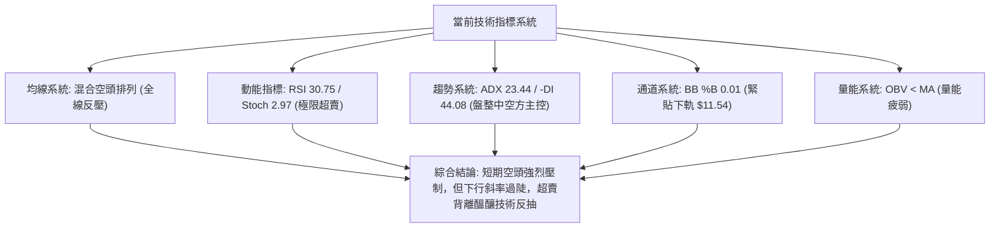

---

### 📈 移動平均線排列分析

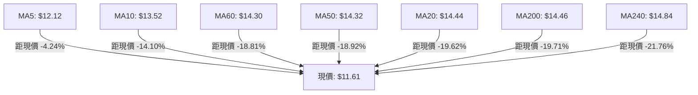

#### 均線數據明細表

| 均線名稱 | 數值 | 價格相對於均線 | 乖離率 | 排列特徵與走勢解讀 |
|:--------:|:----:|:--------------:|:------:|-------------------|
| **MA 5** | $12.12 | 價格在下方 | -4.24% | 短線第一道動態下壓線，反彈需先站上 |
| **MA 10** | $13.52 | 價格在下方 | -14.10% | 與 R2 ($13.52) 完全重合，短線空方防守線 |
| **MA 20** | $14.44 | 價格在下方 | -19.62% | 月線下傾，構成布林帶中軌重要壓力 |
| **MA 50** | $14.32 | 價格在下方 | -18.81% | 季線下彎，與 R3 ($14.32) 重疊，中期強阻力 |
| **MA 60** | $14.30 | 價格在下方 | -18.81% | 糾結於季線下方，中期均線死叉發散 |
| **MA 120**| $13.75 | 價格在下方 | -15.58% | 半年線下行，長期持股成本線瓦解 |
| **MA 200**| $14.46 | 價格在下方 | -19.71% | 年線失守，牛熊轉折信號確立 |
| **MA 240**| $14.84 | 價格在下方 | -21.76% | 長期成本天花板，中長期壓制顯著 |

*均線排列判定：所有天期均線均位於現價上方，均線系統呈現「混合偏空排列」，短期內反彈皆面臨層層解套賣壓。*

---

### 📉 RSI(14) 分析

- **當前讀數**：**30.75** (Wilder 平滑計算)
- **進度條展示**：
  $$\text{RSI(14)}: \quad \text{██████░░░░░░░░░░░░░░} \quad 30.75 / 100 \quad (\text{🟡 接近超賣})$$
- **區間評估**：指標已壓迫至 30.00 絕對超賣臨界線。歷史走勢中，NU 於 30 附近通常會引發空頭回補抵抗。
- **背離分析結論**：根據近 20 根 K 棒首尾價格與 RSI 比對，**無明顯背離**（價格創下波段新低，RSI 同步滑落至低位，空方動能呈順勢宣洩，未見底背離或頂背離確信訊號）。

---

### 📊 MACD(12,26,9) 訊號解讀

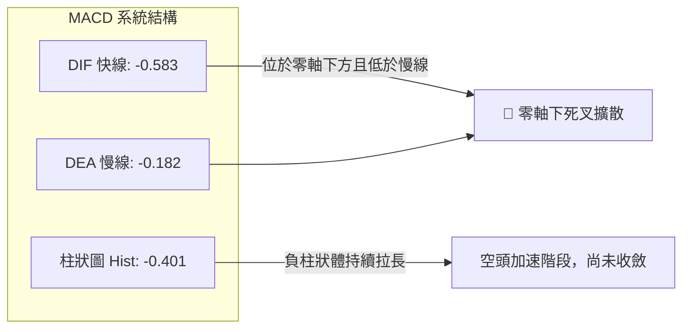

- **MACD 快線**：-0.583
- **MACD 信號線**：-0.182
- **MACD 柱狀體**：-0.401
- **解讀**：DIF 與 DEA 於零軸下方持續死叉發散，柱狀圖負值達 -0.401，顯示當前下行動能仍具慣性，空方拋壓尚未被多頭買盤有效吸收，左側進場風險偏高。

---

### 📦 布林通道分析

```
NU 布林通道 (20, 2) 結構示意圖
$17.34 ────────────────────────────────────────── BB 上軌 (Upper Band)
                     ↑
                     │ 通道寬度 = $5.80 (高波動擴張期)
                     ↓
$14.44 ────────────────────────────────────────── BB 中軌 / MA20 (Mid Band)
                     ↑
                     │
                     ↓
$11.61 ══════════════════════════════════════════ ◄ 現價 ($11.61, %B = 0.01)
$11.54 ────────────────────────────────────────── BB 下軌 (Lower Band)
```

- **上軌**：$17.34
- **中軌 (MA20)**：$14.44
- **下軌**：$11.54
- **%B 指標**：**0.01**（0 = 下軌，$11.54；0.5 = 中軌，$14.44；1 = 上軌，$17.34）
- **狀態解讀**：%B 達 0.01 意味著現價幾乎百分之百貼在下軌邊緣滑行（極端破軌走勢）。依據均值回歸原理，當 %B 接近 0 或跌破 0 後，下軌往往對價格產生向內的「技術拉力」，短期下行空間受到通道幾何限制。

---

### 💹 成交量分析（量價配合度）

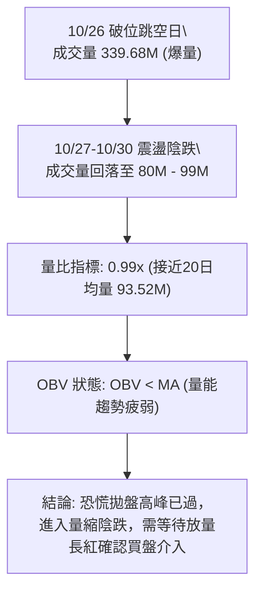

- **最新成交量**：92,947,100
- **20 日均量**：93,519,635（量比 0.99x）
- **50 日均量**：81,557,632
- **OBV 趨勢**：OBV 低於其移動平均線，且斜率向下，說明主力資金流向呈現淨流出狀態，量價結構處於空方主導的量疲弱週期。

---

## 6. 動能與波動率

### ⚡ 動能評估四象限

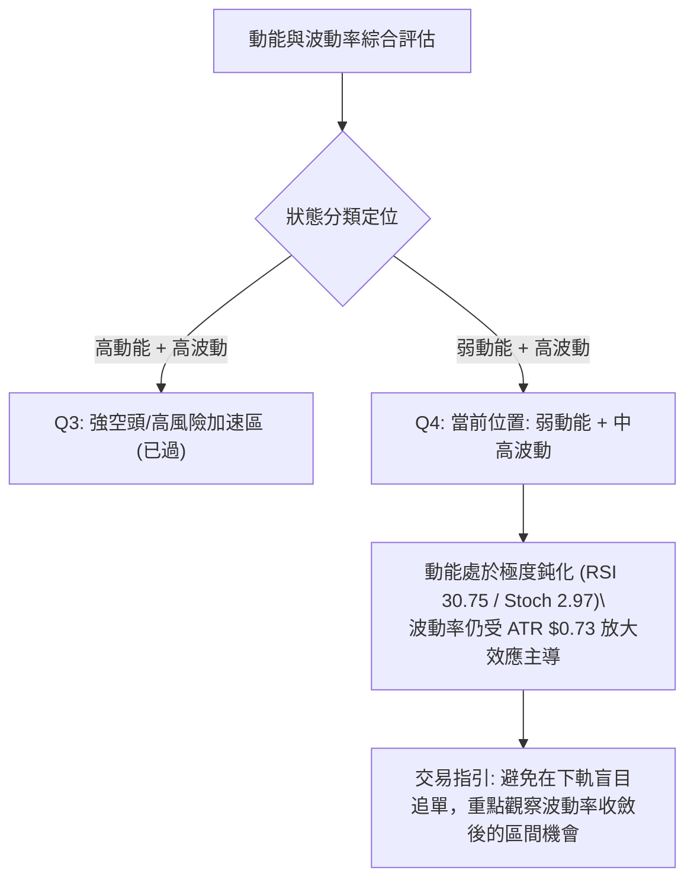

#### 動能與波動象限分佈表

| 象限 | 動能維度 | 波動維度 | 當前狀態 | 評估與策略含義 |
|:----:|:--------:|:--------:|:--------:|----------------|
| **Q1** | 強 | 低 | — | 最佳單邊趨勢機會（非當前狀態） |
| **Q2** | 弱 | 低 | — | 典型低波動盤整（即將收斂之目標狀態） |
| **Q3** | 強 | 高 | — | 崩跌初期的非理性宣洩（已於 10/26 發生） |
| **Q4** | **弱** | **中高** | **✓ 當前** | **空頭動能減速但波動殘留，易出現劇烈洗盤，宜謹慎操作** |

---

### 📊 ATR 波動率分析

- **ATR(14)**：**$0.73** (佔股價比率高達 **6.28%**，採 Wilder 計算法)。
- **波動特徵**：通常個股 ATR 佔比在 2%–4% 屬常態，NU 當前 6.28% 顯示該股近期受突發利空衝擊，日均波動範圍高達 73 美分。
- **風控止損建議**：
  - **保守型交易**：止損幅度建議設置為 $1.5 \times \text{ATR} \approx \$1.10$。
  - **波段型交易**：止損幅度建議設置為 $1.0 \times \text{ATR} \approx \$0.73$。
  - **緊密型交易**：止損幅度建議設置為 $0.5 \times \text{ATR} \approx \$0.37$。

---

### 📐 Beta 與市場相關性

- **Beta 係數**：**0.955**
- **市場連動分析**：NU 的 Beta 值非常接近 1.0（0.955），表明其與美股大盤（S&P 500）具備中度至高度的系統性聯動性。然而，近期引發股價重挫的主要驅動因子為巴西政經選舉消息與區域銀行情緒（參考新聞背景），其走勢出現顯著的個股／區域特質背離，大盤系統性支撐短期內難以完全抵消區域性利空衝擊。

---

## 7. 多時框架總結

### 📋 時框架評分表

| 時框架 | 趨勢方向 | 動能狀態 | 均線排列 | 圖表形態 | 綜合評分 | 建議動作 |
|:------:|:--------:|:--------:|:--------:|:--------:|:--------:|:---------|
| **長期 (月線)** | 🟡 大箱體震盪 | 弱化 (回測箱底) | 糾結向平 | 區間下緣整理 | **48/100** | 逢低分批觀察，不追空 |
| **中期 (週線)** | 🔴 明顯空頭 | 負柱擴大 | 空頭排列 | 天量破位長黑 | **36/100** | 反彈減倉，空方佔優 |
| **短期 (日線)** | 🔴 弱勢築底 | 超賣鈍化 | 全面反壓 | 貼軌弱勢橫盤 | **42/100** | 區間博弈，嚴控風險 |

---

### 🔲 綜合訊號矩陣

| 週期 / 維度 | 趨勢方向 | 動能指標 | 形態結構 | 量價配合 | 訊號一致性 |
|:-----------:|:--------:|:--------:|:--------:|:--------:|:----------:|
| **短期 (日)** | 🔴 空方主控 | 🟡 極度超賣 | 🟡 支撐抵抗 | 🔴 量能疲弱 | 中度分歧（超賣 vs 跌勢） |
| **中期 (週)** | 🔴 空頭排列 | 🔴 柱狀發散 | 🔴 破位缺口 | 🔴 巨量出逃 | 高度一致看空 |
| **長期 (月)** | 🟡 區間下緣 | 🟡 接近前低 | 🟡 箱體測試 | 🟡 常規回調 | 中度分歧（長多回測） |

---

### ⚖️ 多時框收斂結論

*依嚴格規則 14 執行多時框架收斂：*
1. **趨勢強度定調**：當前 ADX(14) 讀數為 **23.44 (< 25)**，嚴格歸類為 **「盤整行情（ADX < 25）」**，不具備健康單邊趨勢之持續動能。
2. **主導時框與交易區間**：依規則 14，「盤整行情以日線布林通道上下軌為主要交易區間」。布林通道下軌位於 **$11.54**，上軌位於 **$17.34**，中軌為 **$14.44**。
3. **時框優先級衝突取捨**：雖然週線與日線均線呈現空頭反壓，但 ADX 弱趨勢配合日線 Stoch %K 2.97 與布林通道 %B 0.01 的極限超賣壓迫，表明向下空間在波段低點聚類 **S1: $11.51** 與 52 週低點 **S2: $11.20** 處將遭遇強大技術防守。
4. **唯一方向性結論**：**⚖️ 中性觀望 / 區間弱勢震盪操作**。嚴禁在 S1/S2 核心支撐區域盲目追空；以 **$11.20 – $13.30** 之箱體區間交易為主導思維。

---

## 8. 交易策略建議

### 🗺️ 策略決策流程圖

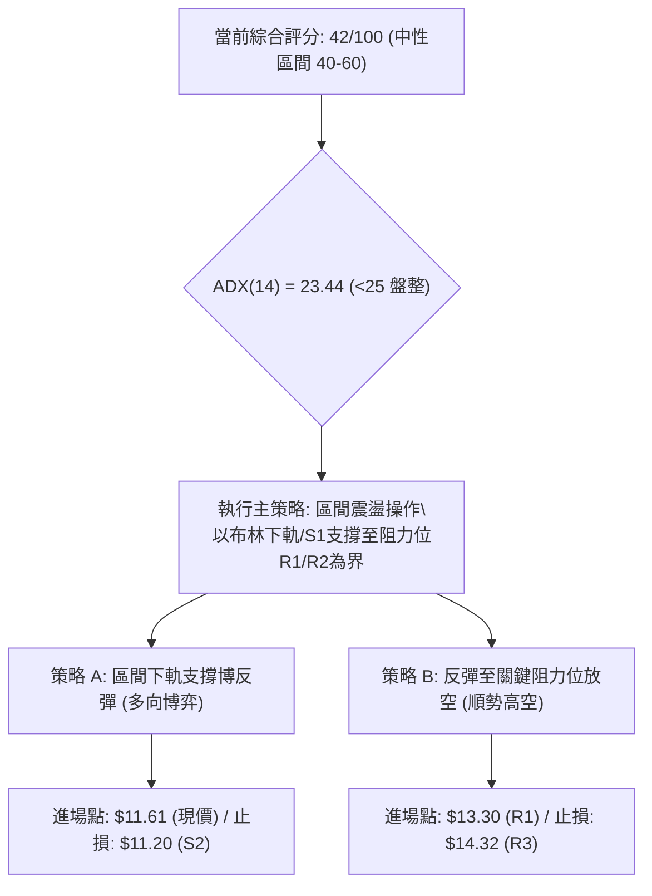

---

### 🧭 策略路由（依評分卡分流）

> **當前主策略方向 = ⚖️ 區間震盪操作，以布林通道與關鍵支撐阻力為交易邊界，等待突破確認（依綜合評分 42/100 定調）**

- **評分分流依據**：第 1 章技術評分卡算術平均為 **42/100**，精準落入 **中性區間（40–60）**。
- **交易邏輯**：ADX < 25 明確定義當前處於無趨勢／盤整格局，市場處於「空頭動能衰竭、多頭尚未反攻」的過渡平衡期。策略以區間邊界（下軌 S1/S2 與上沿 R1/R2）的高拋低吸為核心架構。

---

### 🎯 價格情境階梯（Price Scenarios）

*所有價位嚴格引用自「關鍵價位」區塊：*

| 觸發條件 | 下一目標 | 後續延伸 | 情境含義 |
|----------|:--------:|:--------:|----------|
| **向上突破 R1 $13.30** | R2 $13.52 | R3 $14.32 | 短線超跌反彈確立，缺口回補浪展開 |
| **站穩現價 $11.61** | R1 $13.30 | R2 $13.52 | 於 S1 $11.51 上方構築雙底平台，區間震盪 |
| **有效跌破 S1 $11.51** | S2 $11.20 | 數據中未偵測到 | 下測 52 週歷史前低，空頭下行尋求終極防線 |
| **摜破 S2 $11.20** | 數據中未偵測到 | 數據中未偵測到 | 破底格局開啟，所有支撐瓦解，不可盲目抄底 |

---

### 📊 情境機率分佈

| 運行情境 | 發生機率 | 主要技術依據 |
|----------|:--------:|--------------|
| **下軌獲得支撐，展開區間反彈** | **45%** | Stoch %K 2.97 極端超賣；布林 %B 0.01；逼近 S1 $11.51 與 S2 $11.20 強支撐聚類 |
| **於 $11.20–$12.50 窄幅弱勢築底** | **35%** | ADX 23.44 < 25 缺乏單邊動能；量能縮至均量以下；OBV 偏弱壓制反彈高度 |
| **摜破 S2 $11.20 開啟新一輪跌勢** | **20%** | -DI 高達 44.08；MACD 負柱狀體尚未收斂；均線全線向下空頭排列 |

---

### 🟢 主策略詳情（區間操作雙向指引）

*依規則 17 嚴格定義風險報酬比計算式：*
- **做多風報比** $= (\text{目標價 T1} - \text{進場價}) \div (\text{進場價} - \text{止損價})$
- **做空風報比** $= (\text{進場價} - \text{目標價 T1}) \div (\text{止損價} - \text{進場價})$

| 策略要素 | 策略 A（下軌支撐博反彈 / 低吸多單） | 策略 B（阻力承壓順勢空 / 高空對沖） |
|----------|-------------------------------------|-------------------------------------|
| **策略定位** | 依據布林下軌與 S1 支撐之左側反彈博弈 | 依據均線空頭排列與 R1 缺口阻力高空 |
| **進場條件** | 現價或回踩 S1 $11.51 獲得支撐不破 | 股價反彈至 R1 $13.30 遇阻出現滯漲信號 |
| **進場價格** | **$11.61**（當前收盤價） | **$13.30**（關鍵阻力位 R1） |
| **目標價 T1**| **$13.30**（關鍵阻力位 R1） | **$11.51**（近期支撐位 S1） |
| **目標價 T2**| **$13.52**（關鍵阻力位 R2） | **$11.20**（52週低點 S2） |
| **止損價格** | **$11.20**（跌破 52週歷史低點 S2） | **$14.32**（向上突破強阻力 R3） |
| **風險報酬比** | **1 : 4.12（以 T1 計）** <br>*(算式: (13.30-11.61)/(11.61-11.20) = 1.69/0.41)*<br>**1 : 4.66（以 T2 計）** <br>*(算式: (13.52-11.61)/(11.61-11.20) = 1.91/0.41)* | **1 : 1.75（以 T1 計）** <br>*(算式: (13.30-11.51)/(14.32-13.30) = 1.79/1.02)*<br>**1 : 2.06（以 T2 計）** <br>*(算式: (13.30-11.20)/(14.32-13.30) = 2.10/1.02)* |
| **成功機率** | **55%** | **65%** |
| **建議倉位** | **10%**（輕倉左側試探） | **15%**（右側順勢操作） |

---

### 🔴 反向風險觸發點（對沖與風控提示）

1. **多單嚴格止損點**：若日 K 收盤價跌破 **S2: $11.20**，表明 52 週歷史支撐全面失守，雙底預期破滅，必須無條件止損出局，嚴禁攤平。
2. **空單覆蓋觸發點**：若日 K 帶量突破並站穩 **R3: $14.32**（MA50 季線），意味著跳空破位缺口被多頭完全吞噬，中期反轉走勢確立，空頭倉位必須全數平倉對沖。

---

### ⭐ 整體訊號強度評星

```
做多訊號強度：★★☆☆☆  (2/5星 — 僅具備超賣與通道下軌支撐技術依據，缺乏趨勢反轉確認)
做空訊號強度：★★★☆☆  (3/5星 — 均線與動能結構空方佔優，但面臨低位超跌鈍化限制)
整體可信度：  ★★★☆☆  (3/5星 — 處於 ADX < 25 震盪期，價位依賴箱體邊界有效性)
```

---

## 9. 風險提示與監控

### ✅ 關鍵監控指標 Checklist

```
╔══════════════════════════════════════════════════════════════════╗
║               NU 關鍵技術監控清單 (Checklist)                    ║
╠══════════════════════════════════════════════════════════════════╣
║ [ ] 52W 低點 S2 防守：日線收盤價是否持續維持在 $11.20 之上       ║
║ [ ] RSI 動能回升：RSI(14) 能否自 30.75 拐頭向上脫離超賣區       ║
║ [ ] 隨機指標黃金交叉：Stoch %K (2.97) 是否向上穿破 %D (6.68)      ║
║ [ ] 成交量配合度：日成交量是否有效站上 20 日均量 (93.52M)        ║
║ [ ] 缺口回補測試：反彈動能是否足以觸碰阻力位 R1 ($13.30)         ║
║ [ ] MACD 柱狀體收斂：負柱狀體 (-0.401) 是否由發散轉為縮小        ║
║ [ ] 布林通道走平：%B 指標能否自 0.01 脫離並回歸 0.30 以上         ║
╚══════════════════════════════════════════════════════════════════╝
```

---

### ⚠️ 風險場景分析

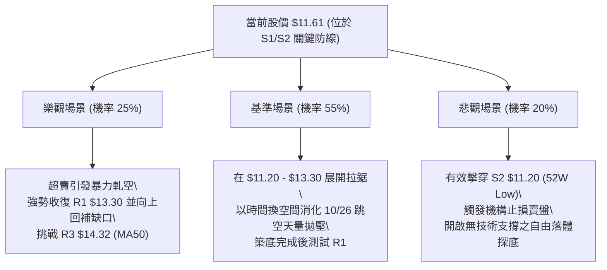

---

### 🛡️ 風險管理重要提醒

1. **跳空缺口重壓**：2026-10-23 至 10-26 留下的巨大跳空缺口（$12.78–$14.57）伴隨 3.39 億股巨量，該區域沉澱了巨額解套賣壓。任何未達 R1 ($13.30) 的弱勢反彈，均屬於逢高減碼窗口而非牛市重啟。
2. **高波動率防禦**：當前 ATR 高達 $0.73（6.28%），單日波動極劇烈。部位規模必須縮減至常態之 **50%–60%**，避免因盤中正常震盪觸發無效止損。
3. **宏觀與基本面事件**：NU 近期受巴西大選後的政策預期干擾（參考相關新聞：MercadoLibre 與巴西銀行股普跌）。12 月 8 日公司即將舉辦首次投資者日（Investor Day），在此之前市場情緒維持高度敏感，技術面支撐需密切提防消息面突發利空刺穿。

---

## 📋 報告總結

```
╔════════════════════════════════════════════════════════════════════════════╗
║                       NU 技術分析報告總結                                 ║
╠════════════════════════════════════════════════════════════════════════════╣
║ 報告日期：2026-11-01                                                      ║
║ 當前價格：$11.61 USD                                                       ║
║ 分析評級：⚖️ 中性觀望 / 區間弱勢震盪 (技術綜合評分: 42/100)               ║
║                                                                            ║
║ 關鍵結論：                                                                 ║
║ ├─ 長期趨勢：🟡 月線高檔大幅回調，正考驗大箱體底部與歷史波段低點           ║
║ ├─ 中期趨勢：🔴 週線天量跳空破位，均線全面反壓，空頭動能尚未完全收斂       ║
║ ├─ 短期趨勢：🟡 日線逼近 S1 $11.51，極度超賣 (%B=0.01) 醞釀技術性抵抗      ║
║ ├─ 關鍵支撐：S1: $11.51 ｜ S2: $11.20 (52週歷史低點)                       ║
║ ├─ 關鍵阻力：R1: $13.30 ｜ R2: $13.52 ｜ R3: $14.32                        ║
║ └─ 分析師目標：共識均價 $18.80 (Low: $12.00 / High: $23.00)                ║
║                                                                            ║
║ 最優策略組合：                                                             ║
║ 1. 🥇 最佳機會：等待回測 S1 $11.51 企穩，以 S2 $11.20 為硬止損，博弈       ║
║                超賣反抽 R1 $13.30 之高風報比波段 (風報比 1:4.12)。         ║
║ 2. 🥈 次選機會：若股價無量反抽至 R1 $13.30 遇阻，順勢建立空頭防禦倉位，   ║
║                止損設於 R3 $14.32，下看 S1 $11.51 (風報比 1:1.75)。        ║
║ 3. 🥉 保守選擇：完全空倉觀望，等待日線有效突破 R1 或站穩 MA20 後再行進場。  ║
╚════════════════════════════════════════════════════════════════════════════╝
```

---

> ⚠️ **免責聲明**：本報告為 AI 自動生成之技術分析，所有數據及估算均嚴格基於所提供的歷史價格與指標資訊。本報告**僅供研究與學術參考**，**不構成任何投資建議與買賣要約**。金融市場瞬息萬變，投資有風險，入市需獨立審慎評估。

---

*報告生成時間：2026-11-01 ｜ 數據來源：Yahoo Finance ｜ 分析框架：資深多時框架量化技術體系*