# NU 技術分析報告

> **報告日期**：2026-11-02 ｜ **語言**：繁體中文 ｜ **數據來源**：Yahoo Finance ｜ **當前價格**：$11.61

---

## 目錄

| 章節 | 內容 |
|------|------|
| [1. 技術面概覽](#1-技術面概覽) | 訊號儀表板、核心指標、評分卡 |
| [2. 趨勢分析](#2-趨勢分析) | 多時框趨勢、長中短期走勢、ADX 解讀 |
| [3. 圖表形態分析](#3-圖表形態分析) | 形態識別、K線組合、目標價推算 |
| [4. 支撐與阻力](#4-支撐與阻力) | 關鍵價位、斐波那契回調結構 |
| [5. 技術指標深度解讀](#5-技術指標深度解讀) | 均線、RSI、MACD、布林通道、量能 |
| [6. 動能與波動率](#6-動能與波動率) | 動能四象限、ATR、Beta 與市場敏感度 |
| [7. 多時框架總結](#7-多時框架總結) | 時框架評分矩陣、多時框收斂結論 |
| [8. 交易策略建議](#8-交易策略建議) | 策略路由、主策略規劃、風險報酬比 |
| [9. 風險提示與監控](#9-風險提示與監控) | 監控指標、風險場景樹、風控原則 |
| [報告總結](#-報告總結) | 核心結論與最優策略組合 |

---

## 1. 技術面概覽

### 🎯 技術訊號儀表板

Nu Holdings Ltd. (NU) 當前收盤價為 $11.61，位於 52 週價格區間（$11.20 – $18.98）的 5.3% 極低分位。受近期巴西大選後的市場動盪與連續拋售影響，技術結構呈現明顯破位與短線極度超賣並存的特徵。

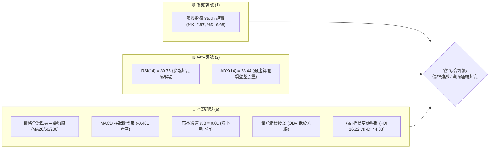

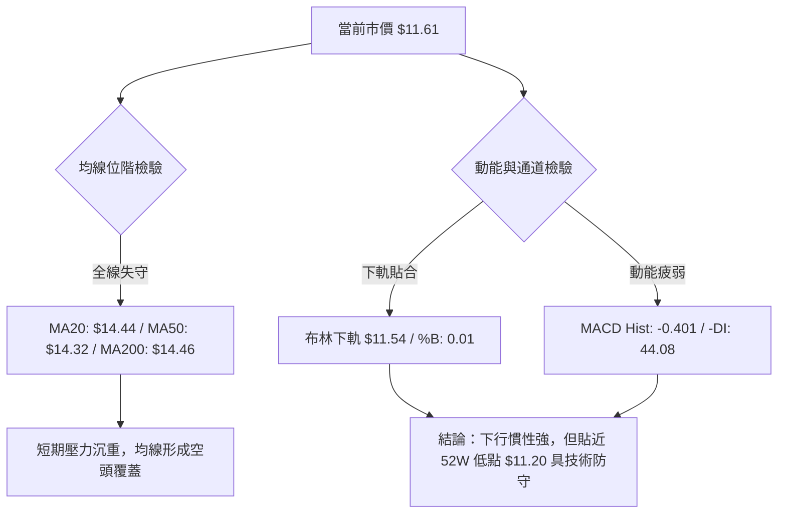

### 📊 核心指標速覽表

| 指標類別 | 指標名稱 | 當前數值 | 訊號 | 解讀 |
|----------|----------|----------|------|------|
| **價格** | 當前價格 | $11.61 | 🔴 | 位於 52 週區間 5.3% 低位，回撤至年度底部區間 |
| **均線** | MA20 | $14.44 | 🔴 | 價格低於 MA20 達 -19.62%，短期乖離過大 |
| **均線** | MA50 | $14.32 | 🔴 | 價格低於 MA50 達 -18.92%，中期趨勢轉空 |
| **均線** | MA200 | $14.46 | 🔴 | 價格低於長期牛熊分界線，長期技術架構破壞 |
| **動能** | RSI(14) | 30.75 | 🟡 | 位於中性與超賣交界，短線下殺動能尚未形成背離 |
| **動能** | MACD (12,26,9) | -0.583 / -0.182 | 🔴 | 雙線位於零軸下方且負向發散，Hist 為 -0.401 |
| **動能** | Stoch %K / %D | 2.97 / 6.68 | 🟢 | 進入極度超賣區（<20），短線存在技術性反彈修復需求 |
| **通道** | 布林帶 %B | 0.01 | 🔴 | 貼近下軌 $11.54 運行，呈現單邊弱勢擴軌特徵 |
| **趨勢** | ADX(14) | 23.44 | 🟡 | ADX < 25 處於弱趨勢/低檔盤整，但 -DI (44.08) 主導空方 |
| **波動** | ATR(14) | $0.73 | 🔴 | 日波幅佔股價達 6.28%，市場恐慌拋售情緒導致波動加劇 |
| **量能** | OBV 趨勢 | OBV < MA | 🔴 | 成交量配合價格下行，量能指標疲弱，資金流出顯著 |

### 🏆 技術評分卡

評分體系基於六大技術維度（各 0–100 分），綜合評分為各項之算術平均值（四捨五入至整數）：

```
╔══════════════════════════════════════════════════════════════════╗
║                   技術評分卡 — NU (2026-11-02)                   ║
╠══════════════════════════════════════════════════════════════════╣
║ 趨勢強度 (Trend)     ████░░░░░░░░░░░░░░░░  20/100  🔴 極弱空頭   ║
║ 動能指標 (Momentum)  ██████░░░░░░░░░░░░░░  30/100  🔴 負向發散   ║
║ 支撐穩定度 (Support) ████████░░░░░░░░░░░░  40/100  🟡 臨近支撐   ║
║ 成交量配合 (Volume)  ██████░░░░░░░░░░░░░░  30/100  🔴 放量下跌   ║
║ 形態完整度 (Pattern) ████░░░░░░░░░░░░░░░░  20/100  🔴 破位形態   ║
║ 均線排列 (MA System) ██░░░░░░░░░░░░░░░░░░  10/100  🔴 混合轉空   ║
╠══════════════════════════════════════════════════════════════════╣
║ 綜合評分 (Overall)   █████░░░░░░░░░░░░░░░  25/100  🔴 強烈偏空   ║
╚══════════════════════════════════════════════════════════════════╝
```

*計算依據：(20 + 30 + 40 + 30 + 20 + 10) ÷ 6 = 25.00 分。*

---

## 2. 趨勢分析

### 🌐 多時框趨勢分析

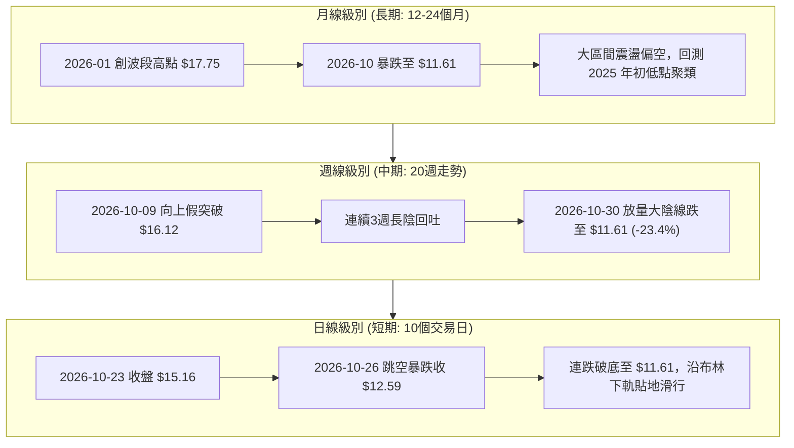

### 📈 長期趨勢 — 12個月走勢圖（Unicode）

NU 過去 12 個月（2025-11 至 2026-10）經歷了完整的上漲至派發、再至斷崖式下跌的輪迴：

```
NU 月線收盤走勢圖（過去12個月）
價格軸 ($)
$18.00 ┤                     ● $17.75 (2026-01 高點)
$17.00 ┤             ● $16.74
$16.00 ┤         ● $17.39
$15.00 ┤                 ● $14.98
$14.00 ┤                         ● $14.37  ● $14.48          ● $14.33  ● $14.55
$13.00 ┤                                           ● $13.13  ● $13.36
$12.00 ┤                                                               ● $12.66
$11.00 ┤                                                                       ● $11.61 (當前)
       └─┬─────┬─────┬─────┬─────┬─────┬─────┬─────┬─────┬─────┬─────┬─────┬──
        11月  12月  01月  02月  03月  04月  05月  06月  07月  08月  09月  10月
        (25)  (25)  (26)  (26)  (26)  (26)  (26)  (26)  (26)  (26)  (26)  (26)
```

**走勢特徵分析表格**：

| 階段區間 | 起止月份 | 收盤價變化 | 漲跌幅 | 走勢結構與技術特徵 |
|----------|----------|------------|--------|--------------------|
| **高檔強勢區** | 2025-11 → 2026-01 | $17.39 → $17.75 | +2.07% | 衝頂階段，創下波段收盤高點 $17.75（盤中歷史高達 $18.98） |
| **初跌減速區** | 2026-01 → 2026-04 | $17.75 → $14.48 | -18.42% | 高檔獲利回吐，於 $14.30–$14.50 構築中期箱體平台 |
| **箱體震盪區** | 2026-04 → 2026-08 | $14.48 → $14.55 | +0.48% | 於 $13.13 至 $14.55 窄幅整理，籌碼在中期均線群反覆換手 |
| **破位恐慌區** | 2026-08 → 2026-10 | $14.55 → $11.61 | -20.21% | 突發地緣與宏觀利空突襲，連續失守多道均線支撐，直逼 52W 低點 |

### 📊 中期趨勢（週線分析）

從近 20 週收盤走勢可見，股價在 2026-10-09 一度衝高至 $16.12（週成交量 5.17 億股），但隨後三週遭遇猛烈拋壓：
- 2026-10-16 收 $14.56（-9.68%）
- 2026-10-23 反彈收 $15.16（+4.12%）
- 2026-10-30 斷崖式暴跌至 $11.61（-23.42%），週成交量飆升至 701,822,800 股，創下近 20 週次大量。

```
NU 中期週線支撐阻力結構示意圖
$16.50 ┤                     ▲ 2026-10-09 假突破高點 $16.12
$16.00 ┤                    ╱ ╲
$15.50 ┤      ▲ $15.37     ╱   ╲
$15.00 ┤     ╱ ╲          ╱     ● 2026-10-23 次高點 $15.16
$14.50 ┤────┼───┼────────┼───────┼─────────────────────────── 中期密集籌碼阻力帶 (MA50: $14.32)
$14.00 ┤   ╱     ╲      ╱         ╲
$13.50 ┤──┼───────┼────┼───────────┼────────────────────────── R2: $13.52 / R1: $13.30
$13.00 ┤ ╱         ╲  ╱             ╲
$12.50 ┤╱           ▼                 ╲
$12.00 ┤                                ╲
$11.50 ┤─────────────────────────────────●────────────── 現價 $11.61 (S1: $11.51)
$11.00 ┤═══════════════════════════════════════════════════ S2: $11.20 (52W 低點強防守)
       └──────────────────────────────────────────────────
```

### ⚡ 趨勢強度評估（ADX 解讀）

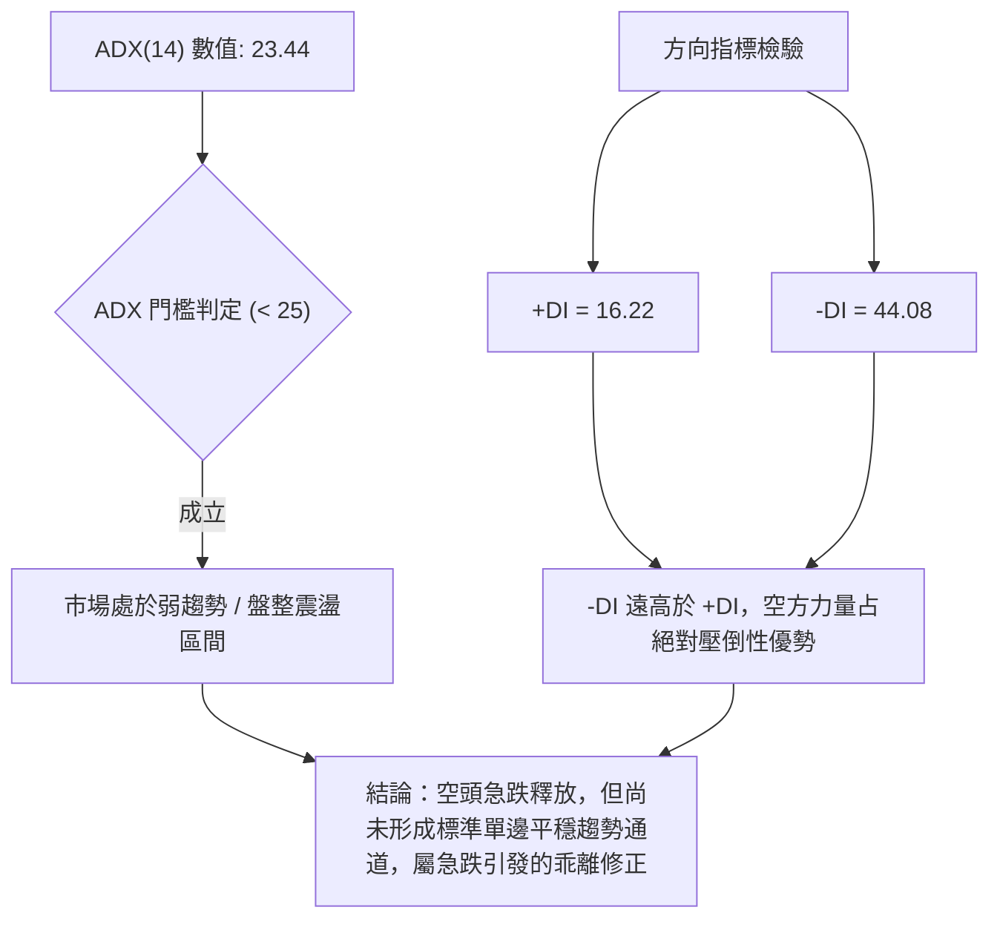

| 指標變數 | 當前讀數 | 強度級別 | 技術解讀 |
|----------|----------|----------|----------|
| **ADX(14)** | 23.44 | 弱趨勢 (<25) | 趨勢強度尚未突破 25，表明此波暴跌屬於脈衝型急跌，並非長期平滑下行趨勢 |
| **+DI** | 16.22 | 弱多頭 | 多方力量降至冰點，買盤嚴重缺乏追價意願 |
| **-DI** | 44.08 | 極強空頭 | 空方力量暴增，單邊賣壓短時間內集中釋放 |
| **DI 差值** | -27.86 | 極度失衡 | 空方絕對主導，任何逆勢作多僅能視為超賣技術反彈 |

---

## 3. 圖表形態分析

### 🔍 形態識別系統

在日線與週線結構上，NU 於 2026 年 10 月中下旬完成了一個典型的**雙重頂破位（Double Top Breakdown）**形態，並疊加**布林下軌極端擴軌破位**。

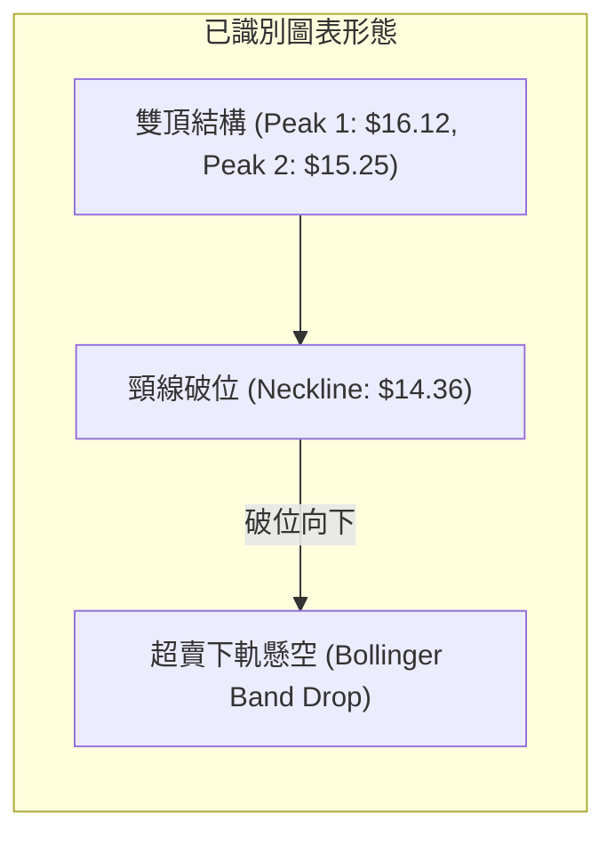

**形態信心度與目標價評估表**（依規則 15）：

| 形態名稱 | 信心度 | 判斷依據（引用數據） | 完成度 | 目標價（附計算式） |
|----------|--------|----------------------|--------|--------------------|
| **雙重頂破位** | 80% | 頂1為 2026-10-09 高點 $16.14，頂2為 2026-10-20 高點 $15.41，頸線為 2026-10-19 低點 $14.36。10-26 放量跳空跌破。 | 100% | 頸線 $14.36 − 形態高度 ($16.14 − $14.36 = $1.78) = **$12.58**（10-26 收盤 $12.59 已精確抵達） |
| **日線跳空缺口破位** | 75% | 2026-10-23 低點 $14.57 至 2026-10-26 高點 $12.78 留下 $1.79 未補跳空缺口。 | 100% | 下跌量測幅度：$12.78 − ($15.16 − $12.78) = $10.40（數據未出現此低點，目前止步於 S1 $11.51 上方） |
| **潛在雙重底結構 (52W底)** | 45% | 當前現價 $11.61 逼近 52W 前低 $11.20。訊號不足，僅做指標型解讀（Stoch %K=2.97）。 | 20% | 需確認守穩 $11.20 且反彈突破頸線 R1 $13.30，目前尚未成形。 |

### 🕯️ 重要 K 線形態分析

嚴格依據數據中「近 10 根日 K」與「近 8 根週 K」之實際 OHLC 數據進行解讀：

| 日期（層級） | 開盤價 | 最高價 | 最低價 | 收盤價 | K線形態名稱 | 技術解讀 | 訊號 |
|--------------|--------|--------|--------|--------|-------------|----------|------|
| **2026-10-23 (日)** | 14.69 | 15.25 | 14.57 | 15.16 | 中陽線 | 反彈上衝遭阻，留有 0.09 上影線，形成反彈終結點 | 🟡 |
| **2026-10-26 (日)** | 11.69 | 12.78 | 11.62 | 12.59 | 暴量下跳陽線 | 跳空開盤暴跌，單日成交 3.39 億股，多頭雖反撲但缺口巨大 | 🔴 |
| **2026-10-27 (日)** | 12.74 | 13.00 | 12.37 | 12.40 | 下行流星/倒錘 | 衝高回落，高點受阻於 $13.00 整數關卡，實體收黑 | 🔴 |
| **2026-10-28 (日)** | 12.36 | 12.44 | 11.96 | 11.97 | 中陰線 | 破位下殺跌破 $12.00，空方延續主導 | 🔴 |
| **2026-10-29 (日)** | 11.98 | 12.19 | 11.85 | 12.05 | 窄幅小陽十字 | 下跌中繼整理，實體僅 0.07，多空於 $12.00 處僵持 | 🟡 |
| **2026-10-30 (日)** | 11.75 | 11.85 | 11.48 | 11.61 | 破底小陰線 | 創下近五日新低 $11.48，逼近 S1 $11.51，弱勢收盤 | 🔴 |
| **2026-10-09 (週)** | 14.98 | 16.14 | 14.84 | 16.12 | 長陽突破線 | 突破 MA200，但留下高位量能陷阱（成交 5.17 億股） | 🟢 |
| **2026-10-16 (週)** | 16.10 | 16.19 | 14.40 | 14.56 | 長陰反包吞噬 | 高位開平走低，完全吞噬前週實體，確認為假突破 | 🔴 |
| **2026-10-30 (週)** | 11.69 | 13.00 | 11.48 | 11.61 | 斷崖巨量大陰 | 週跌幅 -23.42%，週成交量放大至 7.01 億股，恐慌盤湧出 | 🔴 |

### 📉 ASCII 走勢形態示意圖

```
NU 雙重頂破位與跳空缺口示意圖
價位 ($)
$16.14 ┤             ▲ 頂 1 (10-09)
$15.41 ┤                     ▲ 頂 2 (10-20)
$15.16 ┤                   ╱   ╲
$14.73 ┤                  ╱     ╲
$14.36 ┤───────頸線──────●───────●────── (頸線支撐位破位)
$13.50 ┤                │       │
$13.00 ┤                │  跳空 │  ◄── 10-26 跳空向下巨幅缺口 ($14.57 - $12.78)
$12.59 ┤                │  缺口 ├──● 雙頂量測目標抵達點 ($12.58)
$12.00 ┤                ▼       │    ╲
$11.61 ┤                        ▼     ● 當前現價 ($11.61)
$11.20 ┤═════════════════════════════════ S2: 52W 年度低點
       └────────────────────────────────────────────
```

### 🎯 形態目標價計算

1. **雙重頂（Double Top）等幅推算**：
   - 形態波峰：$16.14（2026-10-09 週最高）
   - 形態頸線：$14.36（2026-10-19 日最低點）
   - 形態垂直高度 $H = \$16.14 - \$14.36 = \$1.78$
   - 理論跌幅滿足點 $T_1 = \text{頸線} - H = \$14.36 - \$1.78 = \mathbf{\$12.58}$
   - **實證檢驗**：2026-10-26 跳空暴跌當日收盤價為 **$12.59**，第一等幅目標已於 10-26 完全抵達。

2. **次級延伸跌幅推算（第二波段）**：
   - 以反彈高點 $13.00（10-27 高點）為起點，若複製缺口後首日跌幅（$12.59 - $11.62 = $0.97）：
   - 理論延伸低點 $T_2 = \$12.40 - \$0.97 = \mathbf{\$11.43}$
   - **實證檢驗**：2026-10-30 最低點達到 **$11.48**，已精確觸及此波延伸目標區間。

---

## 4. 支撐與阻力

### 🗺️ 關鍵價位分布圖（Unicode）

依據 OHLCV 聚類計算之關鍵價位分布如下：

```
NU 價位結構分布圖
═══════════════════════════════════════════════════════════════════
$14.32 ║████████████████████████████████████║ 強阻力 R3 (MA50 / 斐波 61.8%)
$13.52 ║████████████████████████            ║ 阻力 R2 (MA10 / 箱體下緣)
$13.30 ║████████████████                    ║ 關鍵阻力 R1 (反彈頸線)
       ╠════════════════════════════════════╣
$11.61 ╠   ◄── 當前收盤價 ($11.61)          ╣ (貼近布林下軌 $11.54)
       ╠════════════════════════════════════╣
$11.51 ║▓▓▓▓▓▓▓▓▓▓▓▓▓▓▓▓▓▓▓▓▓▓              ║ 近期波段支撐 S1 (-0.86%)
$11.20 ║████████████████████████████████████║ 核心強支撐 S2 (52W年度低點, -3.53%)
═══════════════════════════════════════════════════════════════════
```

### 🚧 阻力位分析表

阻力位完全引用數據中「關鍵價位」之波段高點聚類數值：

| 阻力級別 | 價位 | 形成原因（依據數據） | 突破難度 | 重要性 |
|----------|------|----------------------|----------|--------|
| **R1** | **$13.30** | 近一年波段高點聚類位，距現價 +14.56%；貼近 2026-10-27 日高點 $13.00 密集套牢帶上緣 | 🟡 中等 | 短期多空分水嶺，站上始能確認短底成形 |
| **R2** | **$13.52** | 近一年波段高點聚類位，距現價 +16.41%；重合 MA10 均線位置 ($13.52) | 🔴 偏高 | 均線壓制位，反彈至此將遭遇十日均線下行反壓 |
| **R3** | **$14.32** | 近一年波段高點聚類位，距現價 +23.30%；重合 MA50 均線 ($14.32) 及雙頂頸線 ($14.36) | 🔴 極高 | 中期生命線，未突破前中期趨勢維持全面空頭 |

### 🛡️ 支撐位分析表

支撐位完全引用數據中「關鍵價位」之波段低點聚類數值：

| 支撐級別 | 價位 | 形成原因（依據數據） | 守住機率 | 重要性 |
|----------|------|----------------------|----------|--------|
| **S1** | **$11.51** | 近一年波段低點聚類位，距現價 -0.86%；極為接近 2026-10-30 日內低點 $11.48 及布林下軌 $11.54 | 60% | 短線第一道防線，若失守將觸發停損盤 |
| **S2** | **$11.20** | 52 週年度最低點（52W Low），距現價 -3.53%；斐波那契 100.0% 回調位 | 75% | 長期多頭最後防線，具有極強歷史心理與買盤支撐 |

### 📐 斐波那契回調位分析

依據 52 週完整波段（低點 $11.20 → 高點 $18.98，垂直落差 $7.78）之回調位結構分析：

```
NU 52週斐波那契回調架構
0.0%  (52W High) ──────────────────────────────── $18.98
23.6%            ──────────────────────────────── $17.14
38.2%            ──────────────────────────────── $16.01 (10-09 當週高點受阻於此)
50.0%            ──────────────────────────────── $15.09 (10-23 收盤處)
61.8%            ──────────────────────────────── $14.17 (黃金分割關鍵位 / MA50 附近)
78.6%            ──────────────────────────────── $12.86 (10-26 跳空下破位)
100.0% (52W Low) ──────────────────────────────── $11.20 (終極回調基底)
                                ▲
              [當前現價 $11.61 位於 78.6% 與 100.0% 之間]
```

- **位置解讀**：當前收盤價 $11.61 落在 **78.6% 回調位 ($12.86)** 與 **100.0% 回調位 ($11.20)** 之間的深水區。
- **技術意義**：跌破 61.8% ($14.17) 與 78.6% ($12.86) 象徵原本自 52W 低點以來的上升多頭浪潮已遭徹底破壞；目前股價直接尋求 100.0% 回調位 ($11.20) 的全額回撤支撐，技術上已進入「終極回測測底」階段。

---

## 5. 技術指標深度解讀

### 🎛️ 指標訊號總覽

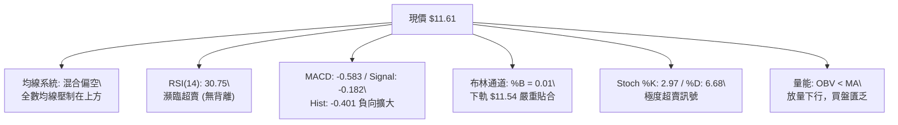

### 📈 移動平均線排列分析

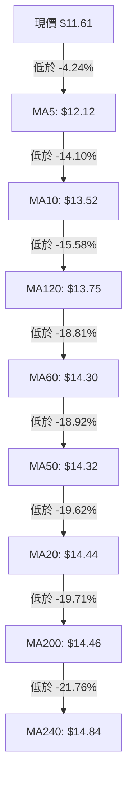

**均線架構解讀**：
1. **短週期均線加速向下**：MA5 ($12.12) 與 MA10 ($13.52) 陡峭下行，顯示短期拋壓極為沉重。
2. **中長期均線密集糾纏破位**：MA50 ($14.32)、MA20 ($14.44) 與 MA200 ($14.46) 在 $14.30–$14.50 區間高度粘合後被向下長陰摜破，構成未來反彈極難跨越的「三重均線天花板」。
3. **現價負乖離率過大**：現價距離 MA20 乖離達 **-19.62%**，距離 MA200 達 **-19.71%**。歷史經驗表明，當 NU 負乖離率逼近 -20% 時，技術面往往伴隨均線修復型的技術反抽。

### 📉 RSI(14) 分析

- **數值進度條**：
  ```
  RSI(14): 30.75  ██████░░░░░░░░░░░░░░  [30.75 / 100]  🟡 中性偏超賣
  ```
- **區間評估**：RSI(14) 讀數為 30.75（Wilder 平滑法），位於 30 臨界點邊緣。週線 RSI 則為 30.7，顯示日線與週線在動能超賣層面達成共振。
- **背離判斷**：
  - **日線背離檢驗**：比較近 20 根 K 棒首尾，價格從 10 月中旬 $15.16 跌至 $11.61 創波段新低，RSI 同步從 55.0 下滑至 30.75，**無底背離，亦無頂背離**，呈現動能與價格同向宣洩特徵。
  - **結論**：動能尚未出現衰竭底背離，說明下行慣性依然存在，不可盲目抄底。

### 📊 MACD (12, 26, 9) 訊號解讀

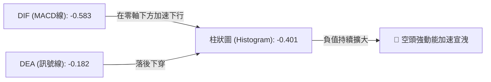

- **數值分析**：MACD 線 (-0.583) 遠在訊號線 (-0.182) 下方，兩者均處於零軸之下負值區運行。
- **柱狀圖動態**：MACD Histogram 為 **-0.401**，相較於前週的 -0.007 出現斷崖式負向拉長，表明拋售動能仍在加速釋放過程中，短線尚未見到收斂拐點。

### 📦 布林通道分析

```
NU 布林通道 (20, 2) 結構圖
$17.34 ┬──────────────────────────────────────────── BB 上軌
       │
$14.44 ┼──────────────────────────────────────────── BB 中軌 (MA20)
       │
$11.61 ┼───────────────────────●                     當前價格 $11.61
$11.54 ┴──────────────────────────────────────────── BB 下軌 (%B = 0.01)
```

- **通道參數**：上軌 $17.34，中軌 $14.44，下軌 $11.54，帶寬高達 $5.80（佔中軌 40.16%）。
- **%B 指標分析**：當前 %B 為 **0.01**（0 代表剛好觸及下軌，0.5 為中軌，1.0 為上軌）。數值 0.01 表示現價已完全懸掛在布林通道下軌極限邊緣，呈現標準的「沿下軌滑落」形態。通道口呈發散開口狀，預示著單邊強波動尚未完全平息。

### 💹 成交量分析（量價配合度）

- **最新量能表現**：2026-10-30 單日成交量為 92,947,100 股，與 20 日均量 (93,519,635 股) 之量比為 **0.99x**；但高於 50 日均量 (81,557,632 股)。
- **爆量下跌特徵**：2026-10-26 跳空暴跌當日放出 **339,677,800 股**的天量（為 20 日均量的 3.63 倍），形成典型的「放量破位陰線」。
- **OBV 走勢**：技術快照明確指出「OBV < MA → 量能疲弱」。OBV 能量潮持續下行跌破其移動平均線，資金流向呈現淨流出狀態，無主力進場吃貨跡象，量價配合顯示為順勢看空。

---

## 6. 動能與波動率

### ⚡ 動能評估四象限

結合動能強度與波動率維度，NU 當前處於**弱動能、高波動（高風險宣洩期）**的象限狀態：

| 象限 | 動能維度 (ADX / RSI) | 波動維度 (ATR% / BB帶寬) | 當前狀態 | 技術評估與操作意涵 |
|------|----------------------|--------------------------|----------|--------------------|
| **Q1** | 強多頭動能 | 低波動壓縮 | — | 趨勢蓄勢突破的最佳買點 |
| **Q2** | 弱多頭動能 | 低波動整理 | — | 窄幅盤整，謹慎觀望 |
| **Q3** | 強空頭動能 | 高波動爆發 | **✓ 吻合 (當前位置)** | **恐慌拋售加速宣洩，下行風險極高，嚴禁逆勢重倉加碼** |
| **Q4** | 弱動能盤整 | 高波動擴散 | — | 無方向劇烈震盪，易遭雙巴 |

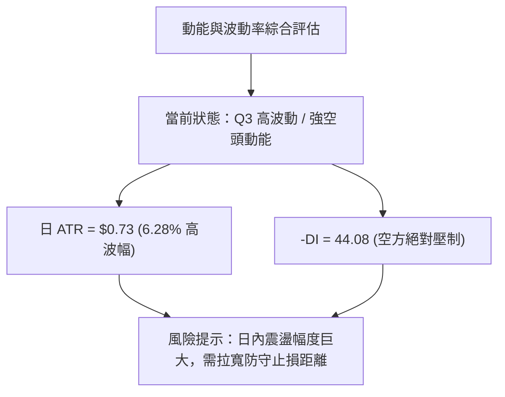

### 📊 ATR 波動率分析

- **當前讀數**：ATR(14) 為 **$0.73**（Wilder 平滑法），佔當前股價 $11.61 的比例高達 **6.28%**。
- **波動特徵解讀**：相較於平穩期 2%–3% 的日波動率，6.28% 屬於極端異常高波動狀態，反映市場正處於突發性消息面衝擊後的流動性重定價階段。
- **止損距離建議**：
  - 短線交易：建議至少給予 **1.5 × ATR = $1.10** 的緩衝空間，以防日內雜訊震盪觸發被動止損。
  - 波段交易：建議給予 **2.0 × ATR = $1.46** 的風控區間。

### 📐 Beta 與市場相關性

- **Beta 數值**：**0.955**。
- **市場特徵分析**：NU 的 Beta 接近 1.0，但由於其業務高度集中於巴西、墨西哥和哥倫比亞等拉美新興市場，近期巴西政治選舉等宏觀事件導致其個股波動大幅脫離美股標普 500 指數基準，呈現高度的區域特定性外生風險。融資融券方面，Short % Float 為 3.7%，Short Ratio 為 1.65，尚未形成嚴重的空頭軋空（Short Squeeze）條件。

---

## 7. 多時框架總結

### 📋 時框架評分表

| 時框架 | 趨勢方向 | 動能指標 | 均線排列 | 圖表形態 | 綜合評分 | 戰略建議 |
|--------|----------|----------|----------|----------|----------|----------|
| **月線 (長期)** | 🟡 大箱體中性 | RSI 偏弱 | 混合糾纏 | 衝頂回吐 | 45/100 | 逼近 52W 低點 $11.20，長期投資者進入觀望分批區間 |
| **週線 (中期)** | 🔴 明顯偏空 | MACD柱擴大 | 跌破 MA200 | 雙頂假突破 | 25/100 | 破位放量大陰線，中期防線全失，順勢看空 |
| **日線 (短期)** | 🔴 強烈偏空 | RSI/Stoch超賣 | 空頭發散 | 跳空下行缺口 | 20/100 | 沿布林下軌滑落，極度超賣可能引發短線反抽 |

### 🔲 綜合訊號矩陣

```
╔══════════════════════════════════════════════════════════════════╗
║                    多時框綜合訊號一致性矩陣                      ║
╠══════════════════════════════════════════════════════════════════╣
║ 維度         短期 (日線)       中期 (週線)       長期 (月線)     ║
╠══════════════════════════════════════════════════════════════════╣
║ 趨勢方向     🔴 空頭主導       🔴 破位下行       🟡 寬幅震盪     ║
║ 均線位階     🔴 跌破全部均線   🔴 跌破 MA50/200  🔴 跌破 MA20    ║
║ 動能強度     🟢 極度超賣       🔴 負向加速       🟡 中性偏弱     ║
║ 量價關係     🔴 放量破位       🔴 週放巨量陰線   🟡 高檔回吐     ║
║ 關鍵支撐     S1: $11.51        S2: $11.20        52W Low: $11.20 ║
╚══════════════════════════════════════════════════════════════════╝
```

### ⚖️ 多時框收斂結論

依據多時框收斂規則（規則 14）：
1. **行情性質判定**：當前 ADX(14) 讀數為 **23.44 (< 25)**，技術上定義為「弱趨勢 / 盤整急跌震盪」。
2. **主導時框收斂**：在 ADX < 25 的盤整震盪架構下，日線布林通道上下軌（$11.54 – $17.34）為主要波動極限範圍。然而，由於週線級別放量摜破 MA50 ($14.32) 與 MA200 ($14.46)，且 -DI 高達 44.08，中期下行重力顯著主導日線走勢。
3. **唯一方向性結論**：**強烈偏空，但短線嚴禁追空（等待超賣反彈修復）**。第 1 章技術評分卡總分為 **25/100 (≤ 40)**，依據策略路由規則，第 8 章之核心策略鎖定為**逢反彈佈局做空（主推空頭策略）**，任何多頭交易僅限於極小倉位的超跌反彈對沖。

---

## 8. 交易策略建議

### 🗺️ 策略決策流程圖

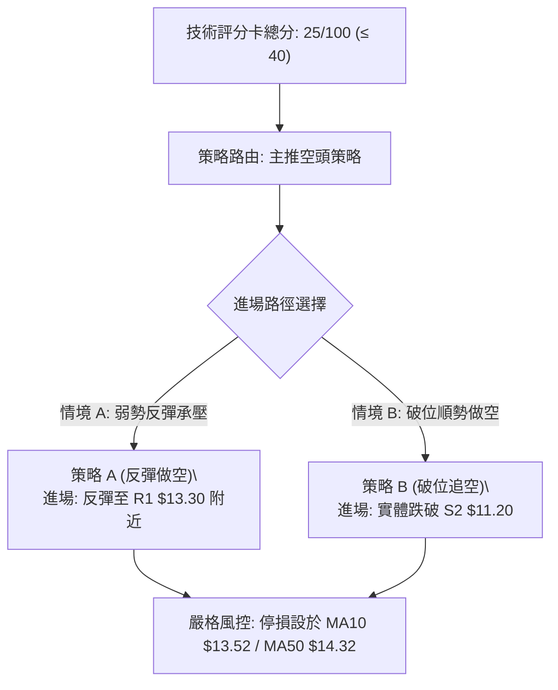

### 🧭 策略路由（依評分卡分流）

> **當前主策略方向 = 強烈偏空，主推空頭波段操作（依綜合評分 25/100）**

因綜合評分僅為 25 分（≤40），技術面均線與動能全線轉空，多頭訊號僅剩短線指標超賣，故嚴格執行以「逢反彈做空」或「破位做空」為主策略。

### 🎯 價格情境階梯（Price Scenarios）

價位完全嚴格引用數據中「關鍵價位」之精確數值：

| 觸發條件 | 下一目標 | 後續延伸 | 情境含義 |
|----------|----------|----------|----------|
| 向上突破 R1 $13.30 | R2 $13.52 | R3 $14.32 | 超跌反彈展開，回補部分跳空缺口 |
| 承壓於 R1 $13.30 之下 | 測試現價 $11.61 | 測試 S1 $11.51 | 空頭中繼弱勢震盪，買盤無力 |
| 向下跌破 S1 $11.51 | S2 $11.20 | 數據中未偵測到 | 破底尋求 52W 年度終極支撐防守 |

### 📊 情境機率分佈

| 情境劇本 | 發生機率 | 主要技術依據 |
|----------|----------|--------------|
| **弱勢反抽後再破底 (續跌)** | **60%** | MACD Hist (-0.401) 負向擴大，OBV 疲弱且低於均線，均線全面空頭反壓 |
| **低檔窄幅橫盤築底** | **30%** | ADX=23.44 屬弱趨勢，現價逼近 52W 低點 S2 $11.20 與布林下軌 $11.54 |
| **強勢 V 型反轉向上** | **10%** | 僅依賴 Stoch %K=2.97 極度超賣，但上方跳空缺口與均線密集區套牢極深 |

### 🔴 主策略詳情（空頭主推）

依據規則 17，風險報酬比以公式計算：`做空風報比 = (進場價 − 目標價 T1) ÷ (止損價 − 進場價)`，以「1 : X.XX（以 T1 計）」呈現：

| 策略要素 | 策略 A（反彈阻力做空 - 首選） | 策略 B（跌破 52W 底追空 - 次選） |
|----------|-------------------------------|-----------------------------------|
| **交易方向** | 做空 (Short) | 做空 (Short) |
| **進場條件** | 股價技術性反抽至 R1 阻力位遇阻回落時進場 | 股價放量長陰跌破 52W 低點 S2 確認破位時進場 |
| **進場價格** | **$13.30**（精確引用 R1） | **$11.10**（跌破 S2 $11.20 後之突破點） |
| **目標價 T1** | **$11.61**（當前現價聚類支撐） | **$10.24**（引用 24 個月歷史低點 2025-03 收盤價） |
| **目標價 T2** | **$11.20**（引用 S2 / 52W 低點） | **$9.50**（由雙頂形態量測推算） |
| **止損價格** | **$13.52**（精確引用 R2 / MA10） | **$11.51**（精確引用 S1 轉阻力） |
| **風險報酬比** | **1 : 7.68（以 T1 計）**<br>*(13.30-11.61)÷(13.52-13.30) = 1.69÷0.22*<br>*(以 T2 計為 1 : 9.55)* | **1 : 2.10（以 T1 計）**<br>*(11.10-10.24)÷(11.51-11.10) = 0.86÷0.41*<br>*(以 T2 計為 1 : 3.90)* |
| **成功機率** | 65% | 55% |
| **建議倉位** | 10% – 15% | 5% – 8% |

### 🟢 反向風險觸發點（對沖多頭提示）

若出現以下訊號，空頭策略必須立即無條件停損出場，多頭方可展開短線博弈：
1. **反轉觸發價位**：日線收盤價強勢突破並站穩 **R2 $13.52**（即收復 MA10 均線）之上。
2. **量能確認指標**：日成交量放大至 1.5 億股以上，且日線 MACD 柱狀圖由負轉正或顯著收斂。
3. **超跌對沖買點（僅供極短線）**：若現價於 **S2 $11.20** 出現日線「長下影線錘頭」且 Stoch %K 黃金交叉 %D，可嘗試以極小倉位（3%）博弈反抽，嚴格以 $11.00 作為硬停損。

### ⭐ 整體訊號強度評星

```
╔══════════════════════════════════════════════════════════════════╗
║ 做多訊號強度：★☆☆☆☆  (1/5 星 - 僅具指標超賣修復價值)         ║
║ 做空訊號強度：★★★★☆  (4/5 星 - 均線與量能全面順勢偏空)       ║
║ 整體可信度：  ★★★★☆  (4/5 星 - 週線日線趨勢高度收斂一致)     ║
╚══════════════════════════════════════════════════════════════════╝
```

---

## 9. 風險提示與監控

### ✅ 關鍵監控指標 Checklist

```
╔══════════════════════════════════════════════════════════════════╗
║                    NU 日常關鍵監控清單 (Checklist)               ║
╠══════════════════════════════════════════════════════════════════╣
║ [ ] 價格防守線：每日收盤是否守穩 S1 $11.51 及 S2 $11.20           ║
║ [ ] 均線動態：價格是否受制於 MA5 ($12.12) 與 MA10 ($13.52) 反壓   ║
║ [ ] 通道狀況：布林通道 %B 是否維持在 0.05 以下極度超賣狀態       ║
║ [ ] 動能拐點：Stoch 是否於超賣區形成向上金叉，RSI 是否突破 35    ║
║ [ ] 量能異動：單日成交量是否異常超越 1.5 億股（主力換手訊號）     ║
║ [ ] 宏觀風險：關注巴西大選後續政局穩定度與 12 月 8 日 Investor Day║
╚══════════════════════════════════════════════════════════════════╝
```

### ⚠️ 風險場景分析

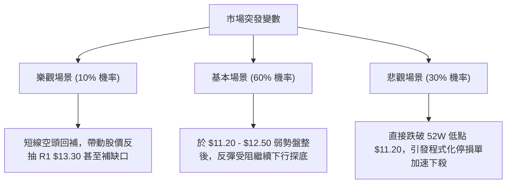

### 🛡️ 風險管理重要提醒

1. **ATR 波動風險匹配**：當前 ATR(14) 高達 $0.73（日振幅 6.28%），單日上下洗盤劇烈。任何進場必須嚴格計算頭寸規模，單筆交易虧損上限應控制在總投資組合淨值的 **1.0%** 以內。
2. **跳空缺口引力與阻力**：2026-10-23 至 10-26 留下的 $1.79 巨幅跳空缺口（下緣 $12.78，上緣 $14.57）將轉化為堅不可摧的套牢籌碼峰。在未有超預期基本面催化劑前，反彈至缺口下緣均為減碼或建立空頭防禦之窗口。
3. **重大日程提示**：新聞顯示 Nubank 將於 12 月 8 日召開首屆投資者日（Investor Day），在此之前市場觀望氣氛濃厚，易出現流動性真空引發的異常折價。

---

## 📋 報告總結

```
╔══════════════════════════════════════════════════════════════════╗
║                     NU 技術分析報告總結                          ║
╠══════════════════════════════════════════════════════════════════╣
║ 報告日期：2026-11-02                                             ║
║ 當前價格：$11.61                                                 ║
║ 分析評級：🔴 強烈偏空 / 弱勢超賣反抽（技術評分：25/100）         ║
║                                                                  ║
║ 關鍵技術維度結論：                                               ║
║ ├─ 長期趨勢：🟡 月線寬幅震盪偏空，衝高回落逼近年度底部          ║
║ ├─ 中期趨勢：🔴 週線跌破 MA50/MA200，形成假突破巨量雙頂破位     ║
║ ├─ 短期趨勢：🔴 日線沿布林下軌滑落，均線全數反壓呈空頭排列      ║
║ ├─ 關鍵支撐：S1: $11.51 ｜ 核心強支撐 S2: $11.20 (52W 年度低點)  ║
║ ├─ 關鍵阻力：R1: $13.30 ｜ 強壓 R2: $13.52 (MA10) ｜ R3: $14.32 ║
║ └─ 華爾街共識：分析師目標均價 $18.80 (Buy 評級，與技術面背離)   ║
║                                                                  ║
║ 最優策略組合建議：                                               ║
║ 1. 🥇 最佳機會（策略 A）：耐心等待超賣反抽至 R1 $13.30 附近，建立║
║       波段做空部位，停損設於 R2 $13.52，目標下看 $11.61 及 $11.20║
║       （風報比達 1 : 7.68，依規則嚴格量化執行）。                 ║
║ 2. 🥈 次選機會（策略 B）：若股價直接放量跌破 S2 $11.20，於 $11.10║
║       順勢建立破位空單，停損設於 $11.51，目標下看歷史低點 $10.24║
║       （風報比 1 : 2.10）。                                      ║
║ 3. 🥉 保守選擇：空手觀望，靜待股價於 $11.20 處構築明確之雙重底  ║
║       或右側止跌形態後，再行評估多頭進場時機。                   ║
╚══════════════════════════════════════════════════════════════════╝
```

---

> ⚠️ **免責聲明**：本報告為依據客觀技術分析模型與歷史數據生成之量化研究報告，報告內所有支撐阻力數值、圖表形態及交易策略均基於現有 OHLCV 數據推演，**僅供學術研究與投資策略參考**，**不構成任何要約、招攬或具體投資買賣建議**。金融市場瞬息萬變，衍生品及股票交易具備極高本金損失風險，投資人應獨立評估自身風險承受能力並自負盈虧。

---

*報告生成時間：2026-11-02 ｜ 數據來源：Yahoo Finance ｜ 分析框架：多時框技術分析體系*