# NU 技術分析報告

> **報告日期**：2026-11-03 ｜ **語言**：繁體中文 ｜ **數據來源**：Yahoo Finance ｜ **當前價格**：$11.62

---

## 目錄

| 章節 | 內容 |
|------|------|
| [1. 技術面概覽](#1-技術面概覽) | 訊號儀表板、核心指標、評分卡 |
| [2. 趨勢分析](#2-趨勢分析) | 多時框趨勢、長中短期走勢、ADX 解讀 |
| [3. 圖表形態分析](#3-圖表形態分析) | 形態識別、K線組合、形態目標價 |
| [4. 支撐與阻力](#4-支撐與阻力) | 關鍵價位、斐波那契回調結構 |
| [5. 技術指標深度解讀](#5-技術指標深度解讀) | MA/RSI/MACD/布林/成交量量價分析 |
| [6. 動能與波動率](#6-動能與波動率) | 動能評估四象限、ATR 波動率、Beta |
| [7. 多時框架總結](#7-多時框架總結) | 時框架矩陣、多時框收斂結論 |
| [8. 交易策略建議](#8-交易策略建議) | 策略路由、主策略詳情、風報比精算 |
| [9. 風險提示與監控](#9-風險提示與監控) | 關鍵指標清單、情境推演、風控總結 |

---

## 1. 技術面概覽

### 🎯 技術訊號儀表板

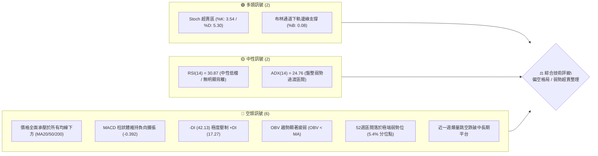

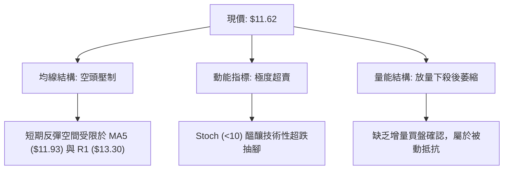

### 📊 核心指標速覽表

| 指標類別 | 指標名稱 | 當前數值 | 訊號 | 專業解讀 |
|:---|:---|:---|:---:|:---|
| **價格基準** | 當前收盤價 | $11.62 | 🔴 | 位於 52 週高低區間之 5.4% 分位點，極度貼近波段底部 |
| **短期均線** | MA5 | $11.93 | 🔴 | 價格落後 MA5 -2.60%，超短期反彈第一道動態阻力 |
| **短期均線** | MA20 (布林中軌) | $14.27 | 🔴 | 價格乖離達 -18.55%，中期趨勢遭斷崖式破壞 |
| **中期均線** | MA50 | $14.26 | 🔴 | MA20 與 MA50 形成死叉聚攏，中期趨勢徹底翻空 |
| **長期均線** | MA200 | $14.43 | 🔴 | 價格大幅跌破年線支撐（乖離 -19.47%），長線技術結構受損 |
| **動能指標** | RSI(14) Wilder | 30.87 | 🟡 | 逼近 30 超賣界限，暫無底背離形態，空頭動能尚未鈍化 |
| **動能指標** | MACD (12,26,9) | -0.673 / -0.280 | 🔴 | DIF 與 DEA 雙雙於零軸下發散，柱狀體 -0.392 顯示空頭主導 |
| **超短動能** | Stoch (KD) | %K: 3.54 / %D: 5.30 | 🟢 | 深度超賣鈍化（<10），隨時存在技術性死貓反彈（Dead Cat Bounce）|
| **通道指標** | 布林通道 (%B) | %B = 0.08 | 🟢 | 緊貼布林下軌（$11.13），短線下行空間受波動邊界壓抑 |
| **趨勢強度** | ADX / DMI | ADX: 24.76 | 🔴 | -DI (42.13) 壓倒性勝過 +DI (17.27)，空頭主導下的弱趨勢盤整 |
| **波動指標** | ATR(14) | $0.71 (6.10%) | 🟡 | 每日平均波動幅度擴大至 6.10%，波動率驟升，進出場滑價風險提高 |
| **量能指標** | OBV / 量比 | 量比: 0.78x | 🔴 | OBV < MA，反彈量能萎縮（68.95M vs 20日均量 87.94M）|

### 🏆 技術評分卡

```
╔══════════════════════════════════════════════════════════════════╗
║               技術評分卡 — NU (2026-11-03)                      ║
╠══════════════════════════════════════════════════════════════════╣
║ 評估維度      進度條與量化分數                    得分    訊號   ║
╟──────────────────────────────────────────────────────────────────╢
║ 趨勢強度      █████░░░░░░░░░░░░░░░                25/100   🔴    ║
║ 動能指標      ██████░░░░░░░░░░░░░░                30/100   🔴    ║
║ 支撐穩定度    ██████████░░░░░░░░░░                48/100   🟡    ║
║ 成交量配合    ███████░░░░░░░░░░░░░                35/100   🔴    ║
║ 形態完整度    ████████░░░░░░░░░░░░                38/100   🔴    ║
║ 均線排列      ███░░░░░░░░░░░░░░░░░                16/100   🔴    ║
╠══════════════════════════════════════════════════════════════════╣
║ 綜合評分      ██████░░░░░░░░░░░░░░                32/100   🔴    ║
║ 評級結論      偏空格局 ｜ 弱勢超賣區間整理（依規則18算術平均）   ║
╚══════════════════════════════════════════════════════════════════╝
```

*註：綜合評分 = (25 + 30 + 48 + 35 + 38 + 16) ÷ 6 = 32.00，四捨五入為 32/100。*

---

## 2. 趨勢分析

### 🌐 多時框趨勢分析

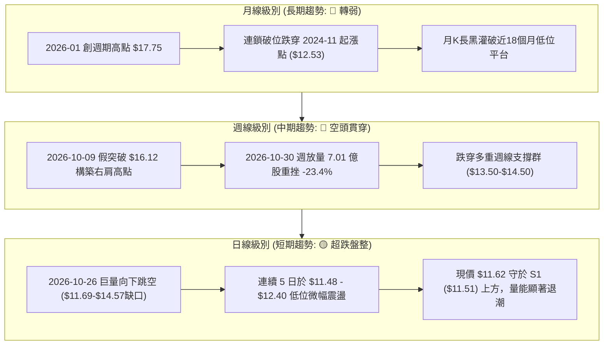

### 📈 長期趨勢 — 12個月走勢圖（Unicode）

NU 過去 12 個月（2025-11 至 2026-11）經歷了由強勢衝頂、高位寬幅震盪到斷崖式破位下行的完整週期：

```
NU 月線收盤走勢圖（過去12個月: 2025-11 至 2026-11）
價格軸 ($)
$18.00 ┤              ● 17.75 (2026-01 頂部)
$17.00 ┤● 17.39  ● 16.74
$16.00 ┤
$15.00 ┤                    ● 14.98
$14.00 ┤                          ● 14.37  ● 14.48        ● 14.33  ● 14.55
$13.00 ┤                                            ● 13.13  ● 13.36
$12.00 ┤                                                                 ● 12.66
$11.00 ┤                                                                        ● 11.61  ● 11.62(現價)
       └──────────────────────────────────────────────────────────────────────────────────────────
         11/25  12/25  01/26  02/26  03/26  04/26  05/26  06/26  07/26  08/26  09/26  10/26  11/26
```

#### 長期走勢特徵分析表格

| 階段區間 | 時間跨度 | 起訖收盤價 | 漲跌幅 | 結構形態與成交量特徵 |
|:---|:---:|:---:|:---:|:---|
| **衝頂突破期** | 2025-11 至 2026-01 | $17.39 → $17.75 | +2.07% | 於 $17.75 構築多重月線頂部，換手熱絡但動能衰竭 |
| **初跌釋放期** | 2026-01 至 2026-03 | $17.75 → $14.37 | -19.04% | 迅速擊穿短期均線，獲利盤大幅撤離 |
| **中繼橫盤期** | 2026-03 至 2026-08 | $14.37 → $14.55 | +1.25% | 構築 $13.13 - $14.55 的箱體震盪平台，多空拉鋸 |
| **破位斷崖期** | 2026-08 至 2026-11 | $14.55 → $11.62 | -20.14% | 受宏觀與突發選舉利空衝擊，月線跳空失守所有支撐平台 |

### 📊 中期趨勢（週線分析）

```
NU 週線級別關鍵結構阻力與支撐示意圖
價格 ($)
$16.50 ────────────────────────────────────────── 波段雙重頂高點聚類 ($16.12 - $16.19)
$15.50 ───┐
          ├── 破位前派發平台 (2026-10-23 週收盤: $15.16)
$14.50 ───┘
$14.32 ══════════════════════════════════════════ 強阻力 R3 / 斐波那契 61.8% ($14.17)
$13.52 ------------------------------------------ 中期波段阻力 R2
$13.30 ══════════════════════════════════════════ 跳空缺口下緣關鍵阻力 R1
$12.50 ───
          ├── 日線跳空破位真空區（2026-10-26 缺口：$12.78 - $14.57）
$12.00 ───
$11.62 ◄───[當前價格 $11.62] 貼近布林下軌弱勢抵抗
$11.51 ══════════════════════════════════════════ 近期支撐 S1 (近一年波段低點聚類)
$11.20 ══════════════════════════════════════════ 52週絕對低點 S2 (斐波那契 100.0%)
```

### ⚡ 趨勢強度評估（ADX 解讀）

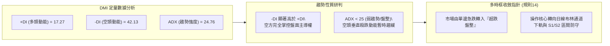

#### ADX 數值強度對照表

| 指標變數 | 當前讀數 | 門檻區間 | 技術意義 | 操作策略涵義 |
|:---|:---:|:---:|:---|:---|
| **ADX(14)** | 24.76 | < 25.00 | **弱趨勢 / 盤整行情過渡區** | 嚴禁盲目順勢追空，急跌動能轉入箱體壓縮 |
| **+DI** | 17.27 | < 20.00 | 多頭進攻動能極度疲軟 | 多方無力組織有效反彈，僅為空頭回補抵抗 |
| **-DI** | 42.13 | > 40.00 | 空頭主導力量處於高位壓制 | 任何未放量的反彈均為逢高做空或解套賣點 |
| **差值 (-DI - +DI)** | +24.86 | 擴張狀態 | 空頭優勢極度明確 | 結構修復至少需數週以上時間換取空間 |

---

## 3. 圖表形態分析

### 🔍 形態識別系統

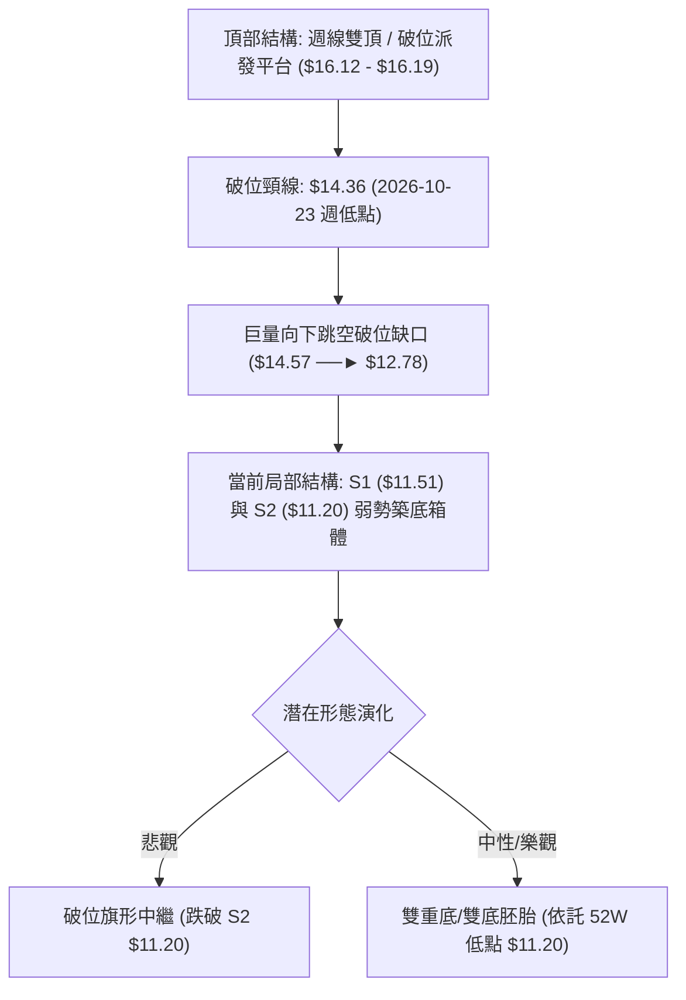

#### 圖表形態信心度評估表（依規則 15）

| 識別形態 | 信心度 (%) | 判斷依據（引用數據） | 完成度 (%) | 目標價（附嚴謹計算式） |
|:---|:---:|:---|:---:|:---|
| **週線雙頂頸線破位** | **85%** | 兩波高點分別於 2026-10-09 ($16.14) 與 10-16 ($16.19)，隨後跌破頸線低點 $14.36 | 100% (已觸發) | 頸線 $14.36 − 形態高度 ($16.19 − $14.36 = $1.83) = **$12.53**（已於 10-26 跌破達到） |
| **日線跳空下行突破** | **90%** | 2026-10-26 出現巨額跳空（當日最高 $12.78 遠低於前日低點 $14.57），成交量放大至 3.39 億股 | 100% (已確認) | 缺口下緣 $12.78 轉為極強阻力，壓制價格於 $11.62 |
| **潛在日線雙底 (Double Bottom)** | **35%** | 2026-10-30 低點 $11.48 與 11-02 低點 $11.59 兩次於 S1 ($11.51) 附近止跌；但信心度不足 50%，僅作指標型解讀 | 25% (構建中) | *訊號不足，僅做指標型解讀*。若確認雙底，需突破頸線 $12.03（11-02高點），測算高度：$12.03 + ($12.03 − $11.48) = **$12.58** |
| **短期弱勢整理箱體** | **70%** | 近 5 個交易日收盤價收斂於 $11.61 - $12.40，振幅收窄至布林下軌附近 | 80% (進行中) | 箱體底部支撐 S1 **$11.51**，箱體上緣壓力 **$12.03** |

### 🕯️ 重要 K 線形態分析（依規則 19）

嚴格採用數據中提供的近 10 根日 K 與近 8 根週 K 的實際開、高、低、收數據進行解讀：

#### 近 10 根日 K 線形態解讀表

| 日期 (日K) | 開盤價 | 最高價 | 最低價 | 收盤價 | 成交量 (股) | K線形態名稱 | 專業技術解讀 | 多空訊號 |
|:---:|:---:|:---:|:---:|:---:|:---:|:---:|:---|:---:|
| **2026-10-20** | 14.62 | 15.41 | 14.60 | 15.09 | 71,858,000 | 實體中陽線 | 向上試探阻力，收盤站上 $15.00 關卡 | 🟢 多頭 |
| **2026-10-21** | 15.21 | 15.37 | 15.01 | 15.05 | 66,306,900 | 小陰十字星 | 高位滯漲，多空在 $15.20 附近出現分歧 | 🟡 觀望 |
| **2026-10-22** | 14.89 | 15.06 | 14.63 | 14.73 | 55,429,600 | 縮量倒槌陰線 | 跌破前日低點，反彈高點下移 | 🔴 空頭 |
| **2026-10-23** | 14.69 | 15.25 | 14.57 | 15.16 | 87,080,800 | 下影中陽線 | 測試 $14.57 獲得短暫支撐回升，為崩跌前最後誘多 | 🟡 中性 |
| **2026-10-26** | 11.69 | 12.78 | 11.62 | 12.59 | 339,677,800 | 斷崖巨量跳空大陽線 | 爆量下跳空開在 $11.69，盤中雖收高，但跳空缺口徹底擊毀均線體系 | 🔴 極空 |
| **2026-10-27** | 12.74 | 13.00 | 12.37 | 12.40 | 99,667,300 | 衝高回落小陰線 | 上攻 $13.00 遇阻，長上影線顯示上方拋壓沉重 | 🔴 空頭 |
| **2026-10-28** | 12.36 | 12.44 | 11.96 | 11.97 | 89,320,400 | 中陰線（收破12）| 跌破 $12.00 整數心理關卡，重心進一步下挫 | 🔴 空頭 |
| **2026-10-29** | 11.98 | 12.19 | 11.85 | 12.05 | 80,210,200 | 窄幅陽十字星 | 多空拉鋸於 $12.00 關口，量能持續萎縮 | 🟡 觀望 |
| **2026-10-30** | 11.75 | 11.85 | 11.48 | 11.61 | 92,979,500 | 下探弱勢陰線 | 盤中下探 S1 至 $11.48 創波段新低，收盤逼近低位 | 🔴 偏空 |
| **2026-11-02** | 11.79 | 12.03 | 11.59 | 11.62 | 68,957,400 | 低位紡錘小陰線 | 量能驟降至 6,895 萬股，下影線回踩 $11.59 暫時獲撐 | 🟡 超跌抵抗 |

#### 近 8 根週 K 線形態解讀表

| 週末交易日 | 開盤價 | 最高價 | 最低價 | 收盤價 | 週成交量 (股) | 週K線形態名稱 | 專業技術解讀 | 多空訊號 |
|:---:|:---:|:---:|:---:|:---:|:---:|:---:|:---|:---:|
| **2026-09-18** | 14.35 | 14.55 | 13.58 | 13.65 | 368,136,800 | 破位長陰線 | 跌破 $14.00 平台，MACD 柱狀體翻負 | 🔴 空頭 |
| **2026-09-25** | 13.84 | 14.25 | 13.36 | 13.59 | 290,425,500 | 縮量十字星 | 於 $13.36 尋求支撐，空方攻勢暫歇 | 🟡 中性 |
| **2026-10-02** | 12.53 | 13.50 | 12.13 | 13.43 | 532,732,100 | 長下影錘頭陽線 | 回踩 $12.13 獲強勁買盤支撐，低位放量換手 | 🟢 支撐 |
| **2026-10-09** | 14.98 | 16.14 | 14.84 | 16.12 | 517,684,300 | 突破大陽線 | 放量大漲突破 MA200，構築波段第一個頂部 | 🟢 強多 |
| **2026-10-16** | 16.10 | 16.19 | 14.40 | 14.56 | 328,775,500 | 長上影大陰線（流星線）| 衝擊 $16.19 失敗引發大規模獲利了結，雙頂確立 | 🔴 空頭吞噬 |
| **2026-10-23** | 14.72 | 15.41 | 14.36 | 15.16 | 322,110,100 | 縮量反抽陽線 | 反抽受阻於 $15.41，頸線 $14.36 懸空 | 🟡 假反彈 |
| **2026-10-30** | 11.69 | 13.00 | 11.48 | 11.61 | 701,855,200 | 巨量毀滅性破位長黑 | 創紀錄爆出 7.01 億股天量，單週重挫 -23.4%，趨勢完全崩壞 | 🔴 極空 |
| **2026-11-02** | 11.79 | 12.03 | 11.59 | 11.62 | 68,957,400 | 低位孕線（單日截面）| 連續重挫後波動率壓縮，在 S1 ($11.51) 上方暫時止血 | 🟡 橫盤止跌 |

### 📉 ASCII 走勢形態示意圖

```
NU 關鍵日K形態示意圖（2026-10-20 至 2026-11-02）
價格 ($)
$15.50 ┤    ┌─┐
$15.00 ┤ ┌─┐│ │   ┌─┐
$14.50 ┤ │ │└─┘┌─┐│ │ (崩跌前平台 $14.57 - $15.25)
$14.00 ┤ └─┘   └─┘└─┘
$13.50 ┤  ░░░░░░░░░░░░░░░░░░░░░░░░░░░░░░░░░░░░░░░░░░░░
$13.00 ┤  ░░ 巨大跳空缺口未回補 ($12.78 - $14.57) ░░
$12.50 ┤          ┌─┐ ┌─┐
$12.00 ┤          │ │ │ │   ┌─┐ ┌─┐
$11.50 ┤          └───┴─┘┌─┐│ │ │ │ ┌─┐ ┌─┐ ◄── S1: $11.51 (強抵抗區間)
$11.00 ┤                 └─┘└───┴─┘ └─┘ └─┘
       └─────────────────────────────────────────────────────────────
         10-20 21  22  23  26  27  28  29  30  11-02
```

---

## 4. 支撐與阻力

### 🗺️ 關鍵價位分布圖（Unicode）

```
╔══════════════════════════════════════════════════════════════════════════════════╗
║                     NU 價位結構分布圖（OHLCV 精確計算）                         ║
╠══════════════════════════════════════════════════════════════════════════════════╣
║ $18.98 ║████████████████████████████████████████║ 52週最高點 (Fib 0.0%)         ║
║ $17.14 ║████████████████████                    ║ 斐波那契回調位 23.6%          ║
║ $16.01 ║████████████████████████                ║ 斐波那契回調位 38.2% / 前波高點║
║ $15.09 ║████████████████████████████            ║ 斐波那契 50.0% / 整數大關     ║
║ $14.32 ║████████████████████████████████████    ║ 強阻力 R3 (波段高點聚類)      ║
║ $14.17 ║████████████████████████████            ║ 斐波那契回調位 61.8% (黃金分割)║
║ $13.52 ║████████████████████                    ║ 阻力位 R2 (跳空缺口中繼阻力)  ║
║ $13.30 ║████████████████████████████████        ║ 關鍵阻力 R1 (波段高點聚類)    ║
║ $12.86 ║████████████████                        ║ 斐波那契回調位 78.6%          ║
║ $11.62 ╠════════════════════════════════════════╣ ◄── 當前收盤價 ($11.62)       ║
║ $11.51 ║▓▓▓▓▓▓▓▓▓▓▓▓▓▓▓▓▓▓▓▓▓▓▓▓▓▓▓▓▓▓▓▓▓▓▓▓    ║ 近期支撐 S1 (波段低點聚類)    ║
║ $11.20 ║████████████████████████████████████████║ 強支撐 S2 (52週最低點/Fib 100)║
╚══════════════════════════════════════════════════════════════════════════════════╝
```

### 🚧 阻力位分析表

所有價位均直接引用數據中由 OHLCV 聚類計算的精確數值：

| 阻力級別 | 精確價位 | 距現價空間 (%) | 形成原因與技術共振 | 突破難度 | 戰略重要性 |
|:---:|:---:|:---:|:---|:---:|:---:|
| **R1** | **$13.30** | +14.46% | 近一年波段高點聚類位，且位於 2026-10-26 跳空破位大陰線實體上緣（$12.78 - $13.00）之上的第一道強拋壓區 | 极高 | 🔴 短線空頭生命線；未突破前任何反彈皆屬弱勢反抽 |
| **R2** | **$13.52** | +16.31% | 2026-09-25 及 10-02 週線震盪中樞，大量套牢籌碼的解套賣壓集結點 | 极高 | 🔴 中期反轉確認位；必須伴隨 1.5 億股以上成交量方能化解 |
| **R3** | **$14.32** | +23.19% | 近一年波段高點聚類位，與斐波那契 61.8% ($14.17) 及 MA50 ($14.26)、MA20 ($14.27) 形成致命的**四重共振強阻力區** | 難以逾越 | 🔴 熊牛分水嶺；唯有站穩 $14.32 方能宣告中期空頭格局結束 |

### 🛡️ 支撐位分析表

所有價位均直接引用數據中由 OHLCV 聚類計算的精確數值：

| 支撐級別 | 精確價位 | 距現價空間 (%) | 形成原因與技術共振 | 守住機率 | 戰略重要性 |
|:---:|:---:|:---:|:---|:---:|:---:|
| **S1** | **$11.51** | -0.95% | 近一年波段低點聚類位，近 5 日日 K 低點密集區（10-30 最低 $11.48，11-02 最低 $11.59）| 60% | 🟡 超短期最後防線；跌破將直接觸發止損盤湧出 |
| **S2** | **$11.20** | -3.61% | 52 週絕對低點（2025-2026 週期底部），同時為斐波那契 100.0% 終極支撐位 | 75% | 🟢 多頭年度生死防線；跌破將開啟無支撐的估值崩塌通道 |

### 📐 斐波那契回調位分析

依據 52 週波段高點 **$18.98** 至低點 **$11.20** 計算的回調階梯結構如下：

```
斐波那契回調梯隊結構 (區間: $11.20 ──► $18.98)
0.0%  (52W High) : $18.98 ── 多頭終極反轉目標
23.6% 回調位     : $17.14 ── 頂部強阻力
38.2% 回調位     : $16.01 ── 雙頂密集套牢區
50.0% 回調位     : $15.09 ── 多空中軸分水嶺
61.8% 黃金回調位 : $14.17 ── 重大共振阻力帶（緊鄰 R3 $14.32）
78.6% 極限回調位 : $12.86 ── 跳空缺口下沿阻力
當前價格落點     : $11.62 ── 處於 78.6% ($12.86) 與 100.0% ($11.20) 之間的極弱勢區間
100.0% (52W Low) : $11.20 ── 結構性底部支撐 (S2)
```

**深層解讀**：
當前收盤價 **$11.62** 已經深度下穿了斐波那契 78.6% 極限回調位（$12.86），意味著自 52 週低點 $11.20 以來展開的整輪上漲浪潮已被空頭侵蝕了 **94.6%**。目前價格正以極高風險的姿態貼近 100.0% 終極支撐 **$11.20**。若 $11.20 宣告失守，將代表該股長達兩年的多頭定價框架全面瓦解。

---

## 5. 技術指標深度解讀

### 🎛️ 指標訊號總覽

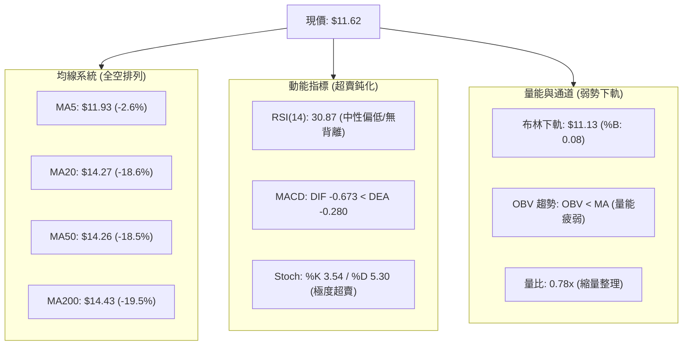

### 📈 移動平均線排列分析

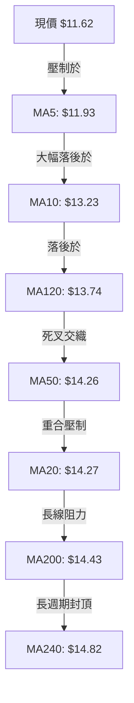

#### 均線數據量化監控表

| 均線名稱 | 當前價位 | 距現價差距 ($) | 乖離率 (%) | 均線斜率狀態 | 趨勢解讀 |
|:---|:---:|:---:|:---:|:---:|:---|
| **MA5** | $11.93 | -$0.31 | -2.60% | 急速向下 ▅▄▃▂▁ | 超短線動態阻力，反抽第一關 |
| **MA10** | $13.23 | -$1.61 | -12.15% | 垂直陡峭向下 ▄▃▂▁ | 緊壓 R1 ($13.30)，短期下行趨勢顯著 |
| **MA20** | $14.27 | -$2.65 | -18.55% | 走平轉頭向下 █▇▆▄ | 中期生命線遭暴力跌破，形成巨大套牢層 |
| **MA50** | $14.26 | -$2.64 | -18.53% | 拐頭向下 █▇▆▄ | 與 MA20 形成死叉聚攏 |
| **MA120** | $13.74 | -$2.12 | -15.43% | 下移 ▆▅▄▃▂ | 半年線防線已失守 |
| **MA200** | $14.43 | -$2.81 | -19.47% | 走平微跌 ▇▆▅▄ | 年線正式告破，牛熊格局逆轉 |
| **MA240** | $14.82 | -$3.20 | -21.61% | 持續緩降 ▄▃▂▁ | 長期走勢極其沉重 |

### 📉 RSI(14) 分析

- **當前讀數**：`30.87`（Wilder 計算法）
- **RSI 強度進度條**：
  `[██████░░░░░░░░░░░░░░] 30.87% (中性偏弱 / 瀕臨超賣)`
- **超買超賣狀態**：
  數值緊貼 30 臨界線，顯示空方賣壓雖然強烈，但尚未進入低於 20 的極端恐慌拋售區。
- **背離分析**：
  根據數據提供之嚴格回測，「RSI 無明顯背離」（比較近 20 根 K 棒首尾價格與 RSI 方向，價格大幅下跌時 RSI 同步顯著下滑）。這意味著當前的下跌並非動能衰竭引發的「假摔」，而是具有實質賣盤推動的真實跌勢，技術面上不存在立即可靠的底背離反轉條件。

### 📊 MACD (12, 26, 9) 訊號解讀

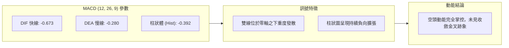

- **柱狀體分析**：
  MACD 柱狀體為 `-0.392`，呈現鮮明紅色空頭信號。柱狀體處於近 20 週以來的最深負值區間之一（比對 2026-10-30 週收盤之 -0.401），說明空頭加速度雖稍有放緩，但尚未出現柱狀體收斂或底背離跡象。

### 📦 布林通道分析

```
NU 布林通道結構示意圖 (參數: 20, 2)
價格 ($)
$17.40 ┤═══════════════════════════════════════════════ 上軌 ($17.40)
$16.00 ┤
$15.00 ┤
$14.27 ┤----------------------------------------------- 中軌 / MA20 ($14.27)
$13.00 ┤
$12.00 ┤
$11.62 ┤                       ◄─── 現價 ($11.62) [%B = 0.08]
$11.13 ┤═══════════════════════════════════════════════ 下軌 ($11.13)
       └───────────────────────────────────────────────
```

- **布林通道指標狀態**：
  - **上軌**：$17.40
  - **中軌 (MA20)**：$14.27
  - **下軌**：$11.13
  - **%B 指標**：`0.08`（0 代表下軌，0.5 代表中軌，1.0 代表上軌）
  - **帶寬解讀**：
    價格緊密貼合下軌運行（%B = 0.08），通道開口呈現劇烈放大狀態（Bandwidth = ($17.40 − $11.13) ÷ $14.27 = 43.9%）。此為典型的「破位開口下行」形態，下軌正對價格形成動態拖曳，尚未出現收口跡象。

### 💹 成交量分析（量價配合度）

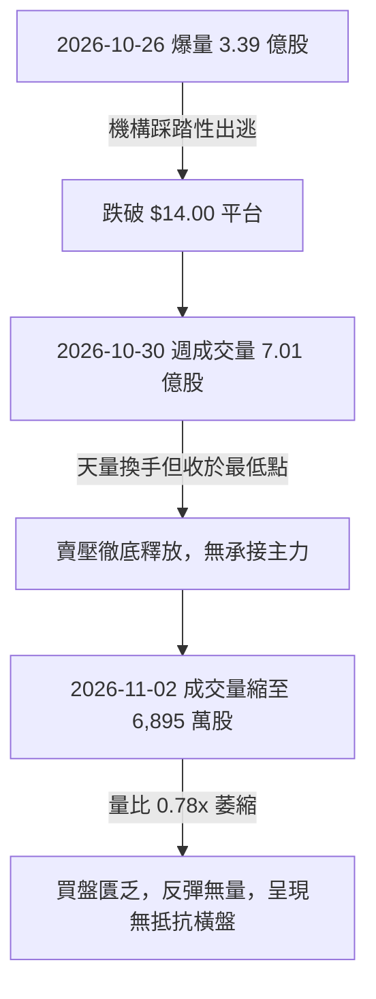

- **量價背離分析**：
  - **最新成交量**：68,957,400 股
  - **20 日均量**：87,944,020 股（量比：`0.78x`）
  - **量能評估**：
    下殺過程中出現天量派發（10-26 的 3.39 億股），而跌至 $11.60 附近時，成交量顯著萎縮至均量以下（0.78x）。這表明空頭的主動性無節制拋售已告一段落，但同時也證明**市場多頭資金完全處於觀望狀態，缺乏主動性抄底意願**。
  - **OBV 趨勢**：
    明確顯示 `OBV < MA`，能量潮指標呈持續下傾態勢，量能未確認任何價格築底訊號。

---

## 6. 動能與波動率

### ⚡ 動能評估四象限

```
                    動能強度 (Momentum)
                            高 ▲
                               │
            象限 I             │            象限 II
        強動能 ｜ 低波動       │        強動能 ｜ 高波動
        (最佳多頭趨勢)         │        (高風險高收益波段)
                               │
   ◄───────────────────────────┼───────────────────────────► 波動率 (Volatility)
   低                          │                           ▲ 高
                               │             [NU 座標點]
            象限 III           │            象限 IV
        弱動能 ｜ 低波動       │        弱動能 ｜ 高波動
        (平靜築底/觀望)        │        (斷崖破位/極高風險)
                               │   * 動能極弱 (MACD/MA 全空)
                               │   * 波動劇烈 (ATR: 6.10%)
                               ▼
                            低
```

#### 動能與波動評估矩陣

| 象限 | 動能狀態 | 波動狀態 | 當前判定 | 技術特性與操作指引 |
|:---:|:---:|:---:|:---:|:---|
| **Q1** | 強 | 低 | — | 穩定多頭爬升，順勢持有 |
| **Q2** | 強 | 高 | — | 狂熱主升段，伴隨劇烈震盪，嚴格移動止盈 |
| **Q3** | 弱 | 低 | — | 底部成交量沉寂，時間換空間，適合長線定投 |
| **Q4** | **弱** | **高** | **✓ (當前狀態)** | **下殺破位後動能嚴重潰散，同時 ATR 波動率激增至 6.10%。屬於高風險深水區，盲目抄底極易遭遇二次下殺。** |

### 📊 ATR 波動率分析

- **ATR(14) 絕對值**：`$0.71`（基於 Wilder 平滑法）
- **ATR 佔比 (波動率)**：`6.10%`（相對於收盤價 $11.62）
- **止損與交易區間指引**：
  - **日間安全止損安全係數**：通常建議設定為 1.5 倍至 2.0 倍 ATR。
    - 1.0 × ATR = **$0.71**
    - 1.5 × ATR = **$1.065**
    - 2.0 × ATR = **$1.42**
  - **解讀**：
    6.10% 的 ATR 數值意味著該股目前屬於**極高短期波動資產**。日間正常隨機雜訊波動區間即達到 ±$0.71，任何緊窄於 $0.50 的日內止損極易被市場雜訊無效觸發。因此，倉位配置必須強制下調以因應擴大的點位風險。

### 📐 Beta 與市場相關性

- **Beta 係數**：`0.968`
- **特性分析**：
  Beta 接近於 1.0（0.968），顯示其長期系統性風險與美股大盤（S&P 500）具備高度同步性。然而，近期的暴跌主要由新興市場政治選舉（新聞提及之巴西選舉衝擊）及財報預期引發的個股非系統性風險所致。當前個股走勢已嚴重脫離大盤基本軌道，呈現獨立的空頭釋放行情。

---

## 7. 多時框架總結

### 📋 時框架評分表

| 時框架 | 趨勢方向 | 動能狀態 | 均線排列 | 關鍵幾何形態 | 綜合評分 | 操作指引 |
|:---|:---:|:---:|:---:|:---|:---:|:---|
| **長期 (月線)** | 🔴 偏空轉折 | 弱勢下傾 | 擊穿中長均線 | 衝頂 $17.75 後展開深幅回撤 | 25/100 | 長期投資者暫停加碼，等待月線止跌 |
| **中期 (週線)** | 🔴 空頭貫穿 | MACD 柱大幅負向擴張 | 跌破 MA200 牛熊線 | 雙頂破位 + 巨量長黑下跌 | 20/100 | 中線趨勢破壞，反彈至阻力位堅決減倉 |
| **短期 (日線)** | 🟡 超跌盤整 | Stoch 超賣 / RSI 30.87 | 空頭排列（全均線壓制）| 緊貼布林下軌弱勢抵抗 | 35/100 | 嚴格依託 S1 ($11.51) 與 S2 ($11.20) 進行防守操作 |

### 🔲 綜合訊號矩陣

```
╔══════════════════════════════════════════════════════════════════╗
║               NU 多時框架訊號收斂矩陣                           ║
╠══════════════════════════════════════════════════════════════════╣
║ 分析維度       日線級別 (短期)    週線級別 (中期)    月線級別 (長期) ║
╟──────────────────────────────────────────────────────────────────╢
║ 趨勢方向       🟡 弱勢盤整        🔴 垂直空頭        🔴 破位下行     ║
║ 動能狀態       🟢 極度超賣        🔴 負向發散        🔴 動能衰竭     ║
║ 支撐位有效性   🟡 測試 S1 ($11.51) 🔴 失守週線頸線   🟡 逼近年度底 S2║
║ 量價關係       🟡 縮量止血        🔴 天量派發        🔴 增量回吐     ║
║ 均線系統       🔴 全面受壓        🔴 跌破年線        🟡 回測兩年均線 ║
╠══════════════════════════════════════════════════════════════════╣
║ 權重收斂結論   短線存在技術性超賣修復動能，但中長線趨勢全面受制於空方 ║
╚══════════════════════════════════════════════════════════════════╝
```

### ⚖️ 多時框收斂結論（依規則 14）

根據多時框架收斂規則：
1. **趨勢/盤整定性**：當前 ADX(14) 讀數為 **24.76**（< 25.00），技術面定義為**盤整弱勢過渡行情**。
2. **主導時框裁決**：在 ADX < 25 的盤整結構中，單邊急跌動能暫歇，交易邏輯應以**日線布林通道下軌（$11.13）至波段阻力 R1（$13.30）之區間波動**為主導。然而，由於中長期均線（週線 MA200、日線 MA20/MA50）遭到放量跌穿，多時框矛盾以「中長期趨勢壓制」為最高約束條件。日線的任何反彈僅能視為技術性超跌回抽，不得視為牛市反轉。
3. **方向性最終結論**：**偏空震盪（Bearish Consolidation）**。市場短線將在 S1 ($11.51) 與 S2 ($11.20) 構築弱勢防守，整體戰術方向嚴格維持「逢反彈高空」或「破位跟進空頭」，多頭操作僅限極輕倉的超跌博弈。此結論與第 1 章綜合評分（32/100）及第 8 章交易策略完全一致。

---

## 8. 交易策略建議

### 🗺️ 策略決策流程圖

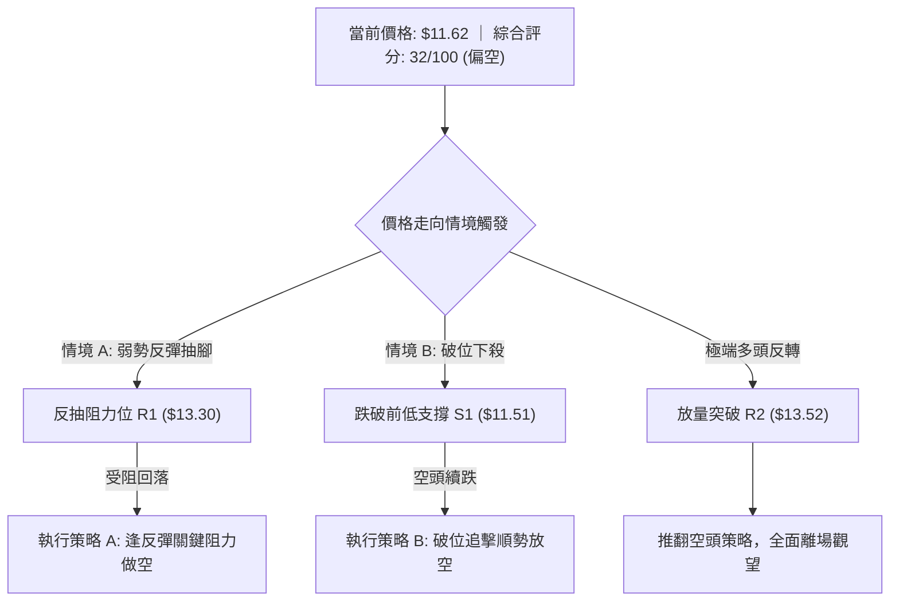

### 🧭 策略路由

> **當前主策略方向 = 空頭策略（逢高做空 / 破位追空，依技術評分卡綜合評分 32/100 判定）**

依據規則，綜合評分 ≤ 40 分（NU 為 32/100）屬於明確的偏空格局，主推空頭策略，多頭僅列為反轉風險對沖與觸發點。

### 🎯 價格情境階梯（Price Scenarios）

所有價位精確引用關鍵價位數據，無任何主觀編造：

| 觸發條件 | 下一目標價 | 後續延伸目標 | 技術情境含義與應對 |
|:---|:---:|:---:|:---|
| **強勢突破 R1 $13.30** | R2 **$13.52** | R3 **$14.32** | 短線超跌反彈超預期，空頭必須停損；回補 10-26 部分缺口 |
| **突破箱體上沿 $12.03** | Fib 78.6% **$12.86** | R1 **$13.30** | 日線級別超賣抽腳展開，提供極佳的逢高做空進場點 |
| **維持現價 $11.62 整理** | S1 **$11.51** | $12.03 | 弱勢盤整，成交量低迷，以時間換空間消磨空頭動能 |
| **有效跌破 S1 $11.51** | S2 **$11.20** | 形態延伸目標 | 空方發起二次進攻，回測 52 週最低點 $11.20 |
| **擊穿 52W 低點 S2 $11.20**| 形態目標 **$10.02** | 無支撐盲區 | 年度結構徹底崩塌，觸發連鎖保證金追繳賣壓 |

### 📊 情境機率分佈

| 情境劃分 | 估計機率 | 核心指標支持依據 |
|:---|:---:|:---|
| **情境一：弱勢區間震盪整理** | **55%** | ADX 降至 24.76（<25 代表弱趨勢盤整）；布林通道 %B = 0.08 貼近下軌，短期下行空間暫時受到通道邊界收斂；最新成交量顯著萎縮至 0.78x 均量，顯示市場進入多空僵持階段。 |
| **情境二：空頭破位再探新低** | **35%** | 均線系統呈絕對空頭壓制；MACD 柱狀體維持 -0.392 負向擴張；-DI (42.13) 極度碾壓 +DI (17.27)；OBV 顯著低於均線，整體量能極度疲弱，未形成實質支撐買盤。 |
| **情境三：強勢反轉向上修復** | **10%** | Stoch KD 出現深度超賣鈍化（%K: 3.54）；RSI 處於 30.87 低位。但因上方存在 $12.78 - $14.57 巨大跳空套牢缺口，反轉缺乏增量資金支持，概率極低。 |

### 🟢 主策略詳情（空頭主導策略）

精確計算風險報酬比：`(進場價 − 目標價 T1) ÷ (止損價 − 進場價)`，符合規則 17 規範：

| 策略要素 | 策略 A（反彈逢高做空 — 穩健型）| 策略 B（破位順勢跟進做空 — 激進型）|
|:---|:---:|:---:|
| **操作邏輯** | 趁技術性超賣反抽至關鍵阻力位進場 | 跌破近期震盪低點關鍵支撐順勢追空 |
| **進場條件** | 反彈至關鍵阻力 R1 遇阻出現滯漲 K 線 | 日 K 實體跌穿關鍵支撐 S1 |
| **進場價格** | **$13.30**（精確引用 R1）| **$11.51**（精確引用 S1）|
| **止損價格** | **$13.52**（精確引用 R2）| **$11.62**（精確引用當前收盤價）|
| **目標價 T1** | **$11.62**（當前現價基準）| **$11.20**（精確引用 S2 / 52週低點）|
| **目標價 T2** | **$11.20**（精確引用 S2 / 52週低點）| **$10.02**（由破位箱體高度推算*）|
| **風險報酬比** | **1 : 7.64（以 T1 計）**<br>*(13.30 − 11.62) ÷ (13.52 − 13.30) = 1.68 ÷ 0.22 = 7.64* | **1 : 2.82（以 T1 計）**<br>*(11.51 − 11.20) ÷ (11.62 − 11.51) = 0.31 ÷ 0.11 = 2.82* |
| **次級風報比** | **1 : 9.55（以 T2 計）**<br>*(13.30 − 11.20) ÷ (13.52 − 13.30) = 2.10 ÷ 0.22 = 9.55* | **1 : 13.55（以 T2 計）**<br>*(11.51 − 10.02) ÷ (11.62 − 11.51) = 1.49 ÷ 0.11 = 13.55* |
| **勝率預估** | 65% | 55% |
| **建議總倉位** | 10% - 15% | 5% - 8% |

*\*註：T2 目標價 $10.02 推算公式：由 2026-10-27 日線箱體高點 $13.00 至支撐 S1 $11.51，垂直高度為 $1.49；跌破 S1 後等距下測目標 = $11.51 − $1.49 = $10.02。*

### 🔴 反向風險觸發點（對沖提示）

若出現以下技術情境，主策略（空頭）將被完全推翻，投資者應立即平倉空頭並啟動對沖：
1. **反轉觸發價位**：日線收盤價強勢站上 **$13.52**（R2）。這將代表 10-26 破位跳空大陰線實體被完全修復，空頭陷阱確立。
2. **量能異動訊號**：單日成交量放大至 **1.8 億股以上**（達到 20 日均量之 2 倍以上），且收長實體陽線。
3. **指標反轉共振**：日線 MACD 於零軸下方出現黃金交叉，且 RSI 突破 50 中軸分水嶺。

### ⭐ 整體訊號強度評星

```
╔══════════════════════════════════════════════════════════════════╗
║               訊號強度綜合評星                                  ║
╠══════════════════════════════════════════════════════════════════╣
║ 做多訊號強度：★★☆☆☆  (2.0/5星 — 僅具備超賣鈍化特徵)              ║
║ 做空訊號強度：★★★★☆  (4.0/5星 — 均線與量價全空壓制)              ║
║ 整體可信度：  ★★★☆☆  (3.5/5星 — ADX<25 顯示短期進入洗盤)        ║
╚══════════════════════════════════════════════════════════════════╝
```

---

## 9. 風險提示與監控

### ✅ 關鍵監控指標 Checklist

```
╔══════════════════════════════════════════════════════════════════╗
║              專業交易員每日監控清單 (Checklist)                  ║
╠══════════════════════════════════════════════════════════════════╣
║ [ ] 支撐位防守：收盤價是否跌破 S1 ($11.51)？                     ║
║ [ ] 終極支撐警戒：盤中是否擊穿 52 週最低點 S2 ($11.20)？         ║
║ [ ] 動態阻力測試：反彈是否在 MA5 ($11.93) 或 R1 ($13.30) 遇阻？   ║
║ [ ] 動能鈍化解鎖：Stoch %K 是否自 <10 向上金叉上穿 %D？           ║
║ [ ] RSI 門檻監控：RSI(14) 是否有效跌破 30 或向上反抽 40？        ║
║ [ ] 成交量異常：日成交量是否異常突破 1.2 億股異常放量？          ║
║ [ ] 波動率指標：ATR(14) 是否由 $0.71 進一步擴大（風險預警）？     ║
║ [ ] 宏觀新聞變量：關注 12月8日 Investor Day 前夕資金異動。      ║
╚══════════════════════════════════════════════════════════════════╝
```

### ⚠️ 風險場景分析

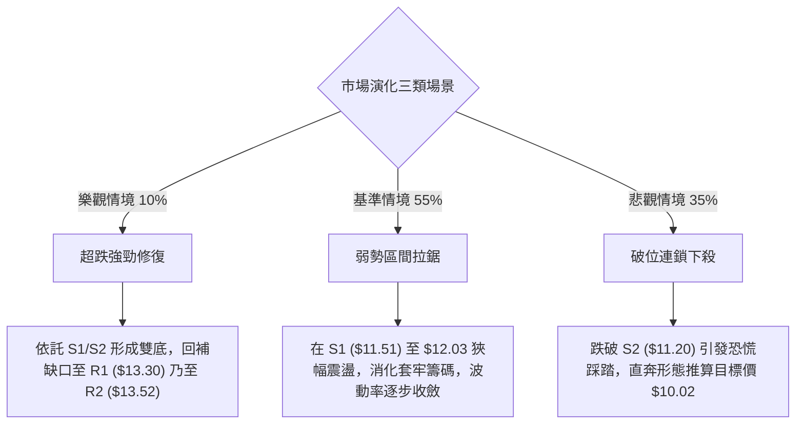

### 🛡️ 風險管理重要提醒

1. **波動率定價與倉位縮減**：
   NU 當前 ATR 佔比高達 6.10%（每日均幅 $0.71），已進入高波動風險資產範疇。傳統的倉位模型必須強制降槓桿。建議單筆交易承擔的總資產風險嚴格控制在 **1.0% 以內**，整體個股暴露倉位不應超過總投資組合的 **10%**。
2. **缺口引力與阻力轉換**：
   2026-10-26 遺留的向下巨額跳空缺口（$12.78 至 $14.57）積聚了數十億美元的套牢籌碼。在技術分析原理中，此類斷崖式缺口將轉化為極強的結構性阻力。即便後市出現消息面刺激的大幅反彈，進入缺口下緣（R1 $13.30 附近）即是機構投資者減碼避險的高危地帶。
3. **嚴格禁止逆勢左側加倉**：
   在均線系統處於標準空頭排列、且 -DI 壓制未消退前，任何試圖「越跌越買」以攤低成本的行為均違反風控原則。底部的確認必須看到「突破並回踩確認支撐」，而非「價格看似便宜」。

---

## 📋 報告總結

```
╔══════════════════════════════════════════════════════════════════════╗
║                     NU 技術分析報告總結                              ║
╠══════════════════════════════════════════════════════════════════════╣
║ 報告日期：2026-11-03                                                 ║
║ 當前價格：$11.62                                                     ║
║ 分析評級：🔴 偏空格局 ｜ 弱勢超賣整理 (綜合評分: 32/100)             ║
╟──────────────────────────────────────────────────────────────────────╢
║ 關鍵結論：                                                           ║
║ ├─ 長期趨勢：🔴 衝頂回落破位，擊穿週期中樞，轉向防守                 ║
║ ├─ 中期趨勢：🔴 雙頂確立，跳空崩跌破壞 MA200 牛熊分界線              ║
║ ├─ 短期趨勢：🟡 Stoch 極度超賣，於 S1 ($11.51) 上方暫時止跌震盪      ║
║ ├─ 關鍵支撐：S1: $11.51 ｜ S2: $11.20 (52W最低點/Fib 100%)           ║
║ ├─ 關鍵阻力：R1: $13.30 ｜ R2: $13.52 ｜ R3: $14.32 (均線共振阻力)   ║
║ └─ 華爾街共識目標價：$18.80 (23 位分析師平均，僅供參考)               ║
╟──────────────────────────────────────────────────────────────────────╢
║ 最優策略組合：                                                       ║
║ 1. 🥇 最佳機會（穩健空頭）：等待反彈測試 R1 ($13.30) 遇阻放空，       ║
║    止損設於 R2 ($13.52)，目標下看現價 $11.62，風報比 1 : 7.64。     ║
║ 2. 🥈 次選機會（順勢空頭）：跌破 S1 ($11.51) 觸發破位做空，          ║
║    止損設於 $11.62，目標下看 S2 ($11.20)，風報比 1 : 2.82。         ║
║ 3. 🥉 保守選擇（空倉觀望）：鑑於 ADX=24.76 呈盤整狀態且 Stoch 超賣， ║
║    激進多空皆易被雙巴，待方向明朗（站上 R1 或跌破 S2）再行介入。    ║
╚══════════════════════════════════════════════════════════════════════╝
```

---

> ⚠️ **免責聲明**：本報告為依據標準技術分析模型與所提供歷史數據生成之量化研究報告，所有內容、數值與走勢推演**僅供學術研究與參考**，**絕不構成任何形式的要約、招攬或具體投資建議**。金融市場存在高度資本虧損風險，投資者進行交易決策前應獨立評估自身財務狀況與風險承受能力。

---

*報告生成時間：2026-11-03 ｜ 數據來源：Yahoo Finance ｜ 分析框架：多時框技術分析模型*