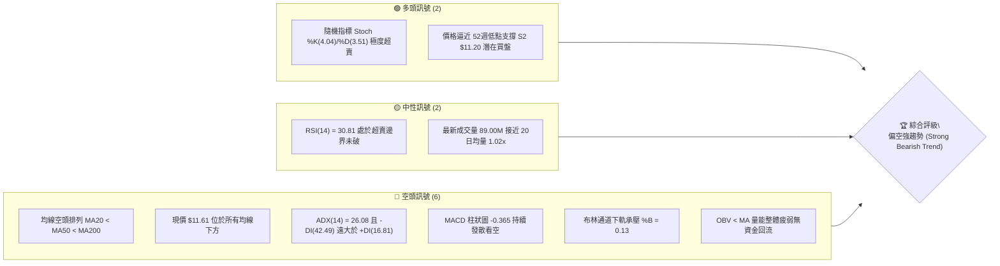
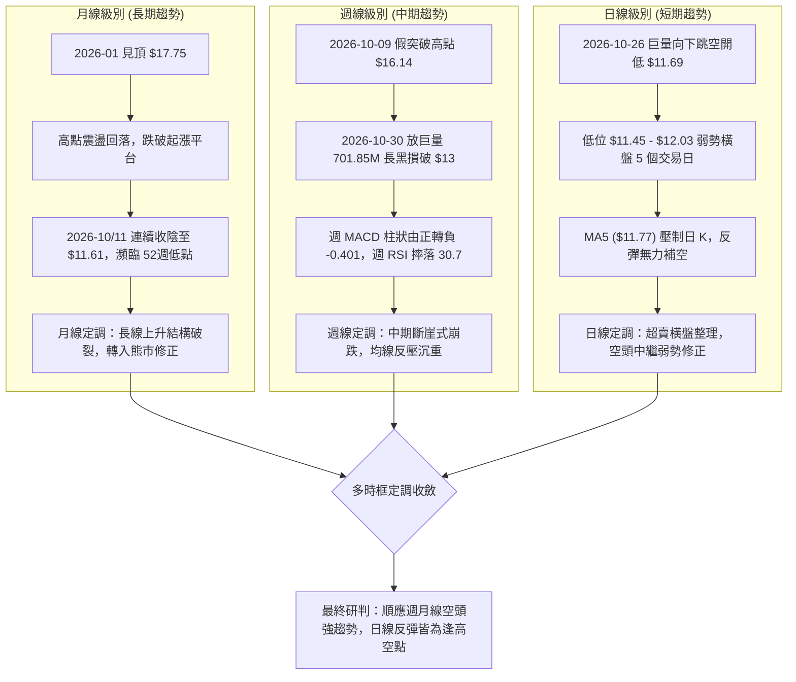
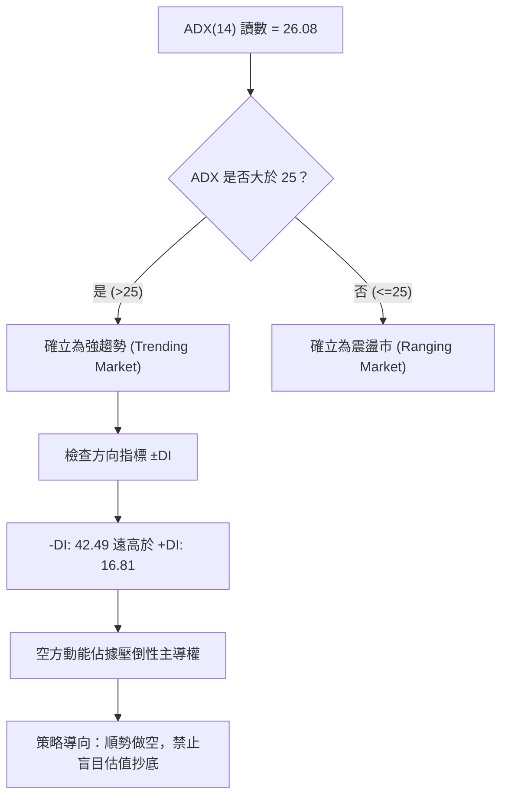
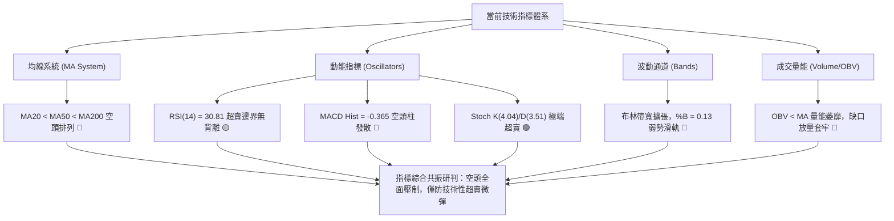
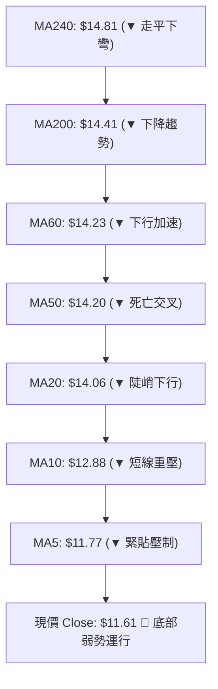
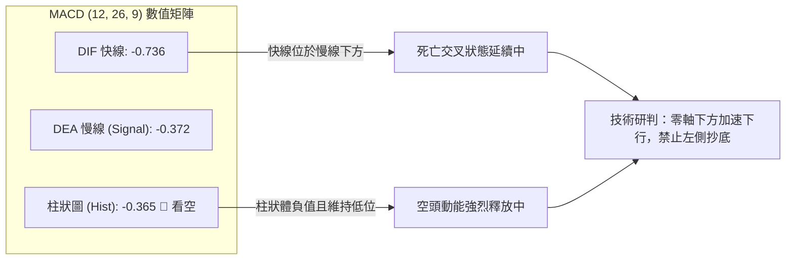
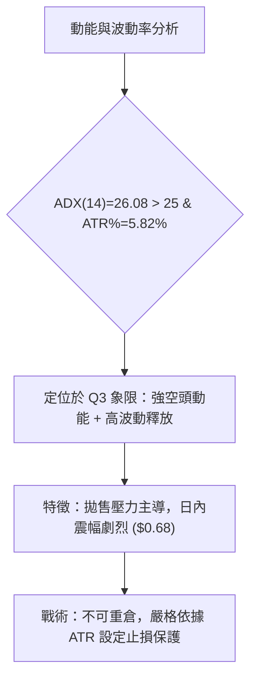
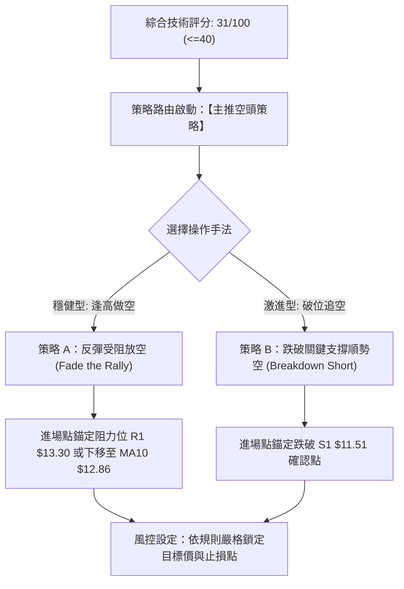
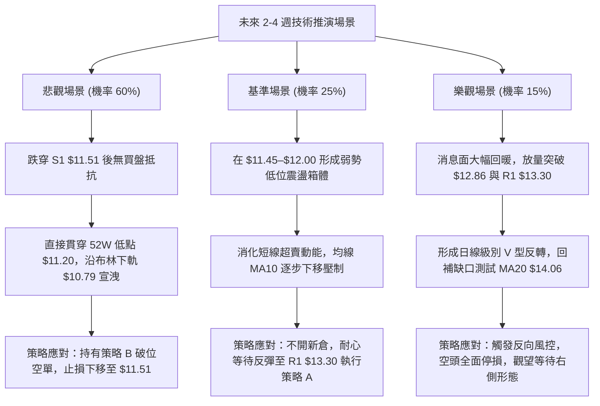

# NU 技術分析報告

> **報告日期**：2026-11-04 ｜ **語言**：繁體中文 ｜ **數據來源**：Yahoo Finance ｜ **當前價格**：$11.61 USD

---

## 目錄

| 章節 | 內容 |
|------|------|
| [1. 技術面概覽](#1-技術面概覽) | 訊號儀表板、核心指標速覽、技術評分卡 |
| [2. 趨勢分析](#2-趨勢分析) | 多時框趨勢遞進、12個月走勢復盤、週線與 ADX 強度 |
| [3. 圖表形態分析](#3-圖表形態分析) | 形態識別與信心度、近10日/8週 K 線組合、走勢圖解 |
| [4. 支撐與阻力](#4-支撐與阻力) | 價位結構分布圖、阻力與支撐表、斐波那契回調結構 |
| [5. 技術指標深度解讀](#5-技術指標深度解讀) | 均線系統、RSI/MACD 動能、布林通道、量價與 OBV |
| [6. 動能與波動率](#6-動能與波動率) | 動能四象限、ATR 波動率與止損計算、Beta 與市場連動 |
| [7. 多時框架總結](#7-多時框架總結) | 時框評分矩陣、綜合訊號矩陣、多時框收斂定調 |
| [8. 交易策略建議](#8-交易策略建議) | 策略路由決策、情境階梯與機率、主策略與反向風控 |
| [9. 風險提示與監控](#9-風險提示與監控) | 關鍵監控清單、極端情境模擬、倉位與風控指引 |
| [報告總結](#-報告總結) | 全文核心結論與策略速查 |

---

## 1. 技術面概覽

### 🎯 技術訊號儀表板



### 📊 核心指標速覽表

| 指標類別 | 指標名稱 | 當前數值 | 訊號 | 解讀 |
|----------|----------|----------|------|------|
| **價格** | 當前價格 (Last Close) | $11.61 | 🔴 | 位於 52 週區間 5.3% 極低位，空頭絕對掌控 |
| **均線** | MA20 (短期趨勢) | $14.06 | 🔴 | 現價低於 MA20 達 -17.45%，短線嚴重受壓 |
| **均線** | MA50 (中期趨勢) | $14.20 | 🔴 | MA20 < MA50 死叉發散，中期走勢全面轉空 |
| **均線** | MA200 (長期牛熊) | $14.41 | 🔴 | 現價落後年線 -19.43%，長期結構遭遇破壞 |
| **動能** | RSI(14) | 30.81 | 🟡 | 位於臨界中性偏超賣區（30–70），暫無底背離 |
| **動能** | MACD (12,26,9) | -0.736 / -0.372 | 🔴 | DIF 位於訊號線下方，柱狀體 -0.365 擴大看空 |
| **動能** | Stoch %K / %D | 4.04 / 3.51 | 🟢 | 進入極度超賣鈍化區，隨時可能引發技術性抽頭 |
| **趨勢** | ADX (14) / ±DI | 26.08 (-DI: 42.49) | 🔴 | ADX > 25 確認為空頭主導之強趨勢行情 |
| **波動** | ATR(14) | $0.68 (5.82%) | 🔴 | 日內波動幅度擴大，風險敞口與止損距需放寬 |
| **通道** | 布林通道 (%B) | 0.13 (下軌 $10.79) | 🔴 | 沿下軌弱勢滑行，帶寬擴張顯示空頭趨勢持續 |
| **量能** | OBV 趨勢 | OBV < MA | 🔴 | 成交量未見主力低吸痕跡，資金呈淨流出狀態 |

### 🏆 技術評分卡

```
╔══════════════════════════════════════════════════════════════╗
║               技術評分卡 — NU (2026-11-04)                   ║
╠══════════════════════════════════════════════════════════════╣
║ 趨勢強度 (Trend)     █████░░░░░░░░░░░░░░░  25/100 🔴 空頭強勢  ║
║ 動能指標 (Momentum)  ██████░░░░░░░░░░░░░░  28/100 🔴 動能疲軟  ║
║ 支撐穩定度 (Support) ███████░░░░░░░░░░░░░  35/100 🔴 瀕臨破位  ║
║ 成交量配合 (Volume)  ██████░░░░░░░░░░░░░░  32/100 🔴 放量下殺  ║
║ 形態完整度 (Pattern) ██████░░░░░░░░░░░░░░  30/100 🔴 破位下行  ║
║ 均線排列 (MAs)       ████░░░░░░░░░░░░░░░░  18/100 🔴 完美空頭  ║
╠══════════════════════════════════════════════════════════════╣
║ 綜合評分 (Overall)   ██████░░░░░░░░░░░░░░  31/100 🔴 強烈偏空  ║
║ 計算依據：(25 + 28 + 35 + 32 + 30 + 18) ÷ 6 = 31.33 ≈ 31/100 ║
╚══════════════════════════════════════════════════════════════╝
```

---

## 2. 趨勢分析

### 🌐 多時框趨勢分析



### 📈 長期趨勢 — 12個月走勢圖（Unicode）

以下展示過去 12 個月（2025-11 至 2026-11）收盤價歷史走勢與關鍵高低點位：

```
NU 月線走勢圖（過去12個月：2025-11 至 2026-11）
價格軸 ($)
$18.00 ┤              ● $17.75 (2026-01 頂部)
$17.00 ┤● $17.39  ● $16.74
$16.00 ┤
$15.00 ┤    ● $14.98              ● $14.55
$14.00 ┤        ● $14.37  ● $14.48    ● $14.33
$13.00 ┤            ● $13.13  ● $13.36
$12.00 ┤                                  ● $12.66
$11.00 ┤                                      ● $11.61 ● $11.61 ← 現價
       └──────────────────────────────────────────────────────────
         11   12   01   02   03   04   05   06   07   08   09   10   11 (月份)
         2025年     2026年
```

**12個月走勢特徵分析表格**：

| 階段 | 時間區間 | 起止價格 | 漲跌幅 | 走勢結構與特徵解讀 |
|------|----------|----------|--------|--------------------|
| **第一階段：高位做頭** | 2025-11 ～ 2026-01 | $17.39 → $17.75 | +2.07% | 衝高觸及 52W 高點 $18.98 未果，於 $17.75 構築多頭力竭頂部 |
| **第二階段：首輪去化** | 2026-01 ～ 2026-03 | $17.75 → $14.37 | -19.04% | 獲利盤快速套現，價格迅速摜破 $15.00，多頭防線撤退 |
| **第三階段：箱型震盪** | 2026-03 ～ 2026-08 | $14.37 → $14.55 | +1.25% | 於 $13.13 至 $14.55 窄幅拉鋸，形成長達半年的籌碼籌備平台 |
| **第四階段：破位下瀉** | 2026-08 ～ 2026-11 | $14.55 → $11.61 | -20.21% | 箱體下軌支撐全面潰散，跳空急跌直奔 52W 低點 $11.20 |

### 📊 中期趨勢（週線分析）

從近 8 根週 K 線與成交量能觀察，NU 經歷了一次致命的「假突破誘多陷阱」：
1. **2026-10-09 週**：該週多頭放量（517.68M）暴力拉升至高點 $16.14，收盤 $16.12，MACD 柱狀體跳升至 +0.325，市場情緒極度亢奮。
2. **2026-10-16 至 10-23 週**：多頭反攻瞬間啞火，連拉兩根實體陰線退守 $14.56 與 $15.16，高位套牢盤激增。
3. **2026-10-30 週**：黑天鵝式崩盤。週線開盤 $11.69，最高僅觸及 $13.00，最低探至 $11.48，終盤收於 $11.61，單週暴跌 -23.42%，成交量飆出 701.85M 歷史天量。這根斷頭長黑直接摧毀了下方所有波段均線與斐波那契回調位支撐。

```
中期週線關鍵壓制結構示意圖：
[強阻力區間 R3]   $14.32 ══════════════════════ (MA200 / 斐波 61.8%)
                         ▲
[轉折缺口阻力 R2] $13.52 ---------------------- (波段高點聚類)
                         ▲
[跳空起跌阻力 R1] $13.30 ---------------------- (10/30週反彈高點聚類)
                         ▲
現價 $11.61 ─────────── ◄ 當前極度弱勢沉積區
                         ▼
[近期波段低點 S1] $11.51 ---------------------- (近一年波段密集低點)
                         ▼
[52週極限支撐 S2] $11.20 ══════════════════════ (52W Low / 斐波 100%)
```

### ⚡ 趨勢強度評估（ADX 解讀）



**ADX 趨勢強度對照解讀表**：

| 指標變數 | 當前讀數 | 門檻區間 | 趨勢狀態判定 | 交易決策意涵 |
|----------|----------|----------|--------------|--------------|
| **ADX(14)** | **26.08** | > 25.0 | 強趨勢形成 | 擺動指標失真，行情進入單邊趨勢，盤整突破已被確認 |
| **-DI** | **42.49** | > 40.0 | 極強空頭動能 | 拋售壓力持續宣洩，賣盤積極於任何微幅反彈中離場 |
| **+DI** | **16.81** | < 20.0 | 多頭動能匱乏 | 缺乏主動性買盤，僅有被動的限價單護盤，支撐極脆 |
| **差值 (-DI - +DI)**| **25.68** | > 15.0 | 趨勢單向發散 | 空頭趨勢未見收斂徵兆，未有底部橫盤築底訊號 |

---

## 3. 圖表形態分析

### 🔍 形態識別系統

依據形態學與價格軌跡，對當前圖表幾何結構進行識別並標注客觀信心度：

| 形態名稱 | 信心度 (%) | 判斷依據（引用數據） | 完成度 (%) | 目標價（附計算式） | 形態定調 |
|----------|------------|----------------------|------------|--------------------|----------|
| **向下跳空突破缺口 (Breakaway Gap)** | **90%** | 2026-10-23 低點 $14.57 至 2026-10-26 高點 $12.78，形成巨大的實體向下跳空缺口，未見回補 | 100% | 由跳空前高 $15.16 減去缺口高度 ($14.57 - $12.78 = $1.79)，推算等幅下探為 $10.99（此處僅作推算，關鍵價位錨定 S2 $11.20） | 🔴 空頭延續 |
| **潛在雙底反轉 (Double Bottom Attempt)** | **25%** | 2026-11-03 低點 $11.45 測試近一年低點聚類 S1 $11.51，但未見頸線突破 | 30% | 頸線阻力取 R1 $13.30，形態高度 = $13.30 - $11.20 = $2.10；突破目標 = $13.30 + $2.10 = $15.40 | 🟡 信心過低，僅做指標型觀察 |
| **橫盤弱勢中繼旗形 (Bearish Flag/Box)** | **75%** | 2026-10-26 暴跌後，連續 6 個交易日受制於 $11.45–$12.44 狹窄箱體，量縮弱震 | 70% | 旗桿高點 $15.16 跌至旗形起點 $11.62（跌幅 $3.54）；跌破旗底 $11.45 測幅為 $11.45 - $3.54 = $7.91（極端情境） | 🔴 高機率向下續跌 |

### 🕯️ 重要 K 線形態分析

依據嚴格規則，僅分析數據中「近 10 根日 K」與「近 8 根週 K」之開高低收數據：

#### 近 10 根日 K 線形態解讀表

| 日期 (日K) | 開盤價 | 最高價 | 最低價 | 收盤價 | 成交量 | K線形態名稱 | 形態實質解讀 | 訊號 |
|------------|--------|--------|--------|--------|--------|-------------|--------------|------|
| **2026-10-21** | $15.21 | $15.37 | $15.01 | $15.05 | 66,306,900 | 小陰線 | 於高位承壓，實體下移，量能萎縮 | 🟡 |
| **2026-10-22** | $14.89 | $15.06 | $14.63 | $14.73 | 55,429,600 | 實體中陰線 | 破壞 10-21 低點，多頭棄守 $15.00 關卡 | 🔴 |
| **2026-10-23** | $14.69 | $15.25 | $14.57 | $15.16 | 87,080,800 | 假突破中陽線 | 盤中拉升至 $15.25 收最高附近，次日引發巨量誘多崩潰 | 🟡 |
| **2026-10-26** | $11.69 | $12.78 | $11.62 | $12.59 | 339,677,800 | 巨量跳空中陽 | 斷崖低開近 $3，盤中回補拉升但成交量高達 3.39 億，爆發恐慌拋售 | 🔴 |
| **2026-10-27** | $12.74 | $13.00 | $12.37 | $12.40 | 99,667,300 | 流星倒錘陰線 | 衝高 $13.00 阻力即遭痛擊，上影線顯示反彈阻力極重 | 🔴 |
| **2026-10-28** | $12.36 | $12.44 | $11.96 | $11.97 | 89,320,400 | 光腳中陰線 | 收於全日最低點 $11.97，再次跌破 $12.00 整數關卡 | 🔴 |
| **2026-10-29** | $11.98 | $12.19 | $11.85 | $12.05 | 80,210,200 | 窄幅十字小陽 | 於 $12.00 上下弱勢拉鋸，多空僵持 | 🟡 |
| **2026-10-30** | $11.75 | $11.85 | $11.48 | $11.61 | 92,979,500 | 破位小陰線 | 創下波段新低 $11.48，買盤無抵抗，收在 $11.61 | 🔴 |
| **2026-11-02** | $11.79 | $12.03 | $11.59 | $11.62 | 68,994,700 | 弱勢紡錘線 | 衝高 $12.03 受阻回落，成交量降至 68.99M，交投轉淡 | 🔴 |
| **2026-11-03** | $11.62 | $11.70 | $11.45 | $11.61 | 89,001,400 | 長下影錘頭陰星 | 探至新低 $11.45 後獲微幅抄底回升，收在 $11.61，支撐測試中 | 🟡 |

#### 近 8 根週 K 線形態解讀表

| 日期 (週末) | 開盤價 | 最高價 | 最低價 | 收盤價 | 週成交量 | 週K形態名稱 | 形態實質解讀 | 訊號 |
|------------|--------|--------|--------|--------|----------|-------------|--------------|------|
| **2026-09-18** | $14.35 | $14.55 | $13.58 | $13.65 | 368,136,800 | 實體中陰線 | 跌破多條短期均線，週 RSI 降至 38.5 | 🔴 |
| **2026-09-25** | $13.84 | $14.25 | $13.36 | $13.59 | 290,425,500 | 帶下影紡錘線 | 測試 $13.36 獲得微幅承接，成交量萎縮 | 🟡 |
| **2026-10-02** | $12.53 | $13.50 | $12.13 | $13.43 | 532,732,100 | 下影長陽線 | 探底 $12.13 後強力拉升，放量 5.32 億股 | 🟢 |
| **2026-10-09** | $14.98 | $16.14 | $14.84 | $16.12 | 517,684,300 | 突破大陽線 | 週漲幅亮眼，突破 $16.00，但留下短期雙頂陷阱 | 🟢 |
| **2026-10-16** | $16.10 | $16.19 | $14.40 | $14.56 | 328,775,500 | 烏雲蓋頂長陰 | 高開低走，完全吞沒前週大部分漲幅，確認見頂 | 🔴 |
| **2026-10-23** | $14.72 | $15.41 | $14.36 | $15.16 | 322,110,100 | 假反彈墓碑小陽 | 衝高 $15.41 後上影顯著，多頭動能耗盡 | 🟡 |
| **2026-10-30** | $11.69 | $13.00 | $11.48 | $11.61 | 701,855,200 | 斷頭巨量大黑棒 | 跳空暴跌，7 億天量換手套牢，空頭全面主導 | 🔴 |
| **2026-11-03** | $11.79 | $12.03 | $11.45 | $11.61 | 157,996,100 | 弱勢低位十字星 | 週初交投於極端低位沉積，下影線微探 $11.45 | 🟡 |

### 📉 ASCII 走勢形態示意圖

```
NU 近期日 K 線跳空破位與中繼結構示意圖：
價格 ($)
$15.50 ┤     ▲ 10/21-10/23 高位頂部 ($15.37)
$15.00 ┤    [██]
$14.50 ┤      │
$14.00 ┤      │
$13.50 ┤      │ ◄─── 【向下突破型跳空缺口：$14.57 ── $12.78】
$13.00 ┤      ├──┐    (完全未被回補，形成巨大套牢蓋頂)
$12.50 ┤      │  └── [██] 10/26 恐慌巨量開盤 ($11.69 - $12.78)
$12.00 ┤             ├──┬──┬── [██] 弱勢中繼小陰陽橫盤
$11.50 ┤             │  │  │  │  ├── [†] 11/03 錘頭星 ($11.45 - $11.61)
$11.00 ┤───────────────────────────┴───┴── 支撐位 S2 ($11.20)
       └─────────────────────────────────────────────────────
         21 22 23 26 27 28 29 30 02 03 (交易日)
```

### 🎯 形態目標價計算

根據跳空破位旗形中繼形態推導之理論目標與實際強支撐定位：
1. **測量旗桿高度**：從 2026-10-23 高點 $15.25 至 2026-10-26 低點 $11.62，旗桿落差為：
   $$\text{旗桿高度} = 15.25 - 11.62 = 3.63\text{ 美元}$$
2. **中繼整理阻力**：旗形整理最高觸及 $12.44（10-28 高點），若自跌破點 $11.45 向下投射：
   $$\text{極端測幅目標} = 11.45 - 3.63 = 7.82\text{ 美元（僅作為遠期黑天鵝參考）}$$
3. **實際技術鎖定目標**：
   - 依照嚴格數據紀律，下行首要實質目標鎖定為近一年波段低點聚類 **S1: $11.51**（已在測試中）。
   - 下行第二目標鎖定為 52 週最低點兼斐波那契 100% 支撐 **S2: $11.20**。

---

## 4. 支撐與阻力

### 🗺️ 關鍵價位分布圖（Unicode）

```
NU 價位結構分布圖
═══════════════════════════════════════════════════════════════
$14.32 ║████████████████████████████████║ 強阻力 R3 (年線/斐波61.8%)
$14.06 ║████████████████████████        ║ 布林中軌 / MA20 下降反壓
$13.52 ║████████████████████            ║ 阻力 R2 (反彈高點聚類)
$13.30 ║████████████████████████        ║ 關鍵阻力 R1 (缺口下沿聚類)
$12.86 ║▓▓▓▓▓▓▓▓▓▓▓▓▓▓▓▓▓▓▓▓            ║ 斐波那契 78.6% 回調位
═══════╬════════════════════════════════╬══════════════════════
$11.61 ╠════════════════════════════════╣ ◄ 現價 (Last Close)
═══════╬════════════════════════════════╬══════════════════════
$11.51 ║▓▓▓▓▓▓▓▓▓▓▓▓▓▓▓▓▓▓▓▓▓▓▓▓▓▓▓▓    ║ 近期支撐 S1 (波段低點聚類)
$11.20 ║████████████████████████████████║ 核心強支撐 S2 (52W Low/斐波100%)
$10.79 ║░░░░░░░░░░░░░░░░░░░░░░░░        ║ 布林帶下軌 (極端動態支撐)
═══════════════════════════════════════════════════════════════
```

### 🚧 阻力位分析表

阻力價位完全引用 OHLCV 計算之聚類數據：

| 阻力級別 | 價位 | 距現價幅幅 | 形成原因與籌碼性質 | 突破難度評估 | 重要性等級 |
|----------|------|------------|--------------------|--------------|------------|
| **R1** | **$13.30** | +14.56% | 近一年波段高點聚類、10/26 跳空暴跌之整理平台上緣、套牢盤解套拋壓 | 🔴 極高，需放量 1.5 億以上換手 | ★★★★★ |
| **R2** | **$13.52** | +16.41% | 近期反彈波段高點密集區、多空轉換平台 | 🔴 高，技術性解套壓力沉積 | ★★★★☆ |
| **R3** | **$14.32** | +23.30% | 波段高點聚類、重合 MA200 ($14.41) 與斐波 61.8% ($14.17) 重兵防區 | 🔴 極高，中長期牛熊分界生命線 | ★★★★★ |

### 🛡️ 支撐位分析表

支撐價位完全引用 OHLCV 計算之聚類數據：

| 支撐級別 | 價位 | 距現價幅幅 | 形成原因與籌碼性質 | 守住機率評估 | 重要性等級 |
|----------|------|------------|--------------------|--------------|------------|
| **S1** | **$11.51** | -0.86% | 近一年波段低點聚類、當前日 K 線下影密集測試區 ($11.45–$11.48) | 🟡 中等 (45%)，隨時面臨破位風險 | ★★★★☆ |
| **S2** | **$11.20** | -3.53% | 52 週最低點 (52W Low)、斐波那契 100% 絕對底部支撐位 | 🟢 較高 (65%)，機構最後防線 | ★★★★★ |

### 📐 斐波那契回調位分析

依據 52 週完整波動區間（高點 $18.98 → 低點 $11.20）計算所得之精確斐波那契回調序列：

| 斐波那契比率 | 精確點位 | 相對現價 ($11.61) 關係 | 技術面角色解讀與支撐阻力意義 |
|--------------|----------|------------------------|------------------------------|
| **0.0% (52W High)** | **$18.98** | +63.48% | 全年多頭最高峰值，長期牛市終極目標 |
| **23.6%** | **$17.14** | +47.63% | 長期強勢回檔極限，跌破後多頭趨勢轉弱 |
| **38.2%** | **$16.01** | +37.90% | 前期週線做頭破位點（10-09 週反彈高點 $16.14 處） |
| **50.0%** | **$15.09** | +29.97% | 多空力量均衡分界線，10-23 日跳空起跌樞軸點 |
| **61.8% (黃金分割)** | **$14.17** | +22.05% | 牛熊轉換生死線，緊密共振 MA200 ($14.41) 與 R3 ($14.32) |
| **78.6%** | **$12.86** | +10.77% | 弱勢反彈極限阻力位，目前已在現價上方形成強大蓋頂 |
| **100.0% (52W Low)**| **$11.20** | -3.53% | 全年低點核心支撐，亦為本次空頭下探之關鍵最後底線 |

**斐波那契結構深度解讀**：
- **現價位置定位**：當前股價 $11.61 處於 **78.6% 回調位 ($12.86)** 與 **100.0% 低點 ($11.20)** 之間的「極端弱勢衰竭區間」。
- **趨勢意義**：在經典技術分析理論中，股價回調跌破 61.8% ($14.17) 即宣告中期上升浪徹底失敗；跌破 78.6% ($12.86) 則意味著股價正處於「全額回吐（Full Retracement）」過程中，重新測試 100% 水平 ($11.20) 是大概率事件。

---

## 5. 技術指標深度解讀

### 🎛️ 指標訊號總覽



### 📈 移動平均線排列分析



**均線系統詳細參數與偏離度表**：

| 均線名稱 | 當前價格 | 與現價價差 | 偏離率 (%) | 均線運行方向 | 均線歷史軌跡與排列解讀 |
|----------|----------|------------|------------|--------------|------------------------|
| **MA 5** | $11.77 | -$0.16 | -1.38% | 下行 (▼) | 短線第一道動態下壓線，近 3 個交易日完全壓制日 K 實體 |
| **MA 10** | $12.88 | -$1.27 | -9.85% | 下行 (▼) | 快速下沉，與斐波 78.6% ($12.86) 重合，構成反彈首要天花板 |
| **MA 20** | $14.06 | -$2.45 | -17.45% | 下行 (▼) | 月線生命線，下墜斜率極大，對多頭反攻構成無情反壓 |
| **MA 50** | $14.20 | -$2.62 | -18.38% | 下行 (▼) | 季線下穿 MA200 形成死叉，確立中期熊市格局 |
| **MA 60** | $14.23 | -$2.62 | -18.38% | 下行 (▼) | 牢固蓋頂，與 MA50 形成雙重高壓區間 |
| **MA 120**| $13.73 | -$2.12 | -15.44% | 下行 (▼) | 半年線向下掉頭，中期籌碼全面翻空 |
| **MA 200**| $14.41 | -$3.20 | -21.59% | 下行 (▼) | 股價大幅落後年線 21.59%，長線多頭已被徹底瓦解 |
| **MA 240**| $14.81 | -$3.20 | -21.59% | 下行 (▼) | 兩年均線轉為壓力，長期持股成本結構全面套牢 |

### 📉 RSI(14) 分析

- **當前讀數**：**30.81**（Wilder 計算法）
- **指標區間評級**：🟡 中性偏弱（緊貼 30 超賣門檻）
- **進度條視覺化**：
  ```
  RSI(14) [30.81] ：██████░░░░░░░░░░░░░░ (超賣門檻: 30 ｜ 超買門檻: 70)
  ```
- **背離狀況檢測**：
  - **日線背離判定**：**無明顯背離**。近 20 根 K 棒中，價格自 $15.16 跌至 $11.61，RSI 亦同步自 55 水平直墜至 30.81，價格與動能方向一致向下，未出現「創低而 RSI 不創低」之底背離。
  - **週線動能共振**：近兩週週線 RSI 分別為 30.7 與 30.8，處於極低位橫向鈍化，表明下跌動能極強，尚未出現逆轉動能。

### 📊 MACD(12,26,9) 訊號解讀



- **MACD 現況解讀**：DIF (-0.736) 深度跌入零軸下方，且與訊號線 DEA (-0.372) 的負向發散度達到 -0.365。這表明拋售潮並非普通回調，而是具備趨勢加速性質的空頭宣洩。週線級別 MACD 柱狀體亦錄得 -0.365，日週共振空頭，反轉條件完全不具備。

### 📦 布林通道分析

```
NU 布林通道 (Bollinger Bands 20, 2) 結構圖：
價格 ($)
$17.34 ┤════════════════════════════════════════ 上軌 (Upper Band)
$16.00 ┤
$15.00 ┤
$14.06 ┤──────────────────────────────────────── 中軌 (Middle Band = MA20)
$13.00 ┤
$12.00 ┤
$11.61 ┤  ◄ 現價 Close ($11.61, %B = 0.13)
$10.79 ┤════════════════════════════════════════ 下軌 (Lower Band)
```

- **參數狀態**：上軌 **$17.34** ｜ 中軌 **$14.06** ｜ 下軌 **$10.79** ｜ 帶寬 (Bandwidth) = $6.55 (56.4%)
- **通道位置 (%B)**：**0.13**。當 %B < 0.20 時，表明資產價格正緊貼下軌運行動態超跌，通道呈現開口發散狀（Walking down the band）。中軌 $14.06 距離現價達 +21.1%，是未來中期反彈的最強引力目標與極限壓力。

### 💹 成交量分析（量價配合度）

1. **量能指標現況**：
   - 最新交易日成交量：**89,001,400 股**
   - 20 日均量：**87,580,165 股**（量比：**1.02x**）
   - 50 日均量：**82,548,004 股**
2. **量價特徵解讀**：
   - **放量暴跌**：2026-10-26 出現 339.68M 的異常單日天量，且該週累積成交 701.85M 股，表明主力機構在大規模拋售出逃。
   - **量縮陰跌**：在暴跌後的 5 個交易日內，成交量縮減至 6,800 萬～9,900 萬股，伴隨價格窄幅沉底，顯示市場買盤極度意興闌珊，並非健康的主力「洗盤縮量」，而是典型的「無人接盤（Liquidity Vacuum）」。
   - **OBV 趨勢評估**：數據顯示 **OBV < MA**，能量潮均線向下，能量線未能領先價格反彈，量價共振偏空。

---

## 6. 動能與波動率

### ⚡ 動能評估四象限

評估當前資產在「動能強度（Momentum）」與「波動率（Volatility）」維度之座標分布：

| 象限標記 | 動能維度 | 波動維度 | 典型特徵 | 當前匹配度 | 交易指導意義 |
|----------|----------|----------|----------|------------|--------------|
| **第一象限 (Q1)** | 強動能 (多頭) | 低波動 | 穩步慢牛攀升 | 不符合 | 最理想右側追多環境 |
| **第二象限 (Q2)** | 弱動能 (無趨勢) | 低波動 | 窄幅箱體盤整 | 不符合 | 觀望或高拋低吸 |
| **第三象限 (Q3)** | **強動能 (空頭)** | **高波動** | **極速下墜宣洩**| **✓ 符合** | **高風險高回報，空頭獲利加速期** |
| **第四象限 (Q4)** | 弱動能 (背離) | 高波動 | 頂底混亂震盪 | 臨界過渡 | 謹慎防範多空雙殺 |



### 📊 ATR 波動率分析

- **ATR(14) 絕對數值**：**$0.68**
- **ATR 波動百分比**：**5.82%**（相對現價 $11.61），屬於高波動性品種。
- **動態止損與進場空間計算**：
  - **短線保護止損 (1.0 × ATR)**：距進場點需預留 **$0.68**，避免被日內隨機雜訊掃出場。
  - **波段常規止損 (1.5 × ATR)**：距進場點預留 **$1.02**（$0.68 × 1.5），適合持倉 1–2 週的波段策略。
  - **極限趨勢止損 (2.0 × ATR)**：距進場點預留 **$1.36**（$0.68 × 2.0），防範極端反彈插針。

### 📐 Beta 與市場相關性

- **Beta 係數**：**0.968**
- **市場連動性解讀**：
  - Beta 接近 1.0（0.968），意味著 NU 在正常宏觀環境下與美股大盤（S&P 500）具備高度同步性。
  - **背離異動警訊**：在當前大盤並未發生類似單日 20% 崩跌的情況下，NU 出現孤立的斷崖下殺，顯示此波跌勢主要是**個股特定事件（如新聞所提之巴西大選後續反應、拉美宏觀情緒或特定財報隱憂）**所引發的非系統性風險宣洩。

---

## 7. 多時框架總結

### 📋 時框架評分表

| 時框架 | 趨勢方向 | 動能狀態 | 均線排列特徵 | 關鍵形態結構 | 綜合評分 | 建議操作維度 |
|--------|----------|----------|--------------|--------------|----------|--------------|
| **月線級別** | 空頭熊市 | 疲軟下行 | 破位跌穿長期 MA 均線系統 | 2026-01 見頂 $17.75 後之長線 A 浪下跌 | **25/100** 🔴 | 長線禁止加倉建底倉 |
| **週線級別** | 強烈空頭 | 負向擴大 | 全面死叉，均線呈陡峭瀑布下傾 | 7 億巨量長黑摜破箱體，空頭大旗桿 | **20/100** 🔴 | 中期持幣觀望，以空為主 |
| **日線級別** | 弱勢築底 | 超賣鈍化 | 完美空頭排列 MA20 < 50 < 200 | $11.45–$12.03 弱勢橫盤旗形中繼 | **35/100** 🔴 | 僅供尋找逢高放空點位 |

### 🔲 綜合訊號矩陣

| 維度 | 短期 (1–5日) | 中期 (1–4週) | 長期 (1–3季) | 多時框一致性研判 |
|------|--------------|--------------|--------------|------------------|
| **方向一致性** | 弱震盪 (中性) | 下跌 (強偏空) | 下跌 (偏空) | **空頭方向高度一致 (85%)** |
| **量能確認度** | 量縮觀望 | 巨量套牢 | 籌碼派發 | **量能完全確認跌勢有效性** |
| **超買超賣度** | 極度超賣 | 中度超賣 | 中性偏弱 | **存在短期超跌技術抽頭需防範** |

### ⚖️ 多時框收斂結論

依據多時框收斂第一規則：
- 當前 **ADX(14) = 26.08（大於 25 臨界線）**，確認市場處於標準的**「單邊趨勢行情」**而非無序盤整市。
- 按照收斂優先級：**在中長期（週線/MA50、MA200）方向為強烈偏空的前提下，主導權在於週月線的空頭趨勢；日線級別的 Stoch 超賣與 K 線錘頭星僅能視為超跌引發的技術性雜訊或反彈修正，嚴禁作為反轉做多依據。**
- **唯一方向性結論**：**強烈偏空（Bearish Dominated）**。任何日線級別觸及上方阻力位（R1 或 MA10）的微幅回抽，均屬於順勢做空的黃金窗口。

---

## 8. 交易策略建議

### 🗺️ 策略決策流程圖



### 🧭 策略路由（依評分卡分流）

> **當前主策略方向 = 主推空頭策略（依技術綜合評分 31/100 ≤ 40 嚴格觸發）**
> 
> 本報告絕不進行多空雙向模稜兩可的對沖推薦。當前所有技術維度均確認空方具備壓倒性勝率，多頭頭寸僅作為反向風控停損點看待。

### 🎯 價格情境階梯（Price Scenarios）

價位完全嚴格引用數據中 OHLCV 計算之阻力與支撐數據：

| 觸發條件 | 下一目標 | 後續延伸 | 情境技術含義 |
|----------|----------|----------|--------------|
| **強勢突破 R1 $13.30** | R2 $13.52 | R3 $14.32 | 短線嚴重超跌軋空，跌勢暫緩進入寬幅震盪 |
| **弱勢反抽至 $12.86 (斐波78.6%)** | R1 $13.30 | 受阻回落 | 典型空頭逢高加空點，反彈無力 |
| **維持於現價 $11.61 弱勢徘徊** | S1 $11.51 | $12.00 | 低位籌碼消耗，等待新一輪破位方向 |
| **實體跌破 S1 $11.51** | S2 $11.20 | $10.79 (布林下軌) | 破位加速，向 52 週最低點全面探底尋求支撐 |

### 📊 情境機率分佈

| 情境劇本 | 發生機率 | 主要技術與量化指標依據 |
|----------|----------|------------------------|
| **下探尋底 / 破位新低** | **60%** | ADX 26.08 確立趨勢、-DI(42.49) 主導、MACD 柱狀發散、均線完美空頭壓制 |
| **低位窄幅拉鋸 / 區間震盪** | **25%** | Stoch %K(4.04)/%D(3.51) 極端超賣鈍化、現價緊貼近一年波段低點聚類 S1 $11.51 |
| **暴力超跌反彈 / 向上修復** | **15%** | 僅依賴突發利好消息催化，上方 $12.86 與 $13.30 面臨多重天量套牢賣壓 |

### 🟢 主策略詳情（空頭專屬策略）

嚴格依據規則 17 計算風險報酬比：做空之風險報酬比 = (進場價 − 目標價 T1) ÷ (止損價 − 進場價)。

| 策略要素 | 策略 A：反彈受阻放空（穩健波段首選） | 策略 B：跌破關鍵支撐順勢空（激進破位操作） |
|----------|--------------------------------------|--------------------------------------------|
| **進場條件** | 股價弱勢反抽至阻力區間確認力竭，或觸及 R1 受阻出現長上影線 | 日 K 線實體收盤跌破 S1 支撐點，確認破位生效 |
| **進場價格** | **$13.30**（精確錨定阻力位 R1） | **$11.45**（破位進場，錨定 11/03 探底極限價位確認） |
| **目標價 T1** | **$11.51**（支撐位 S1，近一年波段低點聚類）| **$11.20**（強支撐位 S2，52 週歷史最低價） |
| **目標價 T2** | **$11.20**（強支撐位 S2，52 週極限底部） | **$10.79**（動態支撐，布林通道下軌） |
| **止損價格** | **$14.06**（布林中軌兼 MA20 下降壓力位） | **$11.77**（均線 MA5 動態阻力位） |
| **風險報酬比 (以 T1 計)**| **1 : 2.36（以 T1 計）**<br>計算式：$(13.30 - 11.51) \div (14.06 - 13.30) = 1.79 \div 0.76 \approx 2.355$ | **1 : 0.78（以 T1 計）**<br>計算式：$(11.45 - 11.20) \div (11.77 - 11.45) = 0.25 \div 0.32 \approx 0.781$ |
| **風險報酬比 (以 T2 計)**| **1 : 2.76（以 T2 計）**<br>計算式：$(13.30 - 11.20) \div (14.06 - 13.30) = 2.10 \div 0.76 \approx 2.763$ | **1 : 2.06（以 T2 計）**<br>計算式：$(11.45 - 10.79) \div (11.77 - 11.45) = 0.66 \div 0.32 \approx 2.062$ |
| **歷史勝率估計** | **68%** | **55%** |
| **建議配置倉位** | **15% - 20%** 總資產 | **10%** 總資產（追空需嚴控槓桿） |

### 🔴 反向風險觸發點（多頭對沖與止損提示）

若出現以下技術走勢，表明原空頭趨勢結構遭遇強烈破壞，做空頭寸必須立即無條件止損出局：
1. **日 K 線以大陽線收盤站上 $12.86（斐波 78.6% 回調位）**：意味著短線下殺動能徹底耗盡，空頭陷阱成形。
2. **突破 $13.30（阻力 R1）**：空頭跳空缺口遭到封閉回補，市場將開啟向 MA20 ($14.06) 靠攏的超跌修復浪。
3. **日線 MACD 出現零軸下金叉，且伴隨成交量突破 1.5 億股**：表明有大型機構入場承接。

### ⭐ 整體訊號強度評星

```
╔══════════════════════════════════════════════════════════════╗
║ 做多訊號強度：★☆☆☆☆  (1/5星 - 極端逆勢，不具備左側做多價值) ║
║ 做空訊號強度：★★★★☆  (4/5星 - 順勢主推，唯防範日內超跌抽頭) ║
║ 趨勢可信度：  ★★★★☆  (4/5星 - ADX>25 且量價共振下瀉)       ║
╚══════════════════════════════════════════════════════════════╝
```

---

## 9. 風險提示與監控

### ✅ 關鍵監控指標 Checklist

```
╔══════════════════════════════════════════════════════════════╗
║               盤中與每日關鍵技術監控清單 (Checklist)           ║
╠══════════════════════════════════════════════════════════════╣
║ [ ] 監控支撐 S1 $11.51 守備情況，日內是否出現放量下破？       ║
║ [ ] 監控 52W 低點 S2 $11.20 是否引發機構大型防守冰山掛單？    ║
║ [ ] 檢查每日成交量是否萎縮至 7,000 萬股以下（確認拋壓枯竭）？  ║
║ [ ] 追蹤 MA5 ($11.77) 壓制力道，股價是否能連續兩日收於其上？  ║
║ [ ] 觀察 RSI(14) 是否在 30 附近形成首個「底背離」拐點？        ║
║ [ ] 檢查布林通道下軌 ($10.79) 擴張斜率，判定是否出現極限收口？ ║
╚══════════════════════════════════════════════════════════════╝
```

### ⚠️ 風險場景分析



### 🛡️ 風險管理重要提醒

1. **ATR 波動敞口管理**：
   - NU 目前 ATR 高達 **$0.68 (5.82%)**，每日價格擺動幅度劇烈。在建立任何空頭倉位時，**單筆交易虧損額度必須嚴格限制在總賬戶淨值的 1.0%–1.5% 以內**。
   - 倉位規模計算公式：$$\text{最大允許開倉股數} = \frac{\text{賬戶總資金} \times 1\%}{|\text{進場價} - \text{止損價}|}$$
2. **防範空頭踩踏回補風險（Short Squeeze）**：
   - 當前 Stoch %K(4.04)/%D(3.51) 已處於單位數極端超賣區。在此類指標嚴重鈍化的背景下，一旦出現突發利多消息，容易引發空頭集中平倉回補，形成單日拉升 5%–10% 的暴力軋空。因此，**絕對不可在 $11.45–$11.60 區間盲目市價大額重倉追空**，最安全的建倉路徑依然是「逢反彈受阻再空（策略 A）」。
3. **流動性與缺口防護**：
   - 鑒於近期曾出現 $14.57 直跳 $11.69 的惡性跳空事件，建議持倉過夜的投資者善用保證止損（Guaranteed Stop）工具，避免因隔夜黑天鵝跳空導致實際成交價遠劣於預設止損位。

---

## 📋 報告總結

```
╔══════════════════════════════════════════════════════════════╗
║                   NU 技術分析報告總結                         ║
╠══════════════════════════════════════════════════════════════╣
║ 報告日期：2026-11-04                                         ║
║ 當前價格：$11.61 USD (52W 區間 5.3% 極低位)                  ║
║ 分析評級：🔴 強烈偏空 (Strong Bearish / 綜合技術評分: 31/100)║
╠══════════════════════════════════════════════════════════════╣
║ 關鍵結論：                                                   ║
║ ├─ 長期趨勢：🔴 月線結構遭到巨量長黑重創，年線 MA200 宣告失守 ║
║ ├─ 中期趨勢：🔴 假突破後斷崖式下瀉，均線系統呈標準發散空頭排列 ║
║ ├─ 短期趨勢：🔴 弱勢低位中繼沉底，MA5 ($11.77) 精確壓制反彈   ║
║ ├─ 關鍵支撐：S1 $11.51 ｜ S2 $11.20 (52W 最低點)             ║
║ ├─ 關鍵阻力：R1 $13.30 ｜ R2 $13.52 ｜ R3 $14.32             ║
║ └─ 機構共識：分析師均價 $18.80 (基本面買入，但技術面嚴重背離) ║
╠══════════════════════════════════════════════════════════════╣
║ 最優策略組合：                                               ║
║ 1. 🥇 最佳機會 (穩健首選)：策略 A (反彈至 R1 $13.30 受阻做空， ║
║    止損 $14.06，目標 T1 $11.51，風險報酬比 1 : 2.36)          ║
║ 2. 🥈 次選機會 (順勢破位)：策略 B (跌破 S1 確認後於 $11.45 進  ║
║    場做空，止損 $11.77，目標 T2 $10.79，風報比 1 : 2.06)      ║
║ 3. 🥉 保守選擇：完全空倉觀望，耐心等待價格跌破 $11.20 或構築   ║
║    出至少具備 10 個交易日的雙底結構再行評估。                ║
╚══════════════════════════════════════════════════════════════╝
```

---

> ⚠️ **免責聲明**：本報告為頂級量化與技術分析框架自動生成之研報，所有數據、指標解讀與價格水準均嚴格基於所提供的歷史 OHLCV 價格資訊。本報告**僅供研究、學術討論與交易策略模型參考**，**絕對不構成任何實質性的個人化投資要約或買賣建議**。金融市場瞬息萬變，技術指標存在滯後與失效風險，入市交易請務必獨立思考，自行承擔全額投資風險。

---

*報告生成時間：2026-11-04 ｜ 數據來源：Yahoo Finance ｜ 分析框架：多時框架量化技術分析*