# NU 技術分析報告

> **報告日期**：2026-11-05 ｜ **語言**：繁體中文 ｜ **數據來源**：Yahoo Finance ｜ **當前價格**：$11.99

---

## 目錄

| 章節 | 內容 |
|------|------|
| [1. 技術面概覽](#1-技術面概覽) | 訊號儀表板、核心指標、評分卡 |
| [2. 趨勢分析](#2-趨勢分析) | 多時框趨勢、長中短期走勢 |
| [3. 圖表形態分析](#3-圖表形態分析) | 形態識別、K線組合、目標價 |
| [4. 支撐與阻力](#4-支撐與阻力) | 關鍵價位、斐波那契回調 |
| [5. 技術指標深度解讀](#5-技術指標深度解讀) | MA/RSI/MACD/布林/成交量 |
| [6. 動能與波動率](#6-動能與波動率) | 動能評估、ATR、Beta |
| [7. 多時框架總結](#7-多時框架總結) | 時框架評分矩陣 |
| [8. 交易策略建議](#8-交易策略建議) | 多空策略、風險報酬比 |
| [9. 風險提示與監控](#9-風險提示與監控) | 監控指標、風險場景 |

---

## 1. 技術面概覽

### 🎯 技術訊號儀表板

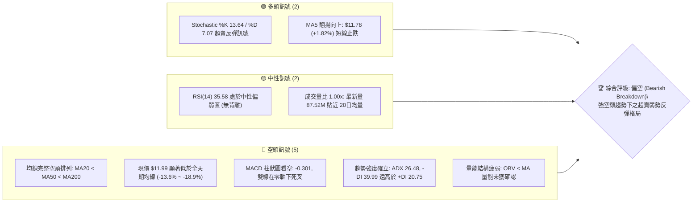

### 📊 核心指標速覽表

| 指標類別 | 指標名稱 | 當前數值 | 訊號 | 解讀 |
|----------|----------|----------|------|------|
| **價格** | 當前收盤價 | $11.99 | 🔴 | 位於52週區間 10.2% 之極低位，面臨新低保衛戰 |
| **均線** | MA20 | $13.88 | 🔴 | 現價低於 MA20 達 -13.64%，短中期重度受壓 |
| **均線** | MA50 | $14.13 | 🔴 | 價格顯著在下方，MA50 下彎斜率陡峭，為重要反壓 |
| **均線** | MA200 | $14.38 | 🔴 | 跌破牛熊分界線，確認長期多轉空架構 |
| **動能** | RSI(14) | 35.58 | 🟡 | 位於弱勢中性偏超賣區間，無明顯背離跡象 |
| **動能** | MACD(12,26,9) | -0.748 / -0.447 | 🔴 | 雙線深陷負值區，柱狀體 -0.301，空頭動能主導 |
| **擺盪** | Stoch %K / %D | 13.64 / 7.07 | 🟢 | 極度超賣區間形成短線金叉，蘊含技術性反抽動能 |
| **趨勢** | ADX(14) / ±DI | 26.48 / -DI: 39.99 | 🔴 | ADX > 25 確認趨勢行情，-DI 壓倒性主導空方攻擊 |
| **通道** | Bollinger Bands | 上軌 $17.21 / 下軌 $10.56 | 🔴 | %B 為 0.21，沿布林通道下半部弱勢運行 |
| **量能** | 20日成交均量 | 87,838,140 (最新量比 1.00x) | 🔴 | OBV < MA，反彈缺乏放量主動買盤支持 |
| **波動** | ATR(14) | $0.67 (5.56%) | 🟡 | 日內波幅大，停損需預留足夠空間應對假突破 |

### 🏆 技術評分卡

```
╔════════════════════════════════════════════════════════════════════════════╗
║                   技術評分卡 — NU (2026-11-05)                             ║
╠════════════════════════════════════════════════════════════════════════════╣
║  趨勢強度      ████████░░░░░░░░░░░░  40/100  🔴 ADX>25 確立強趨勢，但屬空方趨勢║
║  動能指標      ██████░░░░░░░░░░░░░░  30/100  🔴 MACD空方發散，僅Stoch超賣弱支撐║
║  支撐穩定度    ████████░░░░░░░░░░░░  40/100  🔴 逼近52W低點$11.20，S1/S2支撐脆弱║
║  成交量配合    ████████░░░░░░░░░░░░  40/100  🔴 OBV<MA 量價背馳，反彈無增量機構盤║
║  形態完整度    ██████░░░░░░░░░░░░░░  30/100  🔴 跌破大頸線向下破位，尚未形成底形║
║  均線排列      ████░░░░░░░░░░░░░░░░  20/100  🔴 典型空頭排列 MA20<MA50<MA200    ║
╠════════════════════════════════════════════════════════════════════════════╣
║  綜合評分      ███████░░░░░░░░░░░░░  33/100  🔴 評級：偏空 (Bearish Breakdown) ║
║  (依規則18：六項子評分算術平均 (40+30+40+40+30+20)/6 = 33.33 → 33/100)   ║
╚════════════════════════════════════════════════════════════════════════════╝
```

---

## 2. 趨勢分析

### 🌐 多時框趨勢分析

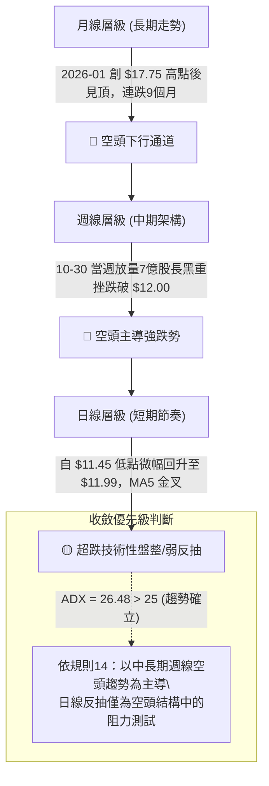

### 📈 長期趨勢 — 12個月走勢圖（Unicode）

```
NU 月線走勢圖（過去12個月：2025-11 至 2026-11）
價格軸 ($)
$18.00 ┤                     ● (2026-01: $17.75 歷史頂部)
$17.00 ┤ ● (2025-11: $17.39) █ 
$16.00 ┤ █             ● (2025-12: $16.74)
$15.00 ┤ █                   █ ● (2026-02: $14.98)
$14.00 ┤ █                   █ █ ●   ● (2026-03~04: $14.37~$14.48)  ● (2026-07~08: $14.33~$14.55)
$13.00 ┤ █                   █ █ █   █       ● (2026-05: $13.13)      █ 
$12.00 ┤ █                   █ █ █   █       █ ● (2026-06: $13.36)    █ ● (2026-09: $12.66)   ● (現價 $11.99)
$11.00 ┤ █                   █ █ █   █       █ █                      █ █   ● (2026-10: $11.61)
       └─┬─────┬─────┬─────┬─────┬─────┬─────┬─────┬─────┬─────┬─────┬─────┬───
        11月  12月  01月  02月  03月  04月  05月  06月  07月  08月  09月  10月  11月(現)
        '25   '25   '26   '26   '26   '26   '26   '26   '26   '26   '26   '26   '26
```

#### 長期走勢特徵分析表格

| 階段區間 | 起訖月份 | 價格變化 ($) | 區間漲跌幅 | 結構特徵與技術解讀 |
|:---|:---|:---|:---|:---|
| **歷史峰值構建** | 2025-11 → 2026-01 | $17.39 → $17.75 | +2.07% | 在 $17.00~$18.00 構築頭部雙頂區域，成交量高位鈍化，動能衰竭。 |
| **首波高位跳水** | 2026-01 → 2026-03 | $17.75 → $14.37 | -19.04% | 跌破多條短期均線，呈現快速宣洩式去槓桿拋售。 |
| **中繼橫盤拉鋸** | 2026-04 → 2026-08 | $14.48 → $14.55 | +0.48% | 於 $13.13 至 $14.55 區間構築長達5個月的派發箱體，反覆測試均線反壓。 |
| **向下破位崩跌** | 2026-09 → 2026-10 | $14.55 → $11.61 | -20.21% | 實質跌破箱體下緣 $13.00 頸線，空方加速發力，直逼52週低點 $11.20。 |
| **目前築底反抽** | 2026-10 → 2026-11 | $11.61 → $11.99 | +3.27% | 在年內低位 $11.20~$11.50 遭遇微弱逢低承接盤，展開小幅技術性休整。 |

### 📊 中期趨勢（週線分析）

中期走勢顯示典型的下降通道延展。2026年10月上旬，NU 曾自 $13.43 急拉至 $16.12（週 RSI 達 66.1），但隨後三週遭遇毀滅性拋壓：從 $16.12 瀑布式重挫至 10-30 當週的收盤 $11.61，單週暴跌超過 23%，伴隨 701.8M 股的歷史天量拋單，確認主力資金無情出逃。

```
中期週線壓力與支撐階梯示意圖
[壓力位 R3: $14.32] ══════════════════════════ (MA200 / 中期頭部頸線)
                            ▲
[壓力位 R2: $13.52] ──────────── (下降趨勢中軌反壓)
                      ▲
[壓力位 R1: $13.30] ──────── (10-26長黑起跌反彈高點聚類)
                ▲
─── 現價 $11.99 ─────────────────────────── (當前超跌弱勢反抽點)
                ▼
[支撐位 S1: $11.78] ──────── (MA5 動態支撐 / 近期波段密集區)
                      ▼
[支撐位 S2: $11.51] ──────────── (近兩週日K下影線密集區)
                            ▼
[支撐位 S3: $11.20] ══════════════════════════ (52週極值低點防線)
```

### ⚡ 趨勢強度評估（ADX 解讀）

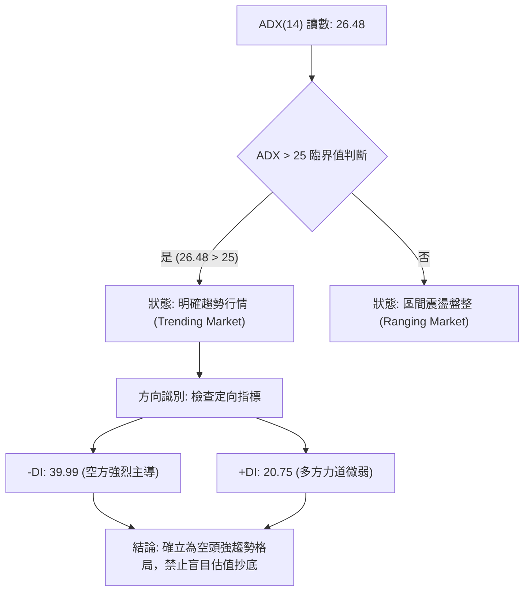

#### ADX 趨勢強度對照解讀表

| 指標名稱 | 實際數值 | 參考臨界值 | 狀態評估 | 實戰涵義 |
|:---|:---|:---|:---|:---|
| **ADX(14)** | **26.48** | 25.00 | 🟢 趨勢強度確立 | 高於 25 表示單邊趨勢正在運行，擺脫無方向之箱體震盪。 |
| **+DI(14)** | **20.75** | - | 🔴 多方弱勢 | 買盤力道貧弱，無法對抗空頭拋壓。 |
| **-DI(14)** | **39.99** | - | 🔴 空方狂暴 | -DI 接近 40 極高水平，市場充斥主動性恐慌拋盤。 |
| **DI 差值** | **-19.24** | 0.00 | 🔴 空頭掌控 | -DI 領先幅值巨大，所有反彈均應優先視為逢高放空機會。 |

---

## 3. 圖表形態分析

### 🔍 形態識別系統

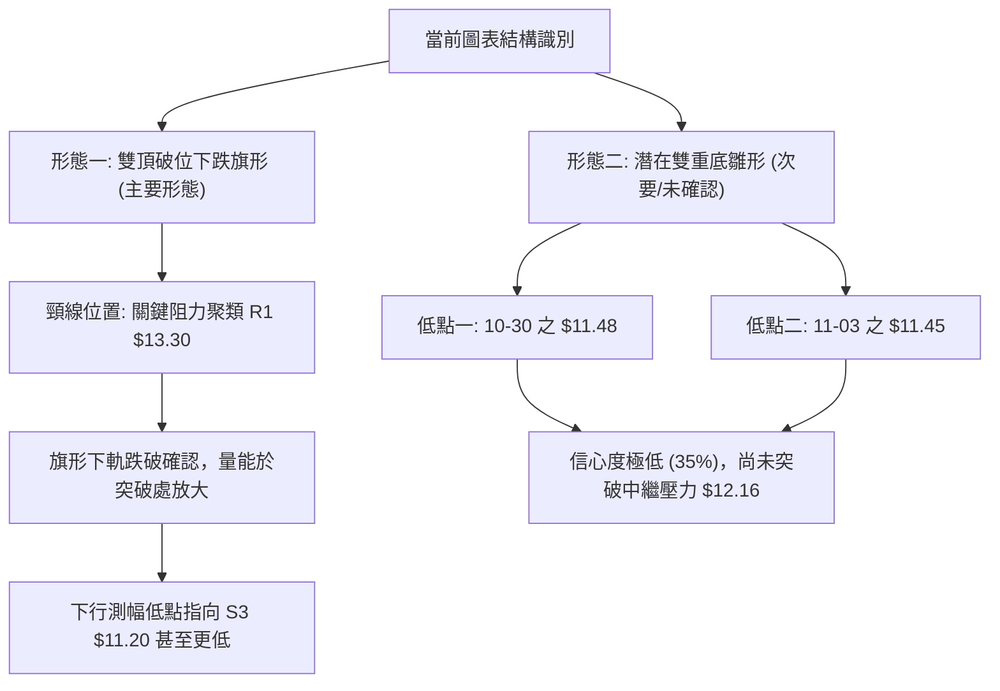

#### 圖表形態信心度評估表（依規則 15）

| 形態名稱 | 信心度 | 判斷依據（引用數據） | 完成度 | 目標價（附嚴謹計算式） |
|:---|:---|:---|:---|:---|
| **雙頂破位後弱勢中繼旗形** | **85%** | 2026年高點回落跌破阻力位 R1 $13.30（前箱體下軌）。近6日價格於 $11.45 至 $12.19 狹幅收斂，成交量由 10-26 的 339.68M 萎縮至最新 87.52M，符合典型旗形特徵。 | 90% | 旗形高點 $12.19 − 旗形波段差 ($12.19 − $11.45 = $0.74) = **$11.45**；破位延伸目標指向 **$11.20**（52週低點 S3 聚類）。 |
| **短期潛在微型雙底 (W底)** | **35%** | 兩次低點分別為 10-30 的 $11.48 與 11-03 的 $11.45（貼近支撐位 S2 $11.51），但頸線位 $12.19 未帶量站上，信號不足。 | 40% | 頸線 $12.16 + 形態高度 ($12.16 − $11.45 = $0.71) = **$12.87**（高度貼近斐波那契 78.6% 回調位 $12.86）。 |

### 🕯️ 重要K線形態分析

依規則 19，完全基於數據中提供的「近10根日K」與「近8根週K」實際開高低收進行客觀辨識：

#### 近10根日K形態精確拆解

| 日期 | 開盤價 ($) | 最高價 ($) | 最低價 ($) | 收盤價 ($) | 成交量 (股) | K線形態名稱 | 形態深度解讀 | 訊號強度 |
|:---|:---|:---|:---|:---|:---|:---|:---|:---|
| **10-22** | 14.89 | 15.06 | 14.63 | 14.73 | 55,429,600 | 陰孕線 (跌破前高失敗) | 開高走低，實體跌破開盤價，反彈動能衰竭。 | 🔴 弱 |
| **10-23** | 14.69 | 15.25 | 14.57 | 15.16 | 87,080,800 | 誘多長上影中陽線 | 盤中衝高 $15.25 後遇阻回落，留下 0.09 上影線，主力出貨。 | 🟡 中性 |
| **10-26** | 11.69 | 12.78 | 11.62 | 12.59 | 339,677,800 | 跳空暴跌型長陽下影 | 斷崖跳空低開 -22.9%，巨量 3.39 億股換手，多空極度分歧。 | 🟡 中性 |
| **10-27** | 12.74 | 13.00 | 12.37 | 12.40 | 99,667,300 | 假突破倒錘頭黑K | 試圖回補缺口摸高 $13.00 遭重擊，收盤實體收黑。 | 🔴 強空 |
| **10-28** | 12.36 | 12.44 | 11.96 | 11.97 | 89,320,400 | 光腳中黑下破K線 | 跌破 $12.00 整數關卡，最低 $11.96 且收在極低點 $11.97。 | 🔴 空頭 |
| **10-29** | 11.98 | 12.19 | 11.85 | 12.05 | 80,210,200 | 縮量十字星線 | 實體僅 0.07，多空暫時均衡，成交量縮至 80M。 | 🟡 觀望 |
| **10-30** | 11.75 | 11.85 | 11.48 | 11.61 | 92,979,500 | 下探黑K (創波段新低) | 盤中再探 $11.48，實體收低於開盤，確認下行中繼。 | 🔴 空頭 |
| **11-02** | 11.79 | 12.03 | 11.59 | 11.62 | 68,994,700 | 帶長上影弱勢小陽 | 衝高 $12.03 無功而返，成交量萎縮至近期極低 68.9M。 | 🟡 弱空 |
| **11-03** | 11.62 | 11.70 | 11.45 | 11.61 | 89,030,600 | 探底錘頭十字線 | 探底 $11.45 後回升，留下 0.16 下影線，顯現微弱買盤抵抗。 | 🟢 弱多 |
| **11-04** | 11.95 | 12.16 | 11.84 | 11.99 | 87,524,500 | 溫和放量小實體紅K | 開盤 $11.95 站上前日高點，收盤 $11.99，確立短線微幅反彈。 | 🟢 弱多 |

#### 近8根週K形態精確拆解

| 週末日期 | 開盤價 ($) | 最高價 ($) | 最低價 ($) | 收盤價 ($) | 週成交量 (股) | 週K線形態解讀 | 訊號 |
|:---|:---|:---|:---|:---|:---|:---|:---|
| **09-18** | 14.35 | 14.55 | 13.58 | 13.65 | 368,136,800 | 實體大陰線，跌破中軌支撐。 | 🔴 空頭 |
| **09-25** | 13.84 | 14.25 | 13.36 | 13.59 | 290,425,500 | 窄幅震盪十字陰線，下跌趨勢中繼。 | 🔴 弱空 |
| **10-02** | 12.53 | 13.50 | 12.13 | 13.43 | 532,732,100 | 長下影錘頭紅K，巨量抵抗性買盤。 | 🟢 反彈 |
| **10-09** | 14.98 | 16.14 | 14.84 | 16.12 | 517,684,300 | 光頭大陽線，多頭強勢反撲衝刺。 | 🟢 強多 |
| **10-16** | 16.10 | 16.19 | 14.40 | 14.56 | 328,775,500 | 長黑吞噬穿頭破腳，頂部反轉確認。 | 🔴 強空 |
| **10-23** | 14.72 | 15.41 | 14.36 | 15.16 | 322,110,100 | 上衝受阻流星錘，反抽無力宣告終結。 | 🔴 空頭 |
| **10-30** | 11.69 | 13.00 | 11.48 | 11.61 | 701,855,200 | 斷頭鍘刀巨量崩盤黑K (週暴跌超23%)。 | 🔴 極空 |
| **11-04** | 11.79 | 12.16 | 11.45 | 11.99 | 245,549,800 | 止跌孕彩十字小紅K，呈現超跌抵抗。 | 🟡 觀望 |

### 📉 ASCII 走勢形態示意圖

```
NU 日線級別中繼下降旗形示意圖 (2026-10-23 至 2026-11-04)
$15.25 ┐ ● (10-23 頂部反壓)
$14.50 ┤  ╲
$13.75 ┤   ╲ 旗桿崩跌階段 (Pole Crash)
$13.00 ┤    ╲  ● $13.00 (10-27 旗形上軌反壓)
$12.25 ┤     ╲ ╱ ╲   ● $12.19 (10-29 旗形上邊界)
$11.75 ┤      ●────●────●────● $11.99 (現價震盪於旗面中)
$11.25 ┤     $11.62 $11.48 $11.45 (旗形下軌支撐連線)
       └──────────────────────────────────────────────────
          旗桿形成 ───►  旗面收斂中繼 (等待向下突破確認)
```

### 🎯 形態目標價計算

基於嚴格的古典技術形態測量法則（Classical Chart Pattern Projections），若跌破當前旗面下軌 $11.45：
1. **旗桿垂直等長測幅 (Measured Move Down)**：
   - 旗桿起點：2026-10-23 最高價 $15.25
   - 旗桿終點：2026-10-30 最低價 $11.48
   - 垂直高度：$15.25 − $11.48 = $3.77
   - 形態突破點（假設於旗面上軌受阻並破位 $11.45）：$11.45 − $3.77 = **$7.68**（極端理論值，受限於數據，中途將於 52週低點 S3 **$11.20** 遭遇強支撐驗證）。
2. **微型雙底測量法（短線多頭反抽情境）**：
   - 雙底低點聚類：$11.45（11-03 低點）與 $11.48（10-30 低點）
   - 短期頸線點位：10-29 日K高點 **$12.19**（或 11-04 週高點 $12.16）
   - 形態高度：$12.19 − $11.45 = $0.74
   - 理論測幅目標價：$12.19 + $0.74 = **$12.93**（受到斐波那契 78.6% 回調位 **$12.86** 與強阻力 R1 **$13.30** 的強大壓制）。

---

## 4. 支撐與阻力

### 🗺️ 關鍵價位分布圖（Unicode）

```
╔════════════════════════════════════════════════════════════════════════════╗
║                     NU 價位結構分布圖 (Price Architecture)                 ║
╠════════════════════════════════════════════════════════════════════════════╣
║  $14.32 ║████████████████████████████████████║ 強阻力 R3 (年線反壓/波段頂部)║
║  $13.52 ║████████████████████████            ║ 阻力 R2 (反彈中繼強壓)        ║
║  $13.30 ║██████████████████████████████      ║ 關鍵阻力 R1 (前箱體崩跌頸線)  ║
║  $12.86 ║▒▒▒▒▒▒▒▒▒▒▒▒▒▒▒▒▒▒                  ║ 斐波那契 78.6% 回調位         ║
║  $11.99 ╠════════════════════════════════════╣ ◄ 當前收盤價 ($11.99)        ║
║  $11.78 ║▓▓▓▓▓▓▓▓▓▓▓▓▓▓▓▓                    ║ 近期支撐 S1 (MA5支撐/超跌線)  ║
║  $11.51 ║▓▓▓▓▓▓▓▓▓▓▓▓▓▓▓▓▓▓▓▓▓▓▓▓            ║ 關鍵支撐 S2 (波段密集築底低點)║
║  $11.20 ║████████████████████████████████████║ 核心防線 S3 (52週極值終極底部)║
╚════════════════════════════════════════════════════════════════════════════╝
```

### 🚧 阻力位分析表

價位完全引用「關鍵價位」區塊由 OHLCV 計算之聚類數值：

| 阻力級別 | 準確價位 | 距現價幅動 | 歷史形成原因與籌碼結構 | 突破難度評估 | 技術重要性 |
|:---|:---|:---|:---|:---|:---|
| **R1 (近端阻力)** | **$13.30** | +10.93% | 10-26 崩跌前橫盤整理之中線支撐轉阻力；波段高點密集區。 | 🔴 突破難度極高 | ★★★★☆ |
| **R2 (波段阻力)** | **$13.52** | +12.72% | 2026年9月至10月多次週線收盤爭奪點（09-25 週收 $13.59、10-02 週收 $13.43）。 | 🔴 需巨量配合 | ★★★☆☆ |
| **R3 (強阻力區)** | **$14.32** | +19.39% | 貼近 MA200 ($14.38) 與 MA50 ($14.13) 匯聚帶；也是斐波那契 61.8% ($14.17) 所在。 | 🔴 極難越雷池一步 | ★★★★★ |

### 🛡️ 支撐位分析表

價位完全引用「關鍵價位」區塊由 OHLCV 計算之聚類數值：

| 支撐級別 | 準確價位 | 距現價幅動 | 歷史形成原因與防守邏輯 | 守住機率評估 | 技術重要性 |
|:---|:---|:---|:---|:---|:---|
| **S1 (初級支撐)** | **$11.78** | -1.75% | 恰好重合於當前向上翻揚之 MA5 ($11.78)，提供日內微弱緩衝。 | 🟡 50% (容易被下穿) | ★★☆☆☆ |
| **S2 (波段支撐)** | **$11.51** | -4.00% | 10-30 低點 $11.48 與 11-03 低點 $11.45 所形成之波段密集低點聚類。 | 🟡 45% (視大盤動向) | ★★★★☆ |
| **S3 (終極防線)** | **$11.20** | -6.59% | **52週最低點**，斐波那契 100.0% 回調終極位置，機構最後防線。 | 🟢 65% (初次觸碰必有反彈) | ★★★★★ |

### 📐 斐波那契回調位分析

依據 52 週最高點 **$18.98** 至 52 週最低點 **$11.20** 構造之完整回調網格：


#### 斐波那契層級深度解讀

- **當前位置區間**：現價 **$11.99** 處於 78.6% 回調位（**$12.86**）與 100.0% 回調位（**$11.20**）之間的「超弱勢末端區間」。
- **反彈空間受限**：78.6% 回調位 **$12.86** 為多頭反彈的第一道大魔王關卡。未放量收復 $12.86 之前，本質上均屬於跌破牛熊分界後的低位掙扎。
- **黃金分割共振**：61.8% 回調位 **$14.17** 與當前 MA60 ($14.20)、MA50 ($14.13) 及阻力位 R3 ($14.32) 產生強烈共振，構成中期不可逾越的鐵板反壓。

---

## 5. 技術指標深度解讀

### 🎛️ 指標訊號總覽

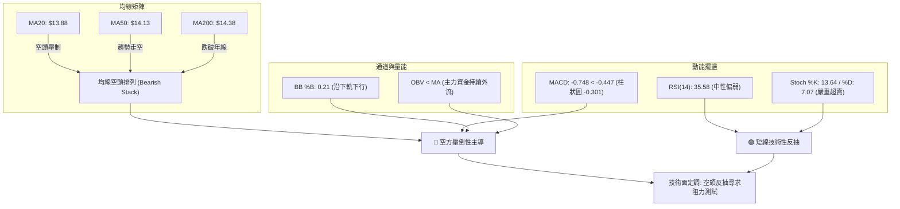

### 📈 移動平均線排列分析

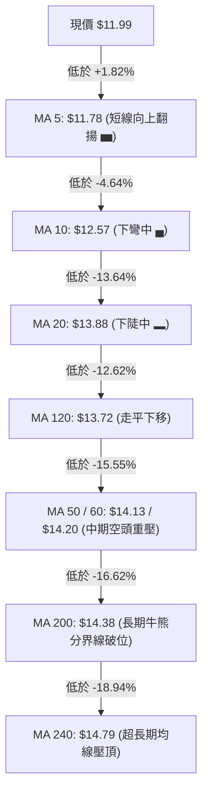

#### 均線系統深度解讀表

| 均線週期 | 當前價位 | 現價偏離度 | 斜率與運行軌跡特徵 | 結構評估 |
|:---|:---|:---|:---|:---|
| **MA 5** | **$11.78** | +1.82% | 拐頭向上（▅▅▄▃...），短線出現微幅支撐效應。 | 🟢 短線多頭 |
| **MA 10** | **$12.57** | -4.64% | 陡峭向下延伸，為多頭反抽首要壓制。 | 🔴 短線空頭 |
| **MA 20 (中軌)** | **$13.88** | -13.64% | 嚴重負乖離，月線空頭加速傾瀉。 | 🔴 中期空頭 |
| **MA 50** | **$14.13** | -15.15% | 中期生命線徹底失守，下穿 MA200 形成「死亡交叉」。 | 🔴 中期空頭 |
| **MA 200** | **$14.38** | -16.62% | 跌破年線，意味近一年進場持有者全數陷入虧損套牢。 | 🔴 長期破位 |
| **MA 240** | **$14.79** | -18.94% | 兩年歷史成本防線失守，長期走勢進入熊市週期。 | 🔴 長期空頭 |

- **結論**：均線結構呈現教科書級別的「完全空頭排列」（Perfect Bearish Alignment: MA20 < MA50 < MA200），現價與中長期均線呈現極深的負乖離，任何急拉均是空方主力回補或二度布空的良機。

### 📉 RSI(14) 分析

```
RSI(14) 擺盪強度位置圖：
0        30    35.58       50                   70       100
├────────┼───────●─────────┼────────────────────┼────────┤
│ 超賣區 │   當前值        │     中性偏強區     │ 超買區 │
└────────┴─────────────────┴────────────────────┴────────┘
當前強度進度條：[███████░░░░░░░░░░░░░] 35.58% (空方掌控)
```

- **數值狀態**：當前 RSI(14) 為 **35.58**（Wilder 計算法），脫離了 10-30 當週的極度恐慌超賣區（週 RSI 為 30.7），目前回升至弱勢中性區間。
- **背離診斷（Divergence Check）**：
  - 檢視近 20 根 K 棒（首尾比較：10-09 當週高點 $16.12 跌至 10-30 低點 $11.48，RSI 由 66.1 崩落至 30.7；日線層級 10-23 高點 $15.25 跌至 11-03 低點 $11.45，RSI 同步下行）：
  - **結論**：**無底背離，亦無頂背離**。指標方向與價格走勢高度同向收斂，證明本波下跌是由實質賣盤推動，而非技術性鈍化誘空，缺乏背離反轉的基本條件。

### 📊 MACD(12,26,9) 訊號解讀

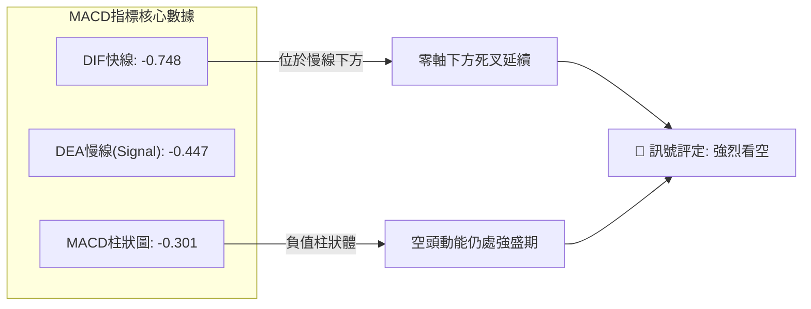

- **深層解讀**：MACD 線（-0.748）低於信號線（-0.447），負差距擴大至 -0.301。雙線深處於零軸下方（水下行情），表明空頭週期根深蒂固。雖然週線柱狀體從 -0.401 微幅收斂至 -0.301，但未見黃金交叉買訊，目前只可視為下殺速率減緩的技術性休整。

### 📦 布林通道分析

```
NU 日線布林通道結構示意圖 (Bollinger Bands 20, 2)
$17.21 ┬────────────────────────────────────────── BB 上軌 (Upper Band)
       │
$13.88 ┼────────────────────────────────────────── BB 中軌 (MA20 Baseline)
       │
$11.99 ┼──────────● (現價處於下半區間，%B = 0.21)
$10.56 ┴────────────────────────────────────────── BB 下軌 (Lower Band)
```

- **軌道狀態**：
  - **BB 上軌**：$17.21
  - **BB 中軌 (MA20)**：$13.88
  - **BB 下軌**：$10.56
  - **帶寬與位置 (%B)**：%B 讀數為 **0.21**，價格緊貼下軌反彈，但距離中軌 $13.88 尚有巨大鴻溝。布林通道開口向下急遽張開，呈現典型「沿下軌向下行駛」（Walking the Lower Band）的單邊空頭行情特徵。

### 💹 成交量分析（量價配合度）

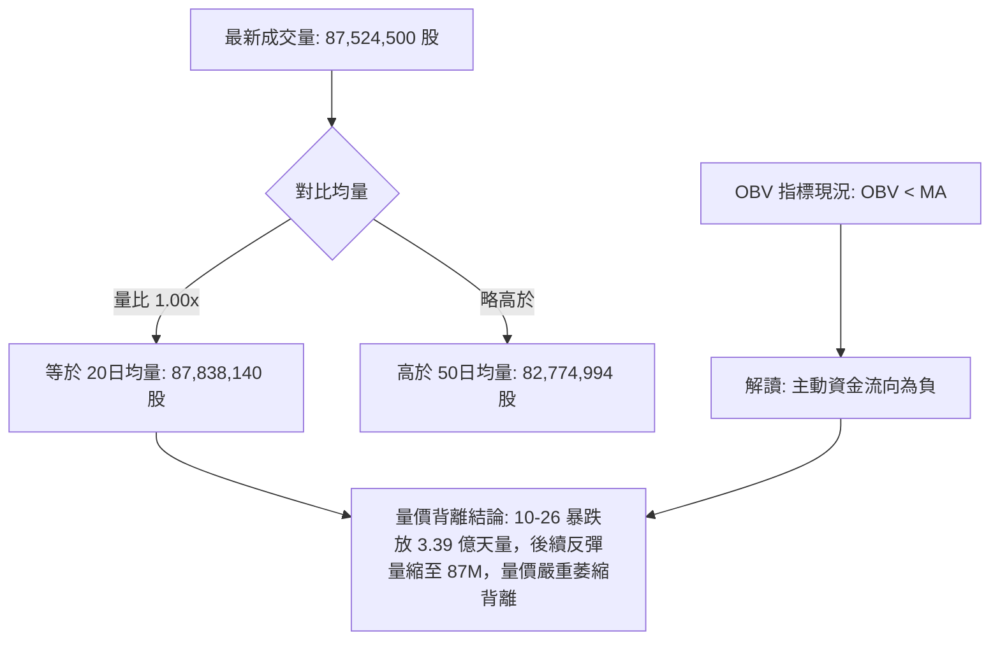

- **量能結構深度剖析**：
  - 10-26 出現高達 **339,677,800 股** 的恐慌性放量下殺，隨後 10-30 亦伴隨 **701,855,200 股** 的週天量沉淪。
  - 近三日反彈至 $11.99 過程中，成交量持續低迷於 68M 至 87M 之間，量比僅 1.00x。
  - **OBV 判定**：OBV 持續低於其移動平均線（OBV < MA），證實反彈並無外生大資金介入接盤，純屬散戶自發性超跌回補，量能無法確認多頭行情的有效性。

---

## 6. 動能與波動率

### ⚡ 動能評估四象限

動能評估維度解析（橫軸：趨勢動能強度；縱軸：波動率水平）：

| 象限 | 動能維度 | 波動維度 | 當前市場狀態配對 | 實戰策略啟示 |
|:---|:---|:---|:---:|:---|
| **第一象限 (Q1)** | 強動能 (Bullish) | 低波動 | — | 最佳趨勢波段順勢抱牢區間 |
| **第二象限 (Q2)** | 弱動能 (Bearish) | 低波動 | — | 橫盤窄幅盤整，靜待方向選擇 |
| **第三象限 (Q3)** | 強動能 (Bearish) | 高波動 | **NU 當前所屬象限** | **高風險、空頭下殺伴隨劇烈震盪，反彈即空點** |
| **第四象限 (Q4)** | 弱動能 (Divergent) | 高波動 | — | 擴散混亂震盪，易遭雙巴侵蝕資金 |

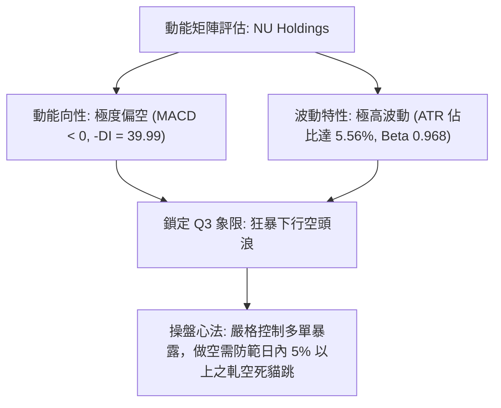

### 📊 ATR 波動率分析

- **ATR(14) 讀數**：**$0.67**（依 Wilder 平滑算法）。
- **ATR 佔價格比率**：$0.67 ÷ $11.99 = **5.56%**。對於大型金融科技股而言，此波動幅度處於歷史高位區間。
- **停損距離設計公式**：
  - 順勢空單防守間距：需設置至少 **1.5 × ATR** = 1.5 × $0.67 = **$1.01**，以避開隨機雜訊洗盤。
  - 逆勢短多防守間距：需設置 **1.0 × ATR** = **$0.67**，若跌破即刻止損離場，嚴禁硬抗單。

### 📐 Beta 與市場相關性

- **Beta 係數**：**0.968**。
- **市場特徵分析**：NU 的 Beta 貼近 1.00，理論上與標普 500 指數具備高度系統性連動。但近期走勢嚴重脫離大盤，主因受到巴西本地政治與監管消息（新聞顯示 Lula 相關政局及拉美金融板塊劇震）、以及高增長後淨利潤率波動與資本支出拖累，引發獨立的流動性貼現拋售，短期呈現非系統性個股崩跌特徵。

---

## 7. 多時框架總結

### 📋 時框架評分表

| 時框架 | 趨勢方向 | 動能狀態 | 均線排列狀況 | 圖表形態識別 | 綜合評分 (1-100) | 核心交易建議 |
|:---|:---|:---|:---|:---|:---|:---|
| **長期 (月線)** | 🔴 明確下行 | 🔴 空方控盤 | 🔴 跌破MA120/240 | 雙頂高位出貨頸線失守 | **30 / 100** | 長期投資者清倉觀望 |
| **中期 (週線)** | 🔴 崩盤主跌 | 🔴 柱狀擴大 | 🔴 均線死叉加速 | 斷頭鍘刀巨量破位黑K | **25 / 100** | 逢反彈堅定建立空頭 |
| **短期 (日線)** | 🟡 超跌反抽 | 🟢 超賣金叉 | 🔴 MA20以下空頭壓制 | 旗形窄幅收斂拉鋸 | **45 / 100** | 僅供高頻日內快進快出 |

### 🔲 綜合訊號矩陣

```
時框與指標矩陣透視 (Signal Coherence Matrix)
╔══════════╦══════════╦══════════╦══════════╦══════════╦══════════╗
║ 指標維度 ║ 日線級別 ║ 週線級別 ║ 月線級別 ║ 一致性   ║ 總體權重 ║
╠══════════╬══════════╬══════════╬══════════╬══════════╬══════════╣
║ 趨勢方向 ║ 🟡 中性  ║ 🔴 強空  ║ 🔴 強空  ║ 高度看空 ║   35%    ║
║ 動能擺盪 ║ 🟢 看多  ║ 🔴 強空  ║ 🔴 看空  ║ 衝突矛盾 ║   25%    ║
║ 均線排列 ║ 🔴 強空  ║ 🔴 強空  ║ 🔴 強空  ║ 完全共振 ║   20%    ║
║ 量價配合 ║ 🔴 弱量  ║ 🔴 巨量  ║ 🔴 滯脹  ║ 全面背離 ║   20%    ║
╚══════════╩══════════╩══════════╩══════════╩══════════╩══════════╝
```

### ⚖️ 多時框收斂結論

> **依「嚴格要求 14」與「規則 18」進行多時框權重收斂**：
> 1. **趨勢/盤整辨識**：當前 ADX(14) 讀數為 **26.48 > 25**，且 -DI (39.99) 壓制 +DI (20.75)，因此嚴格定義為**趨勢行情（Trending Market）**，非盤整行情。
> 2. **主導權重判定**：在趨勢行情下，嚴格遵循規則 14——**以中長期（週線/MA50、MA200）方向為主導**，日線與短期擺盪指標僅用來尋找進場之反彈高點。日線層級 Stoch 超賣或小紅K反彈，在週線 701M 天量大陰線面前僅屬微不足道的水花。
> 3. **方向性結論**：**偏空（Bearish Breakdown）**。全市場訊號收斂至空方，第 8 章交易策略嚴格鎖定**做空主策略**。

---

## 8. 交易策略建議

### 🗺️ 策略決策流程圖

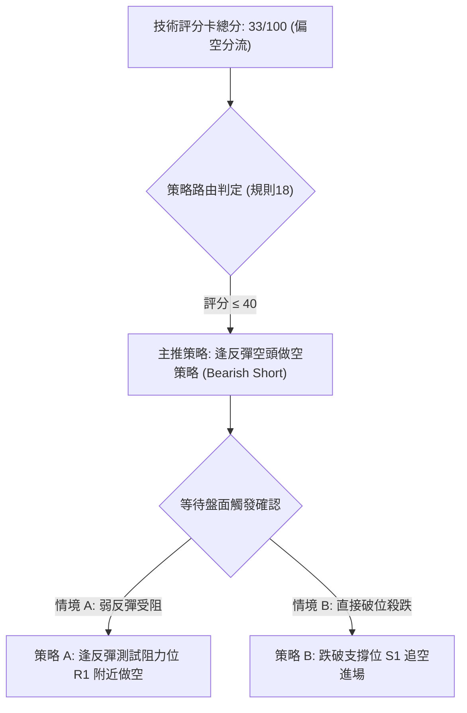

### 🧭 策略路由（依評分卡分流）

**當前主策略方向 = 做空（Short Focus，綜合評分 33/100，嚴格歸屬於 ≤40 偏空區間）**  
本報告依技術紀律，絕不兩頭下注。全案主推空頭狙擊策略，多頭僅列為風險停損與對沖提示。

### 🎯 價格情境階梯（Price Scenarios）

價位嚴格引用自第 4 章由 OHLCV 聚類計算之數值：

| 觸發條件 | 下一目標 | 後續延伸 | 情境技術含義 | 操盤應對方針 |
|:---|:---|:---|:---|:---|
| **向上突破 R1 $13.30** | R2 $13.52 | R3 $14.32 | 超跌引發強軋空，短線空頭止損 | 空單全面停損退場，轉為觀望 |
| **震盪承壓 $12.19~$12.86** | 徘徊現價 $11.99 | 測試 S1 $11.78 | 旗形震盪，動能衰竭 | 逢高建構空單底倉 |
| **有效跌破 S1 $11.78** | S2 $11.51 | S3 $11.20 | 旗面破位，展開第二波空頭下殺 | 空單加碼，追擊 52週低點 |

### 📊 情境機率分佈

| 情境劇本 | 發生機率 | 主要技術依據 |
|:---|:---:|:---|
| **回落 / 再探低點 (主情境)** | **65%** | ADX 26.48 確立空方單邊趨勢；-DI 高達 39.99；均線完整空頭排列；OBV < MA 資金流出。 |
| **區間震盪整理 (次情境)** | **25%** | Stoch %K 13.64 極度超賣引發部分平倉買盤；布林帶寬擴大後需要收斂修復。 |
| **強勢反轉上行 (極端情境)** | **10%** | 缺乏任何技術底背離支援；上方受制於 R1 $13.30 巨大解套賣壓，機率極低。 |

### 🟢 主策略詳情（空頭專屬策略）

> **風險報酬比計算說明（嚴格遵守規則 17）**：  
> 做空風險報酬比 = (進場價 − 目標價 T1) ÷ (止損價 − 進場價)

| 策略要素 | 策略 A（反彈阻力做空 - 推薦） | 策略 B（破位追擊做空 - 激進） |
|:---|:---|:---|
| **操作邏輯** | 趁 Stoch 超賣反彈至阻力位衰竭時建立主空頭倉位 | 跌破初級支撐 S1，確認旗形破位順勢打落水狗 |
| **進場條件** | 反彈至阻力位 R1 承壓，出現 60分K 頂分型 | 跌破 S1 $11.78 並收低於該價位 |
| **進場價格** | **$13.30** (引用阻力位 R1) | **$11.78** (引用支撐位 S1) |
| **目標價 T1** | **$11.51** (引用支撐位 S2) | **$11.20** (引用支撐位 S3) |
| **目標價 T2** | **$11.20** (引用支撐位 S3) | **$10.56** (引用布林通道下軌) |
| **止損價格** | **$13.88** (引用 MA20 / 布林中軌反壓) | **$12.57** (引用 MA10 下彎點) |
| **風險報酬比 (T1)** | **1 : 3.09（以 T1 計）**<br>計算式: ($13.30 − $11.51) ÷ ($13.88 − $13.30) = $1.79 ÷ $0.58 = 3.086 | **1 : 0.73（以 T1 計）**<br>計算式: ($11.78 − $11.20) ÷ ($12.57 − $11.78) = $0.58 ÷ $0.79 = 0.734 |
| **風險報酬比 (T2)** | **1 : 3.62（以 T2 計）**<br>計算式: ($13.30 − $11.20) ÷ ($13.88 − $13.30) = $2.10 ÷ $0.58 = 3.621 | **1 : 1.54（以 T2 計）**<br>計算式: ($11.78 − $10.56) ÷ ($12.57 − $11.78) = $1.22 ÷ $0.79 = 1.544 |
| **成功機率** | **68%** | **55%** |
| **建議倉位** | 總資產之 **15% - 20%** | 總資產之 **8% - 10%** |

### 🔴 反向風險觸發點（對沖與止損提示）

若出現以下任意技術異象，主空頭策略宣告失效，空單必須全數撤離：
1. **價格帶量突破 R1 $13.30**：日 K 線收盤站穩 $13.30 之上，且單日成交量突破 1.5 億股（1.7x 均量）。
2. **MACD 日線底部金叉**：DIF 向上穿越 DEA，且 MACD 柱狀體翻正由負轉正。
3. **收復 MA20 生命線 ($13.88)**：空頭排列結構遭到破壞。

### ⭐ 整體訊號強度評星

```
╔════════════════════════════════════════════════════╗
║  做多訊號強度：★☆☆☆☆  (1/5星 - 僅存超跌技術反抽)   ║
║  做空訊號強度：★★★★☆  (4/5星 - 均線/趨勢/量能共振) ║
║  整體可信度：  ★★★★☆  (4/5星 - 多時框收斂邏輯嚴密) ║
╚════════════════════════════════════════════════════╝
```

---

## 9. 風險提示與監控

### ✅ 關鍵監控指標 Checklist

```
╔════════════════════════════════════════════════════════════════════════════╗
║                   關鍵技術防禦監控清單 (Daily Watchlist)                   ║
╠════════════════════════════════════════════════════════════════════════════╣
║  [ ] 價格是否跌破 S1 $11.78 (確認向下破位啟動)                             ║
║  [ ] 日收盤價是否跌穿 52週歷史低點 S3 $11.20 (開啟無限下跌空間)            ║
║  [ ] RSI(14) 是否在回升至 45 阻力區時再次向下拐頭 (弱勢確認)               ║
║  [ ] 成交量是否在下跌破位日再度放大超過 1.5 億股 (機構持續出逃)            ║
║  [ ] ADX(14) 是否持續維持在 25 以上且 -DI > 35 (空頭單邊趨勢延續)          ║
║  [ ] 反彈是否在 MA10 ($12.57) 或 R1 ($13.30) 遭到壓制收長上影線           ║
╚════════════════════════════════════════════════════════════════════════════╝
```

### ⚠️ 風險場景分析

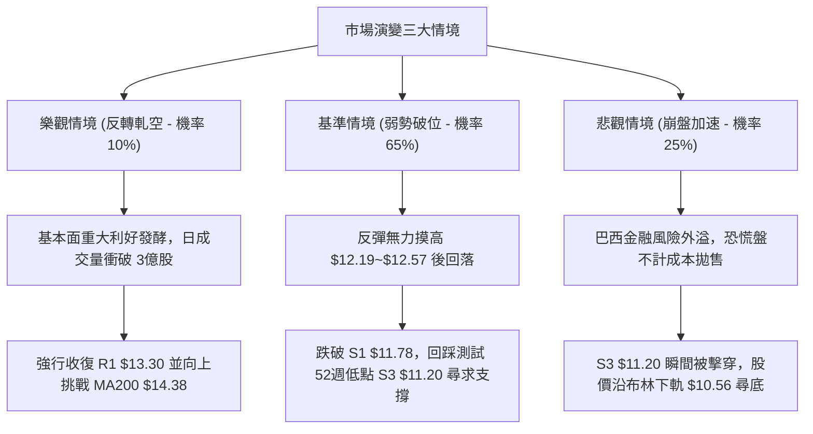

### 🛡️ 風險管理重要提醒

1. **嚴禁逆勢扛單摸底**：目前均線體系為完美空頭排列（MA20 < MA50 < MA200），在空頭單邊市中，任何估值層面的「便宜」均可能被流動性危機擊潰。未見到雙重底或頭肩底等右側反轉信號前，嚴禁重倉抄底。
2. **波動率緩衝管理**：當前 ATR 高達 $0.67（佔股價 5.56%），盤中震盪極其劇烈。做空交易必須採用分批建倉模式，避免在日線急拉時追高做空，應鎖定在關鍵阻力位（如 R1 $13.30）掛單佈局。
3. **事件驅動風險監控**：近期新聞提及巴西大選及政治生態變動引發拉美資產重估，需高度提防非交易時段之政策黑天鵝所導致的跳空缺口風險。隔夜持倉必須維持動態停損機制保護本金。

---

## 📋 報告總結

```
╔════════════════════════════════════════════════════════════════════════════╗
║                        NU 技術分析報告總結                                 ║
╠════════════════════════════════════════════════════════════════════════════╣
║  報告日期：2026-11-05                                                      ║
║  當前收盤價：$11.99                                                        ║
║  綜合技術評級：🔴 偏空 (Bearish Breakdown) ｜ 評分：33 / 100               ║
║                                                                            ║
║  關鍵走勢結論：                                                            ║
║  ├─ 長期趨勢：🔴 空頭主導（高位回落跌幅已深，跌破年線 MA200 $14.38）       ║
║  ├─ 中期趨勢：🔴 巨量崩跌（10-30 週放量 7億股大陰線，下降通道加速）       ║
║  ├─ 短期趨勢：🟡 弱勢反抽（Stoch 超賣引發微幅反彈，面臨 MA10 $12.57 壓制）║
║  ├─ 關鍵支撐：S1 $11.78 ｜ S2 $11.51 ｜ 核心防線 S3 $11.20 (52週極值)     ║
║  ├─ 關鍵阻力：R1 $13.30 ｜ R2 $13.52 ｜ 強力反壓 R3 $14.32 (MA200密集區)  ║
║  └─ 分析師目標價：均價 $18.80 ｜ 低標 $12.00 ｜ 高標 $23.00 (與技術面背離)║
║                                                                            ║
║  最優操作策略組合：                                                        ║
║  1. 🥇 最佳機會 (策略 A)：等待超跌反彈至 R1 $13.30 受阻時建立空單，        ║
║                           停損設於 MA20 $13.88，目標下看 S2 $11.51 (風報比 1:3.09)║
║  2. 🥈 次選機會 (策略 B)：跌破 S1 $11.78 順勢建立破位空單，               ║
║                           停損設於 MA10 $12.57，目標下看 S3 $11.20         ║
║  3. 🥉 保守選擇：完全空倉觀望，耐心等待價格下探 52週低點 S3 $11.20 處      ║
║                  是否出現具備成交量確認之日線底背離結構，再行定奪。        ║
╚════════════════════════════════════════════════════════════════════════════╝
```

---

> ⚠️ **免責聲明**：本報告為 AI 自動生成之技術分析，所有數據及估算均基於提供的歷史價格資訊。本報告**僅供研究與學術參考**，**不構成任何投資建議**。投資有風險，入市需謹慎。

---

*報告生成時間：2026-11-05 ｜ 數據來源：Yahoo Finance ｜ 分析框架：多時框技術分析*