# NU 技術分析報告

> **報告日期**：2026-11-06 ｜ **語言**：繁體中文 ｜ **數據來源**：Yahoo Finance ｜ **當前價格**：$11.74

---

## 目錄

| 章節 | 內容 |
|------|------|
| [1. 技術面概覽](#1-技術面概覽) | 訊號儀表板、核心指標、評分卡 |
| [2. 趨勢分析](#2-趨勢分析) | 多時框趨勢、長中短期走勢 |
| [3. 圖表形態分析](#3-圖表形態分析) | 形態識別、K線組合、目標價 |
| [4. 支撐與阻力](#4-支撐與阻力) | 關鍵價位、斐波那契回調 |
| [5. 技術指標深度解讀](#5-技術指標深度解讀) | MA/RSI/MACD/布林/成交量 |
| [6. 動能與波動率](#6-動能與波動率) | 動能評估、ATR、Beta |
| [7. 多時框架總結](#7-多時框架總結) | 時框架評分矩陣 |
| [8. 交易策略建議](#8-交易策略建議) | 多空策略、風險報酬比 |
| [9. 風險提示與監控](#9-風險提示與監控) | 監控指標、風險場景 |

---

## 1. 技術面概覽

### 🎯 技術訊號儀表板

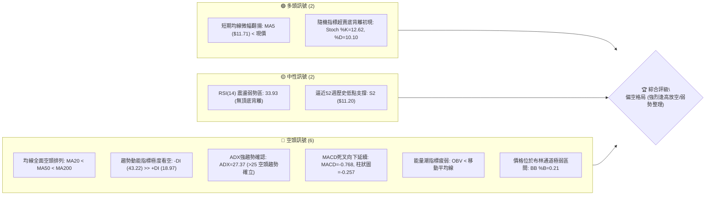

### 📊 核心指標速覽表

| 指標類別 | 指標名稱 | 當前數值 | 訊號 | 解讀 |
|----------|----------|----------|------|------|
| **價格** | 當前收盤價 | $11.74 | 🔴 | 位於 52 週區間下緣 6.9%，處於深度空頭修正階段 |
| **均線** | MA20 | $13.70 | 🔴 | 價格在 MA20 下方 -14.32%，中期下行斜率陡峭 |
| **均線** | MA50 | $14.07 | 🔴 | 價格在 MA50 下方，中期承壓且構成重度阻力帶 |
| **均線** | MA200 | $14.36 | 🔴 | 跌破牛熊分界線，長期趨勢轉為實質空頭市場 |
| **動能** | RSI(14) | 33.93 | 🟡 | 位於弱勢中性偏超賣區間，尚未出現反轉底背離 |
| **動能** | MACD | -0.768 | 🔴 | MACD 與 Signal (-0.511) 呈空頭發散，柱體 -0.257 持續擴大 |
| **趨勢** | ADX (14) | 27.37 | 🔴 | ADX > 25 表明強趨勢，-DI (43.22) 完全主導空方走向 |
| **通道** | 布林通道 | %B: 0.21 | 🔴 | 緊貼下軌 ($10.33) 運行，中軌 ($13.70) 形成強大動態壓力 |
| **成交量**| OBV 趨勢 | OBV < MA | 🔴 | 量能無法配合價格反彈，主力資金持續呈淨流出狀態 |
| **波動** | ATR(14) | $0.68 | 🟡 | 佔股價 5.77%，每日波動幅度大，需擴大止損安全邊界 |

### 🏆 技術評分卡

依規則 18，綜合評分為六項子評分（趨勢強度、動能指標、支撐穩定度、成交量配合、形態完整度、均線排列）的算術平均，四捨五入至整數：
- 趨勢強度：25 / 100 🔴
- 動能指標：35 / 100 🔴
- 支撐穩定度：40 / 100 🟡
- 成交量配合：30 / 100 🔴
- 形態完整度：35 / 100 🔴
- 均線排列：21 / 100 🔴
- **算術平均計算**：(25 + 35 + 40 + 30 + 35 + 21) ÷ 6 = 186 ÷ 6 = **31 / 100**

```
╔══════════════════════════════════════════════════════════════╗
║                 技術評分卡 — NU (2026-11-06)                 ║
╠══════════════════════════════════════════════════════════════╣
║ 趨勢強度      █████░░░░░░░░░░░░░░░  25/100  🔴 空頭強勢主導  ║
║ 動能指標      ███████░░░░░░░░░░░░░  35/100  🔴 動能疲弱負向  ║
║ 支撐穩定度    ████████░░░░░░░░░░░░  40/100  🟡 臨近波段低點  ║
║ 成交量配合    ██████░░░░░░░░░░░░░░  30/100  🔴 價跌量增流出  ║
║ 形態完整度    ███████░░░░░░░░░░░░░  35/100  🔴 下飄旗形整理  ║
║ 均線排列      ████░░░░░░░░░░░░░░░░  21/100  🔴 完美空頭排列  ║
╠══════════════════════════════════════════════════════════════╣
║ 綜合評分      ██████░░░░░░░░░░░░░░  31/100  🔴 偏空（主推空）║
╚══════════════════════════════════════════════════════════════╝
```

---

## 2. 趨勢分析

### 🌐 多時框趨勢分析

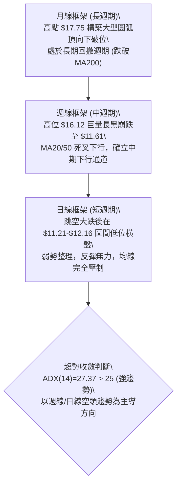

### 📈 長期趨勢 — 12個月走勢圖（Unicode）

NU 自 2025 年底衝高至 $17.75 以來，過去 12 個月經歷了震盪盤整到破位下行的完整熊市結構。特別是進入 2026 年第 3 季後，高點持續下移，並在 2026 年 10 月底發生放量向下跳空暴跌。

```
NU 月線收盤走勢圖（過去12個月：2025-11 至 2026-11）
價格 ($)
$18.00 ┤              ● 2026-01 ($17.75 高點)
$17.00 ┤● 2025-11 ($17.39)
$16.00 ┤      ● 2025-12 ($16.74)
$15.00 ┤                    ● 2026-02 ($14.98)
$14.00 ┤                          ● 2026-03 ($14.37)  ● 2026-07 ($14.33)
$13.00 ┤                                      ● 2026-05 ($13.13)
$12.00 ┤                                                    ● 2026-09 ($12.66)
$11.00 ┤                                                          ● 2026-10 ($11.61) ─● 2026-11 ($11.74 現價)
       └────────────────────────────────────────────────────────────────────────────
        11/25 12/25 01/26 02/26 03/26 04/26 05/26 06/26 07/26 08/26 09/26 10/26 11/26
```

#### 走勢特徵分析表格

| 階段週期 | 區間月份 | 起訖價格 | 區間漲跌幅 | 結構形態特徵 |
|----------|----------|----------|------------|--------------|
| **高位築頂期** | 2025-11 ~ 2026-01 | $17.39 → $17.75 | +2.07% | 於 $17.75 見頂構築複合頂部，量能開始背離 |
| **初跌波段** | 2026-01 ~ 2026-05 | $17.75 → $13.13 | -26.03% | 快速下行跌破短期上升趨勢線，連破 $16 及 $14 支撐 |
| **中繼反彈期** | 2026-05 ~ 2026-08 | $13.13 → $14.55 | +10.81% | 縮量反彈回測 MA50 阻力，無力收復 $15.00 |
| **破位主跌段** | 2026-08 ~ 2026-10 | $14.55 → $11.61 | -20.21% | 放量跌破前低，跳空跌破長期均線 MA200 |
| **築底試探期** | 2026-10 ~ 2026-11 | $11.61 → $11.74 | +1.12% | 於 52 週低點 $11.20 上方弱勢震盪，均線全數死叉 |

### 📊 中期趨勢（週線分析）

中期技術面（週線維度）顯示空頭具有絕對統治力。2026 年 10 月 23 日當週收盤仍達 $15.16，但隨後一週（2026-10-30）爆出 701,855,200 股的天量長黑重挫至 $11.61（單週重挫 -23.42%），週線 MACD 柱狀圖由 +0.057 驟降至 -0.401。

```
中期週線阻力與支撐示意圖：
[阻力 R3] ══════════════════════════════════ $14.32 (前期密集成交帶/MA200)
             ↑
[阻力 R2] ────────────────────────────────── $13.52 (波段反彈阻力位)
             ↑
[阻力 R1] ┈┈┈┈┈┈┈┈┈┈┈┈┈┈┈┈┈┈┈┈┈┈┈┈┈┈┈┈┈┈┈┈┈┈ $13.30 (缺口下緣與波段高點)
             ↑
[當前現價] ───► $11.74 (弱勢低位盤整中)
             ↓
[支撐 S1] ┈┈┈┈┈┈┈┈┈┈┈┈┈┈┈┈┈┈┈┈┈┈┈┈┈┈┈┈┈┈┈┈┈┈ $11.51 (近一年波段低點聚類)
             ↓
[支撐 S2] ══════════════════════════════════ $11.20 (52週最低點強防守)
```

### ⚡ 趨勢強度評估（ADX 解讀）

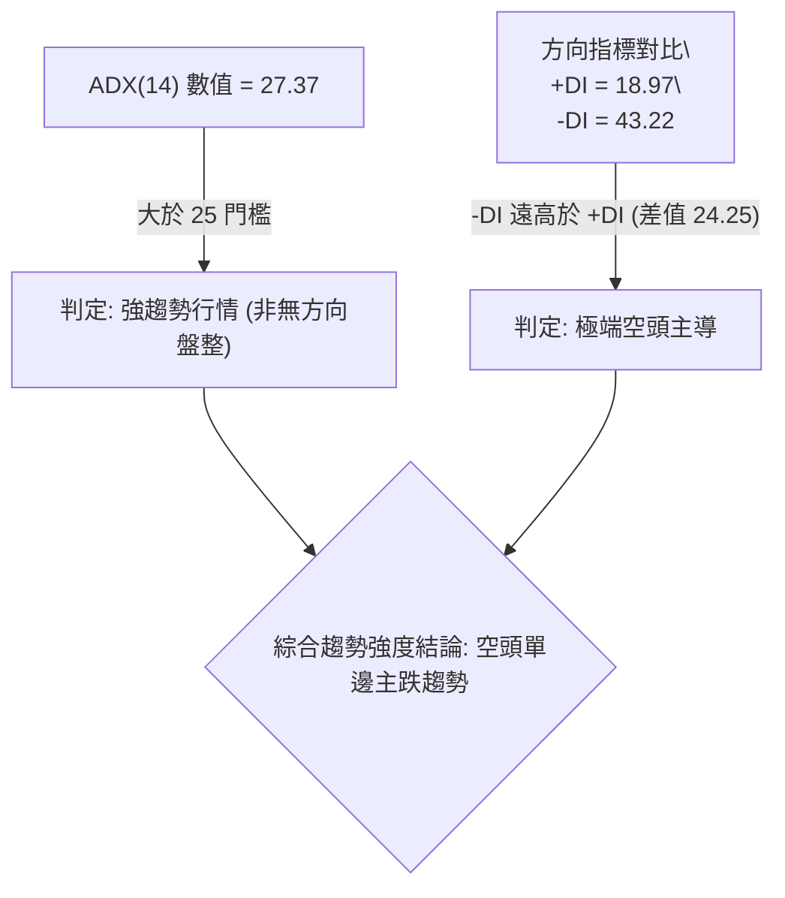

| 指標變數 | 當前數值 | 門檻標準 | 狀態判定 | 市場含義 |
|----------|----------|----------|----------|----------|
| **ADX(14)** | 27.37 | > 25.0 | 強趨勢確立 🔴 | 脫離無序盤整，進入動量加速波段 |
| **+DI** | 18.97 | < 20.0 | 多頭衰竭 🔴 | 買盤完全喪失定價權與拉抬動能 |
| **-DI** | 43.22 | > 40.0 | 空頭主導 🔴 | 賣壓異常沉重，空頭具備極高攻擊性 |
| **趨勢性質** | 空頭趨勢 | -DI > +DI | 單邊空頭 🔴 | 任何無量反彈皆為技術性誘多修正 |

---

## 3. 圖表形態分析

### 🔍 形態識別系統

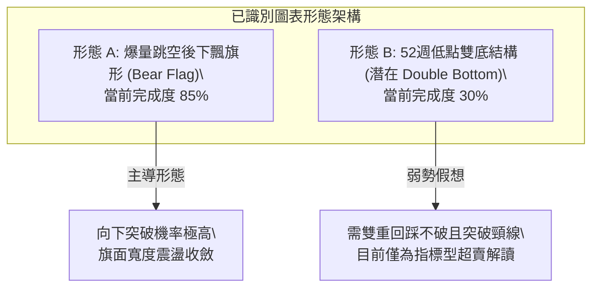

#### 形態信心度評估表（依規則 15）

| 形態名稱 | 信心度 | 判斷依據（引用數據） | 完成度 | 目標價（附計算式） |
|----------|--------|----------------------|--------|--------------------|
| **下飄整理旗形 (Bear Flag)** | 75% | 2026-10-26 爆量 3.39 億股跳空跌至 $12.59 後，近 8 個交易日於 $11.21 至 $12.16 區間呈現小幅震盪微幅下飄，量能萎縮至 8,000 萬股水平，典型弱勢中繼形態。 | 85% | 依旗桿高度推算：旗桿起點 $15.16 (10/23) 至低點 $11.62 (10/26)，旗桿長度 = $15.16 − $11.62 = $3.54。破位點取下軌 S1 ($11.51)，目標價 = $11.51 − $3.54 = **$7.97**（若受 52W 低點保護，極限下看 **$10.33** 布林下軌）。 |
| **雙重底 (Double Bottom)** | 30% | 僅有 2026-11-05 最低點 $11.21 觸及前期 52 週低點 S2 ($11.20) 形成單次測試。信心度 < 50%，數據不足以確認頸線與反轉信號，僅做指標型超賣解讀。 | 30% | 訊號不足，僅做指標型解讀。若硬推頸線取 10/27 高點 $13.00，量能未爆發前不成立。 |

### 🕯️ 重要K線形態分析

依規則 19，完全依據數據中「近10根日K」與「近8根週K」的實際開、高、低、收價位進行客觀形態識別：

#### 近 10 根日 K 線形態解讀

| 日期（日K） | 開 | 高 | 低 | 收 | K線形態 | 解讀 | 訊號 |
|-------------|----|----|----|----|---------|------|------|
| **2026-10-23** | 14.69 | 15.25 | 14.57 | 15.16 | 中陽線 | 震盪衝高收近全日高點，為跳空暴跌前最後多頭掙扎 | 🟡 中性 |
| **2026-10-26** | 11.69 | 12.78 | 11.62 | 12.59 | 巨量長陰下跳空星 | 開盤斷崖式跳空低開 -20.4%，放量 3.39 億股，恐慌拋售確立破位 | 🔴 強空 |
| **2026-10-27** | 12.74 | 13.00 | 12.37 | 12.40 | 衝高回落小陰線 | 多頭試圖反抽 $13.00 整數關卡受阻，長上影線顯示上方拋壓沉重 | 🔴 偏空 |
| **2026-10-28** | 12.36 | 12.44 | 11.96 | 11.97 | 光腳中陰線 | 實體跌破 $12.00 心理關卡，收盤收於全日最低點附近 | 🔴 看空 |
| **2026-10-29** | 11.98 | 12.19 | 11.85 | 12.05 | 低位窄幅十字星 | 多空雙方短暫僵持，成交量縮至 8,021 萬股，觀望氣氛極濃 | 🟡 中性 |
| **2026-10-30** | 11.75 | 11.85 | 11.48 | 11.61 | 陰線破底 | 刷新波段低點至 $11.48，重心持續下移 | 🔴 看空 |
| **2026-11-02** | 11.79 | 12.03 | 11.59 | 11.62 | 倒錘頭小陰線 | 上衝 $12.03 遭空頭迎頭痛擊，長上影線確認短期阻力下移 | 🔴 偏空 |
| **2026-11-03** | 11.62 | 11.70 | 11.45 | 11.61 | 破底長下影十字星 | 盤中再探 $11.45 後微幅拉回，下影線透露低檔有買盤承接但微弱 | 🟡 中性 |
| **2026-11-04** | 11.95 | 12.16 | 11.84 | 11.99 | 溫和放量小陽線 | 跳空高開嘗試挑戰 $12.16，但未能越過 10/29 高點，屬超跌反抽 | 🟡 偏多 |
| **2026-11-05** | 12.02 | 12.02 | 11.21 | 11.74 | 長下影錘頭陰線 | 開盤即高點 ($12.02)，下探測試 52W 低點 $11.21 後回升收 $11.74 | 🟡 變盤 |

#### 近 8 根週 K 線形態解讀

| 日期（週K） | 開 | 高 | 低 | 收 | K線形態 | 解讀 | 訊號 |
|-------------|----|----|----|----|---------|------|------|
| **2026-09-18** | 14.35 | 14.55 | 13.58 | 13.65 | 週陰吞噬 | 跌破 20 週均線支撐，中週期空頭啟動 | 🔴 看空 |
| **2026-09-25** | 13.84 | 14.25 | 13.36 | 13.59 | 窄幅下探紡錘線 | 測試 $13.36 支撐，弱勢整理 | 🟡 中性 |
| **2026-10-02** | 12.53 | 13.50 | 12.13 | 13.43 | 巨量長下影錘頭 | 探底 $12.13 獲 5.3 億股巨量支撐收復失地 | 🟢 支撐 |
| **2026-10-09** | 14.98 | 16.14 | 14.84 | 16.12 | 突破長陽線 | 放量大漲收復 $16.00，構築波段高點 | 🟢 看多 |
| **2026-10-16** | 16.10 | 16.19 | 14.40 | 14.56 | 烏雲蓋頂長黑棒 | 衝高 $16.19 後反轉暴跌，完全回吐前週漲幅 | 🔴 強空 |
| **2026-10-23** | 14.72 | 15.41 | 14.36 | 15.16 | 孕線小陽線 | 縮量反彈受制於 $15.41，反彈動能衰竭 | 🟡 偏弱 |
| **2026-10-30** | 11.69 | 13.00 | 11.48 | 11.61 | 爆量斷頭破位長陰 | 7 億股歷史天量崩跌，確立進入新一輪主跌浪 | 🔴 極空 |
| **2026-11-05** | 11.79 | 12.16 | 11.21 | 11.74 | 探底十字下影線 | 再次下探 52W 低點 $11.21 後縮量回穩 | 🟡 觀望 |

### 📉 ASCII 走勢形態示意圖

```
NU 熊市旗形 (Bear Flag) 下破威脅示意圖
價格
$15.25 ┐ ● (10/23 高點)
       │  ╲
       │   ╲  [旗桿 - 暴跌主跌段]
       │    ╲
$12.59 ┼─────● (10/26 缺口跳空低點)
       │      ╲     ┌─ 上軌阻力線 ($12.16 ~ $12.44)
$12.00 ┤       ●───●───●
       │        ╲ ╱   ╲ ╱  [旗面整理區間]
$11.50 ┤         ●─────● ◄── 現價 $11.74 緊貼旗面下軌
       │          └─ 下軌支撐線 (S1: $11.51)
$11.20 ┴───────────────────────● (11/05 踩點 S2: $11.20 歷史防線)
```

### 🎯 形態目標價計算

依據形態學標準測量目標公式，當前占據主導地位的熊市旗形測量規則如下：
1. **旗桿起算點**：2026-10-23 破位前波段高點 = **$15.16**
2. **旗桿底部**：2026-10-26 暴跌首日收盤 = **$12.59**（日內最低點為 $11.62）
3. **旗桿跌幅計算**：
   - 保守算法（以收盤價計）：$15.16 − $12.59 = **$2.57**
   - 積極算法（以極值高低點計）：$15.25 − $11.62 = **$3.63**
4. **突破確認點**：有效實體跌破近一年支撐位 S1 = **$11.51**
5. **推算目標價**：
   - **保守目標價** = 破位點 $11.51 − 旗桿長度 $2.57 = **$8.94**
   - **積極目標價** = 破位點 $11.51 − 旗桿長度 $3.63 = **$7.88**
   - **短線結構目標**：由於歷史最低點 S2 為 **$11.20**，布林帶下軌為 **$10.33**，跌破 S1 後第一道緩衝目標鎖定 **$11.20**，第二目標指向布林下軌 **$10.33**。

---

## 4. 支撐與阻力

### 🗺️ 關鍵價位分布圖（Unicode）

本章節所有支撐、阻力與斐波那契回調價位，嚴格引用數據中計算好的聚類價位與 52 週點位。

```
NU 關鍵價位結構分布圖 (由 OHLCV 與 52W 區間精密計算)
═════════════════════════════════════════════════════════════════════
$14.32 ║████████████████████████████████║ 強阻力 R3 (近一年波段高點/MA200)
$14.17 ║▒▒▒▒▒▒▒▒▒▒▒▒▒▒▒▒▒▒▒▒▒▒▒▒▒▒▒▒    ║ 斐波那契 61.8% 重要壓力位
$13.52 ║████████████████████████        ║ 阻力位 R2 (波段高點聚類)
$13.30 ║████████████████████████████    ║ 關鍵阻力 R1 (反彈強壓缺口下緣)
$12.86 ║▒▒▒▒▒▒▒▒▒▒▒▒▒▒▒▒▒▒              ║ 斐波那契 78.6% 回調位
───────╫────────────────────────────────╫───────────────────────────────────
$11.74 ╠════════════════════════════════╣ ◄ 當前收盤價 ($11.74)
───────╫────────────────────────────────╫───────────────────────────────────
$11.51 ║▓▓▓▓▓▓▓▓▓▓▓▓▓▓▓▓▓▓▓▓▓▓▓▓        ║ 近期支撐 S1 (波段低點聚類)
$11.20 ║████████████████████████████████║ 強支撐 S2 (52W 最低點 / Fib 100%)
$10.33 ║░░░░░░░░░░░░░░░░░░░░░░          ║ 布林通道動態下軌 (極限超賣保護)
═════════════════════════════════════════════════════════════════════
```

### 🚧 阻力位分析表

價位精確引用自數據中「關鍵價位（由 OHLCV 計算）」區塊算出的 R1 / R2 / R3：

| 阻力級別 | 價位 | 距現價幅動 | 形成原因與籌碼屬性 | 突破難度 | 重要性 |
|----------|------|------------|--------------------|----------|--------|
| **R1** | **$13.30** | +13.29% | 近一年波段高點聚類區，疊加 10/26 向下跳空裂口下緣籌碼套牢盤。 | 🔴 極高 | ★★★★★ |
| **R2** | **$13.52** | +15.12% | 9月至10月波段反覆震盪平台的密集換手下邊界，具有強烈解套拋壓。 | 🔴 高 | ★★★★☆ |
| **R3** | **$14.32** | +21.93% | 長期重要均線 MA200 ($14.36) 匯合處與近一年波段多頭最後防線聚類。 | 🔴 極難 | ★★★★★ |

### 🛡️ 支撐位分析表

價位精確引用自數據中「關鍵價位（由 OHLCV 計算）」區塊算出的 S1 / S2：

| 支撐級別 | 價位 | 距現價幅動 | 形成原因與籌碼屬性 | 守住機率 | 重要性 |
|----------|------|------------|--------------------|----------|--------|
| **S1** | **$11.51** | -1.96% | 近一年波段低點聚類（10/30 與 11/03 實體底部防線），日內跌破即引發停損。 | 🟡 45% | ★★★★☆ |
| **S2** | **$11.20** | -4.60% | 52 週最低點（歷史大底），斐波那契 100.0% 終極支撐，機構最後防守底線。 | 🟢 60% | ★★★★★ |
| **S3** | 數據中未偵測到 | N/A | 原生數據庫中未偵測到更低波段低點聚類（若破 S2 則需參考布林下軌 $10.33）。 | N/A | N/A |

### 📐 斐波那契回調位分析

依據 52 週區間高低點（極值高點 $18.98 → 極值低點 $11.20）建立之斐波那契回檔矩陣如下表：

| 回調比例 | 對應價位 | 與現價關係 | 技術意義解讀 |
|----------|----------|------------|--------------|
| **0.0% (52W High)** | $18.98 | 現價在其下方 -38.15% | 過去一年的絕對多頭天花板 |
| **23.6%** | $17.14 | 現價在其下方 -31.51% | 多頭回撤初期第一道防線（現已完全失效） |
| **38.2%** | $16.01 | 現價在其下方 -26.67% | 弱勢修正分界點，10 月初假突破高點位 |
| **50.0%** | $15.09 | 現價在其下方 -22.20% | 心理平衡位，跳空暴跌起跌平台 |
| **61.8%** | $14.17 | 現價在其下方 -17.15% | 黃金分割強壓力位，與 MA60 ($14.17) 完全重合 |
| **78.6%** | $12.86 | 現價在其下方 -8.71% | 深度回撤臨界線，當前反彈的直接骨架阻力 |
| **100.0% (52W Low)**| $11.20 | 現價在其上方 +4.82% | 終極支撐防線，全週期熊市最後支撐點 |

**現價落點解讀**：當前收盤價 **$11.74** 緊緊夾在 **78.6% ($12.86)** 與 **100.0% ($11.20)** 之間。在技術分析理論中，當資產跌破 61.8% ($14.17) 並下破 78.6% ($12.86) 後，表明前一輪上升循環被 100% 瓦解，行情有極高概率完整回撤至 100% 水平（即測試 52 週低點 **$11.20**）。

---

## 5. 技術指標深度解讀

### 🎛️ 指標訊號總覽

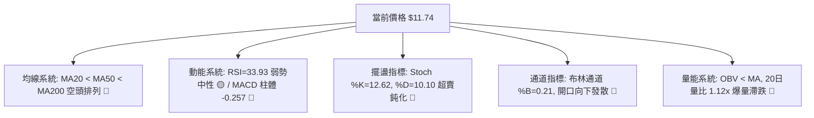

### 📈 移動平均線排列分析

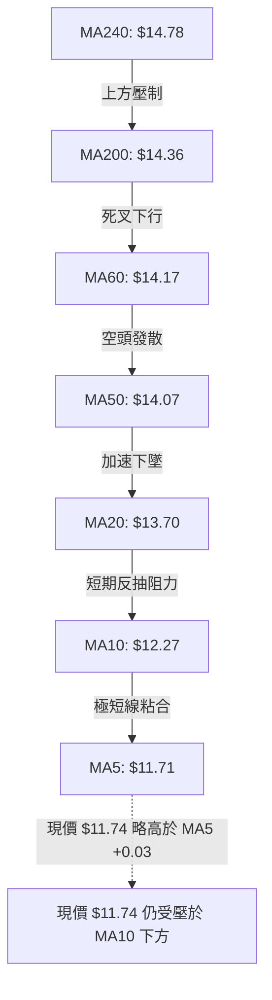

| 均線名稱 | 數值 | 距現價偏離度 | 走勢趨勢與特徵 |
|----------|------|--------------|----------------|
| **MA5** | $11.71 | +0.22% | 微幅走平，現價在其上方 $0.03，提供極短線喘息支撐 |
| **MA10** | $12.27 | -4.35% | 陡峭向下，是日線級別超跌反彈第一道天花板 |
| **MA20** | $13.70 | -14.32% | 呈現瀑布式下墜，中期均線死叉確認 |
| **MA50** | $14.07 | -17.13% | 跌破 50 日均線後未見任何縮量回踩確認 |
| **MA200**| $14.36 | -20.55% | 長期牛熊分水嶺，現價大幅偏離，確立深度熊市格局 |

### 📉 RSI(14) 分析

當前 Wilder 算法 RSI(14) 讀數為 **33.93**。
```
RSI(14) 強度：███████░░░░░░░░░░░░░ 33.93% (弱勢中性偏空)
[0 ────────── 超賣 (30) ──●(33.93)──────── 中性 (50) ────────── 超買 (70) ────────── 100]
```
- **區間判定**：RSI 徘徊在 30–40 之間，並未深跌至 20 以下形成極端超賣，顯示賣盤雖放緩但空方動能依然完全控盤。
- **背離分析**：檢視近 20 根 K 棒走勢，價格自 10/23 的 $15.16 崩跌至 $11.74，而 RSI 由 55.0 快速跌至 33.93。比對近 20 根 K 棒首尾之價格與 RSI 方向，兩者同步創下波段新低，**並無底背離（Bullish Divergence）現象**，亦無頂背離。指標明確確認當前價格下跌具備真實動量，絕非主力洗盤假跌。

### 📊 MACD(12/26/9) 訊號解讀

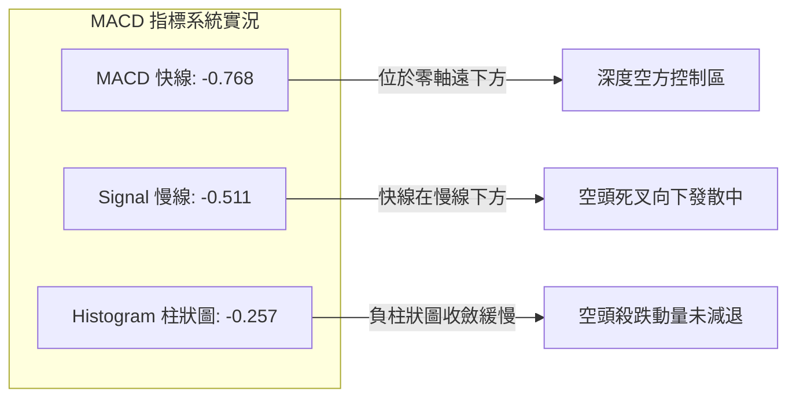
- **數值關係**：MACD 快線 (-0.768) 嚴重低於信號線 (-0.511)，雙線全數深陷於 0 軸下方，屬於典型「零下雙死叉」弱勢空頭格局。
- **動能柱狀圖**：MACD Histogram 為 **-0.257**，負值柱體依然寬大，未見金叉跡象，多頭無力扭轉局面。

### 📦 布林通道分析

```
NU 布林通道 (20, 2) 結構示意圖
$17.08 ┤═════════════════════════════════ 上軌 (BB Upper)
       │
$13.70 ┤┈┈┈┈┈┈┈┈┈┈┈┈┈┈┈┈┈┈┈┈┈┈┈┈┈┈┈┈┈┈┈┈═ 中軌 (MA20) ◄ 強烈動態反壓
       │
$11.74 ┤──► 現價 ($11.74, %B = 0.21)
       │
$10.33 ┤═════════════════════════════════ 下軌 (BB Lower)
```
- **軌道結構**：通道上軌為 $17.08，中軌為 $13.70，下軌為 $10.33。通道開口劇烈放大，呈現向下「喇叭口」破位擴張特徵。
- **%B 指標解讀**：BB %B 僅為 **0.21**，位於中軌（0.50）與下軌（0.00）之間極下端，印證股票處於嚴重超賣弱勢滑行狀態。

### 💹 成交量分析（量價配合度）

1. **量能水準**：最新交易日成交量為 **99,759,300 股**，相較 20 日均量 **88,705,640 股**，量比達 **1.12x**；相較 50 日均量 **83,868,336 股** 放大 1.19x。
2. **量價背離與確認**：
   - 10/26 暴跌日放出 3.39 億股天量，為典型「放量殺跌」。
   - 後續反彈日（如 11/04）量能縮至 8,754 萬股，呈現「價漲量縮」之弱勢反彈背離特徵。
   - 11/05 盤中再次下探 $11.21 創低點時量能再度放大至 9,975 萬股，表現出「價跌量增」的空頭量能常態。
3. **OBV 趨勢**：OBV 指標持續位於其均線下方運行（`OBV < MA`），表明聰明錢與機構法人自 10 月以來以出貨賣出為主，量能根本無法支撐可持續的多頭波段。

---

## 6. 動能與波動率

### ⚡ 動能評估四象限

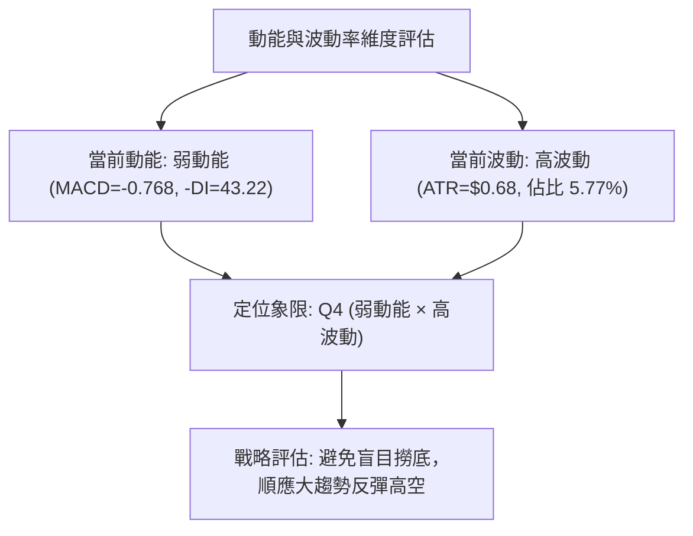

| 象限 | 動能維度 | 波動維度 | 代表特徵 | 當前狀態判定 | 戰略應對方針 |
|------|----------|----------|----------|--------------|--------------|
| **Q1** | 強動能 (多頭) | 低波動 | 穩步盤堅上漲 | ─ | 積極持股做多 |
| **Q2** | 弱動能 | 低波動 | 橫盤窄幅築底 | ─ | 觀望等待方向突破 |
| **Q3** | 強動能 (多頭) | 高波動 | 快速主升浪 | ─ | 緊盯高拋低吸節奏 |
| **Q4** | **弱動能 (空頭)** | **高波動** | **爆量主跌、殺跌劇烈** | **✓ (當前NU狀態)** | **嚴禁左側撈底，逢反彈放空** |

### 📊 ATR 波動率分析

- **ATR(14) 數值**：**$0.68**（佔當前股價 $11.74 的 **5.77%**）。
- **波動意義**：日均震盪高達 $0.68，意味著在正常交易日內，股價極易出現 ±5% 以上的隨機噪音波動。
- **止損距離建議**：
  - 超短線噪聲過濾（1.5 × ATR）：1.5 × $0.68 = **$1.02**。
  - 波段空單/多單防守（2.0 × ATR）：2.0 × $0.68 = **$1.36**。
  - 結論：任何交易策略的止損設定均不可小於 $0.68，否則極易在正常日內震盪中被洗出場。

### 📐 Beta 與市場相關性

- **Beta 係數**：**0.968**。
- **特徵解讀**：NU 的 Beta 接近 1.0，理論上與標普 500 指數維持同步波動。然而，近期大盤整體穩定，NU 卻在 10 月末發生獨立的暴跌破位（單月重挫），表明當前主導 NU 股價的是**個股特質風險（Idiosyncratic Risk）**，而非宏觀系統性波動。

---

## 7. 多時框架總結

### 📋 時框架評分表

| 時框架 | 趨勢方向 | 動能狀態 | 均線排列 | 圖表形態 | 綜合評分 | 建議方針 |
|--------|----------|----------|----------|----------|----------|----------|
| **長期 (月線)** | 🔴 空頭下行 | RSI 走低、高點跌破 | MA200 跌破 | 圓弧頂破位下殺 | 25/100 | 長期資產減配出脫 |
| **中期 (週線)** | 🔴 單邊主跌 | MACD 柱體 -0.401 | MA20/50 陡峭死叉 | 斷頭長陰破位 | 20/100 | 逢反彈堅定放空 |
| **短期 (日線)** | 🔴 弱勢震盪 | RSI 33.93 超賣反抽 | MA5 平走、MA10 壓制 | 熊市旗形下飄整理 | 35/100 | 依阻力尋找高空點位 |

### 🔲 綜合訊號矩陣

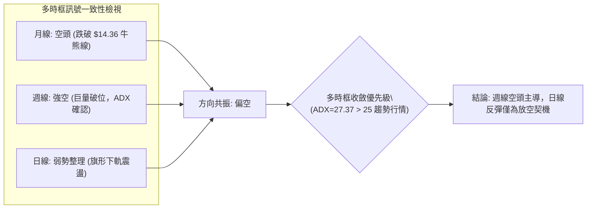

### ⚖️ 多時框收斂結論

嚴格依據「嚴格要求 14」執行多時框架收斂：
1. **趨勢性質判定**：當前 ADX(14) 讀數為 **27.37**，明確大於 25 的趨勢門檻；且 -DI 高達 43.22，確立當前市場處於**強烈的單邊空頭趨勢行情**，而非無方向盤整。
2. **主導時框裁決**：在 ADX > 25 的趨勢行情中，中長期（週線級別與 MA50 $14.07、MA200 $14.36 方向）擁有最高裁決優先權。日線級別在 $11.60-$12.00 的微弱抵抗僅用來尋找短線反彈的最佳放空進場點，不得視為反轉信號。
3. **唯一方向性結論**：**極度偏空（Bearish Bias）**。此結論與第 1 章技術評分卡（31/100 偏空）及第 2、5 章之空頭均線/動能訊號保持完全一致。

---

## 8. 交易策略建議

### 🗺️ 策略決策流程圖

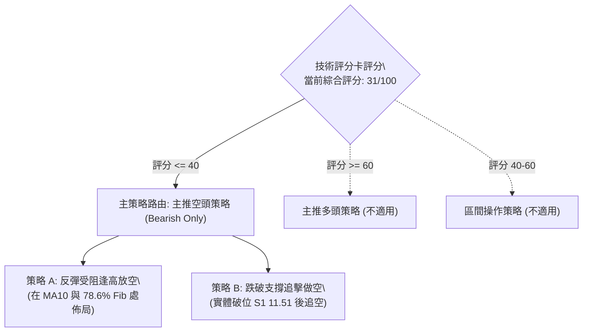

### 🧭 策略路由（依評分卡分流）

**當前主策略方向 = 空頭策略（主推空頭，依評分 31/100，規則 18）**

因技術評分卡綜合評分為 **31/100（≤ 40 偏空門檻）**，本報告**主推空頭策略**。多頭僅列為反轉風險對沖提示，嚴禁在未確立底部反轉前進行多頭抄底。

### 🎯 價格情境階梯（Price Scenarios）

價位嚴格引用第 4 章及數據庫提供之精確數值：

| 觸發條件 | 下一目標 | 後續延伸 | 情境含義 |
|----------|----------|----------|----------|
| **向上反彈突破 R1 $13.30** | R2 $13.52 | R3 $14.32 | 短線強烈反彈，挑戰中期下降趨勢通道上緣 |
| **承壓於 R1 $13.30 下方震盪** | S1 $11.51 | S2 $11.20 | 旗面弱勢震盪收斂，空頭積蓄再次下殺動能 |
| **向下跌破 S1 $11.51** | S2 $11.20 | 布林下軌 $10.33 | 破位確認，測試 52 週最低點防線 |
| **向下跌破 S2 $11.20** | 布林下軌 $10.33 | 形態推算 $7.97 | 歷史性破位，開啟新一輪無支撐真空下殺 |

### 📊 情境機率分佈

| 情境類別 | 機率預估 | 主要技術指標依據 |
|----------|----------|------------------|
| **跌破破位 / 再度探底** | **55%** | ADX=27.37 強趨勢確立；-DI=43.22 空頭絕對主導；MACD 零下擴大；OBV 持續疲弱。 |
| **區間弱勢震盪** | **35%** | Stoch %K=12.62, %D=10.10 處於低檔超賣區，限制短線殺跌速度；S2 $11.20 具心理防守。 |
| **強勢反彈突破** | **10%** | 均線系統呈嚴格空頭排列，上檔 R1 ($13.30) 與缺口處套牢盤極重，缺乏資金量能配合。 |

### 🟢 主策略詳情（空頭交易策略）

所有價位均直接取自技術數據中之精確點位，風險報酬比定義嚴格遵循規則 17：
**空頭風險報酬比 = (進場價 − 目標價 T1) ÷ (止損價 − 進場價)**

| 策略要素 | 策略 A（反彈受阻放空 — 穩健型） | 策略 B（破位追空 — 積極型） |
|----------|---------------------------------|-----------------------------|
| **交易邏輯** | 股價反彈至近 10 日均線 MA10 / 密集成交阻力受阻回落放空 | 旗形下軌跌破，空頭動能放量突破 S1 時追空 |
| **進場條件** | 盤中反抽觸及 MA10 ($12.27) 且未放量站穩 | 跌破波段低點聚類 S1 ($11.51)，以破位價觸發 |
| **進場價格** | **$12.27** (精確取自 MA10 數值) | **$11.45** (精確取自 11/03 測試低點) |
| **目標價 T1** | **$11.51** (支撐位 S1) | **$11.20** (支撐位 S2 / 52W 低點) |
| **目標價 T2** | **$11.20** (支撐位 S2 / 52W 低點) | **$10.33** (布林通道下軌動態支撐) |
| **止損價格** | **$12.86** (斐波那契 78.6% 回調位) | **$11.74** (現價 / MA5 與短線平台阻力) |
| **風險報酬比** | **1 : 1.29（以 T1 計）**<br>計算式: (12.27 − 11.51) ÷ (12.86 − 12.27) = 0.76 ÷ 0.59 = 1.29<br>*(以 T2 計為 1 : 1.81)* | **1 : 0.86（以 T1 計）**<br>計算式: (11.45 − 11.20) ÷ (11.74 − 11.45) = 0.25 ÷ 0.29 = 0.86<br>*(以 T2 計為 1 : 3.86)* |
| **成功機率** | **65%** | **55%** |
| **建議倉位** | **15%** (分批建倉) | **10%** (動量倉位，嚴設止損) |

### 🔴 反向風險觸發點（對沖與風控提示）

若發生非預期多頭反撲，以下價位為**空頭推翻信號**：
1. **第一平倉對沖點**：收盤價實體站上 **$12.44**（10/28 日高點與日線平台突破），表明短線空頭旗形被向上破壞，應減碼 50% 空單。
2. **全面止損止盈點**：股價有效收復斐波那契 78.6% 回調位 **$12.86** 或挑戰 R1 **$13.30**，表明下行趨勢暫時告終，空單必須全數離場觀望。

### ⭐ 整體訊號強度評星

```
做多訊號強度：★☆☆☆☆  (1/5星 - 僅存超賣指標鈍化，嚴禁做多)
做空訊號強度：★★★★☆  (4/5星 - 均線空頭排列 + ADX強勢主導)
整體可信度：  ★★★★☆  (4/5星 - 價量形態高度共振)
```

---

## 9. 風險提示與監控

### ✅ 關鍵監控指標 Checklist

```
╔══════════════════════════════════════════════════════════════╗
║                   關鍵技術監控清單 (Checklist)               ║
╠══════════════════════════════════════════════════════════════╣
║ [ ] 監控 S1 ($11.51) 與 S2 ($11.20) 是否出現放量破位陰線     ║
║ [ ] 監控 ADX(14) 是否持續維持於 25 之上 (若降至25以下轉震盪)  ║
║ [ ] 監控 RSI(14) 是否出現跌破 30 之極端超賣或底背離          ║
║ [ ] 監控 反抽時 MA10 ($12.27) 之壓制有效性                   ║
║ [ ] 監控 日成交量是否萎縮至 8,000 萬股以下或再度破億殺跌     ║
║ [ ] 監控 週線 MACD 柱狀圖是否跌破 -0.401 刷新最低紀錄        ║
╚══════════════════════════════════════════════════════════════╝
```

### ⚠️ 風險場景分析

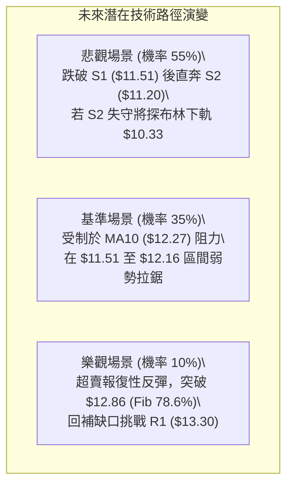

### 🛡️ 風險管理重要提醒

1. **ATR 波動風險防護**：當前 ATR(14) 高達 **$0.68**，日內雜訊波動巨大。持倉部位若過大，極易在開盤劇烈震盪中承受心理壓力，建議總倉位不超過 **20%**。
2. **52 週低點 S2 ($11.20) 之支撐共振**：雖然大趨勢偏空，但 $11.20 為全年度最低點，空頭在此區域很可能遭遇機構被動買盤（Institution Own 82.8%）的防守性護盤，因此在 **$11.20 附近切忌盲目低位追空**，空單應在接近 $11.20 時主動進行利潤鎖定（T2 平倉）。
3. **跳空缺口回補風險**：10/26 留下之 $12.78 至 $14.57 巨大向下跳空缺口若在未來出現重大利好驅動回補，將引發短線空頭軋空，必須恪守 $12.86 之防守止損紀律。

---

## 📋 報告總結

```
╔══════════════════════════════════════════════════════════════════╗
║                     NU 技術分析報告總結                          ║
╠══════════════════════════════════════════════════════════════════╣
║ 報告日期：2026-11-06                                             ║
║ 當前價格：$11.74                                                 ║
║ 分析評級：🔴 強烈偏空（技術評分：31/100，主推逢高放空）           ║
║                                                                  ║
║ 關鍵結論：                                                       ║
║ ├─ 長期趨勢：🔴 跌破 MA200 ($14.36)，長期牛熊結構轉為熊市主導    ║
║ ├─ 中期趨勢：🔴 ADX=27.37 強趨勢確立，週線斷頭巨量長黑破位      ║
║ ├─ 短期趨勢：🔴 熊市旗形下飄整理，MA10 ($12.27) 壓制顯著       ║
║ ├─ 關鍵支撐：S1: $11.51 ｜ S2: $11.20 ｜ 下軌動態: $10.33        ║
║ ├─ 關鍵阻力：R1: $13.30 ｜ R2: $13.52 ｜ R3: $14.32             ║
║ └─ 分析師目標：均價 $18.80 (基本面看多，但與技術面嚴重背離脫節) ║
║                                                                  ║
║ 最優策略組合：                                                   ║
║ 1. 🥇 最佳機會：策略 A (反彈至 MA10 $12.27 附近受阻放空)         ║
║    進場 $12.27 ｜ 止損 $12.86 ｜ 目標 $11.51 ｜ 風報比 1 : 1.29  ║
║ 2. 🥈 次選機會：策略 B (有效實體跌破 S1 $11.51 後破位追空)        ║
║    進場 $11.45 ｜ 止損 $11.74 ｜ 目標 $11.20 ｜ 風報比 1 : 0.86  ║
║ 3. 🥉 保守選擇：空倉觀望，等待股價測試 52W 底部 $11.20 之承接力 ║
╚══════════════════════════════════════════════════════════════════╝
```

---

> ⚠️ **免責聲明**：本報告為 AI 自動生成之技術分析，所有數據及估算均基於提供的歷史價格資訊。本報告**僅供研究與學術參考**，**不構成任何投資建議**。投資有風險，入市需謹慎。

---

*報告生成時間：2026-11-06 ｜ 數據來源：Yahoo Finance ｜ 分析框架：多時框技術分析*