# NU 技術分析報告

> **報告日期**：2026-11-07 ｜ **語言**：繁體中文 ｜ **數據來源**：Yahoo Finance ｜ **當前價格**：$12.03

---

## 目錄

| 章節 | 內容 |
|------|------|
| [1. 技術面概覽](#1-技術面概覽) | 訊號儀表板、核心指標、評分卡 |
| [2. 趨勢分析](#2-趨勢分析) | 多時框趨勢、長中短期走勢、ADX 解讀 |
| [3. 圖表形態分析](#3-圖表形態分析) | 形態識別、K線組合、形態目標價 |
| [4. 支撐與阻力](#4-支撐與阻力) | 關鍵價位分布、阻力支撐表、斐波那契 |
| [5. 技術指標深度解讀](#5-技術指標深度解讀) | 均線系統、RSI、MACD、布林通道、量價 |
| [6. 動能與波動率](#6-動能與波動率) | 動能四象限、ATR 波動度、Beta 相關性 |
| [7. 多時框架總結](#7-多時框架總結) | 時框架評分表、訊號矩陣、收斂結論 |
| [8. 交易策略建議](#8-交易策略建議) | 策略路由、情境階梯、主空頭策略配置 |
| [9. 風險提示與監控](#9-風險提示與監控) | 監控清單、風險情境、資金管理 |

---

## 1. 技術面概覽

### 🎯 技術訊號儀表板

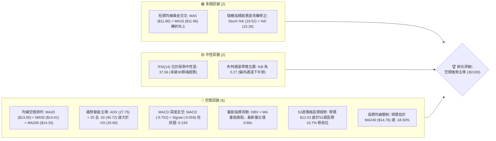

---

### 📊 核心指標速覽表

| 指標類別 | 指標名稱 | 當前數值 | 訊號 | 解讀 |
|:---|:---|:---|:---:|:---|
| **價格** | 當前收盤價 | $12.03 | 🔴 | 位於 52 週低點 $11.20 附近，處於 10.7% 極低百分位 |
| **均線** | 短期 MA20 | $13.50 | 🔴 | 現價低於 MA20 達 -10.88%，短中期空頭重壓 |
| **均線** | 中期 MA50 | $14.01 | 🔴 | 50日線下彎，與 MA20 形成死叉空頭排列 |
| **均線** | 長期 MA200 | $14.33 | 🔴 | 股價位於牛熊分界線下方 -16.05%，長期趨勢偏空 |
| **動能** | RSI(14) | 37.56 | 🟡 | 弱勢中性震盪，尚未進入 <30 極端超賣區，無背離 |
| **動能** | MACD (12,26,9) | -0.752 / -0.559 | 🔴 | 雙線位於零軸下方深度負值，柱狀體為 -0.193 看空 |
| **趨勢** | ADX (14) | 27.75 | 🔴 | ADX > 25 且 -DI 為 40.72，確認空頭趨勢行情運行中 |
| **通道** | 布林帶 %B | 0.27 | 🟡 | 價格貼近下軌 $10.25 與中軌 $13.50 之間震盪 |
| **波動** | ATR(14) | $0.67 | 🟡 | 佔股價 5.55%，單日波動幅度較高，日內風險顯著 |
| **成交量**| 最新量 / 20日均量 | 58.35M / 87.83M | 🔴 | 量比 0.66x，反彈缺乏動能配合，OBV 疲軟下行 |

---

### 🏆 技術評分卡

```
╔════════════════════════════════════════════════════════════════════════════╗
║                   技術評分卡 — NU (Nu Holdings Ltd.)  2026-11-07           ║
╠════════════════════════════════════════════════════════════════════════════╣
║ 評估維度      評分進度條                         得分      訊號  權重比重  ║
╟────────────────────────────────────────────────────────────────────────────╢
║ 趨勢強度      █████░░░░░░░░░░░░░░░              25/100    🔴    20%       ║
║ 動能指標      ██████░░░░░░░░░░░░░░              30/100    🔴    20%       ║
║ 支撐穩定度    █████████░░░░░░░░░░░              45/100    🟡    15%       ║
║ 成交量配合    ███████░░░░░░░░░░░░░              35/100    🔴    15%       ║
║ 形態完整度    ██████░░░░░░░░░░░░░░              30/100    🔴    15%       ║
║ 均線排列      ███░░░░░░░░░░░░░░░░░              15/100    🔴    15%       ║
╠════════════════════════════════════════════════════════════════════════════╣
║ 綜合評分      ██████░░░░░░░░░░░░░░              30/100    🔴「強烈偏空」   ║
║ 計算依據：(25 + 30 + 45 + 35 + 30 + 15) ÷ 6 = 30.00 分（依規則 18 算術平均） ║
╚════════════════════════════════════════════════════════════════════════════╝
```

---

## 2. 趨勢分析

### 🌐 多時框趨勢分析

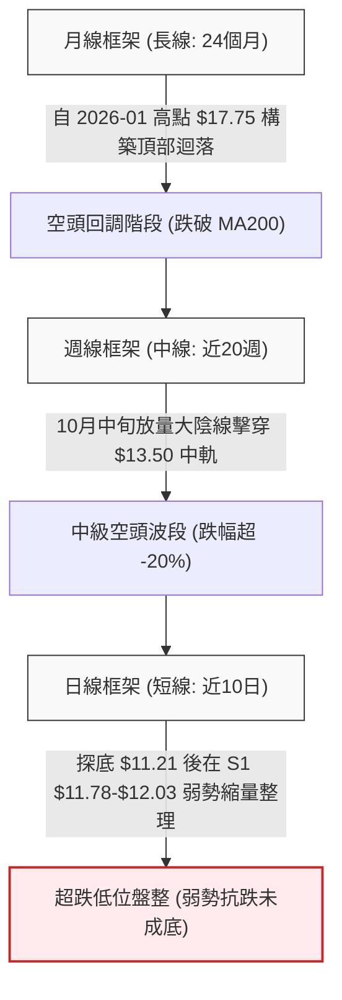

---

### 📈 長期趨勢 — 12個月走勢圖（Unicode）

```
NU 過去12個月月線收盤走勢圖 (2025-11 至 2026-11)
價格軸 ($)
$18.00 ┤                     ● $17.75 (2026-01 頂部高點)
$17.00 ┤ ● $17.39      ● $16.74
$16.00 ┤
$15.00 ┤                               ● $14.98
$14.00 ┤                                    ● $14.37  ● $14.48       ● $14.33  ● $14.55
$13.00 ┤                                                           ● $13.13  ● $13.36
$12.00 ┤                                                                                 ● $12.66         ● $12.03 (現價)
$11.00 ┤                                                                                          ● $11.61 (10月低點)
       └─┬─────────┬─────────┬─────────┬─────────┬─────────┬─────────┬─────────┬─────────┬─────────┬─────────┬─────────┬───
        11月      12月      01月      02月      03月      04月      05月      06月      07月      08月      09月      10月      11月
        (2025)    (2025)    (2026)    (2026)    (2026)    (2026)    (2026)    (2026)    (2026)    (2026)    (2026)    (2026)    (當前)
```

#### 長期走勢特徵分析表格

| 階段區間 | 時間跨度 | 起訖收盤價 | 漲跌幅 | 結構形態特徵 |
|:---|:---|:---|:---:|:---|
| **主升頂部期** | 2025-11 至 2026-01 | $17.39 → $17.75 | +2.07% | 衝高觸及 52W 高點 $18.98，月線形成滯漲換手頂部 |
| **波段退潮期** | 2026-01 至 2026-05 | $17.75 → $13.13 | -26.03% | 連續失守 MA20 及 MA50，形成第一輪快速下殺波段 |
| **中繼平台期** | 2026-06 至 2026-08 | $13.36 → $14.55 | +8.91% | 於 $13.50-$14.50 構築箱型震盪，未能有效收復 MA200 |
| **破位深跌期** | 2026-08 至 2026-10 | $14.55 → $11.61 | -20.21% | 跌破箱底並放量擊穿 $13.00，直探 52W 低點 $11.20 |
| **現階段修復** | 2026-10 至 2026-11 | $11.61 → $12.03 | +3.62% | 超跌後縮量小幅抵抗，受制於上方密集成交阻力區 |

---

### 📊 中期趨勢（週線分析）

從近 20 週收盤走勢觀察，自 2026-10-09 當週拉出長紅收盤 $16.12（週成交量 517.68M）之後，行情急轉直下：
- **2026-10-30 當週**：爆出 701.85M 巨量大陰線，收盤暴跌至 $11.61，週 MACD 柱狀體跳水至 -0.401，週 RSI 摔落至 30.7。
- **2026-11-06 當週**：成交量萎縮至 403.80M，收盤在 $12.03，雖然週 K 線錄得下影線反彈，但成交量未能配合放大，屬於典型的「破位後縮量弱勢抽頭」。

```
中期壓力與支撐結構示意圖 (週線層次)
阻力位 R3 ── $14.32 ════════════════════════════ (近一年高點密集區 / MA200 $14.33)
阻力位 R2 ── $13.52 ──────────────────────────── (布林中軌 / 前期箱體下緣)
阻力位 R1 ── $13.30 ┄┄┄┄┄┄┄┄┄┄┄┄┄┄┄┄┄┄┄┄┄┄┄┄ (近一年波段高點聚類)
現  價   ── $12.03 ◄───[當前弱勢反彈受困於此]
支撐位 S1 ── $11.78 ┄┄┄┄┄┄┄┄┄┄┄┄┄┄┄┄┄┄┄┄┄┄┄┄ (近10日多空爭奪中軸)
支撐位 S2 ── $11.51 ──────────────────────────── (波段低點聚類)
支撐位 S3 ── $11.20 ════════════════════════════ (52週絕對低點 / 強支撐)
```

---

### ⚡ 趨勢強度評估（ADX 解讀）

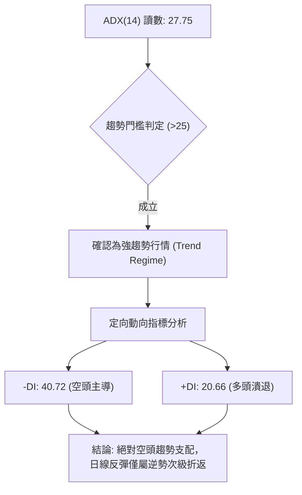

| 指標名稱 | 當前讀數 | 臨界閾值 | 趨勢狀態判定 | 技術含義解讀 |
|:---|:---:|:---:|:---:|:---|
| **ADX (14)** | **27.75** | 25.00 | **強趨勢確立** | 數值超越 25 臨界線，確認市場並非處於無方向無趨勢的橫盤，而是處於具備動能的單邊階段 |
| **-DI** | **40.72** | 20.00 | **空方高度掌控** | 負向定向指標高達 40.72，顯示市場下殺動能強烈且集中 |
| **+DI** | **20.66** | 20.00 | **多方極度疲弱** | 正向指標僅在 20 邊緣掙扎，多空差值 (-DI − +DI) 高達 20.06，空頭處於碾壓優勢 |

---

## 3. 圖表形態分析

### 🔍 形態識別系統

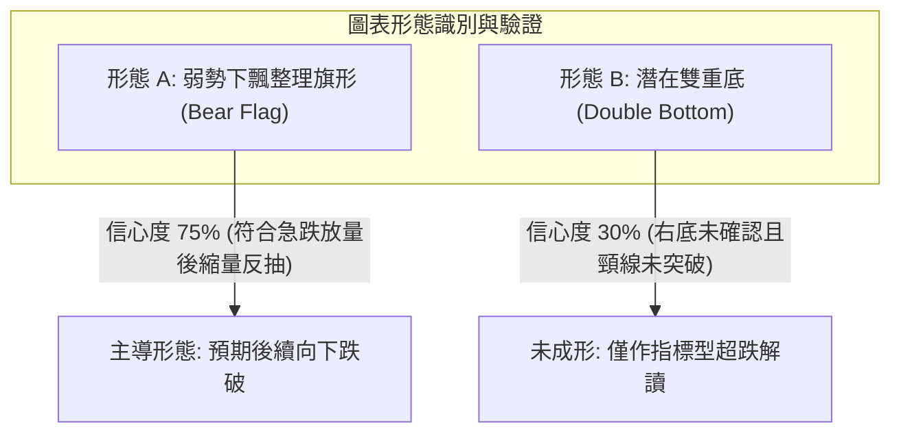

#### 形態識別信心度與量化依據表（依規則 15）

| 形態名稱 | 信心度 | 判斷依據（引用數據） | 完成度 | 目標價（附計算式） |
|:---|:---:|:---|:---:|:---|
| **弱勢下飄旗形 (Bear Flag)** | **75%** | 自 10/23 $15.16 斷崖跌至 10/30 $11.61（旗桿跌幅 $3.55），隨後 6 個交易日於 $11.45–$12.28 窄幅縮量反抽（旗面），OBV 持續落於均線下方 | 70% | 由形態高度推算：旗桿起點 $15.16 − 旗桿底 $11.48 = $3.68；反彈旗面頂點 $12.28 − $3.68 = **$8.60**（理論測幅），短線以支撐位 **S3 $11.20** 為第一滿足點 |
| **潛在雙重底 (Double Bottom)** | **30%** | 兩次低點分別為 10/30 之 $11.48 與 11/05 之 $11.21，但反彈未突破頸線 R1 $13.30，且量能未放。**信心度 < 50%，訊號不足，僅做指標型超跌反彈解讀** | 35% | 若突破頸線 R1 $13.30：頸線 $13.30 + 形態高度 ($13.30 − $11.20 = $2.10) = **$15.40**（當前未確立） |

---

### 🕯️ 重要 K 線形態分析（依規則 19，嚴格基於開高低收數據）

#### 近 10 根日 K 線逐根形態解析

| 日期 | 開 | 高 | 低 | 收 | K線形態名稱 | 形態專業解讀 | 訊號強度 |
|:---|:---:|:---:|:---:|:---:|:---|:---|:---:|
| 2026-10-26 | 11.69 | 12.78 | 11.62 | 12.59 | 放量長陽線 | 成交量 339.68M，實體大漲，多頭強力護盤但留上影線 | 🟢 強多 |
| 2026-10-27 | 12.74 | 13.00 | 12.37 | 12.40 | 衝高回落小陰線 | 高點觸碰 $13.00 整數關卡受阻，成交量驟降至 99.67M | 🔴 轉弱 |
| 2026-10-28 | 12.36 | 12.44 | 11.96 | 11.97 | 中陰線下破 | 跌破 $12.00 心理關口，收在當日近最低點，空頭施壓 | 🔴 看空 |
| 2026-10-29 | 11.98 | 12.19 | 11.85 | 12.05 | 窄幅十字星小陽 | 實體僅 $0.07，多空於 $12.00 關口拉鋸，方向未明 | 🟡 中性 |
| 2026-10-30 | 11.75 | 11.85 | 11.48 | 11.61 | 破位下挫中陰 | 創波段新低 $11.48，實體收低至 $11.61，賣壓沈重 | 🔴 看空 |
| 2026-11-02 | 11.79 | 12.03 | 11.59 | 11.62 | 倒錘頭小陰線 | 向上試探 $12.03 遭空方打回，成交量萎縮至 68.99M | 🔴 偏空 |
| 2026-11-03 | 11.62 | 11.70 | 11.45 | 11.61 | 低檔十字星 | 最低打至 $11.45，收盤持平於 $11.61，超跌暫時獲支撐 | 🟡 止跌 |
| 2026-11-04 | 11.95 | 12.16 | 11.84 | 11.99 | 跳空小陽線 | 開盤跳空開高，收復 $11.90，但未破前高 $12.19 | 🟢 弱多 |
| 2026-11-05 | 12.02 | 12.02 | 11.21 | 11.74 | 長下影錘頭陰線 | 盤中下探 52W 低點至 $11.21，隨後買盤拉起，下影線長達 $0.53 | 🟡 探底 |
| 2026-11-06 | 11.81 | 12.28 | 11.79 | 12.03 | 反彈溫和陽線 | 突破 MA5 與 MA10，收盤 $12.03，但成交量僅 58.35M 創近期新低 | 🟡 縮量反彈 |

#### 近 8 根週 K 線逐根形態解析

| 日期 (週末) | 開 | 高 | 低 | 收 | 週K形態名稱 | 形態專業解讀 | 訊號強度 |
|:---|:---:|:---:|:---:|:---:|:---|:---|:---:|
| 2026-09-18 | 14.35 | 14.55 | 13.58 | 13.65 | 中陰破位週K | 跌破 MA200，週 RSI 下滑至 38.5，確立波段轉弱 | 🔴 看空 |
| 2026-09-25 | 13.84 | 14.25 | 13.36 | 13.59 | 孕線十字陰K | 縮量至 290.43M，於 S1/S2 上方弱勢掙扎 | 🟡 盤整 |
| 2026-10-02 | 12.53 | 13.50 | 12.13 | 13.43 | 長下影大十字陽 | 最低探至 $12.13，多頭放量 532.73M 強勢拉升收復 | 🟢 抵抗 |
| 2026-10-09 | 14.98 | 16.14 | 14.84 | 16.12 | 放量大陽線突破 | 週漲超 20%，成交量 517.68M，MACD 柱狀體跳至 +0.325 | 🟢 強多 |
| 2026-10-16 | 16.10 | 16.19 | 14.40 | 14.56 | 烏雲蓋頂長陰K | 創 $16.19 高點後遭獲利了結，單週暴跌吞沒前週大部分漲幅 | 🔴 頂背轉折 |
| 2026-10-23 | 14.72 | 15.41 | 14.36 | 15.16 | 縮量反抽小陽K | 向上反抽無力，未能收復 $15.50，形成次高點下跌中繼 | 🟡 弱多 |
| 2026-10-30 | 11.69 | 13.00 | 11.48 | 11.61 | 崩跌跳空大陰K | 爆量 701.86M 斷崖崩跌，週 MACD 柱暴跌至 -0.401，結構性破位 | 🔴 極空 |
| 2026-11-06 | 11.79 | 12.28 | 11.21 | 12.03 | 下影小陽星K | 探 52W 底 $11.21 後反彈，量縮至 403.81M，確認下檔有買盤但動能虛脫 | 🟡 超跌整理 |

---

### 📉 ASCII 走勢形態示意圖

```
NU 弱勢下飄整理旗形 (Bear Flag) 示意圖
價格軸 ($)
$15.50 ┤    ┌─● $15.41 (旗桿頂部起跌點 10/23)
$15.00 ┤    │
$14.50 ┤    │  [崩跌旗桿]
$14.00 ┤    │  (放量跳空下殺)
$13.50 ┤    │
$13.00 ┤    │
$12.50 ┤    │                 ┌─/── R1 $13.30 阻力線
$12.00 ┤    │      ┌──● $12.28 (旗面反彈上軌) ──● $12.03 (現價)
$11.50 ┤    └──●──┴───● $11.48 (旗面下軌支撐線)
$11.00 ┤           └──● $11.21 (52W 低點支撐 S3)
       └───────────────────────────────────────────────────► 時間軸
```

---

### 🎯 形態目標價計算

基於嚴格技術量化推導，形態計算依據如下：
1. **旗形破位等長推算（主場景）**：
   - 旗桿垂直跌幅：起點高點 $15.16 − 旗桿底部低點 $11.48 = $3.68
   - 旗面上軌反抽高點：2026-11-06 盤中高點 $12.28
   - 形態理論破位目標價 = $12.28 − $3.68 = **$8.60**
   - 依據規則 13 數據紀律，下行途中的關鍵實體停靠目標直接對齊已驗證價位：第一目標價為波段低點聚類 **S2 $11.51**，第二目標價為 52 週絕對低點 **S3 $11.20**。

---

## 4. 支撐與阻力

### 🗺️ 關鍵價位分布圖（Unicode）

```
NU 價位結構分布圖 (由 OHLCV 與斐波那契精確計算)
════════════════════════════════════════════════════════════════════════
$18.98 ║████████████████████████████████████████║ 52W 最高點 / Fib 0.0%
$17.14 ║████████████████████████████████        ║ Fib 23.6% 回調壓力位
$16.01 ║████████████████████████████            ║ Fib 38.2% 回調位
$15.09 ║████████████████████████                ║ Fib 50.0% 多空中樞分水嶺
$14.32 ║████████████████████                    ║ 強阻力 R3 (MA200 $14.33 重合區)
$14.17 ║████████████████████                    ║ Fib 61.8% 黃金分割強壓力
$13.52 ║████████████████                        ║ 阻力 R2 (布林中軌 MA20 $13.50 重疊)
$13.30 ║████████████                            ║ 關鍵阻力 R1 (波段高點聚類)
$12.86 ║████████                                ║ Fib 78.6% 回調關鍵反壓線
$12.03 ╠════════════════════════════════════════╣ ◄ 當前收盤價 ($12.03)
$11.78 ║▓▓▓▓▓▓▓▓                                ║ 近期支撐 S1 (近10日多空爭奪位)
$11.51 ║▓▓▓▓▓▓▓▓▓▓▓▓                            ║ 次級支撐 S2 (波段低點聚類)
$11.20 ║████████████████████████████████████████║ 極限強支撐 S3 (52W最低點 / Fib 100%)
════════════════════════════════════════════════════════════════════════
```

---

### 🚧 阻力位分析表（嚴格引用 OHLCV 聚類計算數據）

| 阻力級別 | 精確價位 | 距現價空間 | 形成技術依據 | 突破難度 | 重要性等級 |
|:---|:---:|:---:|:---|:---:|:---:|
| **R1** | **$13.30** | +10.56% | 近一年波段高點聚類、10/02 週 K 下跌反彈頸線位 | 🔴 極高 | ★★★★☆ |
| **R2** | **$13.52** | +12.34% | 近一年波段密集成交高點，與布林中軌 MA20 ($13.50) 共振 | 🔴 極高 | ★★★★★ |
| **R3** | **$14.32** | +18.99% | 近一年強阻力峰值聚類，與 200日均線 MA200 ($14.33) 形成「牛熊天塹」 | 🔴 堅不可摧 | ★★★★★ |

---

### 🛡️ 支撐位分析表（嚴格引用 OHLCV 聚類計算數據）

| 支撐級別 | 精確價位 | 距現價空間 | 形成技術依據 | 守住機率 | 重要性等級 |
|:---|:---:|:---:|:---|:---:|:---:|
| **S1** | **$11.78** | -2.08% | 近10個交易日密集成交中樞，近一年波段低點聚類 | 🟡 55% | ★★★☆☆ |
| **S2** | **$11.51** | -4.32% | 近一年波段低點聚類，10/30 與 11/03 實體探底低點支撐 | 🟡 45% | ★★★★☆ |
| **S3** | **$11.20** | -6.90% | 52 週絕對低點（2026-11-05 盤中最低探至 $11.21 獲支撐反彈） | 🟢 65% | ★★★★★ |

---

### 📐 斐波那契回調位分析（區間：52W 低點 $11.20 → 52W 高點 $18.98）

| 斐波那契比例 | 精確價位 | 技術角色判定 | 與現價關係及戰略意義 |
|:---:|:---:|:---:|:---|
| **0.0%** | **$18.98** | 52W 最高點 | 長期牛市終極目標位，目前已被空頭完全逆轉 |
| **23.6%** | **$17.14** | 長期回調阻力 | 高檔第一道出貨頸線，失守後宣告多頭主升段終結 |
| **38.2%** | **$16.01** | 中期關鍵防線 | 10/09 週反彈最高點 $16.14 遇阻處，轉化為中期極強阻力 |
| **50.0%** | **$15.09** | 多空中樞分水嶺 | 心理中位數，目前已遭實質跌破達 -20.28% |
| **61.8%** | **$14.17** | 黃金分割強壓力 | 與 R3 $14.32 及 MA200 $14.33 形成多重共振死壓區 |
| **78.6%** | **$12.86** | 深度回調防守線 | 反彈的第一道斐波那契強壓，現價落於 78.6% 與 100.0% 之間 |
| **100.0%** | **$11.20** | 52W 最低點 | 整個 52 週上升浪的絕對起點，跌破則意味著大週期趨勢全面崩潰 |

> **回調狀態解讀**：現價 $12.03 處於 **78.6% ($12.86)** 與 **100.0% ($11.20)** 的極度弱勢區間。股價回吐了過去 52 週漲幅的近 90%，顯示前期多頭結構遭到徹底破壞，當前僅為空頭主導下的貼底反彈。

---

## 5. 技術指標深度解讀

### 🎛️ 指標訊號總覽

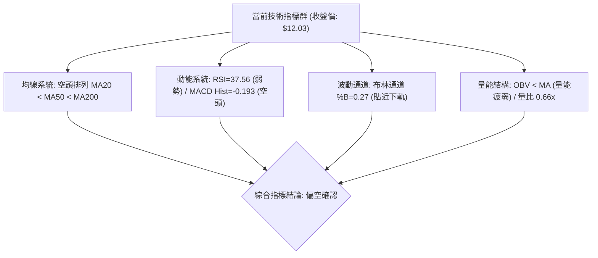

---

### 📈 移動平均線排列分析

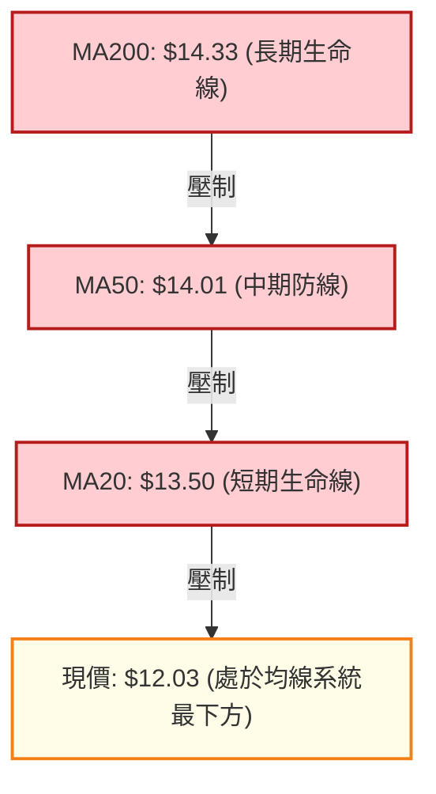

| 均線名稱 | 數值 | 偏離度 (現價相較 MA) | 趨勢斜率 | 技術形態狀態 |
|:---|:---:|:---:|:---:|:---|
| **MA 5** | $11.80 | +1.97% | ▲ 上翹 | 短線止跌回升，價格站上 5 日線進行弱勢修復 |
| **MA 10** | $11.96 | +0.58% | ▲ 上翹 | 5 日線金叉 10 日線，形成極短線超跌反抽結構 |
| **MA 20** | $13.50 | -10.88% | ▼ 下彎 | 短期趨勢下墜，對反彈構成第一道沉重均線壓力 |
| **MA 50** | $14.01 | -14.13% | ▼ 下彎 | 中期死叉確立，MA20 < MA50 < MA200 空頭排列成型 |
| **MA 60** | $14.14 | -14.90% | ▼ 下彎 | 季線下壓，中期籌碼全線套牢 |
| **MA 120** | $13.72 | -12.29% | ▼ 下彎 | 半年線失守，長期多頭結構鬆動 |
| **MA 200** | $14.33 | -16.05% | ▼ 下彎 | 年線由平轉跌，標誌著長期熊市週期的主導地位 |
| **MA 240** | $14.76 | -18.50% | ▼ 下彎 | 長期趨勢阻力位，目前呈全面壓制態勢 |

---

### 📉 RSI(14) 分析

```
RSI(14) 讀數進度條: 37.56 (Wilder)
0 ──────────── 30 ───────●────── 50 ──────────────────── 70 ─────────── 100
[ 極端超賣區 ]  [  弱勢中性區  ]   [    多頭偏強區    ]   [ 超買警戒區 ]
進度條: ███████████████░░░░░░░░░░░░░░░░░░░░░░░░░ 37.56%
```

- **超買超賣狀態**：RSI 目前讀數為 **37.56**，自 10/30 的 30.7 極弱水準小幅回升，但仍壓制在 50 多空中軸下方，未達 >50 的強勢轉強區間。
- **背離判斷**：
  - 價格於 10/30 收盤 $11.61（RSI 為 30.7），11/05 盤中創低點 $11.21 但收盤為 $11.74，11/06 收盤 $12.03（RSI 升至 37.6）。
  - 近 20 根 K 棒首尾檢驗：價格由跌勢趨緩，RSI 同步低檔拐頭，**數據明確顯示：無明顯背離現象**。未出現底背離的背書，說明此波回升僅為指標在弱勢區間的常規動能修復，非結構性反轉。

---

### 📊 MACD(12,26,9) 訊號解讀

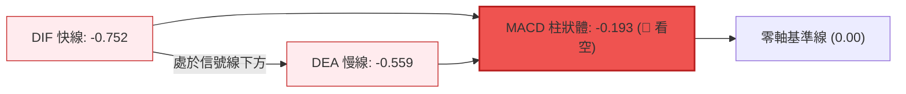

- **雙線絕對位置**：DIF (-0.752) 與 DEA (-0.559) 均處在零軸之下的極深負值區，顯示市場處於完全由空方掌控的水下環境。
- **柱狀體與動能收斂**：MACD 柱狀體為 **-0.193**，較 10/30 當週的 **-0.401** 出現負值收斂縮小跡象，代表空頭砸盤動能有所減速，但空頭排列未變，未見金叉買入訊號，嚴防動能再度發散。

---

### 📦 布林通道分析

```
NU 布林通道 (20, 2) 結構分布圖
價格軸 ($)
$16.75 ┤ ══════════════════════════════════ 上軌 (Upper Band)
$16.00 ┤
$15.00 ┤
$14.00 ┤
$13.50 ┤ ┄┄┄┄┄┄┄┄┄┄┄┄┄┄┄┄┄┄┄┄┄┄┄┄┄┄┄┄┄┄ 中軌 (Middle Band: MA20 $13.50)
$13.00 ┤
$12.03 ┤ ◄────────[現價: $12.03, %B = 0.27]
$11.00 ┤
$10.25 ┤ ══════════════════════════════════ 下軌 (Lower Band)
```

- **帶寬與位置指標 (%B)**：當前 %B 為 **0.27**，顯示價格緊貼通道下半區運行。
- **布林通道帶寬 (Bandwidth)**：(上軌 $16.75 − 下軌 $10.25) ÷ 中軌 $13.50 = **48.15%**，帶寬在經歷 10 月下旬大跌後處於急劇擴張後的高位，暗示市場波動放大，現價反彈第一目標將在布林中軌 $13.50 處遭遇強烈擠壓。

---

### 💹 成交量分析（量價配合度）

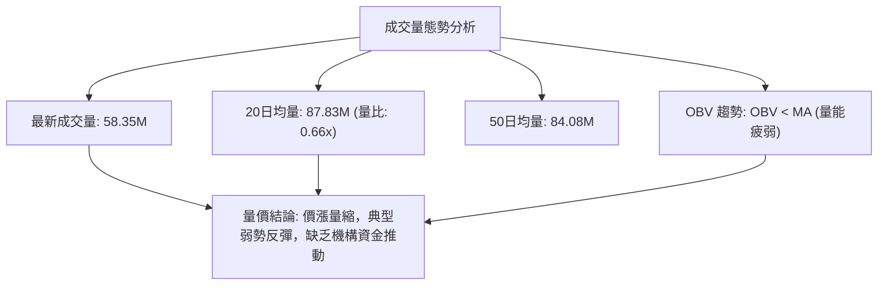

- **量價背離現象**：11/06 價格自 $11.74 上漲至 $12.03 (+2.47%)，但成交量僅為 58,352,600 股，遠低於 20 日均量 87,827,380 股（量比僅 0.66x）。相較於 10/26 反彈時的 339.68M 巨量，本次反彈買盤顯著衰竭。
- **能量潮 (OBV) 指標**：數據確認「OBV < MA → 量能疲弱」，OBV 均線持續下行，資金呈現持續淨流出態勢，無吸籌特徵。

---

## 6. 動能與波動率

### ⚡ 動能評估四象限

| 象限標籤 | 動能狀態 | 波動率狀態 | 當前標的位置 | 策略評估與風險屬性 |
|:---|:---:|:---:|:---:|:---|
| **Q1 (最佳機會)** | 強動能 (多頭) | 低波動 (可控) | — | 趨勢穩健上行，適合回調加碼多單 |
| **Q2 (謹慎觀望)** | 弱動能 (無力) | 低波動 (沉寂) | — | 盤整無方向，資金效率低 |
| **Q3 (高風險收益)**| 強動能 (單邊) | 高波動 (劇烈) | **✓ (當前所處區間)** | **空頭動能強烈 (ADX=27.75) 伴隨高 ATR (5.55%)，高風險單邊主導** |
| **Q4 (避免進場)** | 弱動能 (衰竭) | 高波動 (混亂) | — | 震盪洗盤，容易兩頭打臉止損 |

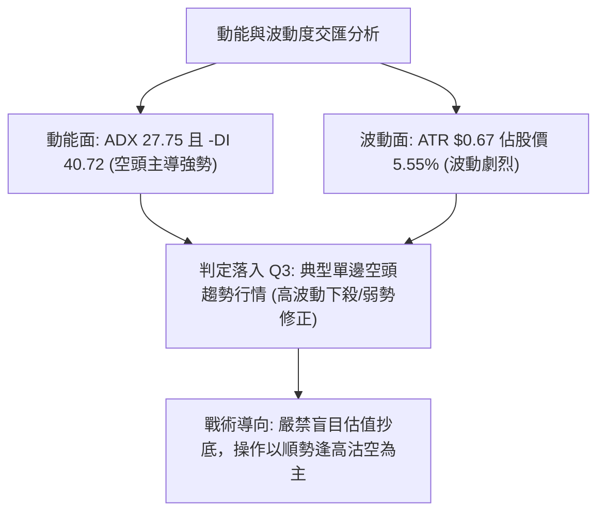

---

### 📊 ATR 波動率分析

- **ATR(14) 精確讀數**：**$0.67**（佔當前股價 $12.03 的 **5.55%**，採 Wilder 平滑算法）。
- **單日波動幅度評估**：單日波動超過 5.5%，顯示短期籌碼穩定度極低，日內多空廝殺激烈。
- **止損距離建議**：
  - **保守型止損（2.0 × ATR）**：$0.67 × 2.0 = **$1.34**。
  - **常規型止損（1.5 × ATR）**：$0.67 × 1.5 = **$1.01**。
  - **緊密型止損（1.0 × ATR）**：$0.67 × 1.0 = **$0.67**。

---

### 📐 Beta 與市場相關性

- **Beta 係數**：**0.968**。
- **大盤聯動性解讀**：Beta 極度接近 1.0，代表 NU 與美股大盤（S&P 500 / 納斯達克金融指數）具備高度同步性。當大盤整體承壓時，NU 缺乏獨立防禦屬性；在自身均線呈完全空頭排列下，大盤的任何風吹草動皆易引發 NU 的放大拋售。

---

## 7. 多時框架總結

### 📋 時框架評分表

| 時框架 | 趨勢方向 | 動能狀態 | 均線排列狀態 | 形態特徵 | 綜合評分 | 戰術建議 |
|:---|:---:|:---:|:---:|:---:|:---:|:---|
| **月線 (長期)** | 🔴 偏空 | RSI 走低 / 頂部破位 | 跌破 MA200，空頭防守失敗 | 頭部確立，深幅回撤 | 35/100 | 長期投資者暫停加碼，靜待落底 |
| **週線 (中期)** | 🔴 強空 | MACD柱 -0.193 / 放量崩跌 | MA20 < MA50 死叉下彎 | 10月巨量陰線破位中繼 | 25/100 | 反彈皆為逢高出脫或做空契機 |
| **日線 (短期)** | 🟡 弱勢反彈 | RSI 37.56 / Stoch 弱金叉 | MA5/10 上翹，MA20 下壓 | 旗形弱勢整理，反彈縮量 | 30/100 | 嚴格依結構阻力分批建空 |

---

### 🔲 綜合訊號矩陣

```
時框共振訊號矩陣分析
────────────────────────────────────────────────────────────────────────
維度        日線 (短期)          週線 (中期)          月線 (長期)
────────────────────────────────────────────────────────────────────────
趨勢        🟡 震盪整理          🔴 空頭延續          🔴 熊市回調
均線        🔴 MA20 壓制         🔴 空頭排列          🔴 跌破 MA200
動能        🟡 低位修復          🔴 柱狀負值          🔴 動能退潮
量能        🔴 縮量反彈          🔴 破位巨量          🔴 頂部放量
────────────────────────────────────────────────────────────────────────
共振結果    75% 權重指向空頭主導，短線反彈僅為技術性乖離修復
────────────────────────────────────────────────────────────────────────
```

---

### ⚖️ 多時框收斂結論（依規則 14 明確收斂）

1. **行情模式判定**：ADX(14) 讀數為 **27.75 > 25**，依規則 14 明確判定為**趨勢行情（Trend Regime）**，非盤整行情。
2. **優先級收斂原則**：在強趨勢行情下，**以中長期（週線 / MA50 $14.01、MA200 $14.33）偏空方向為主導**，日線的短期低檔小陽線反彈僅用來尋找逢高進場做空或多頭減倉的時機。
3. **唯一收斂結論**：**強烈偏空（Bearish Dominated）**。第 8 章之核心交易策略必須無條件服從此趨勢收斂結論，全面以**防守性逢高做空 / 反彈破位追空**為主路由。

---

## 8. 交易策略建議

### 🗺️ 策略決策流程圖

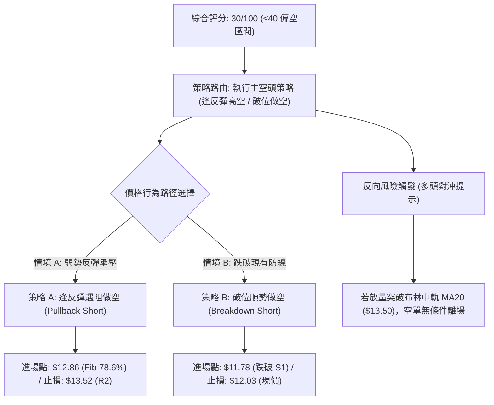

---

### 🧭 策略路由（依評分卡分流，依規則 18 嚴格執行）

> **當前主策略方向 = 主推空頭策略（依技術評分卡綜合評分 30/100）**  
> 綜合評分低於 40 分，均線完全空頭排列，ADX 確立空頭趨勢。本報告堅決主推空頭交易策略，多頭僅列為反轉風險對沖提示，嚴禁兩頭下注。

---

### 🎯 價格情境階梯（Price Scenarios，嚴格引用第 4 章數據）

| 觸發條件 | 下一目標 | 後續延伸 | 情境技術含義 |
|:---|:---:|:---:|:---|
| **強勢突破 R1 $13.30** | R2 $13.52 | R3 $14.32 | 短線超跌強反彈，挑戰布林中軌與 MA20 共振壓力 |
| **承壓於 Fib 78.6% $12.86** | S1 $11.78 | S2 $11.51 | 反彈動能衰竭，回歸弱勢旗形下軌震盪 |
| **放量跌破 S1 $11.78** | S2 $11.51 | S3 $11.20 | 空頭主升浪重啟，測試 10月波段低點支撐 |
| **實體擊穿 S3 $11.20** | 由形態推算 $8.60 | 理論測幅 | 52 週最低點全面失守，打開下方無均線支撐的真空下跌帶 |

---

### 📊 情境機率分佈

| 情境劃分 | 機率預估 | 主要指標量化依據 |
|:---|:---:|:---|
| **回落 / 再探底 (主場景)** | **60%** | ADX 27.75 且 -DI 40.72，均線空頭排列，OBV 疲軟，量比僅 0.66x 縮量誘多 |
| **區間震盪 (次場景)** | **25%** | 股價受制於布林下軌上翹支撐與 S1 $11.78，在 $11.50–$12.50 進行超賣震盪修復 |
| **強勢反彈 / 反轉 (低機率)**| **15%** | Stoch 超賣金叉，若有突發利好刺激方能挑戰 MA20 $13.50，但上方套牢籌碼極重 |

---

### 🟢 主策略詳情（方向：空頭主導策略）

依照「規則 17」精確計算風險報酬比（做空計算公式：**風險報酬比 = (進場價 − 目標價 T1) ÷ (止損價 − 進場價)**）：

| 策略要素 | 策略 A：逢反彈遇阻做空 (Pullback Short) | 策略 B：破位順勢做空 (Breakdown Short) |
|:---|:---|:---|
| **進場條件** | 價格反彈至 Fib 78.6% 壓力線遇阻，出現上影線確認受阻 | 日線實體放量跌破支撐位 S1，順勢追擊空單 |
| **進場價格** | **$12.86** (斐波那契 78.6% 回調位) | **$11.78** (支撐位 S1 跌破點) |
| **止損價格** | **$13.52** (阻力位 R2 / 布林中軌上緣) | **$12.03** (當前收盤價阻力) |
| **目標價 T1** | **$11.78** (支撐位 S1) | **$11.51** (支撐位 S2) |
| **目標價 T2** | **$11.20** (支撐位 S3 / 52W 低點) | **$11.20** (支撐位 S3 / 52W 低點) |
| **風險報酬比 (T1)**| **1 : 1.64（以 T1 計）**<br>*(計算式: (12.86 - 11.78) ÷ (13.52 - 12.86) = 1.08 ÷ 0.66 = 1.64)* | **1 : 1.08（以 T1 計）**<br>*(計算式: (11.78 - 11.51) ÷ (12.03 - 11.78) = 0.27 ÷ 0.25 = 1.08)* |
| **風險報酬比 (T2)**| **1 : 2.52（以 T2 計）**<br>*(計算式: (12.86 - 11.20) ÷ (13.52 - 12.86) = 1.66 ÷ 0.66 = 2.52)* | **1 : 2.32（以 T2 計）**<br>*(計算式: (11.78 - 11.20) ÷ (12.03 - 11.78) = 0.58 ÷ 0.25 = 2.32)* |
| **成功機率** | **65%** | **60%** |
| **建議倉位** | **總資金 10% - 15%** | **總資金 8% - 10%** |

---

### 🔴 反向風險觸發點（多頭對沖提示）

- **全面平空/對沖觸發線**：若日線收盤價強勢站上 **R2 $13.52** 且成交量放大突破 100M（高於 20 日均量），則宣告均線死叉壓力暫告化解，原空頭下飄旗形被破壞，所有空單必須無條件止損離場。
- **左側超跌博弈條件**：僅當股價再次回踩 **S3 $11.20** 不破，且伴隨 RSI < 30 的底背離時，方可動用極小倉位（< 5%）介入搶超跌反彈，目標看至 **$12.86**。

---

### ⭐ 整體訊號強度評星

```
做多訊號強度：★☆☆☆☆  (1/5 星 - 僅有極短線指標低檔鈍化修正，無結構支撐)
做空訊號強度：★★★★☆  (4/5 星 - 均線空頭排列 + ADX強勢確認 + 量能疲弱)
整體可信度：  ★★★★☆  (4/5 星 - 多時框趨勢高度共振，符合空頭量價特徵)
```

---

## 9. 風險提示與監控

### ✅ 關鍵監控指標 Checklist

```
╔════════════════════════════════════════════════════════════════════════════╗
║                        關鍵技術監控指標 CHECKLIST                          ║
╠════════════════════════════════════════════════════════════════════════════╣
║ [ ] 監控項 1: 收盤價是否跌破支撐位 S1 ($11.78) —— 跌破則觸發破位追空訊號     ║
║ [ ] 監控項 2: 反彈高點是否受制於 Fib 78.6% ($12.86) —— 遇阻確認旗形延續    ║
║ [ ] 監控項 3: 日成交量能否突破 20日均量 (87.83M) —— 縮量反彈視為虛漲誘多     ║
║ [ ] 監控項 4: ADX 是否維持在 25 之上且 -DI 保持高位 —— 驗證空頭趨勢強烈程度  ║
║ [ ] 監控項 5: MACD 柱狀體是否在零軸下方再度翻紅擴大 —— 警惕加速下殺動能    ║
║ [ ] 監控項 6: 52週低點 S3 ($11.20) 防守狀態 —— 跌破將引發大規模停損賣壓    ║
╚════════════════════════════════════════════════════════════════════════════╝
```

---

### ⚠️ 風險場景分析

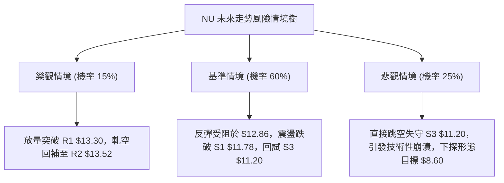

---

### 🛡️ 風險管理重要提醒

1. **嚴禁逆勢盲目猜底**：目前均線呈現 MA20 < MA50 < MA200 完全空頭排列，且現價距 MA200 負偏離高達 -16.05%，在缺乏底部爆量反轉 K 線（如晨星、長下影大陽線）確認前，切勿因估值偏低而重倉做多。
2. **波動度動態風控**：當前 ATR 高達 $0.67（5.55%），日內震盪劇烈。任何部位建立均需嚴格將每筆交易的潛在虧損控制在投資組合總資產的 1.0%–1.5% 以內。
3. **假突破與誘多防範**：近期成交量比僅 0.66x，極易出現盤中拉高、尾盤殺跌的「釣魚線」走勢，日內追高風險極大。

---

## 📋 報告總結

```
╔════════════════════════════════════════════════════════════════════════════╗
║                     NU 技術分析報告總結 (2026-11-07)                       ║
╠════════════════════════════════════════════════════════════════════════════╣
║ 當前收盤價：$12.03                                                         ║
║ 分析評級  ：🔴 空頭主導 / 強烈偏空 (綜合評分: 30/100)                     ║
╟────────────────────────────────────────────────────────────────────────────╢
║ 關鍵結構結論：                                                             ║
║ ├─ 長期趨勢：🔴 偏空（失守 MA200 $14.33，自 $17.75 頂部回調趨勢確立）      ║
║ ├─ 中期趨勢：🔴 強空（週線放量大陰破位，MA20/50 死叉下行）                ║
║ ├─ 短期趨勢：🟡 弱勢反彈（自 $11.21 反抽但量能極度萎縮，受阻於旗形上軌）    ║
║ ├─ 關鍵支撐：S1: $11.78  ｜  S2: $11.51  ｜  S3: $11.20 (52W 最低點)       ║
║ ├─ 關鍵阻力：R1: $13.30  ｜  R2: $13.52  ｜  R3: $14.32 (MA200 重合區)     ║
║ └─ 外資共識：買入 (Buy, 23位分析師)，目標價均值 $18.62 (基本面與技術面背離) ║
╟────────────────────────────────────────────────────────────────────────────╢
║ 最優策略組合建議：                                                         ║
║ 1. 🥇 最佳機會：策略 A —— 逢反彈至 Fib 78.6% ($12.86) 遇阻布局空單，         ║
║                止損設於 R2 $13.52，目標看 S1 $11.78 (風報比 1 : 1.64)      ║
║ 2. 🥈 次選機會：策略 B —— 跌破支撐 S1 ($11.78) 順勢跟進做空，              ║
║                止損設於現價 $12.03，目標看 S3 $11.20 (風報比 1 : 2.32)     ║
║ 3. 🥉 保守選擇：保持空倉觀望，耐心等待價格觸及 52W 低點 S3 $11.20 構築雙底  ║
║                並出現放量右側反轉訊號後再行進場                            ║
╚════════════════════════════════════════════════════════════════════════════╝
```

---

> ⚠️ **免責聲明**：本報告為依據客觀量化技術指標與歷史走勢數據生成之技術分析研究報告，所有支撐阻力位與交易策略均基於歷史價格數學模型推算。本報告**僅供學術研究與投資策略討論參考**，**絕對不構成任何實盤買賣操作之承諾或要約**。金融市場瞬息萬變，交易具有本金虧損之高風險，投資人應獨立審慎評估風險承受能力並自負盈虧。

---

*報告生成時間：2026-11-07 ｜ 數據來源：Yahoo Finance ｜ 分析框架：多時框技術分析模型*